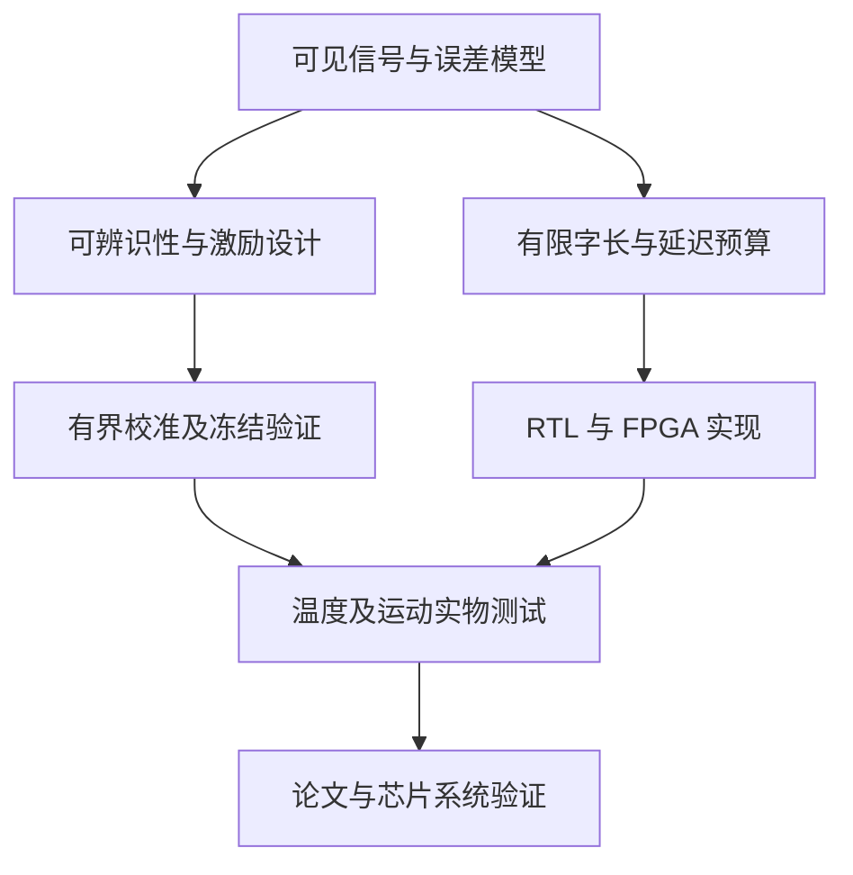

# 博士研究路线与后续进展台账

整理日期：2026-10-10。对象：以全角/速率积分模式半球谐振陀螺（WA/RI-HRG）为主，微半球、微壳和其他轴对称振动陀螺作为明确标注的邻近研究。

## 1. 建议博士主线

建议题目方向：**面向全角半球谐振陀螺数字测控电路的可辨识误差校准与精度—资源协同设计**。

这条主线以现有 MATLAB 平台为起点，把参数分离、校准可信度、有限字长和真实电路连成一个博士问题，避免同时铺开机械制造、全部模拟前端、六种算法和完整导航系统。若最终学位方向明确偏模拟 IC，可把主线中的“精度—资源”转成“低噪声前端与在线校准协同”，但需要补足原创电路和芯片数据。

三个核心研究问题：

1. **信息边界：** 在真实可获得的 I/Q、命令、温度和频率条件下，哪些参数或参数组合可唯一辨识？需要何种最小附加激励？
2. **校准边界：** 有限激励、相位/非线性耦合及未知运动下，怎样保证估计可信、补偿有界且保留真实运动信号？
3. **实现边界：** ADC/NCO/CORDIC/滤波/PI/估计器的字长、延迟和资源怎样共同决定系统误差，怎样用硬件实证这些关系？

候选论文 P1–P6 的具体问题和期刊见 [03_小论文选题与2025二区期刊匹配_20261010.md](03_小论文选题与2025二区期刊匹配_20261010.md)。主线并不以发表六篇为承诺，而以形成可复现的理论—实现—测量闭环为目标。

## 2. 优先级和资源分支

| 现有条件 | 现在应着力 | 暂不承担的主任务 | 下一步需取得的资源 |
|---|---|---|---|
| 只有 MATLAB/计算资源 | P1 可辨识性、真实可见信号模型、独立模型验证；P2 RTL | 不能依此宣称实物或 ASIC 达标 | 合法可用 MATLAB 环境、参考数据、FPGA |
| 有 FPGA 和前端板 | P2 实时实现；P1 注入/冻结测试；P3 相位响应 | 不把板级结果称为片上硅测试 | 稳定时钟、同步采样、原始数据采集、参考输入 |
| 有 HRG、温箱和转台 | P1/P3 闭环实物；P5 热迟滞；明确选一个首篇 | 不凭一个器件一次测试宣称普适 | 可重复启动、多器件、温度/角度参考校验 |
| 有 PDK、模拟设计经验和流片安排 | 针对 P3/P4 的原创电路、P2 低资源集成 | 不复刻全部传统前端而缺少清楚创新 | PVT/寄生/版图、测试芯片、封装与板级测试 |
| 有谐振器加工合作 | 频差/相位测量指导调平、高 Q 镀膜协同 | 不在无平台时独自开发完整微加工 | 真空封装、损耗/频差表征、加工反馈 |

优先读 [R01,R04,R07,R13,R14,R16,R20,R21]，它们分别覆盖当前方案最容易重合的 FRP、非线性、误差分离、相位、量化及新检测架构。尚未取得全文的最新条目要先补读，再提出最终新颖性主张。

## 3. 技术路线及先后依赖



不要在尚未确认参数可辨识时同时优化三个先进估计器，也不要用同模型 Oracle 当作第二物理系统。每个阶段输出数据和明确判据后再进入下一阶段。

## 4. 第一阶段：0–6 周，先补齐可信性

相对时间从实际启动日算，以下是建议计划，不是已经完成的实验或自动安排的任务。

| 工作 | 具体执行 | 完成产物 |
|---|---|---|
| 固定复现 | 在 MATLAB 实际运行 v4.6.4；记录版本、配置、随机种子、警告、完整日志 | `run_manifest.md`、原始 MAT/CSV、结果摘要 |
| 明确数据边界 | 对每项输入标记“实测、命令、独立校准参数、仅评分真值”；外部零速许可独立 | 信号可见性/单位/坐标表 |
| 拆分通过状态 | 数值一致性、零速、非零速、外域温度、硬件一致性分别列状态 | 不会误把零速 PASS 当导航 PASS 的验收表 |
| 验证实际模块作用 | 单模块 OFF/ON 与误差单项注入；确认补偿路径和探针响应 | 消融表、参数偏差、输出变化 |
| 去除内生性与时序混淆 | 检测“理想向量”使用独立参考/约束；E/Q 残差采用一致积分区间与命令模型 | 改进后的离散观测方程 |
| 建立第二模型 | 独立二阶机械方程、真实电容/驱动力模型；避免直接复制原漂移注入 | 第二模型与单位/符号单元验证 |

最重要的第一阶段结果应是一份“哪些效果真实存在、哪些只在真值辅助下存在”的表。若发现某模块失效，直接记录失效条件，比继续调到一个自设 PASS 更有论文价值。

## 5. 第二阶段：第 2–4 个月，形成首篇问题

P1 优先：对联合模型建立局部/全局可辨识性分析，区分参数组合和物理源。必要时固定尺度/坐标规范；构造至少一个不可辨识反例；针对该反例设计附加激励，而不是盲目提高 RLS 阶数。

可把实验设计表达为经过量纲归一化的灵敏度矩阵：

$$J_k=\frac{\partial \hat y_k}{\partial \eta},\qquad \mathcal I=\sum_k J_k^T R_k^{-1}J_k.$$

在适用统计假设下，用 Fisher 信息或局部灵敏度指标评价目标参数的不确定度；输入、参数和噪声必须说明归一化尺度。求解方向、角度、幅度、探针与更新率时受以下约束：驱动/ADC 饱和、机械能量、校准时长、导航误差、闭环稳定余量。D-optimal 等设计原则是成熟工具，创新应是 HRG 模型中的新可辨识结构和可实现约束，而不是使用 log-det 本身。

同时复现一项最接近的强基线（优先 FRP 或检测/驱动分离方法），保留完整配置，不只 OFF。冻结新方法和评价窗口后，运行未见角度、幅度、温区及非零速轨迹。模型参数真实值只用于离线评分。

## 6. 第三阶段：第 5–9 个月，形成数字硬件论文

P2 优先：把数字链路定义为明确同步 RTL。建立数据范围、Q 格式、舍入、饱和/回绕和流水线延迟表；CIC 采用何种溢出规则必须与实现一致；CORDIC/NCO 的标度、角单位和采样有效协议统一。

从系统误差预算倒推位宽与更新率，而不是整个链路统一加位宽。对 RLS/矩阵运算比较降频更新、资源复用、平方根或稳定分解等可实现方案；这些算法本身已有成熟理论，贡献须体现在新约束下的架构/边界或实测优势。

交付逐拍逐位向量对齐、长时极限环/溢出测试、FPGA 实时闭环，以及同条件的综合面积、时序和功耗估算。若有实物，报告在相同带宽、采样率和误差定义下的系统数据；若只有工具估算，标题和摘要须准确说明验证层级。

## 7. 第四阶段：第 10–18 个月，校准电路与泛化

按资源从 P3、P4、P5 中选择一个，优先解决已经暴露的误差主因。若相位主导，就研究双通道延时和切换；若大振幅导致非线性，就研究物理非线性和有界逆；若温变迁移明显，就研究热状态与校准参数。

与模拟电路结合时，应建立输入等效噪声、寄生电容、增益动态范围、相位、ADC 满量程与采样延迟预算。可以参考 DAR [R20]，但必须计入坐标旋转和额外延迟成本；不是直接复制检测轴旋转。开题中的 BCD 和温区目标需重新由工艺、器件、封装及实际测量条件推导。

流片有条件时，选择一个有原创性的校准/前端/数字结构并完成硅测试；没有流片资源时，确保板级闭环仍能回答论文的核心问题，不用“ASIC 行为模型”替代芯片成果。

## 8. 第五阶段：第 18–36 个月或后续，系统动态与论文整合

在已有硬件数据基础上开展 P6：研究周期运动、控制带宽、有限字长及校准激励的耦合。先复现 [R19]，再明确新机理或新边界；加入振荡角运动与累计角度测试，必要时扩展线振动/温度耦合。不能仅凭当前平均慢变量模型做高动态普适结论。

博士论文可组织为：统一模型与信息边界；可辨识校准/激励；有限字长和数字架构；相位/非线性电路子问题；实物与动态泛化。每章共享物理定义和数据协议，但各篇文章需要独立且充分的科学贡献。

## 9. 数据与指标留档规范

| 类型 | 必须保存 | 容易误用的地方 |
|---|---|---|
| 基本状态 | I/Q、E/Q/角度、频率、各控制量、有效标志、时间戳 | 只保存最终速率会失去辨识和归因能力 |
| 参考与环境 | 实际转台参考、温度、温变速率、电压、采样与时钟配置 | 参考真值用于评分，与算法输入严格分开 |
| 标定 | 原始训练轨迹、索引、许可位、参数、先验、版本 | λ/先验/采样索引不一致会让 RLS–LS 对照失真 |
| 验证 | 冻结参数、未见条件、全部时间窗、故障/裁剪统计 | 随机种子独立不等于模型或器件独立 |
| 精度 | 单位明确的 RMS/峰峰值/谐波/累计角度、ARW/BI 与拟合区间 | 短时间窗的速率 RMS 不能当 BI |
| 带宽/动态 | 幅频/相频、群延时、阶跃/换向、有效量程 | 降低带宽会改善噪声，比较时须保持目标一致 |
| 参数 | 每项单位、相对误差、置信区间、归一化奇异值 | 不能把 Hz 与 s⁻¹ 直接相加成单个“物理误差” |
| 硬件 | RTL/工具/工艺、时钟、电压、活动率、资源、时序、功耗来源 | 估算功耗不写成实测，FPGA 不写成流片 |
| 统计 | 独立启动/器件/轨迹和随机种子分别计数 | 时间序列相邻点不是独立样本 |

Allan 分析需提供采样、记录长度、最大平均时间、去趋势方法及有效样本/置信度。论文中的 0.664 等 BI 换算系数应明确采用的噪声模型和定义，不能混淆 Allan 最低值与工程零偏稳定性。

## 10. 90 天行动清单

| 时间 | 首要工作 | 判断点 |
|---|---|---|
| 第 1–2 周 | MATLAB 实际复现、数据边界审计、分开 PASS、补齐最新近邻全文 | 能否无真值辅助复现相同结论？ |
| 第 3–4 周 | 单模块消融；检测/相位/非线性归因；第二机械模型 | 哪个问题确实限制补偿？ |
| 第 5–6 周 | 参数等价/秩分析；设计可区分激励 | 新实验是否改变不可辨识条件？ |
| 第 7–8 周 | 冻结协议、未见轨迹/温度、多种子与真实命令模型 | 泛化收益及不确定度是否成立？ |
| 第 9–10 周 | 测量接口或 FPGA；核心 RTL 向量对齐 | 行为假设是否能实际实现？ |
| 第 11–12 周 | 整理 P1 完整初稿与 P2 字长/资源计划 | 贡献是否超出最接近文献，证据是否对应主张？ |

若当前无 MATLAB/FPGA/HRG 平台，时间表应以获得必要条件后调整；可以先推进理论和 RTL，不应填造计划中的实验结果。

## 11. 后续进展台账（可直接续写）

以下只有本次资料审阅项为“已完成”；未来实验、证明和论文全部标“计划/待验证”，不会把未来发展当成已发生事实。

| ID | 事项 | 2026-10-10 状态 | 当前证据 | 下一步 | 后续日期/结果 |
|---|---|---|---|---|---|
| T00 | 六个资料包清点、文本/OCR 与核心审计 | 已完成本次审阅 | 00/01；静态证据，扫描公式未逐式复算 | 保存版本与原始文件 | 后续续填 |
| T01 | 截至本日公开技术更新 | 已完成本次检索 | 02 的来源与阅读层级 | 补齐近邻全文，投稿前更新 | 后续续填 |
| T02 | 官方 2025 分区及学校交集口径 | 待确认 | 03 的公开历史核对与附件 | 取得官方/学校认定凭证 | 待填 |
| T03 | v4.6.4 实际复现 | 待运行 | 包内脚本；本次无 MATLAB/Octave | 保存完整日志与配置 | 待填 |
| T04 | 去真值依赖的在线信号接口 | 待实现/核验 | 01 的代码定位 | 外部许可与命令模型替代真实执行量 | 待填 |
| T05 | P1 可辨识性命题及附加激励 | 研究假设 | FRP/物理原型 | 反例、证明、灵敏度与置信区间 | 待填 |
| T06 | 第二模型和外部数据验证 | 计划 | [R22] 页面，未分析数据 | 检查适用性或新建独立模型 | 待填 |
| T07 | 三模块独立补偿与耦合消融 | 待验证 | 当前测试主要更新数/有限性 | 单项与组合 OFF/ON/Oracle | 待填 |
| T08 | P2 RTL 与有限字长闭环预算 | 计划 | 部分行为定点链 | 同步实现、误差传播和资源对照 | 待填 |
| T09 | FPGA/实物温箱转台闭环 | 待平台/数据 | 材料未提供最新实测 | 确定资源和数据协议 | 待填 |
| T10 | P3 双通道相位/切换校准 | 研究假设 | 公共相位原型与近邻文献 | 探针同步响应与可分离性 | 待填 |
| T11 | P4 非线性有界逆 | 研究假设 | 多项式 LMS 原型 | 物理归因、残差定义、单调工作区间 | 待填 |
| T12 | P5 热迟滞泛化 | 计划 | 温度项与文献 | 多速率升降温和跨器件数据 | 待填 |
| T13 | P6 动态/ORE 耦合 | 计划 | [R19] 及慢变量框架 | 第二动力学与振荡实验 | 待填 |
| T14 | 首篇投稿成熟度检查 | 待形成证据 | 03 的方案与判断 | 新颖性对照、冻结结果、原始数据、期刊资格 | 待填 |

### 每次实验更新模板

```markdown
### YYYY-MM-DD｜进展 ID 与试验名称
- 目的与可证伪假设：
- 方法/代码版本、配置哈希、工具版本：
- 数据来源、算法可见输入、参考真值的使用范围：
- 训练/验证划分，器件/启动/种子数量：
- 基线、窗口、单位、带宽与采样：
- 主要结果及置信区间（链接原始数据）：
- 不成立的工况、异常、裁剪/失锁/溢出：
- 是否支持论文贡献，是否需要改题：
- 与最新近邻文献的差异：
- 下一步与负责人（实际确认后填写）：
```

### 每次文献更新模板

```markdown
### YYYY-MM-DD｜文献更新
- 题名、作者、DOI、正式卷期与在线日期：
- 来源与实际阅读范围（全文/摘要/条目）：
- 器件、模式、测量工况、基线与数据：
- 与 P1–P6 的重合和差异：
- 对研究计划的影响及尚未核验事项：
```

## 12. 本次行动的边界

本次完成资料调取、静态审阅、文献更新、选题和路线留档；没有改动原研究代码、没有运行 MATLAB、没有下载分析 [R22] 数据、没有向期刊投稿，也没有安排周期提醒。后续计划需要真实执行后再更新台账。

技术来源与核验范围见 [02_最新技术进展与文献对照_20261010.md](02_最新技术进展与文献对照_20261010.md)；已有研究证据见 [01_已有研究工作与创新点审计_20261010.md](01_已有研究工作与创新点审计_20261010.md)。


## 13. 快速交付及待办更新（2026-10-11）

本次根据既有审阅资料完成五份档案快速交付，保留原始日期与文件名，并补入上一轮发现的系统默认真值参数依赖、两项相位直接先例和分区查询方式变化。没有新增 MATLAB 仿真、代码修复、RTL 或实物测量。

| 对应事项 | 本次更新 | 下一步 |
|---|---|---|
| T04 数据边界 | 默认基础补偿器使用对象阻尼/频差参数；现有 FRP 增量 A/B 不能证明系统自主校准 | 分离对象/算法参数；基础补偿参数来源 × FRP OFF/ON 消融 |
| T07 补偿路径 | 检测矩阵补偿路径未闭合；总 PASS 未包含非零速；公共相位不能代表差分相位 | 分别修复、逐项冻结验收，并保留全窗口指标 |
| T10 相位选题 | 新增 [R28,R29] 直接先例 | 补齐全文；聚焦误差分离、切换建立模型及电路实现 |
| T02 期刊资格 | 官方停更及在线服务停止；仍待官方 2025 历史数据凭证 | 联系学校图书馆按既有合法历史数据认定 |
| T14 首篇成熟度 | P1 首篇、P2 第二篇优先顺序保持 | 无真值接口、第二模型、强基线、非零速和硬件证据依次推进 |

下一步的首要产物是“无对象真值输入的基线与 FRP 冻结验证报告”；应先完成该报告，再决定物理源级联合辨识的最终论文主张。
