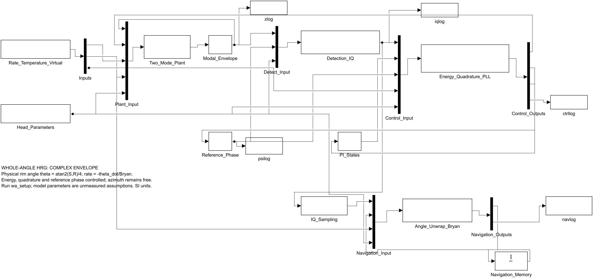
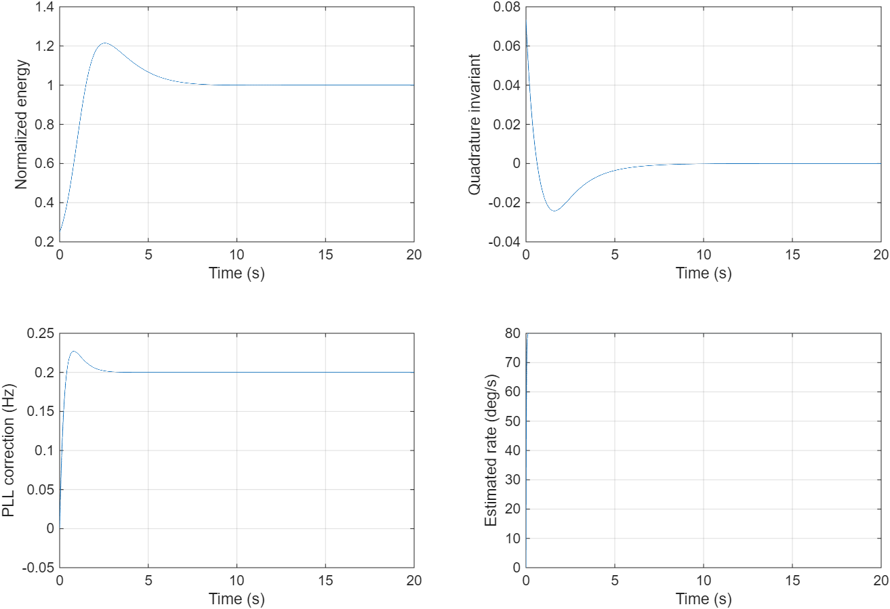

# 全角 HRG 抽象数学与 Simulink 行为验证

交付日期：2026-10-21。MATLAB/Simulink R2025a 实际构建、仿真；仅依赖核心 Simulink。原参考工程只读，未执行其脚本、回调或 MEX，未复制其源码。

## 直接使用

进入本文件夹，在 MATLAB 执行：

```matlab
run_all                       % 重建两个 .slx、运行 scoreboard、输出图和验收数据
open_system('hrg_wa_envelope') % 能量/正交/PLL/导航闭环，适合秒级参数试验
open_system('hrg_wa_carrier')  % 载波级双模态动力学，适合短时动力学验证
```

模型加载时会调用本项目 `wa_setup` 初始化默认参数。修改参数时先打开模型，然后调用 `wa_setup(p)`，避免随后首次加载另一模型覆盖工作区参数：

```matlab
open_system('hrg_wa_envelope');
p = wa_parameters();
p.duration = 20;
p.omega = 45*pi/180;           % rad/s
p.splitHz = .005;             % 两刚度主轴频率差，Hz
p.Q = 1e6;
p.gamma = pi*p.f0/p.Q;        % 修改 f0/Q 后同步更新衰减率
p.detect = [1.01 .002;-.001 .99];
p.drive = eye(2);
wa_setup(p);
out = sim('hrg_wa_envelope');
plot(out.navlog.Time,out.navlog.Data(:,1)*180/pi);
```

`wa_parameters` 读取已有 `../HRG_WA_Digital_ASIC_MATLAB_v4_6_5_FRP_validation_fix/HRG_WA/config/head_default.json` 中的机械、检测矩阵/相位、驱动矩阵；不另建一份物理参数硬编码。也可传入另一表头 JSON 路径。默认表头为 **assumed**，没有实测标定依据。默认 f0=5000 Hz、Q=2e6、Bryan=0.277 来自工程配置，不能当作文献中某台真实样机的参数。

本模型使用连续包络控制器，控制增益、限幅、温度系数、采样周期等研究参数在 `wa_parameters.m` 显式列出；不把原 RTL 的寄存器数值当作本模型的等价控制器参数。I/Q 量化开关是慢变量量化，不代表载波 ADC。

自定义变速/温度/虚拟进动输入：

```matlab
t = (0:p.Ts:p.duration).';
omega = 60*pi/180*sin(2*pi*.2*t);
wa_input = [t omega 25+zeros(size(t)) zeros(size(t))];
% 列：[秒，真实角速度rad/s，温度℃，已知虚拟角速度rad/s]，分段线性插值
out = sim('hrg_wa_envelope');
```

## 文件与验证结果

| 文件 | 用途 |
|---|---|
| `hrg_wa_envelope.slx` | 四实数包络状态、检测、三环、虚拟进动、离散角度展开 |
| `hrg_wa_carrier.slx` | 两位移/两速度的独立二阶载波动力学 |
| `build_wa_models.m` | 可审查和重建 `.slx` 的源程序 |
| `wa_plant_rhs.m`、`wa_full_rhs.m` | 两个不同层次的动力学方程 |
| `wa_measure.m`、`wa_controller.m`、`wa_nav_step.m` | 检测、控制、导航方程 |
| `run_wa_validation.m` | 解析解/expm/载波对照及负向用例 scoreboard |
| `原工程分析与建模依据.md` | 原工程表头方程、文献页码、二倍角/四倍角约定及抽象边界 |
| `evidence/validation_results.json` | 23 项逐项门限、实际误差及通过状态 |
| `evidence/closed_loop_trace.csv` | 已验收理想闭环的可读抽样曲线 |
| `evidence/reference_inventory.json` | 原工程全部 215 个文件的路径、大小、SHA-256；43 个 SLX 结构审计 |
| `evidence/reference_mat_metadata.json` | 70 个 MAT 文件的变量名、类型和维度；不加载仿真对象 |
| `evidence/provenance.json` | 本次验收代码/SLX/配置/文献哈希 |





`iqlog` 列为 `[Cx Cy ImDx ImDy E Q R S L 相位误差]`；此处 `Cx,Cy` 是复包络实部，虚部使用正复指数约定。`navlog` 列为 `[相对载体角rad, 滤波角速度rad/s, 有效标志, 主值驻波角rad]`。`ctrllog` 为 `[能量增益1/s, 正交增益1/s, PLL频率修正Hz]`。导航从有效测量开始相对计角；失效期间冻结并在恢复时重建相位锚点，不声称恢复丢失角度。

载波模型输入 `wa_full_input` 列为 `[t, Ω, Ω_dot, T, Fx/m, Fy/m]`；质量归一化为1，力为广义加速度。本版载波模型是线性动力学参考；Duffing 只在包络模型中作为能量相关频移抽象，不能用它验证电极大位移的精确平方律。

## 验收范围

23 项检查覆盖自由能量衰减、正负300°/s多圈展开、刚度/阻尼非对称解析状态、能量/正交/PLL闭合、虚拟进动抵消、温度频移、检测增益不一致可观测性、无效测量恢复、载波矩阵指数、载波与包络一致性、错误Bryan参数负向检测、变速反转和默认非理想表头的闭环约束。精度结果针对对应理想/指定误差仿真工况，不能解释为真实表头精度。

本版不包含壳体有限元、真实电极间隙/高压平方律、结构热分析、模拟电路噪声、ΣΔ位流、CIC/FIR逐拍和RTL位真等价验证，也未实现文献的完整FRP在线辨识。原有 RTL scoreboard 保持独立，旧验收源文件不改动。

核心模型是自写方程与 Simulink 集成，参考工程未发现许可证文件，因此只保存审计元数据与方程分析，原 `.slx/.m/.mlx/.mat` 保留原位；参考文献PDF按原忽略规则留在本机。

## 版本管理

代码、`.slx`、CSV/JSON验收证据和图均入 Git；`.slx`及验收证据按原始字节保存，`.mat`/Simulink缓存不作为验收依赖。完整验收后运行 `tools/make_provenance.py` 封存哈希：文本源码统一LF后计算，SLX、原参考文件和验收证据按原字节计算，避免Windows换行转换使跨机器核验失效。用户已持续授权完成验证后的 GitHub 同步，目标为 HRG 仓库的 `HRG_WA/HRG_WA_simulink/`。
