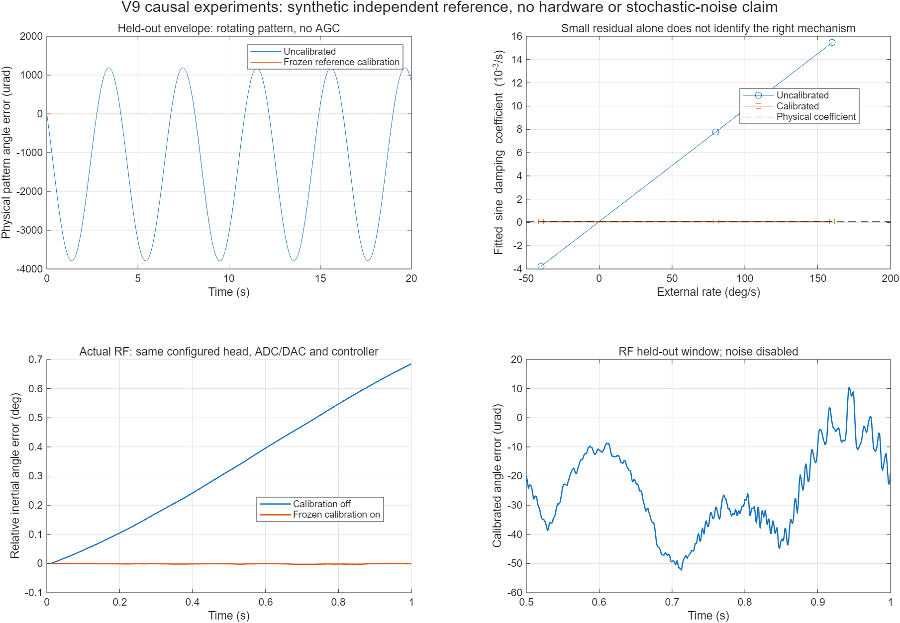
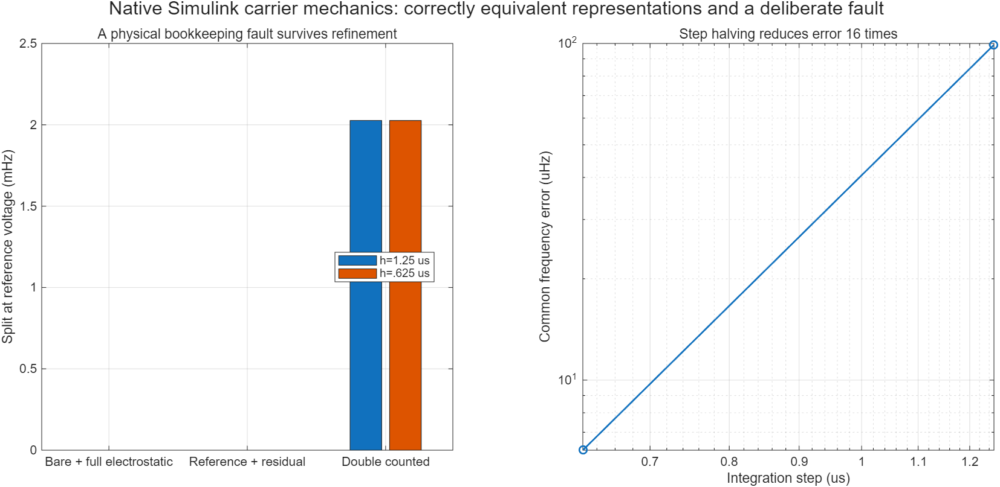

# V9实际结果：因果对照与独立证据

本轮题目、原始材料、专家方法及预注册范围见[protocol.md](protocol.md)，从零推导的学术/通俗配对见[from_zero.md](from_zero.md)。全部为合成研究，不是实物表头测量。

## H1：检测误差与机械阻尼的混淆

独立方向/幅度参考经过量化后标定检测矩阵；估计器只接收参考和测量数据。矩阵误差Frobenius范数为5.0636855e-08，随后冻结。验证轨迹为20s、−40/80/160°/s；不通过验证轨迹重新拟合检测矩阵。

真实[γ, dc, ds]为[0.007853981633974483, 9.719658984386599e-05, 7.859912800230858e-05]，单位1/s。下表采用5ms包络步长：

|转速(°/s)|原始IQ估计ds(1/s)|校准IQ估计ds(1/s)|原始拟合残差RMS|校准拟合残差RMS|校准后阻尼相对误差|
|---|---:|---:|---:|---:|---:|
|-40|-0.00376992391|7.85594361e-05|2.93937e-07|2.94012e-07|0.040083%|
|80|0.00777565737|7.86504048e-05|2.9529e-07|2.95486e-07|0.072908%|
|160|0.0154729749|7.8734904e-05|2.97328e-07|2.97519e-07|0.134879%|

**两种拟合的残差几乎同样小，但原始IQ给出的阻尼方向项随转速大变。**所以低残差本身不能证明物理参数正确。在160°/s时，原始拟合还会给出γ−sqrt(dc²+ds²)<0，与此被动模型矛盾；若拿它更新真实机械补偿，必须额外拒绝。当前只是离线诊断，没有把这组错误参数应用到控制器。

方向欠激励的检测标定与固定方位的阻尼回归均按计划拒绝。冻结标定后再引入±0.1%通道漂移，残差可检测；此反例是独立夹具数据试验，不宣称做了额外RF漂移试验。

## H1留出RF：校准先于全部控制不变量

保留精确电容、ADC/DAC、模拟链、滤波、控制器和直接角度支路；两组仅改变冻结检测标定是否启用。原始物理角.231rad，输入80°/s，1s，噪声关闭，预充能。首个有效历元.012s，评估窗.5–1s；只扣首有效样本的相对零点，没有拟合去漂移。

|量|校准关|冻结标定开|
|---|---:|---:|
|直接角度RMS(°)|0.5185421231|0.001639987579|
|直接角度峰值(°)|0.685243926|0.002992088396|
|测得能量相对RMS|0.0008038100539|2.09230948e-05|
|机械能量相对RMS|0.0006033369335|1.936442771e-05|
|Q/E RMS|1.540057809e-05|1.773428255e-05|
|观测锁相RMS(rad)|2.145612898e-05|1.640820747e-05|
|原导航速率均值误差(°/s)|0.7353246273|-2.619173873e-05|
|原导航速率残差标准差(°/s)|0.05305133941|0.03816006742|
|最小饱和裕量|0.8919074471|0.8919188063|

直接角度RMS比值0.00316268921，约降低99.6837%；校准关的原功能验收失败项为wholeAngle；校准开所有已评估的原功能门限通过。

**没有所有指标都改善。**正交残差略增但仍在原门限内；不把它写成“所有指标全面提升”。原速率标准差门限会漏掉较大的常值速率误差，因此同时列出均值误差和角度误差。这个观察应引出后续先定义的均值误差规格，而不是事后重写本次门限。

校准后角度RMS约28.6232μrad。这是短时无噪声跟踪误差，不能宣称满足1μrad/100Hz随机噪声目标。

本轮RF未做零初值建幅和零输入，建幅时间、零偏不在本次评估范围；ARW、长期Allan、全温与PVT均未评估。H1回归出的阻尼参数未继续嵌入RF补偿。

## H2：参考偏置与故障反例

原生Simulink机械载波在Vref=10V及留出12V测试未偏置机械刚度+完整静电反馈、参考偏置刚度+剩余静电反馈，以及故意双计的错误版本。正确两种表述的状态差小于预设1e−8；错误版本在参考电压处的假频裂为2.02640105mHz，超过预先定义的1mHz故障检测界。

把1.25μs步长减半，正确模型的公共频率数值误差约从99.06μHz降至6.193μHz，符合四阶收敛尺度；双计假频裂没有随之消失。频率由全部零交叉原始括号样本拟合，并由独立Python重新插值/拟合；未用0.2s FFT的5Hz栅格声称mHz分辨率。

## 独立核对与可复现边界

MATLAB核心预注册检查16项通过；独立Python 87项通过。它使用二维矩阵的闭式传播器、解析阻尼振子和RK4稳定多项式预测，不调用MATLAB估计器来生成自己的答案。V7的217、V8的84、WZ的28项封存依赖保持原字节。

完整RF模型保存并重开编译通过，21个Scope、16个Spectrum Analyzer，频谱实际输入采样率与设置逐路一致，最大乘积误差0。两个原生核心模型也重新打开编译。

验收输入包括夹具数据、全部包络轨迹、全部频率事件括号、按固定规则抽取的2049个载波状态探针、RF导航/IQ与尾段波形及原指标。完整机械载波原始CSV/MAT在本机`layered/_work/v9_raw`保留；它们可重生成，不作为公共验收脚本的隐藏依赖。

“独立程序”是实现和数值路径独立，不等于已有第三方实验认证。真实CAD/FEM、位移/电压/时钟计量、转台不确定度、温度记录及外部复核仍缺失；这正是本轮不能证明真实表头精度的原因。
