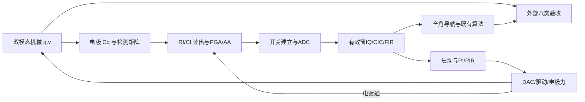

# V7：从机械原理到电路模块的推导与实现

日期：2026-10-23。V7是独立研究分支，入口`w7_config/w7_build/w7_demo`。原V2—V6源文件、已验收模型与用户未提交模型不覆盖。本篇补充并落实此前[文献方法比较](../../layered/docs/literature_derivation_comparison.md)；参数来源、算式、实现、实际测试结果分开。

## 1. 文献依据、设计输入和建模次序

本地技能为`C:/Users/11725/.codex/skills/ic-reference-library/SKILL.md`。73个本地对象和80条网络记录的逐项阅读等级见原比较表。正文未取得的条目只用于路线登记，不能据标题确定系数。以下是本轮实现直接使用的依据，页码指PDF页序。

| 原文及位置 | 采用的思想 | V7实现范围 |
|---|---|---|
| 陈洋2023，`D:/学习资料/资料/全角陀螺/半球谐振陀螺量化误差与阻尼误差抑制技术研究.pdf`，PDF23—27、34—36、49—53 | 模态/平均方程、坐标映射、分参考面量化和偏导传播 | 自洽IQ不变量、接口预算、精确ADC量化仍在载波链；不声称复现其浮点FPGA与跟踪微分器 |
| 蒲云飞2022，`D:/学习资料/资料/全角陀螺/半球谐振陀螺全角模式控制技术研究与实现.pdf`，PDF43—46、55—57，渲染核对 | PI周期残差、PIR、跨阻检测、激励/卸荷/读出 | 可切PI/PIR、实测方位调谐、有限卸荷和有效读出窗；不照抄其具体硬件时钟和电调算法 |
| 刘学2024，`D:/学习资料/资料/全角陀螺/半球谐振陀螺全角模式控制与误差补偿系统设计与实.pdf`，PDF62—65等 | 接口误差必须经控制力回到机械头 | 所有新增检测/驱动非理想放在反馈内；不是论文完整单通道标定样机复现 |
| 张岚昕等2019，`D:/学习资料/资料/全角陀螺/半球谐振陀螺全角模式信号处理控制方法.pdf`，全文7页、重点PDF3—4 | 椭圆/IQ/维持环路 | 从统一位移式重推，不复制已发现的符号/三角函数印刷不一致 |
| [CN112506040A](https://patents.google.com/patent/CN112506040A/en)，实施方式 | 分时驱动、松弛、检测和信号合成 | V7先实现双路同时检测的D-r-S-r隔离；不是专利的D1-r-S1-r-D2-r-S2-r单通道复用 |
| Ning等2025，Scientific Reports，DOI10.1038/s41598-025-86288-1，前轮已读式1—13 | 电子相位可改变控制力与PLL平衡 | 读出与执行器分别标称校准，实际相位扰动继续进入闭环；未实现完整正交探针标定 |

设计顺序是：系统需求→结构/FEM或实测→双模态机械→电极→读出→采样→IQ/控制→驱动→回到机械→统一验收。当前f0、Q、B、m、C0、间隙、kF和噪声均是假设，不从这些论文的样机数字拼成“实测表头”。

机械参数仍从原`head_default.json`经`wa_parameters`读取。V7接口/控制/时分参数集中于`../profile.json`。`w7_budget`从配置计算数值；`evidence/budget_*.json`是实际计算结果。更换表头先改有来源的输入，再重算校准/预算、重建模型；禁止只把参数写进图内常数。

## 2. 从壳体位移到两个广义坐标

设薄壳表面位置为r，两个近简并n=2模态形函数为Φx(r)、Φy(r)：

\[
\mathbf u(\mathbf r,t)=\Phi_x(\mathbf r)x(t)+\Phi_y(\mathbf r)y(t),\quad q=[x,y]^T.
\]

圆周主项为u(χ,t)=x cos2χ+y sin2χ。纯驻波可写为

\[
q=A\cos(\omega_0t+\phi)n(\theta),\quad n=[\cos2\theta,\sin2\theta]^T,
\]

故u=A cos(ω0t+φ)cos[2(χ−θ)]。**物理驻波角θ与模态平面角α满足α=2θ**，与文献的符号θ未必同义。

将形函数代入动能、应变能和耗散函数：

\[
M_{ij}=\int\rho\Phi_i\cdot\Phi_jdV,\quad
K_{ij}=\int\varepsilon(\Phi_i)^T\mathcal C\varepsilon(\Phi_j)dV.
\]

阻尼矩阵D由损耗模型/衰减试验获得。科里奥利耦合由旋转动能的交叉积分得到，符号依模态方向。等质量正交归一化后M=mI。用J=[[0,−1],[1,0]]，本工程选取旋转交叉项

\[
\mathcal L=\frac m2\dot q^T\dot q-\frac12q^TKq+2mB\Omega\dot q^TJq.
\]

计算d/dt(∂L/∂qdot)−∂L/∂q，并加入阻尼和广义力：

\[
m\ddot q+D\dot q+Kq+4mB\Omega J\dot q+2mB\dot\Omega Jq=F.
\tag{1}
\]

这里B来自结构模态交叉积分或已知转台标定；不是由f0、Q唯一决定。式(1)保留Ω、Ωdot的一阶项，忽略Ω²及三维耦合，适用于弱转动/小振幅近似。任意两个来源的“模态质量”和“电极力”必须先统一形函数归一化。

设Aβ=R(2β)diag(1,−1)R(2β)^T，则

\[
D/m=2\gamma I+\Delta\gamma A_{\beta_d},\quad
K/m=\omega_n^2I-\omega_n2\pi\Delta f A_{\beta_k}.
\]

γ=ω0/(2Q)，两振幅衰减率为γ±Δγ/2，因此需γ>|Δγ|/2。刚度写法是小频裂近似；Δf是Hz，不能直接当rad/s。V7继续使用原机械库双积分结构，新增静电力也接在实际加速度求和点。

## 3. 平均法、全角测量和非理想漂移

取q=Aref Re[z exp(jω0t)]，忽略z的二阶导数和小量乘积。以Fc表示力复幅度，有

\[
2j\omega_0\dot z+2j\gamma\omega_0z+4jB\Omega\omega_0Jz=F_c/(mA_{ref}),
\]

\[
\dot z=-\Gamma z+jHz-2B\Omega Jz+h,
\quad h=\frac{F_c}{2jm\omega_0A_{ref}}.\tag{2}
\]

Γ=γI+ΔγAβd/2，H=2πδf I−πΔf Aβk。理想z=a exp(jφ)n(θ)，且dn/dθ=2Jn，沿Jn投影：

\[
\dot\theta=-B\Omega,\quad
\hat\psi(t)-\hat\psi(t_0)=-\frac{\theta(t)-\theta(t_0)}B.\tag{3}
\]

机械驻波提供积分，电路维持幅度、压制椭圆短轴并跟踪频相，同时保留方位自由度。若再把方位锁定到壳体并用力求速率，则是力平衡输出结构，不能用其精度替代全角结果。

忽略正交且只保留阻尼各向异性，沿Jn投影得到

\[
\dot\theta=-B\Omega+\frac{\Delta\gamma}{4}\sin4(\theta-\beta_d).
\tag{4}
\]

可能出现静止平衡的条件为|Ω|≤|Δγ|/(4B)。理想虚拟进动h_v=−2BΩvJz使θdot=−B(Ω+Ωv)，解算再减Ωv。但实际执行幅相误差使注入和扣除不完全一致，不能用读取机械真值的补偿掩盖它。

## 4. 机械能量决定维振和启动范围

主驻波物理幅度A时：

\[
E_m=\tfrac12m\omega_0^2A^2,\quad \dot E_m=-2\gamma E_m.
\]

速度同相驱动的平均功率Fpkω0A/2补偿损耗2γEm，得到

\[
F_{hold}=m\omega_0^2A/Q,\quad V_{hold}=F_{hold}/k_F.\tag{5}
\]

谐振恒力启动满足Adot+γA=Fpk/(2mω0)。由A(0)=0解得

\[
A(t)=\frac{F_{pk}}{2m\omega_0\gamma}(1-e^{-\gamma t}),\quad
F_{pk}\ge\frac{2m\omega_0\gamma A_{target}}{1-e^{-\gamma t_b}}.\tag{6}
\]

短启动近似Fpk≈2mω0Atarget/tb，绝不能用稳态维振电压代替启动电压。默认假设下约0.493 mV维振、0.629 V对应0.1 s理想恒力建幅。V7的启动激励使用另一明确配置：归一化幅度增速4/s，再转入闭环；不宣称等于0.1 s指标。

原h=uE z在z=0时永远为零。V7增加有界开放激励→有效能量达到阈值→PI/PIR维持的状态转换，并设超时关断。能量阈值和转换只读取测得IQ；机械q/v只供外部验收。其前提是标称频率已在可捕获范围，**还没有自动扫频、未知频率搜索和硬件故障恢复**。

机械热噪声同样由损耗反推。在相同广义坐标归一化下，热平衡力的单边谱矩阵为SF=4kBTD；各向同性时单轴SF=4kBT(2mγ)。因此高Q减小维振力，也改变热力噪声。当前载波热源仍采用各向同性γ的白力近似，尚未把各向异性阻尼矩阵完整映射为相关噪声源；它不是所有温度/模态损耗机制的FDT签核。

## 5. 电极如何把位移变成电容，并产生广义力

实际第i片电极可从

\[
C_i(q)=\int_{A_i}\frac{\epsilon}{g(\mathbf r)-\Phi(\mathbf r)^Tq}dA
\]

求导。梯度pi=∂Ci/∂q决定检测灵敏度和驱动力方向，Hessian决定静电刚度。电极弧段、边缘场、安装偏心和模态形状需FEM/标定，不能仅凭面积除间隙代表整壳。

V7仍用易校验的对置平板抽象。定义ρ=x/g，C±=C0/(1∓ρ)，半差分检测

\[
\Delta C=\frac{C_+-C_-}2=\frac{C_0\rho}{1-\rho^2}
\simeq C_0\rho+C_0\rho^3.\tag{7}
\]

若实际读出采用全差分，增益为此定义的两倍，必须同步修改噪声/满量程预算。默认A=100 nm、g=5 μm、C0=1 pF，半差分电容峰值约20 fF。

恒压电极的广义力为Fi=Vi²(∂Ci/∂q)/2。对两侧电压Vb±v，加入显式模态参与系数η：

\[
F=\eta\frac{C_0}{2g}\left[\frac{(V_b+v)^2}{(1-\rho)^2}-\frac{(V_b-v)^2}{(1+\rho)^2}\right].\tag{8}
\]

在原点展开：

\[
k_V=\partial F/\partial v=2\eta C_0V_b/g,\quad
k_x=\partial F/\partial x=2\eta C_0V_b^2/g^2.
\]

F含正kx x项，移到方程左侧为**负刚度**。默认η=.025使kV=10⁻⁷ N/V，与线性基线一致；kx=.2 N/m会改变实际谐振，V7不把它悄悄从机械K中扣掉。`w7_force`可在`linear/electrostatic`间切换；后者包含电压/间隙非线性，|ρ|≥.2直接拒绝。

η是假设，实际多电极必须积分为向量/矩阵；此处不是完整壳体电调电极设计。

**必须确认频率测量时的偏置条件。** V7完整静电力分支把输入K视为尚未包含本次静电软化的机械刚度。若表头f0是在相同偏置下测得的净频率，直接再加入式(8)会重复计入负刚度。在线性对置近似下应先恢复Kbare=m(2πfbias)²+kx，再将Kbare对应频率填入该分支；多电极时需对矩阵处理。线性力分支则可以直接用已经带偏置的净机械频率。实测条件必须与配置一起记录，不能仅保存一个没有偏置说明的f0数值。

## 6. 统一TIA与电荷放大器的幅相参考

偏置恒定时检测电流i=Vb dΔC/dt，默认峰值约6.283 nA。有限反馈Rf并联Cf的理想运放闭环为

\[
Z_f(s)=\frac{R_f}{1+sR_fC_f},\quad
V_o(s)=-V_b\frac{sR_f}{1+sR_fC_f}\Delta C(s).\tag{9}
\]

反相符号由电极/差分接线约定统一；本模型归一化选择正检测方向。**TIA与电荷放大近似是同一个完整传递函数的不同频率区间：**

- ωRfCf≪1：Vo≈−Vb Rf sΔC，测得近似速度，位移参考多出90°；
- ωRfCf≫1：Vo≈−Vb ΔC/Cf，测得近似位移。

V7的charge默认Rf=1 GΩ、Cf=1 pF；tia示例Rf=1 MΩ、Cf=1 pF，并提高PGA增益使量程可比较。它们都使用式(9)，没有通过独立添加“90°常数”冒充真实电路。

有限运放、PGA、AA的简化主极点合并为Ha(s)。实际载波检测传递Hd(s)必须包含式(9)、Ha和ADC延迟。V7用**标称设计值**构造复数IQ逆标定；实际极点/温度偏离继续留在被测对象中。

改实际`c.cvBandwidthHz`等字段后默认不重算逆标定，用于暴露相位/增益裕量；重新标定应修改配置、重建并保存新常数，不能让模型在每个工况访问真值自动抵消误差。

电路元件进一步这样反推：

1. **Cf和量程**：电荷区峰值约VbΔCpk/Cf，故Cf≥VbΔCpk/Vallow；Vallow先扣掉偏置、馈通、噪声和PGA所需裕量。Cf越大信号越小，不能只以不饱和为目标。
2. **Rf和低频拐点**：fL=1/(2πRfCf)。若只给Rf/Cf高通相位εφ，则atan[1/(ω0RfCf)]≤εφ，要求RfCf≥cot(εφ)/ω0。标称相位可以校准，温漂导致的残余仍需分配。
3. **闭环带宽**：单极点幅度1/sqrt[1+(f0/fp)²]、相位−atan(f0/fp)。未标定的相位误差要求fp≥f0/tanεφ；允许幅度下降εg要求fp≥f0/sqrt[(1−εg)⁻²−1]。真实运放需根据频率相关NG、环路增益和补偿网络重算，GBW≈NG×闭环带宽只能作单极点初估，不能代替相位裕度分析。
4. **压摆率与输出电流**：正弦至少SR≥ω0Vpk；负载电容CL至少需要Ipk≥ω0CLVpk，另加反馈/负载电阻电流及切换建立电流。默认0.1874 V、5 kHz对应约0.00589 V/μs的纯正弦SR下限；脉冲/启动边沿通常要求更高。负载与电源未知时不能据此确定晶体管尺寸或总功耗。
5. **增益与相位匹配**：vX=Vs cos2θ、vY=(1+ε)Vs sin2θ时，δθ≈ε sin4θ/4，导航峰值≈|ε|/(4B)。因此1 μrad全额增益预算要求残余失配约1.108 ppm，指校准后全温/幅度范围残差，不是要求全部原始电阻天然达到该匹配。

## 7. 从噪声与动态范围推读出要求

运放电压噪声的完整简化噪声增益为

\[
NG(s)=\frac{1+sR_f(C_0+C_f)}{1+sR_fC_f}.
\]

忽略其他寄生时，载波处输出单边噪声功率谱

\[
e_{out}^2=|NG|^2e_n^2+|Z_f|^2(i_n^2+4k_BT/R_f).\tag{10}
\]

此前高频近似NG≈1+C0/Cf不能原样用于TIA低ωRC工作区，V7据式(10)修正其标称白噪声源强度。它仍是载波附近的行为近似，不是运放全频有色噪声、1/f、伪电阻PVT和反馈噪声相关性的完整电路模型。

理想检测投影v=Vs[cos2θ,sin2θ]，小扰动产生

\[
\delta\theta=\frac{[-\sin2\theta,\cos2\theta]\delta v}{2V_s},
\quad \delta\psi=-\delta\theta/B.
\]

因此σψ²=gΣvgT，g=[−sin2θ,cos2θ]/(2BVs)。独立白噪声、2cos解调和输出ENBW Be下

\[
\sigma_\psi=\frac{e_v\sqrt{2B_e}}{2BV_s},\quad
e_{v,allow}=\frac{2BV_s\sigma_{\psi,target}}{\sqrt{2B_e}}.\tag{11}
\]

先分配总角度误差，再分配各噪声源；每一项不能各自使用总预算。公共相位/幅度与差分噪声的Jacobian不同。对于真实动态闭环，要积分各噪声源经机械、控制和滤波的互功率谱，式(11)只是局部读出估算。

AFE峰值应包含信号、启动馈通、偏置、非线性和噪声裕量；先看限幅前请求，再看限幅后输出。PGA设置由最弱有效信号和最强输入共同决定，不由最大增益单独决定。

## 8. 抗混叠、ADC、采样时钟和数字位宽

对会折叠到载波邻域的干扰fin，ADC后频率为|fin−kfs|。阻带需满足Vinterf|HAA(fin)|≤分配残余，而不是只要求截止频率<fs/2。默认18 kHz单极点在35 kHz仅约6.8 dB衰减，V7保留该候选作诊断，不假称已经满足高精度阻带要求。

双极±VFS、N位步距Δ=2VFS/2ᴺ。在误差去相关且可视为白噪声时，单边PSD=Δ²/(6fs)，解调后

\[
\sigma_{\psi,ADC}=\frac{\Delta}{2BV_s}\sqrt{\frac{B_e}{3f_s}},\quad
N\ge\left\lceil\log_2\left[\frac{2V_{FS}}{2BV_s\sigma_{\psi,ADC}}\sqrt{\frac{B_e}{3f_s}}\right]\right\rceil.\tag{12}
\]

5 kHz/40 kS/s是相干8点采样，量化误差可能形成方位谐波、杂散和极限环，**白量化预算不是普遍性能结论**。实际载波链继续逐样本量化/INL/延迟，不能用长时间包络模型验收这些现象。模拟先解调后ADC则在另一个参考面，需重新推噪声折叠、带宽和采样要求。

正弦孔径抖动的一阶原始SNRj=−20log10(2πf0σt)，通道偏斜δφ=2πf0Δt；公共与差分时钟不能混为独立RSS。沿用的孔径误差块仍按机械速度近似输入导数，未覆盖强馈通/宽带噪声的真实孔径采样，相关电路验收需替换该块。

采样/滤波电路还需明确以下约束：

- 独立每转换采样噪声σs经过2cos混频和ENBW Be后，局部角度方差约σs²Be/(B²Vs²fs)。由分配σψ反推σs≤BVsσψ sqrt(fs/Be)，再以Cs≥kBT/σs²估算kT/C下限。真实SAR电容阵列、相关采样和ΣΔ积分不能一律使用这一独立采样系数。V7分时保持电容当前建模电荷注入/建立，**尚未加入其独立kT/C噪声**。
- 对一阶RonCs建立，误差ΔV exp(−Tacq/(RonCs))≤半LSB。最坏满量程步进时，Tacq≥(N+1)ln2·RonCs。还应叠加运放闭环建立、压摆、源阻抗与开关非线性；不能用采样周期全部充当有效建立时间。
- 若选择Butterworth抗混叠候选，由通带fp损失Ap、阻带fsb抑制As反推阶数：n≥log[(10^(As/10)−1)/(10^(Ap/10)−1)]/[2log(fsb/fp)]，再向上取整并检查群延迟。这里fsb不是ADC采样率；指标未确定时V7保留现有单极点供扫参，而不任意声称某阶滤波已足够。
- ADC/DAC参考噪声和漂移要作为乘性误差，公共参考与差分参考分别注入。理想公共检测增益对瞬时方位可抵消，却会经能量环、非线性和通道不均进入实际力；不能仅凭瞬时比值抵消就省略参考源设计。

N级未归一化CIC的直流增长Rᴺ，整数位增长至少ceil(N log2R)，再考虑符号/内部边界。V7仍为归一化浮点boxcar等效加指定IQ/控制舍入，未把全部RTL寄存器位真模型重新实现。NCO频率分辨率fs,NCO/2ᴾ、CORDIC精度、乘法裁位须分别预算并用独立RTL scoreboard验收。

## 9. IQ与角度解算重新展开

用q/Aref=Re[d exp(jφNCO)]，两路乘2cosφ、−2sinφ并低通，得到d=[Cx+jSx,Cy+jSy]。对椭圆

\[
d=e^{j\varphi}\begin{bmatrix}a\cos\alpha-jb\sin\alpha\\a\sin\alpha+jb\cos\alpha\end{bmatrix},\quad \alpha=2\theta,
\]

直接展开：

\[
E=|d_x|^2+|d_y|^2=a^2+b^2,\quad Q_q=2\Im(d_x^*d_y)=2ab,
\]
\[
R=|d_x|^2-|d_y|^2=(a^2-b^2)\cos4\theta,\quad
S=2\Re(d_x^*d_y)=(a^2-b^2)\sin4\theta,
\]
\[
M+jL=d_x^2+d_y^2=(a^2-b^2)e^{j2\varphi}.\tag{13}
\]

故θ=unwrap atan2(S,R)/4，φ=atan2(L,M)/2。R²+S²趋零（零振幅或圆极化）时方位不可观测，不能盲目执行atan2后报有效。短长轴比r=(Qq/E)/(1+sqrt[1−(Qq/E)²])，不可把Qq/E直接叫做短长轴比。

微分链式法则给出

\[
\dot\theta=\frac{R\dot S-S\dot R}{4(R^2+S^2)},\quad
\delta\theta=\frac{R\delta S-S\delta R}{4(R^2+S^2)}.\tag{14}
\]

偏导测率避免包裹角直接差分跳点，但微分噪声仍存在。现导航继续采用已验证的因果解缠/Kalman核；PIR只从相邻实测R/S相位差估计|4θdot|，不读取真实Ω。方位分支至少需|4BΩTc|<π，并预留噪声裕量。

## 10. 控制器：从局部PI到可检验PIR

控制h=uE d+juQ Jd−2BΩvJd。理想情况

\[
\dot E=-2\gamma E+2u_EE+2u_QQ_q,\quad
\dot Q_q=-2\gamma Q_q+2u_EQ_q+2u_QE.
\]

在Qq≈0、E≈E0处，δEdot=2gE E0 δuE。PI误差E0−E给出

\[
s^2+2g_EE_0K_{pE}s+2g_EE_0K_{iE}=0.
\]

指定ζ、ωn得KpE=ζωn/(gEE0)、KiE=ωn²/(2gEE0)。对归一化正交qQ=Qq/E，局部qQdot≈2gQ uQ，故KpQ=ζωnQ/gQ、KiQ=ωnQ²/(2gQ)。

PLL以Hz输出，φedot=δω−2πuPLL，给出KpPLL=ζωnPLL/π、KiPLL=ωnPLL²/(2π)。V7使用已标称补偿的近似单位路径g=1生成初值，之后以真实闭环测试；不是无延迟公式直接证明所有工况稳定。

结构非理想含sin4θ/cos4θ，匀速进动时成为ωh=4|θdot|周期扰动。一般环路残余由S=1/(1+PC)决定，PI在jωh处增益有限。V7实现带泄漏的谐振支路

\[
\dot r=(-\omega_c+j\hat\omega_h)r+e,\quad
u_R=K_r\Re(r),\quad
C_R(s)=K_r\frac{s+\omega_c}{(s+\omega_c)^2+\hat\omega_h^2}.\tag{15}
\]

ωc→0且频率固定时趋于Kr s/(s²+ωh²)，对应文献理想内模。有限ωc提高失谐容忍度但不再保证目标频率零误差。V7用测得四倍角相位增量滤波得到ωhat，低于阈值关闭谐振输出，限定最高频率，不用转台真值设定它。

每个采样周期保持e、ωhat时，r[k+1]=exp(λTs)r[k]+expm1(λTs)e/λ，λ=−ωc+jωhat。独立记分板使用实矩阵增广expm核对，不用同一个复数递推当参考答案。限幅或压摆受限时停止谐振状态继续积累并泄漏，PI以实际输出作反算抗饱和。频率跳变、瞬时无效样本和重新捕获仍需联合角落验证。

## 11. 相位与真实谐振必须分开

V7把读出逆标定和执行器逆标定分别记录。控制用的是校正到NCO参考的位移包络，实际DAC保持/延迟/驱动极点再产生执行误差，不能重复把整个环路相位都旋入检测值。

正交控制力若有小相位差δφ：juQJz exp(jδφ)≈juQJz−uQδφJz，故

\[
\delta\dot\theta\simeq-u_Q\delta\phi/2,\quad
\delta\Omega\simeq u_Q\delta\phi/(2B).\tag{16}
\]

应由零偏分配反推相位/延迟温漂，不能先假定0.1°一定足够。PLL观测误差为零也不证明实际机械谐振。单模态独立判据为Im(F conj(V))=0且Re(F conj(V))>0，并需分离非维振力/耦合；当前统一记分板只并列观测相位与机械相位漂移，尚未对所有混合力完成真实谐振签核。

## 12. DAC、驱动、分时链路与有效窗口

由式(2)Fc=2jmω0Aref h，线性力常数kF下

\[
v(t)=-\frac{2m\omega_0A_{ref}}{k_F}
[\Im(h)\cos\phi_{NCO}+\Re(h)\sin\phi_{NCO}].\tag{17}
\]

DAC ZOH为exp(−jπf/fs)sinc(f/fs)，必须连同寄存延迟、驱动极点、噪声、SR、轨到轨限制一起进入反馈。默认16位±2 V在维振峰值只约8码，启动与维振的动态范围冲突仍需多增益/粗细驱动等电路方案验证，V7没有靠取消量化把它变成已解决问题。

重建滤波也必须有镜像掩模。理想ZOH的第一镜像fs−f0相对载波幅度为f0/(fs−f0)，默认5/35，即−16.90 dBc；后续驱动极点按|H(fs−f0)|/|H(f0)|再衰减。机械头会抑制远离谐振的力，但电馈通可能绕过机械直接进入检测，因此两条通路需分别验收。若驱动负载电容CD，切换时还需I≈CDΔV/Δt；实际供电、负载和共模未知，不能由维振机械功率直接得ASIC功耗。

控制带宽需要保留真实包络延迟。N级长度R的归一化boxcar延迟N(R−1)/(2fs)，对称L抽头FIR延迟(L−1)Tc/2。加流水、控制寄存、ADC/DAC和ZOH后，当前示例约7.525 ms。若仅为纯延迟分配30°相位损失，则交越fc≤1/(12τ)≈11.07 Hz；还需加机械/控制/模拟极点与离散采样效应。载频相位校准不能消除这一动态延迟。

分时模式默认1个载波周期D→1周期卸荷→2周期S→1周期卸荷，帧长1 ms。D期间命令乘1/Dd=5，**在DAC量化和限幅前**进行，因此能够暴露峰值电压不足。实际电极在读出/卸荷期间断开，驱动极点尾迹不再持续施力；断开后电压进入寄生馈通路径。

读出状态vH用有限RC递推：

\[
v_H[k+1]=\begin{cases}
v_H[k]+(1-e^{-T_p/\tau_a})(v_{AFE}[k]-v_H[k]),&S,\\
e^{-T_p/\tau_u}v_H[k],&r,\\v_H[k],&D.
\end{cases}\tag{18}
\]

切换边沿额外加入qinj/Cs；初始读出一段时间消隐。ADC值延迟d个采样后才到解调，因此mask也必须延迟dTa，不能拿当前开关状态解释过去采样。

有效窗口m[k]会改变正余弦基函数正交性。令b[k]=[cosφ[k],−sinφ[k]]T，有限帧的Gram矩阵

\[
G=\frac1N\sum m[k]b[k]b[k]^T,\quad
\begin{bmatrix}C\\S\end{bmatrix}=G^{-1}\frac1N\sum m[k]b[k]v[k]/V_{norm}.\tag{19}
\]

V7对标称时钟/消隐模式预计算G，并按实际NCO相位原点旋转；其逆注入混频系数，后续仍走实际boxcar/FIR/流水。若窗口整周期且正交，G≈Ds I/2才退化为2/Ds的简单增益。配置拒绝不完整控制帧和病态G。

式(19)严格恢复的前提是一帧内包络近似常量、载频接近标称值且ADC时间对齐。大频偏、快速动态、开关建立瞬态会产生残差，不能宣称所有TDM误差已被归一化消除。载波周期内驱动断开还会改变执行器的二维幅相映射；当前仍使用连续标称执行器校准，实际差异由架构测试暴露。

这是真实的D/r/S/r行为隔离，但仍保留两路检测电路；没有声称获得专利单通道复用的全部增益失配消除效果。

## 13. 数值求解、包络模型与观察仪器

高Q机械对数值耗散敏感。RK4一步因子P(jωTp)=1+jωTp+(jωTp)²/2+…+(jωTp)⁴/24；等效数值阻尼γnum=−ln|P|/Tp。默认400 kHz约占物理γ的8.30%，V7提高到800 kHz，独立估算约0.259%。`w7_validate_mechanics`另外用实际自由振动与矩阵指数核对，不能只由该公式判断非线性闭环收敛。

载波模型沿用库Integrator、State-Space、ZOH、Delay、Scope和Spectrum Analyzer。新增分时RC和开关用显式库块，记录状态和窗口。频谱支路仍先明确采样率：机械/模拟800 kHz、ADC40 kHz、IQ1 kHz；电压用dBV，归一化用参考幅度1的dBFS，不混作dBm。

`w7_envelope`用于40 s PI/PIR对照，实际调用同一个控制器和原平均机械方程。它仅用等效低频滤波近似CIC延迟，未包含载波噪声、真实ADC量化/TDM和镜像，因此只用于周期控制对照。不得把它的性能数字当载波接口验收。

该加速入口显式拒绝`noiseEnable=true`，避免一个开关显示“噪声开启”却运行确定性包络。所保存的PIR研究模型配置与报告中40 s对照的机械/量化开关一致；实际接口噪声用载波配对测试。

## 14. 同一组八类验收量与参数反推

| 验收量 | 如何从原理反推电路 | V7检查方式 |
|---|---|---|
| 建幅时间 | 式(6)→峰值力/电压、占空比、SR、捕获范围 | 真实零状态载波启动；机械q/v能量首次持续入带，不以IQ填充代替 |
| 能量误差 | 检测增益/温漂、PI及执行幅相 | IQ E与机械q²+(v/ω0)²并列，标称复数增益校准 |
| 正交残差 | 频裂→uQ范围→DAC精度/相位泄漏 | Q/E、短长轴比；PI/PIR同工况配对 |
| 锁相误差 | 式(16)→相位容限→延迟温漂/校准 | 观测相位与独立机械相位漂移分开，不宣称真实谐振全签核 |
| 全角误差 | 式(13)—(14)、B误差、增益失配 | 原时间轴累计误差，不拟合移除漂移；多方位/低速需扩展工况 |
| 角速度噪声 | 式(10)—(12)、实际微分器/闭环谱 | 短记录残差标作含确定性成分；配对噪声另报，不直接叫ARW |
| 零偏 | 阻尼、频裂×相位、馈通及温度 | 静态短均值单列；长期Allan未验收 |
| 饱和裕量 | 启动/稳态/切换前的真实请求峰值 | DAC峰值按1/Dd计入、AFE与驱动限幅前节点、控制限幅占用 |

原统一`wl_acceptance_metrics`被复用为外部scoreboard；机械真值不返回控制器。短记录保留所有未达标/未评估项，`functionalPass`只说明数值有限及功能测试完成，**不等于所有八类精度通过**。

## 15. 如何替换为具体表头

1. 测f0、Q、B、频裂/阻尼差及轴角，按相同模态归一化得到m和工作幅度。
2. 取得各电极C(q)、驱动梯度/矩阵和偏置温漂；先校验线性梯度，再决定是否使用式(8)的平板近似。
3. 测实际Rf/Cf、读出/PGA/AA频响与输入/输出噪声。统一位移或速度参考，记录极性。
4. 在`profile.json`及机械表头配置中改值；运行`w7_budget`，分配Vs、噪声、ADC/DAC、延迟和量程。示例1 μrad/100 Hz只是研究场景。
5. 用独立标定数据固定检测/执行幅相逆；先理想单因素，再温度/幅度/方向/噪声/时延联合角落。每次工况不自动调参。
6. 执行单位记分板、自由振动指数解、载波接口工况和PI/PIR对照，再按八类验收量判定；训练RLS/FRP后必须冻结并留出数据验证。

当前未加入未知表头自动扫频、完整单通道复用、全电极在线电调、全部文献的RLS/FRP/ORE、晶体管PVT或整机长期统计。其余文献方法的适用边界仍以逐篇比较表为准。
