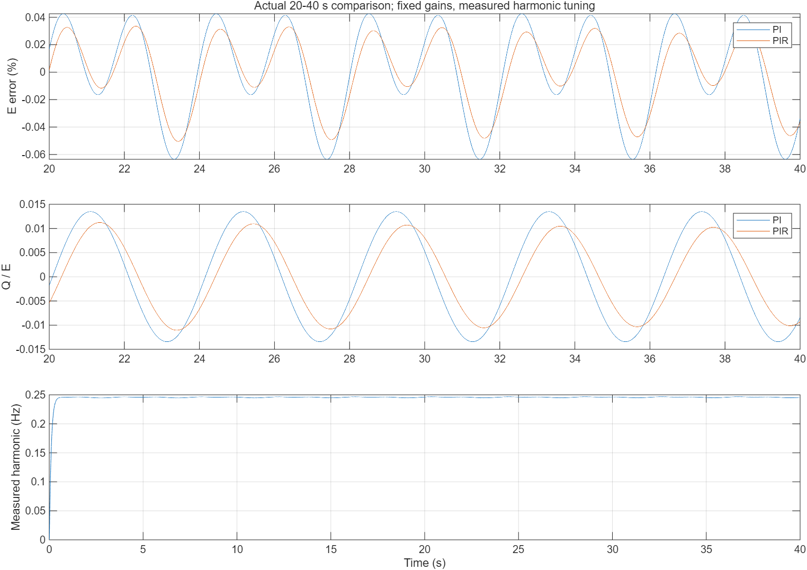
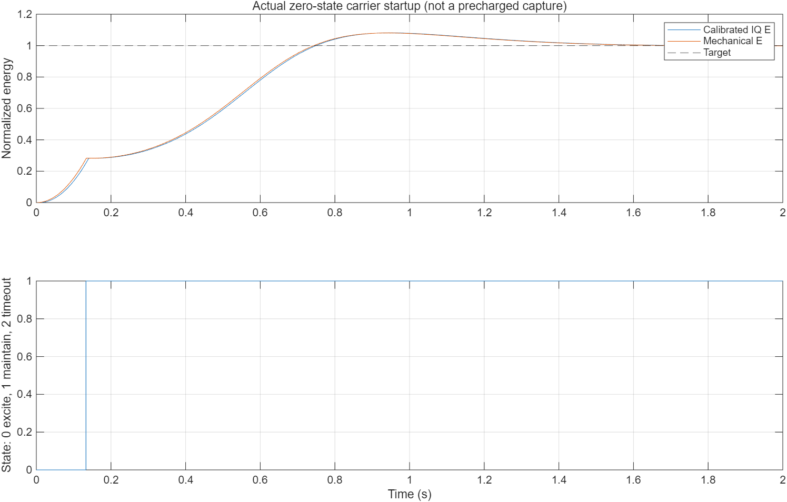
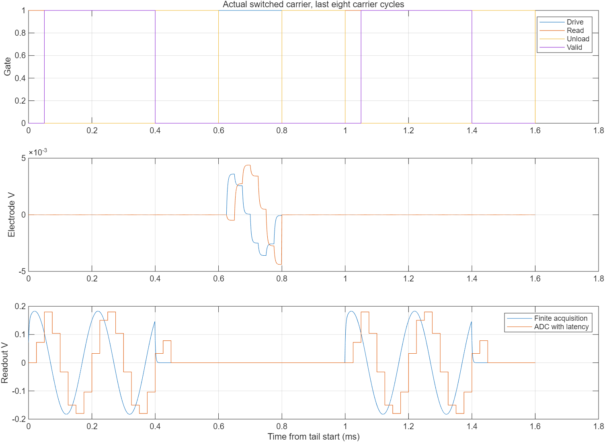
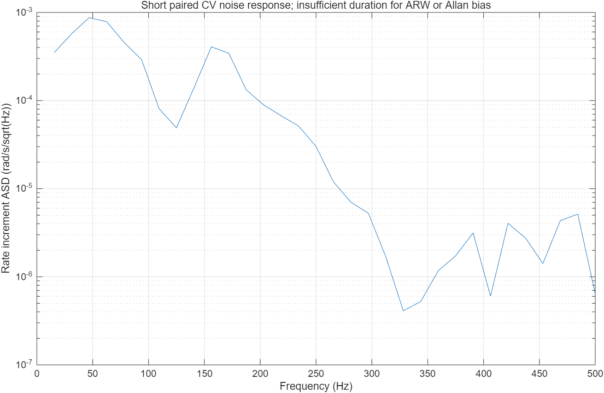

# V7实际验证结果

2026-10-23。所有数值由本目录实际MATLAB/Simulink记录生成；没有继承论文样机性能。预算和验收阈值仍为假设研究分配。

独立代数/状态/时序记分板：19项通过。保存后重开编译：5个载波模型与1个包络模型。仪器89项检查通过，核对18个分时模型频谱仪的实际采样率、单位及观察支路无扰动。

## 载波闭环与同一组验收量

| 场景 | 时长/s | IQ能量RMS/% | 机械能量RMS/% | Q/E RMS | 观测相位RMS/rad | 最小量程裕量/% | 示例全部门限 |
|---|---:|---:|---:|---:|---:|---:|---|
| continuous | 0.08 | 0.29648 | 0.17046 | 0.00157761 | 0.00550416 | 89.434 | 通过 |
| switched | 0.08 | 0.31083 | 0.18604 | 0.00168618 | 0.00530775 | 84.948 | 通过 |
| tia | 0.08 | 0.29959 | 0.17264 | 0.001551 | 0.0056094 | 77.121 | 通过 |
| electrostatic | 1.5 | 0.022249 | 0.053537 | 0.00111027 | 0.0104911 | 70.955 | 通过 |
| zero_state_startup | 2 | 3.261 | 3.1537 | 0 | 9.81642e-06 | 86.216 | 通过 |

零状态启动：`zero_energy_start_reached_from_seed`，入带时间0.699431 s；定义为机械能量进入±5%并连续保持0.05 s。该激励已知标称频率，不能证明未知频率自动搜索。

首次持续入带不等于后续一直稳定：该记录机械能量峰值约1.08048，最后一次出带后、保持至记录结束的时间为1.169 s（1 ms导出分辨率）。

统一旧scoreboard对零状态启动成功状态的前缀识别有遗漏；V7在独立包装器中修正，不修改原验收脚本。建幅与IQ滤波填充、预置振动捕获分开。

静电力场景包含真实负刚度引起的谐振变化；缩短观察时间可能尚未捕获。即使观测相位通过，也未对所有控制力完成独立物理谐振判据签核。

## PI/PIR同工况对照

40 s平均包络模型，20—40 s统计，检测/驱动矩阵设为单位，Δγ=.004/s、Δf=.08 Hz，关闭噪声和格式量化以隔离控制器周期残差；两组使用同一被控对象、PI增益和因果输入。

| 控制器 | 能量相对RMS | Q/E RMS |
|---|---:|---:|
| PI | 0.00033139561 | 0.0095847336 |
| PIR | 0.00024979886 | 0.0075444606 |

此工况PIR使正交残差下降21.287%，能量残差下降24.622%。它是单一研究工况的实际改善，不代表任意转速/动态下稳定，不是载波量化与TDM验收。

## 数值步长与噪声

| 机械求解频率/Hz | 实际终点位移误差 | 实际终点速度/ω0误差 | 线性RK4等效耗散/物理耗散 |
|---|---:|---:|---:|
| 400000 | 2.5337374e-05 | 0.00038525921 | 0.082949143 |
| 800000 | 7.9045158e-07 | 2.4119191e-05 | 0.0025936703 |

实际步长减半的位移误差比=0.03119706。独立参考为含科里奥利项的完整4×4矩阵指数，仅证明线性自由振动收敛。

CV噪声开/关配对记录0.2 s，0.1 s之后角速度增量std=0.0055199513 rad/s。PSD有效窗长0.064 s，频点间隔15.625 Hz。该短记录包含噪声经非线性/量化器改变的闭环响应，不是固有噪声、ARW或Allan零偏不稳定性。

## 当前电路预算暴露的问题

实际标称有限带宽信号峰值约0.18740046 V；假设1 μrad/100 Hz场景的总白噪声分配约7.34117 nV/√Hz，简化读出自身约343.925 nV/√Hz，尚不满足该场景。

18位理想ADC的白量化估算约4.24277 μrad；在此实际信号幅度下，若单独把1 μrad全部给ADC，理想位数下限为21位。该数字不是采购或流片规格，相干量化、ENOB及其他噪声还需另验。

D-r-S-r示例占空比20%，0.1 s理想启动的峰值请求约为连续方案5倍，可能超过现有量程；短时预置振动场景通过不代表分时快速冷启动通过。连续标称驱动校准也不完全抵消开关执行映射。

## 接口单因素筛查

每项80 ms，保持标称校准；包含短时捕获，不能解释为稳态误差或联合PVT。

| 工况 | 能量RMS/% | Q/E RMS | 相位RMS/rad | 全角峰值误差/deg | 示例全部门限 |
|---|---:|---:|---:|---:|---|
| baseline | 0.29648 | 0.00157761 | 0.00550416 | 0.173919 | 通过 |
| cv_pole_20pct_low | 0.6697 | 0.00157983 | 0.0195555 | 0.177706 | 通过 |
| adc_14_bits | 0.296742 | 0.00156881 | 0.00551734 | 0.176998 | 未全部通过 |
| adc_extra_3_samples | 0.411105 | 0.00267736 | 0.512637 | 0.221944 | 未全部通过 |
| feedthrough_2fF | 0.296712 | 0.00157781 | 0.00548877 | 0.173038 | 通过 |
| switched_baseline | 0.310833 | 0.00168618 | 0.00530775 | 0.181163 | 通过 |
| slow_read_20us | 22.2665 | 0.00199295 | 0.32638 | 0.221394 | 未全部通过 |
| switch_charge_2fC | 0.310833 | 0.00168618 | 0.00530775 | 0.181163 | 通过 |
| switched_feedthrough_2fF | 0.310861 | 0.00168801 | 0.00530783 | 0.181173 | 通过 |

完整单通道复用、在线电调、全部文献算法、长期低速/零偏、温度联合角落和晶体管PVT仍需后续实测条件。本轮功能运行通过不替代上述性能验收。

## 复现与证据

执行顺序：`w7_run_validation` → `w7_validate_mechanics` → `w7_validate_noise` → `w7_sweep_interfaces` → `w7_build_delivery` → `w7_validate_instrumentation` → `w7_plot_results` → `python tools/report.py` → `python tools/verify.py --seal`。清单同时包含原模型依赖与新代码，CSV保留规定节点的原生采样尾段或完整低速记录。
