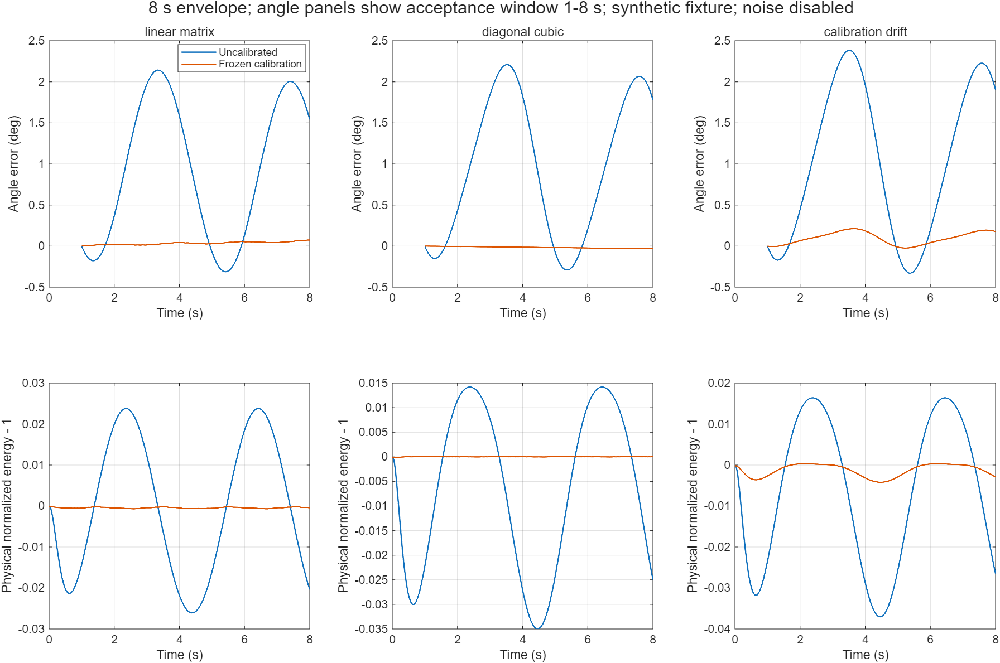
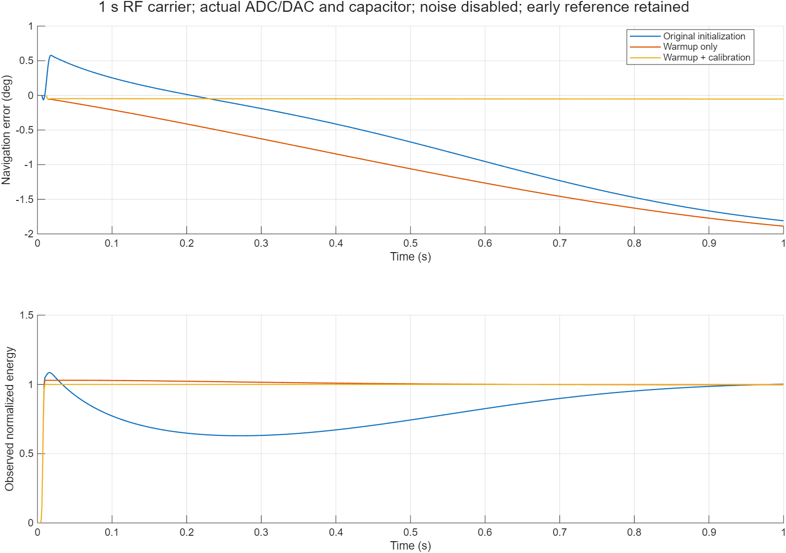
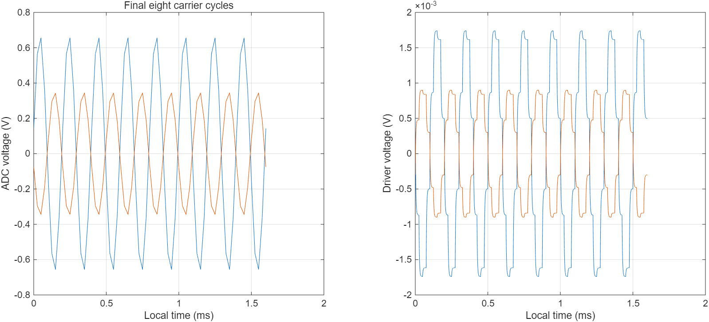

# V7优化探索：实际结果与边界

日期：2026-10-24。所有校准数据为明确的合成夹具数据；不代表实际表头标定。V7原始217项依赖校验通过。

## 实现内容

独立目录内复用V7构建器；不修改原控制器。新增冻结检测矩阵/对角三次逆、冻结执行矩阵逆、反馈滤波预热有效窗及与被动阻尼矩阵匹配的热源。包络模型将电极非线性置于AFE之前，实际载波仍使用原精确平板电容、ADC/DAC、延迟及驱动。

## 8秒包络留出实验

两轴及幅度多样性的训练数据与下表运行轨迹分开；初始物理角8°，输入80°/s，固定1s历元，仅扣除初始不可观测方位，不拟合去漂移；测量窗1–8s。矩阵案例与对角三次案例分开；后者位移/间隙比提高到.08以观察非线性。噪声关闭，非RF验证。

|场景|角度RMS(°)|机械能量RMS|Q/E RMS|PLL相位RMS(rad)|
|---|---|---|---|---|
|linear_matrix_0|1.271579|0.01665399|2.408078e-05|1.475098e-05|
|linear_matrix_1|0.03874616|0.0004514925|2.477993e-05|2.791179e-05|
|diagonal_cubic_0|1.293312|0.01656623|3.87135e-06|1.623937e-06|
|diagonal_cubic_1|0.01813755|6.28951e-06|3.527212e-06|3.899201e-06|
|calibration_drift_0|1.394586|0.0178666|3.505057e-06|1.64421e-06|
|calibration_drift_1|0.1214515|0.001780035|4.427205e-06|3.985317e-06|

`_0`为关闭新增校准，`_1`为开启。calibration_drift在辨识冻结后对两轴增益分别增加/减少0.1%，并把三次参数错设20%；其残差说明未标定漂移会限制精度。



## 1秒原采样率载波对照

fsPlant=800kHz，ADC=40kS/s，控制=1kHz。各场景有完全相同的真实机械/电容/电路扰动；0为原初始化且校准关，1只加预热且校准关，2为预热加校准。噪声关闭；每项采用原八类验收量，其中建幅与零偏仅在对应场景才能判断。

|场景|角度RMS(°)|角度峰值(°)|测得能量RMS|机械能量RMS|速率残差标准差(°/s)|通过|失败项|
|---|---|---|---|---|---|---|---|
|hrg_wa_v8_carrier_0|1.35944|1.809942|0.1207495|0.136107|0.534722|False|energy, wholeAngle, rateResidual|
|hrg_wa_v8_carrier_1|1.54068|1.887923|0.002124422|0.02793817|0.3301248|False|wholeAngle, rateResidual|
|hrg_wa_v8_carrier_2|0.05200281|0.05322638|3.814869e-06|4.184044e-05|0.01649068|True|无（仅限所评估项目）|

每项的Q/E、锁相、饱和裕量、有效覆盖率和未评估说明均保存在studies.json。通过是原行为级示例门限的通过，不代表主推导中的1μrad/100Hz设计场景达标。较大输入下通过也不等于低速或零速通过。

先导0.2s失败结果保留于`pilot_carrier_initialization.json`；仅推迟有效标志、预热期间仍施加固定方向激励的失败结果保留于`pilot_warmup_excitation.json`。它会牵引已振动驻波而污染角度历元。正式方案预热期间输出零激励，再按测得能量判断启动；本轮拆开预热作用、延长记录并保留所有失败项。





零机械状态另作2秒实际载波测试，±5%能量容差并保持50ms；测得建幅时间0.7111288s。测试仅在已知标称频率、噪声关闭的条件下成立，短时零输入均值不能命名为偏置不稳定性。

## 观察仪器与验证

保存模型重新打开并编译通过；20个Scope、16个Spectrum Analyzer。逐项编译采样率与设置值相符，23个观察量在仪器开/关配对运行中的最大差为0。电压频谱采用dBV，归一化量使用声明的参考幅值；不把归一化IQ谱当成dBm功率。

独立推导记分板10项通过，MATLAB代数/闭环探索检查12项通过，另从CSV独立重算9组角度RMS。记录的总体研究检查通过不抹去上表原验收量的失败。

## 尚未完成

在线三倍频SNR门控估计、一般交叉矩阵与高阶非线性联合辨识、完整非线性执行逆、RC机电调谐支路、全温/低速/反转/长期Allan与RTL映射均未完成。短时噪声关闭的结果不能给出ARW或偏置不稳定性。真实表头参数未知，不能据此确定最终流片规格。

## 运行

```matlab
cd('C:/Users/11725/Desktop/HRG_WA/HRG_WA_simulink/literature_v8_research')
addpath(pwd)
[out,c] = w8_demo;   % 默认原机械JSON和研究profile，桌面运行保留图窗
w8_run_studies;      % 留出包络及三组实际载波
w8_build_delivery;   % 仪器采样率/无扰动及模型重开检查
w8_plot_results;
```

交付观察模型为`../models/hrg_wa_v8_calibrated.slx`，其配置来自上述合成标定实验；默认`w8_config`中的矩阵为单位阵，校准关闭，防止把合成标定误作真实标定。它们是研究分支，未替代V7。
