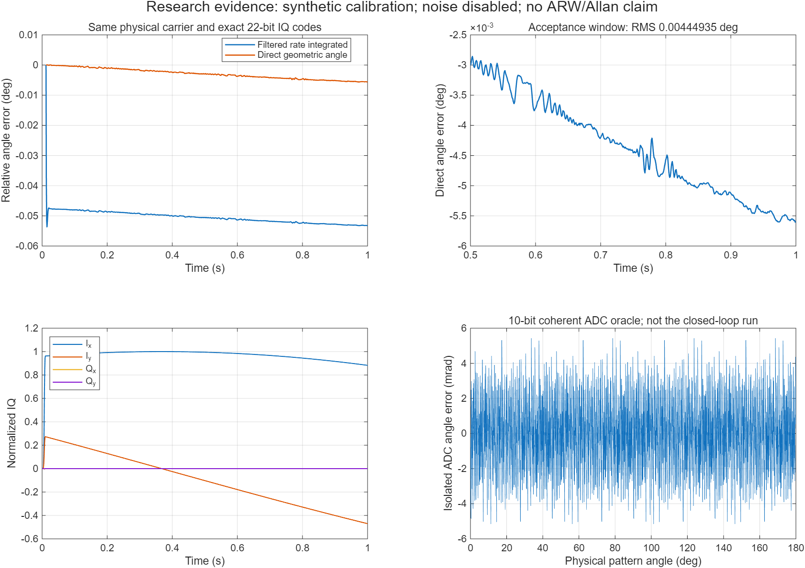

# Zotero新增文献驱动的全角模型研究分支

本分支增量复用已封存V7/V8，不改其模型、代码或验收字节。真实表头参数尚未知；这里的矩阵和非线性标定来自声明的合成夹具。

建议按以下顺序阅读：

1. [机械结构→机电接口→电路预算→控制与导航：20节主推导](../literature_v8_research/docs/mechanics_to_algorithms.md)，配套[每项公式的数值代入](../literature_v8_research/docs/calculation_trace.md)。
2. [新增原文带来的修正与进一步计算](docs/source_formula_updates.md)：解调比例、量化Jacobian、非线性残差、相位/频裂辨识、TDM采样、温漂、死区、双频泵阈值、直接角度及可辨识性。
3. [17份原文相关章节的建模对照](docs/paper_comparison.md)与[133条题录覆盖表](../../research/zotero_integration_20261024/hrg_bibliographic_coverage.md)。目录收录、全文提取、相关章节阅读和逐式核验分别记录。

## 本次实现和实际结果

- 检测三次逆在βr²≤.05且远离原范围判断边界时，从7步Newton精简为3步；其他情况回退原实现。6000组随机IQ的舍入前最大差4.44e−16，实际载波每一帧22位IQ码与V8相同。
- 在原控制闭环旁增加直接几何角度输出，按arg(R+jS)/4展开驻波物理方位，以首个有效样本定义相对零点；另行滤波速率。输入只有公开IQ、有效标志和已知虚拟命令，无机械真值输入。
- 锚定后丢帧、异常相位跳变或间隔过长会锁存无效；重新启动建立新的相对零点，不能自动找回丢失圈数。当前直接支路不接受在线、FRP、温度补偿配置。

相同1s载波：机械800kHz，ADC/DAC40kS/s，控制1kHz，外界80°/s，噪声关闭。首有效历元.012s，评估窗.5–1s，不作斜率拟合或事后去漂移。

|量|结果|
|---|---:|
|旧导航角度RMS|.05200281155°|
|直接角度RMS|.00444934511°|
|直接角度峰值|.00560504543°|
|测得能量相对RMS|3.81487e−6|
|机械能量相对RMS|4.18404e−5|
|正交Q/E RMS|3.20159e−6|
|观测锁相RMS|1.24514e−5rad|
|原速率残差标准差|.0164907°/s|
|全记录最小饱和裕量|55.9905%|

建幅时间另见V8零初值实跑的.71112875s（±5%能量并保持50ms）；本次为预充能运行，不重新声称测过建幅。本次有非零输入，零偏不适用；ARW、长期Allan偏置不稳定性未测。锁相量主要是IQ观测及慢包络物理交叉检查，不构成完整物理谐振锁定签核。行为级示例门限通过仍不等于主预算的1μrad/100Hz目标达成。



21个Scope、16个Spectrum Analyzer随模型保存并重新打开编译通过。16路频谱实际输入采样时间与设置采样率逐项相符；电压用dBV，归一化量声明为dBFS参考量，不能解释成dBm功率。原有控制器与观测路径保留，新增角度为旁路输出。

## 运行与复算

```matlab
cd('C:/Users/11725/Desktop/HRG_WA/HRG_WA_simulink/literature_zotero_research')
addpath(pwd)
[out,c] = wz_demo;       % 桌面重放；保留图窗，自动打开adc/iq/driver频谱
wz_run_study;           % 完整重跑载波与比较，可能需要数分钟
wz_plot_results;        % 仅从CSV重画科学对照图
```

其他频谱可从各子系统内直接打开。交付模型为`models/hrg_wa_wz_calibrated.slx`。`wz_run_study(true)`只允许读取配置和四份关键源码文本完全匹配的本机载波缓存，缺失缓存仍实跑；它不是跳过仿真验证的通用开关。当前证据来自一次实际RF运行及匹配缓存的后处理/仪器检查。

```powershell
python HRG_WA_simulink/literature_zotero_research/tools/verify_study.py
```

独立Python重建IQ几何角度、重算两路角度RMS/峰值、核对22位码和频谱采样率，检查V7的217项依赖及V8封存清单。12项公式/孤立ADC检查、12项MATLAB检查和5种平均模型辨识工况分别留证，不把平均模型误作RF验证。

先导失败`evidence/pilot_spectrum_count.json`保留：当时用MaskType枚举频谱块得到0，而实际模型存在16块；正式检查改为定位实际Spectrum块并读取编译采样时间。CSV往返时间舍入差1.11e−16s已按1e−12s容差检查；没有拟合对齐波形。

## 可继续研究的方向与范围

相位/频裂联合回归的病态门控、能量/时隙/探针联合调度值得继续验证。当前平均模型已经显示：短窗口会遗漏偏差，列共线会不可辨识，未知同频转动即使满秩也能伪装成相位错误。现有相位注入、虚拟进动、模态反转、三次校正与温漂拟合均有前人工作；三步Newton和直接角度属于实现改进，不宣称新的全角原理或已经确认专利新颖性。

尚未实现完整TDM内闭环、在线3ω辨识、分布薄膜RC、热调谐、全温/低速/反转/长期噪声及RTL映射。未取得正文的条目只能留作书目线索，不能补写不存在的推导证据。
