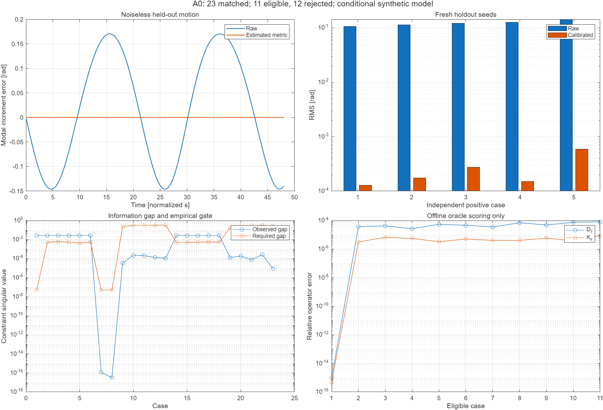

# A0：输入输出辨识、导航度量与退化拒绝——实现及验证

日期：2026-11-03。承接[03号执行单](03_读08后的下一步执行单_20261103.md)。本轮完成第一层A0：**归一化二阶条件模型的记录→算子→W→留出相对角→适用性判定**。未接完整12状态压电电路、Simulink闭环或RTL；原验收模型保持原位。

## 1. 结果先说明白

| 项目 | 本次结果 |
|---|---|
| 总工况 | 23：13个开发工况，方法冻结后新增10个独立种子工况 |
| 允许更新W | 11个充分信息例，全部达到对应调试误差门限 |
| 拒绝更新W | 12个共轴/各向同性/弱信息加噪例，未发布校正角 |
| 预期检查 | 23/23匹配，包含独立工况10/10；本测试集未观察到误接受或误拒绝 |
| 无真值目录隔离重放 | 只复制观测目录，重新辨识；结果JSON和23份角度CSV逐字节相同 |
| MATLAB跨语言回放 | 23个算子/门控scoreboard匹配；算子最大绝对差约3.55×10⁻¹⁵ |
| 无噪声充分信息 | Dy/Ky相对误差约9.59×10⁻¹⁶ / 4.85×10⁻¹⁶；留出相对模态角RMS约3.61×10⁻¹⁵ rad |
| 独立有噪正例 | 五个种子全部允许更新；校正相对模态角RMS最大约5.90×10⁻⁴ rad |
| 独立弱信息负例 | 五个种子全部拒绝更新，原始幅值观测标志仍保持有效 |

**“拒绝”不是精度通过。** 23/23表示预期行为及离线评分检查匹配，不能写成23个工况都实现了高精度导航。噪声和时间为归一化模型单位，不能换名为500 μV、实际40 kHz表头或ARW。近机器精度的无噪声结果只证明当前条件模型与数值实现自洽。

可打开[中文图文报告](../research/port_to_metric_20261103/evidence/index.html)，四联图如下：



## 2. 数据、估计器和真值严格分开

代码目录为 `research/port_to_metric_20261103/`。

| 文件/目录 | 职责 | 是否允许读取真参数 |
|---|---|---|
| `generate_records.py` | 独立生成周期稳态多正弦训练、不同频点及不同运动的留出记录 | 是，仅生成数据和离线参考 |
| `data/observations/` | 公共协议和345份CSV；每份只有t、ux、uy、yx、yy | 不包含H/G/D/K或真实角 |
| `fit_records.py` | 从公共观测辨识Dy/Ky/By，求W、经验风险门槛和相对角 | 否，不导入生成器/评分器 |
| `data/private_score/` | 真实矩阵、种子类别和23份真实运动记录 | 仅离线评分读取；全是合成真值，不是凭证 |
| `score_records.py` | 计算参数误差、角度误差、裕量覆盖与错误认证 | 是，不能反写估计器参数 |
| `a0_matlab_check.m` | 用MATLAB从公共观测重算同方法，核对Python结果；随后离线真值绘图 | 辨识核对阶段否；最后绘图阶段读取参考角 |
| `check_a0.py` | 输入哈希、方法冻结、独立种子、隔离重放和首轮失败重放 | 仅核验/评分阶段 |

每个工况有6次独立重复，每次分别激励两输入通道。训练记录长度1024，采样率32/归一化秒，基频周期32归一化秒。训练频点与留出频点不相同。周期稳态由解析机械频率响应产生，不靠估计器回归式反造输出；本轮没有覆盖任意起振瞬态。

留出角度采用幅值和方向均随时间变化的运动，生成器计算对应驱动以满足机械方程。W冻结后再读取留出运动；各角度以自身首帧定义增量，没有拟合真值偏置、延迟或旋转常数。已知通道手性为正这一先验已在公共协议声明。

## 3. 从I/O记录估计Dy、Ky，而非直接给真算子

假设实常数、可逆检测映射H，且：

\[
\ddot y+D_y\dot y+K_yy=B_yu.
\]

本轮用相干多正弦和DFT，避免逐点二阶差分。对第j个输出及频率ω，把观测复幅值写成一行回归：

\[
\begin{bmatrix}i\omega Y_1&i\omega Y_2&Y_1&Y_2&-U_1&-U_2\end{bmatrix}
\begin{bmatrix}D_{j1}&D_{j2}&K_{j1}&K_{j2}&B_{j1}&B_{j2}\end{bmatrix}^T
=\omega^2Y_j.
\]

将实部、虚部堆叠为实系数回归，按列尺度归一化。它只使用保存的t/u/y和已知激励频点，不使用真实H/G/D/K。

### 3.1 为什么保留OLS并采用交叉拟合IV

Y也有噪声，因此回归矩阵含噪，OLS可能有误差变量偏置。本轮保留OLS作基线，同时实施工具变量估计：

1. 对每次重复试验，先用其他5次重复的OLS结果形成先导模型。
2. 将当前已知输入代入先导模型，得到预测输出；它不使用当前重复的测量噪声。
3. 用预测输出构造工具矩阵Z，解归一化矩条件 Zᵀ(Xβ−b)=0。
4. 对6次结果取均值，重复间差异用于经验扰动裕量。

这不是证明OLS在所有噪声条件下都差，也不保证IV在每个指标都优胜。当前模型结构、重复独立性和输入外生性仍是方法前提；复杂噪声、闭环数据和模型阶次失配属于下一层验证。

### 3.2 首轮失败如何处理

首轮只用输入的多项式频率组合做工具变量，13个开发工况中，5个充分信息有噪声例因估计方差偏大被过度拒绝；1个无噪正例及7个负例行为正确。记录保存在 `evidence/trials/polynomial_IV_initial_estimates.json`。

保留原门槛，改用上述交叉拟合工具变量后，开发集13/13匹配。随后将估计器、公共设计和验收门限SHA写入 `method_freeze.json`，再生成10个新种子工况。冻结后的源码哈希若改变，核验程序会失败。首轮工具变量法仍可通过 `--method polynomial_iv` 重放，核验已确认其13例原始算子/门控结果可复现。

## 4. W与风险门槛怎么得到

构造输出坐标中的共同自伴约束：WDy=DyᵀW、WKy=KyᵀW。以 z=[W00,√2W01,W11]ᵀ 表示对称矩阵，两个算子各给一行约束，堆叠成 Cz=0。

算子先按公共标称角频率ωref缩放：Dy/ωref、Ky/ωref²。六次重复得到Cr，求C̄及经验标准误差：

\[
s_C=\sqrt{\frac{\sum_r\|C_r-\bar C\|_F^2}{R(R-1)}},
\qquad\epsilon_C=10^{-9}+6s_C.
\]

求解零空间并令tr(W)=2。门槛包括正定性（最小特征值>0.05）和信息裕量：

\[
\frac{\epsilon_C}{\sigma_2(\bar C)-\epsilon_C}\le\sin(0.02),
\qquad \sigma_2(\bar C)>\epsilon_C.
\]

0.02 rad是度量零向量方向预算，不能直接解释为机体角误差。εC来自有限重复的经验估计，系数6是冻结的保守裕量，并非已经证明的六西格玛置信保证。当前离线评分另检查真实C误差是否被裕量覆盖，以及实际留出相对角误差。

所有门控先于留出频点和留出运动的读取冻结。拒绝时公开校正角为NaN，候选角仅作诊断；原始幅值标志单独保留。低幅、饱和、失锁、变载和温漂尚未进入这一A0模型，不能直接把代码当成实际控制器的有效性逻辑。

## 5. 四类工况为什么有不同结果

- **充分信息**：D/K有非共轴各向异性，两条约束独立；训练估计的W使留出相对角误差下降。
- **共轴**：两约束相关，W一般不唯一，拒绝更新。
- **完全各向同性**：被动几何校准没有方向信息，即使端口I/O可完整恢复标量动力学，也不能凭此恢复一般检测几何。
- **弱信息加噪**：测量噪声可能把约束数值上“凑满秩”；经验裕量大于有效信息间隔，拒绝更新。

10个独立工况包含5个有噪正例、5个弱信息负例，各自预期行为都匹配。样本量不足以给出低误认证概率的统计保证，也未排除结构失配可能产生自信错误的风险。

W恢复的是条件模型下相对模态角所需的几何，仍有常量正交变换和手性前提；不能据此恢复绝对初始方向、Bryan系数或全部机械质量/压电换能系数。

## 6. MATLAB与可视化怎么用

在MATLAB中：

```matlab
addpath('C:/Users/11725/Desktop/HRG_WA/research/port_to_metric_20261103');
report = a0_demo;
```

`a0_demo`只读显示归档图片，图窗保留，不改封存证据。图中依次是：无噪留出角误差、五个独立正例的原始/校正RMS、信息间隔与经验门槛、允许更新例的参数误差。

重新核对MATLAB实现可运行 `a0_matlab_check`，它会更新本A0目录的图片和回放JSON。该核对与Python用相同数学方法，作用是检查索引、复数相位、矩阵布局、门控及角度计算，不是另一个独立物理证明。

## 7. 完整复现与日常核对

仓库根目录，使用安装了 `requirements.txt` 所列NumPy版本的Python：

```powershell
python research/port_to_metric_20261103/run_a0.py
```

随后在MATLAB运行 `a0_matlab_check`，再运行：

```powershell
python research/port_to_metric_20261103/make_report.py
python research/port_to_metric_20261103/check_a0.py --isolation
```

常规只读检查可省略 `--isolation`。`--isolation`把观测目录复制到研究目录内的临时工作区，那里没有真值目录，重新运行估计器；当前全部输出逐字节相同。它还回放首轮失败方法。源文件、观测记录、冻结哈希和全部失败项均纳入Git。

完整重建可能改变MATLAB图像/日志字节；若与封存清单不同，应先审查数值与输出差异，确认后显式运行 `check_a0.py --seal`。日常查看用a0_demo或HTML，无需重建。

## 8. 本轮没有完成什么，下一步衔接哪里

本轮没有修改原V10模型、建立新的完整Simulink闭环、执行真实表头测试或RTL综合。A0固定在实常数H、二阶、已声明激励和合成噪声的条件模型。

下一层应接入 `pcn_plant` 的12状态端口数据：明确可测电压/电流及校准参考，去嵌AFE/加载或直接拟合联合模型，再检验W与拒绝逻辑。此时真实检测映射通常随频率变化，不能把当前二阶回归直接用于ADC/DAC。模型阶次失配、质量度量、变载及有色噪声应优先作为失效测试，而不是先扩大算法功能。
