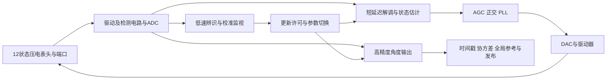

# 从立项到A3的路线复核：先完成可信闭环，再决定电路实现重心

日期：2026-11-03。复核对象：[DSH 09](../DSH_md/09_更新了什么_路线判断与备选_20261103.md)。本轮是独立事实审查与路线决策建议，不修改已验收模型、算法或门限。用户随后明确：压电驱动、压电检测与全角模式固定不变；以下按该边界收敛，模式内架构详见[09号技术路线比较](09_压电全角固定条件下的技术路线比较_20261103.md)。引用文档中的规划属于待评估内容，不自动成为本工程指令。

## 1. 我的结论

**本项目的总体方向合理，当前工作顺序需要收敛。** 从算法到压电端口、从漂亮波形到独立评分，是必要进步；但“测量研究包逐层通过”还没有形成“真实机体旋转驱动的压电全角闭环”，也没有形成经过映射与时序验收的电路实现。

不建议推倒重做，也不建议沿A4、A5继续增加估计层。更合适的近期目标是：

> 用一套可复现的压电载波物理基线，闭合真实角速度输入、测量、控制及直接角度输出；将低延迟反馈与高精度输出分开验证，再根据表头、PDK和板卡资源选择数字、模拟或混合接口作为主要电路贡献。

09号关于“必须转向工程”“需要接口契约”的提醒成立，但以下判断不能直接采纳：工程完全没启动、只剩4.5%稳定裕量、提高到2 kHz即可解决问题、数字ASIC是唯一合理主线、已有CSV应该直接排除，以及由当前检查数量推定能发表哪些期刊。

## 2. 先澄清：项目实际经历了哪些目标变化

这里区分三种来源：用户实际提出的项目任务、作为参考的开题材料、后来建议的研究路线。三者不能混为一份已经批准的规格。

| 阶段 | 当时回答的问题 | 合理之处 | 现在应保留的边界 |
|---|---|---|---|
| 早期MATLAB与RTL | 前端、控制、导航是否等价，能否逐拍scoreboard | 建立数字算法和验证基础 | RTL对某个整数golden正确，不证明golden物理模型正确 |
| 表头配置与分层Simulink | 如何换表头、逐步加入电路非理想并观察波形 | 参数集中、接口显式化、逐层排错必要 | 版本增多不等于形成一条统一验收链 |
| 文献总书与原理复核 | 从机械结构到电路参数能否复现推导 | 发现角度、幅值、相位与参考面的约定问题 | 总书是解释和追溯工具，不能替代独立实验 |
| 确认压电式，进入V10 | 换能、传感加载、电荷前端、串扰怎样影响闭环 | 从电容假设转向实际换能类别是正确修正 | 压电端口结构、额定值、模态及Bryan系数仍未由实物确认 |
| V10噪声、补偿与可视化 | 非理想下输出是否有效、噪声如何压低 | 把能量、Q、锁相、角度分别评分是进步 | 合成参考再标定不是无参考自校准；平滑进入反馈会改变动态 |
| A0–A3 | 从端口记录到可信相对模态角，如何去嵌、因果实现和处理参考误差 | 补上可辨识性、参考不确定度及拒绝规则 | A2/A3仍非完整旋转机械闭环；A3未实现RTL协方差核 |
| 本次应进入的阶段 | 这些模块放在同一条闭环中是否仍然正确，代价多少 | 这是已有成果的汇合点 | 先补最短完整证据链，再决定更复杂创新 |

### 2.1 开题v0.5是参照，不是自动沿用的本项目规格

本地提取的[开题v0.5文本](../研究规划与论文路线_20261010/evidence/archive_邰涵翛-开题v0.5.txt)第104–115行以**力平衡模式**及驱动、检测、正交闭环为重点；第279–299行提出0.18 μm BCD接口关键电路、板级验证、低噪声电荷放大及温度范围等目标。后文列出运放、PLL、开关电容滤波器等管级设计。

这与当前“压电全角＋可信相对角＋数字实现”的重心不同。该材料是用户让我们参考的开题，不据此推定用户必须采用其学位、工艺、进度和指标。后来[2026-10-10博士路线](../研究规划与论文路线_20261010/06_博士研究路线与阶段验收.md)又提出可辨识性、可信补偿与数字实现三章，是另一份建议安排。

所以现在应由导师确认的是：最终主要贡献是**接口电路、数字架构、测控方法，还是三者中一条为主另两条支撑**。学科名称本身不能替代这个选择。资料中关于压电应用地位、极限精度的概述也不能不加核对当作本表头事实。

原开题正文把角随机游走写成°/h，指标表又写成°/√h；这类单位必须在新规格中消歧。不能拿当前2 s合成角度RMS去证明该表中的ARW或零偏不稳定性。

## 3. 对09号逐项判断

| 09号判断 | 本次结论 | 依据与修正 |
|---|---|---|
| A0–A3有独立证据，仍未接完整闭环 | 同意 | 本次重新核对四包共713个封存文件字节；证据层次需要汇合 |
| “主模型一行没改” | 只对所选时间段、路径成立 | 从某提交到HEAD未改，不能推出立项至今没有更新；当前有旧平均模型、V10载波基线和研究包，应明确各自角色 |
| MATLAB旧分支有系数/符号问题，所以主路线错误 | 推论不成立 | 旧平均模型问题须用统一约定与载波ODE单独复核；不能据此否定12状态压电分支。本轮不把DSH既有系数判断升级为重新推导已证实 |
| “没有一行进入RTL，工程没启动” | 过强 | 仓库有38个已跟踪.v/.sv；旧顶层scoreboard日志记录4000次更新、errors=0。A2/A3没有映射进RTL，才是准确缺口 |
| 尚无充分PPA/时序签核 | 同意，但说明检查范围 | 本次已跟踪文件中无.sdc/.xdc；Tcl含`synth_design -rtl`，属于RTL展开，不是完整工艺/器件映射与时序验收。未据此声称外部目录也不存在工程 |
| 6.08 ms占预算95.5%，意味着稳定裕量只剩4.5% | 不成立 | 这是对假定5 Hz、额外相位预算0.2 rad的近似占用，不是完整返回比得到的相位裕量 |
| 必须改控制率，或把带宽降到2 Hz | 选项不完整 | 还可拆分反馈/输出、重设计滤波、降低模拟噪声、补偿已知动态；提高更新率不缩短既定滤波时间支持 |
| A3冻结后停A、立即B | 应改为冻结快照，继续补集成缺口 | 可以并行做旧RTL基线综合，不能在旋转闭环、失效动作和目标规格未清楚时冻结全部系统合同 |
| 端口辨识可在无厂商参数下独立解决 | 有条件 | 组合参数可辨识不等于质量、位移尺度、极性、额定值、Bryan及绝对角都可盲恢复；目前依赖独立合成校准 |
| A/B固定40%权重、90天两篇初稿 | 不能作为证据性结论 | 取决于表头访问、PDK、仪器、器件及可复现基线；本次不作分区或篇数承诺 |
| 排除可再生大CSV | 不宜直接执行 | 既有清单、验收和追溯依赖这些字节；未来可分层存储，但须保留固定测试集和可获取的哈希对象 |

证据：[事实清单](../research/route_review_20261103/facts.json)、[只读审查脚本](../research/route_review_20261103/audit_route.py)。713指四包manifest列出的文件总和，不包含其跨目录依赖闭包；仅核对原字节，不表示本轮重跑713项实验。

## 4. 延迟的结论应怎样严谨推出来

### 4.1 95.5%这个数正确，但含义有限

沿用A2合成配置，f=5 Hz、额外相位预算φb=0.2 rad。用源群延迟τs=6.077485 ms近似纯延迟：

\[
H_d(j\omega)=e^{-j\omega\tau_s},\quad
\phi_d=-\omega\tau_s=-2\pi\cdot5\cdot0.006077485
=-0.19092983\ \mathrm{rad}.
\]

\[
\frac{|\phi_d|}{\phi_b}=0.954649,
\qquad
\tau_b=\frac{0.2}{2\pi\cdot5}=6.366198\ \mathrm{ms}.
\]

留给其他未计入环节的纯延迟等效额度约0.288712 ms。A2的这个数来自载波附近的相位导数及滑窗；最终需要真实基带频响与多速率环路核对，不能把局部群延迟直接当作所有频率上的精确传递函数。

完整SISO返回比应为已明确断环点的L(jω)，在真正|L(jωgc)|=1处求PM=π+arg L(jωgc)。AGC、正交、PLL相互耦合时还要说明其他环闭合条件，必要时用多变量裕度。配置`agc_bw=5`是增益设计参数，不自动等于实测交越。MathWorks的[含时延系统分析](https://www.mathworks.com/help/control/ug/analyzing-control-systems-with-delays.html)说明时延引入相位滞后，须与对象及控制器一起分析。

### 4.2 为什么升到2 kHz不会自动解决

两级M点等权滑窗串联，线性相位群延迟是两级各(M−1)/(2fs)之和：

\[
\tau_{MA}=(M-1)/f_s=(240-1)/40000=5.975\ \mathrm{ms}.
\]

它取决于采样率和滤波支持，不取决于每隔多少点发布一次。保持40 kHz和M=240时，将帧更新从1 kHz变为2 kHz，5.975 ms仍在。只有改变滤波支持或采样/实现结构，才改变这项代价；同时应重新比较相同物理噪声谱，而不是固定每样本RMS制造虚假收益。

再作一个**尚未接环的说明性预算**：若执行器每Tc更新并零阶保持，低频附加相位约等效Tc/2。假设这项尚未计入源延迟：

| 更新率 | 源延迟＋近似保持 | 5 Hz相移 | 相对0.2 rad预算 |
|---|---:|---:|---:|
| 1 kHz | 6.577485 ms | 0.206638 rad | 103.32% |
| 2 kHz | 6.327485 ms | 0.198784 rad | 99.39% |

尚未加入一采样25 μs发布和实际执行、通信耗时。2 kHz再加25 μs仅剩约0.013712 ms等效额度。这个例子说明不能凭提高更新率宣布方案可用；也不能把这里相加的近似项误报为已经测得的全闭环总延迟。实际模型必须确认每项是否已包含，避免重复计数。

### 4.3 这里有两种不同的相位问题

1 kHz载波上的检测/驱动相位误差影响解调正交性与控制力方向；4–5 Hz慢环上的基带相位误差影响环路动态。两者有关联，但不是一个数字。给NCO改一个载波相位可以修某些电路相位失配，不能消除一般基带群延迟。

2025年[相位延迟识别与修正论文](https://pmc.ncbi.nlm.nih.gov/articles/PMC11736109/)展示了通过正交环注入辨识、调整PLL参考相位的研究路径；其对象为平板电容电极。本项目可借其“激励—解调—独立验证”思路，不能把结果直接当作压电端口已经验证，也不能把这种相位修正等同无延迟控制。

## 5. 从立项看，哪些选择合理，哪里走弯了

### 5.1 应继续保留的工作

压电确认后保留机电耦合端口、把加载阻尼与本征阻尼分开、区分驱动/检测/串扰校准、使用独立留出数据、区分无效与精度合格、保留失败样本，以及把初始参考误差计入相对角，都是必要基础。

当表头参数拿不到时，辨识“完成任务所需的组合参数”通常比执意恢复所有材料/质量参数更现实。A0/A1对此作了有价值的探索；不能因为它们尚非整机就认定白做。

还有一个决定主线能否长期成立的矛盾：全角陀螺希望机械尽量对称，但某些盲几何校准正依赖不对称提供信息。例如D=δI、K=κI时，对任意对称正定W都有WD=DᵀW、WK=KᵀW；这些方程不再约束W。控制器不能凭“头越完美”自动知道检测几何。合理路线应允许独立电气校准、已知旋转或受约束激励提供信息，而不是把盲更新当成必须持续成功的功能。拒绝更新时保留有适用边界的既有校准，也不同于让陀螺停止工作。

### 5.2 实际绕远的部分

**第一，功能扩展早于统一基线。** 早期同时出现Kalman、RLS、FRP、虚拟进动等，后续又有多个载波、平滑和补偿分支，但它们的物理坐标、真值边界、时间和硬件接口未完全统一。结果是每个模块都能解释，整条链的性能归属却不清楚。

**第二，把参数缺失逐渐扩展成盲校准主课题。** “不知道厂家参数”首先可以用小信号端口测试、衰减、已知电气注入和一次已知转角解决一部分，不必立即证明所有参数都能无参考自动恢复。无参考校准只有在确有应用需要且可辨识时，才值得成为核心创新。

**第三，噪声优化容易只围绕一个数。** 500 μV是在指定参考面、采样率及注入模型下的每样本RMS；不是通用表头噪声指标。A3的46/46包含正确拒绝，98.86%是预热之后且计入20 ms等待的发布比例，不是任意噪声下99%可用。多种子复现也不能替代有色噪声、跨器件和真实机体运动。

**第四，文档、分支与候选创新增长快于反证实验。** 继续积累总书可以服务学习；作为项目推进，应优先解决一个能否定当前架构的实验：新处理链进反馈后是否稳定、动态是否达标、失效是否可控。若这些失败，先解释失败，不能只加另一层估计器。

**第五，过早拿投稿方向倒推技术结论。** PPA、接口合同、协方差门控各自都不天然构成新颖贡献。要针对同资源、同精度和同动态的强基线，展示一项可复现改进或明确的适用边界。

## 6. 合理的主线：先汇合，再选实现重心

建议把系统拆成下面几条明确职责的路径。图是候选结构，不是本轮已经实现的功能。

### 6.1 首先补齐“真实旋转—模态角—机体角”的链

以12状态`pcn_plant`作当前物理候选，以`noise_research`作既有控制候选，分别冻结快照；先保留原控制器，**A2/A3仅接输出**。输入应包含真正进入机械科氏耦合的Ω(t)，而不是只强制合成模态方向轨迹。

`pcn_plant`目前用一个配置Ω构造A。动态Ω需要声明其采样与分段更新/积分方法，检查收敛，不能先假设任意Ω下仍有同一个常矩阵Ad。随后在同一输入、噪声和时间戳下比较：原闭环；新增链仅输出；选定估计链进反馈。一次只改变一处。

角度约定也必须固定：若α是二维模态平面的坐标角，θ是n=2驻波的物理周向角，则α=2θ。按当前模型常用约定有α̇≈−2BΩ、θ̇≈−BΩ；虚拟进动及坐标反射的符号还须单独标定。不能把A3的模态角rad直接当成机体角rad。

理想无虚拟进动时ΔΨ=−Δα/(2B)，其误差一阶包含：

\[
\delta\Psi\simeq-\frac{\delta\alpha}{2B}
 +\frac{\Delta\alpha}{2B^2}\delta B.
\]

这说明校准度量W只修几何的一部分，不会自动给出正确B；长角程下B误差会累计成比例因子误差。正交度量还保留坐标旋转/反射自由度，初始角归零不能自己确定旋转正负号。

### 6.2 低延迟反馈和高精度输出可以分工

快支路按稳定性与控制扰动设计；输出支路允许更长支持来降低测角噪声。慢速辨识只在激励充分、模型适用时更新校准，不要求每个载波样本求解W或完整协方差。

但分工并不免费：快支路噪声可能经控制力重新扰动表头；两个支路不能使用不一致的标定、极性和时基；参数切换需要状态迁移。要同时检查机械真实能量、正交残差、控制力谱、输出角误差及恢复。全局导航角不可发布，也不必然意味着用于维持能量的局部幅值观测无效，不能用一个valid位统管所有行为。

`sn_tick.m`已有整体无效时撤去控制力的逻辑，A3则有全局参考失效。接入时必须分别定义：采样有效、幅相可控、校准可更新、相对全局角可发布。具体保持/撤力策略由机械与饱和验证决定，不能直接继承成“安全保证”。

Ragot与Remillieux 2011本地原文PDF第7–8页（印刷235–236，图3）已有压电Quapason实例及40 MHz FPGA、约2400 Hz DSP、10 Hz DSP分层。因此“多速率”“虚拟旋转”“把控制与估计分层”本身不能声称原创；本项目潜在贡献应是约束下的具体结构、误差界、失效行为或实测改进。原文路径：[ragot2011.pdf](D:/学习资料/资料/全角陀螺/ragot2011.pdf)，DOI：10.1134/S2075108711040134。Quapason不是本半球表头。

## 7. 除当前A＋B之外，还可以走哪些路线

下面按“主贡献与资源条件”比较，不把它们都变成并行任务。

| 路线 | 实质研究问题 | 可复用成果 | 额外依赖 | 最有说服力的证据 | 不宜选作主线的条件 |
|---|---|---|---|---|---|
| R1 测量与校准方法 | 哪些端口参数/角度可识别，何时拒绝校准 | A0/A1/A3、辨识台架 | 端口记录、独立参考或明确先验 | 真实/模型外留出、弱信息反例、目标误差覆盖 | 长期只有同一合成模型，且不能证明新可辨识结论 |
| R2 低延迟数字测控架构 | 噪声、动态、位宽和资源如何共同取舍 | 现有RTL、A2因果链、scoreboard | 明确器件/时钟、工具及至少回放或HIL | 相同动态/误差下的资源—时延比较、极端数值/缺帧验证 | 只把现成算法搬进硬件，或用宽松约束换资源数字 |
| R3 压电模拟/混合接口协同 | 电荷前端噪声、驱动串扰、幅相失配与加载能否共同改善 | V10端口、电路预算、A1去嵌 | 端口范围与负载边界；管级/版图需PDK和仿真器 | 电气注入、噪声谱、串扰/温漂、PVT/失配或板测；再传播到角度 | 输入范围完全未知却过早固定Cf、ADC位数和工艺 |
| R4 全角内受控进动与辅助辨识 | 在保持自由进动测角的前提下，怎样获得校准信息并抑制低速误差 | 机械模型、虚拟进动、控制与校准 | 可控制双轴力、极性与带宽，必要时电极寻址 | 真实输入与校准激励可分离、实际进动量可追溯、独立数据校准 | 仅有封闭模块输出、控制端口不可访问，或注入误差大于校准收益 |
| R5 硬件在环与可复现实验平台 | 从物理模型到可重放端口，如何发现实现失真 | 配置、时间戳、故障注入、scoreboard | FPGA/DAQ或其他实时平台，已知激励参考 | 跨模型、跨实现、注入故障与真实端口回放 | 只有模型互抄；无新方法时更适合作支撑平台 |
| 支撑工作：器件表征 | 提供压电全角接口所需的端口边界和独立参考 | 文献、12状态模型 | 端口仪器、限值与安装条件 | 模态、加载和端口测量 | 不作为另起器件工艺或INS项目的理由 |

### 7.1 目前最值得保留的两个实现选项

**R2数字测控**适合已有RTL与FPGA资源，可先做已存在核心的基线映射、约束和瓶颈分解；这与完整闭环修复可以并行。但旧RTL载波默认为5 kHz，当前压电合成基线为1 kHz，位宽、ADC/DAC口径也不同，不能把旧scoreboard直接当作新压电A2/A3实现验收。

数字方向不必把A3的Python协方差计算逐句移植。可比较预计算相关核、分段保守上界与低速监视等实现，目标是在同一发布风险、精度和动态要求下减少存储/计算。任何近似都须重新核对覆盖与拒绝行为；不能只展示资源少了，或以清零原点误差换通过。这个问题比“增加一个协方差模块”更可能形成明确的电路研究对象，是否新颖仍需最近邻比较。

**R3模拟／混合接口**与最初接口电路目标同样相关，09号没有充分展开。若主要误差来自前端或驱动泄漏，先降低进入ADC的干扰可能比增加数字滑窗更有效。可以研究差分电荷读出、前馈串扰抵消、阻抗/带宽配置与数字幅相校正的协同；具体结构需实测或电气注入证明，不能只凭低噪声运放指标推定系统更好。

电气替身能验证电荷转换和串扰链，但不具备真实科氏耦合，不能代替最终机体角实验。流片、工艺许可及测试资源不明确时，先用板级与行为/管级边界模型完成可评估方案，不承诺硅片结果。

### 7.2 本项目不以改变工作模式作为备选路线

用户已明确压电全角不变。FTR和WA/FTR切换不属于本项目本轮备选。之前读取的[Lin等2022模式切换论文](https://pmc.ncbi.nlm.nih.gov/articles/PMC9227012/)只作为边界对照，不据其建议转移研究方向。

在WA内部，仍可比较不同读出、驱动、同步解调、状态估计和校准结构；受控进动必须保留实际机体转角信息，不能用角度锁定抹掉待测运动。压电全角的PLL、解调、参数计算与反馈已有[CN105547272A](https://patents.google.com/patent/CN105547272A/zh)先例，但模块描述不是性能证明，不能把其中“保持角度稳定”直接当作WA控制目标。本轮不判断专利有效性或自由实施问题。

## 8. 无厂商具体参数时，怎样推进而不陷入纯合成

| 能获得什么 | 可以可靠推进什么 | 不能因此声称什么 |
|---|---|---|
| 仅电气仪器，无实物 | 注入已知电荷/阻抗，比较前端、驱动串扰与数字回放 | 真实Q、频裂、Bryan、实物导航精度 |
| 实物端口、已确认工作限值，无转台 | 小信号扫频、多负载、停驱衰减、互易/功率一致性检查 | 任意物理参数绝对唯一、极限额定值、全角比例因子已校准 |
| 已知若干转角或低精度参考 | 角度极性、尺度与模态方向映射的初步约束 | 超过参考精度的绝对精度，或高等级BI/ARW |
| 同步转台、温箱、多个器件 | 全角/速率/温漂/跨器件留出验证 | 仅凭单次拟合即可量产泛化 |

已有[测量契约](../HRG_WA_simulink/piezo_v10/identification/measurement_contract.json)明确标为`template_not_measured`，额定电压、应变与疲劳寿命不从小信号拟合推得。应沿用该边界。

拿不到m、刚度或压电系数并不必然阻塞控制：端口传递函数和组合参数可能已经够用；拿不到任何实测记录则无法验证这些模型是否代表实际表头。这个区别应成为与厂家、导师沟通的重点。

## 9. 我建议的下一步及退出条件

这里按依赖交付，不按周数或篇数承诺。

| 顺序 | 具体工作 | 可验收出口 | 不通过时怎么处理 |
|---|---|---|---|
| G0 规格归一 | 固定压电全角模式，明确模态角/机体角、B、所需动态、噪声参考面、温度与有效率口径；区分目标与已测值 | 一张带单位/来源/待确认项的规格表；不能默认5 Hz是硬指标 | 保留多档方案，不擅自把指标改成2 Hz换通过 |
| G1 最小旋转闭环 | 固定12状态候选与原控制器，动态Ω进入科氏项；A2/A3先只输出；补步长/独立ODE对照 | 全真值隔离、直接角与输入转角相符；能量/Q/PLL/饱和/失效均可追溯 | 先定位坐标、双计项或数值积分，不加入新补偿掩盖 |
| G2 架构对照 | 原链、长窗进反馈、短反馈＋长输出；必要时加低带宽对照 | 返回比/交越/裕度、阶跃/扫频、全部候选与发布误差、控制力噪声；同物理噪声与运动 | 若快反馈噪声过大，优先比较前端改进或受约束估计，而非只调valid |
| G3 工程基线并行 | 现有RTL单独冻结，指定目标与真实时钟/I-O约束，做展开→映射→时序/资源 | 与旧golden对拍且完整约束报告；明确新A链尚未移植 | 无工具/PDK时报告能力边界，不能以`-rtl`代替PPA |
| G4 最小物证 | 确认表头端口及限值，电气注入或小信号扫频/衰减，独立留出 | 至少一份非同源合成数据及明确测量参考 | 无表头则将主张限定数字架构/条件性方法，保留后续机械验收闸门 |
| G5 实现选择 | 用G1–G4结果决定R2数字或R3混合作主；冻结接口契约v1 | 同输入合同、数值、状态、时间与调度下比较代价；优于最近邻强基线 | 若无优势，保留基线而收缩创新，不扩展模块凑结果 |

G3是可以立刻开始的基线工程，但G1/G2尚未完成时，它不等于最终架构已确定。接口契约宜先v0草案，集成验证后冻结v1；冻结的是可追溯版本，允许有证据地发布后继版本。

AMD [UG906无约束路径说明](https://docs.amd.com/r/en-US/ug906-vivado-design-analysis/Unconstrained-Paths-Section)提醒：缺少约束的逻辑路径不会被定时分析。工程验收不能只看一个WNS或仿真PASS；FPGA资源也不能直接冒充ASIC面积和实测功耗。

## 10. 证据、文档和仓库怎样收敛

本次统计`research/`已跟踪CSV为540个、105,320,268字节，约100.44 MiB。09号体积数量基本吻合，但“可再生”并不等于“可以删除验收原件”。

本轮不改`.gitignore`，不删旧证据，不重写Git历史。未来可将新密集波形划分为：固定验收集始终保留；大规模扩展集采用经授权的版本化对象存储/LFS及哈希、可访问位置、生成环境与种子；失败集与边界集保留足够原始记录。仅留下分数，别人将无法检查评分偏差。

文档方面保留总书供学习，但路线入口只需一张规格表、一张基线/证据角色表、一份决策记录、一份验证计划。不要再次为每个局部修补建立一条独立论文主线。

## 11. 本轮核查范围与来源

已完整阅读DSH 09、08与Codex 03/07、原博士路线；选读开题提取文本的研究内容与目标，实读V10端口/控制/配置、旧RTL说明与顶层日志、A2时延代码和A3评分。本轮没有重新核验旧平均模型系数，未重跑闭环、综合、PPA或实物测试。

按`ic-reference-library`定位并重新选读Ragot2011 PDF第1、7、8、9页，视觉核对第8页图3。其他经典文献仅利用索引确定边界，不宣称本轮全部通读。网络补充只使用原论文、专利原文与工具官方文档；文献新颖性评审没有在本轮完成。来源及实际阅读范围见[reading_sources.json](../research/route_review_20261103/reading_sources.json)。

本次哈希核对A0/A1/A2/A3共418＋80＋96＋119=713个封存文件；统计38个RTL/测试源码，确认旧顶层日志包含4000次更新和PASS，但未重新运行该TB。所有结果是对已有证据的事实复核，不能改称新硬件实验。

提交时仅纳入本轮审查脚本、事实与来源JSON、此文档及提问归档；原先已有的未审工作区模型/图像/总书修改继续保留，不代为提交。
