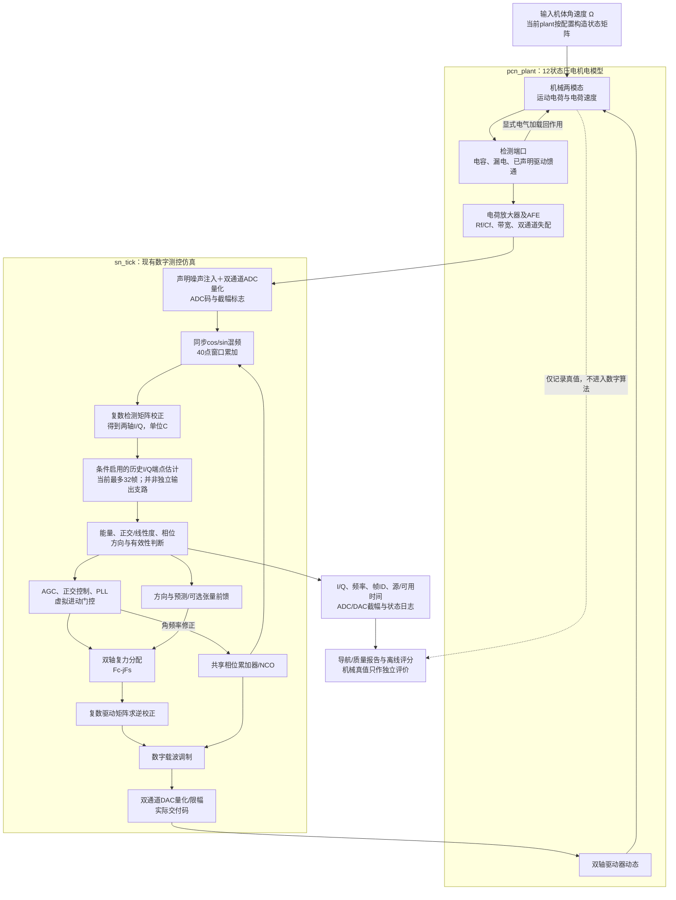
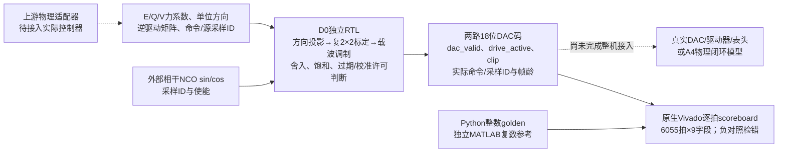
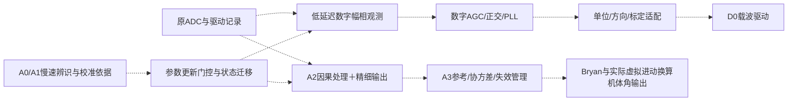

# 当前架构信号流图：压电全角与数字实现

日期：2026-11-04。用于[导师汇报](13_核心疑惑与导师汇报提纲_20261104.md)。当前有多条独立证据链，尚不存在“最新模型＋A0–A3＋D0全部接通并验证”的单一整机。下图区分现有仿真链、独立RTL模块与待集成路径。

## 1. 现有压电仿真闭环的信号处理流

下面按`pcn_plant.m`、`sn_reference.m`和`sn_tick.m`的功能依赖画图。模拟/机械块是行为状态模型，数字块为MATLAB状态机，不因此等于已实现芯片。

当前40 kS/s、1 kHz合成载波、40点/1 ms帧来自调试配置；载波频率不等于慢环带宽。`sn_smooth`的估计I/Q目前进入控制，不能把图中现有链写成已经实现“快反馈＋精细输出”两支路。各研究分支的选项也不一定全部同时开启。

逐拍执行先从旧控制状态交付DAC，再消费本拍ADC；完整窗口结束后更新I/Q和慢控制，新状态在后续采样使用。窗口开始/结束/中心/可用时间不同，图中箭头只表示功能依赖，不代表同一个时钟边沿能即时走完全链。

## 2. D0实际完成了哪一段

实线是D0明确输入/输出与验证关系；虚线为集成缺口。D0不包含上游NCO、PI/PLL、方向预测、标定辨识或导航。其M矩阵定义、单位与当前标定的相位参考面需要适配，不能直接将旧三路慢DAC码接成两个载波。

## 3. A0–A3与拟议输出支路的位置

| 包 | 实际研究内容 | 与现有整机链的关系 |
|---|---|---|
| A0 | 输入输出算子与条件性几何度量辨识 | 独立记录处理；不是每拍运行的现有控制模块 |
| A1 | 完整端口/加载的去嵌与辨识 | 独立台架；不等于当前控制器的静态复矩阵校正已经包含所有动态 |
| A2 | 因果载波去嵌、驱动重建与I/Q时间账本 | 独立台架；尚未作为完整旋转闭环反馈链验收 |
| A3 | 相对角协方差、重锚定和缺测全局参考管理 | 独立输出/参考管理台架；协方差未完整映射RTL |
| D0 | 三慢力系数到双轴数字载波 | 本轮已验证的独立RTL驱动接口，待整机适配 |

拟议集成关系如下，**整张图是下一阶段目标，不是当前已完成接线**：

不确定信息不能通过画图变成已实现模块。A4应先保留现有控制，让新增处理只输出，证明不改变机械和驱动；随后才比较新估计进入反馈的动态和失效行为。

## 4. 汇报时如何指着图讲

“第一张是已有压电模型和数字状态机的仿真闭环；第二张是刚完成逐拍验证的D0驱动RTL；第三张是下一阶段集成目标。我们现在的任务，是在统一单位、相位、时间和有效性合同下把这些证据连接起来，并取得独立表头数据验证。”

依据文件：`HRG_WA_simulink/piezo_v10/revision_v10_2_cn/pcn_plant.m`、`noise_research/sn_reference.m`、`sn_tick.m`、`sn_smooth.m`，以及`research/digital_drive_d0_20261104/interface_v0.json`。本轮仅核对源码信号关系，未运行新的整机仿真或生成硬件时序报告。
