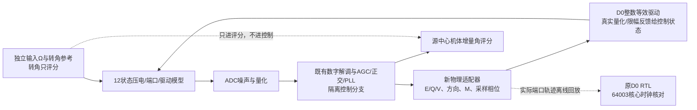
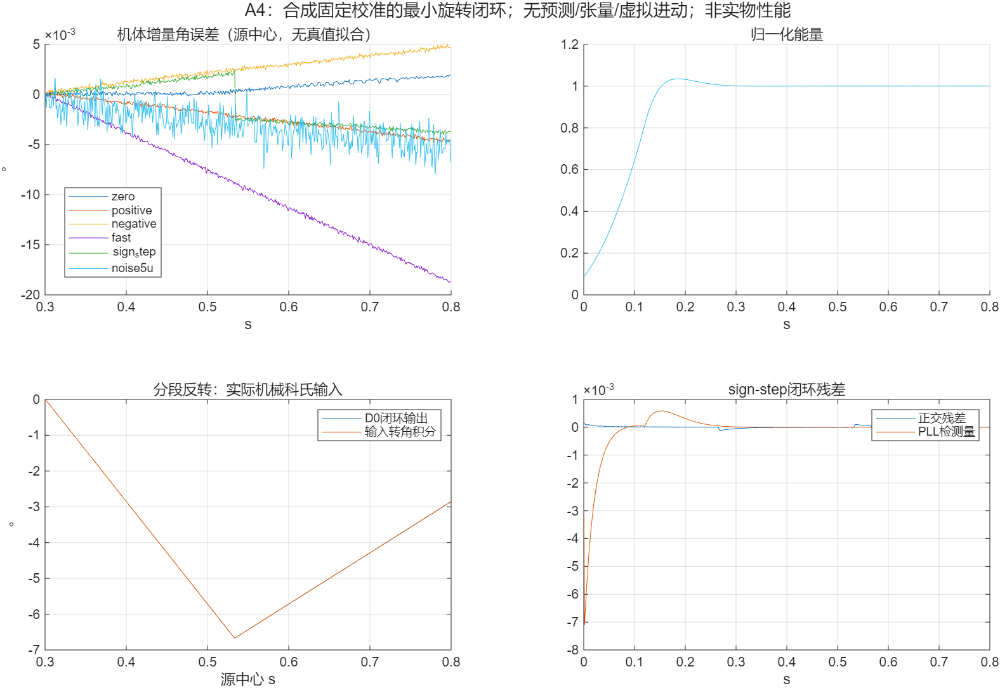

# 物理适配器与A4最小旋转闭环

日期：2026-11-05。承接[12号D0](12_D0数字驱动接口与逐拍验证_20261104.md)，固定压电全角和数字实现。本轮完成D0物理适配、合成旋转闭环、原生Simulink核对和原D0 RTL轨迹回放。**这是A4第一阶段，尚非A2/A3全处理链接入或实物验收。**

## 1. 结果与适用条件

| 检查 | 结果 |
|---|---|
| 缩放/矩阵/相位单位检查 | 不作中间量化的物理复数参考最大差2.6589 DAC LSB；配置上界16 LSB |
| F0缩放一致性 | F0与归一化逆矩阵同时乘2，最大输出差22.89 μV，来自两种离散归一化量化；未宣称逐码相等 |
| 相位负对照 | 错用下一采样相位，最大误差63.67 mV，明确检出本拍/下拍相位区别 |
| 标定元数据拒绝 | 采样周期失配、名义载波频率失配、奇异驱动矩阵3项拒绝 |
| 最小旋转闭环 | 静止、±0.5 rad/s、2 rad/s、三段反转、0.5 rad/s加5 μV噪声，共6/6满足预先定义的调试条件 |
| 整数/浮点分支差异 | 最大机体增量角RMS差1.5651×10⁻⁵ rad，约0.000897° |
| 与理想输入转角的误差 | 本合成试验中机体增量角RMS最高1.99593×10⁻⁴ rad，约0.01144°；不是硬件精度 |
| 原生Simulink | 分段反转工况，机械状态/诊断差0，ADC/DAC逐码相等，NaN位置相同 |
| 原D0 RTL回放 | 32001个载波采样，64003个核心时钟，9字段逐拍一致；故意破坏期望码负对照检出 |
| 独立ODE积分核对 | 对同一连续模型与保持电压用32子步RK4，电荷误差/目标电荷最大1.902×10⁻⁸ |

测试为0.8 s、40 kS/s、名义1 kHz载波、1 kHz控制帧，合成固定独立标定。关闭heading预测、张量前馈、虚拟进动、32帧I/Q平滑，保留既有AGC/正交/PLL。没有验证500 μV、一般模型失配、长时零偏、任意高动态或环路相位裕量。

## 2. 为什么需要物理适配器

D0接收的是归一化力系数，不是旧RTL的三路DAC码。先把现有控制器的双轴实系数写成Fc、Fs，载波力为Fc cosφ＋Fs sinφ。

当I可用时取e=I/‖I‖，n=[−ey,ex]ᵀ；初始I为零时使用控制器声明的固定X方向，不从真实机械初始角读取方向。当前最小控制分支满足Fc垂直于e，于是：

\[
E=-e^TF_s,\qquad Q=n^TF_c,\qquad V=-n^TF_s.
\]

重构结果为Fc=Qn、Fs=−Ee−Vn。适配器显式检查eᵀFc残差；若未来引入径向同相力或其他前馈，必须扩展接口，不能悄悄丢掉该分量。首轮V为0，但单位检查同时覆盖非零V。

配置VFS=dac_span/2=1 V，F0=p.b·VFS；F0单位为C/s²，是运动电荷坐标下的力等效尺度。它是当前合成模型的配置，不是已测压电系数。D0输入与矩阵为：

\[
\widetilde E=E/F_0,\quad\widetilde Q=Q/F_0,\quad\widetilde V=V/F_0,
\qquad M=\frac{F_0}{V_{FS}}c_{drive}^{-1}.
\]

因此M乘归一化复力后得到V/VFS，最后D0的Q17码乘VFS/2¹⁷恢复物理电压。力和矩阵分别量化后重标F0不保证逐码相同，故用有限量化差验证，不以“改单位后零误差”作为错误目标。

实物参数未知时，可以选定一致的坐标/尺度和独立端口标定推进接口，但仍需要明确标定参考面及可辨识组合。本轮没有恢复真实质量、位移标尺或厂商额定值。

## 3. 标定与采样相位怎样核对

标定来源是已存在的`revision_v10_2_cn/evidence/calibration_profile.json`，状态为`synthetic_independent_reference_only`。矩阵含驱动器与DAC零阶保持的幅相校正，所以适配器不再叠加一次逆驱动器或半采样相移。

检查名义载波与profile.frequency_Hz相同，采样周期与profile.sample_period_s相同，矩阵有限且条件数<100。归一化系数必须能装进D0 signed20/fractional16格式，力系数超界也直接拒绝，不回绕截断。

这些检查是元数据兼容性，不证明真实校准准确，也不证明矩阵在整个PLL调谐范围、温度或频率范围内均适用。未来改变载波或Ts，必须重新获取对应标定；本轮不以近名义频率结果替代全频段测试。

每拍先使用旧控制状态s.phase产生cos/sin，再消费本拍ADC并推进相位。这和既有`sn_tick`一致。若提前推进一拍，名义相位误差为：

\[
\Delta\phi=2\pi f_0T_s=2\pi\cdot1000/40000\approx0.15708\ \mathrm{rad}.
\]

单位试验故意加入这一相位错误，得到约63.67 mV的最大电压差，远大于本轮量化误差。这是载波采样相位检查，**不是慢控制环相位裕量测量**。

## 4. 本轮闭环究竟接了什么



`a4_control_tick.m`由原`sn_tick.m`生成，只改函数名以及一行DAC生成接口；现在由`a4_drive`产生电压与实际clip，再进入原有饱和累计/窗口状态。不是在闭环外简单替换绘图信号。原控制器和旧模型文件不修改，检查器逐字重建两个替换，验证不存在额外隐藏修改。

原`sn_tick`作为浮点对照独立运行自己的机械轨迹，两个分支使用同样噪声、输入和固定标定。每一分支均由自己的ADC反馈推进，不用浮点分支的状态驱动整数分支。

控制分支没有读取p.Omega、p.theta0、输入转角或评分器。它仍使用声明配置和独立合成标定，不能称作无参考识别。

## 5. Ω怎样进入模型，角度怎样评分

科氏项在机械速度矩阵中按当前段的Ω更新，而不是只生成一条预设方向轨迹。反转输入三段为[+0.5,−0.5,+0.25] rad/s，各占总时长三分之一；每段预计算对应的精确ZOH状态矩阵。

模型仍是原有两模态近似的分段常Ω形式，没有新增一般角加速度/Euler项或更高阶旋转物理。不能由本分段试验宣称任意高动态已验证。

从每个已发布完整窗口提取一次I/Q，定义模态平面方向α=unwrap(atan2(M,N))/2，机体增量角：

\[
\widehat{\Delta\Psi}=-\frac{\alpha(t_c)-\alpha(t_r)}{2B},
\qquad \Delta\Psi_{ref}=\int_{t_r}^{t_c}\Omega(t)dt.
\]

tc是窗口源中心，tr为首个不早于0.3 s的有效源中心；评分区间从0.35 s开始。两者各自减去同一参考时刻的定义值，没有用真值拟合偏置、比例或延迟。原点建立前相对角保持NaN，报告也不向过去回填后来的原点。

这是离线直接角度评分，不等于本轮已将导航解算全部实现为RTL。短时记录不用于报告ARW/真实BI。

| 输入 | D0分支机体增量角RMS [rad] | 整数与浮点角RMS差 [rad] |
|---|---:|---:|
| 静止 | 1.67721e−5 | 1.56501e−5 |
| +0.5 rad/s | 4.88534e−5 | 3.20862e−6 |
| −0.5 rad/s | 5.26453e−5 | 6.68868e−6 |
| +2 rad/s | 1.99593e−4 | 3.84710e−6 |
| 分段反转 | 4.47607e−5 | 6.01532e−6 |
| +0.5 rad/s，5 μV | 6.51834e−5 | 4.86477e−6 |

所有工况同时核对能量、正交、PLL、截幅、有效率与整数/浮点轨迹差。阈值在首轮运行前写入`config.json`，是合成调试验收，不是厂家或任务指标。

## 6. 三种实现核对分别证明什么

### 原生Simulink

新增[hrg_wa_a4_physical_adapter.slx](../research/physical_adapter_a4_20261105/models/hrg_wa_a4_physical_adapter.slx)，包括独立机电、ADC、数字控制/适配块，以及四路日志和Scope。Outputs只读状态，Update提交状态。反转工况与逐拍MATLAB参考的状态/诊断差0、ADC/DAC相等，证明接线与执行顺序一致；两者共享控制/模型函数，因此不视作两个独立物理模型。

### 原D0 RTL回放

把反转闭环中实际提供给D0的控制快照和相干sin/cos保存，回放到**未修改字节的D0 RTL**。每个载波采样前留一个sample_en=0的核心时钟槽，有新快照时原子装载；首样本前先bootstrap装载。下一采样边沿消费该快照，遵守D0“同边沿用旧命令”的规则，不多加一个物理采样周期。

32001采样对应64003个核心时钟（含初始化），实际9字段逐拍一致，修改期望码的负对照正常报错。测试时钟仅是仿真服务时钟，不代表真实Fmax、最坏执行时间或DAC建立时间。

这是端口轨迹回放，**不是RTL在线参与机械反馈的协同仿真**。要在实际系统采用此调度，还需真实系统时钟、计算/通信预算和作用时间验收。

### 连续ODE数值核对与失败保留

首轮RK4使用8子步，传感端口电气极点约−1e6/s，λh≈−3.125，越过显式RK4负实轴稳定区，积分检查失败。没有把失败解释成机械闭环失稳，也没有提高误差阈值。

保留首轮配置和日志后改32子步，λh约−0.78125，独立RK4与ZOH轨迹最大电荷差/目标电荷约1.902e−8，低于原1e−5阈值。这验证同一连续模型的数值离散，不证明该模型已经代表实物。

## 7. 查看、重建与下一步

MATLAB只读查看图表：

```matlab
addpath('C:/Users/11725/Desktop/HRG_WA/research/physical_adapter_a4_20261105');
result = a4_demo;
```

完整重建顺序：运行`prepare.py`生成隔离控制分支；MATLAB运行`a4_run`；再运行`replay_rtl.py`；最后用`check_a4.py`只读核对，审查后才可`--seal`更新封存。`a4_run(true)`只从已有结果生成原点就绪后的报告，不重跑控制。



当前仍待：A2/A3仅输出接入与因果/参考风险核对；快反馈/精细输出A/B；方向预测和张量前馈的有界接入；环路返回比/交越/裕量；强噪声、失配、温漂和更大角程；原RTL顶层集成及综合。不能把本轮六项短时通过升级成这些任务已完成。

下一步优先将A2/A3作为**不影响控制的观测支路**接到本闭环，用相同输入、时间戳和独立评分核对；反馈方案的更改必须另外评估动态与失效，不直接替换当前已经验证的最小基线。
