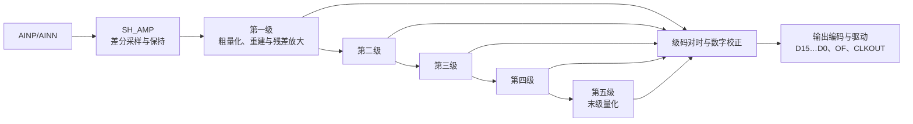

# 52 · LTC2217 全工程工作原理与 SH_AMP 逐图复核

2026-11-19。依据用户的 16 张 Virtuoso 图、DSH 35、附带的工程摘要、`techrevzwb/LTC2217a` 三个 OA 库及 LTC2217 数据手册。截图直接可见的连接用于追踪晶体管支路，未展开的内部网络用 OA 库名、master、引脚和公开功能交叉核查。文中的仿真预算为可复算示例。[DSH 35 号原文](<../DSH_md/35_LTC2217_SH_AMP晶体管级原理_20261119.md>) · [LTC2217 数据手册](https://www.analog.com/media/en/technical-documentation/data-sheets/2217f.pdf)

## 1. 整机如何转换一笔样本

LTC2217 是单通道差分、16 位、105 MS/s 的五级流水线 ADC。差分满量程 2.75 Vpp，典型输入共模 1.575 V。105 MS/s 时一拍 9.524 ns，规格中的七拍数据延迟约为 66.67 ns，输出引脚还有手册单列的传播延时和数据—时钟偏差。流水线填满后每拍可接受一笔新样本。以下相位用 ENC 的内部有效电平表达，开启占空比稳定器时，内部下降沿由稳定器重建。[手册时序表、时序图与占空比稳定器说明](https://www.analog.com/media/en/technical-documentation/data-sheets/2217f.pdf)

| 外部 ENC 时刻 | 样本 n 的位置 | 与其他样本的并行关系 |
|---|---|---|
| ENC 低 | 输入采样开关导通，输入电容跟踪 AINP/AINN | 较早样本在级间继续转换 |
| ENC 上升并进入高相位 | 输入开关关断，S/H 放大器保持样本，首级在此相采入 | 偶数级向后一级交付较早样本的残差 |
| ENC 回低 | 首级生成样本 n 的残差，二级采入 | S/H 开始跟踪样本 n+1 |
| 下一次 ENC 回高 | 二级生成样本 n 的残差，三级采入 | 首级采集样本 n+1 |
| 后续相位 | 第三和第四级重复，末级量化。校正路径对齐样本 n 的全部级码 | 输出端用规定的 CLKOUT 边沿接收码字及 OF |

项目根为 `G:/学习资料/techrevzwb/LTC2217a`。主库 `LTC2217` 有 230 份原理图和 229 份符号，`LTC2217_ALIB` 有 84 份器件和引脚符号，`LTC2217_DLIB` 有 52 份原理图及 52 份符号。顶层可核对 `SH_AMP`、五个具名流水级、`CLOCK_DRIVER`、`REFERENCE_CIRCUIT`、`CURRENT_SOURCE_2`、`TRIMMING_CTRL` 及校正区标注。当前目录缺少可重跑的展开 Spectre/CDL 网表。局部连接以下文截图为据，完整实例端接、有效工艺模型和精确级码权重仍待展开。[数据手册第 1、3、7–8、18 页](https://www.analog.com/media/en/technical-documentation/data-sheets/2217f.pdf) · [工程 OA 文件索引](../research/pipeline_engineering_20261119/pipeline_oa_inventory_20261119.json)

## 2. SH_AMP 的主信号路径及开关

附件图 1 是外层 `SH_AMP`，图 4 是内层 `S_H_AMP`。主电容的开关侧跟踪时接外部输入，保持时接放大器输出。主电容另一侧接放大器输入，承载存下的电荷和补偿注入。

| 图 1 的器件或单元 | 实见连接及其功能 |
|---|---|
| AINP/AINN、ESD1、M1288/M3263 | 两输入各有 ESD 支路，主信号分别经采样 NMOS 进入主电容。两管分别受 S 类自举时钟驱动。 |
| 上、下主 `pipcap`，下支可见 C275 | 各跨在输入/反馈侧和求和侧之间。子图内外的信号命名不同，差分极性以实际连线为准。 |
| M1149/M3265 | 各在主电容开关侧和对应保持输出之间。由 H 类时钟驱动，闭合时建立保持反馈。 |
| M1214/M921/M1211 与 V_CM2 | 求和侧可见共模接入与差分均衡支路。可用于设置起始共模、减小前史，确切开关先后从 EQ 类栅压及支路电流确证。 |
| U4 `SH_CALIBRATION2` | COMP_P 经 C52 耦合到 P 路主电容的开关侧，经 C17 耦合到 N 路的放大器输入侧。COMP_N 经 C32 耦合到 N 路开关侧，经 C51 耦合到 P 路放大器输入侧。交叉引线中间无连接点。 |
| U6 `SH_CALIBRATION` | ADJ1…3 及互补输出在图 1 中经右侧电容注入求和侧。U4 的五位控制另由 SH_AMP 边界进入。 |
| U1 `S_H_AMP` | 外层上支保持输出 VL_N 接 U1 的 OP，外层下支 VL_P 接 ON。单看 P/N 后缀会误判反馈方向。 |
| U5 `SH_CLK_GEN`、U2 `SH_BIAS` | 分别提供相位/栅驱动及偏置。 |

ENC 低相位下，S 开关闭合，外部驱动给采样电容充电。手册的每端等效模型给出约 7.3 pF 采样电容、1.8 pF 固有寄生、20 Ω 导通开关和 3 Ω 串联寄生。保持相转回跟踪时，上一拍仍在电容上，输入驱动要提供约 $C_s\Delta V$ 的转移电荷。例如每端阶跃 0.5 V，主电容需约 3.65 pC。孔径由 S 开关实际失去导通的时刻决定。S/EQ 的相对边沿影响注入位置，S/H 的间隔应防止输入和输出短时直通。进入保持后，H 路闭合，OTA 通过差分反馈恢复被采样的电压，一级在其采集相位读入。[手册第 18–19 页及图 1–2](https://www.analog.com/media/en/technical-documentation/data-sheets/2217f.pdf)

### 2.1 从采样电荷计算保持值

每支主电容开关侧记为 $b$，放大器输入侧记为 $x$，其余与 $x$ 相连电容上的电荷合并为 $q_o$。令 $s,h$ 分别表示采样结束和保持相，$Q_{inj}$ 为交接期间进入求和节点的净电荷。由 $q_x=C_s(x-b)+q_o$ 得

$$
C_s(b_h-b_s)=C_s(x_h-x_s)+(q_{o,h}-q_{o,s})-Q_{inj}.
$$

对 P、N 两支分别写式再相减。理想差分闭环使 $x_h-x_s$ 的差分分量接近零，输出保持采样差分值。COMP 跳变、寄生回冲和有限增益通过方程右侧引入误差。在一侧低阻、另一侧浮置的简化条件下，单支耦合电容使节点改变约 $C_c\Delta V_{comp}/C_{tot}$。完整差分修调量要计入两侧交叉支路和开关相位。

工程内 `LTC2217_ALIB/pipcap/symbol` 的可见字段为 **`s=`、`m=`**。SH_AMP 的 OA 含 `6601.81u`、`261.63u` 一类属性字符串。它们需与实例 CDF、模型及网表的电容实参对应，DSH 35 将图上数字直接写为 **201.63 fF** 的读法缺少依据。AMP4 的 R219/R771 同样使用 `l,w,m`。6.05u 是几何长度，若 17 单元并联并忽略边沿项，$R\approx R_{sheet}(6.05/0.60)/17=0.593R_{sheet}$。方阻未定时不能给出实际电阻。[附件图 1、5 与手册等效输入](https://www.analog.com/media/en/technical-documentation/data-sheets/2217f.pdf)

## 3. 差分放大器的晶体管路径

### 3.1 AMP4 提供第一级跨导和电压增益

图 5 的 M1362/M240 是 NMOS 输入对。栅分别接 VI_P/VI_N，漏分别通向 VO_N/VO_P，公共源节点接尾管 M1367。M1404 和 M1395 位于 IBNI 和 VBNI1 相关的偏置复制支路。M1007/M3311 顶部接 VDD，栅接 VBNI2，底端汇合后通过 R219/R771 给左右输出供电。**该单元 OA 的晶体管 master 只有 nmos。** M688 横接输出，栅受 `_EN` 控制，导通会均衡两侧。M18/M20 位于 `_EN` 相关电阻链下方，其堆叠连接可用于产生钳位电平，实际电位需用工作点求。

VI_P 升高会提高左支电流，使 VO_N 降低。若顶部公共节点近似差模交流地，增益初估为 $|A_4|\approx g_{m,in}(R_{poly}\parallel r_{o,in}\parallel R_{next})$。需要同时算输入一对管的热噪声、负载电阻噪声、尾电流噪声、下一级输入负载及允许的共模。实见连接支持电阻负载差分前置级，DSH 35 中的 PMOS 顶负载和 telescopic cascode 归类应修正。

### 3.2 AMP5 的上下局部调节和输出驱动

图 4 中 AMP4 的 VO_N 进入 AMP5 的 VI_P，VO_P 进入 VI_N。图 6 中真正由 VI_P/VI_N 驱动的输入器件为 **M584/M3312**。旁边 M331/M3313 是接地栅的对称支路。上侧 M73/M2843 的栅由 VBP2 偏置，AMP3 取样上侧内部节点并驱动 M362/M3395 的栅。下侧 AMP2 取样局部内部节点并驱动 M585/M3396 的栅。M593/M3321 等接 VCMFB 调节下拉支路电流。差分输出从上下支路相交的高阻节点取得。

上下调节支路的连线符合增益增强或调节共栅的读法。若局部反馈增益为 $T_b$，相关侧低频输出阻抗在简化小信号模型中约提升 $1+T_b$ 倍。大幅跃迁时需分别查看源电流和灌电流。AMP2 与 AMP3 在此处都是接入局部环的子放大器。管子面积和并联数只能用于推算驱动能力，无法单独判定 Class-AB 的导通方式。

**下侧 AMP2。** 工程留存的 AMP2 展开图中，M3319/M319 的源极分别接 GND，栅极分别接 VI_P/VI_N，漏极为 VO_N/VO_P。M1766/M466 和 M145/M143 组成上下堆叠的 PMOS 负载，由 VBPI2/VBPI1 分别偏置。C281 和 C34 并联跨在两个输出之间。差模对称半电路中，每侧等效加载 $2(C_{281}+C_{34})$，因两端摆幅等大反向。共模两端同向时，理想跨差分电容无交流电流。若单侧输出电阻为 $R_o$，单侧寄生电容为 $C_p$，该节点的一阶差模极点估计为 $[2\pi R_o(C_p+2(C_{281}+C_{34}))]^{-1}$。

**上侧 AMP3。** M166/M2849 漏极接 VDD，源极跟随并移位后驱动 M170/M2850 的栅。两组带 VBNI1/VBNI2 的下拉堆叠维持跟随支路电流。核心共源器件再把差分输入转换为输出电流，上方 PMOS 堆叠提供负载。R775–C278 和 C23–R99 各组成一条串联支路，两条并联跨在 VO_N 与 VO_P 之间。在两支路的 R、C 各自相等时，跨端导纳为 $Y_d(s)=2sC/(1+sRC)$。它随频率增加而逐渐加载差模输出。实际闭环的极零点还取决于局部增益、负载及其他节点。

两张展开图把 AMP2 的跨端电容和 AMP3 的跨端 RC 定到了实际网络。DSH 35 给出的 Miller 阻容解释、48 MHz 零点及相位裕量不能从这些连接和器件几何属性推出。分别测 AMP2、AMP3 的局部环、主差模环和共模环的环路增益才能建立定量结论。

管级计算先提取 $I_D$、$g_m$、$g_{ds}$、$V_{DS}$、$V_{DSAT}$。同一电流镜可用 $(W/L)m$ 比例做初值，精值需计入端电压和失配。对每侧输出，$I_{peak}\ge C_L\Delta V/t_{slew}$。类似 $8kT\gamma/g_m$ 的简化热噪声式单位是 V²/Hz，RMS 还要乘入噪声传递函数并积分，计入两级、负载电阻、采样折叠和共模转差模。增大输入对可能降低噪声与失配，也会抬高采样节点及中间高阻节点的寄生。

## 4. 共模反馈、偏置和自举

**图 4 的共模连接为 OP/ON → U5 CMFB → VCM_O1 → U2 SH_CMFB 的 VCM → VCMFB → AMP5。** `DUMMY_IN` 来自 VBNI3。该连线支持对输出共模的取样和偏置转换两段配合，DSH 35 所画的两个相互独立、分时直调 AMP5 的闭环需要修正。

- **图 8 的 CMFB。** 输出相关的 VI_P/VI_N 连成对采样电容和互补传输门。CLK3/_CLK3 驱动相位选择，V_CM、VBN3 参与参考和电容预置。`_CP_CLK` 还有一组输出侧开关电容支路。等容时，成对电荷转移将差分分量抵消，留下与两端平均值相关的共模量。若两边各为 $C_m$、共同节点等效电容 $C_T$，控制节点一次更新的量级可用 $2C_m\Delta V_{ocm}/C_T$ 初估。
- **图 7 的 SH_CMFB。** M3344 的栅接共模输入，源侧连接 VCMFB 控制节点。M3376 给顶部偏置，M3327/M3330 和 M648/M3866 在下部偏置支路。M3385/M3380 接 `_EN`，参与禁用状态的钳位。M3344 和 M648 在截图中没有组成对称的两输入差分对。动态上同时看 OP/ON 共模、VCM_O1 与 VCMFB，确定误差如何通过两段并回到 AMP5。
- **图 14 的 SH_BIAS。** 偏置入口 IBNI1/IBNI2，经镜像、电阻、堆叠管和滤波支路生成 VBPO1/2、VBNO1/2 和 V_OUT。`_EN`、BIAS_EN 设置工作状态。M1446/M1436 对应图中可见的反相控制。启动、关断与偏置恢复用供电缓升和 SHDN 退出分别检查。

| 时钟单元 | 依据截图核对的路径 |
|---|---|
| `SH_CLK_GEN`，图 9 | U11 RC_DELAY 的 AP_DELAY/AN_DELAY 接 U10 SCK_BOOTSTRAP；U10 生成 S_CLK/S_CLK_1 并回到 U11 的同名输入。U5、U9 各产生 H 类和 EQ 类栅驱动。 |
| `RC_DELAY`，图 10 | 两个 RC 支路分别接 AINN/AINP 及对应 S 时钟。DAC_RES_1/2 的 ADJ 控制位和 VCM 相关端口位于延迟/修调通路。仅凭 DAC_RES 名称无法把它们接到整机 PRBS dither。 |
| `SCK_BOOTSTRAP`，图 11 | 两个对称开关、电容泵支路以 AINP/AINN 相关电平为参考。截图能读到带 2VDD 的理想电位注释，输入项符号与实际高电平用瞬态复核。 |
| `HCK_BOOTSTRAP`，图 12 | 使用内部 VI_N/VI_P 作为跟随参考，图注给出 VI_N＋2VDD 一类泵电位。 |
| `EQCK_BOOTSTRAP`，图 13 | V_IN 经缓冲和门控，再经 C58/C80 等泵电容产生 EQ_CLK。图注为 V_IN＋2VDD。 |

自举基本过程是先给泵电容预充，再用相位切换抬升参考端。单次耦合的实际升幅受 $C_B/(C_B+C_{par})$ 限制。图中的 $2VDD$ 项描述指定节点的绝对电位，器件端间应力要看 $V_{GS}$、$V_{GD}$、$V_{DS}$、$V_{GB}$ 和结偏置随时间变化。原工程常见 0.35 µm 沟道标注，移植到 180 nm 时需按本地 PDK 重新验算全工况应力。

## 5. 改变采样电荷的校准、首级修调与整机抖动

| 环节 | 连接证据和工作原理 |
|---|---|
| `SH_CALIBRATION2`，图 1/2 | ADJ1…5 对应互补控制，MOS 选择驱动电平。两组汇总节点 COMP_P/COMP_N 可见带相同单位几何参数、约按 1/2/4/8/16 倍数排列的电容，以及固定或旁路支路。底板切换改变汇总节点的电荷，图 1 的耦合支路再把补偿送入 S/H。DSH 35 中“五位电阻串 DAC、32 个抽头”的归类应改为**五位控制的加权电容补偿网络**，实际码—电压关系需逐码测得。 |
| `SH_CALIBRATION`，图 1/3 | U6 的 IN1…4 取边界的同名信号，DUMMY_IN4/3/2 分别取 IN7/6/5，DUMMY_IN1 取 V_IN，`_CP_CLK` 实接 CLK1。传输单元与门逻辑生成 ADJ1…3 及对应反相信号，图 1 的右侧电容将反相输出耦合到 P 路、同相输出耦合到 N 路。U4 的五位控制从边界另行进入。当前图片所示逻辑不足以重建一个逐次逼近搜索控制器。验算时分别冻结和切换 U4/U6 控制，观察两者怎样作用于 held 值。 |
| `FIRST_STAGE_CALIBRATION`、`SECOND_STAGE_CALIBRATION`、`TRIMMING_CTRL` | 首级校准视图引用 TRIMMING_CALIBRATION1…3 与 ERROR_CORRECT_1，二级引用 TRIMMING_CALIBRATION4/5 与 ERROR_CORRECT_2。两份 ERROR_CORRECT 原理图都有 FUSE_SEL/FUSE_SEL_2、pipcap 和 VO_P/VO_N，二级还有 MOS 与 poly 电阻。它们具备模拟电荷或偏置修整的电路证据。公开框图的跨级数字校正和移位寄存器另行理解。修调字段及加载时机需跟踪有效端接。 |

以图 2 为例，设第 $i$ 路补偿电容为 $w_i C_u$，底板在一相位切换 $b_i\Delta V_i$，$C_{COMP,tot}$ 是浮置输出节点所见的总电容。第一阶更新近似为

$$
\Delta V_{COMP}\approx
\frac{\sum_i w_i C_u b_i\Delta V_i}{C_{COMP,tot}}.
$$

对 P/N 各写一次，核对固定支路、预充、并联寄生、输出负载和注入极性。再把两组 COMP 的台阶代入第 2.1 节的主采样电荷方程。扫完整 32 组控制码组合可以获得实际差分步长、可用范围以及每次更新的毛刺。不同码组合即使理论权重二进制，也可能受相位和固定支路影响。

**整机 DITH 与 RAND** 有独立的公开定义。开启 DITH 时，长伪随机序列经过精密 DAC 加到 S/H 后的信号，数字端按同一采样序号减去对应量。它主要降低弱输入时确定性的码相关杂散，匹配误差会留为残余噪声。RAND 在输出编码端用最低位与其他输出位异或，接收端用同一个最低位恢复原码，以减小总线活动与模拟输入的相关性。校准注入、模拟 dither 和输出数据随机化的时序和验收点各自独立。[手册第 24–25 页，图 13–15](https://www.analog.com/media/en/technical-documentation/data-sheets/2217f.pdf)

## 6. 首级 MDAC、后续级和数字输出

### 6.1 首级怎样把粗码变成残差

图 15 是 `FIRST_PIPELINED_ADC_STAGE`。可见阈值和判决相关的大量并行互连。图 16 给出 `AMP18` 的差分驱动和共模控制。逐层查找可使用下面这些原工程单元。

| 首级动作 | 实际 master 与信号 |
|---|---|
| 首级采样 | `BOOTSTRAP1`、`SWITCH_1`、`CLK_BUF_1` 和 pipcap。S/H 的输出同步送入比较和电荷存储支路，在保持输出已经建立后获取同一笔样本。 |
| 阈值与判决 | `FLASH_ADC1` 引用 `RES_22`、`COMP_CELL1`、`ADC_BIAS3`、`DEC_1`。另有 `ENCODE1`。可核对 32 个 VREFP 和 32 个 VREFN 索引及 DEC_A0…A4 标签。实际判决级数还取决于有效比较器、参考连线及过范围控制。 |
| 模拟重建 | `RESIDUE_CALCULUS1` 由 MOS、pipcap、poly 电阻和逻辑组成。粗码控制电容参考连接，从采样电荷中扣去重建值。先按导通表写采样与放大两相的电荷方程，再按电容比求残差增益。 |
| 残差驱动 | `AMP18` 包含 `AMP6`、`AMP7`、`AMP_BIAS1`、`CMFB4`。图 16 可见 M1377/M1397 差分输入对、M1745/M1753 尾支路、VCMFB 控制的成组负载，以及上下局部放大器。输出要驱动二级的采样电容。 |

粗比较器把孔径上的差分输入与各阈值比较，其输入对先把差压变成差电流，再形成并行判决。`COMP_CELL1` 在 OA 内引用 NMOS、PMOS、pipcap、反相器及 NAND，包含 VI_P/VI_N 和两路时钟标签。用于首次预算时，可把判决分为复位、输入压差形成初始差模电压、再生、数字出码四段。近阈值时再生时间可用 $t_{reg}\approx(C_{node}/g_{m,reg})\ln(V_{logic}/|\Delta v_{init}|)$ 初估。要确定复位节点和再生管对，需继续打开该单元的原理图或取网表。

待粗码有效后，MDAC 按码重排电容参考。参考缓冲在该瞬间提供 $\Delta Q=C\Delta V$，差分 OTA 产生与误差成比例的电流使电荷重新平衡。以单支等效电容为例，放大相若 $C_f$ 为反馈电容，$C_{in}$ 为输入电压系数对应的总采样电容，$C_k$ 为随粗码重接的单元，理想虚地处电荷守恒给出 $C_f r=C_{in}x-\sum_k C_k v_{r,k}(D)$。按实际管脚极性统一 $x,r$ 的符号后，可从输入项推出增益系数，从参考项推出逐码截距。保留在反馈中的电容、浮置支路和寄生电容均应纳入两相方程。

首级线性建立可用 $\Delta r\exp(-2\pi\beta f_u t)$ 初筛，反馈因子 $\beta$ 来自放大相电容矩阵。若测试时看到残差段斜率偏离理想，先核查电容比、有限环路增益和是否在锁存前建立完毕。若各段斜率相近而边界高度不合，则对照 DAC 单元电容、参考恢复和粗码选择。随后检查首级输出摆幅、过量程、共模环与二级采样回冲。

图 16 的 CMFB4 有时钟、共模和差分输出相关端口，返回电压控制图中成组负载。它与前端 S/H 的共模环各自服务自己的负载。用两个连续样本取相反极性，检查首级当拍残差是否随上拍变化。若参考、输入和粗码相同而残差仍不同，可进一步区分不完全复位、局部放大器建立、介质吸收和参考下陷。

### 6.2 后续四级与位权重构

| 工程视图 | 可识别的主要子单元 |
|---|---|
| `SECOND_PIPELINED_ADC_STAGE` | `FLASH_ADC2`、`RESIDUE_CALCULUS2`、`AMP13`、`ENCODE2`、`SECOND_STAGE_CALIBRATION`、保持自举与局部 RS 控制 |
| `THIRD_PIPELINED_ADC_STAGE` | `FLASH_ADC3`、`RESIDUE_CALCULUS3`、`AMP12`、`ENCODE3`、`BOOTSTRAP2` |
| `FOURTH_PIPELINED_ADC_STAGE` | `FLASH_ADC4`、`RESIDUE_CALCULUS4`、`AMP16`、`ENCODE4`、局部 RS 控制 |
| `FIFTH_PIPELINED_ADC_STAGE` | `FLASH_ADC_5`、`ENCODE5`、`CLK_BUF_5`、`IBIAS_2`，承担末级量化 |

按 OA 查看 `FLASH_ADC2`、`FLASH_ADC3` 和 `FLASH_ADC4`，分别可追到参考网络 `RES_19`、`RES_18` 和 `RES_16`。三者均有 VREFP/N 的 0–16 索引，其中 8 的两种差分拼写未在文本标签中出现。`FLASH_ADC_5` 则使用 `COMP_CELL5`、poly 电阻和 `ADC_5_DUMMY`。`ENCODE1…5` 各引用分层 ENCODE 子块和 SA_CELL 类型单元。这些是检查阈值梯、判决锁存和编码的直接入口。标签数量需结合实际单元实例和端接使用，不能视为已量得的阈值数。

设第 $i$ 级输入为 $x_i$，粗码 $D_i$ 的 DAC 重建值为 $q_i(D_i)$，实际残差增益为 $G_i$。理想递推为 $x_{i+1}=G_i[x_i-q_i(D_i)]$。五级最终估计为

$$
\hat x_1=q_1+\frac{q_2}{G_1}
+\frac{q_3}{G_1G_2}
+\frac{q_4}{G_1G_2G_3}
+\frac{\hat x_5}{G_1G_2G_3G_4}.
$$

其中 $\hat x_5$ 是末级量化结果。各级先用寄存器对齐到同一采样序号。粗判决即使在相邻码之间变动，只要残差仍落在后级线性范围且码权正确，后级可以补回差额。模拟增益误差、参考压降和饱和则会破坏这个条件。首级输出误差折回 ADC 输入约为 $e_1/G_1$，后级的折回系数还要除以前级增益乘积。

公开资料确认五级和最终 16 位。当前 OA 索引和图 15 的分辨率不足以推出“五级各四位”或“各级 G=8”。要确定 LTC2217 的真实位分配，逐级导出参考阈值、实际比较单元和 ENCODE 决策，扫粗码转移曲线，再将每段 DAC 选码、残差斜率和校正权重对上。

### 6.3 公共参考、时钟和封装输出

`REFERENCE_CIRCUIT` 有 `BANDGAP`、`VREF_GEN`、`RANGE_SELECT`、`IBIAS_ADJ` 及多路 `VBIAS`。参考波形影响 Flash 决策、MDAC 重建和各级工作点。SENSE 接 VDD 时使用内部 2.5 V 参考，亦可接 1.25 V 或 2.5 V 外部参考，这三种标称设置均对应 2.75 Vpp 差分满量程。VCM 引脚提供 1.575 V 共模，外接至少 2.2 µF 也用于稳定参考。内部 RANGE_SELECT 的模式映射需按工程顶层实查。瞬态检查记录最坏数字码跳变时参考支路的电流、压降和恢复。[手册第 20–21 页](https://www.analog.com/media/en/technical-documentation/data-sheets/2217f.pdf)

`CLOCK_DRIVER` 可跟到 `COMP_1`、`CLK_BUF`、`CLK_STABILIZER`、`CLOCK_LATCH`。ENC 判决经过占空比和相位处理，再分发到 S/H 和流水各级。手册给出最低转换速率 1 MS/s，因为长时间保持会积累漏电和下垂。输出模式由引脚配置，可用全速 CMOS、解复用 CMOS 或 LVDS。数据、OF 和 CLKOUT 应同时采集，偏移二进制/二补码和 RAND 配置由接收端明确记录。[手册第 14–18、22–25 页](https://www.analog.com/media/en/technical-documentation/data-sheets/2217f.pdf)

## 7. 能独立复算的整机数量级

| 项目 | 算式与口径 |
|---|---|
| 16 位名义码步 | $2.75/2^{16}=41.96$ µV/LSB，理想独立均匀量化噪声约 12.11 µV RMS。手册外部参考的转换噪声约 2 LSB RMS，即 83.9 µV RMS。 |
| 从 81.3 dBFS 折算 | 2.75 Vpp 满幅正弦约 0.9723 V RMS，按该噪声口径折算约 83.7 µV RMS。名义位数、SNR、SNDR 和 SFDR 分别使用各自定义。 |
| S/H 采样热噪声 | 以 300 K、7.3 pF/边计算，两支独立时 $\sqrt{2kT/C}=33.7$ µV RMS。若人为规定热噪声仅占半个名义 LSB，则需约 18.8 pF/边。这个电容是特定预算下的结果。 |
| 单极点建立 | 假设整个 4.762 ns 半拍都可用于线性建立，初始误差达到满量程且末端允许 0.5 LSB，$f_{cl}\ge\ln(2^{17})/(2\pi t)\approx394$ MHz。实际另扣比较、非交叠、压摆，并按实测步进和反馈因子求解。公开 400 MHz 是 S/H 全功率输入带宽，采用不同测试口径。 |
| 孔径抖动 | 只计器件 85 fs RMS，$SNR_j=-20\log_{10}(2\pi f_{in}\sigma_t)$。70 MHz 输入约 88.55 dBc，400 MHz 约 73.41 dBc，6.8 kHz 约 168.8 dBc。板上还应计外部 ENC 的时间噪声和确定性 X/Y 时差。 |

这些计算能对读图结果做量级检查。工程的精确电容、器件静态电流、三相波形、OTA 极点、实际有效码位和整机 ENOB 仍需从分层网表与仿真取得。[手册第 2–4、17–19 页](https://www.analog.com/media/en/technical-documentation/data-sheets/2217f.pdf)

## 8. 可执行的 Virtuoso 对拍顺序

1. **SH_AMP。** 用小正弦和可控阶跃记录 AINP/AINN、主电容两侧、S/H/EQ 栅压、开关支路电流与 OP/ON。按导通时刻确定孔径、反馈极性和非交叠。改变前一拍幅度、驱动阻抗与保护时长，测 held 值和一级采样边沿之间的误差。
2. **共模与修调。** 固定差分幅度，扫描输入共模及 SHDN 启动，测 VCM_O1、VCMFB、输出共模。U4 与 U6 分别排查，扫真实控制码、量实际 COMP 码步和 held 差分增量。共模环、局部增益环及差模环独立量环路裕量。
3. **首级和整机。** 首级以差分慢斜坡遍历参考阈值，逐码拟合残差斜率和截距，记录残差最坏越界及可允许的比较器偏移。接实际二级负载后复测。继续取得后续级增益和码权，按样本 ID 重构并核对七拍、OF、输出编码、DITH 和 RAND。
4. **用于全角陀螺。** 180 nm 首版借鉴分相采样、独立共模控制、首级电荷守恒与样本对齐。用相同的 6.8 kHz 弱信号叠加不同的前一驱动窗历史，先测输入何时恢复，再测 ADC 额外需要等待多久。10 位/10 MS/s 可做 Pipeline 调通规格，系统位宽、速率和有无窗口复位按有效窗里的 I/Q、低速方向及角误差验收。[全角 ADC 工程复核](50_三套Pipeline_ADC工程复核与180nm实现_20261119.md)

## 9. 16 张附图与工程单元

下列单元均可在 `techrevzwb/LTC2217a/LTC2217/<cell>/schematic/sch.oa` 定位。图 15 是首级全图，细节需进入其子单元。

| 附图 | 对应单元与读图重点 |
|---|---|
| 1 | SH_AMP，主采样和保持反馈、补偿注入及顶层器件编号 |
| 2–3 | SH_CALIBRATION2、SH_CALIBRATION，加权电容及真实/dummy 门控 |
| 4–6 | S_H_AMP、AMP4、AMP5，差分极性、负载及局部放大器端接 |
| 7–8 | SH_CMFB、CMFB，共模取样与偏置转换 |
| 9–13 | SH_CLK_GEN、RC_DELAY、SCK_BOOTSTRAP、HCK_BOOTSTRAP、EQCK_BOOTSTRAP，自举驱动及相位 |
| 14 | SH_BIAS，多路偏置和使能 |
| 15–16 | FIRST_PIPELINED_ADC_STAGE、AMP18，Flash/DAC 接口、首级 OTA 和 CMFB4 |
