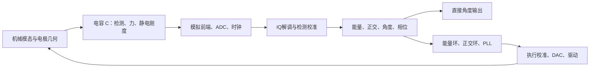

# 全角HRG：新增文献后的设计优化与双层解释

日期：2026-10-26。对象是本工程的n=2电容式全角HRG；不是任意MEMS陀螺的通用参数表。本文件给出独立推导、数值代入及对应优化项，保留V7、V8、WZ已封存模型。下文的算例参数仍是假设，不能当作未知实物表头的标定结果。

## 1. 先回答：值得优化什么

不需要推翻“两模态机械模型→电容接口→IQ→三环→全角输出”的骨架。应优先完善参数的参考面和辨识顺序，而不是先增加滤波器或神经网络。

|优先级|优化项|为什么|当前工程状态|
|---|---|---|---|
|P0|统一物理角/模态角、位移/电压、力/单位质量力，以及频率测量时的偏置电压|错一个2或重复加入静电弹簧，会形成系统性错误|原推导已有单位约定；本轮补充偏置参考的显式要求|
|P1|先标检测矩阵，再估阻尼，最后估执行矩阵|检测误差既扭曲角度，也污染能量和衰减斜率|V8/WZ有合成夹具冻结逆；真实跨模式标定流程尚未实现|
|P1|加入偏置电压扫描与刚度各向异性矢量拟合|频裂大小是矢量的模，不能总按一条直线拟合|本轮推导和合成代数检查；未改载波模型|
|P1|区分两轴检测相位与整个控制环路相位|共同PLL不能修复两轴差相位；正交力泄漏可能造成大偏差|当前冻结单点校准不能代表全温/全幅度复相位标定|
|P2|分开处理检测非线性与执行非线性，联合选工作振幅|信号更大可减小相对噪声，也会增大电容非线性|已有三次检测逆；一般非线性执行逆未实现|
|P2|给在线辨识增加工况、秩、协方差与饱和门控|未知运动或共线回归量，不能靠多迭代解决|已有独立平均模型探索；未成为完整在线校准器|
|维持|直接角度输出与速率滤波分开|避免把滤后速率积分的启动误差带入角度|WZ已做独立输出支路；本轮不把它重复算成新功能|

通俗解释：先校准“尺子”，再测“弹簧和阻力”，最后校准“推它的手”。尺子歪了，就算换一个更复杂的计算器，也可能算得更稳定但仍然算错。



常用符号：m为有效模态质量，A为米单位振幅，a=A/Aref为归一化振幅，g为电极间隙，ω0=2πf0为弧度频率，γ为振幅衰减率，Qm为机械品质因数，Qq为正交不变量，B为物理驻波角/载体角的角增益。下文机械损耗公式中的Q均指Qm；不能把它与IQ组合得到的正交量混用。

## 2. 来源的证据等级

本轮使用以下新题录及已有全文补充，并不声称365条导入题录已全部通读。

|来源|已获得的证据|用于什么|不作什么声称|
|---|---|---|---|
|Cheng等2025，10.3390/act14060275|本地完整16页PDF；阅读PDF3–13，视觉检查PDF6、11；路径与SHA见sources.json|检测增益与阻尼耦合，FTR定方位标定的思路及变量映射|不直接复制其全部系数；不移植样机性能|
|Deng等2025，10.1109/TIM.2025.3555670|[IEEE出版方摘要](https://ieeexplore.ieee.org/abstract/document/10964523/)|三类误差需要分离，以及DQC特殊工况这一方法方向|未取得全文，不把下面的具体公式归因于其原文|
|Deng等2024，10.1016/j.measurement.2024.114308|[出版方摘要及要点](https://www.sciencedirect.com/science/article/abs/pii/S0263224124001921)|改变偏置电压，联合观察频裂和主轴来区分误差来源|不是已读正文；下文为从C(q)出发的独立小信号推导|
|Wang等2024，10.1016/j.measurement.2024.114945|[出版方摘要及章节预览](https://www.sciencedirect.com/science/article/pii/S0263224124008303)|检测与静电执行非线性应同时考虑这一问题定位|不声称复现其优化器、完整模型或实验|

已有V8的机械积分、电路负载反作用、检测三倍频与执行非线性来源仍见[原20节主推导](../../HRG_WA_simulink/literature_v8_research/docs/mechanics_to_algorithms.md)。本轮新增来源的摘要只支持上表的方法方向，后文公式由本工程的统一定义推导。

## 3. 三个“角”先分清

设载体转角为ψ，角速度Ω=ψ̇；设驻波在壳体圆周上的物理方位为θ；设两个模态坐标平面中振动直线的方位为α。n=2模态的边缘位移写为

\[
u_r(\chi,t)=x(t)\cos2\chi+y(t)\sin2\chi.
\tag{1}
\]

对于一条纯驻波，取

\[
x=A\cos2\theta\cos\omega_0t,\qquad
y=A\sin2\theta\cos\omega_0t.
\tag{2}
\]

因此α=atan2(y的包络,x的包络)=2θ。Cheng原文的椭圆方位θ对应这里的α，而非这里的物理θ；其方程的转动系数k对应本工程2B。下文始终使用本工程的θ、B。

通俗解释：沿壳体转动45°，n=2的波形在两个数学坐标中已经转了90°。这不是软件故意放大，而是四波腹形状的几何性质。

## 4. 机械结构怎样缩成两个振子

### 4.1 从连续壳体得到M与K

真实壳体每个位置都能移动。用两个主要模态近似：u(r,t)=Φx(r)x(t)+Φy(r)y(t)。令Φ无量纲，并把指定唇缘观测点的位移归一为1，那么x、y单位为米。

动能和应变能分别为

\[
T=\tfrac12\int_V\rho|\dot u|^2dV
=\tfrac12\dot q^TM\dot q,\quad
U=\tfrac12\int_V\epsilon(u):\mathsf C:\epsilon(u)dV
=\tfrac12q^TKq,
\tag{3}
\]
\[
q=[x,y]^T,\quad M_{ij}=\int_V\rho\Phi_i\cdot\Phi_jdV,\quad
K_{ij}=\int_V\epsilon(\Phi_i):\mathsf C:\epsilon(\Phi_j)dV.
\tag{4}
\]

将(3)代入Lagrange方程d/dt(∂T/∂q̇)−∂T/∂q+∂U/∂q=F，并加入耗散，得到Mq̈+Dq̇+Kq=F。模态频率由det(K−ω²M)=0求得。理想对称时M=mI、K=mω0²I。

所以只知道“谐振频率5kHz”，不能分别求出m和k：所有满足k/m=(2π5000)²的组合都可能。还需几何/FEM模态质量或实验标定。

通俗解释：把整个壳体的运动投影成两种最主要的“变形姿势”。m是这个姿势参与运动的等效质量，不是直接拿秤称出的整个表头重量。

### 4.2 加入转动，为什么输出是角度

在慢角速度、忽略Ω²及角加速度高阶项的近似下，按本工程定义写

\[
\ddot q+2\Gamma\dot q+K_nq+4B\Omega J\dot q=F/m,
\quad J=\begin{bmatrix}0&-1\\1&0\end{bmatrix}.
\tag{5}
\]

B由结构模态和科氏投影积分确定，不能对所有半球都取.4或1。教学圆环的.4与工程假设半球的.277不能互换。

令n=[cos2θ,sin2θ]ᵀ、q=A n cosω0t。因为ṅ=2θ̇Jn，忽略慢量二次项，有

\[
\dot q\simeq-A\omega_0n\sin\omega_0t+2A\dot\theta Jn\cos\omega_0t,
\]
\[
\ddot q\simeq-A\omega_0^2n\cos\omega_0t
-4A\omega_0\dot\theta Jn\sin\omega_0t.
\tag{6}
\]

忽略损耗和外力，将(6)代入(5)。弹簧项抵消第一项，剩下−4Aω0(θ̇+BΩ)Jn sinω0t=0，所以

\[
\dot\theta=-B\Omega,\qquad
\psi(t)-\psi(t_0)=-[\theta(t)-\theta(t_0)]/B.
\tag{7}
\]

例：假设B=.277，载体转100°，驻波相对壳体转−27.7°。全角模式让驻波自由转动，同时维持其能量、抑制正交、跟踪载波相位；它不把驻波锁死在一个固定方向。必须保留式(5)适用范围，高角加速度不能仅凭恒速验证通过来签核。

通俗解释：驻波像一个尽量保留原方向的振动“图案”。外壳转了，图案相对外壳的位置就变了；测图案位置即可得到转角。维振控制是补充摩擦损失，不能一直朝固定方向推而强迫图案跟着走。

### 4.3 B不是凭经验插入的常数：从转动动能继续推

在随壳体转动的坐标中，空间点的惯性速度为u̇+Ωez×(r0+u)。对理想对称n=2模态，扣除刚体运动及与这两个模态不耦合的平衡项，保留小振动的二次动能；沿前述两个固定模态投影后展开为

\[
T=\tfrac12\dot q^TM\dot q+\Omega\dot q^TCq+
\tfrac12\Omega^2q^TH_{rot}q,
\quad C_{ij}=\int_V\rho\Phi_i\cdot(e_z\times\Phi_j)dV.
\tag{7a}
\]

C是反对称矩阵，因为a·(ez×b)=−b·(ez×a)。求导得到∂T/∂q̇=Mq̇+ΩCq，d/dt项为Mq̈+Ω̇Cq+ΩCq̇；另一方面∂T/∂q=−ΩCq̇+Ω²Hrot q。因此完整投影式中出现

\[
M\ddot q+2\Omega C\dot q+\dot\Omega Cq
-\Omega^2H_{rot}q+D\dot q+Kq=F.
\tag{7b}
\]

在等质量二模态坐标中写C=cJ、M=mI，将科氏项2ΩCq̇/m与(5)的4BΩJq̇比较，得到B=c/(2m)。这说明B依赖模态形状与结构积分，包括支撑/柄部对模态的影响，不能仅由谐振频率决定。改变模态基底的方向可能改变符号约定，应同时固定坐标和转动正方向。

这也明确了(5)省略的是什么：不是所有情况下都没有角加速度或离心项，而是本节先在慢速/慢变化条件下忽略它们。二维简化模型以外的其他模态也可能影响快速转动，需FEM或更高阶模型验证。

通俗解释：B衡量的是“这个变形姿势有多容易感受到旋转”。壳体看起来差不多、频率也一样，内部运动分布不同，B仍可能不同。

## 5. 同一个电容函数导出检测、驱动和静电刚度

### 5.1 单电极与两电极的区别

对一个平板电极C(x)=εA_e/(g−x)=C0/(1−x/g)。对x求导：

\[
C'(x)=\frac{C_0/g}{(1-x/g)^2},\quad
C''(0)=2C_0/g^2.
\tag{8}
\]

若电极保持直流偏置Vb，运动电流i=d(CVb)/dt≈Vb(C0/g)ẋ。若x=Acosω0t，则峰值Ipk=Vb C0ω0 A/g。

取C0=1pF、Vb=10V、g=5μm、A=100nm、f0=5kHz：先算A/g=.02，电容变化峰值C0 A/g=20fF，再算Ipk=10×31415.93×20fF=6.283nA。

恒压电源下的广义静电力由电共能求：F=∂(CV²/2)/∂x=V²C'(x)/2。这里的正号包含电源做功，不能只对孤立电容场能取负号后当成恒压力。

对相向两电极的简化推挽结构，令两侧电压Vb±v，得到

\[
F_{net}=\frac{C_0}{2g}
\left[\frac{(V_b+v)^2}{(1-x/g)^2}
-\frac{(V_b-v)^2}{(1+x/g)^2}\right].
\tag{9}
\]

在x=0处，Fnet=2C0 Vb v/g；在v=0附近，位移项为2C0 Vb²x/g²，等效减少弹簧刚度2C0 Vb²/g²。真实电极需加模态参与系数及空间积分，因此不能把此单对系数直接代入所有16电极表头。单个电极的DC力可远大于净维振力，相向的DC项会互相平衡。

通俗解释：检测是“动一下，电容变一下”；驱动是“电压把它拉一下”；静电刚度是“越靠近，拉力增加得越快”。三件事来自同一电容，不能分别随意指定互不相干的增益。

### 5.2 多电极统一表达

令gj=∇q Cj(0)、Hj=∇q² Cj(0)。线性项给

\[
i_j\simeq V_{bj}g_j^T\dot q,\quad
F\simeq\sum_j\left(\tfrac12V_{bj}^2g_j+V_{bj}v_jg_j+
\tfrac12V_{bj}^2H_jq\right).
\tag{10}
\]

于是驱动矩阵的第j列是Vbj gj，静电刚度修正是−ΣVbj²Hj/2。检测、执行及电调的物理误差可以相互关联，但其电子增益和相位仍是不同路径。

优化要求：表头配置应注明C0是单电极、半差分还是总电容；驱动参与系数如何归一化；f0、Q及主轴是在哪个偏置、温度、振幅下测得。否则即使每个参数单独合理，组合后的模型也可能不代表同一台表头。

## 6. 从位移到IQ，再从IQ到角度

为避免半幅约定混乱，这里用2cos和−2sin解调，使理想低通后直接得到复包络z。若使用单位幅cos/sin，所有IQ先乘2后再用本节公式。

理想纯驻波归一化包络为z=e^{jφ}a[cos2θ,sin2θ]ᵀ。更一般的椭圆可写z=e^{jφ}(a n+j b Jn)，其中b的符号按本工程约定。设zx=Cx+jSx、zy=Cy+jSy，计算

\[
E=|z_x|^2+|z_y|^2=a^2+b^2,
\]
\[
R=|z_x|^2-|z_y|^2=(a^2-b^2)\cos4\theta,
\quad S=2\Re(z_x^*z_y)=(a^2-b^2)\sin4\theta.
\tag{11}
\]

公共相位φ在绝对值和共轭相乘中消失。因此W=R+jS=(a²−b²)e^{j4θ}，

\[
\theta=\tfrac14\arg W,\quad
\hat\psi=-\frac{\operatorname{unwrap}(\arg W)-\arg W_{epoch}}{4B}.
\tag{12}
\]

必须使用atan2，并展开4θ而不是先把θ随意展开。若a≈|b|，W≈0，椭圆接近圆，主轴方向本来就难以定义；应输出无效，不能靠atan2得到一个数就当可靠角度。

通俗解释：四个IQ数是“两条测量通道，各自与正弦、余弦对照后的结果”。R、S相当于一个指针的横纵坐标；atan2读出指针方向。这个指针转了4倍的物理方位，所以最后要除4。

WZ已经采用直接几何角度支路，滤后的速率只用于速率输出。它仍有前端及滤波延迟，并不等于零延时测量；丢失相位连续性后也不能自动找回圈数。

## 7. 优化一：检测增益必须在算不变量之前校正

### 7.1 一点点增益不等，怎样变成角度误差

先看b=0、载波相位已对齐、只剩实数增益的简单情况。令κy/κx=r，公共增益约去，测量包络为xm=a cosα、ym=ar sinα，α=2θ。因而

\[
\hat\theta=\tfrac12\operatorname{atan2}(r\sin2\theta,\cos2\theta).
\tag{13}
\]

这个微分可以从tanα=y/x直接算：两边求微分，sec²α dα=(xdy−ydx)/x²；再乘cos²α=x²/(x²+y²)，得到dα=(xdy−ydx)/(x²+y²)。atan2在局部使用同一个导数，但还能保留正确象限。设r=1+ε，dx=0、dy=εa sinα，代入得δα=εsinαcosα=εsin2α/2，再除2得到

\[
\delta\theta=\frac\epsilon4\sin4\theta+O(\epsilon^2),\quad
\delta\psi=-\frac\epsilon{4B}\sin4\theta.
\tag{14}
\]

因此r−1=100ppm时，假设B=.277，载体角误差峰值约100e−6/(4×.277)=90.25μrad=.00517°。如果分配给检测增益残差的角误差只有1μrad，则必须满足|ε|≤4B×1e−6=1.108ppm。该约束是校准后残差要求，不是要求两只未校准电阻天然匹配到这个水平。

再对(13)求导，可得到精确关系

\[
\frac{d\hat\theta}{d\theta}=
\frac r{\cos^22\theta+r^2\sin^22\theta}
=1+\epsilon\cos4\theta+O(\epsilon^2).
\tag{15}
\]

它乘在真实θ̇上，所以检测增益既造成角度位置畸变，也造成随方位变化的速率标度。若实际θ̇还包含阻尼漂移h(θ)，测得的漂移也被这个导数相乘；这就是不能将两个误差完全独立拟合的原因之一。

通俗解释：把圆的横轴放大一点，圆就变成椭圆。你按“正圆”的刻度读角度，同样的真实转动在不同位置会读得有快有慢。

### 7.2 能量也被这把歪尺污染

同一情形下测得的能量不是a²，而是

\[
E_m=a^2g(\theta),\quad g=\cos^22\theta+r^2\sin^22\theta
\simeq1+\epsilon-\epsilon\cos4\theta.
\tag{16}
\]

如果能量控制器只让Em恒定，则真实a²=Em/g也随方位变；一阶振幅约a≈√Em[1−ε/2+(ε/2)cos4θ]。这不等于“理想标量能量控制一定改变进动角”，但在非线性或执行方向误差存在时，它给其他耦合误差提供了幅度调制。

一般测量矩阵ym=Ds z时，真正的能量应由

\[
z_c=D_s^{-1}y_m,\quad E=z_c^Hz_c
=y_m^H(D_s^{-H}D_s^{-1})y_m
\tag{17}
\]

得到。应先校准IQ，再统一计算E/Q/R/S/PLL误差信号；不能只在最后角度输出减一个4θ正弦，而能量环和正交环仍使用错误IQ。

本工程V8/WZ已经采用“校准先于不变量”的结构，但矩阵来自合成夹具。新增文献带来的工作重点是如何用真实可辨识工况获得Ds，而不是重复增加一个矩阵逆。

## 8. 优化二：阻尼辨识要使用校准能量和完整功率平衡

### 8.1 机械阻尼的定义与死区

定义振幅衰减率γ=ω0/(2Q)，阻尼矩阵

\[
\Gamma=\gamma I+\frac{\Delta\gamma}{2}
\begin{bmatrix}\cos4\beta_d&\sin4\beta_d\\
\sin4\beta_d&-\cos4\beta_d\end{bmatrix}.
\tag{18}
\]

两个振幅本征衰减率为γ±Δγ/2。自由振幅按e^(−γt)衰减，能量按e^(−2γt)衰减。不能把振幅时间常数与能量时间常数混用。

令q=Aref Re(z e^{jω0t})，把q̇、q̈展开，忽略z̈和慢量乘积，(5)中2jω0 ż除以2jω0后给出

\[
\dot z=-\Gamma z+jHz-2B\Omega Jz+h,
\quad h=\frac{F_c}{2jm\omega_0A_{ref}}.
\tag{19}
\]

Fc是实际力F=Re(Fc e^{jω0t})的复幅值。h的单位是s⁻¹，因为z已用Aref归一。不是把牛顿单位的力直接填进无量纲包络。

在纯驻波z=a n且忽略正交残差时，先算nᵀΓn=γ+(Δγ/2)cos4(θ−βd)、(Jn)ᵀΓn=−(Δγ/2)sin4(θ−βd)。n方向的左侧是ȧ，Jn方向的左侧是2aθ̇，因而分别得到

\[
\frac{\dot a}{a}=-\gamma-\frac{\Delta\gamma}{2}\cos4(\theta-\beta_d),
\quad
\dot\theta=-B\Omega+\frac{\Delta\gamma}{4}\sin4(\theta-\beta_d).
\tag{20}
\]

后一式来自ṅ=2θ̇Jn，因而还要除2。令θ̇=0，可知当|Ω|≤|Δγ|/(4B)时存在锁定位置。Δγ=.00025/s、B=.277时阈值为46.54°/h，这是简化模型阈值，不是实测分辨率。

### 8.2 为什么检测误差可能被误认成阻尼

因为E=a²，(20)给−(1/2)dlnE/dt=γ+(Δγ/2)cos4(θ−βd)。但未校准时Em=E g(θ)，所以

\[
-\tfrac12\frac{d\ln E_m}{dt}=
\gamma+\frac{\Delta\gamma}{2}\cos4(\theta-\beta_d)
-\tfrac12\frac{g'(\theta)}{g(\theta)}\dot\theta.
\tag{21}
\]

由(16)，g′≈4εsin4θ，最后一项约−2εθ̇sin4θ。它恰好也落在阻尼辨识常用的4θ基函数中。

代入ε=.01、Ω=80°/s、B=.277：θ̇≈−.386765rad/s，假阻尼正弦系数约.007735/s；真实Δγ/2只有.000125/s。用精确g而不是一阶式进行角度扫描拟合，得到假系数.0076968/s，约为真实各向异性系数的61.6倍。这是独立代数扫描，尚非新增闭环实跑。

若先按(17)校正，再拟合[1,cos4θ,sin4θ]，就可在理想模型下恢复γ、Δγ和βd。后两者由dc=(Δγ/2)cos4βd、ds=(Δγ/2)sin4βd反算：Δγ=2√(dc²+ds²)、βd=atan2(ds,dc)/4。

实际数据中，能量接近测量噪声底时lnE会有偏差，数值求导还会放大噪声。应设高于噪声底的有效窗，采用带噪声模型的局部拟合/状态估计，并保留原始数据和置信区间，不能仅对每帧logE相减后直接更新阻尼参数。

通俗解释：图案转到“读得偏大”的方向时，仪器会觉得振幅衰减变慢；转到“读得偏小”的方向时，又觉得衰减变快。这种读数变化会伪装成方向相关的机械摩擦。

### 8.3 DQC和衰减测试不能忘记仍在工作的控制力

IEEE新文献提出在特殊DQC工况分离三类误差，可借鉴其“改变工况让不同误差显露”的方向。但本工程应从能量守恒重新检查：

\[
\dot E=-2z^H\Gamma z+2\Re(z^Hh),
\quad
\dot{\mathcal E}=-\langle\dot q^TD\dot q\rangle+
\langle F^T\dot q\rangle.
\tag{22}
\]

这里利用H实对称、J反对称，使刚度和科氏项对总能量不做平均净功。实际记录还要包含控制、探针和噪声等功率来源。关掉维振环，不代表仍工作的正交环、探针和延迟误差都不做功。若不能忽略控制功率，应从衰减估计中扣除经执行标定后的功率，或缩小到满足近似的测试工况。

## 9. 优化三：跨模式标定先解决“能不能分开看见”

### 9.1 一个输入输出模型不自动给出三个物理矩阵

先在冻结或短时不变的检测矩阵下，设ż=A z+Da u、ym=Ds z，则ym满足

\[
\dot y_m=(D_sAD_s^{-1})y_m+(D_sD_a)u.
\tag{23}
\]

任取可逆T，令z′=Tz、Ds′=DsT⁻¹、A′=TAT⁻¹、Da′=TDa，这两个输入输出组合不变。所以一般状态辨识只能得到组合，不能自动唯一给出全部物理误差。加入阻尼对称性、已知角增益等约束会缩小歧义，但T=cI的公共幅度尺度歧义仍需质量/位移/执行等独立参考解决。

若Ds本身随时间变化，(23)还应增加Ḋs Ds⁻¹ ym；不应将这个读出漂移项直接解释为机械阻尼变化。矩阵逆也可能放大噪声，应同时记录最小奇异值和校准后的噪声协方差，而非只比较拟合角度误差。

通俗解释：只看“推了一下，屏幕动多少”，不能确定是手推大了、尺子放大了，还是机械本身变灵敏了。

### 9.2 FTR定方位标定能借鉴什么，不能省略什么

Cheng原文在FTR模式固定模态方位，再把识别参数用于WA。按其归一化斜率框架，理想等幅、标度与执行路径可比较时，可概括为p0=C r Ω+b0、p90=C Ω/r+b90。对正负转台输入拟合斜率s0、s90，常量偏置被分开，r=√(s0/s90)。原文0°/90°是模态平面角，对应物理0°/45°。

但若两次路径还有不同未知系数h0、h90，则r估计值变成r√(h0/h90)。即便做了反转测试，4%的路径比差仍可约造成2%的检测增益估计偏差。移植时必须记录物理幅度、DAC/驱动标度、切换负载与温度，而不是只看到两个斜率就认定所有误差已经分离。

一般多参数回归y=Xβ+n应按噪声协方差Σ加权，参数信息矩阵为XᵀΣ⁻¹X。列归一化后检查SVD，且要求信息量足以让参数协方差达到预算；不能只检查矩阵“能求逆”。未知外界运动若与探针同频，还需要已知工况许可或额外观测。

对应V7优化：先增加离线标定状态机/数据格式和独立参考，再考虑把慢速估计迁入现有RLS/EKF。仅把离线最小二乘替换为RLS，不会创造可观测性。

## 10. 优化四：偏置扫描拟合“刚度矢量”，并注明参考偏置

### 10.1 为什么直流电压会改变频率

由(10)，在固定模态形状与小位移条件下，电压随同一个V缩放时

\[
K_{eff}(V)=K_{mech}-\tfrac12 V^2H_\Sigma.
\tag{24}
\]

若实测f0本来就在Vref下得到，模型应使用

\[
K_{eff}(V)=K_{eff}(V_{ref})-
\tfrac12(V^2-V_{ref}^2)H_\Sigma,
\tag{25}
\]

而不是从这个已经软化过的f0再次减去V²HΣ/2。需要保留机械刚度与静电力的载波实现时，应反推出Kmech=Keff(Vref)+Vref²HΣ/2，然后让精确静电力计算产生软化；也不能既保留精确力中的线性位移项，又在弹簧支路重复减一次。

合成例：Vref=10V时两模态均测得5000Hz。假设质量归一后的静电系数P=diag(20,12)s⁻²/V²。错误地再减100P后，两频率变成4999.994934Hz与4999.996960Hz，凭空引入2.026mHz频裂。系数P只是教学值，不是本机实测参数。

通俗解释：原始频率可能已经包含“电压把弹簧拉软”的效果。再次扣除，就像商品标价已打折，你又把同一折扣扣了一遍。

### 10.2 为什么要联合测主轴

在固定质量归一坐标中把对称刚度矩阵写成

\[
K_n(V)=\bar\lambda(V)I+
\begin{bmatrix}u(V)&v(V)\\v(V)&-u(V)\end{bmatrix},
\quad [u,v]^T=a_0+a_2V^2.
\tag{26}
\]

特征值为λ1,2=λ̄±√(u²+v²)，并有ω1,2=√λ1,2。若较大特征值的模态平面主轴为αk、物理主轴βk=αk/2，则

\[
\begin{bmatrix}u\\v\end{bmatrix}=
\frac{\omega_1^2-\omega_2^2}{2}
\begin{bmatrix}\cos4\beta_k\\\sin4\beta_k\end{bmatrix}.
\tag{27}
\]

所以测频率和主轴后，分别对u、v作V²回归即可。只拟合频裂大小，相当于拟合|a0+a2V²|，当两矢量不共线或接近抵消时，它不是直线。零频裂附近主轴本来就不稳定，不应把噪声角度当可信数据。

式(27)也可直接验证：将主轴矩阵diag(λ̄+d,λ̄−d)旋转αk后，差分对角项为d cos2αk，非对角项为d sin2αk；由于αk=2βk，便出现cos4βk和sin4βk。不是任意在拟合式中放入4倍角。

代数算例取a0=[800,−600]s⁻²，a2=[−11,8]s⁻²/V²，V=5、7、9、11V；先构造刚度矩阵，再只从其特征频率/主轴重建矢量并回归，恢复a0和a2的最大误差为2.17e−8s⁻²量级。

这里截距只代表“在该模型下与偏置无关的有效结构各向异性”。它不等于凭两模态数据唯一反演所有质量分布；材料刚度、边界和模态归一化也会影响截距。高电压静态变形、温升或模态变化会使HΣ不再常量，需要检查V⁴残差、扫描往返滞后及温度。

若电极电源存在有限阻抗，电极电压也不再是理想恒压；机电负载可同时产生频率相关的刚度和耗散。因此偏置扫描还应记录Q、控制相位和负载条件，不能把所有V²变化都无条件解释为纯静电刚度。增加Vb虽能提高检测电流和施力增益，也会增强这些V²效应。

优化配置建议：后续参数集中表加入`frequency_reference_bias_v`、`frequency_reference_amplitude_m`、`frequency_reference_temperature_c`，并明确f0是机械未偏置还是参考偏置下的频率。本轮仅提出字段与校验要求，未改封存配置文件。

## 11. 优化五：相位误差不能只给一个笼统指标

### 11.1 两轴差相位，为什么会变成假正交

设增益已校准，真实z=a[cos2θ,sin2θ]ᵀ，两轴还相差δφ。公共相位约去，测量zx=a cos2θ，zy=a sin2θ e^{jδφ}。

这时R=a²cos4θ，S=a²sin4θ cosδφ，而一个正交不变量Qq=2Im(conj(zx)zy)=a²sin4θ sinδφ。因sinδφ≈δφ，假正交是一阶误差；但cosδφ≈1−δφ²/2，故δR=0、δS≈−a²δφ²sin4θ/2。再代入δθ=(RδS−SδR)/[4(R²+S²)]，得到−δφ²cos4θ sin4θ/8，最后用2sin4θ cos4θ=sin8θ，得到

\[
\delta\theta\simeq-\frac{\delta\phi^2}{16}\sin8\theta.
\tag{28}
\]

不能据此说相位误差不重要，因为控制器会对这个一阶假正交施加真实控制力。公共PLL相当于给两轴同时旋转同一个复相位，不能消掉它们之间的差相位。

通俗解释：两个通道像两个人看同一件来回运动的东西，一个人的表慢了一点，软件便会误以为两个方向没有同时振动，从而“纠正”一个原本不存在的椭圆运动。

### 11.2 控制环路差相位怎样把正交力漏进角度

定义真实正交控制力峰值为Fq，其理想切向载波为Fq cosω0t。它本应主要调节椭圆短轴。若实际为Fq cos(ω0t−δφ)，则展开成Fq cosδφ cosω0t+Fq sinδφ sinω0t。后一个切向sin项与(6)中的−4mAω0θ̇ Jn sinω0t同相，因此

\[
|\delta\dot\theta|\simeq
\frac{|F_q|}{4m\omega_0A}|\delta\phi|,
\quad
|\delta\Omega|\simeq
\frac{|F_q|}{4m\omega_0AB}|\delta\phi|.
\tag{29}
\]

这一步把Fq明确定义为牛顿单位的力峰值；如果论文使用单位质量力、半幅包络或模态角，其分母中的2或4须重新映射。

在刚度分裂主导的简单模型下，切向刚度幅值约mω0Δω，抵消力峰值最多约mω0ΔωA，得到

\[
|\delta\Omega|\lesssim\frac{|\Delta\omega|}{4B}|\delta\phi|,
\quad \Delta\omega=2\pi\Delta f.
\tag{30}
\]

假设Δf=.002Hz、δφ=1°、B=.277：Δω=.012566rad/s、δφ=.017453rad，代入得到1.979e−4rad/s，即40.83°/h的最坏方位近似上界。这里不是预测实际静态零偏，也未加入所有其他误差。

如果只把.1°/h的误差预算分给这一项，先换为4.84814e−7rad/s，再由δφmax=4B δΩmax/Δω得到4.27469e−5rad=.00245°。在5kHz处等效残余时间误差为δτ=δφ/ω0=1.361ns。

这1.361ns指“标定后、该正交控制路径的等效残余相位误差”，不是要求ADC原始孔径抖动直接小于这个数。确定性通道延迟、相位标定漂移、随机采样抖动和解调滤波延迟必须分别预算。

通俗解释：本来用来“消椭圆”的力，如果推早或推晚了一点，就有一部分变成“转图案”的力。减小频裂能降低需要的正交力，因此也能放宽环路残余相位要求。机械调谐与电路相位精度是一项联合设计问题。

## 12. 优化六：检测非线性与执行非线性分开建模

### 12.1 检测的三次项从哪里来

两相向电容的半差是

\[
\Delta C=\tfrac12(C_+-C_-)
=C_0\frac{x/g}{1-(x/g)^2}
=C_0[(x/g)+(x/g)^3+(x/g)^5+\cdots].
\tag{31}
\]

令x=A n_i cosω0t，利用cos³t=(3cos t+cos3t)/4，基频包络与A n_i[1+(3/4)(A/g)²n_i²+…]成正比。对于电流读出，基频再乘ω0Vb；三倍频再乘3ω0Vb，且模拟链在ω0与3ω0处的增益/相位一般不同，所以不能直接把ADC的V3/V1当作电容三次系数。

令ρ=A/g、η=3ρ²/4，校掉公共线性增益后的两个基频分量为dx=nx(1+ηnx²)、dy=ny(1+ηny²)。仍用atan2微分：δα=nx δdy−ny δdx=ηnxny(ny²−nx²)=−ηsin4α/4。因此

\[
\delta\theta=-\frac{3\rho^2}{32}\sin8\theta+O(\rho^4),
\quad
\delta\psi=\frac{3\rho^2}{32B}\sin8\theta+O(\rho^4).
\tag{32}
\]

该8θ是理想对称、对角三次检测模型和物理圆周角的结果，不代表所有真实非线性只有8θ；线性交叉、增益不等、非均匀间隙及闭环执行误差可引入其他谐波。论文若用模态角α，则这里的8θ就是其4α。

例：ρ=.02、B=.277，未校正三次检测项的角误差峰值约135.38μrad；如果三次系数只剩1%的相对标定误差，该项仍约1.354μrad。即使Newton迭代完全收敛，也不能消掉系数本身的1%误差，更不能自动消掉五次项和温漂。

### 12.2 为什么检测逆不等于执行逆

检测逆修正的是“电容信号如何代表位移”；执行端则必须从(9)的电压平方及位移相关分母求力。同样的电压，在不同间隙位置、不同振动幅度和不同载波相位下，基频有效力可能不同。

例如F含有x²v项时，x=Acosωt。若v∝cosωt，x²v的基频系数来自cos³，比例为3/4；若v∝sinωt，cos²t sin t的基频比例为1/4。不能把一个标定得到的3/4幅度修正同时施给所有能量力、正交力与虚拟进动力。

优化顺序应是：先证明真实执行电压和力的模型，再按目标力的载波相位分别标定或构造逆；最后检查饱和、噪声放大与标定范围。当前V8/WZ的执行矩阵逆仅处理冻结线性误差，并非已经实现一般非线性执行逆。

通俗解释：校准摄像机不能代替校准电机。一个是“看见多少”，另一个是“推了多少”；它们都与间隙有关，但不是同一张校准表。

## 13. 工作振幅怎样选：信号更大并非一定更好

当输入等效电压噪声近似不随信号变化、检测信号与A成正比时，角度随机噪声近似σn=Kn/A。假设校准后三次残差仍随A²增长，其空间均方根可写σb=Kb A²。对任务选定的空间RMS综合目标

\[
J(A)=\frac{K_n^2}{A^2}+K_b^2A^4,
\quad \frac{dJ}{dA}=-\frac{2K_n^2}{A^3}+4K_b^2A^3.
\tag{33}
\]

令导数为0，有A*= [Kn²/(2Kb²)]^(1/6)。再把A*限制在间隙非线性范围、AFE/ADC余量、DAC能力、起振要求和模型标定范围内。确定性空间偏差与随机噪声不能随意混成PSD；J仅是明确声明的设计权衡指标。

教学例：在ρ0=.02处人为设定随机噪声10μrad，三次系数残差1%。由(32)，三次残差的空间RMS为.9573μrad。令t=A/A0，则J=(10μrad/t)²+(.9573μrad×t²)²，得到t*=1.9475、ρ*=.03895。g=5μm时A*=194.75nm，综合RMS约6.289μrad。

这10μrad是特意设定的教学噪声，不是当前AFE实测或现有默认参数。若放入当前默认AFE约43.92μrad的旧预算，最优点会改变；若五次项、噪声、工艺温漂或饱和变了，也要重新求解。

通俗解释：把音乐开大，背景嘶声相对小了，但喇叭可能更失真。最佳音量由噪声和失真共同决定，不能只追求“大”。

## 14. 把角度要求逐项换成电路要求

### 14.1 检测信号到ADC电压

反馈阻抗Zf=Rf/(1+jωRfCf)，加上PGA与抗混叠响应G、HAA后，

\[
V_{pk}=V_b\omega_0\frac{C_0A}{g}|Z_f|G|H_{AA}|.
\tag{34}
\]

前面的Ipk=6.283nA，取原算例|Zf|=31.8149MΩ、G=1、|HAA|=.937477，依次相乘得到Vpk=.187400V。这里是两通道向量对应的峰值标度，单轴幅值还乘cos2θ或sin2θ。

### 14.2 从角度Jacobian得到电压噪声预算

纯驻波、公共相位已对齐时α=atan2(Iy,Ix)，Ix=Vpk cosα、Iy=Vpk sinα。先求微分，再除2B：

\[
\delta\psi=-\frac{-\sin\alpha\,\delta I_x+\cos\alpha\,\delta I_y}{2BV_{pk}}.
\tag{35}
\]

若两轴噪声互不相关且相等，在载波附近单边电压噪声密度为ev，使用2cos解调和基带等效噪声带宽Be，则每个解调分量的方差为2ev²Be。把(35)两个噪声项的平方权重相加，sin²α+cos²α=1，所以总方差为2ev²Be/(2BVpk)²，开平方得到

\[
\sigma_\psi=\frac{e_v\sqrt{2B_e}}{2BV_{pk}},
\quad e_{v,max}=\frac{2BV_{pk}\sigma_{\psi,max}}{\sqrt{2B_e}}.
\tag{36}
\]

取B=.277、Vpk=.187400V、σψ,max=1μrad、Be=100Hz：先算分子2×.277×.187400×1e−6=1.03820e−7V，再除√200=14.1421，得到7.341nV/√Hz。它是这一分配下ADC端的总噪声额度，不是运放单个en参数可独占的额度。

TIA噪声还包括噪声增益乘运放电压噪声、反馈电阻热噪声及运放电流噪声：ev,AFE²≈|NG|²en²+|Zf|²(in²+4kBT/Rf)，之后再经PGA/AA。若C、R、噪声有频率依赖，须积分实际传递而不是只取5kHz一个数。两轴相关时使用JΣJᵀ，不能继续假定相加为两个独立白噪声源。

机械热噪声也不能漏掉。对m ẍ+c ẋ+kx=Fth，在热平衡时⟨ẋ²⟩=kBT/m。若白力双边谱为SF,2，速度方差平衡给2(c/m)⟨ẋ²⟩=SF,2/m²，因此SF,2=2ckBT，单边力谱为SF,1=4ckBT；多坐标推广为4kBTD。它应先通过机械闭环和读出投影再与电子噪声合并，不能把机械热噪声也按一个任意ADC端白电压重复加入。实际结构/电子负载相关耗散与噪声须配套建模。

通俗解释：先问“多小的电压变化会被读成1μrad”，再把这个电压额度分给前置放大器、电阻、ADC和其他模块。不能从“高精度陀螺”直接跳到“必须用某款24位ADC”。

### 14.3 理想ADC位数只能先给下界

若量化误差可以近似独立白噪声，量化步长Δ=2VFS/2^N，采样误差方差Δ²/12。白噪声的单边谱积分到fs/2应等于这个方差，所以Sq(fs/2)=Δ²/12，解得Sq=Δ²/(6fs)、密度eq=√Sq=Δ/√(6fs)，代入(36)得到

\[
\sigma_{\psi,q}=\frac{\Delta}{2BV_{pk}}
\sqrt{\frac{B_e}{3f_s}},
\quad
N\ge\left\lceil\log_2\left[
\frac{2V_{FS}}{2BV_{pk}\sigma_{\psi,q}}
\sqrt{\frac{B_e}{3f_s}}\right]\right\rceil.
\tag{37}
\]

取输入范围±2V、fs=40kS/s、Be=100Hz：18位对应Δ=15.2588μV，eq=31.1469nV/√Hz，角度RMS为4.243μrad。如果把1μrad全部分给理想量化噪声，下界为21位；真实ADC的ENOB、输入噪声、INL、参考源及驱动建立仍要另算。分配一部分额度给其他电路后，ADC额度更小。

现有链路实际ENBW约108.338Hz而非恰好100Hz，应按配置重新计算。若采样与载波严格相干、噪声不足以打散码型，量化可能形成周期确定性谐波；届时式(37)的白噪声近似不是保证，应配合真实量化器的载波/方位扫描。

### 14.4 抗混叠与采样率不由载波频率单独决定

采样后带内噪声包含模拟带外噪声的折叠和：在−fs/2至fs/2的双边谱中，Ssample(f)=Σk |HAA(f+kfs)|²Sanalog(f+kfs)。所以抗混叠滤波器应按带外噪声、干扰、ADC过载余量及允许折叠量设计，而不是仅让截止频率高于5kHz。

时分接口还要扣掉开关建立时间。若一阶节点建立到相对残差ε需ts=τsw ln(1/ε)，应先从时隙扣ts，再检查剩余采样点的sin/cos矩阵秩与条件数。已有连续40kS/s检测的通过结果不能直接证明四时隙TDM接口通过。

### 14.5 DAC为什么同时需要启动大信号和维振小信号能力

稳态谐振损耗力Fhold=mω0²A/Q。用原假设m=1mg、A=100nm、Q=2e6，得4.9348e−11N；若假设有效执行增益kF=1e−7N/V，维振电压仅.49348mV。此kF包含模态参与和电子路径定标，与(9)未加参与系数的理想单电极对不能混为同一个参数。

从零振幅用共振恒定力建立到A，包络方程Ȧ=−γA+Fstart/(2mω0)。解为A(t)=Fstart[1−exp(−γt)]/(2mω0γ)，反解

\[
F_{start}=\frac{2m\omega_0\gamma A}{1-e^{-\gamma t_b}}.
\tag{38}
\]

tb=.1s时Fstart≈6.28565e−8N，对同一个假设kF需.628565V，比维振电压大约1274倍。16位±2V的DAC步长61.035μV，维振峰值仅约8.09码；启动不饱和，不等于维振分辨率够。

优化方向是量化误差闭环验证、分档模拟增益/有效力范围或经验证的噪声整形等；切换本身的增益、相位、瞬态和稳定性也须建模。不能仅根据DAC位数推断有效施力精度。

通俗解释：启动像把静止秋千推起来，需要较大力；维持已经摆动的秋千只要补很小的损失。电路既要推得动，也要能细致地补那一点点力。

## 15. 控制参数怎样从机械包络推出来

先用等向阻尼、b≈0的局部子模型。以方向正确、速度同相的能量力F_E=2m uE q̇为例，它在(19)中对应hE=uE z，所以

\[
\dot E=2(u_E-\gamma)E.
\tag{39}
\]

uE单位s⁻¹。取uE=γ+Kp(E0−E)+Ki ξ、ξ̇=E0−E。令E=E0+δE，一阶线性化为δĖ=−2E0KpδE+2E0Kiξ、ξ̇=−δE。再求一次导数并消去ξ：

\[
\delta\ddot E+2E_0K_p\delta\dot E+2E_0K_i\delta E=0.
\tag{40}
\]

与目标s²+2ζωn s+ωn²比较，得Kp=ζωn/E0、Ki=ωn²/(2E0)。E0=1、ζ=.8、fn=.8Hz时，Kp=4.02124/s、Ki=12.6331/s²，闭环极点为−4.02124±j3.01593/s。

这是归一化能量的连续包络PI，不是可不经换算就写入RTL寄存器的系数。若实现中积分器已提供全部稳态维振量，就不能额外重复加入γ前馈；还要映射E的定标、执行增益、采样周期、离散化、定点位宽和抗饱和。

真实有各向异性时，γ应替换为nᵀΓn=γ+(Δγ/2)cos4(θ−βd)。已辨识的阻尼可先做方向相关前馈，PI处理剩余误差。若用PIR针对周期项，其时间频率为4|θ̇|/(2π)，会随载体角速率及虚拟进动而变化；固定中心频率的PIR不能自动保证所有转速下零误差。是否采用前馈、调度PIR或其他内模，应由残差谱及稳定性检查决定。

总环路还有延迟τd，其相位损失约ωcτd。原示例τd=.007525s，若希望延迟贡献小于30°，则fc<1/(12τd)=11.07Hz，只是初筛边界，不是完整稳定性证明。正交、PLL及数字滤波还会引入其他极点/零点和耦合，最终应检查完整离散多环模型。

### 15.1 锁相环的幅度归一化和NCO分辨率

由椭圆包络直接算zx²+zy²=(a²−b²)e^(j2φ)，因此在主轴有效且分支连续时，公共载波相位误差可由eφ=arg(zx²+zy²)/2取得。若仅用L=Im(zx²+zy²)，锁定附近L≈2(a²−b²)eφ，鉴相增益会随振幅改变；以2|W|归一化可得到局部单位增益相位误差。近圆/低能量时必须冻结鉴相与积分，不能用接近零的|W|作除数。

先只看一个理想相位跟踪子系统：ωNCO=ωref+K0u，u=Kpφ eφ+Kiφ η，η̇=eφ，eφ=φsignal−φNCO。求导并消去η后，误差方程为ëφ+K0Kpφ ėφ+K0Kiφ eφ=ω̇signal。与二阶目标比较得到Kpφ=2ζωn/K0、Kiφ=ωn²/K0。

但完整HRG谐振锁还包括受驱机械振子、驱动相位、滤波器和群时延，上述只是子系统局部公式，不是完整PLL参数已经定好的证明。路径相位误差为零也不自动证明机械恰在共振点，需要独立的谐振频率/功率/相位关系核对。

P位相位累加器每个采样加频率字W，φ[k+1]=φ[k]+2πW/2^P。故fNCO=fs,NCO W/2^P、频率字到角频率的K0=2πfs,NCO/2^P。例：40kHz更新、P=32，理想频率步进为9.313μHz。这个分辨率不等于频率精度或相位噪声，还受时钟基准、相位截断、正余弦表、DAC和杂散影响。

通俗解释：PI比例项决定“发现能量偏差后立即推多少”，积分项决定“持续缺少的一点推力最终补多少”。但如果你看到的画面晚了几毫秒，纠正太快反而容易推过头。

## 16. 下一步Simulink怎样按层验证这些优化

本轮只新增理论文档与独立公式检查，不修改或重跑封存模型。本表是建议的下一研究分支实施顺序，不是已完成清单。

|阶段|新增模型/工况|要区分的误差|必要检查|
|---|---|---|---|
|A|参考偏置、幅度、温度元数据；机械/静电分开|本征参数与带偏置实测参数|V=Vref时复现测得频率，排除弹簧双计|
|B|检测复矩阵及独立标定夹具|增益、相位、交叉、绝对尺度|独立留出轨迹；校准后噪声协方差和矩阵奇异值|
|C|跨模式FTR及衰减+正交工况|检测与阻尼、执行的混淆|记录实际控制功率；无外界运动许可时拒绝部分更新|
|D|多V偏置扫描，记录双频率和主轴|结构各向异性和电调相关项|u/v矢量回归、温度/幅度一致、近零频裂的主轴置信度|
|E|执行端非线性、两轴相位、开关建立|检测逆与实际施力的差异|控制电压/实际力同步记录，载波相位分类验证|
|F|噪声、温度和幅度扫参，最后在线估计|确定性拟合与随机性能|多随机种子、未见过的幅度/温度/速率轨迹、长期零输入|

统一保留八类验收量：建幅时间、能量误差、正交残差、锁相误差、全角误差、角速度噪声、零偏、饱和裕量。没有从零状态启动的记录不报告建幅；非零速率不叫零偏试验；短时标准差不等于长期Allan偏置不稳定性。

原WZ无噪声、1s恒速合成标定算例的角度RMS=.004449345°约77.66μrad，不能与随机1μrad/100Hz目标混为同一种指标，也不能据此声称已达该目标。本轮的13项代数/数值检查同样不替代RF闭环或真实硬件验证。

## 17. 原文公式与项目推导的一处具体区别

Cheng原文PDF6式(6)在等参、无转动极限给ȧ=−γa+A/(2ω)。据此稳态应A=2ωγa。已视觉核对的PDF11式(10)–(12)的A通道在相应括号外又乘了2aω；若变量定义没有另外改变，就会多出一个a。其P通道与A通道的幅值因子不能混用。

最简单的代入反例是a=2、γ=.01、ω=10：正确A=.4使ȧ=0；直接按额外a取A=.8，则代回ȧ=.02，不满足设定的稳态。单位质量力与实际力也必须先区分。这只检查当前印刷表达在相同变量定义下的自洽性，不声称作者的实际代码使用了该排印式，更不因此否定其跨模式标定实验。

因此本工程采用其“定方位、换工况做辨识”的方法启发，控制系数仍从统一单位和功率方程重推。学术上引用文献与工程上独立验证公式，两者都需要。

## 18. 阅读与复算入口

正文中的数值和反例由同目录`check_derivations.py`生成`derivation_checks.json`，包括有限差分、精确角度Jacobian、假阻尼、尺度不可辨识、偏置矢量回归、差相位、三次检测谐波、幅度权衡、ADC预算及PI极点。13项通过；另检查V7的217项依赖、V8的84项封存依赖和WZ的28项依赖原字节保持。

```powershell
python research/theory_20261026/check_derivations.py
```

概念记忆顺序：看得准（检测标定）→状态算得对（角度/能量/正交）→认得清（结构与执行辨识）→推得准（力与相位）→把噪声、延迟和余量一起验收。真实表头数据取得后，应替换假设并重算整条链，而非只改一个谐振频率。
