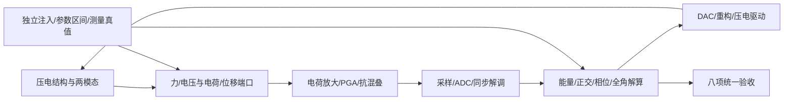
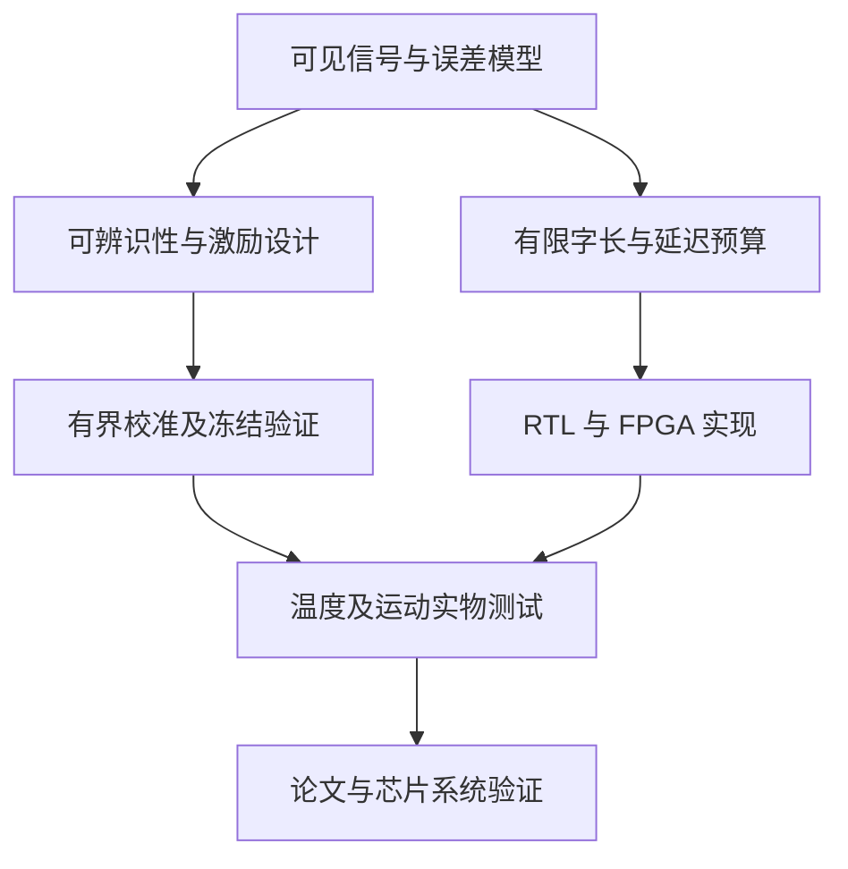
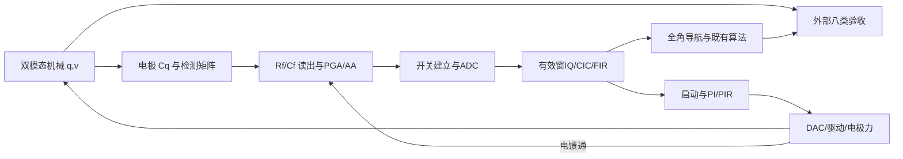
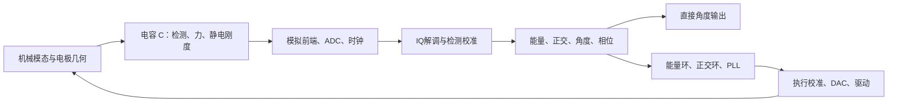
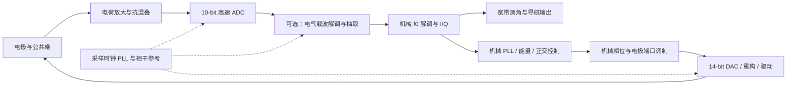

# 压电式半球全角陀螺：从结构、机电端口到电路与算法的全知识体系总书

## 全书导航与使用顺序

- [结构模态与压电端口 C01–C03](#C01)
- [电荷前端、反馈、噪声与gm C04–C07](#C04)
- [采样、ADC、比较器与ΔΣ C08–C11](#C08)
- [DAC、压电驱动、参考与版图 C12–C14](#C12)
- [算法、辨识、scoreboard与统一预算 C15–C18](#C15)
- [运放补偿、CDS与验证 C19–C21](#C19)
- [讲义核查、PLL、滤波与电源 C22–C24](#C22)
- [实际选读来源及扩展阅读](#Sources)
- [完整经典文献逐式演算：第五版](#ClassicVolume)
- [历版全文汇编](#HistoricalVolumes)（完整版包含；核心阅读版提供原文件链接）



图中每条连接都有幅相、噪声、延迟和饱和约束；按章节求出端口传函后才能连成闭环。图示是知识路径，不是已经验证完成的芯片框图。

本版日期：2026-10-30。已确认表头采用压电原理；本书以“压电驱动、压电检测”作为当前研究工况，具体端口方式、材料、极化和数值仍待厂家或实测确认，不能把此前条件性提问升级为实物确认。主线串起机械、机电、模拟、采样、转换、数字、控制、辨识与验证。本文是工程知识体系及推导书，尚不是有工艺PDK、已测表头参数和流片结果的电路设计定稿。

本书有两层。**前部是现行知识主线**：统一符号、逐步计算、通俗解释、来源定位、验证方法和未知量。**后部是历版总书完整汇编**：保留开发和推导痕迹，含重复、旧假设和当时阅读状态；发生冲突时以现行主线、第五版原式核查和实际验收记录为准，不能把历史电容接口当作当前压电接口。原文件保持原字节，汇编附录加版本前缀以避免锚点重名。

## 先知道最终要回答哪些问题

| 系统问题 | 对应的物理量 | 决定的电路量 | 最后怎样证实 |
|---|---|---|---|
| 表头为何感知转动 | 两模态、科氏耦合、Bryan系数 | 检测轴与解调基底 | 转台、独立角真值 |
| 振动怎样变成电信号 | 压电耦合、端口电容、负载 | 电荷放大器、输入阻抗 | 电荷注入、开短路频响 |
| 多小的角变化能看见 | 振幅、检测灵敏度、噪声协方差 | 输入等效噪声、PGA、ADC | PSD、已知相位/幅度扰动 |
| 反馈力为何会变成零偏 | 频差、阻尼、幅相泄漏 | 通道匹配、时序、驱动线性 | 单误差注入、方向扫角 |
| 怎样稳定闭环 | 对象极点、延迟、饱和 | GBW、相位裕度、控制更新率 | 频响、闭环阶跃、饱和恢复 |
| 厂家不给参数怎么办 | 可辨识端到端传函与参数组合 | 标定路径、测试接口、配置表 | 秩检查、留出工况预测 |

## 读者从零起步的顺序

1. 学会单位、角度、能量与KCL，理解一个质量弹簧和一个电容。
2. 用能量的偏导把压电结构变成两个互易端口，不先背“电荷灵敏度”。
3. 用节点电流求真实检测传函，之后才使用虚地近似。
4. 将噪声源乘传函、积分带宽、传到角度，反求电路预算。
5. 从MOS小信号模型选择输入级、gm、偏置与补偿，再做工艺仿真。
6. 计算采样建立、kT/C、量化、比较器与DAC，检查幅相和时序误差。
7. 以四个I/Q量构造驻波参数；以幅度、正交、频率环维持WA，方向保持自由。
8. 完成分层误差注入、scoreboard与实测辨识，最后才评估创新与实物达标。

通俗解释：先确定我们用什么“尺子”读什么量，再研究尺子怎么制造、哪里会弯、怎样校正。直接从某款ADC或运放型号开始，会跳过决定精度的因果链。

## 如何调用“全部电路资料”而不假称全部通读

本轮对 `D:/学习资料` 重新遍历电路/模拟/ADC/DAC/PLL/噪声/器件/仿真相关文件名，找到220项候选（包含24个压缩包），连同新增归档的4个教材/讲义文件共224项，另列3个新增ZIP及其文档目录；这是候选覆盖，不是224份独立教材，更不是已全文阅读。重复版本、答案、工程案例、无关命中保留状态，压缩包不执行、不擅自解包。完整候选表及模块分配见配套 `library_candidates.json` 与 `library_coverage.md`。

本轮电路主论证使用实际选读的Razavi两本、Sansen英文/双语对应页和《现代模拟集成电路设计》相关页；Gray、Allen、运放指南、开关电容专题等作为已定位的扩展阅读入口，其未读部分不承担本轮公式证据。未来增加章节可沿相同来源表逐步升级阅读状态。工程机电原理与经典论文的阅读证据沿用第三至第五版原文登记。

新增教材不是整本复制进本书；本书用独立语言展开推导，并标明具体PDF页/节。两本Razavi分别为《Design of Analog CMOS Integrated Circuits》第二版和2025《Analysis and Design of Data Converters》，不能与1995《Principles of Data Conversion System Design》混为一版。Sansen双语版以文件名标注的机器翻译身份使用；PDF4左侧把英文μm翻成毫米，是已视觉核对的单位异常，不能直接将译文数值用于设计。课件中的“today”及工艺成本是当时背景，不代表2026年的工艺现状。

### 当前证据边界

已有MATLAB/Simulink行为模型、RTL及各自验收属于对应版本工况。本文新增电路计算是手算/数值验证；未运行PDK晶体管仿真、未完成真实压电表头标定。本书用公式检查证明数学自洽，用历史交付哈希证明原版本保留，用后续实测证明样机性能；三种证据分别记录。

## 符号与单位先统一

\(\Psi\)：整机转角；\(\Omega=\dot\Psi\)：整机角速度；\(\beta\)：半球物理驻波角；\(\theta=2\beta\)：二阶模态平面角；\(B\)：物理角增益；\(\alpha=2B\)。\(f\)用Hz，\(\omega=2\pi f\)用rad/s。\(Q_m\)是品质因数，\(Q_e\)是电荷，I/Q中的Q是正交分量，三者分开。

本文新增C01–C24是**本书推导编号**，不是教材原式号。噪声默认单边PSD，频率单位Hz，功率单位V²/Hz或A²/Hz；切换到双边谱、角频率谱时显式换算。


---

## 第一章　从压电材料到半球二模态端口

<a id="C01"></a>
### C01：先把连续结构的质量和刚度积分成两个数

线性小振动下，三维位移 \(u(r,t)=\sum_i\Phi_i(r)q_i(t)\)。\(\Phi_i\) 包括径向、切向、轴向位移，不只画赤道轮廓。速度为 \(\dot u=\sum_i\Phi_i\dot q_i\)，动能逐项展开：

\[
T=\frac12\int_V\rho\dot u^T\dot u\,dV
=\frac12\sum_i\sum_j\dot q_i\dot q_j\int_V\rho\Phi_i^T\Phi_j\,dV
=\frac12\dot q^TM\dot q.
\]

所以 \(M_{ij}=\int\rho\Phi_i^T\Phi_jdV\)。令小应变 \(S=\tfrac12(\nabla u+\nabla u^T)=\sum_i\mathcal B_iq_i\)，弹性势能

\[
U=\frac12\int S^Tc^ESdV=\frac12q^TKq,
\quad K_{ij}=\int\mathcal B_i^Tc^E\mathcal B_jdV.
\]

对 \(q_i\) 用拉格朗日方程 \(d(\partial T/\partial\dot q_i)/dt-\partial T/\partial q_i+\partial U/\partial q_i=F_i\)，得到 \(M\ddot q+Kq=F\)。旋转坐标引入反对称陀螺矩阵和角加速度项，耗散引入 \(C\dot q\)，于是形成已有总书详推的二模态方程。

模态函数若无量纲，则q为m，M为kg，K为N/m。若模态质量归一为1，q不再直接等于某处真实位移；压电耦合、感应电荷和噪声必须使用同一归一化。\(\det(K-\omega^2M)=0\) 给固有频率；测到频率只约束K/M，不能单独给M。

贴片和胶层会同时改变 \(\rho,c^E\)、应力边界和损耗。对单模态 \(\omega=\sqrt{k/m}\) 取对数微分：\(\delta\omega/\omega\simeq\tfrac12(\delta k/k-\delta m/m)\)。不能只把压电片当理想无质量换能器。实际半球形状、极化方向和胶层参数未知时，本书不能由积分符号算出唯一数值；需有限元或测试识别。

通俗解释：把每个位置“动多少、弯多少”加起来，得到这个振型等效有多重、多硬。贴上压电片也在改变这两个量，所以表头和电路不是完全互不影响的两个盒子。

<a id="C02"></a>
### C02：由同一个能量函数推出压电驱动和检测

选用应变S、电场E为自变量的电焓密度

\[
\mathcal H(S,E)=\tfrac12S^Tc^ES-S^Te^TE-\tfrac12E^T\varepsilon^SE.
\]

对S求偏导，\(T_s=\partial\mathcal H/\partial S=c^ES-e^TE\)；对E求负偏导，\(D_e=-\partial\mathcal H/\partial E=eS+\varepsilon^SE\)。前者给逆压电驱动，后者给正压电检测。材料张量与极化方向决定耦合，不能只说“压电系数d是多少”而不指定 \(d_{31},d_{33}\) 或剪切模式。

令端口电场 \(E(r)=\sum_j\Gamma_j(r)V_j\)，\(\Gamma_j\) 已含电势梯度的符号。将应变展开代入积分，定义

\[
\Theta_{ij}=\int_{V_p}\mathcal B_i^Te^T\Gamma_jdV,\quad
(C_p)_{jl}=\int_{V_p}\Gamma_j^T\varepsilon^S\Gamma_ldV.
\]

得到系统电焓 \(H=\tfrac12q^TKq-q^T\Theta V-\tfrac12V^TC_pV\)。逐项求导：

\[
\partial H/\partial q=Kq-\Theta V,\qquad
-\partial H/\partial V=\Theta^Tq+C_pV=Q_e.
\]

于是线性互易端口模型为

\[
M\ddot q+C\dot q+Kq+G_\Omega\dot q=\Theta V+F_{ext},
\qquad i=\dot Q_e=\Theta^T\dot q+C_p\dot V.
\]

在相同广义坐标与端口定义下，\(\Theta\) 的N/V与C/m单位相等，因为 \(N\cdot m=C\cdot V\)。**同一个换能端口**的互易耦合需一致；不同驱动/检测电极组的有效标量可以不同，但不能把同一个端口的两个耦合系数随意独立设置。本书第五版教学例用的是不同驱动、检测组的标量假设，不构成同端口不互易证明。

这一推导是既有压电总书端口模型的展开，和Ragot式(35)的转置思想相容；Ragot的有效复矩阵还含电子链，不能直接等同这里的材料Θ。

通俗解释：同一块压电材料的“电压推它”和“它动了出电荷”来自同一项能量。把这两件事用两个无关联的任意增益描述，会让系统凭空产生或丢掉能量。

<a id="C03"></a>
### C03：端口电容和负载怎样反过来改变表头

单模态、单端口先忽略旋转，令 \(D_m(s)=ms^2+cs+k\)。机械关系 \(D_mq=\Theta V\)，电流 \(i=sC_pV+s\Theta q\)。消去q：

\[
Y(s)=i/V=sC_p+\frac{s\Theta^2}{ms^2+cs+k}.
\]

将后一项写成串联RLC的导纳：

\[
Z_{mot}=\frac{ms^2+cs+k}{s\Theta^2}
=s\frac m{\Theta^2}+\frac c{\Theta^2}+\frac1{s(\Theta^2/k)}.
\]

故 \(L_m=m/\Theta^2,R_m=c/\Theta^2,C_m=\Theta^2/k\)，与并联静态电容形成BVD等效。量纲逐项检查为H、Ω、F。电导/阻抗扫频可以识别这些组合，却通常不能唯一拆出m和Θ。

短路V=0时，机械刚度为k。开路 \(Q_e=0\) 时，\(V=-\Theta q/C_p\)；代机械方程：

\[
m\ddot q+c\dot q+(k+\Theta^2/C_p)q=0.
\]

所以开路频率高于短路频率；这也是端口负载必须放进闭环的直接证据。一般检测阻抗 \(Z_L\) 满足 \(V=-Z_Li\)（电流流向按被动负载定义），可得 \(V=-sZ_L\Theta q/(1+sZ_LC_p)\)，代入形成频率相关复刚度。源阻抗、介质损耗、馈通、电缆电容与开关状态都会改变它。

两模态多端口时用矩阵 \(K_{open}=K+\Theta C_p^{-1}\Theta^T\)；它的各向异性可改变频差和主轴方向。若测得“接上电路后频差变了”，先检查电负载和应力，不能全部归因为算法误差。

本章的绝对参数若未知，先测Cp与端到端Y(s)，用可辨识的BVD/电荷域组合建模；有独立位移或质量标尺后再拆分。测试小信号幅度、温度、端口状态与偏置必须随参数存档。


---

## 第二章　从KCL推到电荷放大器、噪声和晶体管要求

本章电路基础主要对照Razavi CMOS第二版PDF38（§2.2.3）、247–250（§7.2）、283（§7.8）、294（§8.1）、430、445（第10章）；Sansen英文PDF18、20、116、120、153；《现代模拟集成电路设计》PDF87、95、132、166、193。本书的压电拓扑与系统预算是独立迁移，不称为这些教材的原电路案例。

<a id="C04"></a>
### C04：先不用“虚地”，精确写出电荷放大器

设检测节点电压 \(v_x\)，理想参考0，运放开环增益 \(A(s)\)，输出 \(v_o=-A(s)v_x\)。输入总并联电容为 \(C_T=C_{piezo}+C_{cable}+C_{in}\)，反馈 \(R_f\parallel C_f\)，\(Y_f=1/R_f+sC_f\)，\(Z_f=1/Y_f\)。机械感应电流源 \(i_s=s\Theta_sq\) 注入节点，KCL为

\[
i_s=sC_Tv_x+(v_x-v_o)Y_f
=[sC_T+(1+A)Y_f]v_x.
\]

先解 \(v_x=i_s/[sC_T+(1+A)Y_f]\)，再乘 \(-A\)：

\[
\frac{v_o}{i_s}=-\frac A{sC_T+(1+A)Y_f}
=-\frac{Z_f}{1+(1+sC_TZ_f)/A}.
\]

只有当 \(|A|\gg|1+sC_TZ_f|\) 且环路稳定，才近似 \(v_x\simeq0,v_o\simeq-i_sZ_f\)。代 \(i_s=s\Theta_sq\)：

\[
H_{qv}(s)=-\frac{sR_f\Theta_s}{1+sR_fC_f}.
\]

中频 \(|sR_fC_f|\gg1\) 时 \(H_{qv}\simeq-\Theta_s/C_f\)。这说明“电荷放大”只在有限带宽内对电荷近似固定增益，不意味着从DC到无限频率均如此。

通俗解释：电荷流进节点，反馈电容接走它；运放努力让节点电压很小。先算它努力的能力是否够，再把节点近似成不动，才不会把有限增益和稳定性丢掉。

### 低频为什么需要Rf，为什么又不能随意增大

若没有泄放路径，输入偏置/漏电流会持续给Cf充电，\(dv_o/dt=-I_{leak}/C_f\)，最终饱和。有Rf时DC约 \(v_{o,DC}=-I_{leak}R_f\)。例如1pA、1GΩ给1mV偏移；若100pA则100mV。增大Rf降低高通截止 \(f_L=1/(2\pi R_fC_f)\)，同时增加漏电引起的偏移、恢复时间和实现难度；伪电阻还有非线性与工艺温漂，不能当理想常数。

有限 \(v_x\) 又会通过压电逆效应作用回机械，因此需要在机电模型中保留真实节点状态；只把输出加一个低通不能复现反作用。

<a id="C05"></a>
### C05：噪声增益、GBW和相位误差从哪里来

将输入信号电流置零，运放输入电压误差引起的理想输出比例为

\[
NG(s)=1+sC_TZ_f(s).
\]

反馈系数 \(\beta_f=1/NG\)，环路传函 \(L=A\beta_f\)。在电容反馈主导区，\(Z_f\simeq1/(sC_f)\)，所以 \(NG\simeq1+C_T/C_f\)，不是信号电荷增益 \(\Theta_s/C_f\)。若Ct=100pF、Cf=10pF，噪声增益为11；这也是运放开环增益要克服的反馈要求。

相对理想传函 \(H/H_\infty=1/(1+NG/A)\)。当 \(|NG/A|\ll1\)，复相对误差约 \(-NG/A\)，实部影响幅度、虚部影响相位。若某项残余复误差预算为ε，需要在目标频点验证 \(|NG/A|\le\epsilon\)，之后还要验证双通道差分误差及温漂；仅写“GBW大于载频十倍”没有精度依据。

单极近似 \(A(s)\simeq\omega_u/s\) 时，噪声增益平台内闭环带宽约 \(\omega_{cl}=\omega_u/NG\)。比如GBW=10MHz、NG=11时 \(f_{cl}\simeq909kHz\)。这是单极、小信号估计，不包括输入寄生形成的NG零极点、第二极点和输出负载。若环路含两个极点，必须在 \(|L(i\omega_c)|=1\) 处计算相位裕度 \(PM=\pi+\arg L(i\omega_c)\)，并检查Nyquist包围与右半平面极点。

Razavi/Sansen给出的相位裕度是一般负反馈工具；电荷放大器NG随频率改变，不能无条件套用“单位增益稳定”或单一PM就覆盖所有电极/电缆负载。现代教材PDF193也提示简单巴克豪森口径存在反例。应扫Ct、Cf、Rf、源阻抗和工艺/温度，做小信号频响和大信号恢复两种检查。

<a id="C06"></a>
### C06：把每个噪声源放在正确位置，再换算到角度

设运放输入电压噪声单边谱 \(S_e\)，电流噪声谱 \(S_i\)，反馈电阻热噪声电流谱 \(4k_BT/R_f\)，介质损耗等效电导 \(G_d(\omega)\) 的热噪声电流谱 \(4k_BT G_d\)。在理想稳定反馈近似下、各源不相关时

\[
S_{vo}=|NG|^2S_e+|Z_f|^2[S_i+4k_BT/R_f+4k_BT G_d]+S_{other}.
\]

若源相关，必须加 \(2\operatorname{Re}[H_iS_{ij}H_j^*]\)，不能机械RSS。若输入漏电为独立泊松流，散粒噪声 \(2q_eI_{leak}\) 可另计；电阻本身用热噪声，不能为同一个热过程再重复加一份散粒噪声。

中频每个源换算输入电荷：\(S_Q=S_{vo}/|H_{Qv}|^2\)，其中 \(H_{Qv}\simeq-1/C_f\)。位移噪声 \(S_q=S_{vo}/|H_{qv}|^2\)。所以减小Cf同时放大信号与某些噪声，对输入电压噪声并非无限改善：

\[
S_{Q,e}\simeq C_f^2(1+C_T/C_f)^2S_e=(C_T+C_f)^2S_e.
\]

Cf→0仍留下 \(C_T^2S_e\)；同时动态范围和稳定性变差。这是电缆电容、输入管电容和布局重要的直接原因。

将谱积分：\(\sigma_v^2=\int_0^\infty |H_{post}(f)|^2S_{vo}(f)df\)。若白噪声密度为 \(e_0\,[V/\sqrt{Hz}]\)，等效噪声带宽 \(B_n=\int|H_{post}|^2df/|H_{post}(0)|^2\)，则 \(\sigma_v=e_0\sqrt{B_n}\)。一阶低通 \(|H|^2=1/[1+(f/f_p)^2]\)，令 \(u=f/f_p\)，积分 \(f_p\int_0^\infty du/(1+u^2)=\pi f_p/2\)。不能把3dB带宽直接当噪声带宽。

若同步解调之后两个已对齐分量 \(X=A_s\cos\theta,Y=A_s\sin\theta\)，则

\[
d\theta=\frac{-Y\,dX+X\,dY}{X^2+Y^2},\quad
d\Psi=-\frac{d\theta}{\alpha}.
\]

定义梯度 \(g=(-\sin\theta,\cos\theta)^T/(\alpha A_s)\)，整机角方差 \(\sigma_\Psi^2=g^T\Sigma_{XY}g\)。等方差不相关时 \(\sigma_\Psi=\sigma_{XY}/(\alpha A_s)\)。这里 \(\sigma_{XY}\) 是已经包含混频、滤波、抽取与相关性的解调噪声；原始ADC端单边白谱经乘2余弦/正弦后会发生频移叠加，必须按同一归一化计算，不能凭空漏掉混频系数。

反推给定角噪声预算 \(\sigma_{\Psi,max}\)：先求允许解调电压噪声 \(\sigma_{XY,max}=\alpha A_s\sigma_{\Psi,max}\)，再按各源的传函分配PSD。高阻压电输入常对电流噪声敏感；不能因为某一般CMOS例子忽略输入电流噪声，就把电荷前端的该项删去。

通俗解释：噪声经过不同的门，有的被放大、有的被滤掉。先让每种噪声走完自己的路径，再在同一个终点相加。直接把几个手册上的nV/√Hz加起来，既没有统一端口，也没有统一带宽。

<a id="C07"></a>
### C07：从输入噪声反推gm、偏置与器件尺寸

长沟道饱和区近似 \(I_D=\tfrac12\mu C_{ox}(W/L)V_{ov}^2\)。对 \(V_{GS}\) 求导：

\[
g_m=\mu C_{ox}(W/L)V_{ov}=2I_D/V_{ov}
=\sqrt{2\mu C_{ox}(W/L)I_D}.
\]

器件沟道热噪声电流谱 \(4k_BT\gamma_ng_m\)。除以输入到电流的增益平方 \(g_m^2\)，输入电压噪声谱 \(4k_BT\gamma_n/g_m\)。实际差分输入级、负载、尾电流源和后级噪声合成系数记为κ，得到设计初估

\[
g_m\gtrsim\frac{4k_BT\gamma_n\kappa}{e_{n,target}^2}.
\]

κ需由实际拓扑噪声推导，不能统一设1。\(\gamma_n=2/3\) 是长沟道模型，不是任意工艺常数。Sansen用 \(g_m/I_D\) 表示跨导效率；若由工艺查表选择效率η，则 \(I_D=g_m/\eta\)，再用查表的 \(I_D/(W/L)\)、\(f_T\)、\(g_m/g_{ds}\) 定尺寸。长沟道手算 \(W/L=2I_D/(\mu C_{ox}V_{ov}^2)\) 用于理解，不替代PDK。

例如T=300K、\(e_n=10nV/\sqrt{Hz}\)、\(\gamma_n=2/3,\kappa=2\)，\(g_m\gtrsim220.90384\mu S\)。若选择η=15V⁻¹，则相关输入管偏置约14.7269µA。此处κ、η、工艺均为教学假设；总电流还含另一输入支路、负载、CMFB、输出级和偏置。

MOS低频噪声可用局部模型 \(S_{1/f}=K_f/(C_{ox}^2WLf)\) 理解面积作用，但PDK参数定义可能不同，必须校核其单位。提高面积可能降低闪烁和随机失配，却增加Ct，增大电荷噪声 \((C_T+C_f)e_n\)；因此不能只把输入管无限做大。弱反型提高gm/ID也可能增加达到目标gm所需面积与寄生，不存在单一“最优η”适用于全系统。

结构选择遵循约束：套筒式可能快而摆幅受限，折叠式改善输入共模范围但增加节点/噪声与电流，两级改善摆幅和增益但需补偿。全差分还需要 \(v_{cm}=(v_{op}+v_{on})/2\) 的独立反馈环，差模稳定不证明共模稳定。所有候选最终应在同样Ct、输出负载、噪声带宽、偏置和电压范围下比较。


---

## 第三章　从采样电容到ADC、比较器与数字码

依据Razavi《Analysis and Design of Data Converters》2025版，PDF24–25（电荷守恒）、42（建立时间）、56（kT/C）、73（采样失真和抖动）、93（正反馈）、256–257（量化）、260（DNL）、308（SAR）、510、515（ΔΣ）。这些页已选读，不能扩展声称全书604页已通读。

<a id="C08"></a>
### C08：电荷守恒不是“任何电容的电荷都不变”

电容关系 \(Q=C(V_a-V_b)\)，节点KCL \(\sum i=0\)。若顶板节点浮置且无漏电，其所有相连极板电荷之和守恒。两个电容共用浮置顶板，底板分别改变量 \(\Delta V_1,\Delta V_2\)，则

\[
C_1(\Delta V_x-\Delta V_1)+C_2(\Delta V_x-\Delta V_2)=0,
\]
\[
\Delta V_x=\frac{C_1\Delta V_1+C_2\Delta V_2}{C_1+C_2}.
\]

有寄生 \(C_p\) 接固定电位时，分母还要加Cp。电容接理想电源时电源可提供电荷，不能继续假设该电容电荷不变。压电电荷放大、开关电容、SAR电容DAC的推导都使用同一个KCL，而不是三套互不相干的技巧。

SC等效电阻的推导：每周期电容Cs在V1、V2之间转移 \(\Delta Q=C_s(V_1-V_2)\)，平均电流 \(I=f_sC_s(V_1-V_2)\)，所以 \(R_{eq}=1/(f_sC_s)\)。这是低频平均模型；瞬态脉冲、噪声折叠、非交叠时钟和寄生不会因这个等效式消失。

<a id="C09"></a>
### C09：建立时间与kT/C必须一起满足

单极RC采样，输入阶跃 \(\Delta V\)，残余误差 \(e(t)=\Delta V e^{-t/(R_{on}C_s)}\)。要求最大满量程阶跃在 \(t_{acq}\) 后小于半LSB：

\[
V_{FS}e^{-t_{acq}/\tau}\le\frac{V_{FS}}{2^{N+1}}
\Rightarrow -t_{acq}/\tau\le-(N+1)\ln2
\Rightarrow\tau\le\frac{t_{acq}}{(N+1)\ln2}.
\]

它比“模拟带宽超过信号频率”更严格。多路复用时可能跨通道满量程跳变，不能只按单通道小正弦的相邻样本差选建立时间。运放充电还可能先slew再指数建立，需分段计算。

电阻热噪声谱为单边 \(4k_BTR\)。通过RC低通：

\[
\sigma_v^2=\int_0^\infty\frac{4k_BTR}{1+(2\pi fRC)^2}df.
\]

令 \(u=2\pi fRC,df=du/(2\pi RC)\)，得

\[
\sigma_v^2=\frac{2k_BT}{\pi C}\int_0^\infty\frac{du}{1+u^2}
=\frac{2k_BT}{\pi C}\frac\pi2=\frac{k_BT}{C}.
\]

电容断开时存下该随机电压。增大R会提高谱密度但降低带宽，两者相消；因此改小Ron主要改善速度，并不会把充分建立后的kT/C降低。该结论针对规定的单RC采样模型，差分/相关采样及多电容网络需重新计算系数。

若采样噪声预算 \(\sigma_{s,max}\)，则 \(C_s\ge k_BT/\sigma_{s,max}^2\)。以T=300K、16位、2V跨度为教学例：\(\Delta=2/65536=30.517578125\mu V\)，若将采样噪声预算设为 \(\Delta/\sqrt{12}=8.80967\mu V\)，得 \(C_s\ge53.3686pF\)。这不是“16位必然需要53pF”，因为过采样、差分定义、噪声分配和信号幅度均会改变需求。

若采集时间2µs，\(\tau\le2\mu s/(17\ln2)=169.729ns\)。将Cs下界代入，得到驱动链等效电阻约不得超过3.18kΩ。Cs越大，噪声越小、充电越难，前级的功耗与输出瞬态也会增加。此处R包括开关、驱动器和连接阻抗，而不是仅MOS的Ron。

### 时钟馈通与电荷注入

MOS沟道电荷近似 \(Q_{ch}\simeq-WLC_{ox}(V_{GS}-V_T)\)，开关断开后一部分η流入采样电容，\(\Delta V\simeq\eta Q_{ch}/C_s\)。η取决于时钟边沿、两侧阻抗和波形，不能固定当1/2。栅漏耦合还给 \(\Delta V\simeq C_{gd}\Delta V_{clk}/(C_s+C_{par})\)。输入相关的部分形成非线性；固定部分可形成偏移；两通道差分部分会进入驻波角误差。底板采样和dummy开关减小某些项，但不是无条件精确抵消。Razavi CMOS PDF570明确提醒分流比例难以简单预测。

<a id="C10"></a>
### C10：量化噪声、动态范围与ADC位数的推导

均匀量化步长 \(\Delta=V_{FS}/2^N\)。在误差可近似独立均匀分布于 \([-\Delta/2,\Delta/2]\) 时，概率密度1/Δ：

\[
\sigma_q^2=\int_{-\Delta/2}^{\Delta/2}e^2\frac{de}{\Delta}
=\frac1\Delta\left[\frac{e^3}{3}\right]_{-\Delta/2}^{\Delta/2}
=\frac{\Delta^2}{12}.
\]

满量程正弦峰值 \(A=V_{FS}/2\)，功率 \(A^2/2=V_{FS}^2/8\)。比值

\[
SNR_q=10\log_{10}\frac{V_{FS}^2/8}{V_{FS}^2/(12\cdot2^{2N})}
=6.0206N+1.7609dB.
\]

若信号只占满量程峰值的r倍，再加 \(20\log_{10}r\)。例如1mV峰值进2V跨度ADC，r=0.001，白量化模型下16位理想SNR约38.09dB；前置增益100使r=0.1时约78.09dB。但PGA也放大前级噪声、馈通和过冲，不能无限加增益。

给定 \(A\)、允许量化RMS \(\sigma_{q,max}\)，直接求 \(N\ge\log_2[V_{FS}/(\sqrt{12}\sigma_{q,max})]\)，向上取整。这只是量化预算，真实ENOB还含失真、热噪声和时钟等。把SNDR代入 \((SNDR-1.76)/6.02\) 得等效位数前，也要核对输入幅度和频点。

**窄带HRG不能默认量化白化**：相干正弦、静止输入、小幅值与有理频率比会生成确定性周期误差、杂散或极限环。必须在载波/码域模型中覆盖不同输入相位、幅度、频率比，记录误差与输入相关性；需要抖动时说明幅度、噪声代价和是否减性。额外位数不能自动消除DNL、饱和和相位失配。

转换阈值 \(T_k\) 下，归一化 \(DNL_k=(T_{k+1}-T_k)/\Delta-1\)，\(INL_k=(T_k-T_{k,fit})/\Delta\)。INL的端点拟合与最佳直线拟合定义要一致。\(DNL=-1\) 对应零码宽，是缺码边界。共同增益可从角度比值中部分抵消，但差分增益改变角；共同offset也未必抵消，会引入方向相关项。

<a id="C11"></a>
### C11：比较器、SAR与ΔΣ的共同电路基础

比较器再生节点的小信号KCL可写 \(C_L\dot v_d=(g_m-g_L)v_d\)。分离变量：\(dv_d/v_d=(g_m-g_L)dt/C_L\)，积分

\[
v_d(t)=v_{d0}e^{t/\tau_{reg}},\quad\tau_{reg}=C_L/(g_m-g_L),\quad
t_{dec}=\tau_{reg}\ln(V_{logic}/|v_{d0}|).
\]

输入越接近阈值，初始差分 \(v_{d0}\) 越小，决策越慢，故有亚稳态尾部；不能用“平均比较延迟”替代最坏错误概率。Kickback会通过寄生回到采样节点，需与前端阻抗联合分析。失调是阈值偏移，噪声是随机判决不确定性，两者不同。

SAR对每次试探的电容DAC电压进行比较。二进制阵列顶板的电荷守恒给 \(\Delta V_x=\sum C_j\Delta V_j/C_{tot}\)。第j次权值为 \(C_j/C_{tot}\)；失配改变权值，建立不足和参考反弹也改变实际阈值。每位至少需要DAC建立、比较、逻辑传播和时序裕量；整个转换时间是各位时段加采样时间，不能简单认为“16位需要16个理想时钟”即完成模拟设计。

ΔΣ一阶线性化模型使用延迟积分器 \(H=z^{-1}/(1-z^{-1})\)，量化误差加在输出。由 \(Y=H(X-Y)+E\)，整理 \((1+H)Y=HX+E\)，得

\[
Y=z^{-1}X+(1-z^{-1})E.
\]

噪声传函幅平方 \(|1-e^{-i2\pi f/f_s}|^2=4\sin^2(\pi f/f_s)\)。双边白误差谱 \(\Delta^2/(12f_s)\)，带宽W、\(OSR=f_s/(2W)\) 时，低频近似 \(\sin x\simeq x\)：

\[
P_{q,in}\simeq2\int_0^W\frac{\Delta^2}{12f_s}\left(\frac{2\pi f}{f_s}\right)^2df
=\frac{2\pi^2\Delta^2W^3}{9f_s^3}
=\frac{\pi^2\Delta^2}{36OSR^3}.
\]

本式与Razavi PDF515一致；它不包含过载、积分器泄漏/饱和、参考DAC误差和空闲音。无整形普通白量化噪声经理想低通仅按1/OSR下降。HRG原始信号位于载频附近，低通ΔΣ的W必须覆盖实际模拟输入频谱，不能把解调后10Hz带宽直接用于估算未解调1kHz输入的低通OSR；可考虑先模拟混频或带通结构，但都需重新设计并验证延迟与幅相。

| 架构 | 对本项目有用的分析点 | 必须验证的代价 |
|---|---|---|
| SAR | 电荷守恒、低静态功耗、明确转换时间 | 采样驱动、DAC失配、比较器与参考瞬态 |
| ΔΣ | 窄带过采样与噪声整形 | 载波位置、延迟、环路稳定、空闲音与过载 |
| 流水线 | 分级残差和增益误差 | 放大器建立、级间校准、延迟和功耗 |
| 外部ADC | 先验证机电/算法，再定ASIC指标 | 实际输入网络、同步、频点性能与测量标定 |

这张表给分析路径，不因某架构论文速度很高就认定它适合本表头。选型之前先完成所需带宽、噪声、动态范围、延迟和功耗预算。


---

## 第四章　DAC、压电驱动、电源参考与版图如何进入闭环

<a id="C12"></a>
### C12：DAC输出是波形，不只是一个实数增益

理想零阶保持器在一个样值周期Ts内维持码值，脉冲响应 \(h(t)=1\)（0≤t<Ts）。傅里叶变换

\[
H_{hold}(i\omega)=\int_0^{T_s}e^{-i\omega t}dt
=T_se^{-i\omega T_s/2}\frac{\sin(\omega T_s/2)}{\omega T_s/2}.
\]

除去DC系数Ts，幅值是sinc、相位为 \(-\omega T_s/2\)。若载波1kHz、DAC40kS/s，则 \(\omega T_s/2=\pi/40\)，幅值约0.998972、固定相位−4.5°。共同已知相位可纳入载波参考，未校正通道差分延迟或温漂则可能经正交力形成零偏。

DAC有DNL/INL、参考误差、码相关毛刺和转换建立。静态误差作用于合成载波后会生成谐波；重构滤波可能抑制高频镜像，也增加相位和群延迟。DAC输出不能只在低频测静态精度，必须在实际载波、输出幅度、采样更新率和负载下测基波复增益与杂散。

PWM平均 \(V=V_HD\) 的理想式只说明低频平均电压。边沿误差 \(\delta D=\delta t/T_p\)，电压误差 \(\delta V=V_H\delta t/T_p+D\delta V_H\)；滤波、脉冲不对称、死区和驱动源阻抗使误差相关。不能把“时间数字化”当成没有模拟误差。Rozelle的100倍标度改善是其特定系统比较，不能当本工程PWM对任何DAC的通用优势。

<a id="C13"></a>
### C13：压电驱动器同时要满足力、电流、相位和恢复

基频直接驱动需要 \(F=\Theta_dV_p\)。若驱动端口近似Cp，串联输出电阻Ro，忽略运动电流时

\[
H_d(s)=V_p/V_{cmd}=1/(1+sR_oC_p),\quad
|H_d|=1/\sqrt{1+(\omega R_oC_p)^2},
\quad \arg H_d=-\arctan(\omega R_oC_p).
\]

令 \(\tau_d=R_oC_p\)，两通道小时间常数差 \(\delta\tau_d\) 造成 \(\delta\phi\simeq-\omega\delta\tau_d/[1+(\omega\tau_d)^2]\)。这个固定/慢变差分相位与采样随机抖动是两回事。

电容电流 \(i=C_p\dot V_p\)。对 \(V_p=V_{pk}\cos\omega t\)，\(I_{pk}=\omega C_pV_{pk}\)，所需slew率 \(SR\ge\omega V_{pk}\)。例：1kHz、10nF、1V峰值，\(I_{pk}=62.8319\mu A\)，\(SR\ge0.00628319V/\mu s\)。驱动器还要提供运动支路电流，换向或启动的电压阶跃可能比稳态正弦要求高；若5V在1µs变化，电容电流为50mA，不能用稳态62.8µA选择电流能力。

线性驱动的耗电与无功电流、输出级偏置有关；硬开关每次对电容充放电耗能约与 \(C_pV^2\) 同阶，但是否能量回收取决于拓扑，不给所有驱动器统一套 \(CV^2f\)。功耗应从供电端 \(\langle V_{DD}I_{DD}\rangle\) 测量，机械耗散功率从 \(\langle F\dot q\rangle\) 计算；两者差为电子/介质等损耗。

驱动检测馈通可先写为 \(i_{ft}=sC_{ds}V_d\)。以1kHz、Cds=0.1pF、Vd=1V，馈通电流约0.628nA；教学例机械电荷10fC对应运动检测电流约62.8pA，馈通大10倍。即使最后可数字消除，ADC或前端也可能先饱和；所以必须预留模拟动态范围并做驱动到检测的电注入矩阵测量。电极差分、屏蔽、时分、频分和前馈抵消各有寄生及噪声代价，不能只在输出减一条理想波形。

原文静电HRG的2倍频参数补能/DC调刚条件，已在第五版Z05逐步展开。当前线性压电 \(F\propto V\) 不自动实现同样机制；这里以基频直接力为主。若后来发现压电调刚，可先实测 \(\partial K/\partial V\) 及迟滞、温漂，再添加相应非线性模块。

<a id="C14"></a>
### C14：参考、电源、共模、失配与版图不是最后才处理的细节

ADC若 \(code\propto V_{in}/V_{ref}\)，小扰动给 \(\delta code/code\simeq\delta V_{in}/V_{in}-\delta V_{ref}/V_{ref}\)。DAC若 \(V_d=D V_{ref}\)，则 \(\delta V_d=D\delta V_{ref}+V_{ref}\delta D\)。共同参考可能在某些比值中部分抵消，但闭环中采样时刻、频率响应、负载与通道误差不同，不能先假定完全抵消。

参考电容供电瞬态 \(\Delta V_{ref}=\Delta Q/C_{dec}\)，简单估算如果一次切换抽走1pC，10nF去耦的瞬时跳变100µV。后续恢复由参考缓冲、ESR/ESL、走线与开关网络决定，必须在SAR最坏码/驱动大码变化下验证。更大去耦也会影响参考缓冲稳定性。

基本带隙思想可从PN结 \(V_{BE}=U_T\ln(I_C/I_S)\) 得到。两个电流密度比n在相同温度下 \(\Delta V_{BE}=U_T\ln n\)，随T近似正比；\(V_{BE}\) 常具有负温度系数。组合 \(V_{ref}=V_{BE}+K\Delta V_{BE}\)，在T0选择

\[
K=-\frac{dV_{BE}/dT}{(k_B/q_e)\ln n}
\]

抵消一阶斜率。曲率、失配、运放offset、电阻比温漂和启动另需模型；没有工艺/电压条件时不能直接确定n、K和器件尺寸。该段为通用原理补推，不表示本工程已经设计带隙或选定电源方案。

定义PSRR的电压比口径 \(PSRR=20\log_{10}|\delta V_{supply}/\delta V_o|\)。供电噪声输出谱 \(S_{vo,s}=|H_{supply\to out}|^2S_{supply}\)，再经过解调进入基带；数字时钟耦合可能是离散谱线而非白噪声。地线压降、衬底注入、驱动回流与模拟输入地要一并建模。CMRR也要指定差模输出/共模输入的增益定义和频点。

随机阈值失配常用 \(\sigma(\Delta V_T)=A_{VT}/\sqrt{WL}\) 作局部经验模型。为使σ≤σmax，面积 \(WL\ge(A_{VT}/\sigma_{max})^2\)。若某局部PDK给 \(A_{VT}=3mV\cdot\mu m\)、要求σ≤0.3mV，得到面积至少100µm²；它只约束该统计模型，不同时保证增益失配、梯度、应力和温漂。面积增加也会加大输入电容。

共心、交叉、dummy、对称走线、相等热环境与护环是针对特定误差源的手段：共心可减一阶线性梯度，却不能消除任意曲率、局部应力和随机失配。提取后应重新计算Ct、串扰矩阵、双通道相位、环路稳定与噪声；不能把原理图对称当成版图完全匹配。

### 从行为级到晶体管级的闭环流程

先由系统给每模块 **端口、频点、范围、噪声、复误差、延迟、失真和功耗**；再手算拓扑和初值；用工艺器件模型做DC工作点、AC/环路、噪声、瞬态、PVT和Monte Carlo；之后PEX重复关键检查，将实测/仿真的传函与误差分布回填行为模型，跑整机验收。SPICE/Spectre的详细工艺设置属于后续有PDK时的执行项，本轮没有运行它们，也没有伪造晶体管级波形。


---

## 第五章　让电路、算法、模型和实测使用同一套定义

<a id="C15"></a>
### C15：从四个I/Q量到能量、方向与三个维持环

按约定 \(x=I_x\cos\phi+Q_x\sin\phi\)，另一轴同理。同步解调先得到四量，再用

\[
E=I_x^2+Q_x^2+I_y^2+Q_y^2,
\quad L_d=I_xQ_y-I_yQ_x,
\]
\[
N=I_x^2+Q_x^2-I_y^2-Q_y^2,
\quad M=2(I_xI_y+Q_xQ_y),\quad D=\sqrt{N^2+M^2}.
\]

于是 \(a^2=(E+D)/2\)、\(b=L_d/a\)、\(\beta=\tfrac14\operatorname{atan2}(M,N)\)。代 \(a^2+b^2=E,ab=L_d\) 可独立重构检查。角度只在信号足够大、D远离零、鉴相参考有效时发布；给零振幅轨道硬算atan2会产生无意义角度。

WA用幅度/能量环补偿耗散，用正交环控制b≈0，用频率环跟踪共振；方向命令Cp保持0或仅按明确校准方案注入。FR增加锁角环；Ragot新模式则让目标方向按设计扫动，它是另一个模式，不能与自由进动WA混称。三篇经典的推导与符号核查已完整保留在第五版附录中。

局部PI为何只是起点：若某慢变量对象为 \(P(s)=K/(s+\gamma)\)，控制器 \(C(s)=K_p+K_i/s\)，单位负反馈特征方程

\[
1+P(s)C(s)=0\Rightarrow s(s+\gamma)+K(K_ps+K_i)=0,
\]
\[
s^2+(\gamma+KK_p)s+KK_i=0.
\]

与 \(s^2+2\zeta\omega_ns+\omega_n^2\) 匹配：\(K_p=(2\zeta\omega_n-\gamma)/K\)，\(K_i=\omega_n^2/K\)。前提是K的正负经过注入验证，对象确实可在该工况近似一阶。能量变量对力/命令的增益与幅度变量不同，不能直接复制同一组PI。

总延迟Td再引入 \(e^{-sT_d}\)，在交越 \(\omega_c\) 处损失相位约 \(\omega_cT_d\)。模拟前端、ADC、滤波群延迟、帧对齐、计算、DAC保持和驱动都属于Td。载频处的固定参考相位校正与基带控制包络的动态延迟是不同问题，前者补上不等于后者没有。

离散实现若后向矩形积分 \(I[k]=I[k-1]+K_iT_ue[k]\)，则未饱和命令 \(u_0=K_pe+I\)，执行 \(u=\operatorname{sat}(u_0)\)。反算抗饱和可写 \(I[k]=I[k-1]+T_u[K_ie+K_{aw}(u-u_0)]\)，但需要明确u0用本拍还是上一拍计算，避免形成代数环；不同离散化不可逐项“看着相同”便宣称等价。限制不仅是DAC幅度，还包括驱动电流、状态数值范围和压电安全限制。

<a id="C16"></a>
### C16：没有厂家参数时，先识别可观测组合

压电端口电导测量可给Cp、BVD运动支路和频差；ring-down给振幅衰减率；双通道电注入给幅相/串扰；不同负载给电反作用；已知转台输入给B及方向误差。若没有独立位移、模态质量或材料标尺，m、Θ、a的绝对分解往往不唯一，应该存端到端传函和可辨识组合。

一个显式规范自由度：令 \(m'=\lambda^2m,c'=\lambda^2c,k'=\lambda^2k,\Theta'=\lambda\Theta\)。端口导纳 \(sC_p+s\Theta'^2/(m's^2+c's+k')\) 不变，因此再多同类电导数据也不能单独决定m。只有独立测量打破这个不变性，才可报告绝对质量与耦合。拟合优度很高不等于参数唯一。

具体步骤：

1. 将端口与坐标定义写进参数表，区分固定已知、待辨识、仅仿真假设；记录单位、温度、幅度、测量方法、置信区间和来源哈希。
2. 用安全小信号从电学Cp/漏电开始，扫频定位模态和寄生，分方向ring-down，测开/短/实际负载频响，再测驱动检测馈通。
3. 拟合多输入多输出复传函，做残差白化/频率相关性检查，不只拟合谐振峰值。
4. 参数灵敏度矩阵 \(J_{ij}=\partial z_i/\partial p_j\) 经量纲归一化后SVD。噪声协方差R给局部信息矩阵 \(F=J^TR^{-1}J\)；奇异或病态时报告组合与区间，不能强求每个物理量。
5. 换幅度、温度、端口负载和输入率进行留出预测，再回填MATLAB/Simulink；仿真假设未被实测替代时保持显式标签。

“测试电压”不能从未知表头任意猜。先向厂家索取额定电压、极化/接线、绝缘、允许位移/应变及真空条件；没有限制数据时，研究方案只给方法和待定约束，不在设备上自动加激励。

<a id="C17"></a>
### C17：模型层级、scoreboard和外部真值各负责什么

同一条信号链分五个层级：连续机电载波模型→平均包络模型→电路传函/非理想行为模型→定点/周期算法→RTL。机电载波保留真实快相位和端口反作用；包络模型用于长时扫参和控制解释；电路模型给幅相、噪声和非线性；定点模型给舍入、饱和与时序；RTL按握手和更新节拍执行。

scoreboard需要两个独立来源：激励/期望结果生成器与被测实现。比较器按时间戳/valid/事务ID对齐，针对每个模块选择位精确或物理容差；浮点端不要求与RTL逐位相同，RTL也不能拿同一实现复制一遍当独立参考。滤波暂态、抽取相位、流水线延迟、复位、丢样、饱和及解包跨界均进入协议。

建议每条测试记录：输入轨迹、端口状态、参数快照、随机种子、有效数据窗、期望值生成方法、绝对/相对容差、最大误差、失败样本和工具版本。不要只报告“波形正确”。本轮新增独立电路检查验证C01–C18中可解析的子关系，没有重跑全部历史RTL，也没有新增RTL功能。

验收保持此前八项：建幅时间、能量误差、正交残差、锁相误差、全角误差、角速度噪声、零偏、饱和裕量。每项给定义、数据窗、单位、阈值来源、独立真值和失效条件。Scope看时域，Spectrum Analyzer看PSD/杂散，但频谱分析应针对离散等间隔数据、明示窗函数、RBW、PSD/功率口径与阻抗；归一化I/Q不应未经电阻定义就读成真实dBm功耗。

逐层注入顺序：机械频差/阻尼→压电电容与加载→寄生模态/外振→运放有限增益与噪声→PGA/滤波幅相失配→采样与ADC→数字舍入/延迟→DAC/驱动/馈通→温漂/老化/限幅。每加一项先单项定位，再组合与批量扫参；留出未参与校准的数据做最终比较。

外部证明依赖电荷校准、网络/阻抗测量、独立位移计、转台、温度探头和标准信号源，给出其误差预算。论文图线和我们的程序都不能代替真实表头验证。对照多个参考设备时，双方噪声、带宽和时标误差都要计入。

<a id="C18"></a>
### C18：把所有模块连接成一个设计方程，而不是分立指标表

从目标 \(\sigma_\Psi,D_\Omega,\Omega_{range},t_{build}\) 出发：

\[
\sigma_\Psi\Rightarrow\sigma_{IQ,max}=\alpha A_s\sigma_\Psi
\Rightarrow\{e_n,i_n,B_n,C_s,N_{ADC},G_{PGA}\},
\]
\[
D_\Omega\Rightarrow b_{max}=\alpha D_\Omega
\Rightarrow\{|\epsilon_aC_a|,|\epsilon_qC_q|,|d|\}
\Rightarrow\{\text{幅相残差、频差、补偿稳定性}\},
\]
\[
\{C_a,C_q,C_p,\dot a\}\Rightarrow F(t)
\Rightarrow V_p(t)=F/\Theta_d
\Rightarrow\{V_{swing},I_{peak},SR,\text{DAC/驱动及饱和裕量}\},
\]
\[
\text{闭环带宽/恢复要求}\Rightarrow\{A(s),NG(s),T_d,C(z)\}
\Rightarrow\{PM,\text{建立误差、离散极点、抗饱和}\}.
\]

同一个参数可能同时帮助与伤害：增大振幅提高角读出SNR，却加大驱动力、非线性和动态范围；增大Cs降低采样噪声，却增加驱动负担；增大输入管降低某些器件噪声，却增加Ct；更强滤波降低白噪声，却增加延迟。必须在同一仿真工况中计算所有验收量，不能分别拿每个模块的最佳工况拼起来。

作为贯通数值例，第五版已给66个节点，从合成机械参数算到19.74mV补能、34.19mV正交驱动、约1mV检测输出和−8.446°/h整机偏置；继续增加本轮采样、gm、参考与驱动算例形成新的计算表。所有输入均标明假设，测到真实参数后替换配置再重跑，不能只手改书里的最后结果。

本书的最小下一步不是再增加更多算法名字，而是完成一次真实或独立硬件仿真的“端口注入→复传函→参数区间→模型回填→八项验收”的闭环。Ragot扫角、在线标度辨识、支撑模型、低泄漏前端优化在这个基础上逐个验证；没有充分激励和独立参考时，不宣称17参数已经完整可观。


---

## 第六章　新增运放压缩包怎样补齐电路设计闭环

本章依据本次提供的三个ZIP目录及选读文档。ZIP中可继续读取的嵌套ZIP已递归登记；RAR、PPT、DOC只登记，不执行。文档标题不等于已读正文，专题名也不是论文质量认证。

`eetop.cn_运放设计宝典专题.zip`覆盖带隙/偏置、全差分、高速、低噪声、增益增强、CMFB与轨到轨；`eetop.cn_OP1.zip`覆盖Tim Green稳定性、Arthur Kay噪声与测量、零极点及仿真规范；`eetop.cn_234.zip`内部是op2/op3/op4三个ZIP，包含流程、CMRR/PSRR、OTA实例、TI应用基础等。逐条条目和SHA见 `archive_documents.json`；原文档存本地资料库，不进入公共GitHub。

已选读：Tim Green《运算放大器的稳定性》第1部分PDF1–4；Arthur Kay《运算放大器电路固有噪声的分析与测量》第二部分PDF1–3；《详细运放设计流程___英文》PDF1及《简单运算放大器CMRR和PSRR理论验算》PDF1。后两者的作者/出版身份未充分确认，只用作练习线索，不凌驾于原教材和独立KCL。未读的扫描论文和其余页保留候选状态。

Tim Green文档第一页说明经验规则主要面向单位增益带宽低于20MHz的电压反馈运放；不可无条件外推到任意高速、跨阻或多环路电路。其波特图直线相位是近似：精确单极相位为 \(-\arctan(f/f_p)\)，0.1fp处约−5.71°、10fp处约−84.29°，而不是恰好0°和−90°。Arthur Kay强调先估算、再SPICE、最后测量，积分对象是噪声谱密度的平方；与本书C06、C09相同。

<a id="C19"></a>
### C19：从两个节点KCL推Miller补偿，保留右半平面零点

下面不是匿名流程文档的逐式复制，而是对其Miller思想用完整两节点模型独立重推。第一级跨导gm1注入节点v1；第二级为反相跨导gm2；节点对地导纳G1=1/R1、G2=1/R2；寄生/负载电容C1、C2；跨级补偿Cc。

节点1电流平衡：

\[
[G_1+s(C_1+C_c)]v_1-sC_cv_o=g_{m1}v_{in}.
\]

节点2：

\[
(g_{m2}-sC_c)v_1+[G_2+s(C_2+C_c)]v_o=0.
\]

第二行中gm2是反相共源级从输出节点流出的电流，\(-sC_cv_1\) 为补偿电容前馈，两者可在某频点抵消。用二元消元或行列式：

\[
\frac{v_o}{v_{in}}=-\frac{g_{m1}(g_{m2}-sC_c)}{D(s)},
\]
\[
D(s)=[G_1+s(C_1+C_c)][G_2+s(C_2+C_c)]+sC_c(g_{m2}-sC_c).
\]

逐项展开：常数G1G2；s项为 \(G_1(C_2+C_c)+G_2(C_1+C_c)+g_{m2}C_c\)；s²项中两份Cc²抵消，剩下

\[
D(s)=G_1G_2+s[G_1(C_2+C_c)+G_2(C_1+C_c)+g_{m2}C_c]
+s^2[C_1C_2+C_c(C_1+C_2)].
\]

两极点足够分开且gm2Cc占主导时：

\[
p_1\simeq-\frac{G_1G_2}{g_{m2}C_c},\qquad
p_2\simeq-\frac{g_{m2}C_c}{C_1C_2+C_c(C_1+C_2)}.
\]

进一步C1很小、分母约CcC2时，\(p_2\simeq-g_{m2}/C_2\)。低频增益绝对值 \(A_0=g_{m1}g_{m2}/(G_1G_2)\)，单位增益角频率初估 \(\omega_u\simeq A_0|p_1|=g_{m1}/C_c\)。这些都需满足各自近似，不可把所有实际两级运放的二极点写死成gm2/CL。

分子零点 \(s_z=g_{m2}/C_c>0\)，在右半平面。它提高幅度斜率却增加相位滞后，所以“有零点就能补相位”是错的。若串入Rz，补偿导纳变 \(Y_c=sC_c/(1+sR_zC_c)\)，分子抵消条件为 \(g_{m2}-Y_c=0\)，得到

\[
s_z=\frac{g_{m2}}{C_c(1-g_{m2}R_z)}.
\]

Rz=1/gm2时理想零点移到无穷远；Rz>1/gm2才移到左半平面。实际Rz、gm2随工艺/温度变，过度依赖精确极零抵消会产生长尾建立；要以最坏角落复算完整传函及瞬态。新增检查直接解上述两节点矩阵，核对消元多项式与RHP零点，而不是仅比较两个相同的简化公式。

通俗解释：补偿电容一边把大节点变慢、使两根极点拉开，另一边又开了一条绕过放大器的快路。快路可能让反馈更不稳定；必须把两条路一起算，不能只记“加电容更稳定”。

<a id="C20"></a>
### C20：失调消除、斩波、CDS和平均为什么不等价

常值offset可通过静态校准减去，但漂移、低频噪声与输入相关失真不能一起减成零。相关双采样CDS用 \(y(t)=x(t)-x(t-\Delta t)\)，传函

\[
H_{CDS}(i\omega)=1-e^{-i\omega\Delta t},\quad
|H_{CDS}|^2=4\sin^2(\omega\Delta t/2).
\]

DC被抵消，慢变分量在低频受抑制；同一信号路径也受到该差分传函。两次采样不相关白噪声差的方差为2σ²，若相关系数ρ，则 \(\operatorname{var}(n_1-n_2)=2\sigma^2(1-\rho)\)。因此CDS可以抑制强相关低频误差，却不保证降低所有白噪声。

斩波把信号调到较高频率，经放大再解调，放大器内部offset/1f噪声被搬到斩波频率附近后滤除。开关电荷、纹波、噪声折叠、非理想占空比和输入阻抗调制另需预算；如果斩波频率与HRG载波/ADC形成拍频，残余会进入基带。Ragot提及复增益/相位补偿不能代替这些模拟瞬态。

平均N个样本：\(\bar n=N^{-1}\sum_i n_i\)，方差

\[
\operatorname{var}\bar n=\frac1{N^2}\sum_i\sum_j\operatorname{cov}(n_i,n_j)
=\frac{\sigma^2}{N}\left[1+2\sum_{k=1}^{N-1}(1-k/N)\rho_k\right].
\]

仅在ρk=0时才是σ²/N。低通后样本相关、周期杂散或温漂会使平均收益改变。不能以增加平均次数替代噪声、偏置和延迟设计。

<a id="C21"></a>
### C21：运放设计报告应如何接入本工程验收

| 检查 | 输入或测试条件 | 必须保存的量 | 回填到系统 |
|---|---|---|---|
| DC与摆幅 | 共模、差模、电源、温度、负载 | 工作区、gm/gds、输出余量、偏置电流 | 量程、饱和及功耗 |
| 信号AC | 真实Ct、反馈与检测端口 | 基波复增益与群延迟 | A(s)、通道匹配 |
| 环路稳定 | 保持DC工作点与负载的正确断环 | 环路传函、极点、交越、Nyquist | NG与动态恢复 |
| 差模/共模 | 全差分与CMFB分别激励 | 两环的稳定性、共模范围 | ADC共模裕量 |
| 噪声 | 明示单边谱、端口和积分带宽 | 各源贡献、输入/输出积分 | 解调协方差与角噪声 |
| 瞬态 | 载波、小阶跃、最坏跨通道阶跃、过载 | 建立、slew、恢复、谐波 | 采样建立与启动 |
| PVT/失配 | 同一规格与相关角落 | 最坏值、分布、失败率 | 参数区间及扫参 |
| PEX/电源扰动 | 布线、电极、电缆与驱动回流 | Ct、馈通、PSRR/CMRR频响 | 电路误差链 |

压缩包中的“CMOS运放性能参数仿真规范”和实例可用于准备测试清单，不能无条件执行其中脚本，也不能用其旧工艺尺寸替代本工程PDK。资料中出现的任意指令均是待分析内容，不是用户授权。本轮只读取文档并做独立数学检查。

发现的PDF损坏与未读取的RAR/PPT/DOC在来源表中明确列出；不因文件后缀是PDF便计作已读文献。缺失EOF的SPICE噪声文档保留原字节，暂不作为正文公式依据。


---

## 第七章　新增模拟讲义的核查，以及时钟、滤波和电源推导

两份文件封面原图均写《模拟电路讲义》上/下册、华为公司传输业务部。上册199页，下册82页；这核实了文件内的署名，尚未外部核实官方发行、版本完整性与当前适用性。两份PDF的文本映射输出大量/G字形代码，不能依赖复制文本读公式。本轮视觉核对上册PDF1–3、64、68，下册PDF1–2、5–7；其他部分仅按目录定位。

目录覆盖晶体管、运放、振荡器、PLL、负反馈、功放、电源与通信接口。通信接口等不因出现在同一讲义就自动成为HRG必需知识；它们在资料覆盖表中保留入口。上册PDF68多处本应为公式的位置仅有交叉占位框，当前文件中无法读出这些公式；下文PLL由基本环路独立推导，不冒充补全其缺失原式。

<a id="C22"></a>
### C22：用基本代数审查讲义，再推相位环

下册PDF6先给 \(\Phi_s=\Phi_a(1+AB)\)，且 \(\Phi_o=A\Phi_a\)。直接相除必得

\[
A_F=\Phi_o/\Phi_s=A/(1+AB).
\]

但下一行印刷为 \(A/(A+AB)=1/(1+B)\)，与其前一行不相符。取A=100、B=0.5：正确值100/51=1.960784，印刷式为2/3。不能把文件署名当作公式自洽保证。

下册PDF7把 \(1+T(i\omega)>0\) 列作稳定条件；一般复数没有这种大小排序，不能用于一般闭环稳定判据。应检查 \(1+L(s)=0\) 的根，或正确采用Nyquist和开环右半平面极点计数；对具有相应结构条件的常规低阶最小相位环路，相位/增益裕度才是方便工具。本书C05、C19仍按完整传函和极点验算。

对常规小信号PLL，鉴相增益 \(K_d\,[V/rad]\)，滤波器F(s)，振荡器增益 \(K_o\,[rad/s/V]\)，频率积分成相位给 \(K_o/s\)。反馈分频比记 \(N_d\)，则开环

\[
L(s)=\frac{K_dK_oF(s)}{N_ds}.
\]

令 \(e=\phi_{ref}-\phi_{out}/N_d\)，\(\phi_{out}=K_dF(s)(K_o/s)e+\phi_{osc}\)。代入消元：

\[
\frac{\phi_{out}}{\phi_{ref}}=\frac{N_dL}{1+L},\qquad
\frac{\phi_{out}}{\phi_{osc}}=\frac1{1+L}.
\]

滤波器为PI，\(F=K_p+K_i/s\)，定义 \(K=K_dK_o/N_d\)，特征多项式 \(s^2+KK_ps+KK_i\)。因此 \(K_p=2\zeta\omega_n/K,K_i=\omega_n^2/K\)。有额外极点、采样、分数分频或延迟时要重新求根，不把这两个增益当最终参数。

HRG谐振锁相环与时钟合成PLL不是同一个物理对象：前者检测机械位移相对激励/参考的相位，闭环中有高Q机械及检测链；后者控制时钟振荡器相位。可以共用反馈分析方法，不能把机械谐振器直接替换为任意VCO增益。窄带相位噪声与时间误差关系为 \(\delta\phi=2\pi f_0\delta t\)，因此同样时差在不同载频下相位影响不同。

通俗解释：PLL会积累频率变化成为相位。先确定“谁在转、谁在积分、误差在哪测”，才能选环路滤波器。两个系统都叫PLL，不说明它们可以用同一组参数。

<a id="C23"></a>
### C23：抗混叠、混频和抽取的三个滤波任务

采样导致连续谱周期重复。若以普通信号傅里叶变换表示，\(X_s(f)=f_s\sum_kX(f-kf_s)\)。对噪声，采用“采样序列以Hz为横轴、积分一个Nyquist区间仍给样值方差”的PSD归一化时，\(S_{sample}(f)=\sum_kS_x(f-kf_s)\)，不要再机械乘 \(f_s^2\)。数字滤波无法把已经混叠到目标频带的不同来源分开，因此需要模拟抗混叠滤波。

乘 \(2\cos2\pi f_0t\) 后，信号谱为 \(X(f-f_0)+X(f+f_0)\)。载波近邻被搬到DC，噪声/杂散的另一个频段也可能搬到DC；解调低通需在目标动态带宽内保留幅相，同时抑制2f0附近分量。随后抽取R倍会再次折叠频谱，抽取前必须满足低通阻带条件。这三件事不能由同一个“低通截止频率”概括。

以Butterworth模拟低通为例，幅平方 \(|H|^2=1/[1+(f/f_c)^{2n}]\)。要求fp处衰减≤Ap、fs处衰减≥As：

\[
(f_p/f_c)^{2n}\le10^{A_p/10}-1,
\quad(f_s/f_c)^{2n}\ge10^{A_s/10}-1.
\]

相除、取对数：

\[
n\ge\frac{\log_{10}[(10^{A_s/10}-1)/(10^{A_p/10}-1)]}{2\log_{10}(f_s/f_p)}.
\]

取fp=5kHz、fs=20kHz、Ap=1dB、As=60dB为教学工况，阶数至少6；但最终fc还要落在两条不等式给出的区间内。它不是HRG既定滤波器规格，也不说明6阶滤波的相位/延迟一定满足闭环要求。

数字CIC（N级、抽取R、差分延迟M）在高采样率表示的传函

\[
H_{CIC}(z)=\left(\frac{1-z^{-RM}}{1-z^{-1}}\right)^N
=\left(\sum_{k=0}^{RM-1}z^{-k}\right)^N.
\]

所以DC增益 \((RM)^N\)，群延迟 \(N(RM-1)/2\) 个输入样本，通带有下垂。满精度增长初估需加 \(\lceil N\log_2(RM)\rceil\) 位，再按实际截断/舍入和溢出语义检查。FIR补偿可改善下垂，但带来额外延迟；RTL scoreboard必须对齐抽取相位、有效握手和总延迟，不能按同一数组索引比较。

滤波器阻带、谱图RBW和最终输出带宽是三个概念；用频谱仪看到噪声底降低，可能只是RBW变窄，不一定是输入等效噪声降低。应在同一带宽和归一化下比较。

<a id="C24"></a>
### C24：电源和热量最终怎样回到角度误差

本节为通用理想拓扑补推；下册目录定位了电源章节，但未逐页审读，不把下面公式称为该讲义逐式结论。以连续导通理想Buck为例：开关导通D比例时电感电压 \(V_{in}-V_o\)，其余时为 \(-V_o\)。稳态电感每周期净电流变化为零：

\[
D(V_{in}-V_o)+(1-D)(-V_o)=0\Rightarrow V_o=DV_{in}.
\]

导通电流增量 \(\Delta I_L=(V_{in}-V_o)D/(Lf_{sw})\)。理想三角电容电流经积分，电压纹波约 \(\Delta V_C=\Delta I_L/(8C_of_{sw})\)，再加ESR项量级 \(\Delta I_LR_{ESR}\)。不连续导通、控制环路、负载阶跃和开关尖峰需另建模。

LDO线性稳压损耗初估 \(P_{loss}\simeq(V_{in}-V_o)I_o+V_{in}I_q\)。减小纹波与功耗、热漂移常有取舍，不能只比较静态输出电压。供电扰动经PSRR影响检测/参考/驱动，同时发热经 \(\Delta T\simeq P R_{th}\) 改变频率、阻尼和耦合；动态需要热容状态。与Ragot零偏式连接：

\[
\delta b\simeq C_a\delta\epsilon_a+\epsilon_a\delta C_a
+C_q\delta\epsilon_q+\epsilon_q\delta C_q+\delta b_D.
\]

若 \(\epsilon_a(T),\epsilon_q(T),Q(T),\delta f(T)\) 均变化，仅控制某一个温度或补一条线性零偏曲线不一定覆盖全部路径。先用温度/供电独立扰动辨识偏导，再做耦合工况；不能把所有慢漂都归入“算法零偏”。

这使知识链条闭合：供电与热→器件与端口幅相→控制力泄漏→驻波率→整机角误差。电路理论不是独立于机械模型的附录，而是决定最终验收量的一部分。


---

## 电路贯通算例：逐节点计算表

本表每个依赖均在上文定义；CSV另存其当时操作数。全部为演示值。

| 节点 | 算式 | 数值 | 单位 |
|---|---|---:|---|
| `pi` | `pi` | 3.14159265359 | 1 |
| `kB` | `SI exact` | 1.380649e-23 | J/K |
| `T` | `assumed input` | 300 | K |
| `carrier_Hz` | `assumed input` | 1000 | Hz |
| `omega` | `2*pi*carrier_Hz` | 6283.18530718 | rad/s |
| `Ct` | `assumed input` | 1e-10 | F |
| `Cf` | `assumed input` | 1e-11 | F |
| `noise_gain` | `1+Ct/Cf` | 11 | 1 |
| `GBW` | `assumed single-pole input` | 10000000 | Hz |
| `closed_bandwidth` | `GBW/noise_gain` | 909090.909091 | Hz |
| `input_noise_target` | `assumed input` | 1e-08 | V/sqrt(Hz) |
| `MOS_noise_gamma` | `long-channel teaching assumption` | 0.666666666667 | 1 |
| `noise_topology_factor` | `teaching assumption` | 2 | 1 |
| `gm_min` | `4*kB*T*MOS_noise_gamma*noise_topology_factor/input_noise_target^2` | 0.00022090384 | S |
| `gm_ID` | `teaching assumption` | 15 | 1/V |
| `input_device_ID` | `gm_min/gm_ID` | 1.47269226667e-05 | A |
| `ADC_bits` | `teaching assumption` | 16 | bit |
| `ADC_span` | `teaching assumption` | 2 | V |
| `ADC_LSB` | `ADC_span/2^ADC_bits` | 3.0517578125e-05 | V |
| `quantization_RMS` | `ADC_LSB/sqrt(12)` | 8.80966597274e-06 | V |
| `sample_C_min` | `kB*T/quantization_RMS^2` | 5.33685807203e-11 | F |
| `acquisition_time` | `teaching assumption` | 2e-06 | s |
| `settling_constants` | `(ADC_bits+1)*ln(2)` | 11.7835020695 | 1 |
| `acquisition_tau_max` | `acquisition_time/settling_constants` | 1.6972882834e-07 | s |
| `effective_R_max` | `acquisition_tau_max/sample_C_min` | 3180.31369861 | ohm |
| `ideal_fullscale_SNR` | `10*log10[(ADC_span^2/8)/(ADC_LSB^2/12)]` | 98.090511203 | dB |
| `ADC_signal_peak` | `teaching assumption` | 0.001 | V |
| `signal_fraction` | `ADC_signal_peak/(ADC_span/2)` | 0.001 | 1 |
| `SNR_without_PGA` | `ideal_fullscale_SNR+20*log10(signal_fraction)` | 38.090511203 | dB |
| `PGA` | `teaching assumption` | 100 | 1 |
| `SNR_with_PGA` | `ideal_fullscale_SNR+20*log10(signal_fraction*PGA)` | 78.090511203 | dB |
| `DAC_rate` | `teaching assumption` | 40000 | sample/s |
| `DAC_Ts` | `1/DAC_rate` | 2.5e-05 | s |
| `hold_argument` | `pi*carrier_Hz*DAC_Ts` | 0.0785398163397 | rad |
| `hold_magnitude` | `sin(hold_argument)/hold_argument` | 0.998972233249 | 1 |
| `hold_phase_deg` | `-hold_argument*180/pi` | -4.5 | deg |
| `drive_Cp` | `teaching assumption` | 1e-08 | F |
| `drive_Vpeak` | `teaching assumption` | 1 | V |
| `sinusoidal_drive_Ipeak` | `omega*drive_Cp*drive_Vpeak` | 6.28318530718e-05 | A |
| `sinusoidal_min_slew` | `omega*drive_Vpeak` | 6283.18530718 | V/s |
| `startup_step` | `teaching assumption` | 5 | V |
| `startup_rise` | `teaching assumption` | 1e-06 | s |
| `startup_capacitive_current` | `drive_Cp*startup_step/startup_rise` | 0.05 | A |
| `feedthrough_Cds` | `teaching assumption` | 1e-13 | F |
| `feedthrough_Ipeak` | `omega*feedthrough_Cds*drive_Vpeak` | 6.28318530718e-10 | A |
| `motion_charge_peak` | `teaching assumption` | 1e-14 | C |
| `motion_Ipeak` | `omega*motion_charge_peak` | 6.28318530718e-11 | A |
| `noise_filter_pole` | `teaching assumption` | 100 | Hz |
| `filter_ENBW` | `pi*noise_filter_pole/2` | 157.079632679 | Hz |
| `filtered_voltage_RMS` | `input_noise_target*sqrt(filter_ENBW)` | 1.25331413732e-07 | V |
| `reference_charge_step` | `teaching assumption` | 1e-12 | C |
| `reference_decoupling` | `teaching assumption` | 1e-08 | F |
| `reference_instantaneous_step` | `reference_charge_step/reference_decoupling` | 0.0001 | V |


---

<a id="Sources"></a>
## 实际选读来源与复算入口

全部候选、未读条目、压缩包目录和损坏PDF的状态见 [电路资料覆盖表](research/knowledge_system_20261030/library_coverage.md)。下表只列实际人工选读页，不代表整书通读。

| ID | 原文 | 本次读到的PDF页 |
|---|---|---|
| `razavi_cmos` | [Design of Analog CMOS Integrated Circuits 2e by Behzad Razavi 拉扎维 英文版.pdf](<D:/学习资料/面试笔试/模拟IC笔试面试面试题全集（部分有答案）/附赠资料/题库资料包/Design of Analog CMOS Integrated Circuits 2e by Behzad Razavi 拉扎维 英文版.pdf>) | 38,247,248,250,283,294,430,445,563,570,611 |
| `razavi_converters` | [Razavi_Analysis and Design of Data Converters(1).pdf](<D:/学习资料/资料/电路学习/HRG知识体系_20261030/Razavi_Analysis and Design of Data Converters(1).pdf>) | 24,25,42,56,73,93,256,257,260,308,510,515 |
| `sansen_bilingual` | [Analog Design Essentials (Willy Sansen)双语对照by deepseekv4flash.pdf](<D:/学习资料/资料/电路学习/HRG知识体系_20261030/Analog Design Essentials (Willy Sansen)双语对照by deepseekv4flash.pdf>) | 1,2,3,4,20 |
| `sansen_english` | [Analog Design Essentials (Willy Sansen).pdf](<D:/学习资料/面试笔试/模拟IC笔试面试面试题全集（部分有答案）/附赠资料/题库资料包/Analog Design Essentials (Willy Sansen).pdf>) | 1,2,5,6,7,18,20,116,120,153,230 |
| `modern_analog` | [现代模拟集成电路设计_含目录.pdf](<D:/学习资料/资料/现代模拟集成电路设计_含目录.pdf>) | 87,95,132,166,179,193 |
| `huawei_upper` | [eetop.cn_华为模拟电路设计.pdf](<D:/学习资料/资料/电路学习/HRG知识体系_20261030/eetop.cn_华为模拟电路设计.pdf>) | 1,2,3,64,68 |
| `huawei_lower` | [eetop.cn_华为模拟电路下册.pdf](<D:/学习资料/资料/电路学习/HRG知识体系_20261030/eetop.cn_华为模拟电路下册.pdf>) | 1,2,5,6,7 |
| `archive_29` | [fd42302755271011_1.PDF](<D:/学习资料/资料/电路学习/HRG知识体系_20261030/运放专题/PDF/fd42302755271011_1.PDF>) | 1,2,3,4 |
| `archive_43` | [da33f3c8ed5a7d19_(2)运算放大器噪声介绍.pdf](<D:/学习资料/资料/电路学习/HRG知识体系_20261030/运放专题/PDF/da33f3c8ed5a7d19_(2)运算放大器噪声介绍.pdf>) | 1,2,3 |
| `archive_50` | [b05183d0fd03a7ef_详细运放设计流程___英文.pdf](<D:/学习资料/资料/电路学习/HRG知识体系_20261030/运放专题/PDF/b05183d0fd03a7ef_详细运放设计流程___英文.pdf>) | 1 |
| `archive_53` | [e407e75b751db6eb_CMRR和PSRR推算过程.pdf](<D:/学习资料/资料/电路学习/HRG知识体系_20261030/运放专题/PDF/e407e75b751db6eb_CMRR和PSRR推算过程.pdf>) | 1 |

新增电路检查45项Python及8项MATLAB，电路计算链53节点。经典增补另有38项Python、9项MATLAB、66节点；既有Lynch36项Python、4项MATLAB、96节点仍单独登记，不把不同层级证据混成实物验收。

复算命令（在工程根目录）：

```powershell
python research/knowledge_system_20261030/verify_circuits.py
python research/knowledge_system_20261030/worked_circuits.py
matlab -batch "addpath('research/knowledge_system_20261030'); verify_circuits_matlab"
python research/knowledge_system_20261030/build_book.py
python research/knowledge_system_20261030/check_delivery.py
```

本轮不运行历史模型生成脚本来覆写已验收SLX，也不将参考压缩包中的说明当作执行指令。当前材料的数学检查不是全库公式认证。

---

<a id="ClassicVolume"></a>
## 经典推导完整卷：第五版

以下保留第五版全部文字，显式锚点加V5前缀；它贯通Lynch46组、Ragot32组和Jeanroy9组原编号，及Rozelle8个本书推演节点。

# 压电全角验证总书第五版：Lynch、Ragot、Jeanroy与Rozelle的逐式贯通

日期：2026-10-30。第五版在第四版 Lynch 46 组逐式演算的基础上，增补本次用户提供的三篇全文；第四版、第二版及已验收 MATLAB/Simulink 模型保持原字节。新增内容是理论审读、独立复算和设计迁移，不表示已在 V10 中实现新的扫角控制器。

阅读顺序：先读本说明，再读保留的 Lynch 基础推导；随后读 [Ragot 基础与符号核查](#V5_R01)、[Ragot 接口误差与扫角](#V5_R18)、[Jeanroy 电路预算](#V5_J01)、[Rozelle 工作模式与实现](#V5_Z01)、[数值贯通与验收](#V5_Integration)。每章同时提供数学步骤和通俗解释。所有新增公式的原式号、PDF页、章节锚点见配套 `equation_map.json`。复算脚本和计算痕迹位于 `research/classics_addendum_20261030/`。

## 本次真正读到了什么

| 文献 | 本地原文与定位 | 阅读范围与作用 |
|---|---|---|
| Ragot、Remillieux，2011，A New Control Mode Greatly Improving Performance of Axisymmetrical Vibrating Gyroscopes | [ragot2011.pdf](<D:/学习资料/资料/全角陀螺/ragot2011.pdf>)，DOI 10.1134/S2075108711040134；PDF1–10，印刷229–238 | 全10页文本与原图；32组印刷编号：1–31及35。所给版本没有32–34。推导、电子误差、扫角与实验分别审读 |
| Jeanroy、Bouvet、Remillieux，2014，HRG and Marine Applications | [jeanroy2014.pdf](<D:/学习资料/资料/全角陀螺/jeanroy2014.pdf>)，DOI 10.1134/S2075108714020047；PDF1–8，印刷67–74 | 全8页文本；公式页与关键图表原图核对；9组编号。2013俄文发表信息与2014英译不是两次独立实验 |
| Rozelle，2009，The Hemispherical Resonator Gyro: From Wineglass to the Planets | [全文](<D:/学习资料/资料/全角陀螺/the-hemispherical-resonator-gyro-from-wineglass-to-the-planets-david-m-rozelle.pdf>)；29页文件，PDF3起印刷1，PDF28为参考文献 | 全29页文本；PDF14、16、19–21技术图表原图核对。正文没有编号方程，不能伪造“原式1–N”；下文Z编号是本书自编的推演节点 |

Lynch 平均法九页扫描、原式1–46的已完成演算继续保留。Lynch 1998《Coriolis Vibratory Gyros》和2008/2009发展史原文仍未取得，Rozelle的转述与引文不能替代它们。第四版中“三篇未取得全文”的状态已经被本次取代，但其历史版本不改写。

必须先区分四个层次：**原文印刷关系、由原文展开的演算、发现不自洽后的条件修正、迁移到本工程的建议**。下文给出不自洽之处的反例及可运行检查，不以作者声望代替代数。也不以单篇疑点否定其全部工作。

## 三篇不是同一种证据

Ragot 给出了可迁移到轴对称振子的控制数学，并明确其 Quapason 样机使用压电换能器（PDF5、7）。这支持压电接口误差与新控制方法的研究；Quapason不是半球壳，不能拿其65°/s阻尼或85°/s频率各向异性作为我们的表头参数。

Jeanroy 给出了高Q、低频差半球谐振器的工程预算与海洋系统实验；其平面电极设计不能自动当作我们的压电接口模型。Rozelle叙述的主要产品采用电容检测/静电激励，2倍频参数激励、DC调刚与高偏置电压不能直接套到线性压电驱动。

本书统一：物理驻波角为 \(\beta\)，二阶模态平面角为 \(\theta=2\beta\)，整机转角为 \(\Psi\)。理想 \(\dot\beta=-B\Omega\)，故 \(\dot\theta=-2B\Omega=-\alpha\Omega\)。文献把 \(\alpha\) 叫Bryan系数并不保证其角度定义与我们的 \(B\) 相同。所有进入电路预算的率量先保留rad/s，最后统一换为°/s或°/h。

通俗解释：这三篇分别告诉我们“怎样控制”“机械质量为什么决定电路难度”“工业系统怎样选择工作方式”。它们互相补充，却不能互相代替样机参数。

---

## 第一编　Lynch基础推导（承接第四版）

以下保留第四版的数学主体。它末尾原有的待补文献说明在本版由上述当前状态和第二编取代。阅读范围、原式L01–L46、96节点数值例及旧验证结果仍属于第四版证据，不与本轮新增检查重复计数。


---

## 先学会区分四种对象

1. **原文方程**：下文标“原式(n)”并给出PDF页。保留其符号和坐标约定。
2. **本卷演算**：补齐原文省略的运算。重命名只用于防止同一字母表示不同东西，给出映射。
3. **条件或分支修正**：例如有符号短轴、atan2、圆轨道奇异性；明确指出原式在哪个条件下可用。
4. **工程迁移**：最后才映射至半球二阶模态、压电端口和 V10。原文泛化振子不自动给出本表头质量、压电耦合、Bryan系数或安全电压。

## 本卷统一记号

| 符号 | 本卷含义 | 与本工程的区别 |
|---|---|---|
| \(\mathbf z=(x,y)^T\) | 两个模态的实位移向量 | 不是Z轴位移 |
| \(\theta\) | **Lynch二维椭圆主轴方向角** | 本工程半球物理驻波角记 \(\beta\)，二阶模态 \(\theta=2\beta\) |
| \(q\) | 有符号椭圆短半轴 | 本工程 \(\mathbf q\) 还可能表示位移向量；本卷用粗体区别 |
| \(a\) | 长半轴，选 \(a>0,|q|<a\) | 圆轨道 \(|q|=a\) 另处理 |
| \(\phi\) | 参考发生器相对 \(\omega t\) 的慢相位 | \(\dot\phi\) 是频率修正，不是完整载波频率 |
| \(\phi'\) | 振动轨道的慢相位；这里的撇号不是微分 | 导数必须写 \(\dot\phi'\) |
| \(\delta=\phi-\phi'\) | 参考与振动的慢相位差 | 后文控制目标通常为0，不能随意换成−π/2而不改基底 |
| \(\gamma=1/\tau\) | 平均振幅衰减率 | 速度项系数为 \(2\gamma\) |
| \(d=\Delta(1/\tau)\) | 两主轴振幅衰减率之差 | 不是 V10 的 `damping_delta`；后者对应 \(d/2\) |
| \(h=\Delta\omega\) | 原文定义的频率分裂参数，见式5 | 与 \(\omega_1-\omega_2\) 仅近似相等 |
| \(L\) | 原文复二次量 \(C^TC\) | 不是 V10 里的实数行列式 `L` |
| \(\mathbf f\) | 原文按质量归一化的力，即加速度 | 物理力为 \(m\mathbf f\)，压电电压还需机电传函 |

为节约横向空间而不隐藏运算，以下定义

\[
J=\begin{bmatrix}0&-1\\1&0\end{bmatrix},\quad
R(\psi)=\begin{bmatrix}\cos\psi&-\sin\psi\\\sin\psi&\cos\psi\end{bmatrix},
\quad A(\psi)=\begin{bmatrix}\cos2\psi&\sin2\psi\\\sin2\psi&-\cos2\psi\end{bmatrix}.
\]

每次使用缩写，均可回到这些明确矩阵。\(A\) 在这里是各向异性矩阵，不是幅度或状态矩阵。

通俗解释：先给每一把“尺子”贴标签。原文的角度尺、我们的驻波角尺、复相位尺不是同一把尺；如果一开始混用，后面即使每次乘除都正确，也会得到2倍、符号或90°错误。


---

## 第一章　原式(1)–(6)：从坐标加速度到完整机械方程

<a id="V5_L01"></a>
### 原式(1)，PDF1：旋转坐标中的两条运动方程

原文从一个二维质量—弹簧系统开始。这里先把它省略的旋转坐标求导补齐。设惯性系位置为

\[
\mathbf r_I=\mathbf r_O+R(\psi)\mathbf z',\qquad \dot\psi=\Omega.
\]

\(\mathbf r_O\) 是坐标原点位置。此处 \(\psi\) 为坐标架转角，区别于椭圆角 \(\theta\)。逐项求矩阵导数：

\[
\frac{dR}{d\psi}=\begin{bmatrix}-\sin\psi&-\cos\psi\\\cos\psi&-\sin\psi\end{bmatrix}=RJ,
\quad\dot R=\Omega RJ.
\]

第一次求导：

\[
\dot{\mathbf r}_I=\dot{\mathbf r}_O+\dot R\mathbf z'+R\dot{\mathbf z}'
=\dot{\mathbf r}_O+R(\dot{\mathbf z}'+\Omega J\mathbf z').
\]

第二次求导，先不合并项：

\[
\ddot{\mathbf r}_I=\ddot{\mathbf r}_O+
\Omega RJ(\dot{\mathbf z}'+\Omega J\mathbf z')
+R(\ddot{\mathbf z}'+\dot\Omega J\mathbf z'+\Omega J\dot{\mathbf z}').
\]

利用 \(J^2=-I\)，逐项展开：

\[
\ddot{\mathbf r}_I=\ddot{\mathbf r}_O+
R[\ddot{\mathbf z}'+2\Omega J\dot{\mathbf z}'+\dot\Omega J\mathbf z'-\Omega^2\mathbf z'].
\]

注意两份 \(\Omega J\dot{\mathbf z}'\) 分别来自 \(\dot R\) 和括号求导，所以科氏系数是2。欧拉项来自 \(\dot\Omega\)，离心项来自 \(J^2\)。这三个来源不可混淆。

按原文选择弹簧主轴：X′ 轴固有频率为 \(\omega_2\)，Y′ 轴为 \(\omega_1\)。弹簧力除以质量为

\[
-K'\mathbf z',\qquad K'=\operatorname{diag}(\omega_2^2,\omega_1^2).
\]

把原点平动产生的等效输入记为 \(\mathbf g'=-R^T\ddot{\mathbf r}_O\)，牛顿定律除以质量后为

\[
\ddot{\mathbf z}'+2\Omega J\dot{\mathbf z}'+\dot\Omega J\mathbf z'+(K'-\Omega^2I)\mathbf z'=\mathbf g'.
\]

分别计算矩阵乘法：

\[
J\dot{\mathbf z}'=(-\dot y',\dot x')^T,\quad J\mathbf z'=(-y',x')^T.
\]

故两行是

\[
\ddot x'-2\Omega\dot y'-\dot\Omega y'+(\omega_2^2-\Omega^2)x'=g_{x'},
\]
\[
\ddot y'+2\Omega\dot x'+\dot\Omega x'+(\omega_1^2-\Omega^2)y'=g_{y'}.
\]

这就是原式(1)，不是凭记忆直接写出一个 \(2\Omega\) 项。单位检查：四类左项均为长度/时间²。

通俗解释：在转动的相机里看振子，画面本身也在转。对画面的位置连续求两次导数，才会出现这几项“额外加速度”。

<a id="V5_L02"></a>
### 原式(2)，PDF1：从主轴换到检测/驱动轴

令 \(\theta_\omega\) 为 X′ 轴（\(\omega_2\)轴）相对 X 轴的方向。向量沿新坐标轴的分量为投影：

\[
V_{x'}=V_x\cos\theta_\omega+V_y\sin\theta_\omega,
\quad V_{y'}=-V_x\sin\theta_\omega+V_y\cos\theta_\omega.
\]

写成矩阵并求逆：

\[
\mathbf V'=R^T(\theta_\omega)\mathbf V,
\quad R^TR=I,\quad\mathbf V=R(\theta_\omega)\mathbf V'.
\]

例如第一行内积是新X′单位轴 \((\cos\theta_\omega,\sin\theta_\omega)\) 与 \(\mathbf V\) 的内积。这是被动坐标变换，不是把实物主动转了 \(-\theta_\omega\)。本文假设材料主轴相对表头坐标固定；若它本身随时间变化，变换求导还会出现额外项。

<a id="V5_L03"></a>
### 原式(3)，PDF2：把旋转后的刚度每一项乘开

先记 \(c=\cos\theta_\omega,s=\sin\theta_\omega\)，仅在本小节使用。

\[
K=RK'R^T
=\begin{bmatrix}c\omega_2^2&-s\omega_1^2\\s\omega_2^2&c\omega_1^2\end{bmatrix}
\begin{bmatrix}c&s\\-s&c\end{bmatrix}.
\]

逐元素相乘：

\[
K_{xx}=c^2\omega_2^2+s^2\omega_1^2,
\quad K_{xy}=cs(\omega_2^2-\omega_1^2),
\]
\[
K_{yx}=cs(\omega_2^2-\omega_1^2),
\quad K_{yy}=s^2\omega_2^2+c^2\omega_1^2.
\]

用 \(c^2=(1+\cos2\theta_\omega)/2\)、\(s^2=(1-\cos2\theta_\omega)/2\)、\(cs=\sin2\theta_\omega/2\)：

\[
K=\frac{\omega_1^2+\omega_2^2}{2}I
-\frac{\omega_1^2-\omega_2^2}{2}A(\theta_\omega).
\]

还要核对旋转项是否改变。直接算 \(RJ=JR\)，故 \(RJR^T=J\)。把式(1)乘 \(R\)，再代入式(2)的逆变换：

\[
\ddot{\mathbf z}+2\Omega J\dot{\mathbf z}+\dot\Omega J\mathbf z+(K-\Omega^2I)\mathbf z=\mathbf g.
\]

展开第一行：

\[
\ddot x-2\Omega\dot y-\dot\Omega y+left(\frac{\omega_1^2+\omega_2^2}{2}-\Omega^2\right)x
-\frac{\omega_1^2-\omega_2^2}{2}(x\cos2\theta_\omega+y\sin2\theta_\omega)=g_x.
\]

展开第二行：

\[
\ddot y+2\Omega\dot x+\dot\Omega x+left(\frac{\omega_1^2+\omega_2^2}{2}-\Omega^2\right)y
+\frac{\omega_1^2-\omega_2^2}{2}(-x\sin2\theta_\omega+y\cos2\theta_\omega)=g_y.
\]

正负号来自 \(K'\) 的轴编号，不能把 \(\omega_1\)、\(\omega_2\) 对调而不一起改主轴定义。

<a id="V5_L04"></a>
### 原式(4)，PDF2：阻尼主轴为什么可以与刚度主轴不同

一维欠阻尼振子 \(\ddot u+2\dot u/\tau_i+\omega_i^2u=0\) 的特征根实部为 \(-1/\tau_i\)，因此 \(\tau_i\) 是振幅的衰减时间常数。不是把 \(\tau_i\) 直接放到速度项分母而漏掉2。

令阻尼主轴1方向为 \(\theta_\tau\)，该方向衰减率为 \(\gamma_1=1/\tau_1\)，另一方向为 \(\gamma_2=1/\tau_2\)。与刚度相同的乘法给出

\[
D_v=R(\theta_\tau)\operatorname{diag}(2\gamma_1,2\gamma_2)R^T(\theta_\tau)
=(\gamma_1+\gamma_2)I+(\gamma_1-\gamma_2)A(\theta_\tau).
\]

其两行作用于速度为

\[
(D_v\dot{\mathbf z})_x=(\gamma_1+\gamma_2)\dot x+(\gamma_1-\gamma_2)(\dot x\cos2\theta_\tau+\dot y\sin2\theta_\tau),
\]
\[
(D_v\dot{\mathbf z})_y=(\gamma_1+\gamma_2)\dot y-(\gamma_1-\gamma_2)(-\dot x\sin2\theta_\tau+\dot y\cos2\theta_\tau).
\]

把这两行分别加进式(3)，便逐项得到原式(4)。此处没有规定 \(\theta_\tau=\theta_\omega\)。例如胶层损耗最强的方向和刚度最大的方向可以不同，分别辨识才有意义。

<a id="V5_L05"></a>
### 原式(5)，PDF2：四个参数定义，先精确后近似

原文定义

\[
\omega^2=\frac{\omega_1^2+\omega_2^2}{2},\quad
\gamma=\frac1\tau=\frac12\left(\frac1{\tau_1}+\frac1{\tau_2}\right),
\]
\[
\omega h=\frac{\omega_1^2-\omega_2^2}{2},\qquad
d=\Delta\left(\frac1\tau\right)=\frac1{\tau_1}-\frac1{\tau_2}.
\]

本卷用 \(h\) 简写原文 \(\Delta\omega\)，用 \(d\) 简写 \(\Delta(1/\tau)\)。特别是

\[
h=\frac{(\omega_1-\omega_2)(\omega_1+\omega_2)}{2\omega}.
\]

令 \(\bar\omega=(\omega_1+\omega_2)/2,\epsilon_\omega=\omega_1-\omega_2\)，则

\[
\omega^2=\bar\omega^2+\epsilon_\omega^2/4,
\quad h=(\bar\omega/\omega)\epsilon_\omega.
\]

只有 \(|\epsilon_\omega|\ll\bar\omega\) 时，才有 \(\omega\simeq\bar\omega,h\simeq\epsilon_\omega\)。若频率用Hz，必须先乘 \(2\pi\)。衰减率的反解为

\[
1/\tau_1=\gamma+d/2,\quad1/\tau_2=\gamma-d/2.
\]

因此两轴被动耗散的必要条件为 \(\gamma\pm d/2\ge0\)。这也是扫参时的物理约束。

<a id="V5_L06"></a>
### 原式(6)，PDF2：泛化到振动陀螺，不凭空确定几何系数

先将式(4)写成简短但完全明确的矩阵：

\[
\ddot{\mathbf z}+[2\gamma I+dA(\theta_\tau)+2\Omega J]\dot{\mathbf z}
+[(\omega^2-\Omega^2)I-\omega h A(\theta_\omega)+\dot\Omega J]\mathbf z=\mathbf g.
\]

原文再引入广义转动增益 \(k\)、离心项系数 \(k'\)、平动耦合 \(\gamma_x,\gamma_y\) 与归一化驱动力：

\[
\ddot{\mathbf z}+[2\gamma I+dA(\theta_\tau)+2k\Omega J]\dot{\mathbf z}
+[(\omega^2-k'\Omega^2)I-\omega h A(\theta_\omega)+k\dot\Omega J]\mathbf z
=\mathbf f+\operatorname{diag}(\gamma_x,\gamma_y)\mathbf g.
\]

把矩阵每一行展开，就是原式(6)。例如 X 行的新增部分是 \(-2k\Omega\dot y-k\dot\Omega y-k'\Omega^2x\)，并不是把整条方程全部乘 \(k\)。

这里引入系数是从点质量模型推广至模态模型，**不是计算这些系数的过程**。半球壳的 \(k\)、各向异性和压电端口系数仍要从模态积分/实测得到。第九章给出与 V10 的精确记号映射，不把常见的0.277直接填进原文的每一个 \(k\)。

## 第二章　原式(7)–(11)：Pauli矩阵只是好用的二维代数

<a id="V5_L07"></a>
### 原式(7)，PDF3：三个基矩阵

\[
\sigma_1=\begin{bmatrix}0&1\\1&0\end{bmatrix},\quad
\sigma_2=\begin{bmatrix}0&-i\\i&0\end{bmatrix},\quad
\sigma_3=\begin{bmatrix}1&0\\0&-1\end{bmatrix}.
\]

它们在这里不意味着引入量子物理。\(\sigma_1\) 交换分量，\(\sigma_3\) 改变第二分量符号，\(-i\sigma_2=J\) 产生平面90°转动。虽然 \(\sigma_2\) 含复数，\(-i\sigma_2\) 为实矩阵。

<a id="V5_L08"></a>
### 原式(8)，PDF3：把关键乘法真正算一次

\[
\sigma_1^2=\begin{bmatrix}1&0\\0&1\end{bmatrix},
\quad \sigma_2^2=\begin{bmatrix}(-i)i&0\\0&i(-i)\end{bmatrix}=I,
\quad\sigma_3^2=I.
\]

\[
\sigma_1\sigma_2=\begin{bmatrix}i&0\\0&-i\end{bmatrix}=i\sigma_3,
\quad \sigma_2\sigma_1=-i\sigma_3,
\]
\[
\sigma_2\sigma_3=\begin{bmatrix}0&i\\i&0\end{bmatrix}=i\sigma_1,
\quad \sigma_3\sigma_2=-i\sigma_1,
\]
\[
\sigma_3\sigma_1=\begin{bmatrix}0&1\\-1&0\end{bmatrix}=i\sigma_2,
\quad\sigma_1\sigma_3=-i\sigma_2.
\]

不可交换性在这里非常具体：把矩阵左右顺序交换会变号，所以后文不能随意交换旋转矩阵与各向异性矩阵。

<a id="V5_L09"></a>
### 原式(9)，PDF3：向量定义

\[
\mathbf z=\begin{bmatrix}x\\y\end{bmatrix}.
\]

\(\mathbf z\) 是实值，后文 \(C\) 才是复包络。定义两个符号并不是增加两个独立物理状态。

<a id="V5_L10"></a>
### 原式(10)，PDF3：从两行变成一个矩阵方程

由式(7)直接计算

\[
\sigma_3\cos2\psi+\sigma_1\sin2\psi=A(\psi),\qquad -i\sigma_2=J.
\]

因此原式(6)可写为

\[
\ddot{\mathbf z}+2[\gamma I+(d/2)A(\theta_\tau)-ik\Omega\sigma_2]\dot{\mathbf z}
+[(\omega^2-k'\Omega^2)I-\omega hA(\theta_\omega)-ik\dot\Omega\sigma_2]\mathbf z=\mathbf f.
\]

本式暂时把平动耦合省去。核对第一行的陀螺项：

\[
2(-ik\Omega\sigma_2)_{12}\dot y=2(-i)(-i)k\Omega\dot y=-2k\Omega\dot y.
\]

第二行是 \(2(-i)i k\Omega\dot x=+2k\Omega\dot x\)。欧拉项同理。这一行算式能排除最常见的 \(i\) 的符号错误。

原文随后说明为简化令 \(k'=\gamma_x=\gamma_y=0\)。所以后文结果不包括离心和平动耦合；更不能把后续平均方程称为任意高动态条件下的完整模型。

<a id="V5_L11"></a>
### 原式(11)，PDF3：力的向量与单位

\[
\mathbf f=(f_x,f_y)^T.
\]

式(6)已按质量归一化，故这里 \(f_x,f_y\) 单位为长度/时间²。若从电压计算实际牛顿力 \(F_x\)，代入时是 \(f_x=F_x/m\)。忽略此处的质量会让后面 PI 增益差一整个物理量纲。


---

## 第三章　原式(12)–(17)：平均化不是“把高频删掉”

<a id="V5_L12"></a>
### 原式(12)，PDF3：选择随参考相位转动的复包络

设参考相位为 \(\chi=\omega t+\phi(t)\)，原文定义

\[
\mathbf z=\Re\{C(t)e^{-i\chi}\}.
\]

这里 \(\omega\) 为常数，\(\phi\) 慢变。负指数是原文约定。若改成正指数，所有正弦分量、鉴相符号与力的复数表示均须相应改变。

<a id="V5_L13"></a>
### 原式(13)，PDF3：复数怎样表示四个实 IQ

\[
C=\begin{bmatrix}c_x+is_x\\c_y+is_y\end{bmatrix}.
\]

先把一行乘开：

\[
(c_x+is_x)(\cos\chi-i\sin\chi)
=c_x\cos\chi+s_x\sin\chi+i(s_x\cos\chi-c_x\sin\chi).
\]

所以

\[
x=c_x\cos\chi+s_x\sin\chi,\quad y=c_y\cos\chi+s_y\sin\chi.
\]

若一周期内IQ近似常数，乘参考再平均：

\[
\langle2x\cos\chi\rangle=2c_x\langle\cos^2\chi\rangle+2s_x\langle\sin\chi\cos\chi\rangle=c_x,
\]
\[
\langle2x\sin\chi\rangle=2c_x\langle\sin\chi\cos\chi\rangle+2s_x\langle\sin^2\chi\rangle=s_x.
\]

因为 \(\langle\cos^2\chi\rangle=\langle\sin^2\chi\rangle=1/2\)、\(\langle\sin\chi\cos\chi\rangle=0\)。若解调器不用前面的2，输出是这些IQ的一半；所有二次量随之缩小到1/4，不能继续使用原阈值。

<a id="V5_L14"></a>
### 原式(14)，PDF3：力也使用同一个参考

\[
\mathbf f=\Re\{F(t)e^{-i\chi}\}.
\]

这表示力在载波附近的窄带部分。DC、倍频、开关毛刺和其他模态分量不因为写成此式而消失；需要另行分析其平均作用或在完整载波模型中保留。

<a id="V5_L15"></a>
### 原式(15)，PDF3：四个力分量

\[
F=\begin{bmatrix}f_{xc}+if_{xs}\\f_{yc}+if_{ys}\end{bmatrix},
\quad f_x=f_{xc}\cos\chi+f_{xs}\sin\chi,
\quad f_y=f_{yc}\cos\chi+f_{ys}\sin\chi.
\]

下标 c/s 指时间余弦/正弦，不是空间X/Y。后面再将空间方向旋转到主波/短轴，合计有“两个空间方向×两个时间相位”四个力。

<a id="V5_L16"></a>
### 原式(16)，PDF4：保留完整求导，再列删除清单

定义

\[
\Lambda=\gamma I+(d/2)A(\theta_\tau)-ik\Omega\sigma_2,
\quad\nu=\dot\chi=\omega+\dot\phi.
\]

先求复载波的一阶导数：

\[
\frac d{dt}(Ce^{-i\chi})=(\dot C-i\nu C)e^{-i\chi}.
\]

再求二阶，第一项括号也要求导：

\[
\frac {d^2}{dt^2}(Ce^{-i\chi})
=[\ddot C-i\dot\nu C-i\nu\dot C-i\nu(\dot C-i\nu C)]e^{-i\chi}
\]
\[
=[\ddot C-2i\nu\dot C-i\dot\nu C-\nu^2C]e^{-i\chi}.
\]

把它们代入式(10)。为了看清原文省略的物理项，这一步暂把 \(k'\Omega^2\) 也写出：

\[
\ddot C+(2\Lambda-2i\nu I)\dot C+
[(\omega^2-\nu^2-k'\Omega^2)I-i\dot\nu I-2i\nu\Lambda-\omega hA(\theta_\omega)-ik\dot\Omega\sigma_2]C=F.
\]

展开两个含 \(\nu\) 的乘积：

\[
\omega^2-\nu^2=-2\omega\dot\phi-\dot\phi^2,
\quad-2i\nu\Lambda=-2i\omega\Lambda-2i\dot\phi\Lambda,
\quad\dot\nu=\ddot\phi.
\]

分成保留项与余项，完整等式为

\[
-2i\omega\dot C-2\omega\dot\phi C-2i\omega\Lambda C-\omega hA(\theta_\omega)C+\mathcal R=F,
\]

\[
\mathcal R=\ddot C+2\Lambda\dot C-2i\dot\phi\dot C
-i\ddot\phi C-\dot\phi^2C-2i\dot\phi\Lambda C
-ik\dot\Omega\sigma_2C-k'\Omega^2C.
\]

这份余项就是计算痕迹。若令 \(k'=0\)，最后一项已由模型选择删除，而非平均运算自动消失。

用同一个小量尺度检查量级。假定

\[
\gamma/\omega,d/\omega,h/\omega,k\Omega/\omega,\dot\phi/\omega=O(\epsilon),
\quad \dot C/(\omega C)=O(\epsilon),
\]
\[
\ddot C/(\omega^2 C),\ddot\phi/\omega^2,k\dot\Omega/\omega^2=O(\epsilon^2).
\]

保留项为 \(O(\epsilon\omega^2C)\)，余项为 \(O(\epsilon^2\omega^2C)\)。这说明为什么可以在一阶近似中舍去 \(\mathcal R\)。若角速度突然变化，\(\dot\Omega\) 未必是二阶小量，必须重新判断，不能继续套这个结论。

现在才令 \(\mathcal R\simeq0\)，逐项除以 \(-2i\omega\)：

\[
\dot C+\Lambda C-i\dot\phi C-\frac i2hA(\theta_\omega)C=\frac i{2\omega}F.
\]

比如 \((-2\omega\dot\phi)/(-2i\omega)=\dot\phi/i=-i\dot\phi\)，不是 \(+i\dot\phi\)。这就得到原式(16)

\[
\boxed{\dot C+\Gamma C=\frac i{2\omega}F.}
\]

补充解释：这里“令同频复指数系数满足方程”是在窄带实线性系统及慢变假设下得到的共振项条件。它不是在完全任意的 \(C(t)\) 表示中证明了唯一性；快项、其他谐波和所选包络规范都必须服从上述条件。

通俗解释：我们把高速摆动写成“一个快转的钟面×慢慢移动的指针”。求导时先把钟面和指针都算进去，再证明指针的二阶变化足够小，最后才省略，不能从一开始就假装它不存在。

<a id="V5_L17"></a>
### 原式(17)，PDF4：每一项在慢变量里做什么

\[
\Gamma=\gamma I+\frac d2A(\theta_\tau)-ik\Omega\sigma_2-i\dot\phi I-\frac i2hA(\theta_\omega).
\]

右移到 \(\dot C\) 中观察：

\[
\dot C=-\gamma C-\frac d2A(\theta_\tau)C+ik\Omega\sigma_2C+i\dot\phi C+\frac i2hA(\theta_\omega)C+\frac i{2\omega}F.
\]

- \(-\gamma C\)：所有方向等比例衰减。
- \(-dA C/2\)：某方向衰减快、另一方向慢，能够改变椭圆方向。
- \(ik\Omega\sigma_2C=-k\Omega JC\)：在模态平面产生进动。
- \(i\dot\phi C\)：参考尺改变导致的包络相位变化，不是新的机械力。
- \(ihAC/2\)：频率不等引起两个空间模态的相位相对积累。
- \(iF/(2\omega)\)：力到慢幅度的比例。若只有正弦力 \(F=if_s\)，则 \(\dot C=-f_s/(2\omega)\)，由此核对控制符号。

令 \(d=h=F=0,\dot\phi=0\)，解为

\[
C(t)=e^{-\gamma t}R(-k\Omega t)C(0)
\]

（常 \(\Omega\)）。所以该约定下正输入角速度使椭圆方向以 \(-k\Omega\) 转动。后面从链式求导再次验证这一点，而不是把期望的方向硬塞回方程。

## 第四章　原式(18)–(23)：为什么指数矩阵会出现二倍角

<a id="V5_L18"></a>
### 原式(18)，PDF4：把式(2)写成Pauli形式

\[
\cos\theta_\omega I+i\sigma_2\sin\theta_\omega
=\begin{bmatrix}\cos\theta_\omega&\sin\theta_\omega\\-\sin\theta_\omega&\cos\theta_\omega\end{bmatrix}
=R^T(\theta_\omega).
\]

因此 \(\mathbf V'=(\cos\theta_\omega I+i\sigma_2\sin\theta_\omega)\mathbf V\)。没有额外的物理假设。

<a id="V5_L19"></a>
### 原式(19)，PDF4：两个坐标向量

\[
\mathbf V=(V_x,V_y)^T,\quad\mathbf V'=(V_{x'},V_{y'})^T.
\]

这个定义提醒我们：相同物理向量有不同坐标分量，不是同一式子里又增添了两个独立向量。

<a id="V5_L20"></a>
### 原式(20)，PDF4：从幂级数推指数恒等式

由 \(\sigma_2^2=I\)，偶次幂为I、奇次幂为 \(\sigma_2\)：

\[
e^{i\sigma_2u}=I+i\sigma_2u-\frac{u^2}{2!}I-\frac{iu^3}{3!}\sigma_2+\frac{u^4}{4!}I+\cdots
\]
\[
=\left(1-\frac{u^2}{2!}+\frac{u^4}{4!}-\cdots\right)I
+i\left(u-\frac{u^3}{3!}+\cdots\right)\sigma_2
=\cos u\,I+i\sigma_2\sin u.
\]

这等于 \(R(-u)\)。注意是完整角 \(u\)，这里没有量子旋转中另加的1/2。

<a id="V5_L21"></a>
### 原式(21)，PDF4：被动旋转的指数写法

将式(20)取 \(u=\theta_\omega\) 代入式(18)，得到

\[
\mathbf V'=e^{i\sigma_2\theta_\omega}\mathbf V.
\]

反变换是 \(\mathbf V=e^{-i\sigma_2\theta_\omega}\mathbf V'\)。后面把椭圆坐标旋回检测坐标，要用这个负号。

<a id="V5_L22"></a>
### 原式(22)，PDF4：共轭转置为什么等于逆

\(\sigma_2^\dagger=\sigma_2\) 且 \(u\) 为实数，所以

\[
(e^{i\sigma_2u})^\dagger=e^{-i\sigma_2u}.
\]

两指数因生成矩阵相同而可相加：

\[
e^{-i\sigma_2u}e^{i\sigma_2u}=e^0=I.
\]

这里矩阵同时为实正交矩阵和复意义下酉矩阵。\(T\) 是普通转置，\(\dagger\) 才包含复共轭；后面 \(C^TC\) 与 \(C^\dagger C\) 的差别正来自这里。

<a id="V5_L23"></a>
### 原式(23)，PDF4：把各向异性写成一个乘积

用式(8)的 \(\sigma_3\sigma_2=-i\sigma_1\)：

\[
\sigma_3e^{2i\sigma_2u}
=\sigma_3\cos2u+i\sigma_3\sigma_2\sin2u
=\sigma_3\cos2u+\sigma_1\sin2u=A(u).
\]

代回式(17)：

\[
\Gamma=\gamma I+(d/2)\sigma_3e^{2i\sigma_2\theta_\tau}
-ik\Omega\sigma_2-i\dot\phi I-(ih/2)\sigma_3e^{2i\sigma_2\theta_\omega}.
\]

二倍角来自二阶矩阵在坐标变换中左右各乘一次旋转。它与半球二阶酒杯模态的 \(\theta=2\beta\) 是两个不同来源；结合后才出现工程常见的 \(4\beta\)。


---

## 第五章　原式(24)–(31)：把四个IQ转换为可以控制的几何量

<a id="V5_L24"></a>
### 原式(24)，PDF4：理想振子是这一整套变量的出发点

在式(6)中依次令 \(\Omega=0\)、\(\gamma=d=0\)、\(h=0\)、外力为零，则

\[
\ddot x+\omega^2x=0,\qquad\ddot y+\omega^2y=0.
\]

一般实解是 \(x=A\cos\omega t+B\sin\omega t\)、\(y=D\cos\omega t+G\sin\omega t\)，共四个实常数。本节用四个几何参数重新表达它们，没有增减物理自由度。

<a id="V5_L25"></a>
### 原式(25)，PDF4：为什么一般轨道可以写成旋转椭圆

把四常数写成矩阵

\[
\mathbf z=\begin{bmatrix}A&B\\D&G\end{bmatrix}
\begin{bmatrix}\cos\omega t\\\sin\omega t\end{bmatrix}=T\,\mathbf u(t).
\]

\(\mathbf u\) 走单位圆，任意实矩阵 \(T\) 将圆变成椭圆（也可能退化为线或点）。对 \(T\) 作实奇异值分解，右侧正交变换可吸收到时间相位 \(\phi'\)，左侧正交变换给空间角 \(\theta\)。反射符号放进有符号短轴 \(q\)。因此可选

\[
\mathbf z=R(\theta)\begin{bmatrix}a\cos\psi\\q\sin\psi\end{bmatrix},
\qquad\psi=\omega t+\phi'.
\]

逐行乘开，得到原式(25)：

\[
x=a\cos\theta\cos\psi-q\sin\theta\sin\psi,
\]
\[
y=a\sin\theta\cos\psi+q\cos\theta\sin\psi.
\]

在椭圆本征坐标 \(u=x\cos\theta+y\sin\theta\)、\(v=-x\sin\theta+y\cos\theta\) 中，\(u=a\cos\psi,v=q\sin\psi\)。若 \(q\ne0\)，立即有 \(u^2/a^2+v^2/q^2=1\)。若 \(q=0\)，轨道是一条线。

用一个参数例子体会：\(a=2,q=0.2,\theta=30^\circ\) 时，\(\psi=0\) 得 \((x,y)=(\sqrt3,1)\)；\(\psi=\pi/2\) 得 \((-0.1,0.1\sqrt3)\)。前者在长轴端点，后者在短轴端点。角 \(\theta\) 在模态平面量取，不是壳面圆周角。

通俗解释：四个IQ像四个电压数字；\(a,q,\theta,\phi'\) 则分别回答“振幅多大、轨道有多歪、朝哪里、摆到第几拍”。控制目标用后者更容易理解。

<a id="V5_L26"></a>
### 原式(26)，PDF5：椭圆写回复数，逐行验证

由 \(R(\theta)=e^{-i\sigma_2\theta}\)，有

\[
\mathbf z=\Re\{e^{-i\sigma_2\theta}z_0e^{-i(\omega t+\phi')}\}.
\]

<a id="V5_L27"></a>
### 原式(27)，PDF5：为什么短轴分量必须带 \(i\)

\[
z_0=\begin{bmatrix}a\\iq\end{bmatrix}.
\]

先乘空间旋转：

\[
R(\theta)z_0=
\begin{bmatrix}a\cos\theta-iq\sin\theta\\a\sin\theta+iq\cos\theta\end{bmatrix}.
\]

利用 \(\Re\{ie^{-i\psi}\}=\sin\psi\)，取第一行实部得到 \(a\cos\theta\cos\psi-q\sin\theta\sin\psi\)；第二行得到 \(a\sin\theta\cos\psi+q\cos\theta\sin\psi\)。若误把 \(z_0\) 写成 \([a,q]^T\)，两个方向将同相，轨道变成线，不能表示一般椭圆。

<a id="V5_L28"></a>
### 原式(28)，PDF5：从振动相位换到参考相位

比较式(12)和式(26)。因 \(\phi'=\phi-\delta\)，有

\[
e^{-i(\omega t+\phi')}=e^{-i(\omega t+\phi)}e^{i\delta}.
\]

把共同参考载波提出：

\[
\boxed{C=R(\theta)\begin{bmatrix}a\\iq\end{bmatrix}e^{i\delta}.}
\]

<a id="V5_L29"></a>
### 原式(29)，PDF5：相位差的符号与四个IQ完整展开

\[
\delta=\phi-\phi'.
\]

令 \(c=\cos\theta,s=\sin\theta,c_\delta=\cos\delta,s_\delta=\sin\delta\)。两行复乘法为

\[
C_x=(ac-iqs)(c_\delta+is_\delta)
=(ac c_\delta+qs s_\delta)+i(ac s_\delta-qs c_\delta),
\]
\[
C_y=(as+iqc)(c_\delta+is_\delta)
=(as c_\delta-qc s_\delta)+i(as s_\delta+qc c_\delta).
\]

逐项识别实虚部：

\[
c_x=ac c_\delta+qs s_\delta,\qquad s_x=ac s_\delta-qs c_\delta,
\]
\[
c_y=as c_\delta-qc s_\delta,\qquad s_y=as s_\delta+qc c_\delta.
\]

特别在 \(\delta=0\) 时，\((c_x,s_x,c_y,s_y)=(a\cos\theta,-q\sin\theta,a\sin\theta,q\cos\theta)\)。这组符号可用作解调单元的最小测试向量。

<a id="V5_L30"></a>
### 原式(30)，PDF5：先定义七个量，随后检查哪些真正不变

原文写出

\[
E=C^\dagger C,\quad Q=C^\dagger\sigma_2C,\quad
R=C^\dagger\sigma_3C,\quad S=C^\dagger\sigma_1C,
\]
\[
L=C^TC,\quad M=C^T\sigma_3C,\quad N=C^T\sigma_1C.
\]

前四个为实数，后三个一般为复数，共10个实数表达式，但由四个实IQ构成，不能把它们当成10个独立状态。

**关于原文“不变量”措辞的核对。** 把检测坐标旋转 \(\eta\)，\(C'=R^T(\eta)C\)，则

\[
E'=E,\quad Q'=Q,\quad L'=L,
\]

\[
\begin{bmatrix}R'\\S'\end{bmatrix}
=\begin{bmatrix}\cos2\eta&\sin2\eta\\-\sin2\eta&\cos2\eta\end{bmatrix}
\begin{bmatrix}R\\S\end{bmatrix},
\]

\[
\begin{bmatrix}M'\\N'\end{bmatrix}
=\begin{bmatrix}\cos2\eta&\sin2\eta\\-\sin2\eta&\cos2\eta\end{bmatrix}
\begin{bmatrix}M\\N\end{bmatrix}.
\]

证明第一式例如 \(E'=C^\dagger RR^TC=E\)；R/S式可把 \(R\sigma_3R^T\)、\(R\sigma_1R^T\) 逐项相乘得到。最小反例：\(C=[1,0]^T\) 时 \((R,S)=(1,0)\)，坐标旋转45°后为 \((0,-1)\)。故 R/S、M/N 是协变量，**不是每个量都在坐标旋转下保持数值不变**。原文的统称不应掩盖这个差别。

<a id="V5_L31"></a>
### 原式(31)，PDF5：七个量逐个乘开

#### 31-A　能量代理 \(E\)

\[
C_x^*C_x=(c_x-is_x)(c_x+is_x)=c_x^2+s_x^2,
\quad C_y^*C_y=c_y^2+s_y^2.
\]

代入29节的四个IQ，先算X项：

\[
c_x^2+s_x^2=(ac c_\delta+qs s_\delta)^2+(ac s_\delta-qs c_\delta)^2
\]
\[
=a^2c^2(c_\delta^2+s_\delta^2)+q^2s^2(s_\delta^2+c_\delta^2)
+2aqcs(c_\delta s_\delta-s_\delta c_\delta)
=a^2c^2+q^2s^2.
\]

同样 \(c_y^2+s_y^2=a^2s^2+q^2c^2\)。相加得

\[
\boxed{E=c_x^2+s_x^2+c_y^2+s_y^2=a^2+q^2.}
\]

它单位为长度²；真实理想机械能为 \(\mathcal E=m\omega^2E/2\)。叫它“能量变量”不等于它数值单位就是焦耳。

#### 31-B　正交量 \(Q\)

\[
Q=-iC_x^*C_y+iC_y^*C_x=2\Im(C_x^*C_y)=2(c_xs_y-c_ys_x).
\]

在椭圆表示中，共同相位抵消：

\[
C_x^*C_y=(ac+iqs)(as+iqc)
=(a^2-q^2)cs+iaq(c^2+s^2)
=(a^2-q^2)cs+iaq.
\]

故 \(\boxed{Q=2aq}\)。其正负保留了短轴的旋向信息。

#### 31-C　方向量 \(R,S\)

\[
R=|C_x|^2-|C_y|^2=(a^2c^2+q^2s^2)-(a^2s^2+q^2c^2)
\]
\[
=(a^2-q^2)(c^2-s^2)=\boxed{(a^2-q^2)\cos2\theta}.
\]

\[
S=C_x^*C_y+C_y^*C_x=2\Re(C_x^*C_y)
=2(a^2-q^2)cs=\boxed{(a^2-q^2)\sin2\theta}.
\]

在IQ形式中，\(S=2(c_xc_y+s_xs_y)\)，其中是**加号**。不能将其他论文或OCR中的减号照搬。

#### 31-D　复相位量 \(L\)

先不取复共轭：

\[
C_x^2=(ac-iqs)^2e^{2i\delta}
=(a^2c^2-q^2s^2-2iaqcs)e^{2i\delta},
\]
\[
C_y^2=(as+iqc)^2e^{2i\delta}
=(a^2s^2-q^2c^2+2iaqsc)e^{2i\delta}.
\]

相加时交叉项抵消：

\[
\boxed{L=C_x^2+C_y^2=(a^2-q^2)e^{2i\delta}.}
\]

再直接用IQ展开同一量：

\[
L=c_x^2-s_x^2+c_y^2-s_y^2+2i(c_xs_x+c_ys_y).
\]

因此 \(\Im L=2(c_xs_x+c_ys_y)\)，而 \(\Re L=c_x^2-s_x^2+c_y^2-s_y^2\)。鉴相量通常选 \(\Im L\)，不是复数L本身，也不是正交量Q。

#### 31-E　复方向量 \(M\)

用上面两份平方相减：

\[
M=C_x^2-C_y^2
=[(a^2+q^2)(c^2-s^2)-4iaqcs]e^{2i\delta}
\]
\[
=\boxed{[(a^2+q^2)\cos2\theta-2iaq\sin2\theta]e^{2i\delta}}.
\]

从IQ直接展开是

\[
M=c_x^2-s_x^2-c_y^2+s_y^2+2i(c_xs_x-c_ys_y).
\]

#### 31-F　复交叉量 \(N\)

\[
C_xC_y=(ac-iqs)(as+iqc)e^{2i\delta}
=[(a^2+q^2)cs+iaq(c^2-s^2)]e^{2i\delta}.
\]

所以

\[
\boxed{N=2C_xC_y=[(a^2+q^2)\sin2\theta+2iaq\cos2\theta]e^{2i\delta}},
\]

\[
N=2(c_xc_y-s_xs_y)+2i(c_xs_y+c_ys_x).
\]

这里实部的减号和 \(S\) 的加号不同，原因是N不用共轭、S使用共轭。

#### 31-G　用恒等式检查运算，而不是只看曲线

由上述各式：

\[
R^2+S^2=(a^2-q^2)^2(\cos^22\theta+\sin^22\theta)=(a^2-q^2)^2,
\]
\[
E^2-Q^2=(a^2+q^2)^2-(2aq)^2
=a^4+2a^2q^2+q^4-4a^2q^2=(a^2-q^2)^2.
\]

故

\[
\boxed{E^2=Q^2+R^2+S^2,\quad|L|^2=R^2+S^2.}
\]

另外 \(M^2+N^2=(C_x^2-C_y^2)^2+(2C_xC_y)^2=(C_x^2+C_y^2)^2=L^2\)，这是复数平方恒等式，不是绝对值平方的同一表达。

只要 \(a^2>q^2\)，方向与相位可恢复为

\[
\theta=\frac12\operatorname{atan2}(S,R)\pmod\pi,
\quad\delta=\frac12\operatorname{atan2}(\Im L,\Re L)\pmod\pi.
\]

这里用 atan2 明确象限；普通 \(\arctan(S/R)\) 会丢象限。解包裹需要时间连续性和有效性检查，不能靠真值挑选分支。

通俗解释：E把两个方向的“总振动量”加起来；Q判断轨道有没有短轴；R/S共同描述朝向；L描述相对参考拍子的进度。它们不是七个互不相关的新传感器，而是对同一组四个数换几种看法。


---

## 第六章　原式(32)–(39)：逐行推导完整慢变量动力学

先约定本章的缩写，每个都可以直接展开：

\[
u=2(\theta-\theta_\tau),\quad v=2(\theta-\theta_\omega),
\quad b=d/2,\quad g=h/2.
\]

\(g\) 在本章仅为频裂的一半，不是第一章的平动输入。为了避免将复力的实部、虚部混淆，定义

\[
e^{-i\delta}F_a=u_a+iv_a,\qquad e^{-i\delta}F_q=u_q+iv_q.
\]

其中 \(F_a,F_q\) 是转到椭圆长轴/短轴方向的复力，稍后式(36)给出投影。\(u_a,v_a,u_q,v_q\) 均为实数。

<a id="V5_L32"></a>
### 原式(32)，PDF6：对椭圆参数表示求导，不跳过乘积法则

从 \(C=R(\theta)z_0e^{i\delta}\) 出发，三个因子都可随时间变化：

\[
\dot C=\dot Rz_0e^{i\delta}+R\dot z_0e^{i\delta}+Rz_0(i\dot\delta)e^{i\delta}.
\]

因为 \(\dot R=RJ\dot\theta=R(-i\sigma_2)\dot\theta\)，得

\[
\boxed{\dot C=R[\dot z_0-i\sigma_2\dot\theta z_0+i\dot\delta z_0]e^{i\delta}.}
\]

单独把括号展开，供后面查符号：

\[
\dot z_0=\begin{bmatrix}\dot a\\i\dot q\end{bmatrix},\quad
J\dot\theta z_0=\begin{bmatrix}-iq\dot\theta\\a\dot\theta\end{bmatrix},\quad
i\dot\delta z_0=\begin{bmatrix}ia\dot\delta\\-q\dot\delta\end{bmatrix}.
\]

<a id="V5_L33"></a>
### 原式(33)，PDF6：左乘逆变换

把式(32)和式(28)代入 \(\dot C+\Gamma C=iF/(2\omega)\)：

\[
R[\dot z_0-i\sigma_2\dot\theta z_0+i\dot\delta z_0]e^{i\delta}
+\Gamma Rz_0e^{i\delta}=iF/(2\omega).
\]

左乘 \(e^{-i\delta}R^T\)；标量相位可交换，矩阵顺序不能交换：

\[
\boxed{\dot z_0-i\sigma_2\dot\theta z_0+i\dot\delta z_0+R^T\Gamma Rz_0
=\frac i{2\omega}e^{-i\delta}R^TF.}
\]

由于 \(\delta=\phi-\phi'\)，后面应使用 \(\dot\delta=\dot\phi-\dot\phi'\)。不能把原文 \(\phi'\) 的撇号误读为求导。

<a id="V5_L34"></a>
### 原式(34)，PDF6：刚度和阻尼只与相对角度有关

旋转共轭的结果为

\[
R^T(\theta)A(\eta)R(\theta)=A(\eta-\theta).
\]

可以由 \(A(\eta)=R(\eta)\sigma_3R^T(\eta)\) 验证：

\[
R^T(\theta)R(\eta)\sigma_3R^T(\eta)R(\theta)
=R(\eta-\theta)\sigma_3R^T(\eta-\theta).
\]

因此

\[
R^T\Gamma R=(\gamma-i\dot\phi)I+b
\begin{bmatrix}\cos u&-\sin u\\-\sin u&-\cos u\end{bmatrix}
+k\Omega J-ig
\begin{bmatrix}\cos v&-\sin v\\-\sin v&-\cos v\end{bmatrix}.
\]

这与原文指数形式完全相同：其各向异性项为 \(\sigma_3e^{-2i\sigma_2(\theta-\eta)}\)。转到椭圆轴后，系统只关心椭圆与阻尼/刚度主轴之间的夹角，而不是某一条坐标轴在纸上的绝对方向。

<a id="V5_L35"></a>
### 原式(35)，PDF6：两条复方程拆成四条实方程

先把 \(R^T\Gamma R\) 作用在 \(z_0=[a,iq]^T\) 上，逐个来源列出：

\[
(\gamma-i\dot\phi)z_0=
\begin{bmatrix}\gamma a-i\dot\phi a\\i\gamma q+\dot\phi q\end{bmatrix},
\]
\[
bA(\theta_\tau-\theta)z_0=
\begin{bmatrix}ba\cos u-ibq\sin u\\-ba\sin u-ibq\cos u\end{bmatrix},
\]
\[
k\Omega Jz_0=\begin{bmatrix}-ik\Omega q\\k\Omega a\end{bmatrix},
\]
\[
-igA(\theta_\omega-\theta)z_0=
\begin{bmatrix}-iga\cos v-gq\sin v\\iga\sin v-gq\cos v\end{bmatrix}.
\]

右端 \(i(u+iv)/(2\omega)=-v/(2\omega)+iu/(2\omega)\)。把以上四项与式(32)的括号相加，再分别取实虚部。

第一分量实部：

\[
\dot a+\gamma a+ba\cos u-gq\sin v=-v_a/(2\omega).
\tag{35a}
\]

第二分量虚部：

\[
\dot q+\gamma q-bq\cos u+ga\sin v=u_q/(2\omega).
\tag{35b}
\]

第二分量实部，先保留参考相位导数：

\[
a\dot\theta-q\dot\delta+\dot\phi q-ba\sin u+k\Omega a-gq\cos v=-v_q/(2\omega).
\]

用 \(-\dot\delta+\dot\phi=\dot\phi'\)，得到

\[
(\dot\theta+k\Omega-b\sin u)a+(\dot\phi'-g\cos v)q=-v_q/(2\omega).
\tag{35c}
\]

第一分量虚部为

\[
-q\dot\theta+a\dot\delta-\dot\phi a-bq\sin u-k\Omega q-ga\cos v=u_a/(2\omega).
\]

用 \(\dot\delta-\dot\phi=-\dot\phi'\)，整行乘−1，得到

\[
(\dot\phi'+g\cos v)a+(\dot\theta+k\Omega+b\sin u)q=-u_a/(2\omega).
\tag{35d}
\]

这四行分别与原式(35)对应。实虚部的区别很重要：a受 \(-\Im(e^{-i\delta}F_a)\) 驱动，q受 \(+\Re(e^{-i\delta}F_q)\) 驱动。后面能量和正交环的正负号正是从这里来的。

<a id="V5_L36"></a>
### 原式(36)，PDF6：空间力投影

\[
\begin{bmatrix}F_a\\F_q\end{bmatrix}=R^T(\theta)\begin{bmatrix}F_x\\F_y\end{bmatrix}
=\begin{bmatrix}F_x\cos\theta+F_y\sin\theta\\-F_x\sin\theta+F_y\cos\theta\end{bmatrix}.
\]

这是复力的空间投影；实部和虚部同时按同一个实矩阵旋转。想从期望的 \(F_a,F_q\) 合成电极方向命令，应使用反变换 \([F_x,F_y]^T=R(\theta)[F_a,F_q]^T\)。

<a id="V5_L37"></a>
### 原式(37)，PDF6：把两个导数耦合的方程真正消元

令 \(X=\dot\theta+k\Omega,Y=\dot\phi'\)，式(35c,d)变为

\[
aX+qY=ba\sin u+gq\cos v-v_q/(2\omega),
\]
\[
qX+aY=-ga\cos v-bq\sin u-u_a/(2\omega).
\]

系数矩阵 \(\begin{bmatrix}a&q\\q&a\end{bmatrix}\) 的行列式为 \(D=a^2-q^2\)。先不直接写逆矩阵，以便看清每一步。

求X：第一式乘a，第二式乘q，然后相减。左边为

\[
(a^2X+aqY)-(q^2X+aqY)=(a^2-q^2)X.
\]

右边为

\[
b(a^2+q^2)\sin u+2gaq\cos v+(-av_q+qu_a)/(2\omega).
\]

故

\[
(\dot\theta+k\Omega)D-b\sin u(a^2+q^2)-g\cos v(2aq)
=(-av_q+qu_a)/(2\omega).
\tag{37a}
\]

求Y：第二式乘a，第一式乘q，然后相减，左边为 \(DY\)，右边为

\[
-g(a^2+q^2)\cos v-2baq\sin u+(-au_a+qv_q)/(2\omega).
\]

故

\[
\dot\phi'D+g\cos v(a^2+q^2)+b\sin u(2aq)
=(-au_a+qv_q)/(2\omega).
\tag{37b}
\]

原文右端采用复力写法；把 \(u_a,v_q\) 定义代回，便分别成为

\[
\Re\left\{\frac i{2\omega}e^{-i\delta}(aF_q-iqF_a)\right\},
\quad-\Re\left\{\frac1{2\omega}e^{-i\delta}(aF_a+iqF_q)\right\}.
\]

**为什么不能在圆轨道上除？** 当 \(|q|=a\)，\(D=0\)，长短轴不可区分，这个2×2方程组失去可逆性。圆沿哪个方向当作“长轴”都一样，不能靠把分母改成很小的 `eps` 来声称测到了真实方向。

<a id="V5_L38"></a>
### 原式(38)，PDF7：从a、q换到E、Q，四条都保留运算

由 \(E=a^2+q^2,Q=2aq,D=a^2-q^2=\sqrt{E^2-Q^2}>0\)，先求导：

\[
\dot E=2a\dot a+2q\dot q,\qquad\dot Q=2q\dot a+2a\dot q.
\]

代入35a,b已解出的导数：

\[
\dot a=-(\gamma+b\cos u)a+g\sin v\,q-v_a/(2\omega),
\]
\[
\dot q=-(\gamma-b\cos u)q-g\sin v\,a+u_q/(2\omega).
\]

能量一行完全展开：

\[
\dot E=-2\gamma a^2-2ba^2\cos u+2gaq\sin v-av_a/\omega
-2\gamma q^2+2bq^2\cos u-2gaq\sin v+qu_q/\omega.
\]

两项 \(gaq\) 抵消；按E和D归组：

\[
\boxed{\dot E=-2\gamma E-d\cos u\,D+(-av_a+qu_q)/\omega.}
\tag{38E}
\]

正交一行完全展开：

\[
\dot Q=-2\gamma aq-2baq\cos u+2gq^2\sin v-qv_a/\omega
-2\gamma aq+2baq\cos u-2ga^2\sin v+au_q/\omega.
\]

两项 \(baq\) 抵消；\(-4\gamma aq=-2\gamma Q\)、\(2g(q^2-a^2)=-hD\)，所以

\[
\boxed{\dot Q=-2\gamma Q-h\sin v\,D+(au_q-qv_a)/\omega.}
\tag{38Q}
\]

把式37a除D，减去 \(k\Omega\)：

\[
\boxed{\dot\theta=-k\Omega+\frac d2\sin u\frac ED+\frac h2\cos v\frac QD
+\frac{-av_q+qu_a}{2\omega D}.}
\tag{38T}
\]

把式37b除D：

\[
\boxed{\dot\phi'=-\frac d2\sin u\frac QD-\frac h2\cos v\frac ED
+\frac{-au_a+qv_q}{2\omega D}.}
\tag{38P}
\]

以上就是原式(38)的实分量等价形式，**没有使用 \(q\ll a\) 或 \(\delta\ll1\)**。它仍然是平均法的一阶慢模型，不是恢复了之前舍去的载波二阶项。

可以再次用信号量独立查导数：\(\dot E=2\Re(C^\dagger\dot C)\)；\(\dot Q=\dot C^\dagger\sigma_2C+C^\dagger\sigma_2\dot C\)；\(\dot\theta=(R\dot S-S\dot R)/(2(R^2+S^2))\)；\(\dot\delta=\tfrac12\Im(\dot L/L)\)。这条路线不使用a、q消元，可与38E–38P交叉检验。

通俗解释：前两条决定轨道多大、多扁；后两条决定轨道朝哪里、摆到第几拍。我们刚才把两个互相缠在一起的导数方程，用小学“倍乘相减”的方法分开了，分母D就是能否分开的条件。

<a id="V5_L39"></a>
### 原式(39)，PDF7：恢复长短轴，要保留短轴符号

把 \(E=a^2+q^2\) 和 \(D=a^2-q^2\) 相加：\(E+D=2a^2\)；相减：\(E-D=2q^2\)。因此

\[
a=\sqrt{(E+D)/2},\qquad |q|=\sqrt{(E-D)/2}.
\]

扫描原式(39)对q写了正平方根。若限定 \(q\ge0,Q\ge0\)，它成立；但不能直接覆盖正交误差经过0的有符号控制。

由 \(Q=2aq\)、已选 \(a>0\)，有更完整且数值更稳定的恢复：

\[
\boxed{a=\sqrt{(E+\sqrt{E^2-Q^2})/2},\qquad q=Q/(2a).}
\]

也可从 \(E\pm Q=(a\pm q)^2\) 得

\[
a=\frac{\sqrt{E+Q}+\sqrt{E-Q}}2,\quad
q=\frac{\sqrt{E+Q}-\sqrt{E-Q}}2.
\]

第二种q表达在q极小时有相近数相减，数值实现优先用 \(Q/(2a)\)。例如 \(a=2,q=-0.2\)，则 \(E=4.04,Q=-0.8,D=3.96\)。正平方根返回+0.2，不能满足 \(Q=2aq\)；有符号恢复返回−0.2。

物理域还要求 \(E\ge|Q|\ge0\)。若有噪声导致略超界，应记录数据不一致并按测量模型处理；不能把所有负根号都无声裁到0，再把结果当作高置信度角度。


---

## 第七章　原式(40)–(46)：从完整方程到四环控制，再回到完整方程

<a id="V5_L40"></a>
### 原式(40)，PDF7：每个近似都说明从哪里来

令 \(r=Q/E\)，且 \(|r|\ll1\)。由 \(D=E\sqrt{1-r^2}\)，Taylor展开为

\[
D=E(1-r^2/2+O(r^4)),\quad E/D=1+r^2/2+O(r^4),
\quad Q/D=r+O(r^3).
\]

另外 \(|q|\ll a\) 时 \(a\simeq\sqrt E\)；\(|\delta|\ll1\) 时 \(\cos\delta\simeq1,\sin\delta\simeq\delta\)。注意这是一组新假设，和前面“阻尼/转速相对载波小”的平均法假设不同。

令 \(F_a=f_{ac}+if_{as},F_q=f_{qc}+if_{qs}\)。乘以 \(e^{-i\delta}\) 后：

\[
u_a=f_{ac}\cos\delta+f_{as}\sin\delta,\quad
v_a=f_{as}\cos\delta-f_{ac}\sin\delta,
\]
\[
u_q=f_{qc}\cos\delta+f_{qs}\sin\delta,\quad
v_q=f_{qs}\cos\delta-f_{qc}\sin\delta.
\]

从38E开始：将D换成E、a换成 \(\sqrt E\)、\(v_a\) 换成 \(f_{as}\)，并暂忽略q力项，得

\[
\dot E\simeq-[2\gamma+d\cos u]E-\frac{\sqrt E}{\omega}f_{as}.
\tag{40E}
\]

同样对38Q处理，得

\[
\dot Q\simeq-2\gamma Q-h\sin v\,E+\frac{\sqrt E}{\omega}f_{qc}.
\tag{40Q}
\]

对38T保留显式的 \(Q/E\) 机械耦合项，而力项暂用q=0、δ=0：

\[
\dot\theta\simeq-k\Omega+\frac d2\sin u+\frac h2\cos v\frac QE
-\frac{f_{qs}}{2\omega\sqrt E}.
\tag{40T}
\]

对38P先换成相位差导数 \(\dot\delta=\dot\phi-\dot\phi'\)，再做同样近似：

\[
\dot\delta\simeq\dot\phi+\frac h2\cos v+\frac d2\sin u\frac QE
+\frac{f_{ac}}{2\omega\sqrt E}.
\tag{40D}
\]

这四行与原式(40)一致，但它是用于引出控制结构的近似，不是所有耦合项在数学上都为零。例如完整能量方程有 \(qf_{qc}/\omega\)，完整角度方程有 \(af_{qc}\sin\delta/(2\omega D)\)。如果正交补偿力很大，即使q或δ很小，这些项也可能不可忽略。不能一边根据式40宣称完全解耦，一边期待它解释相位泄漏误差。

通俗解释：先在“椭圆很扁、相位差很小”的工作点附近看每只旋钮主要控制什么；真正评估误差时，再把旋钮之间的小串扰放回去。

<a id="V5_L41"></a>
### 原式(41)，PDF8：四种控制力，不要只说“驱动力”

把式36投影的实部、虚部分别列出：

\[
f_{ac}=\Re F_a=f_{xc}\cos\theta+f_{yc}\sin\theta,
\quad f_{as}=\Im F_a=f_{xs}\cos\theta+f_{ys}\sin\theta,
\]
\[
f_{qc}=\Re F_q=-f_{xc}\sin\theta+f_{yc}\cos\theta,
\quad f_{qs}=\Im F_q=-f_{xs}\sin\theta+f_{ys}\cos\theta.
\]

由式40逐行读出：

| 控制力 | 空间方向 | 时间相位 | 在本约定下的主要作用 |
|---|---|---|---|
| \(f_{as}\) | 长轴 | sin参考 | 控制E；正值减少E |
| \(f_{qc}\) | 短轴 | cos参考 | 控制Q；正值增加Q |
| \(f_{qs}\) | 短轴 | sin参考 | 控制θ；正值降低θ的进动率 |
| \(f_{ac}\) | 长轴 | cos参考 | 控制轨道/参考相位关系 |

例如长轴位移约为 \(a\cos\chi\)，速度约为 \(-a\omega\sin\chi\)。正 \(f_{as}\sin\chi\) 与速度反向，平均功率为 \(-a\omega f_{as}/2\)，所以减少能量。这个功率检查独立于复数代数，也验证了控制符号。

<a id="V5_L42"></a>
### 原式(42)，PDF8：为何四条PI的符号各不相同

设能量目标E₀，其他三个目标偏置Q₀、S₀、Lᵢ₀。原文展示FTR情形，令 \(f_{ac}=0\)，采用

\[
f_{as}=K_E\left[(E-E_0)+\frac1{2\tau_E}\int_0^t(E-E_0)\,dt'\right],
\]
\[
f_{qc}=-K_Q\left[(Q-Q_0)+\frac1{2\tau_Q}\int_0^t(Q-Q_0)\,dt'\right],
\]
\[
f_{qs}=K_S\left[(S-S_0)+\frac1{2\tau_S}\int_0^t(S-S_0)\,dt'\right],
\]
\[
\dot\phi=-K_L\left[(\Im L-L_{i0})+\frac1{2\tau_L}\int_0^t(\Im L-L_{i0})\,dt'\right].
\]

假设增益 \(K_E,K_Q,K_S,K_L>0\)。依次检查反馈方向：

1. E偏大，\(f_{as}>0\)，40E使E下降。
2. Q偏大，\(f_{qc}<0\)，40Q使Q下降。
3. 在θ≈0、E≈E₀时，\(S\simeq2E_0\theta\)；θ偏大使 \(f_{qs}>0\)，40T使θ下降。
4. δ偏大时，\(\Im L\simeq2E_0\delta\)；\(\dot\phi<0\)，40D使δ下降。

这里 \(\tau_E,\tau_Q,\tau_S,\tau_L\) 是控制补偿时间常数，不是机械 \(\tau\)。与常见PI形式 \(K_pe+K_i\int e\) 对照：

\[
K_p=K,\qquad K_i=K/(2\tau_c),\qquad T_i=K_p/K_i=2\tau_c.
\]

漏掉这个2，就把积分强度加倍。原文只给控制结构，并没有替本表头设计稳定带宽/相位裕量；增益仍须根据电路、采样和延迟计算。

### 42-补充　线性化也要算工作点，不能只凑一个二阶式

用最简单各向同性、已锁相的能量环举例。精确到当前平均模型：

\[
\dot E=-2\gamma E-\sqrt E\,f_{as}/\omega.
\]

目标 \(E_0=a_0^2\) 的静态补能力必须满足

\[
0=-2\gamma E_0-a_0f_{as0}/\omega,
\quad f_{as0}=-2\gamma\omega a_0.
\]

它可以由积分器静态偏置提供。令 \(E=E_0+e,f_{as}=f_{as0}+\Delta f_{as}\)，用

\[
\sqrt{E_0+e}=a_0+e/(2a_0)+O(e^2)
\]

逐项展开：

\[
\dot e=-2\gamma E_0-2\gamma e-
\frac1\omega\left(a_0f_{as0}+a_0\Delta f_{as}+\frac{f_{as0}}{2a_0}e\right)+O(e^2,e\Delta f).
\]

常数项相消。将 \(f_{as0}=-2\gamma\omega a_0\) 代入最后的e系数：

\[
\dot e=-2\gamma e+\gamma e-\frac{a_0}{\omega}\Delta f_{as}
=-\gamma e-\frac{a_0}{\omega}\Delta f_{as}.
\]

所以不能直接把能量环工作点附近的被动系数写成 \(2\gamma\) 而忽略补能力对 \(\sqrt E\) 的导数。若采用随E变化的精确前馈抵消，线性化又会不同，必须声明控制结构。

令 \(\dot I_e=e\)、\(\Delta f_{as}=K_pe+K_iI_e\)，设 \(b_E=a_0/\omega\)，则

\[
\dot e=-(\gamma+b_EK_p)e-b_EK_iI_e.
\]

再求导并代入 \(\dot I_e=e\)：

\[
\ddot e+(\gamma+b_EK_p)\dot e+b_EK_ie=0.
\]

与目标 \(s^2+2\zeta\omega_ns+\omega_n^2\) 比较得到

\[
K_p=(2\zeta\omega_n-\gamma)/b_E,
\quad K_i=\omega_n^2/b_E,
\quad\tau_E=K_p/(2K_i).
\]

**可手算例。** 只为演算选归一化长度单位，使 \(a_0=1\)，取 \(\omega=1000s^{-1},\gamma=0.5s^{-1},\omega_n=5s^{-1},\zeta=0.7\)。这不是实物参数。按顺序：

\[
b_E=1/1000=0.001,
\quad2\zeta\omega_n=2\times0.7\times5=7,
\]
\[
K_p=(7-0.5)/0.001=6500,
\quad K_i=5^2/0.001=25000,
\quad\tau_E=6500/(2\times25000)=0.13s.
\]

代回特征多项式：\(s^2+(0.5+0.001\times6500)s+0.001\times25000=s^2+7s+25\)。配方：\((s+3.5)^2+12.75=0\)，所以根为 \(-3.5\pm i\sqrt{12.75}=-3.5\pm3.570714i\)。这验证的是局部连续模型，尚未计ADC/窗口/计算/DAC延迟和限幅。

正交、角度和PLL环可沿同样步骤做，但被控量不同、比例系数不同。由40Q，Q通道系数为 \(a_0/\omega\)、被动衰减为 \(2\gamma\)；由40T与 \(S\simeq2E_0\theta\)，角度环的等效比例为 \(a_0/\omega\)；由40D与 \(\Im L\simeq2E_0\delta\)，PLL主要反馈系数是 \(2E_0K_L\)。若改用46的完整线性化，还会保留被40忽略的小耦合，不能混用两个模型的极点。

<a id="V5_L43"></a>
### 原式(43)，PDF8：积分器怎样变成状态

以零初值积分器为例，由微积分基本定理：

\[
I_E(t)=\int_0^t(E(t')-E_0)dt'\Rightarrow\dot I_E=E-E_0.
\]

另外三条同理：

\[
\dot I_Q=Q-Q_0,\quad\dot I_S=S-S_0,\quad\dot I_L=\Im L-L_{i0}.
\]

若积分器有预置值，积分表达式还要加该初值；不能在把连续式改成状态方程时偷偷重置为0。

<a id="V5_L44"></a>
### 原式(44)，PDF8：代数控制输出

将式43四个积分状态代回42：

\[
f_{as}=K_E(E-E_0+I_E/(2\tau_E)),
\quad f_{qc}=-K_Q(Q-Q_0+I_Q/(2\tau_Q)),
\]
\[
f_{qs}=K_S(S-S_0+I_S/(2\tau_S)),
\quad \dot\phi=-K_L(\Im L-L_{i0}+I_L/(2\tau_L)).
\]

至此控制输出是当前慢状态的代数函数，不需要在求解器内部每次重新做从0到t的数值积分。数字实现则需离散积分、实际输出限幅和抗积分饱和；这些不在原式44里，不能冒充原文已证明。

<a id="V5_L45"></a>
### 原式(45)，PDF8：把实际反馈量接回状态

由式31的R/S与L结果，把 \(D=\sqrt{E^2-Q^2}\) 代入：

\[
S=D\sin2\theta,\qquad\Im L=D\sin2\delta.
\]

小角度时 \(\sin2\theta\simeq2\theta,\sin2\delta\simeq2\delta\)，再用D≈E₀，才得到上面用过的 \(S\simeq2E_0\theta,\Im L\simeq2E_0\delta\)。若驻波全角进动，不能把 \(S\simeq2E_0\theta\) 用到整个圆周；它只是FTR锁定点附近的线性化。

<a id="V5_L46"></a>
### 原式(46)，PDF9：把完整控制重新接回完整慢模型

现在不再令q或δ为零，只保留原文选择的 \(f_{ac}=0\)。于是

\[
u_a=f_{as}\sin\delta,\quad v_a=f_{as}\cos\delta,
\]
\[
u_q=f_{qc}\cos\delta+f_{qs}\sin\delta,\quad
v_q=f_{qs}\cos\delta-f_{qc}\sin\delta.
\]

逐个代入38，先处理力的分子：

\[
-av_a+qu_q=-af_{as}\cos\delta+q(f_{qc}\cos\delta+f_{qs}\sin\delta),
\]
\[
au_q-qv_a=a(f_{qc}\cos\delta+f_{qs}\sin\delta)-qf_{as}\cos\delta,
\]
\[
-av_q+qu_a=-a(f_{qs}\cos\delta-f_{qc}\sin\delta)+qf_{as}\sin\delta,
\]
\[
au_a-qv_q=af_{as}\sin\delta-q(f_{qs}\cos\delta-f_{qc}\sin\delta).
\]

最后一行来自 \(\dot\delta=\dot\phi-\dot\phi'\)，所以是38P力项的反号。把分母和机械项一并写回，得到完整闭合方程：

\[
\dot E=-2\gamma E-d\cos u\,D-\frac a\omega f_{as}\cos\delta
+\frac q\omega(f_{qc}\cos\delta+f_{qs}\sin\delta),
\tag{46E}
\]

\[
\dot Q=-2\gamma Q-h\sin v\,D+\frac a\omega(f_{qc}\cos\delta+f_{qs}\sin\delta)
-\frac q\omega f_{as}\cos\delta,
\tag{46Q}
\]

\[
\dot\theta=-k\Omega+\frac d2\sin u\frac ED+\frac h2\cos v\frac QD
-\frac a{2\omega D}(f_{qs}\cos\delta-f_{qc}\sin\delta)
+\frac q{2\omega D}f_{as}\sin\delta,
\tag{46T}
\]

\[
\dot\delta=\dot\phi+\frac h2\cos v\frac ED+\frac d2\sin u\frac QD
+\frac a{2\omega D}f_{as}\sin\delta
-\frac q{2\omega D}(f_{qs}\cos\delta-f_{qc}\sin\delta).
\tag{46D}
\]

在每个时刻：先从E/Q计算有符号a/q及D；用式45得到S和ImL；用44计算四个命令；用46及43求八个导数。这形成 \((E,Q,\theta,\delta,I_E,I_Q,I_S,I_L)\) 的八个一阶慢状态方程。若还要重建实际载波，需要另行累计参考相位，不能把“八个慢状态”误读为含NCO、电路和机械载波的全部状态数。

### 46-核对　小相位偏差如何制造真实进动

取 \(q\simeq0,D\simeq a^2\)、\(f_{qs}=0\)，46T中的正交力部分是

\[
\dot\theta_{leak}=\frac{f_{qc}}{2\omega a}\sin\delta
\simeq\frac{f_{qc}}{2\omega a}\delta.
\]

它不是角度显示偏差，而是控制力使真实运动方向发生偏移。因此“正交残差接近零”仍不足够：抵消频裂需要的 \(f_{qc}\) 很大时，小相位偏差也会产生进动。

同样，在非零稳态维振力下，46D保留 \(f_{as}\sin\delta/(2\omega a)\)。若 \(f_{as0}=-2\gamma\omega a\)，小信号系数为 \(-\gamma\delta\)。40D为引出主要控制结构删去了这项；精确局部极点审查不应将其当成数学上不存在。

通俗解释：40告诉我们“哪一个旋钮主要管哪件事”；46告诉我们“旋钮稍微转歪后，又会牵动哪些事”。两套都要会，才能既设计控制，又解释为什么波形看似稳定而角度仍在漂移。


---

<a id="V5_WorkedExample"></a>
## 第八章　完整数值算例：从四个IQ一直算到下一时刻

这是纯教学的归一化长度算例，不是实际表头参数。特意保留非零短轴和15°相位差，演示完整式38，**不把它当作 \(\delta\ll1\) 的验证**。输入逐项规定为

\[
a=2,\ q=0.2,\ \theta=30^\circ=\pi/6,\ \delta=15^\circ=\pi/12,
\]
\[
\omega=1000s^{-1},\ \gamma=0.01s^{-1},\ d=0.004s^{-1},\ h=0.02s^{-1},
\]
\[
\theta_\tau=0.1rad,\ \theta_\omega=0.2rad,\ k=0.6,
\quad\Omega=0.03rad/s,\ \dot\phi=0.001rad/s,
\]
\[
F_x=0.1-0.2i,\qquad F_y=0.03+0.04i.
\]

所有显示小数均经舍入；复算使用 `worked_example.json` 中双精度输入。

配套 `worked_trace.csv` 保存96个唯一编号的计算节点，每行列出原式号、算式、操作数和17位有效数字结果。运行 `worked_example.py` 可从输入重新生成流水；它仅使用标准库标量运算，不调用复矩阵/慢变量验证函数，因此可作为手算的逐步对照。

### 8.1　先生成四个IQ，不把结果预填回去

\[
\cos\theta=0.866025404,\ \sin\theta=0.5,
\quad\cos\delta=0.965925826,\ \sin\delta=0.258819045.
\]

按式29逐项代入：

\[
c_x=2(0.866025404)(0.965925826)+0.2(0.5)(0.258819045)
=1.698914512,
\]
\[
s_x=2(0.866025404)(0.258819045)-0.2(0.5)(0.965925826)
=0.351695153,
\]
\[
c_y=2(0.5)(0.965925826)-0.2(0.866025404)(0.258819045)
=0.921097053,
\]
\[
s_y=2(0.5)(0.258819045)+0.2(0.866025404)(0.965925826)
=0.426122306.
\]

从这些IQ独立计算二次量，可与几何参数正向计算交叉核对：

\[
E=c_x^2+s_x^2+c_y^2+s_y^2=4.04=2^2+0.2^2,
\]
\[
Q=2(c_xs_y-c_ys_x)=0.8=2\times2\times0.2,
\]
\[
D=\sqrt{4.04^2-0.8^2}=\sqrt{16.3216-0.64}=\sqrt{15.6816}=3.96,
\]
\[
R=D\cos60^\circ=1.98,\quad S=D\sin60^\circ=3.429460599,
\]
\[
L=D(\cos30^\circ+i\sin30^\circ)=3.429460599+1.98i.
\]

恢复角度：\(\tfrac12\operatorname{atan2}(3.429460599,1.98)=30^\circ\)；相位差为 \(\tfrac12\operatorname{atan2}(1.98,3.429460599)=15^\circ\)。不要把两组 atan2 的输入位置互换。

### 8.2　先旋转空间力，再旋转时间相位

\[
F_a=(0.1-0.2i)(0.866025404)+(0.03+0.04i)(0.5)
=0.101602540-0.153205081i,
\]
\[
F_q=-(0.1-0.2i)(0.5)+(0.03+0.04i)(0.866025404)
=-0.024019238+0.134641016i.
\]

空间旋转不会替代相位旋转；还要乘 \(e^{-i\delta}=0.965925826-0.258819045i\)。对 \((A+iB)(c-is)\)，实部为 \(Ac+Bs\)，虚部为 \(Bc-As\)。所以

\[
u_a=0.101602540(0.965925826)-0.153205081(0.258819045)=0.058488125,
\]
\[
v_a=-0.153205081(0.965925826)-0.101602540(0.258819045)=-0.174281417,
\]
\[
u_q=-0.024019238(0.965925826)+0.134641016(0.258819045)=0.011646857,
\]
\[
v_q=0.134641016(0.965925826)+0.024019238(0.258819045)=0.136269871.
\]

机械相对角为

\[
u=2(0.523598776-0.1)=0.847197551,
\quad v=2(0.523598776-0.2)=0.647197551,
\]
\[
\sin u=0.749427888,\ \cos u=0.662085976,
\quad\sin v=0.602953048,\ \cos v=0.797776674.
\]

### 8.3　能量、正交量的每个来源分别计算

能量有三项：

\[
T_{E1}=-2\gamma E=-2(0.01)(4.04)=-0.0808,
\]
\[
T_{E2}=-d\cos uD=-0.004(0.662085976)(3.96)=-0.010487441865,
\]
\[
T_{E3}=(-av_a+qu_q)/\omega
=[-2(-0.174281417)+0.2(0.011646857)]/1000
=0.000350892205.
\]

相加：\(\dot E=-0.0808-0.010487441865+0.000350892205=-0.090936549660\)。

正交量也有三项：

\[
T_{Q1}=-2(0.01)(0.8)=-0.016,
\]
\[
T_{Q2}=-0.02(0.602953048)(3.96)=-0.047753881408,
\]
\[
T_{Q3}=[2(0.011646857)-0.2(-0.174281417)]/1000
=0.0000581499974.
\]

因此 \(\dot Q=-0.016-0.047753881408+0.0000581499974=-0.063695731411\)。

### 8.4　角度和相位的每个来源分别计算

角度第一项是理想进动：\(T_{\theta1}=-k\Omega=-0.6(0.03)=-0.018\)。

\[
T_{\theta2}=\frac{0.004}2(0.749427888)\frac{4.04}{3.96}
=0.001529135692,
\]
\[
T_{\theta3}=\frac{0.02}2(0.797776674)\frac{0.8}{3.96}
=0.001611670049,
\]
\[
T_{\theta4}=\frac{-2(0.136269871)+0.2(0.058488125)}{2(1000)(3.96)}
=-0.000032934611.
\]

相加得 \(\dot\theta=-0.014892128870rad/s\)。注意它不是理想的−0.018，另外三项的来源已经分别保留，不能把差值统一称为“噪声”。

相位差由四项组成：

\[
T_{\delta1}=\dot\phi=0.001,
\quad T_{\delta2}=\frac{0.004}2(0.749427888)\frac{0.8}{3.96}=0.000302799147,
\]
\[
T_{\delta3}=\frac{0.02}2(0.797776674)\frac{4.04}{3.96}=0.008138933746,
\]
\[
T_{\delta4}=\frac{2(0.058488125)-0.2(0.136269871)}{2(1000)(3.96)}
=0.000011328570.
\]

故 \(\dot\delta=0.009453061463rad/s\)，并可反查 \(\dot\phi'=\dot\phi-\dot\delta=-0.008453061463rad/s\)。

### 8.5　再用a/q方程独立复算同一导数

\[
\dot a=-(0.01+0.002\cos u)2+0.01\sin v(0.2)-v_a/2000
=-0.021355297101,
\]
\[
\dot q=-(0.01-0.002\cos u)0.2-0.01\sin v(2)+u_q/2000
=-0.013788403143.
\]

按链式法则：

\[
2a\dot a+2q\dot q=4(-0.021355297101)+0.4(-0.013788403143)
=-0.090936549660,
\]
\[
2q\dot a+2a\dot q=0.4(-0.021355297101)+4(-0.013788403143)
=-0.063695731411.
\]

这和38E、38Q独立计算完全一致。

若用Euler教学性前进一步 \(\Delta t=0.001s\)，先写更新公式 \(X_1=X_0+\Delta t\dot X_0\)，得到

\[
E_1=4.039909063450,\quad Q_1=0.799936304269,
\]
\[
\theta_1=0.523583883469,\quad\delta_1=0.261808840489.
\]

Euler只演示状态推进的逻辑，局部截断误差为二阶；实际仿真还需步长收敛、准确初值和有效域检查。这个一步结果不能代替稳定性证明或长时性能测试。

<a id="V5_V10Mapping"></a>
## 第九章　如何正确迁移至压电半球 V10

### 9.1　三种角度和旋转系数的映射

半球二阶模态壳口位移写为

\[
w(\varphi,t)=x(t)\cos2\varphi+y(t)\sin2\varphi.
\]

纯主波取 \((x,y)=a(\cos\theta,\sin\theta)\cos\psi\)，代入：

\[
w=a[\cos\theta\cos2\varphi+\sin\theta\sin2\varphi]\cos\psi
=a\cos(2\varphi-\theta)\cos\psi
=a\cos[2(\varphi-\beta)]\cos\psi.
\]

比较相位给 \(\theta=2\beta\)。因此

\[
\dot\theta=-k\Omega\quad\Rightarrow\quad\dot\beta=-(k/2)\Omega.
\]

工程若定义物理驻波进动系数B，使 \(\dot\beta=-B\Omega\)，则 **\(k=2B\)**。又因原式6速度项为 \(2k\Omega J\dot z\)，对应V10的 \(4B\Omega J\dot z\)。这里的2和4分别有来源，不是经验修正。

刚度和阻尼主轴也在同一模态平面：\(\theta_\omega=2\beta_K,\theta_\tau=2\beta_D\)。所以 \(\sin2(\theta-\theta_\tau)=\sin4(\beta-\beta_D)\)。这才是半球方位四次谐波的这个具体来源，不意味着任何电路非线性都只能产生四次谐波。

### 9.2　衰减率、频裂和力的映射

V10使用 \(\omega_0=2\pi f_0\)，速度对角项为 \(\omega_0/Q_m\pm2\delta_D\)。与 \(2\gamma\pm d\) 比较：

\[
\gamma=\omega_0/(2Q_m)=\pi f_0/Q_m,\qquad d=2\delta_D.
\]

其中 \(Q_m\) 是机械品质因数，和本文正交量Q不同。机械幅度衰减时间 \(\tau=1/\gamma=2Q_m/\omega_0\)。

V10两频率为 \(\omega_0\pm\pi\,\texttt{split\_hz}\)。对照原文5，精确RMS中心为 \(\sqrt{\omega_0^2+(\pi\,\texttt{split\_hz})^2}\)，不是完全等于算术中心 \(\omega_0\)。一阶窄分裂下 \(h\simeq2\pi\,\texttt{split\_hz}\)；高精度建模时应保持完整定义或引入中心失谐项。

原文F单位为归一化加速度。V10的期望力状态 `Fc/Fs` 使用牛顿时，对应

\[
F_{Lynch}=(\mathbf F_c+i\mathbf F_s)/m.
\]

而实际压电力还要通过驱动器、电极/压电耦合与传感反作用计算，不能把DAC命令直接当成已经实现的F。

### 9.3　为什么V10使用I−iQ而本文使用I+iQ，并不自动构成错误

本文负频率表示为 \(x=\Re\{Ce^{-i\chi}\}\)，\(C=I+iQ\)。同一实信号也可写为

\[
x=\Re\{X_+e^{i\chi}\},\qquad X_+=C^*=I-iQ.
\]

对实系数LTI电路，\(H(-i\omega)=H(i\omega)^*\)。因此

\[
X_{+,out}=H(i\omega)X_{+,in},\quad
C_{out}=H(i\omega)^*C_{in}.
\]

V10将解调结果组成 `z=I-1i*Q`，然后除以按 \(s=+i\omega\) 计算的H，再取 `I=real(z), Q=-imag(z)`。这与上式一致。若只把某一行换成I+iQ却仍除以H，会引入相位错误。程序变量名和公式必须成套映射。

### 9.4　同名L、不同Q的逐项对照

\[
Q_{Lynch}=2(I_xQ_y-I_yQ_x),
\quad L_{Lynch}=(I_x+iQ_x)^2+(I_y+iQ_y)^2.
\]

V10 `p10_metrics.m` 的实数 `L=Ix*Qy-Iy*Qx` 等于 \(Q_{Lynch}/2\)，其 `2L/E` 正好等于 \(Q_{Lynch}/E\)。因此该字段用来衡量正交残差，并非原文复L鉴相量。

V10鉴相器是 \((I^TQ)/E=\Im L_{Lynch}/(2E)\)，小相位、短轴很小时近似δ。原文式42使用未归一化的 \(\Im L\)。复制增益数字而不考虑E、2倍系数和单位，会得到不同环路。

驻波角则为

\[
\beta=\theta/2=\frac14\operatorname{atan2}(S,R).
\]

这证明V10中角度四分之一系数的来源，不意味着所有其他环路已等价复现。

### 9.5　从经典原文看V10哪些地方可以更扎实

1. **方向估计要与载波相位区分。** 当前径向单位向量用 \(I/\|I\|\)，只在小短轴、相位已对齐等条件下代表主轴方向。原文式31的R/S提供对共同载波相位不敏感的方向，但仍需正确分支和圆轨道有效性判断。
2. **完整耦合式用于误差解释。** 把式46作为独立慢模型候选，与已封存载波模型比较，尤其检查正交补偿力×相位差、阻尼主轴×方位。不能只用小误差式40验证所有非理想场景。
3. **实际通道传函需要实测。** 原文并未提供我们压电表头的 \(\Theta_d,\Theta_s,C_s,G_0\) 或电子延迟；它们仍需端口试验。用已知模型H做补偿并不等于已经完成标定。
4. **全角不锁方位。** 原文42的完整四环明确举的是FTR。WA通常令切向力 \(f_{qs}=0\)，让θ自由进动；若加入虚拟旋转，其力和输出扣除另行标定。不能为了让角度Scope平滑而把S环也锁到0，这会改变工作模式。
5. **比例鉴相不是原文PI全链。** V10当前频率修正是局部比例式；与式42/44的PI相位环不同。捕获、重捕获、积分饱和和延迟裕量都需要进一步验证。
6. **近似域是验收的一部分。** 长时、低速、快速转速变化、近圆轨道和大相位偏差分别触及不同假设；某个1秒合成用例通过不能覆盖它们。

以上是推导指导的候选优化，没有在本轮改变原V10代码或宣称新算法性能已提升。

### 9.6　压电接口放在哪里，不能在抽象力处结束

若采用线性互易端口，单轴可写

\[
m\ddot x+c\dot x+k_xx=\Theta_dv_d+\Theta_sv_s,
\quad C_s\dot v_s+Gv_s=-\Theta_s\dot x+C_{ds}\dot v_d.
\]

驱动器把命令变成 \(v_d\)，检测负载决定 \(v_s\)，电荷放大器/AFE/ADC产生IQ，原文F对应的是这些作用后进入机械方程的归一化力。把端口消元时会得到频率相关的附加刚度/阻尼，不能一边使用已加载的Q，一边重复加入同一反作用。

不知道质量时，可在同一归一化约定下用运动电荷 \(\eta=\Theta_sx\) 建立电端口模型，其参数组合 \(\Theta_s^2/m\)、\(\Theta_s\Theta_d/m\) 可通过端口数据研究；但物理位移尺度、双轴相对标尺、B和安全限值仍需独立依据。对应推导和测试契约见第三版总书与 `piezo_v10/identification/`、`electrical/`，本卷不把这些未知数用经典论文中的其他器件数值替换。

## 第十章　WA与FTR的关系：能够从已取得原文推导的部分

这个小节保留第四版的Lynch平均法推演；本版第二编另按新取得的Ragot 2011全文进行逐式核查。

理想短轴为零、各向异性为零且相位正确时，40T给

\[
\dot\theta=-k\Omega-f_{qs}/(2\omega a).
\]

**WA：** 令切向力 \(f_{qs}=0\)，积分：

\[
\theta(t)-\theta(0)=-k\int_0^t\Omega(s)ds.
\]

二阶半球 \(\theta=2\beta,k=2B\)，所以载体角增量

\[
\Delta\Psi=-\Delta\beta/B=-\Delta\theta/(2B).
\]

**FTR：** 以切向力将 \(\dot\theta\) 压近0，移项：

\[
0=-k\Omega-f_{qs}/(2\omega a)
\Rightarrow f_{qs}=-2\omega ak\Omega
\Rightarrow\Omega=-f_{qs}/(2\omega ak).
\]

若F表示物理力，则再除质量：\(\Omega=-F_{qs}/(2m\omega ak)\)。能量维持/正交控制可以同时存在；两种模式的主要差别是是否让空间方向自由转动，以及从角度还是平衡力读取转动信息。

加入非理想后，前面的阻尼、频裂、相位泄漏项都会进入此关系。所谓“结合WA与FTR”的具体方法不能仅凭这两条理想式自行命名为Ragot算法；需要其全文中的命令、切换/调制、误差估计和实验条件。

## 第十一章　验证、阅读路径与未完成边界

### 11.1　公式验证并非“相同代码比两次”

本卷 NumPy 检查包含以下独立路线：

- Pauli矩阵直接乘法、实旋转刚度/阻尼与分量方程。
- 复包络完整求导的余项恒等式及二阶尺度检查。
- 128组有正有负短轴的规范参数，比较复矩阵方程与标量慢方程。
- 从 \(C,\dot C\) 直接求E/Q/R/S/L导数，与a/q链式法和2×2消元法比较。
- 相干解调、旋转协变、参考相位变换、符号分支和圆轨道反例。
- PI工作点中心差分，及极点配平数值复算。

MATLAB另用矩阵指数推进完整载波机械方程和平均模型，并以精确仿射传播的中心差分验证二次量导数。它不复用Python标量慢方程作为唯一真值。检查结果见 `checks.json`、`matlab_checks.json`。这些为合成理论夹具，不能代替实际表头、Simulink全功能或RTL验收。

本轮实际结果：NumPy 36项检查全部通过；MATLAB R2025a另4项检查全部通过。指定小参数夹具中，0.2秒内完整载波与平均模型的最大归一化位移差为约 \(4.9649\times10^{-7}\)，二次量导数交叉检查的最大差为约 \(8.1983\times10^{-11}\)。这些数值只对记录的夹具、初值和时间范围成立，不是所有表头的平均法误差界。

### 11.2　怎样手工复现

1. 先只抄统一记号表和 \(J,R,A\)，手乘 \(J^2\)、\(R^TR\)。
2. 复现第一章坐标求导及K矩阵四个元素；确认频率轴编号。
3. 从式12连续求两次导数，把所有项分到“保留/余项”两栏；独立做量级判断。
4. 用29节四个IQ，手算31节的E/Q/R/S/L；再用本卷数值算例检查象限和相位。
5. 按35节四行分解，不先看38结果；用37节倍乘相减亲自消元。
6. 计算 \(\dot E,\dot Q\)，观察哪两组交叉项抵消；再代入46核对非零相位。
7. 最后才配PI、映射V10；不要从已有程序的最终公式反推一个看似合理的证明。

复算命令：

```powershell
& 'C:/Users/11725/.cache/codex-runtimes/codex-primary-runtime/dependencies/python/python.exe' -X utf8 research/classics_20261030/verify_classics.py
& 'C:/Users/11725/.cache/codex-runtimes/codex-primary-runtime/dependencies/python/python.exe' -X utf8 research/classics_20261030/worked_example.py
& 'D:/matlab/bin/matlab.exe' -batch "addpath('C:/Users/11725/Desktop/HRG_WA/research/classics_20261030'); verify_classics_matlab"
```

### 11.3　与前几版总书的关系

- [第二版逐行总书](C:/Users/11725/Desktop/HRG_WA/全角HRG验证总书第二版_逐行推导与复算.md)：保留从机械积分、电路、滤波、数字实现到验收的工程完整主线；R07–R09、R19–R20、R22可与本卷对照。
- [第三版压电总书](C:/Users/11725/Desktop/HRG_WA/压电全角总书第三版_原理到V10实现.md)：保留压电双向耦合、电路加载和V10功能/测试证据。本卷详解其平均法数学基础，不修改第三版历史字节。
- [V10优化审查](C:/Users/11725/Desktop/HRG_WA/V10优化审查_压电表头与Zotero全文证据.md)：当前可优化项及独立诊断，不代表已经实现全部改动。


---

## 第二编第一章　Ragot：从实振动逐步得到四个控制通道

### 先固定基底，否则无法审查正负号

用 \(I\) 为单位矩阵，\(J=\begin{bmatrix}0&-1\\1&0\end{bmatrix}\)，\(v=(\cos\theta,\sin\theta)^T\)，\(w=Jv=(-\sin\theta,\cos\theta)^T\)。逐项验证：

\[
J^2=-I,\quad v^Tv=w^Tw=1,\quad v^Tw=0,\quad
\dot v=\dot\theta w,\quad\dot w=-\dot\theta v,\quad v^TJ=-w^T.
\]

后面每个投影均用这六条关系，不另换 \(J\) 的方向。\(b\) 是有符号短轴；\(a>0,|b|<a\)。物理圆轨道 \(|b|=a\) 没有唯一主轴，任何求角算法都不能绕过此奇异性。

<a id="V5_R01"></a>
### 原式(1)，PDF1：模态方程与自然频率

把实际壳体位移写成 \(u(r,t)=M_1(r)\eta_1(t)+M_2(r)\eta_2(t)\)，只保留一对近简并模态。理想、无损、等质量等刚度时，两条独立牛顿方程均为 \(m\ddot\eta_i+k\eta_i=0\)。两边除 \(m\)：

\[
\ddot\eta+\omega_0^2\eta=0,\quad \omega_0^2=k/m,\quad\omega_0=\sqrt{k/m}.
\]

模态质量依赖 \(M_i\) 的归一化。如果把模态形状放大 \(s\)，坐标缩小 \(s\)，质量与端口耦合也必须随之换算，不能从一个未知振幅单位单独反推绝对质量。

<a id="V5_R02"></a>
### 原式(2)，PDF1：为什么是椭圆而不是两条无关正弦

同频的两通道正弦可写为 \(P\cos\phi+Q\sin\phi\)。选择主轴和快相位后，得到

\[
\eta=a v\cos\phi+bw\sin\phi,\quad \phi=\omega_0t+\phi_0.
\]

在旋转主轴系中，\(v^T\eta=a\cos\phi,w^T\eta=b\sin\phi\)，所以 \((v^T\eta/a)^2+(w^T\eta/b)^2=1\)。\(b=0\) 时成为线段，即纯驻波。\(\theta\to\theta+\pi\) 同时 \(\phi\to\phi+\pi\) 不改变 \(\eta\)，故以 \(\pi\) 为模态主轴周期。半球二阶模态再除2才得到物理波腹方向。

<a id="V5_R03"></a>
### 原式(3)，PDF2：把控制力分到两种时间基底

\[
f=f_c\cos\phi+f_s\sin\phi,\qquad \ddot\eta+\omega_0^2\eta=f/m.
\]

\(f_c,f_s\) 各为二维慢变力矢量，不是单个标量。四个自由数正好允许分别作用于频率、幅度、短轴、方向。力单位为N，除 \(m\) 才是加速度；后文控制命令的rad/s是另一次归一化。

<a id="V5_R04"></a>
### 原式(4)，PDF2：慢变量究竟怎样求两次导数

令 \(p=av,q=bw\)，\(\dot\phi=\omega_0+\delta\omega\)。先一次求导：

\[
\dot\eta=(\dot p+\dot\phi q)\cos\phi+(\dot q-\dot\phi p)\sin\phi.
\]

再逐括号求导，尚不删项：

\[
\ddot\eta=(\ddot p+\ddot\phi q+2\dot\phi\dot q-\dot\phi^2p)\cos\phi
+(\ddot q-\ddot\phi p-2\dot\phi\dot p-\dot\phi^2q)\sin\phi.
\]

一阶平均近似要求 \(|\dot a/a|,|\dot b/a|,|\dot\theta|,|\delta\omega|\ll\omega_0\)，慢量二阶导和慢率乘积小。用 \(\dot\phi^2-\omega_0^2=2\omega_0\delta\omega+(\delta\omega)^2\)，删最后平方；用 \(\dot p=\dot a v+a\dot\theta w\)、\(\dot q=\dot b w-b\dot\theta v\)。于是残差的两个系数为

\[
r_c=-2\omega_0(a\delta\omega+b\dot\theta)v+2\omega_0\dot b\,w,
\]
\[
r_s=-2\omega_0\dot a\,v-2\omega_0(b\delta\omega+a\dot\theta)w.
\]

这是核心中间结果；下面所有控制方向均可从它重算。通俗解释：快振动负责每秒来回几千次，慢变量描述“来回运动的线段”怎样变长、变椭圆、转向和改变节奏。

<a id="V5_R05"></a>
### 原式(5)，PDF2：四次投影与二元消元

由 \(r_c=f_c/m,r_s=f_s/m\)，分别投影：

\[
\dot a=-\frac{v^Tf_s}{2m\omega_0},\quad
\dot b=\frac{w^Tf_c}{2m\omega_0}=-\frac{v^TJf_c}{2m\omega_0},
\]
\[
a\delta\omega+b\dot\theta=-\frac{v^Tf_c}{2m\omega_0},\quad
b\delta\omega+a\dot\theta=\frac{v^TJf_s}{2m\omega_0}.
\]

系数矩阵 \(T=\begin{bmatrix}a&b\\b&a\end{bmatrix}\)，行列式 \(a^2-b^2\)，伴随矩阵 \(\begin{bmatrix}a&-b\\-b&a\end{bmatrix}\)。因此

\[
\begin{bmatrix}\delta\omega\\\dot\theta\end{bmatrix}
=\frac1{2m\omega_0(a^2-b^2)}
\begin{bmatrix}a&-b\\-b&a\end{bmatrix}
\begin{bmatrix}-v^Tf_c\\v^TJf_s\end{bmatrix}.
\]

原图放大核对后，下行确为 **正的** \(v^TJf_s\)，不是OCR可能误读的负号；式(5)与此一致。分母趋零时不是数值精度问题，而是圆的长轴方向失去定义。

<a id="V5_R06"></a>
### 原式(6)，PDF2：只在短轴被压到零后解耦

代 \(b=0\)，定义 \(K_r=1/(2ma\omega_0)\)，得到

\[
\delta\omega=-K_rv^Tf_c,\quad\dot a/a=-K_rv^Tf_s,
\quad\dot b/a=-K_rv^TJf_c,\quad\dot\theta=K_rv^TJf_s.
\]

若 \(b\) 残差较大，必须回到式(5)，不能继续使用四个互不耦合积分器。用 \(|b/a|\)、\(a^2-b^2\) 设置解角有效标志，正是工程中的正交残差验收。

<a id="V5_R07"></a>
### 原式(7)，PDF3：由命令合成物理力

记 \(S=2ma\omega_0\)。原文定义

\[
f=-S[(C_rv+C_qw)\cos\phi+(C_av+C_pw)\sin\phi].
\]

故 \(f_c=-S(C_rv+C_qw),f_s=-S(C_av+C_pw)\)。例如 \(v^TJf_s=-S[C_av^TJv+C_pv^TJw]=-S[0-C_p]=SC_p\)。这一行明确决定方向命令的符号。

<a id="V5_R08"></a>
### 原式(8)，PDF3：一个必须标出的符号不一致

将上述两力代入原式(6)，四项分别为

\[
\delta\omega=C_r,\quad \dot a/a=C_a,\quad \dot b/a=-C_q,\quad\dot\theta=+C_p.
\]

印刷式(8)前三项相同，但最后写 \(\dot\theta=-C_p\)。这与同页式(7)、前页式(6)在同一 \(J\) 定义下不自洽；后面的式(17)、(25)、(27)又使用正的 \(C_p\)。本书后续使用从力定义直接得到的 \(+C_p\)，不把印刷负号写进控制器。最小反例：\(v=(1,0),m=a=\omega_0=1,C_p=1\)，则 \(f_s=(0,-2)\)，式(6)给 \(\dot\theta=1\)。

<a id="V5_R09"></a>
### 原式(9)，PDF3：四个力通道的物理解释表

同方向、同位移相位的力改变恢复刚度，因此改变频率；同方向、同速度相位的力改变平均做功，因此改变振幅；横向、同位移相位的力产生椭圆短轴；横向、同速度相位的力转动主轴。这是编号表，不是额外一条微分方程。

平均功率也能独立检查：\(\dot\eta\simeq-a\omega_0v\sin\phi\)，故 \(\langle f^T\dot\eta\rangle=ma^2\omega_0^2C_a\)，而 \(E=ma^2\omega_0^2/2\)，所以 \(\dot E=2EC_a\Rightarrow\dot a/a=C_a\)。这与纯代数投影得到同一结论。

<a id="V5_R10"></a>
### 原式(10)，PDF3：质量、阻尼、刚度与旋转同时存在

定义三个对称无迹缺陷矩阵 \(D_j=\begin{bmatrix}\Delta_{jc}&\Delta_{js}\\\Delta_{js}&-\Delta_{jc}\end{bmatrix}\)，\(j=m,c,k\)。原文为

\[
m(I+D_m)\ddot\eta+c(I+D_c)\dot\eta+k(I+D_k)\eta
+2m\alpha\Omega J\dot\eta+m\alpha\dot\Omega J\eta=f.
\]

质量、耗散、储能分别决定三个对称矩阵；陀螺项为反对称矩阵，\(\dot\eta^TJ\dot\eta=0\)，所以科氏项本身不做功。这里忽略 \(\Omega^2\) 的频率效应，不是任何高速输入下都精确。

<a id="V5_R11"></a>
### 原式(11)，PDF3：先精确移项，再声明近似

除 \(m\)，用 \(c/m=\omega_0/Q, k/m=\omega_0^2\)，将各缺陷移到右侧：

\[
\ddot\eta+\omega_0^2\eta=f/m-2\alpha\Omega J\dot\eta-\alpha\dot\Omega J\eta
-D_m\ddot\eta-\frac{\omega_0}{Q}(I+D_c)\dot\eta-\omega_0^2D_k\eta.
\]

此步尚有 \(D_m\ddot\eta\)，不能把它直接删除。\(Q\) 对应振幅衰减率 \(\gamma=\omega_0/(2Q)\)，速度系数为 \(2\gamma\)。

<a id="V5_R12"></a>
### 原式(12)，PDF4：质量缺陷中使用零阶运动

一阶微扰中，\(\ddot\eta=-\omega_0^2\eta+O(\epsilon\omega_0^2\eta)\)。故
\(-D_m\ddot\eta=+\omega_0^2D_m\eta+O(\epsilon^2\omega_0^2\eta)\)。只在已经乘小量的项中这样代入，不能把左边真实加速度也改成零阶值。

<a id="V5_R13"></a>
### 原式(13)，PDF4：为什么只看到刚度减质量

\[
-\omega_0^2D_k\eta+\omega_0^2D_m\eta=-\omega_0^2(D_k-D_m)\eta.
\]

令 \(u=\Delta_{kc}-\Delta_{mc},z=\Delta_{ks}-\Delta_{ms}\)，则频率缺陷为 \(\begin{bmatrix}u&z\\z&-u\end{bmatrix}\)。给 \(D_k,D_m\) 同时加同一个小矩阵，不改变这一阶窄带观测；所以仅用共振附近的I/Q不能唯一拆开质量缺陷与刚度缺陷。

<a id="V5_R14"></a>
### 原式(14)，PDF4：把所有误差写成率量

\[
\ddot\eta+\omega_0^2\eta=f/m-2M_Q\dot\eta-2\omega_0M_{\Delta\omega}\eta,
\]
\[
M_Q=\alpha\Omega J+G,\quad G=\gamma(I+D_c),\quad
M_{\Delta\omega}=\frac{\alpha\dot\Omega}{2\omega_0}J+H,\quad
H=\frac{\omega_0}{2}\begin{bmatrix}u&z\\z&-u\end{bmatrix}.
\]

逐项乘回：\(-2\omega_0(\alpha\dot\Omega/(2\omega_0))J\eta=-\alpha\dot\Omega J\eta\)，\(-2\omega_0H\eta=-\omega_0^2(D_k-D_m)\eta\)。\(G,H\) 的单位均为s⁻¹，便于直接与命令相比。

<a id="V5_R15"></a>
### 原式(15)，PDF4：幅度固定、短轴为零时再求导

取 \(\eta=av\cos\phi,a\) 常数：

\[
\dot\eta=a\dot\theta w\cos\phi-a(\omega_0+\delta\omega)v\sin\phi,
\]
\[
\ddot\eta=a[\ddot\theta w-\dot\theta^2v-(\omega_0+\delta\omega)^2v]\cos\phi
-a[2(\omega_0+\delta\omega)\dot\theta w+\dot{\delta\omega}v]\sin\phi.
\]

若只保留一阶慢率，应删 \(\ddot\theta/\omega_0\) 等二阶项。原文额外保留角加速度修正而略去某些其他高阶项；下面用与其相同的准静态近似（\(\dot{\delta\omega}\simeq0\)、\(G\dot\theta\) 等乘积忽略），单独写出保留的 \(\ddot\theta\)，并不把它称为一致的完整二阶平均模型。

<a id="V5_R16"></a>
### 原式(16)，PDF4：四个投影全部展开，并审查印刷符号

把式(15)代入式(14)，再用式(7)。余弦平行项给
\(-2a\omega_0\delta\omega=-2a\omega_0 C_r-2a\omega_0v^THv\)，故

\[
\delta\omega=C_r+v^THv=C_r+\frac{\omega_0}{2}(u\cos2\theta+z\sin2\theta).
\]

余弦横向项给 \(a\ddot\theta=-2a\omega_0C_q-\alpha a\dot\Omega-2a\omega_0w^THv\)，故

\[
C_q=-w^THv-\frac{\alpha\dot\Omega+\ddot\theta}{2\omega_0}
=\frac{\omega_0}{2}(u\sin2\theta-z\cos2\theta)-\frac{\alpha\dot\Omega+\ddot\theta}{2\omega_0}.
\]

正弦平行项给 \(0=-2a\omega_0C_a+2a\omega_0v^TGv\)，故

\[
C_a=v^TGv=\gamma[1+\Delta_{cc}\cos2\theta+\Delta_{cs}\sin2\theta].
\]

正弦横向项给 \(-2a\omega_0\dot\theta=-2a\omega_0C_p+2a\omega_0w^TM_Qv\)，故

\[
\dot\theta=C_p-w^TM_Qv=C_p-\alpha\Omega
+\gamma(\Delta_{cc}\sin2\theta-\Delta_{cs}\cos2\theta).
\]

最后一项用直接相乘核对：\(w^TD_cv=-\Delta_{cc}\sin2\theta+\Delta_{cs}\cos2\theta\)。原文印刷(16)对 \(C_r\)、频差引起的 \(C_q\)、阻尼引起的方向率的符号与上述基础式不一致；原文(17)的后两种谐波形式又与这里相符。故不能把(16)原样用于模型。

三个独立反例：理想振子仅 \(C_r>0\) 时控制力是额外恢复力，\(\omega_{new}^2=\omega_0^2+2\omega_0C_r\)，应频率升高；\(u>0,z=0,\theta=\pi/4\) 时需要正 \(C_q=\omega_0u/2\)；阻尼X大于Y、\(\theta=\pi/4\) 时X分量衰减快，方向应向Y转，即正方向率。这些反例均进入独立检查。

<a id="V5_R17"></a>
### 原式(17)，PDF4：合并正余弦时为什么必须有半角

令 \(h=\sqrt{u^2+z^2},\chi=\operatorname{atan2}(z,u)\)，则 \(u=h\cos\chi,z=h\sin\chi\)。代入：

\[
u\cos2\theta+z\sin2\theta=h\cos(2\theta-\chi).
\]

因此 \(\theta_H=\chi/2\)，而不是 \(\chi\)。同理 \(\theta_G=\tfrac12\operatorname{atan2}(\Delta_{cs},\Delta_{cc})\)。定义 \(\Delta\omega=\omega_0h/2\)，\(d=\gamma\sqrt{\Delta_{cc}^2+\Delta_{cs}^2}\)，得到一致形式

\[
\delta\omega=C_r+\Delta\omega\cos2(\theta-\theta_H),\quad
C_a=\gamma+d\cos2(\theta-\theta_G),
\]
\[
C_q=\Delta\omega\sin2(\theta-\theta_H)-\frac{\alpha\dot\Omega+\ddot\theta}{2\omega_0},\quad
\dot\theta=C_p-\alpha\Omega+d\sin2(\theta-\theta_G).
\]

印刷(17)的轴角定义没有这个1/2，且用单参数arctan丢象限；频率行仍是 \(-C_r\)。使用该行及后文(31)时可另定义 \(\widetilde C_r=-C_r^{(7)}\)，但这一个改名不能同时消除(8)、(16)的其他不一致。

\(H\) 的特征值为 \(\pm\Delta\omega\)。机械两主频近似 \(\omega_0\pm\Delta\omega\)，所以**完整角频差**为 \(2\Delta\omega\)，完整Hz频差为 \(\delta f=\Delta\omega/\pi\)。本书称 \(\Delta\omega\) 为半频差率，不能与Lynch使用的完整分裂量无条件同名替换。阻尼矩阵两衰减率为 \(\gamma\pm d\)，完整衰减率差为 \(2d\)。

通俗解释：矩阵的轴方向转一圈，表格里的正余弦转两圈，所以从正余弦系数反求轴方向时必须除2。频差也要先问“两个频率相差多少”，还是“每个频率偏离中心多少”。


---

## 第二编第二章　Ragot：接口如何变成误差，新模式如何抵消误差

<a id="V5_R18"></a>
### 原式(18)，PDF5：检测矩阵不只是一个标量增益

\[
\hat\eta=A\eta,\quad \eta=A^{-1}\hat\eta.
\]

一般 \(A=\begin{bmatrix}a_{11}&a_{12}\\a_{21}&a_{22}\end{bmatrix}\)：对角元描述各通道灵敏度，非对角元包含串扰和轴不正交。行列式太小意味着两个检测端口几乎看到同一模态，逆矩阵会放大噪声。共同标量增益不改方向，差分增益会改方向。这里先用实、常矩阵；后面复矩阵作用于窄带相量，不是直接把实位移乘复数当作物理位置。

<a id="V5_R19"></a>
### 原式(19)，PDF5：实际驱动力与命令之间再隔一个矩阵

\[
f=B(-2m\hat a\omega_0u),\quad
u=[(C_rI+C_qJ)\cos\hat\phi+(C_aI+C_pJ)\sin\hat\phi]\hat v.
\]

检测先把真实轨道变成 \(\hat a,\hat v,\hat\phi\)，算法据此合成力，实际端口又经过 \(B\)。因此只校正ADC增益不足以保证闭环正确：控制器看到的是 \(A\)，驱动回机械的是 \(B\)，两者在不同位置。

<a id="V5_R20"></a>
### 原式(20)，PDF5：一步一步进行坐标变换

常矩阵时 \(\dot{\hat\eta}=A\dot\eta,\ddot{\hat\eta}=A\ddot\eta\)。将式(14)左乘 \(A\)，再将 \(\eta,\dot\eta\) 换成 \(A^{-1}\hat\eta,A^{-1}\dot{\hat\eta}\)：

\[
\ddot{\hat\eta}+\omega_0^2\hat\eta
=AB(-2\hat a\omega_0u)-2AM_QA^{-1}\dot{\hat\eta}
-2\omega_0AM_{\Delta\omega}A^{-1}\hat\eta.
\]

控制力看见的是乘积 \(AB\)，机械矩阵看见的是相似变换 \(AMA^{-1}\)。若 \(A=A(t)\)，精确求导出现 \(2\dot A\dot\eta+\ddot A\eta\)；“温漂慢”只能说明快周期内可近似常数，不意味着长时漂移率对高精度输出一定可忽略。

<a id="V5_R21"></a>
### 原式(21)，PDF5：检测增益为何能污染科氏项

\[
AM_QA^{-1}=\alpha\Omega AJA^{-1}+AGA^{-1}.
\]

取 \(A=\operatorname{diag}(g_x,g_y)\)，直接三矩阵相乘：

\[
AJA^{-1}=\begin{bmatrix}0&-g_x/g_y\\g_y/g_x&0\end{bmatrix}
=\frac{r+r^{-1}}2J+\frac{r^{-1}-r}2\begin{bmatrix}0&1\\1&0\end{bmatrix},\quad r=g_x/g_y.
\]

第二部分是对称矩阵；除非 \(|g_x|=|g_y|\)，它不再是纯反对称科氏结构。共同增益 \(g_x=g_y\) 会消掉；通道差分增益留下方向相关误差。这是应校正幅相矩阵的数学原因。

<a id="V5_R22"></a>
### 原式(22)，PDF5：方向相关的等效标度因数

原文写 \(\alpha'(\theta)=\alpha+\Delta\alpha\cos2(\theta-\theta_\alpha)\)，是低阶谐波表示。用一个更直接、可独立验证的几何推导说明来源。令 \(z=Av,\hat\theta=\operatorname{atan2}(z_y,z_x)\)，则

\[
\frac{d\hat\theta}{d\theta}=\frac{z_xz_y'-z_yz_x'}{z_x^2+z_y^2}
=\frac{\det[A v,A w]}{\|Av\|^2}=\frac{\det A}{\|Av\|^2}.
\]

对 \(A=\operatorname{diag}(1,1+\epsilon)\)：分子 \(1+\epsilon\)，分母 \(1+2\epsilon\sin^2\theta+O(\epsilon^2)\)。用 \((1+x)^{-1}\simeq1-x\)：

\[
\frac{d\hat\theta}{d\theta}\simeq1+\epsilon\cos2\theta,
\quad \hat\theta-\theta\simeq\frac\epsilon2\sin2\theta.
\]

所以 \(\dot{\hat\theta}\simeq-\alpha\Omega[1+\epsilon\cos2\theta]\)，物理角误差为 \(\delta\beta\simeq\epsilon\sin4\beta/4\)。这是一个特定实增益例子，不是所有复矩阵误差的完整表达。它同时告诉我们角度误差是周期的；微分后会把角度相关项变成角速度相关项。

<a id="V5_R23"></a>
### 原式(23)，PDF5：补偿矩阵的乘法顺序不能交换

原文的有效检测矩阵 \(A=A_cA_eA_d\)，有效驱动矩阵 \(B=B_dB_eB_c\)，目标均接近 \(I\)。假设台架已辨识 \(A_eA_d\)，则 \(A_c=(A_eA_d)^{-1}\)；已辨识 \(B_dB_e\)，则 \(B_c=(B_dB_e)^{-1}\)。将逆放错边通常不会抵消串扰。

若窄带相量采用 \(e^{i\omega t}\)，检测链相位延迟 \(\tau\) 对应 \(e^{-i\omega\tau}\)。\(e^{-i\delta}=\cos\delta-i\sin\delta\simeq1-i\delta\)，故本来纯同相的控制量出现大小约 \(\delta\) 的正交通道泄漏。采用相反相量约定时虚部符号也反转，工程必须用已知相位注入校准。

<a id="V5_R24"></a>
### 原式(24)，PDF5：三个零偏来源及乘积关系

WA令 \(C_p=0\)，原文将有效方向率写为

\[
\dot\theta=-\alpha'\Omega+\Omega_b,\quad
\Omega_b=d\sin2(\theta-\theta_G)+\Delta\theta\,C_a+\Delta\phi\,C_q,
\]
\[
\Delta\theta=t_0+t_1\cos2(\theta-\theta_t),\qquad
\Delta\phi=p_0+p_1\cos2(\theta-\theta_p).
\]

第1项是真实阻尼各向异性；第2项是维持振幅的力漏入横向速度方向；第3项是正交力因相位误差漏入横向速度方向。\(\Delta\theta,\Delta\phi\) 是依原文定义的有效小误差，其正负最终由实际端口注入测定，不从文字“延迟”猜测。

Ragot样机数字复算：\(65\,\mathrm{deg/s}\times300\times10^{-6}\times3600=70.2\,\mathrm{deg/h}\)；\(85\times300\times10^{-6}\times3600=91.8\,\mathrm{deg/h}\)。原文约70、90合理。这里300ppm相位作为小角弧度系数使用；不是300微度。名义阻尼各向异性1.5°/s与老化引起300°/h漂移不是同一指标。

物理整机零偏要再除 \(\alpha\)：\(\hat\Omega=-\dot\theta/\alpha=\Omega-\Omega_b/\alpha\)。不能把电角率误差与整机角速度误差直接等同。

<a id="V5_R25"></a>
### 原式(25)，PDF6：锁住驻波时输出是什么

令共同执行标度误差为 \(s=\Delta SF\)，用原文近似

\[
\dot\theta=-\alpha'\Omega+\frac{\Omega_b+C_p}{1+s}.
\]

FTR约束 \(\dot\theta=0\)，乘 \(1+s\)、再移项：\(C_p=(1+s)\alpha'\Omega-\Omega_b\)。因此根据 \(C_p\) 求 \(\Omega\) 时，执行增益进入标度因数。原文用 \(\|AB\|=I/(1+s)\) 表达归一化增益，严格矩阵范数应为标量；本书只把它解释为近各向同性部分 \(AB\simeq I/(1+s)\)，各向异性另外处理。

<a id="V5_R26"></a>
### 原式(26)，PDF6：为何主动匀速扫角

若 \(b(\theta)\) 有角度零均值，时间均值仍为

\[
\frac1T\int b(\theta(t))dt=\frac1T\int\frac{b(\theta)}{\dot\theta(\theta)}d\theta.
\]

只有匀速、或采用正确角度权重时，才等于 \(\pi^{-1}\int_0^\pi b(\theta)d\theta\)。新模式命令 \(\theta=rt+\theta_0\)，\(r=\Omega_c\) 常数，一次正扫时长 \(T_c=\pi/r\)。反扫时正的时长为 \(\pi/|r|\)，不能把负 \(r\) 直接变成负时长。

反例：\(b=\sin2\theta,\dot\theta=r(1+\rho\sin2\theta),|\rho|<1\)。展开 \(1/\dot\theta\simeq(1-\rho\sin2\theta)/r\)。分子积分 \(\int b/\dot\theta\simeq-\rho\pi/(2r)\)，分母 \(T\simeq\pi/r\)，时间均值约 \(-\rho/2\)，并不为零。

<a id="V5_R27"></a>
### 原式(27)，PDF6：必须减掉人为扫角命令

代 \(\dot\theta=r\) 入(25)，\(C_p=(1+s)(r+\alpha'\Omega)-\Omega_b\)。减 \(r\)：

\[
y=C_p-r=(1+s)\alpha'\Omega+sr-\Omega_b.
\]

这里 \(y\) 是命令归一化的电角率输出，原文用 \(\hat\Omega\) 记它；在迁移到本工程时，求整机输入仍需除 \((1+s)\alpha'\)，并校正偏置。否则人为扫描会被错误当作真实转动。

<a id="V5_R28"></a>
### 原式(28)，PDF6：一圈平均剩下哪一项

在 \(s,\Omega,\alpha'\) 对该圈近似恒定、或先去掉其已知变化的条件下：

\[
\overline{y-(1+s)\alpha'\Omega}=sr-\frac1{T_c}\int\Omega_bdt
=sr-\frac1\pi\int_{\theta_0}^{\theta_0+\pi}\Omega_b(\theta)d\theta.
\]

方向相关的 \(\alpha'\) 也是谐波；完整圈匀速时其谐波可平均，但若 \(\Omega\) 在圈内变化，\(\alpha'(\theta)\Omega(t)\) 的乘积不保证零均值，需动态误差预算。

<a id="V5_R29"></a>
### 原式(29)，PDF6：正反两圈如何抵消执行标度误差

设两圈相同 \(|r|\)、相同时长且 \(s\) 不变。正圈残差 \(e_+=sr-\bar b\)，反圈残差 \(e_-=-sr-\bar b\)。两者等时平均：

\[
e_{pair}=(e_++e_-)/2=-\bar b.
\]

反圈积分时 \(dt=d\theta/(-r)\)，角积分的方向与分母同时反号，所以阻尼误差的平均不会额外变号。若两圈增益变为 \(s_+,s_-\)，则额外残差为 \((s_+-s_-)r/2\)。若时长不等，还会留下 \(sr(T_+-T_-)/(T_++T_-)\)。换向加速度、驱动饱和和闭环滞后必须计入数据窗，不能把理想折线轨迹当作可直接施加的机械运动。

<a id="V5_R30"></a>
### 原式(30)，PDF7：逐项积分，不能把两个零均值乘积也当作零

暂忽略角加速度修正，\(C_a=\gamma+d\cos2(\theta-\theta_G)\)，\(C_q=h\sin2(\theta-\theta_H)\)。先展开：

\[
\Delta\theta C_a=t_0\gamma+t_0d\cos2(\theta-\theta_G)
+t_1\gamma\cos2(\theta-\theta_t)
+t_1d\cos2(\theta-\theta_t)\cos2(\theta-\theta_G).
\]

中间两项积分为零。用 \(\cos A\cos B=[\cos(A-B)+\cos(A+B)]/2\)，末项平均为 \(t_1d\cos2(\theta_G-\theta_t)/2\)。再展开

\[
\Delta\phi C_q=p_0h\sin2(\theta-\theta_H)
+p_1h\cos2(\theta-\theta_p)\sin2(\theta-\theta_H).
\]

用 \(\cos A\sin B=[\sin(B+A)+\sin(B-A)]/2\)，第一部分为4倍角周期项，第二部分为常数 \(\sin2(\theta_p-\theta_H)/2\)。最终

\[
\bar\Omega_b=t_0\gamma+\frac{t_1d}{2}\cos2(\theta_G-\theta_t)
+\frac{p_1h}{2}\sin2(\theta_p-\theta_H).
\]

这就是原式(30)各积分的完整结果；原文末行再因 \(d\ll\gamma\) 略去中间项，但保留可能较大的 \(p_1h\)。若 \(C_q\) 因换向角加速度含非零均值或与误差相位相关的暂态，上述删项条件需要重新检查。

通俗解释：扫角像把一圈高低不平的路平均。但如果鞋底厚度也随位置变化，两种变化相乘可以留下平均高度，不能只看每个变化单独平均为零。

<a id="V5_R31"></a>
### 原式(31)，PDF7：注入已知频率命令辨识执行标度

使用原文后半部分的操作符号 \(\widetilde C_r=-C_r^{(7)}\)，若两个控制通道具有相同有效增益，频率关系为
\(\delta\omega=\text{机械频率项}-\widetilde C_r/(1+s)\)。因此

\[
a_r=\frac{\partial\delta\omega}{\partial\widetilde C_r}=-\frac1{1+s},\quad
\frac{\partial C_p}{\partial\Omega}=(1+s)\alpha'.
\]

从测量斜率反解：\(a_r(1+s)=-1\Rightarrow s=-1/a_r-1\)。例如 \(s=0.02\)，斜率 \(-0.9803921569\)；斜率误差 \(\delta a\) 放大为 \(\delta s\simeq\delta a/a_r^2\)。并非只需“增加RLS”就自然正确，首先应证明注入量和观测量有独立可辨识响应。

具体测试：在安全幅度下给 \(\widetilde C_r=c_0+c_1\sin\nu t\)，同时记录实际注入、NCO频率、锁相误差、幅度和执行限幅；用复传函拟合相位与增益，或在每个平台等待稳定后拟合斜率。若PLL把 \(\delta\omega\) 定义为被压到零的鉴相误差，则不能把它当作实际共振频率变化，必须同时读取NCO跟踪量或去嵌入闭环。检测/驱动的幅相响应不同也会破坏“同一个 \(s\)”假设，需要分通道验证。

<a id="V5_R35"></a>
### 原式(35)，PDF10：互易性约束与“17参数可观”的边界

所给PDF从(31)跳到(35)，没有(32)–(34)。原文在同一换能器顺序检测/驱动的条件下给

\[
B=\frac{A^T}{1+s}.
\]

这里是普通转置 \(T\)，不是复共轭转置 \(\dagger\)。一个解释互易性的机电端口模型是交叉能量项 \(-q^T\Theta V\)：对 \(q\) 求导给驱动力 \(F=\Theta V\)，对 \(V\) 求导给感应电荷项 \(Q_e=\Theta^Tq\)。这是同一双线性耦合产生的转置关系。实际还存在端口电容、驱动源阻抗、开关瞬态、检测负载和电子增益；只有先归一化并补偿这些链路，才可以把有效A/B约束为该形式。不能因“压电互易”就直接把ADC数字矩阵转置成DAC系数。

原文计数为4个复参数=8实参数，加1个共同增益误差，再加频率/阻尼/输入率相关的8实参数，总17。原文说明已知 \(\Omega\) 时用 \(\delta\omega,C_a,C_q,C_p\) 工厂标定；未知 \(\Omega\) 时用扫角及 \(C_r\) 调制、\(\delta\omega,C_a\) 估计其余参数，再从 \(C_p\) 求率。但没有提供完整估计器、原始数据、规范约束和数值Jacobian，不能据这一段宣称我们已经重现17参数在线辨识。

实际还应检查参数规范自由度。例如只观测式(20)时，\(A\to\lambda A,B\to B/\lambda\) 保持 \(AB\) 与相似变换不变；绝对位移标尺必须由独立校准或规范固定。若同时施加(35)，共同增益也需要相应约束。通用验证步骤是明确参数向量 \(p\)，生成观测 \(z(p,u)\)，计算 \(J_p=\partial z/\partial p\)，经量纲归一化后做SVD；报告秩、条件数、不可辨识组合及独立留出数据残差。计数17不等于秩17。

### 实验与实现：论文证明了什么

PDF7–10：样机采用压电换能器、数字滤波、复幅相补偿、40MHz FPGA、约2400Hz DSP和10Hz热模型；这是其实现速率，不是本表头的必需时钟。电极组合压低低阶寄生模态的作用，高频寄生模态用数字滤波，不能只在数学模型里放一对完美模态。

温度试验漂移RMS约48→13°/h，改善约3.69倍；标度误差正文约3200→360ppm，图5为3245→359ppm，图值比9.04倍。RMS是在所试温度轨迹上的统计量，不等于全温最大误差。Allan图FTR最低约0.1°/h在100s，新实现约0.02°/h在1000s，比较的是不同积分时间，不能写成同带宽噪声改善5倍。2秒扫角周期还引入短时调制，图中2秒整数倍附近的局部极小值不能当作普遍的白噪声标度。

论文所谓完整方案进一步改善短期噪声，提供了研究方向；尚无足够公开细节让本轮复现其全部实测曲线。我们的通过项是代数、理想扫角积分及合成算例，实物指标仍需压电半球表头验证。


---

## 第二编第三章　Jeanroy：从高Q和频差推到电路精度

<a id="V5_J01"></a>
### 原式(1)，PDF1：通用两自由度式与四种力

原文写

\[
m\ddot x+h_v\dot x+kx=2m\Omega\dot y+F_x,\quad
m\ddot y+h_v\dot y+ky=-2m\Omega\dot x+F_y.
\]

本书把原文阻尼字母h改写为 \(h_v\)，避免与半频差混淆。把右侧科氏项移到左侧，矢量式为 \(m\ddot q+h_v\dot q+kq+2m\Omega J\dot q=F\)。它相当于模态陀螺系数取1的简化模型；实际半球表头应恢复 \(\alpha=2B\)，不能从这个简式推出 \(B=1\)。

令 \(q=av\cos\omega t\)，速度 \(-a\omega v\sin\omega t\)。写四力

\[
F=P_{12}v\cos\omega t-P_{11}v\sin\omega t
+P_{22}w\cos\omega t-P_{21}w\sin\omega t.
\]

\(P\) 是有符号物理力峰值（N）。与Ragot式(7)逐系数对照：

\[
C_a=P_{11}/(2ma\omega),\quad C_p=P_{21}/(2ma\omega),
\quad C_r=-P_{12}/(2ma\omega),\quad C_q=-P_{22}/(2ma\omega).
\]

所以表1的 \(F_{11},F_{12},F_{21},F_{22}\) 应理解为经过定义后的作用通道，不可看到F就认为后文°/s数字仍是牛顿。通俗解释：方向和快相位共同决定力“帮着振动”“改变节奏”“转动驻波”还是“把轨迹推成椭圆”。

<a id="V5_J02"></a>
### 原式(2)，PDF2：FTR所需方向力

锁角时需抵消科氏横向力。由简化式(1)，\(\dot q=-a\omega v\sin\omega t\)，其科氏项峰值 \(2ma\omega|\Omega|\)。按 \(2ma\omega\) 归一化后，方向命令幅值即 \(|\Omega|\)，原文写 \(F_{21}=\Omega\)。真实半球模式为

\[
|P_{21}|=2ma\omega\alpha|\Omega|,\qquad |C_p|=\alpha|\Omega|.
\]

这解释FTR为什么随输入率提高驱动动态。若已知压电驱动力系数 \(\Theta_d\,[N/V]\) 与驱动器传函 \(H_d(i\omega)\)，电压峰值为 \(V_{21}=|P_{21}|/(|\Theta_dH_d|)\)。若只有整链辨识结果，直接用端到端电压/电角率系数，不虚构 \(m,a,\Theta_d\) 各自的绝对值。

<a id="V5_J03"></a>
### 原式(3)，PDF2：Q到振幅时间常数，逐个系数保留

\[
\ddot x+\frac{\omega_0}{Q}\dot x+\omega_0^2x=0.
\]

特征根实部 \(-\omega_0/(2Q)\)，因此 \(a(t)=a_0e^{-t/\tau}\)，\(\tau=2Q/\omega_0=Q/(\pi f_0)\)，归一化补能命令 \(C_a=1/\tau=\pi f_0/Q\)。也可从能量验证：\(E=ma^2\omega_0^2/2\)，\(\dot E=-\omega_0E/Q\)；两边除E，\(2\dot a/a=-\omega_0/Q\)，得到同一振幅时间常数。

当 \(f_0=10000Hz,Q=5000\)：\(\pi f_0/Q=2\pi=6.2831853s^{-1}\)，乘 \(180/\pi\) 得360°/s。Q改为 \(10^7\)：\(\gamma=0.00314159265s^{-1}\)，\(\tau=318.309886s\)，\(\gamma=0.18°/s=648°/h\)。这与原文一致。**能量**衰减常数为 \(\tau/2\)，做ring-down回归必须说清拟合的是幅度还是能量。

<a id="V5_J04"></a>
### 原式(4)，PDF2：频差的Hz、rad/s和半差约定

原文写 \(F_{22}=df\)，并把1Hz换为360°/s、0.5mHz换为0.18°/s。按它的工程表述是 \(2\pi df\) 率量；式面省略了Hz到rad/s的换算。不能直接把这项等同于本书Ragot的 \(C_q\)。

从刚度独立演算：两主频为 \(\omega_x=\omega_0+h_f\)、\(\omega_y=\omega_0-h_f\)，略去 \(h_f^2\)，则 \(K/m=\omega_0^2I+2\omega_0h_f\operatorname{diag}(1,-1)\)。在与主轴夹45°时，横向刚度力峰值为 \(2ma\omega_0|h_f|\)。按前节的 \(2ma\omega_0\) 除，最大 \(|C_q|=|h_f|\)。而完整Hz频差

\[
df=\frac{\omega_x-\omega_y}{2\pi}=\frac{h_f}{\pi},\quad |C_q|_{max}=\pi|df|.
\]

所以按统一控制命令，1Hz对应180°/s，0.5mHz对应0.09°/s。原文360°/s是完整频差的角频率，不能同时当作同一归一化下的横向力命令；它可能体现工程幅值定义，论文未把该处力归一化交代到足以消除此2倍差。预算中同时列“文献率量 \(2\pi df\)”和“本书命令 \(\pi df\)”，再用载波模型注入确认，不能悄悄选择有利数字。

<a id="V5_J05"></a>
### 原式(5)，PDF2：从力泄漏反推幅相误差上限

小误差 \(\epsilon\) 把主力通道的 \(\epsilon\) 比例漏入方向通道，所以原文写 \(D=\epsilon F_{ij}\)。在本书统一单位下：

\[
|\delta\dot\theta|\le|\epsilon_a C_a|+|\epsilon_q C_q|+|d|,
\quad |\delta\Omega|=|\delta\dot\theta|/\alpha.
\]

给定整机单项零偏预算 \(D_{max}\,[rad/s]\)，先化成电角率预算 \(\alpha D_{max}\)，再得 \(|\epsilon_a|\le\alpha D_{max}/|C_a|\)、\(|\epsilon_q|\le\alpha D_{max}/|C_q|\)。这是真正从系统指标往电路倒推的步骤。\(\epsilon_a\) 可能是轴失准或差分增益，\(\epsilon_q\) 常是相位泄漏；分别需要实际传函映射，不能统称为ADC位数。

复算原文：\(10^{-5}\times0.18\times3600=0.00648°/h\)，四舍五入 \(6.5\times10^{-3}\)。两个来源若完全同向，最坏和为0.01296°/h；只有不相关随机误差才可RSS。原文说各类误差优于0.01°/h，不代表两项最坏和也优于0.01。

PDF4参数用 \(f_0=7500Hz,Q=10^7\)，\(\gamma=\pi7500/10^7=0.00235619449s^{-1}\)，乘 \(180\times3600/\pi\) 得486°/h，原文约500。0.5mHz的**完整**角频差为648°/h，原文约650；统一半差命令为324°/h。10ppm泄漏分别为0.00486°/h和0.00324°/h电角率，再除 \(\alpha\) 才是整机率。文献数字是样机预算，不能移植为我们压电头的保证。

<a id="V5_J06"></a>
### 原式(6)，PDF2：不平衡能量比例的假设

原文估计 \(dE=E\,dm/m\)。若一小质量 \(dm\) 与模态质量m有同一速度幅值，\(E\propto m v^2\)，就有该比例。若不平衡导致的质心位移幅值为主模态的 \(r\) 倍，能量比还应乘 \(r^2\)。因此 \(dm/m\) 在此是有效不平衡耦合的估计量，不能把任意静态称重质量差直接代进去。

<a id="V5_J07"></a>
### 原式(7)，PDF2：支撑寄生模态的相位式及其限制

印刷关系为

\[
E'=dE\arctan\left[\frac{\omega_1\omega_2}{Q_2(\omega_2^2-\omega_1^2)}\right].
\]

括号来自二阶系统动态刚度 \(D_2=\omega_2^2-\omega_1^2+i\omega_1\omega_2/Q_2\) 的相位比。\(\tan\delta=\operatorname{Im}D_2/\operatorname{Re}D_2\)。但相位不是一般情况下每周期耗散能量比例；过共振相位应采用atan2分支，损耗能量必须非负。原式作为远离寄生共振的量级估计使用，不能当完整被动模型。

<a id="V5_J08"></a>
### 原式(8)，PDF3：Q定义与原文数值重算

Q定义为 \(Q=2\pi E/E'\)，所以 \(1/Q_{dm}=E'/(2\pi E)\)。把(6)、(7)代入即原式(8)。数值用 \(\omega_1/2\pi=10000Hz,\omega_2/2\pi=1000Hz,Q_2=10,dm/m=10^{-3}\)：

\[
x=\frac{10000\times1000}{10(1000^2-10000^2)}=-0.0101010101,
\]
\[
\arctan x=-0.0101006666,\quad (10^{-3}/2\pi)\arctan x=-1.6075710\times10^{-6}.
\]

印刷公式照用给负耗散，而原文给正 \(1.6\times10^{-6}\)。要复现它的正量级需取损耗角绝对值；这一步是本书指出的必要解释，不是印刷式写明的绝对值。靠取绝对值也不能使它在共振附近变成完整能量模型。

<a id="V5_J09"></a>
### 原式(9)，PDF3：多个损耗途径为什么倒数相加

各耗散功率相加，\(P_{loss}=\omega E/Q+\omega E/Q_{dm}\)。定义总Q满足 \(P_{loss}=\omega E/Q_g\)，两边除 \(\omega E\)：

\[
1/Q_g=1/Q+1/Q_{dm}.
\]

用原文舍入值 \(1/Q_{dm}=1.6\times10^{-6}\)、\(Q=10^7\)，总倒数 \(1.7\times10^{-6}\)，故 \(Q_g=588235.294\)。\(f=10kHz\) 时补能率 \(180f/Q_g=3.06°/s\)。原文以 \(Q_g\simeq Q_{dm}=625000\) 近似，得2.88°/s；10ppm泄漏 \(2.88\times10^{-5}\times3600=0.10368°/h\)，约0.1。若保留本征损耗，3.06给0.11016°/h。书中同时记录精确倒数和近似，不能把两种算法混成一条计算链。

### 本书补推：一个保证耗散为正的最小支撑模型

以下不是Jeanroy原式，而是用于V10后续扩展的物理一致替代。两个坐标x、y采用对称惯性耦合 \(\kappa\)，令 \(\kappa^2<m_1m_2\) 保证质量正定。频域矩阵为

\[
\begin{bmatrix}k_1-m_1\omega^2+i c_1\omega&-\kappa\omega^2\\
-\kappa\omega^2&k_2-m_2\omega^2+i c_2\omega\end{bmatrix}
\begin{bmatrix}x\\y\end{bmatrix}=\begin{bmatrix}F\\0\end{bmatrix}.
\]

第二行给 \(y=\kappa\omega^2x/(k_2-m_2\omega^2+ic_2\omega)\)。代第一行，附加动态刚度

\[
\Delta K=-\frac{\kappa^2\omega^4}{a+ib}
=-\frac{\kappa^2\omega^4a}{a^2+b^2}+i\frac{\kappa^2\omega^4b}{a^2+b^2},
\quad a=k_2-m_2\omega^2,\ b=c_2\omega.
\]

对正频率与 \(c_2>0\)，虚部恒非负。令 \(k_i=m_i\omega_i^2,c_2=m_2\omega_2/Q_2\)，在主频 \(\omega_1\) 处，弱耦合近似附加倒数Q为

\[
\Delta(1/Q)=\frac{\operatorname{Im}\Delta K}{m_1\omega_1^2}
=\frac{\mu\omega_1^3\omega_2/Q_2}{(\omega_2^2-\omega_1^2)^2+(\omega_1\omega_2/Q_2)^2},
\quad \mu=\kappa^2/(m_1m_2).
\]

它同时给耗散和频移，且共振附近有有限阻尼分母。不能将 \(\mu\) 直接等同于原文 \(dm/m\)；需支撑振动/频响测试辨识。通俗解释：支撑不是凭空“吃掉一部分Q”，而是被主振子带动，再通过自身阻尼消耗能量；能量必须去向明确且非负。

### PDF4–8：从器件预算走到系统证据

平面电极/封装、六自由度平衡、低频差与高Q协同降低所需控制力，这是本文最有价值的设计链条。文中温度、振动、20g/9ms冲击、6只陀螺六个月老化、八个方位各十次五分钟对准、两小时飞行及海试提供不同维度证据。0.6mrad对准RMS约0.03438°；它属于整个惯导及对准算法，不是单陀螺瞬时角度误差。

海试误差 \(0.1°\sec(纬度)\) 与地球自转水平分量 \(\Omega_E\cos\lambda\) 相关。简单静态寻北线性化：\(\Omega_N=\Omega_E\cos\lambda\cos\psi\)，\(\Omega_East=-\Omega_E\cos\lambda\sin\psi\)；小航向误差由横向率误差除 \(\Omega_E\cos\lambda\)，因此高纬误差放大。以49°为例 \(0.1/\cos49°=0.15243°\)。这些系统结果不能用于证明当前V10压电模型已经达到同样等级。


---

## 第二编第四章　Rozelle：把工业原理叙述还原成可计算关系

本文没有编号方程。以下Z01–Z08为本书自编节点，每节先定位其原文论述，再补推数学；它们不是作者原式。历史时间线不强行编成方程，产品指标也不当作通用物理常数。

<a id="V5_Z01"></a>
### Z01，PDF18–19／印刷16–17：四节点驻波、角度与角增益

二阶赤道径向位移可以写为

\[
u_r(\varphi,t)=a\cos[2(\varphi-\beta)]\cos\omega_0t
=a[\cos2\beta\cos2\varphi+\sin2\beta\sin2\varphi]\cos\omega_0t.
\]

与模态坐标比较：\(\eta_1=a\cos2\beta\cos\omega_0t\)，\(\eta_2=a\sin2\beta\cos\omega_0t\)，所以 \(\theta=2\beta\)。节点由 \(\cos2(\varphi-\beta)=0\) 得 \(\varphi=\beta+\pi/4+k\pi/2\)，共四处；波腹由 \(\varphi=\beta+k\pi/2\) 得四处。快相位变 \(\pi\) 使长短轴外形交换，但不是驻波真的瞬间转了90°；不能用单帧壳形识别整机转角。

理想慢方程 \(\dot\theta=-\alpha\Omega\)，积分 \(\theta(t)-\theta(0)=-\alpha[\Psi(t)-\Psi(0)]\)。除2：

\[
\Delta\beta=-B\Delta\Psi,\quad B=\alpha/2,\qquad
\widehat{\Delta\Psi}=-\operatorname{unwrap}(\Delta\beta)/B.
\]

原文“约0.3”是特定半球结构的物理角增益，且明确需要使用前标定（PDF19）。它不是我们的精确标定值，也不说明所有材料、边界、贴片、加工残差下均相同。若 \(B(T)=B_0[1+k_T(T-T_0)]\)，用固定 \(B_0\) 解算得到相对率误差约 \(k_T\Delta T\)。原文约0.5ppm/°C意味着20°C变化对应约10ppm量级，不能在未知压电结构上直接承诺该值。

通俗解释：表壳转了一个角，驻波在壳上向反方向滑过一小部分角。先用驻波的角度尺读数，再除经过标定的比例，才是陀螺整机转角。

<a id="V5_Z02"></a>
### Z02，PDF19–20／印刷17–18：WA不是所有环路都断开

原文WA允许方向自由，同时维持幅度、抑制行波并跟踪频率。所谓open loop指方向测量通道，不等于取消幅度、正交与PLL闭环。FR则增加方向锁定，以方向控制命令推算输入率。两者对应

\[
\text{WA}: C_p=0,\quad \dot\theta=-\alpha\Omega+b(\theta),
\qquad
\text{FR}:\dot\theta=0,\quad C_p\simeq\alpha\Omega-b(\theta).
\]

波位读数误差 \(e_\theta(\theta)\) 与真实漂移 \(b(\theta)\) 不同：\(\hat\theta=\theta+e_\theta(\theta)\)，所以

\[
\dot{\hat\theta}=[1+e_\theta'(\theta)][-\alpha\Omega+b(\theta)].
\]

忽略小量乘积后，\(\hat\Omega=-\dot{\hat\theta}/\alpha\simeq\Omega+e_\theta'\Omega-b/\alpha\)。读数误差的导数形成标度调制，真实力误差形成偏置；只做一个“角度LUT”不能保证两者同时校正。

原文图23横轴明示electrical angle；其两周期曲线与模态2倍角误差相容。正文说360°回到原位置只是一个充分周期，不意味着最低周期一定是360°物理角。拟合应使用实际电极对称性及留出数据，不能仅凭这句叙述选择傅里叶阶数。

<a id="V5_Z03"></a>
### Z03，PDF20–21／印刷18–19：WA与FR的限制分别来自哪里

FR最大方向命令 \(|C_p|\le C_{p,max}\)，所以近似输入范围 \(|\Omega|\le C_{p,max}/\alpha\)。压电驱动中若线性 \(F=\Theta_dV\)，方向力最大峰值 \(F_{max}=|\Theta_dH_d|V_{usable}\)，则

\[
\Omega_{max,FR}\simeq\frac{F_{max}}{2ma\omega_0\alpha}.
\]

需先扣除补能、正交、建幅和换向占用的电压裕量，再计算 \(V_{usable}\)。叠加正余弦分量在每个通道上峰值为 \(\sqrt{F_c^2+F_s^2}\)，多通道驱动还要逐路检查，不能只检查单个命令。

原文称WA“not limited in rate”意指不受FTR方向平衡力上限约束，不代表电子采样和解包无限量程。若相位无关角估计为 \(\beta=\tfrac14\arg(N+iM)\)，每次更新 \(\Delta\arg=4\Delta\beta\) 需小于 \(\pi\) 才能无先验最近邻解包；因此

\[
4B|\Omega|T_u<\pi\Rightarrow |\Omega|<\frac{\pi}{4BT_u}.
\]

这是相位无关四倍角算法的保守无歧义上限；若保留带符号相位信息或有可靠运动先验，可采用别的分支跟踪策略。实际范围还受低通带宽、延迟、短轴残差、PLL失锁、ADC饱和及平均法 \(\alpha\Omega\ll\omega_0\) 限制。WA不能凭物理原理一句话宣布任意角速度都可测。

<a id="V5_Z04"></a>
### Z04，PDF21–22／印刷19–20：I/Q四变量怎样构造幅度和角度

定义检测载波 \(x=I_x\cos\omega t+Q_x\sin\omega t\)，\(y=I_y\cos\omega t+Q_y\sin\omega t\)。同步乘2倍参考并低通，因为 \(2\cos^2=1+\cos2\omega t\)、\(2\sin\cos=\sin2\omega t\)，得到对应I、Q。这里正弦约定与V10相量约定必须明确映射。

构造相位无关实矩阵

\[
S=\begin{bmatrix}I_x^2+Q_x^2&I_xI_y+Q_xQ_y\\I_xI_y+Q_xQ_y&I_y^2+Q_y^2\end{bmatrix}
=a^2vv^T+b^2ww^T.
\]

所以 \(E_n=\operatorname{tr}S=a^2+b^2\)，\(N=S_{xx}-S_{yy}=(a^2-b^2)\cos2\theta\)，\(M=2S_{xy}=(a^2-b^2)\sin2\theta\)，\(D=\sqrt{N^2+M^2}=a^2-b^2\)。于是

\[
a^2=(E_n+D)/2,\quad b^2=(E_n-D)/2,\quad
\theta=\tfrac12\operatorname{atan2}(M,N),\quad\beta=\tfrac14\operatorname{atan2}(M,N).
\]

短轴符号还需 \(L_d=I_xQ_y-I_yQ_x=ab\)，不能只取平方根。角噪声一阶传播：

\[
\delta\beta=\frac{N\delta M-M\delta N}{4(N^2+M^2)}.
\]

圆轨道D→0时角噪声发散，与Ragot式(5)的奇异分母指向同一个物理原因。纯驻波、同步相位已对齐、检测白噪声各轴等方差 \(\sigma_n^2\) 时，直接 \(\theta=\operatorname{atan2}(I_y,I_x)\) 给 \(\delta\theta=(-\sin\theta n_x+\cos\theta n_y)/a\)，故 \(\sigma_\beta=\sigma_n/(2a)\)。若再换算整机角 \(\Psi=-\beta/B\)，\(\sigma_\Psi=\sigma_n/(2Ba)\)。实际低通带宽和I/Q相关性须进入协方差，不能总套独立等方差。

<a id="V5_Z05"></a>
### Z05，PDF21–22：2倍频参数激励和DC调刚为何不能照搬压电头

Rozelle介绍的静电结构把补能放在2倍频，把正交修正通过DC改变刚度。先从电容端口能量推导（电压由理想源保持时取力的标准形式）：\(F_e=\tfrac12V^2\partial C/\partial x\)。若 \(V=V_b+v\cos\omega t\)，则

\[
V^2=V_b^2+2V_bv\cos\omega t+\frac{v^2}{2}[1+\cos2\omega t].
\]

静电力可有DC、基频、2倍频分量，且 \(\partial F_e/\partial x\) 改变有效刚度。若直接调制刚度 \(k(t)=k_0+\delta k\cos(2\omega t+\psi)\)，对 \(x=a\cos\omega t\)，调制力 \(F_p=-\delta k\cos(2\omega t+\psi)a\cos\omega t\)。乘速度 \(-a\omega\sin\omega t\)，周期平均：

\[
\langle F_p\dot x\rangle=\delta ka^2\omega\langle\cos(2\omega t+\psi)\cos\omega t\sin\omega t\rangle
=-\delta ka^2\omega\sin\psi/4.
\]

由于 \(E=ma^2\omega^2/2\)，参数激励带来的幅度增长率为 \(-\delta k\sin\psi/(4m\omega)\)。抵消阻尼需要 \(|\delta k\sin\psi|/(4m\omega)\ge\gamma\)。这里“2倍频”是刚度泵浦的频率，不是控制环更新带宽。

线性压电直接驱动则 \(F_p=\Theta_dV_d\)。若只给2倍频电压，力也只在2倍频，在理想线性系统中不会因此在 \(\omega\) 共振处提供同样的平均补能。要做压电参数激励，需要另证明电压调刚、几何非线性或相应耦合项。当前V10应先采用已建模的基频直接驱动，不能因这篇有2倍频就切换驱动方法。DC压电电压可产生静态应变，但未必等价于可控、稳定、足量的两模态调刚。

<a id="V5_Z06"></a>
### Z06，PDF15–16／印刷13–14：热设计与频率测温的计算

原文给频率温度系数约84ppm/°C与0.1°C控温。若 \(f(T)=f_r[1+k_f(T-T_r)]\)，则 \(\Delta T=(f-f_r)/(k_ff_r)\)。取**演示** \(f_r=7500Hz\)、\(k_f=84\times10^{-6}/°C\)，斜率0.63Hz/°C，0.1°C对应0.063Hz、8.4ppm。若测量噪声标准差为0.01Hz且其他量已知，温度估计噪声约0.01587°C。

实际频率还会受驱动幅度、端口负载、贴片应力、老化和频率控制注入影响：\(\delta f=k_ff_r\delta T+k_a\delta a+k_V\delta V+\delta f_{age}\)。只测一个f无法无条件区分这些来源。因此扫频辨识与频率控温不能互相当真值；应有独立温度探头及非注入时段交叉验证。

热耗散系数40mW/°C意味着 \(G_{th}=0.04W/K\)，\(R_{th}=25K/W\)。稳态高于环境100K时每只约4W，三只约12W，符合正文给出的量级。动态还需热容 \(C_{th}\)：\(C_{th}\dot T=P-G_{th}(T-T_a)\)，时间常数 \(\tau_{th}=R_{th}C_{th}\)；文章不给我们的 \(C_{th}\)，不能由稳态功率推断热环带宽。

原文提双真空腔“泄漏率相乘”并以 \(10^{-8}\times10^{-8}=10^{-16}\) 类比。若泄漏率具有体积/时间单位，直接乘积量纲不对。双腔应写压强状态：\(V_o\dot p_o=C_o(p_a-p_o)-C_i(p_o-p_i)\)，\(V_i\dot p_i=C_i(p_o-p_i)\)，再加入getter抽速等；效果取决于容积、导通和时间。其隔离思想可借鉴，不能照抄乘法为寿命定量公式。

<a id="V5_Z07"></a>
### Z07，PDF16／表5：数字接口、PWM与噪声指标

表5同为±12°/s范围，角白噪声0.014→0.001arcsec/√Hz为14倍；ARW0.00060→0.00006°/√h为10倍；偏置0.0050→0.0005°/h为10倍；标度稳定性和线性度100→1ppm为100倍。表2、表3的不同系统/试验另列，不能把Hubble实验的最佳值和SSIRU量程拼成一个不存在的产品指标。

原文说PWM相对传统梯形DAC改善稳定性，直接采样/数字解调降低延迟至1ms以内。这是该系统对比，不是PWM天然比任何DAC好100倍。单边沿PWM若平均电压 \(\bar V=V_HD\)，占空比 \(D=t_{on}/T_p\)，则 \(\delta\bar V=V_H\delta t/T_p\)；实际还受电平、边沿、死区、滤波纹波、时钟抖动与压电负载影响。压电负载近似电容时，\(i=C_p\,dV/dt\)，开关尖峰与馈通更需要实测。

对采样正弦 \(v=A\cos\omega t\)，时间抖动小量 \(\delta t\) 给 \(\delta v\simeq-A\omega\sin\omega t\delta t\)。若独立且均方为 \(\sigma_t^2\)，噪声RMS \(A\omega\sigma_t/\sqrt2\)，信号RMS \(A/\sqrt2\)，所以 \(SNR_j=-20\log_{10}(\omega\sigma_t)\)。这适用于随机孔径抖动；两通道固定时差产生确定性相位差 \(\omega\Delta t\)，应作为Ragot \(\Delta\phi C_q\) 型泄漏处理，不能混成同一个白噪声项。

ARW需定义时间单位。例如独立角速度样本 \(n_k\) 方差 \(\sigma_\Omega^2\)，间隔 \(T_s\) 秒，积分角 \(\sum n_kT_s\) 的方差为 \(\sigma_\Omega^2T_s t\)，故以秒计的随机游走系数 \(N_s=\sigma_\Omega\sqrt{T_s}\,[deg/\sqrt s]\)，换为 \(deg/\sqrt h\) 需乘60。滤波后相邻样本相关，改用自协方差求和或规定PSD单双边约定。角白噪声与积分率白噪声不是同一个量，不能用一个常数直接互换。

<a id="V5_Z08"></a>
### Z08，全篇：历史、模式选择与外部证据

PDF3–17叙述材料、支撑、加工、电极、电子学、封装与冗余的累积改进；30mm系统达到甚至超过早期58mm系统，文中解释早期系统受电子学限制。这提醒我们不能只按直径缩放指标，必须测清当前瓶颈。

PDF22–26的NEAR、Cassini、MESSENGER、Deep Impact为当时任务案例，支持技术应用历史，不提供我们的压电模型参数。作者提星敏更新噪声大于陀螺，说明外部参考也有误差；比较应报告双方带宽、时间同步、独立性，而不是把参考设备读数一律当真值。12百万在轨陀螺小时和100%任务成功是该文截至当时的统计，不等于任何样机永不失效；文末“不受quantum limit”是展望性表述，不能否定热噪声、测量噪声和估计下界。

原文还存在历史文字内部不协调，例如PDF13在1996首发附近写“early1966”，PDF8对1982采访与1991报道的叙述不能直接当精确时间线。本书不靠这些日期推导物理，也不擅自改为另一个未经核实的出版年。参考文献页给Lynch发展史的原始线索，但未取得该原文就仍不声称已通读。

三篇的共同结论是：WA的理想几何标度优势需要优质机械、准确读出和低泄漏控制共同兑现；FR的噪声和定点标定优势伴随执行增益进入率标度；主动扫角能抑制部分方向相关漂移，但增加调制、换向和辨识负担。模式选择必须由目标任务和实测瓶颈决定。


---

## 第二编第五章　从机械量到电压、算法和验收的同一条计算链

<a id="V5_Integration"></a>
### 为什么先做一组可复算的合成参数

没有厂家绝对参数时，不能靠论文产品指标填空。先以明确标注的合成参数验证单位、符号、缩放和误差路径，随后用端到端辨识替换可观测组合。下例的每个中间数值由 `worked_example.py` 输出66节点有向依赖表；`worked_trace.csv` 记录公式、操作数、数值、单位及来源，不只记录最终结果。

本例取 \(f_0=1000Hz,m=10^{-4}kg,a=10^{-6}m,Q=10^4,B=0.27699\)，完整频差0.2Hz，阻尼半差 \(d=10^{-5}s^{-1}\)，\(\theta=50°,\theta_G=20°,\theta_H=-10°\)，真实输入30°/s。驱动系数 \(\Theta_d=2\times10^{-5}N/V\)，检测系数 \(\Theta_s=10^{-8}C/m\)，\(C_f=10pF,R_f=1G\Omega\)。这些都是教学假设。

### 第一步：把机械参数化为慢变量率量

\[
\omega_0=2\pi\times1000=6283.18530718rad/s,\quad
\alpha=2\times0.27699=0.55398,
\]
\[
\gamma=\frac{6283.18530718}{2\times10000}=0.314159265359s^{-1},\quad
\tau=1/\gamma=3.18309886184s,
\]
\[
h=\pi\times0.2=0.628318530718rad/s.
\]

先算夹角 \(2(50°-20°)=60°\)，\(2[50°-(-10°)]=120°\)。所以

\[
C_a=\gamma+d\cos60°=0.314164265359s^{-1},
\]
\[
C_q=h\sin120°=0.544139809270s^{-1},\quad
\delta\omega_{natural}=h\cos120°=-0.314159265359rad/s.
\]

若希望实际载频回到参考中心，依据本书一致控制定义应命令 \(C_r=-\delta\omega_{natural}\)；若采用原文后段 \(\widetilde C_r\) 定义，则命令的符号也要反转。

### 第二步：将控制量换成真实驱动力和电压

归一化系数

\[
S=2ma\omega_0=2\times10^{-4}\times10^{-6}\times6283.18530718
=1.25663706144\times10^{-6}\ N/(s^{-1}).
\]

故 \(|F_a|=SC_a=3.94790459229\times10^{-7}N\)，\(|F_q|=S|C_q|=6.83786250932\times10^{-7}N\)。设本例驱动器在载频处增益1、相位已校正，则 \(V_a=|F_a|/\Theta_d=19.7395229614mV\)，\(V_q=34.1893125466mV\)。这是各投影分量峰值，实际两路输出需再按 \(v,w\) 及正余弦合成检查峰值，不是直接拿两者各自低于满量程就判全部通过。

真实建幅时 \(\dot a\ne0\)，所需能量流还包括 \(\dot a/a\)；若只有稳态补能量预算，可能启动很慢或建幅饱和。因此建幅时间必须作为独立验收量，而不是从高Q自动推出“容易建幅”。

### 第三步：将机械振幅换成压电电荷、检测电压和相位

压电检测 \(Q_s=\Theta_sa=10^{-8}\times10^{-6}=10^{-14}C\)。理想电荷放大器输出幅值 \(Q_s/C_f=10^{-14}/10^{-11}=1mV\)。并联 \(R_f,C_f\) 的反馈阻抗 \(Z_f=R_f/(1+sR_fC_f)\)，输入压电电流 \(i=sQ_s\)，所以

\[
V_o=-\frac{sR_f}{1+sR_fC_f}Q_s
=-\frac{Q_s}{C_f}\frac{sR_fC_f}{1+sR_fC_f}.
\]

在载频 \(s=i\omega_0\) 下，\(u=\omega_0R_fC_f=62.8318530718\)。相对理想反相电荷增益的幅值 \(u/\sqrt{1+u^2}=0.999873372576\)，输出幅值0.999873372576mV；相对理想反相的相位偏差 \(\arctan(1/u)=0.0159141506995rad\)。共同相位可由PLL/数字参考校正，通道差分相位及其漂移才会直接进入 \(C_q\) 泄漏；不能把共同相位全部计作差分失配。

后续ADC量程需要PGA增益、驱动馈通、建幅暂态和偏置一起计算；1mV稳态信号并不证明ADC只需1mV量程。并联电容、输入阻抗、开关恢复、介质损耗及噪声要放回电荷域模型，不应只用一个固定灵敏度替代整个接口。

### 第四步：三个误差相加，换成整机零偏

设有效轴泄漏 \(\Delta\theta=10^{-5}\)，有效相位泄漏 \(\Delta\phi=2\times10^{-5}rad\)。各项为

\[
b_D=d\sin60°=8.66025403784\times10^{-6}rad/s,
\]
\[
b_A=10^{-5}C_a=3.14164265359\times10^{-6}rad/s,
\]
\[
b_Q=2\times10^{-5}C_q=1.08827961854\times10^{-5}rad/s.
\]

总电角率偏置 \(b=2.26846928768\times10^{-5}rad/s\)，整机估计 \(\hat\Omega=-\dot\theta/\alpha\)，故整机偏置

\[
D=-b/\alpha=-4.09485773437\times10^{-5}rad/s.
\]

换单位必须两次转换：\(D\times180/\pi\times3600=-8.44625037188°/h\)。输入30°/s时计算得 \(\dot\theta=-0.290040565013rad/s\)，估计输入 \(0.523557827021rad/s\)。数值看似接近真实30°/s，但小时级零偏远不满足0.01°/h目标；不能用曲线“差不多重合”验收。

### 第五步：反推接口要求，识别预算是否不切实际

若给**单个来源**分配整机零偏0.01°/h，则

\[
D_{max}=0.01\frac\pi{180}\frac1{3600}=4.84813681110\times10^{-8}rad/s,
\]
\[
b_{max}=\alpha D_{max}=2.68577083061\times10^{-8}rad/s.
\]

分别除补能和正交命令，得到残余轴泄漏 \(\epsilon_{a,max}=8.54893801350\times10^{-8}\)，残余相位泄漏 \(\epsilon_{q,max}=4.93581021799\times10^{-8}rad\)。若将后者全等效为固定两通道时差：

\[
\Delta t_{max}=\epsilon_{q,max}/\omega_0=7.85558594356ps.
\]

这个结果不意味着要立即购买“7.9ps采样器”。它说明：在假定的0.2Hz完整频差、无相位补偿且全部误差分配给一个来源时，要求极严；应先降低机械频差、辨识并补偿固定差分相位、控制其温漂，或重新分配指标。真正要求的是校正后残余等效相位和稳定性；随机孔径抖动则按噪声PSD预算，不用同一静态公式。若所有误差来源各分0.01°/h，总预算必须另行求和或说明统计独立性。

通俗解释：先算“需要多大的力”，再算“这一股力错一点会带来多大假转速”。若算出来电子要求过严，先检查是否可以减少需要施加的力、改善机械或做有证据的补偿，而不是只盯ADC位数。

### 第六步：如何以最小范围接入V10

| 本轮新增认识 | 当前V10状态 | 后续最小验证实验 |
|---|---|---|
| 检测/驱动必须分开、允许复幅相和串扰 | 已有压电物理及电荷域研究模型；本轮未改模型 | 用已知端口注入分辨A、B或可辨识组合；合成幅相矩阵与载波参考比较 |
| 半频差、角度和力符号必须统一 | 第四版Lynch基础已保留 | 用单个正Cr、正Cp、45°刚度/阻尼反例做极性验收，禁止直接复制印刷式 |
| 非均匀驻波运动不保证时间平均消零偏 | WA方向自由 | 先离线验证角度加权平均，再建立可切换扫角分支；不可把它伪装成既有WA功能 |
| 正反扫会抑制共同标度泄漏，也带来调制和换向 | 未实现Ragot新模式 | 同一合成参数下比较WA/FTR/扫角三模式，限制相同电压与带宽，单独报告2Tc频线 |
| 互易约束和17参数模型需辨识秩证明 | 既有辨识分支已区分已知/未知B | 先做电荷域可辨识组合的SVD和留出验证；不强行恢复未知绝对质量与灵敏度 |
| 支撑损耗须保持被动性 | 当前主要机械模型不是本文二自由度支撑扩展 | 加一个有物理耦合参数的寄生支撑模态，比较频移、Q和外振响应 |
| 静电2f激励/DC调刚不直接等于压电直接驱动 | 采用压电端口模型 | 保留基频直接力；先测电压调刚证据，才研究参数激励 |

这些是本轮形成的有数学依据的优化方向。本轮交付没有声称完成Ragot17参数估计、真实表头测量、PCB指标验收或新增Simulink闭环模式。

### 用同一组验收量，避免每加功能就换指标

1. **建幅时间**：定义目标能量/幅度误差带、连续保持时长、最大过冲和启动电压；从初值到首次持续进入误差带计时。不能把振荡首次过零当建幅完成。
2. **能量误差**：分别报告归一化 \(E_n=a^2+b^2\) 与已知物理标尺下的 \(E_m=m\omega_0^2E_n/2\)；未知质量时只承诺前者。
3. **正交残差**：记录有符号 \(b/a\)、\(2ab/(a^2+b^2)\)、方向可观条件D；低信号和圆轨道区间单独判无效。
4. **锁相误差**：鉴相角RMS/峰值、频率误差、NCO轨迹、失锁次数与重捕时间；同步记录注入命令，避免把被压零的误差信号当作物理频率不变。
5. **全角误差**：与独立真值比较解包后的整机角，不只比较模态角；覆盖正反转、过边界、扫角换向和长时累计。
6. **角速度噪声**：固定输出带宽和采样率，报告PSD及谱线；排除或单列启动/调制暂态，区分角白噪声与率白噪声。
7. **零偏**：静态多驻波角、温度往返、支撑扰动与老化时标；报告均值、方向谐波、RMS与最大值，Allan需足够时长和置信信息。
8. **饱和裕量**：逐端口检查合成电压、电流、ADC码、积分器和数值溢出；报告限幅次数、最长持续时间、最小裕量与恢复过程。

每个对比只增加一类非理想因素，再做组合与留出工况：理想机械→频差/阻尼→压电端口与支撑→检测放大/滤波→ADC/PGA时序→数字控制→DAC/驱动→温漂与饱和。使用固定随机种子和相同输入轨迹，同时保存配置、工具版本、断言和结果哈希。单独项定位误差，组合项检查耦合，两者不能互相替代。

### 除了作者和我们，什么能证明结果

本轮第一层是独立数学路线：实载波求导对慢变量、力投影对功率、矩阵特征轴对谐波、数值积分对解析积分、被动支撑Schur消元对正耗散。第二层是Python与MATLAB不同实现的交叉复算，且加入反例证明检查能发现错误。第三层仍待实测：电注入标定、激光/独立位移读数、ring-down、频响、精密转台、独立温度探头、功率及饱和记录。转台和外部参考也要给校准证书、分辨率、带宽与时间同步误差。

论文实测曲线是外部研究证据，但原始数据未随三篇PDF提供，所以不能声称精确复现其Allan或温度曲线。合成模型只验证“给定这些参数时推导和实现相符”，不证明参数就是本机表头。复现正确、参数可信、实物达标是三个不同问题。

### 本轮可复算入口与证据范围

在工程根目录运行：

```powershell
python research/classics_addendum_20261030/verify_addendum.py
python research/classics_addendum_20261030/worked_example.py
matlab -batch "addpath('research/classics_addendum_20261030'); verify_addendum_matlab"
python research/classics_addendum_20261030/build_book.py
python research/classics_addendum_20261030/check_delivery.py
```

Python新增38项独立检查、MATLAB新增9项交叉检查、66个新标量节点；这些与保留的Lynch36项Python、4项MATLAB、96节点分开登记。三篇新增全文的哈希、阅读范围、41组原编号覆盖及8个Rozelle自编推演节点均随交付登记。检查通过也不免除上面列出的模型边界与实物验收。


---

### 自动展开的标量计算痕迹

每一行先使用上方已定义的量；CSV另存每个依赖的当时数值，避免只留最终结果。下面的输入用于复算方法，不是制造商参数。

| 节点 | 算式 | 数值 | 单位 |
|---|---|---:|---|
| `pi` | `pi` | 3.14159265359 | 1 |
| `deg_to_rad` | `pi/180` | 0.0174532925199 | rad/deg |
| `rad_s_to_deg_h` | `180*3600/pi` | 206264.806247 | deg/h per rad/s |
| `f0` | `input` | 1000 | Hz |
| `mass` | `input` | 0.0001 | kg |
| `amplitude` | `input` | 1e-06 | m |
| `Q` | `input` | 10000 | 1 |
| `B` | `input` | 0.27699 | 1 |
| `full_split_Hz` | `input` | 0.2 | Hz |
| `theta` | `50*deg_to_rad` | 0.872664625997 | rad |
| `theta_G` | `20*deg_to_rad` | 0.349065850399 | rad |
| `theta_H` | `-10*deg_to_rad` | -0.174532925199 | rad |
| `input_rate` | `30*deg_to_rad` | 0.523598775598 | rad/s |
| `damping_half_difference` | `input` | 1e-05 | 1/s |
| `alignment_leak` | `input` | 1e-05 | 1 |
| `phase_leak` | `input` | 2e-05 | rad |
| `drive_coupling` | `input` | 2e-05 | N/V |
| `sense_coupling` | `input` | 1e-08 | C/m |
| `Cf` | `input` | 1e-11 | F |
| `Rf` | `input` | 1000000000 | ohm |
| `omega0` | `2*pi*f0` | 6283.18530718 | rad/s |
| `alpha` | `2*B` | 0.55398 | 1 |
| `gamma` | `omega0/(2*Q)` | 0.314159265359 | 1/s |
| `tau_amplitude` | `1/gamma` | 3.18309886184 | s |
| `split_half_rate` | `pi*full_split_Hz` | 0.628318530718 | rad/s |
| `double_angle_G` | `2*(theta-theta_G)` | 1.0471975512 | rad |
| `double_angle_H` | `2*(theta-theta_H)` | 2.09439510239 | rad |
| `cosG` | `cos(double_angle_G)` | 0.5 | 1 |
| `sinG` | `sin(double_angle_G)` | 0.866025403784 | 1 |
| `cosH` | `cos(double_angle_H)` | -0.5 | 1 |
| `sinH` | `sin(double_angle_H)` | 0.866025403784 | 1 |
| `Ca` | `gamma+damping_half_difference*cosG` | 0.314164265359 | 1/s |
| `Cq` | `split_half_rate*sinH` | 0.54413980927 | 1/s |
| `natural_detuning` | `split_half_rate*cosH` | -0.314159265359 | rad/s |
| `bias_damping` | `damping_half_difference*sinG` | 8.66025403784e-06 | rad/s |
| `bias_amplitude_leak` | `alignment_leak*Ca` | 3.14164265359e-06 | rad/s |
| `bias_quadrature_leak` | `phase_leak*Cq` | 1.08827961854e-05 | rad/s |
| `bias_electrical` | `bias_damping+bias_amplitude_leak+bias_quadrature_leak` | 2.26846928768e-05 | rad/s |
| `bias_body` | `-bias_electrical/alpha` | -4.09485773437e-05 | rad/s |
| `bias_body_deg_h` | `bias_body*rad_s_to_deg_h` | -8.44625037188 | deg/h |
| `WA_theta_dot` | `-alpha*input_rate+bias_electrical` | -0.290040565013 | rad/s |
| `WA_estimated_body_rate` | `-WA_theta_dot/alpha` | 0.523557827021 | rad/s |
| `force_normalization` | `2*mass*amplitude*omega0` | 1.25663706144e-06 | N per 1/s |
| `amplitude_force_peak` | `force_normalization*Ca` | 3.94790459229e-07 | N |
| `quadrature_force_peak` | `force_normalization*abs(Cq)` | 6.83786250932e-07 | N |
| `amplitude_voltage_peak` | `amplitude_force_peak/drive_coupling` | 0.0197395229614 | V |
| `quadrature_voltage_peak` | `quadrature_force_peak/drive_coupling` | 0.0341893125466 | V |
| `sense_charge_peak` | `sense_coupling*amplitude` | 1e-14 | C |
| `ideal_charge_output_peak` | `sense_charge_peak/Cf` | 0.001 | V |
| `omega_Rf_Cf` | `omega0*Rf*Cf` | 62.8318530718 | 1 |
| `charge_response_magnitude` | `omega_Rf_Cf/sqrt(1+omega_Rf_Cf^2)` | 0.999873372576 | 1 |
| `actual_charge_output_peak` | `ideal_charge_output_peak*charge_response_magnitude` | 0.000999873372576 | V |
| `charge_phase_offset` | `atan(1/omega_Rf_Cf)` | 0.0159141506995 | rad |
| `single_body_bias_budget` | `0.01/rad_s_to_deg_h` | 4.8481368111e-08 | rad/s |
| `single_electrical_bias_budget` | `alpha*single_body_bias_budget` | 2.68577083061e-08 | rad/s |
| `max_single_alignment_leak` | `single_electrical_bias_budget/abs(Ca)` | 8.5489380135e-08 | 1 |
| `max_single_phase_leak` | `single_electrical_bias_budget/abs(Cq)` | 4.93581021799e-08 | rad |
| `max_differential_timing_skew` | `max_single_phase_leak/omega0` | 7.85558594356e-12 | s |
| `J08_phase_ratio` | `10000*1000/[10*(1000^2-10000^2)]` | -0.010101010101 | 1 |
| `J08_literal_phase` | `atan(J08_phase_ratio)` | -0.0101006665853 | rad |
| `J08_literal_inverseQ` | `0.001*J08_literal_phase/(2*pi)` | -1.60757101558e-06 | 1 |
| `J08_loss_magnitude_inverseQ` | `abs(J08_literal_inverseQ)` | 1.60757101558e-06 | 1 |
| `J09_total_inverseQ_rounded` | `1e-7+1.6e-6` | 1.7e-06 | 1 |
| `J09_Q_global` | `1/J09_total_inverseQ_rounded` | 588235.294118 | 1 |
| `J09_exact_maintenance_deg_s` | `180*10000*J09_total_inverseQ_rounded` | 3.06 | deg/s |
| `J09_approx_maintenance_deg_s` | `180*10000*1.6e-6` | 2.88 | deg/s |


---

<a id="HistoricalVolumes"></a>
## 历版全文汇编与适用性

以下完整保留各版内容（仅为汇编消除显式锚点重名）。旧的电容工况、阅读状态、仿真结果和计划仍属于当时版本；当前压电工况及本轮审查优先。相同公式在各版可能重复，完整汇编用来追溯，日常学习优先核心阅读版。

| 版本文件 | 内容SHA256（原文件） |
|---|---|
| [全角HRG从零到当前_完整推导与验证总书.md](<全角HRG从零到当前_完整推导与验证总书.md>) | `9cca4a1c03f78f746d3b426bc975a8f938ada61bc529a210ea0fe38880a270a6` |
| [全角HRG验证总书第二版_逐行推导与复算.md](<全角HRG验证总书第二版_逐行推导与复算.md>) | `e201c28712fa841b0fe8554aabce5e7e064738f99e6edecab210e28279a34e98` |
| [压电式半球全角陀螺_逐步推导与文献审读.md](<压电式半球全角陀螺_逐步推导与文献审读.md>) | `38706f5e0af9a38116b75c89bdfafe1f09b6c3883cca526bb8f918255f6dde0f` |
| [压电全角总书第三版_原理到V10实现.md](<压电全角总书第三版_原理到V10实现.md>) | `5d642747bdd75a1740d422ae675190271d2b45c8e33653f61303aaf2bd21e39e` |
| [压电全角验证总书第四版_经典文献逐式演算.md](<压电全角验证总书第四版_经典文献逐式演算.md>) | `faf9f0b2e44f40bd1198551b0c65bb71e2f7cad9a47b711bb9194c1fbec48d1b` |
| [压电全角验证总书第五版_三篇经典文献贯通.md](<压电全角验证总书第五版_三篇经典文献贯通.md>) | `e26674f3b4022438b09a251f44583897456b04ff907d6a62415080e1f6f2c03d` |
| [全角陀螺从理论到产品与ASIC设计教材.md](<全角陀螺从理论到产品与ASIC设计教材.md>) | `0fd96823e0506b4835be993c374973b10345205d2e89a5b287271214c3b57ee5` |


---

<a id="History1"></a>
## 历史卷1：全角HRG从零到当前_完整推导与验证总书.md

> 这是历史版本全文，其条件和状态不覆盖前部现行主线。

# 全角HRG从零到当前：完整理论推导、实现与验证总书

学术推导与通俗解释双版 · 整理日期：2026-10-27 · 项目基线：`097ab0e`，V9里程碑。

本书的对象是本仓库的全角模式半球谐振陀螺（HRG-WA）项目。目标是让刚开始学习的人，从力、位移、电容、电压、采样和整数出发，理解整个系统为什么这样工作，参数怎样计算，代码怎样实现，以及每种测试究竟证明什么。这里的“当前”是上述项目基线，不是宣称现实中的所有HRG都采用同一结构。

本书由两层组成：**第0—45章是按统一符号重写的学习与设计主线；附录是项目历次理论、实现和验证文档的去重汇编及全量来源索引。**主线给出当前解释，附录保留过去怎么推、怎么改、怎么测，避免整合时丢掉细节。历史文字中的“当前”“已完成”“下一步”只对其原版本有效，不覆盖本书的状态表。

范围说明：本次工作是文档整理和独立算例核对，没有重跑全部历史仿真，没有把旧日志改成新实验。已有源码、模型、配置和封存证据保留原字节。所有参数算例都是声明的教学/研究假设，除非明确标成实测；目前没有真实表头完整标定、晶体管网表验证或流片性能证据。

## 如何读这一本书

第一次按第0—18章顺序读，建立机械—电极—信号的概念。第二次读第19—32章，把控制、标定、导航和代码联系起来。第三次读第33—45章，自己运行测试、解释反例并设计实物实验。遇到旧版本细节，在附录按来源编号跳转；不必先读完整的历史资料。

每章尽量包含四件事：**学术版**解释定义、假设、推导和单位；**通俗版**解释它在做什么；**实现位置**说明代码如何对应；**怎样检验**说明什么观察会推翻结论。公式编号用本书的章号，历史公式在各自来源内编号，不能跨来源按同一个编号引用。

主线导航：

- [第0章：问题与证据](#H1_ch00) → [第1章：数学和单位](#H1_ch01) → [第2章：角度与振型](#H1_ch02)
- [第3章：单振子](#H1_ch03) → [第4章：连续壳体](#H1_ch04) → [第5章：旋转耦合](#H1_ch05) → [第6章：圆环算例](#H1_ch06)
- [第7章：非理想机械](#H1_ch07) → [第8章：慢包络](#H1_ch08) → [第9章：椭圆与不变量](#H1_ch09) → [第10章：进动和死区](#H1_ch10)
- [第11章：电容与力](#H1_ch11) → [第12章：模拟读出](#H1_ch12) → [第13章：噪声](#H1_ch13) → [第14章：指标预算](#H1_ch14)
- [第15章：ADC与时钟](#H1_ch15) → [第16章：NCO与混频](#H1_ch16) → [第17章：CIC/FIR](#H1_ch17) → [第18章：DAC与驱动](#H1_ch18)
- [第19章：控制力](#H1_ch19) → [第20章：PI/PIR](#H1_ch20) → [第21章：锁相](#H1_ch21) → [第22章：启动与限幅](#H1_ch22)
- [第23章：导航](#H1_ch23) → [第24章：Kalman](#H1_ch24) → [第25章：可辨识性](#H1_ch25) → [第26章：阻尼辨识](#H1_ch26)
- [第27章：RLS/EKF](#H1_ch27) → [第28章：FRP](#H1_ch28) → [第29章：非线性](#H1_ch29) → [第30章：偏置与相位](#H1_ch30)
- [第31章：TDM等候选](#H1_ch31) → [第32章：定点与RTL](#H1_ch32) → [第33章：表头配置](#H1_ch33)
- [第34章：Simulink分层](#H1_ch34) → [第35章：波形和频谱](#H1_ch35) → [第36章：八类验收](#H1_ch36)
- [第37章：scoreboard](#H1_ch37) → [第38章：独立物理/数值验证](#H1_ch38) → [第39章：算法实验](#H1_ch39)
- [第40章：RTL测试](#H1_ch40) → [第41章：全部复现入口](#H1_ch41) → [第42章：版本与结果](#H1_ch42)
- [第43章：文献与修正](#H1_ch43) → [第44章：实物流程与研究](#H1_ch44) → [第45章：从零练习](#H1_ch45)
- [附录：来源与历史全文汇编](#H1_source-archive)

<a id="H1_ch00"></a>
## 第0章　先定义任务：我们要控制什么、测出什么、证明什么

### 学术版

系统输入是载体绕敏感轴的角速度Ω，目标输出是相对转角Δψ及可选的速率估计。敏感结构是近轴对称、近简并的二阶振动模态。闭环维持振动能量、抑制椭圆短轴并跟踪载波相位；测量环节允许驻波方位进动。若把驻波方位始终锁在固定电极方向，再把平衡力作为输出，便进入另一种工作模式，不能只改名称就称为本书的全角读角。

完整链条为：

```text
载体转动 → 壳体双模态运动 → 电极电容 → C/V或TIA → PGA/抗混叠
        → ADC/时钟 → NCO混频 → CIC/FIR → 检测校准 → IQ不变量
        → 控制/导航/有效性 → DAC/保持/驱动 → 电极力 → 壳体
```

外部真实Ω、真实位移和真实机械能量允许进入被控对象及评分器，**不允许偷偷进入被测导航器或估计器**。必须区分四类量：设计假设、配置请求、实际交付量、独立测量值。

证据也有层次：代数一致 → 模块数值一致 → 给定输入逐码一致 → 指定闭环工况通过 → 留出性能改善 → 实物独立计量 → 产品环境保证。前一级通过不能自动推出后一级。

### 通俗版

机械头是“转动的尺”，电极和电路负责读尺，控制器负责让尺保持可读。若评分时把正确答案喂给算法，看到漂亮输出也不能证明算法会测量。

### 实现与检验

V4.6.5、分层Simulink、V7/V8/WZ/V9和RTL是不同实现边界。第42章逐一列出，不把它们拼成一套事实上不存在的“全功能芯片”。测试首先检查真值端口是否越界，再检查物理量、单位、时序和统计。

<a id="H1_ch01"></a>
## 第1章　从零需要掌握的数学、单位与采样概念

### 学术版

位移x的单位是m；速度dx/dt是m/s；加速度d²x/dt²是m/s²。积分是累计：若Ω恒定，Δψ=Ωt；若变化，Δψ=∫Ωdt。度与弧度的关系是180°=πrad，转速换算需明确秒或小时：1°/s=3600°/h。

正弦量x=Acos(ωt+φ)包含三个不同概念：A是峰值，ω=2πf是角频率，φ是载波相位。其均方根为A/√2；把峰值当RMS会让功率差一倍。以采样周期Ts离散化，t_k=kTs，k是无量纲整数；差分(x_k−x_{k−1})/Ts才有导数单位。

二维向量q=[x,y]ᵀ；矩阵K把位移映射成力。特征方程Kv=ω²Mv表示某一种空间变形可以按单一频率运动。对称矩阵有正交主轴；反对称矩阵

\[
J=\begin{bmatrix}0&-1\\1&0\end{bmatrix},\quad J^T=-J,\quad v^TJv=0
\tag{1.1}
\]

表示平面旋转90°，其最后一个恒等式以后用于检验科氏项不做功。

复数z=I+jQ只是同时存储两路实数，不是新增物理维度。Euler关系e^{jφ}=cosφ+j sinφ让幅度与相位运算简化。内积zᴴz=|zx|²+|zy|²为非负实数，H表示共轭转置。

噪声ASD的单位常是V/√Hz，PSD为V²/Hz；方差为PSD对频率积分。白噪声单边ASD为e时，带宽Be内σ²=e²Be。连续白噪声到离散样本若覆盖0—Fs/2，则σ_sample²=e²Fs/2，不能把ASD直接作为每个样本的标准差。

### 通俗版

“5kHz振动”说的是壳体来回动多快；“80°/s转动”说的是平台转多快。它们不能直接相加。矩阵像一本转换规则，复数像把两根信号线写在一个符号里，噪声谱密度则像“每一小段频带分到多少噪声”。

### 怎样检验

每个公式先核单位；把Hz误当rad/s、把1mg误当1μg、把相位码误当度都会造成数量级错误。极限测试取Ω=0、噪声=0、误差矩阵=单位阵，结果应退回基础振子。

<a id="H1_ch02"></a>
## 第2章　物理结构、三个角和两个模态

### 学术版

以χ表示壳体圆周位置、θ表示驻波物理方位、ψ表示载体角、φ表示快速载波相位。二阶边缘振动写成

\[
u(\chi,t)=A\cos[2(\chi-\theta)]\cos\phi(t).
\tag{2.1}
\]

展开cos差角，得到x=Acos2θ、y=Asin2θ，因此二维模态平面的方向为α=2θ。空间相差45°的两个二阶形状，在模态平面相差90°。

进一步有x²−y²=A²cos4θ、2xy=A²sin4θ。四倍角不是载波四次谐波，而是对二阶空间系数做二次组合的结果。必须分别标注空间谐波4θ与时间谐波3ω，不能只写“高次谐波”。

### 通俗版

θ是振动图案在杯口上的朝向，φ是杯口此刻向里还是向外。图案方向转一点，两个固定电极上的幅度就重新分配。电子算法从这个分配读出方向。

### 实现与检验

给θ=0，理想纯驻波只有x轴；给θ=π/4，只有y轴；给θ=π/8，两轴等幅。逐点代入能检测二倍角、四倍角及象限错误。

<a id="H1_ch03"></a>
## 第3章　从牛顿方程推到谐振频率、Q和能量

### 学术版

受力平衡为m ẍ+c ẋ+kx=F。除m，定义ω0²=k/m、2γ=c/m：

\[
\ddot x+2\gamma\dot x+\omega_0^2x=F/m.
\tag{3.1}
\]

自由响应取x=e^{st}，特征根s=−γ±j√(ω0²−γ²)。令ωd=√(ω0²−γ²)，在x(0)=A、ẋ(0)=0时

\[
x(t)=Ae^{-\gamma t}[\cos\omega_dt+(\gamma/\omega_d)\sin\omega_dt].
\tag{3.2}
\]

机械能𝓔=(m ẋ²+kx²)/2。方程乘ẋ得𝓔̇=F ẋ−c ẋ²。近正弦每周期平均耗能为(cω0²A²/2)(2π/ω0)，所以

\[
Q_m=2\pi\mathcal E/\Delta\mathcal E=m\omega_0/c=\omega_0/(2\gamma).
\tag{3.3}
\]

振幅衰减常数τA=1/γ，能量衰减常数τE=1/(2γ)。例：f0=5000Hz、Qm=2×10⁶、m=10⁻⁶kg、A=10⁻⁷m：

1. ω0=2π×5000=31415.9265rad/s。
2. γ=ω0/(2Qm)=0.0078539816s⁻¹，τA=127.324s。
3. k=mω0²=986.96044N/m。
4. 𝓔=kA²/2=4.9348022×10⁻¹²J。

只有f0不能同时求m和k，只能知道k/m。尺寸不足或归一化未知时，不可反推一个唯一模态质量。

### 通俗版

弹簧决定振多快，损耗决定停多慢。高Q让振动保存得久，但不意味着闭环能瞬间建立振幅。测振幅下降时间时，还要分清测的是幅度还是幅度平方。

### 怎样检验

自由衰减应符合式(3.2)，包络能量应符合E0exp(−2γt)。有力时必须检查输入功率F ẋ；不能在控制仍施力时把全部能量变化归于阻尼。

<a id="H1_ch04"></a>
## 第4章　从真实壳体到有效质量、刚度和归一化

### 学术版

真实半球是连续体，先用两种主要位移场表示u(r,t)=Φx(r)x(t)+Φy(r)y(t)。模态坐标单位为m，Φ无量纲，且固定到指定唇缘参考。代入动能和弹性能：

\[
M_{ij}=\int_V\rho\Phi_i\cdot\Phi_j\,dV,\quad
K_{ij}=\int_V\epsilon(\Phi_i):\mathsf C:\epsilon(\Phi_j)\,dV.
\tag{4.1}
\]

薄壳也可分中面膜应变和曲率项，材料刚度尺度分别为Eh/(1−ν²)、Eh³/[12(1−ν²)]。支撑、粘接、镀膜、预应力和边界必须进入这些积分。求Kv=ω²Mv，挑选近简并n=2模态，再固定方向、极性和电极坐标。

若改坐标q′=s q，位移场不变要求Φ′=Φ/s；于是M′=M/s²、K′=K/s²、F′=F/s、电容梯度p′=p/s。频率不变，但单独复制一个“有效质量”而不复制归一化会破坏力和电容的对应。

### 通俗版

两个坐标不是两颗小球，而是壳体两种主要变形的强弱。把“1单位位移”定义在杯口还是别处，会改变等效质量的数字，但真实壳体不能因此改变。

### 实现与检验

当前模型用等效二模态，不含真实CAD/FEM求解。应做模态网格收敛、模态正交性、单位变换和能量等价检查；没有这些原始材料，就保留m、B及电极梯度的假设标记。

<a id="H1_ch05"></a>
## 第5章　从旋转动能推科氏项与Bryan系数

### 学术版

随体坐标中的惯性速度含u̇+Ωez×(r0+u)。保留小振动二次项和Ω的一阶项，旋转动能交叉项为

\[
T_\Omega=\Omega\dot q^TCq,\quad
C_{ij}=\int\rho\Phi_i\cdot(e_z\times\Phi_j)dV,\quad C^T=-C.
\tag{5.1}
\]

在等质量坐标M=mI中写C=mκJ。Lagrange函数为m q̇ᵀq̇/2+mκΩq̇ᵀJq−qᵀKq/2。逐项求导，得到

\[
m\ddot q+D\dot q+Kq+2m\kappa\Omega J\dot q+m\kappa\dot\Omega Jq=F.
\tag{5.2}
\]

对n阶模态，模态方向α=nθ，平均后α̇=−κΩ，因此B=κ/n。本项目n=2，有κ=2B，故科氏项为4mBΩJq̇，Euler项为2mBΩ̇Jq。

恒Ω且K固定时，q̇ᵀJq̇=0，科氏项不改变机械能；若某个实现把它变成沿速度的耗散项，应检查矩阵和符号。Ω̇或Ω²项能否省略取决于运动范围及坐标推导，不可从不同论文拼接。

### 通俗版

Bryan系数不是软件里随便选的比例。它来自壳体各部位怎样运动、旋转怎样影响这些运动的积分。换了结构、模态和支撑，系数就可能不同。

### 怎样检验

理想极限应有Δθ=−BΔψ；把B错设成另一器件的值，必须被独立转角oracle抓出。当前B=0.277是工程假设，不是从本机真实壳体积分得到的测量结果。

<a id="H1_ch06"></a>
## 第6章　一个从几何算到底的圆环教学例子

### 学术版

为展示积分，不把圆环假装成半球。不可伸长细环取

\[
\Phi_x=\cos n\chi\,e_r-\sin n\chi\,e_\chi/n,\quad
\Phi_y=\sin n\chi\,e_r+\cos n\chi\,e_\chi/n.
\tag{6.1}
\]

切向分量由∂uχ/∂χ+ur=0得到。对0—2π积分：

\[
m=\rho A_c\pi R(1+1/n^2),\quad
\kappa=2n/(n^2+1),\quad B=2/(n^2+1).
\tag{6.2}
\]

曲率变化δκ=(n²−1)xcos(nχ)/R²；弯曲能积分给k=πEI(n²−1)²/R³。取R=.01m、径向厚h=10⁻⁴m、轴向宽b=10⁻³m、E=72GPa、ρ=2200kg/m³、n=2：Ac=bh=10⁻⁷m²，I=bh³/12=8.3333×10⁻¹⁷m⁴，m=8.63938×10⁻⁶kg，k=169.646N/m，f=705.262Hz，B=.4。

### 通俗版

先用一个能手算的环学会“怎么积分”，再用真实半球的形状重新算。不能因为两者都有四个波腹，就把圆环的.4当成半球的答案。

### 怎样检验

本例的705Hz与后续5kHz是两个不同假设模型；书中不混用其质量和刚度。模态缩放后重新算一遍，频率和物理位移预测必须不变。

<a id="H1_ch07"></a>
## 第7章　频裂、阻尼主轴、温漂和非线性

### 学术版

令两主轴振幅衰减率为γ±Δγ/2，物理主轴方位βd。定义

\[
A(\beta)=\begin{bmatrix}\cos4\beta&\sin4\beta\\\sin4\beta&-\cos4\beta\end{bmatrix},\quad
\Gamma=\gamma I+\frac{\Delta\gamma}{2}A(\beta_d),\quad D=2m\Gamma.
\tag{7.1}
\]

要求γ>|Δγ|/2，保证所有方向被动耗能。刚度则从主轴旋转得到

\[
K/m=R(2\beta_k)\operatorname{diag}(\omega_1^2,\omega_2^2)R^T(2\beta_k).
\tag{7.2}
\]

对小频裂，可写ω0²I−2πω0Δf A(βk)，但Δf符号取决于模态编号；等频极限各向异性必须消失。βk与βd不必相同。

温漂可局部写f(T)=f_ref+TCF·f_ref(T−Tref)；振幅相关频移可写δf_nl=νE。它们是等效近似，不是所有壳体Duffing张量的精确替代。若用振荡频率测温，还会混入方位频裂、电压软化和执行相位偏差。

### 通俗版

一个方向可能稍硬，另一个方向可能损耗稍大；“硬的方向”和“摩擦大的方向”也可能不同。平均频率和平均Q把这些差别藏起来了。

### 怎样检验

检查Γ正定、K正定、等参极限和转坐标等价性。频率变了要区分材料温漂、偏置变化和幅度变化；不能只改一个f0就声称建好了温度模型。

<a id="H1_ch08"></a>
## 第8章　从载波微分方程一步步得到慢包络

### 学术版

取q=Aref Re[z(t)e^{jωrt}]，求导可得q̇对应ż+jωrz，q̈对应z̈+2jωrż−ωr²z。代入质量归一的式(5.2)，在|ż|≪ωr|z|、|Ω|≪ωr、频裂和阻尼小的条件下，忽略z̈及慢量乘积并除以2jωr：

\[
\dot z=-\Gamma z+jHz-2B\Omega Jz+h,\quad
H=\frac{K/m-\omega_r^2I}{2\omega_r},\quad
h=\frac{F_c}{2jm\omega_rA_{ref}}.
\tag{8.1}
\]

Fc是实际力F=Re[Fc e^{jωrt}]的复峰值，h单位为归一化振幅每秒。若保留Euler项，另有jBΩ̇Jz/ωr；本书恒速平均实验省略它，不签核高角加速度。

理想纯驻波z=a e^{jφ}n，n=[cos2θ,sin2θ]ᵀ，ṅ=2θ̇Jn。沿Jn投影：2aθ̇=−2BΩa，得到θ̇=−BΩ。

能量E=zᴴz的导数为

\[
\dot E=-2z^H\Gamma z+2\Re(z^Hh).
\tag{8.2}
\]

H实对称和J实反对称的项不改变E。机械焦耳能量近似𝓔=mω0²Aref²E/2，不能把E=1直接写成1J。

### 通俗版

载波记录每一次快速振动，包络只记录振动有多大、图案朝哪里。长时间标定可以先用包络研究，但ADC混叠、DAC保持和三倍频必须回到载波模型。

### 怎样检验

用完整4×4线性载波矩阵指数重建位移/速度，再提取包络比较；不能只让包络输出等于输入Ω。V9的实二维自由模型另有闭式解，见第38章。

<a id="H1_ch09"></a>
## 第9章　椭圆表示、四个IQ和全部不变量

### 学术版

若vi(t)=Vpk Re[zi e^{jωt}]，乘2cosωt/Vpk与−2sinωt/Vpk并低通，分别得到Ii=Rezi、Qi=Imzi。少了2，幅度减半、能量变四分之一；正弦解调换号，所有含虚部的符号要一起变。

把一般近椭圆写成

\[
z=e^{j\phi}(a n+j b Jn),\quad a>|b|,\quad n=[\cos2\theta,\sin2\theta]^T.
\tag{9.1}
\]

代入并展开，得到

\[
E=|z_x|^2+|z_y|^2=a^2+b^2,\qquad Q_q=2\Im(z_x^*z_y)=2ab,
\]
\[
R=|z_x|^2-|z_y|^2=(a^2-b^2)\cos4\theta,\quad
S=2\Re(z_x^*z_y)=(a^2-b^2)\sin4\theta.
\tag{9.2}
\]

记W=R+jS，则θ=unwrap(argW)/4。记M+jL=zx²+zy²，则φ=.5arg(M+jL)，且

\[
E^2=Q_q^2+R^2+S^2,\quad M^2+L^2=R^2+S^2.
\tag{9.3}
\]

Δ=a²−b²=√(E²−Qq²)>0，a²=(E+Δ)/2；也可由a=(√(E+Qq)+√(E−Qq))/2求有符号b。若解调比例为K，恢复物理a、b还须除K。近圆形a≈|b|时W≈0，方向不可观测。

不提前假设b=0时，可直接推完整椭圆运动：令w=e^{−jφ}ż，wn=nᵀw，wt=(Jn)ᵀw。对式(9.1)求导并分实虚部：

\[
\dot a=\Re w_n,\quad \dot b=\Im w_t,\quad
\dot\phi=\frac{a\Im w_n+b\Re w_t}{a^2-b^2},\quad
\dot\theta=\frac{b\Im w_n+a\Re w_t}{2(a^2-b^2)}.
\tag{9.4}
\]

把式(8.1)逐项代入w即可得到保留完整短轴的方程。用E替代Δ、令a≈√E都是额外近似，只有|b|≪a才合理。

### 通俗版

四个IQ先描述“两个方向分别有多少同相和正交振动”，再组合成能量、椭圆程度、图案方向和载波相位。圆形轨迹没有唯一长轴，软件不能因为atan2返回一个数就假装看见了方向。

### 怎样检验

随机生成a、b、θ、φ，正向生成IQ再反解；检查式(9.3)、象限、公共相位不变性和近圆失效。固定点运算允许有声明的误差界，不能以浮点精确恒等式要求溢出后的整数仍成立。

<a id="H1_ch10"></a>
## 第10章　阻尼怎样导致进动误差、死区和虚拟旋转残差

### 学术版

零正交、无控制、H=0时，z=a n。把式(7.1)投影到n和Jn，利用(Jn)ᵀA(β)n=−sin4(θ−β)，得到

\[
\dot a/a=-\gamma-\frac{\Delta\gamma}{2}\cos4(\theta-\beta_d),\quad
\dot\theta=-B\Omega+\frac{\Delta\gamma}{4}\sin4(\theta-\beta_d).
\tag{10.1}
\]

驻波可停住的条件是|BΩ|≤|Δγ|/4。代Δγ=.00025s⁻¹、B=.277：Ωcrit=.000225632rad/s=.01292775°/s=46.5399°/h。这是指定简化模型的锁定阈值，不是实物最小可测速率。

超过阈值仍有平均非线性，恒速时平均θ̇=−sign(Ω)√[(BΩ)²−(Δγ/4)²]。加入已知虚拟Ωv可绕开低速锁定，导航扣除∫Ωvdt；但若真实交付为(1+εv)Ωv，残差就是εvΩv。1°/s虚拟旋转的100ppm执行误差造成.36°/h偏差。

### 通俗版

损耗不均会把图案拉向喜欢停留的方向。给它一个已知的持续进动，可以不让它卡住；但“实际推了多少”和“软件减了多少”必须一致。

### 怎样检验

扫描正/负低速、初始方位、阻尼轴和虚拟命令；包括锁定、临界、越阈值、反转与执行增益偏差。当前较大恒速通过不能替代这些低速测试。

<a id="H1_ch11"></a>
## 第11章　从一个电容函数同时推检测、力和负刚度

### 学术版

第i片电极间隙g(r)−Φ(r)ᵀq，忽略边缘场时

\[
C_i(q)=\int_{A_i}\frac{\epsilon}{g-\Phi^Tq}dA
=C_{i0}+p_i^Tq+\tfrac12q^TH_iq+\cdots,
\]
\[
p_i=\int\frac{\epsilon\Phi}{g^2}dA,\quad H_i=\int\frac{2\epsilon\Phi\Phi^T}{g^3}dA.
\tag{11.1}
\]

恒压检测i=Vb pᵀq̇；恒压电共能给F=V²∇C/2。小信号电压v产生Vb p v，位移反馈产生Vb²Hq/2，移到弹簧左侧为负刚度。三者必须来自同一几何参考面。

对置平板半差分为

\[
\Delta C=\frac12\left(\frac{C_0}{1-x/g}-\frac{C_0}{1+x/g}\right)
=C_0\frac{x/g}{1-(x/g)^2}.
\tag{11.2}
\]

取C0=1pF、A=100nm、g=5μm，ρ=A/g=.02，线性电容峰值20fF。全差分定义会再乘2，须一起修改读出增益和预算。

对置驱动Vb±v的实际力为

\[
F=\frac{C_{d0}}{2g}\left[\frac{(V_b+v)^2}{(1-x/g)^2}-\frac{(V_b-v)^2}{(1+x/g)^2}\right].
\tag{11.3}
\]

在原点求偏导，kV=2Cd0Vb/g，kx=2Cd0Vb²/g²。Cd0=.025pF、Vb=10V时kV=10⁻⁷N/V、kx=.2N/m。若mω0²=986.960N/m且f0是不加偏置频率，软化一阶改频约−f0kx/(2k)=−.506606Hz。若f0已在同偏置下测得，则不能再完整软化一次。

### 通俗版

电极离壳体近，读数会灵敏、推力会大，也会把机械弹簧拉软。不能把这三种影响分别随意调到最有利的数值。

### 怎样检验

用有限差分核对C的一阶/二阶导数，检查F·q̇的功率和偏置参考。模态参与因子若表示电极面积，梯度和Hessian同尺度；若表示位移投影，梯度与Hessian通常分别一次、二次缩放，二者不能混用。

<a id="H1_ch12"></a>
## 第12章　从电容、电流到C/V、TIA、PGA和抗混叠

### 学术版

偏置固定时i=Vb dΔC/dt。反馈网络Rf∥Cf的阻抗为Zf(s)=Rf/(1+sRfCf)，所以检测传递为

\[
V_o(s)=-V_b sZ_f(s)\Delta C(s).
\tag{12.1}
\]

ωRfCf≪1时近似速度读出；ωRfCf≫1时近似位移读出−VbΔC/Cf。“TIA”和“电荷放大器”名称不能替代完整传递函数及极性。

逐项代入：f0=5kHz、Rf=1GΩ、Cf=1pF，ωRfCf=31.4159，|Zf|=31.814875MΩ。第11章20fF电容振动在10V偏置下给Ipk=10×31415.9265×20×10⁻¹⁵=6.283185nA，反馈输出峰值.1998988V。

若CV、PGA和抗混叠各用30k、30k、18kHz单极点，|Ha|=∏[1+(5000/fp)²]⁻¹/²=.937476885，因此ADC峰值Vpk=.187400463V。固定相位为各传递相位之和，控制执行相位必须另算。

选Cf可从VbΔCpk/Vo初设：10V×20fF/.2V=1pF。Rf随后由低频恢复、噪声、漏电和相位共同决定。有限运放开环增益时近似Ti=−Zf/[1+NG/Aol]；行为模型30kHz极点不等于运放GBW，真实稳定性还需噪声增益和环路AC分析。

PGA增加后ADC相对量化误差降低，但前级噪声与信号一起放大，前级SNR不会因此改善。抗混叠滤波同时改变幅度、相位、噪声与建立时间，不能只检查5kHz峰能否通过。

### 通俗版

电容变化先变成很小的电流，再被电路放大成ADC能读的电压。把放大倍数调大只是让信号和已有噪声一起变大；如果前面已经很吵，后面放大不会让它干净。

### 实现与检验

分层模型显式包含CV、PGA、抗混叠节点。对每一级做正弦幅相测试、噪声开关配对、过载与恢复测试；保留标称校准后改变实际极点，才能观察鲁棒性，而不是每次用扰动真值自动重标定。

<a id="H1_ch13"></a>
## 第13章　噪声不是最后加一个随机数：逐节点推导

### 学术版

理想闭环输入总电容Cin时噪声增益

\[
NG(s)=\frac{1+sR_f(C_{in}+C_f)}{1+sR_fC_f},\quad
e_o^2=|NG|^2e_n^2+|Z_f|^2(i_n^2+4k_BT/R_f).
\tag{13.1}
\]

这里en为运放输入电压ASD，in为输入电流ASD，4kBT/Rf为反馈电阻单边电流PSD。取Cin=Cf=1pF、en=10nV/√Hz、in=10fA/√Hz、T=298.15K：NG≈1.99924；电压噪声约19.99nV/√Hz；电流噪声约318.149nV/√Hz；电阻热流噪声√(4kBT/Rf)=4.0578fA/√Hz，输出约129.1nV/√Hz。平方相加约343.925nV/√Hz，再经上述模拟极点约322.422nV/√Hz，尚未计PGA自身噪声。

被动机械热平衡满足力噪声谱矩阵SF=4kBT Dphysical。若加速度以位移/Aref归一并按fsPlant生成白样本，D_v=Dphysical/m=2Γ，则样本协方差

\[
\Sigma_a=\frac{2k_BT f_{s,plant}}{mA_{ref}^2}D_v.
\tag{13.2}
\]

各向异性Γ意味着热源通常相关，可用Cholesky矩阵变换生成。若只使用平均γ的两路独立噪声，却保留非对角实际阻尼，便不是严格热平衡配对。主动数字反馈的“等效阻尼”不能自动配上4kBTD，主动器件噪声应由实际链路产生。

相关噪声需使用协方差：若误差e有Σe，输出y≈Je，则Σy=JΣeJᵀ。公共时钟、公共偏置源和串扰不应随意拆成独立源。

### 通俗版

噪声从哪里进入，就应走哪里的传递路径。机械热力会真的推动壳体，ADC噪声只改变读数，DAC噪声又会通过电极推动壳体。这些效果不能都用导航末端的一团白噪声代替。

### 怎样检验

检查离散白噪声方差与实际采样率；用噪声开/关配对、PSD积分与时域方差交叉核对。被动线性对象可检查Lyapunov平衡A P+P Aᵀ+N=0。短记录只能说明指定带宽/窗口的响应，不能自动给ARW或偏置不稳定性。

<a id="H1_ch14"></a>
## 第14章　从角度要求反推电压噪声、增益匹配和电路预算

### 学术版

先从θ=.25atan2(S,R)微分，而不是先挑ADC位数：

\[
\delta\theta=\frac{R\delta S-S\delta R}{4(R^2+S^2)},\quad
\delta\psi=-\delta\theta/B,\quad \Sigma_\psi=J_\psi\Sigma_{IQ}J_\psi^T.
\tag{14.1}
\]

纯驻波且公共相位对齐时，δα=[−sinα δIx+cosα δIy]/a，θ=α/2。每轴独立、单边ADC电压ASD为ev、峰值Vpk，采用2倍混频且有效噪声带宽Be，得到

\[
\sigma_\psi=\frac{e_v\sqrt{2B_e}}{2BV_{pk}},\quad
e_{v,max}=\frac{2BV_{pk}\sigma_\psi}{\sqrt{2B_e}}.
\tag{14.2}
\]

取B=.277、Vpk=.187400463V、σψ=1μrad、Be=100Hz，额度为7.34117nV/√Hz。若五个独立模块均分方差，每项只有7.34117/√5=3.283nV/√Hz，不能每项都占7.34nV。

第13章322.422nV/√Hz折算约43.92μrad，高于目标。暂把全部电压额度给输入电流，得到in,max=7.34117nV/(31.814875MΩ×.937477)=.246fA/√Hz；若仅给电阻，Rf≥4kBT/in,max²≈272GΩ。这只是噪声下界，不是可直接实现的阻值建议；漏电、偏置恢复、复位和工艺都会限制它。

再推静态增益差：测得模态角α̂=atan2[(1+ε)sinα,cosα]，在ε=0求导，δα=(ε/2)sin2α，因此

\[
\delta\theta\simeq\frac\varepsilon4\sin4\theta,\quad
|\delta\psi|_{pk}\simeq\frac{|\varepsilon|}{4B}.
\tag{14.3}
\]

1%增益差在B=.277时对应.00902527rad≈.517110°单点最大一阶误差。若预算为1μrad单点峰值，残差要求ε≤1.108ppm；任意两时刻相对误差的保守差界会再收紧一倍。它是校准后残差预算，不要求每个未经标定的电阻都达到该匹配。

Bryan标度误差则随累计转角增大：Bcal=B+δB时δψ≈−(δB/B)Δψ。360°累计角允许1μrad，需|δB/B|≤.159ppm。噪声、周期误差与累计标度误差要分别预算。

### 通俗版

先规定最终能容忍多少角度误差，再沿链条反算每一环能错多少。某一级“位数很多”并不能弥补另一环的噪声；校尺子的比例误差还会在转很多圈后积累成大误差。

### 怎样检验

Jacobian用独立有限差分核对；随机与确定性误差分开，峰值与RMS分开，真实ENBW与标称截止频率分开。预算不达标应如实报告，不通过改单位、缩短窗口或去掉噪声来“达标”。

<a id="H1_ch15"></a>
## 第15章　ADC、量化、相干误差、时钟和通道偏斜

### 学术版

双极性±VFS、N位有符号量化步长Δ=2VFS/2ᴺ。无过载且误差充分白化时，单样本方差Δ²/12，单边PSD=Δ²/(6fs)。代入式(14.2)：

\[
\sigma_{\psi,ADC}=\frac\Delta{2BV_{pk}}\sqrt{\frac{B_e}{3f_s}},\quad
N\ge\left\lceil\log_2\left[\frac{2V_{FS}}{2BV_{pk}\sigma_\psi}\sqrt{\frac{B_e}{3f_s}}\right]\right\rceil.
\tag{15.1}
\]

18位、±2V、40kS/s时Δ=15.258789μV，ASD=31.1469nV/√Hz，100Hz场景角度RMS约4.24277μrad。若ADC独占1μrad额度，理想下界为21位；这不是实际ENOB或选型保证，还要测INL、SFDR、基准噪声和输入频率处的动态性能。

相干载波、固定采样相位和无抖动时，量化误差可周期性相关，不能套独立白噪声。相同奇对称双轴量化器具有模态平面90°旋转对称性，物理角误差可有π/4周期，因而8θ项显著而4θ项接近零；失配、时隙和闭环会破坏该对称性。必须实际扫描θ、载波相位、幅度和码型。

随机孔径抖动一阶δv≈v̇δt，载波SNR初筛为−20log10(ω0σt)。固定轴间skew则δ=ω0Δt。纯驻波两轴差相位给Qq/E≈δsin4θ；若正交峰值预算10⁻⁴，在5kHz需|Δt|≤10⁻⁴/31415.9≈3.18ns。这是特定相位误差预算，不是全部时钟规格。

长期时基误差还影响速率单位和控制Ts；与短时抖动不同。负skew应延迟另一通道以维持因果，不能读取未来样本。

### 通俗版

ADC像有有限刻度的尺。细刻度不等于尺身准确；两路如果不是同一时刻读，也可能把普通振动误读成椭圆。量化误差有时会重复同一种花纹，不能总当随机噪声平均掉。

### 怎样检验

先测理想量化器的码边界、正负端点和舍入；再测正弦SINAD/杂散、全方位误差、过载恢复和valid传播。改变fs还要同步改变CIC、控制率、相位延迟、谱标尺及编译指纹。

<a id="H1_ch16"></a>
## 第16章　NCO、FCW、相位推进和数字混频

### 学术版

P位相位累加器每个有效ADC样本推进Φ_{k+1}=(Φk+FCW) mod2ᴾ，输出频率fNCO=fsADC·FCW/2ᴾ。32位、40kS/s下5kHz的FCW=2³²/8=`0x20000000`；频率格点fs/2³²=9.31323μHz，相位格点2π/2³²=1.46292nrad。

实际正余弦的幅度量化、相位截断和近似算法会产生杂散；很细的相位累加器并不自动保证很高SFDR。当前RTL前端用40级组合旋转CORDIC构造18位正余弦，不使用可综合边界内的real/$sin/$cos。幅值分母为131071，不能误当131072。

同一ADC样本必须与合同指定的推进前/推进后相位相乘。相位差一个样本在5kHz/40kS/s下是45°，可显著改变相位与控制符号。`adc_valid`空洞表示系统时钟中没有新样本，不表示可以任意改变物理采样周期。

### 通俗版

NCO是数字参考时钟。每来一笔新数据，参考指针转固定角度。若把第k笔数据与第k+1笔参考配对，即使频率一样，相位也错了。

### 怎样检验

测试四轴、象限边缘、完整相位、FCW变化、valid空洞与复位；逐样本比较混频码，另外检查载波参考频率和杂散。V7/V8的行为NCO不能代替RTL位真NCO的验证。

<a id="H1_ch17"></a>
## 第17章　为什么先滤波再抽取：CIC、FIR、ENBW和延迟

### 学术版

混频后既有基带，也有约2f0分量。降采样会把高频折叠回来，所以先滤波。N级、抽取R、差分延迟M的CIC为

\[
H_{CIC}(z)=\left(\frac{1-z^{-RM}}{1-z^{-1}}\right)^N,
\quad G_{DC}=(RM)^N.
\tag{17.1}
\]

本RTL为N=3、R=40、M=1，DC增益64000；后接FIR [1,2,3,2,1]/9。硬件用高速积分、低速梳状实现；行为模型也可用三个归一化boxcar级联，但只保证相应传递，不自动位真。

三级积分器若同样本级联使用新值，而参考用了上拍值，就会引入不同相位。梳状器读到新末级状态、FIR历史更新顺序、除增益后的舍入位置都属于逐码合同。

低频CIC群延迟为3(R−1)/(2fsADC)=1.4625ms；五抽头FIR再加2ms，控制寄存/流水约4ms，转换及保持初筛62.5μs，总τ≈7.525ms。若只容许纯延迟损失30°，fc≤1/(12τ)=11.074Hz，这只是延迟约束，不是实际闭环带宽证明。

从真正冲激响应求噪声带宽：高速hcic为三个长度R的boxcar卷积；把低速FIR按R插零再卷积得到h。DC增益为1时

\[
B_e=\frac{f_{ADC}}2\sum_n h[n]^2.
\tag{17.2}
\]

当前组合约108.338Hz。流水纯延迟不改ENBW，却影响控制稳定性。100Hz是前面单独指定的设计场景，实际仿真噪声应使用真实滤波带宽。

### 通俗版

抽取像隔很多格只抄一格数据；若不先清除快速变化，它会伪装成慢变化。滤波越强通常越慢，因此降噪与控制反应要一起设计。

### 怎样检验

冲激、阶跃、直流增益、正弦幅相、抽取相位、复位和valid节拍逐项测。ENBW既用冲激能量，也可用频率积分核对；输出缓存未填满时，不应用作可靠能量或导航锚点。

<a id="H1_ch18"></a>
## 第18章　维振与启动怎样决定DAC、驱动摆幅和建立时间

### 学术版

近谐振维振力Fpk与速度同相，平均输入功率Fpkω0A/2。损耗功率为2γ𝓔，因此

\[
F_{hold}=m\omega_0^2 A/Q_m=4.9348022\times10^{-11}\mathrm N.
\tag{18.1}
\]

kF=10⁻⁷N/V时维振电压仅.493480mV。16位±2V DAC一步61.035μV，维振峰值仅8.085码，需关注极限环和有效分辨率。

零幅启动不能只用h=uEz，因为z=0时施力仍为0。已知谐振频率下施加恒定峰值谐振力，包络满足Ȧ+γA=Fpk/(2mω0)，积分得到

\[
A(t)=\frac{F_{pk}}{2m\omega_0\gamma}(1-e^{-\gamma t}),\quad
F_{pk}=\frac{2m\omega_0\gamma A_{target}}{1-e^{-\gamma t_b}}.
\tag{18.2}
\]

若tb=.1s，Fpk=6.285653×10⁻⁸N，电压.628565V，约维振1274倍。20%占空比若要保持同平均力，峰值初筛约3.1428V，超过±1.8V限制；分时快速启动不能靠连续维振计算宣称通过。

DAC ZOH为e^{−jωTs/2}sinc(ωTs/2)。5kHz/40kS/s时幅值.974495，相位−22.5°；一拍转换再−45°，50kHz驱动极点再约−5.71°，合计约−73.21°。正弦输出摆率至少SR≥ω0Vpk，.628565V时约19.75kV/s；切换边沿还需另外检查。

同频寄生馈通近似Vft=(Cft/Cf)Vdrive。它与有效信号同频，普通低通无法完全分离；需几何隔离、差分、时分或独立标定。不能以总寄生电容代替未校准残余耦合。

### 通俗版

启动像把秋千从静止推起来，维持像偶尔补一点力。一个量程要同时处理大启动和小维振，很容易出现“启动够大，维振太粗”的矛盾。

### 怎样检验

记录DAC请求、量化后码、电压、驱动输出及最终力；测试建立、压摆、饱和和恢复。虚拟命令扣除应对应实际交付量。增加内部控制位数不能弥补DAC本身的分辨率。

<a id="H1_ch19"></a>
## 第19章　控制器输出怎样变成能量力、正交力和虚拟进动力

### 学术版

在统一复包络下，理想控制可写

\[
h=h_E+h_Q+h_v=u_Ez+u_QjJz-2B\Omega_vJz.
\tag{19.1}
\]

uE、uQ单位s⁻¹，Ωv单位rad/s。hE沿包络放大/缩小，hQ改变有符号椭圆短轴，hv改变空间方位。由Qq=zᴴ(jJ)z，且(jJ)²=I，可得

\[
\dot E\big|_E=2u_EE,\quad
\dot Q_q\big|_Q=2u_QE,\quad
\dot E\big|_Q=2u_QQ_q.
\tag{19.2}
\]

因此Q控制只在小短轴附近近似不扰动能量。恢复载波力用Fc=2jmωrAref h；然后乘实际执行矩阵与AFE/驱动相位映射，经DAC和电极得到真实力。不能把归一化uE数值直接当成伏。

若控制基于测得d而d=Ds z，且实际执行为Da，错误Ds会把原本径向的维振力转到进动方向。校准应先修IQ，再算不变量和控制；Da还要单独校准。

### 通俗版

维振力负责“别停”，正交力负责“别变成圆”，虚拟力负责“按已知速度转图案”。三个旋钮不是完全独立，尺子读歪了，施力方向也会跟着歪。

### 怎样检验

分别施加三个小控制量，检查能量、短轴和方位的一阶响应及交叉项，再检查叠加后是否仍在小信号范围。控制输入读取测量量；机械真值只用于独立评分。

<a id="H1_ch20"></a>
## 第20章　从包络对象推PI、PIR和延迟稳定性

### 学术版

平均等向阻尼下，能量Ė=2(uE−γ)E。工作点E0、uE0=γ，线性化得δĖ=2E0δuE。取e=Eref−E，uE=γ+Kpe+Ki∫e，闭环特征式

\[
s^2+2E_0K_ps+2E_0K_i=0.
\tag{20.1}
\]

与s²+2ζωns+ωn²配系数：KpE=ζωn/E0，KiE=ωn²/(2E0)。取E0=1、ζ=.8、fn=.8Hz，则ωn=5.026548s⁻¹，KpE=4.0212386s⁻¹，KiE=12.6330936s⁻²。

对r=Qq/E，在r≈0附近ṙ≈2uQ，得到KpQ=ζωnQ、KiQ=ωnQ²/2。它们是局部连续无延迟初值，不应覆盖成硬件当前已验证的固定系数。不同版本还可能把比例2、归一化和前馈吸收到命令定义中。

对能量开环P=2E0/s、C=Kp+Ki/s，令a=2E0Kp、b=2E0Ki，从|PC|=1得ωc⁴−a²ωc²−b²=0。因此

\[
\omega_c=\sqrt{\frac{a^2+\sqrt{a^4+4b^2}}2},\quad
PM\simeq90^\circ-\tan^{-1}\frac{K_i}{K_p\omega_c}-\omega_c\tau\frac{180^\circ}{\pi}.
\tag{20.2}
\]

代入上值和τ=7.525ms，fc≈1.36336Hz、近似PM≈66.17°。离散CIC/FIR、多环耦合、饱和与PVT尚未被这个公式证明。

进动中的sin4θ、cos4θ扰动时间频率ωh≈4B|Ω|。PI只在直流有积分内模，在非零ωh残差由S=1/(1+PC)决定。PIR添加谐振状态，V7用带泄漏复状态ṙ=(−λ+jωh)r+e，常输入一步精确离散为

\[
r_{k+1}=e^{(-\lambda+j\omega_h)T_s}r_k+
\frac{e^{(-\lambda+j\omega_h)T_s}-1}{-\lambda+j\omega_h}e_k.
\tag{20.3}
\]

ωh必须从测得方位增量因果估计，不能读真实Ω作完美调谐。泄漏、限幅、低速退出、变速失谐都需测试。

### 通俗版

PI适合消除长期固定偏差；周期性扰动像每转到某个方向就来一下，PI未必消干净。PIR专门增加一个对应节拍的响应，但节拍猜错或系统延迟大时也会出问题。

### 实现与检验

V7有40s同对象PI/PIR包络对照，正交残差约降21.287%，能量残差约降24.622%，仅限该研究工况。尚不能推成任意运动、TDM或RTL中的普遍改进。

<a id="H1_ch21"></a>
## 第21章　DPLL为什么要归一化，怎样换算到FCW

### 学术版

用M+jL=zx²+zy²观测共同相位，φobs=.5atan2(L,M)。小相位且短轴小，L≈2Eφobs；故L/E可去除幅度变化影响，但它约等于2φobs而不是φobs。RTL使用−L/max(E,.08)并匹配其自身相位推进、增益和反馈符号；不能把另一公式的Kp、Ki原数搬来。

若误差φ定义为机械相对NCO相位、控制uPLL单位Hz，则局部φ̇≈δω−2πuPLL。PI配极点得到KpPLL=ζωnPLL/π、KiPLL=ωnPLL²/(2π)。最终δFCW=round(δf·2³²/fsADC)。

当前RTL基线Kp=8、Ki=35，积分贡献限幅800Hz、校正限幅1200Hz，反算增益12/s；测量无效冻结积分和FCW，校正叠加配置的基准FCW。这是具体数值合同，不是所有表头的最优设计。

锁相观察为零也不必然说明锁在真实机械谐振：AFE延迟、驱动延迟、静电软化和正交力均可能改变零相位条件。应检查实际位移/力相位、能量和载波频率，必要时独立扫频。

### 通俗版

PLL让数字参考跟上真实振动。先把相位误差按幅度归一，可以避免振动变大时“同一个相位错误看起来更大”。但相位指针归零不一定代表所有物理误差都消失。

### 怎样检验

频率阶跃、基准频率变化、捕获范围、积分饱和、disable/invalid冻结与恢复都要检查。RTL逐码测试证明给定合同下更新正确；物理谐振锁定还要看被控对象。

<a id="H1_ch22"></a>
## 第22章　启动、滤波预热、无扰切换和完整抗饱和

### 学术版

系统至少区分STARTUP、ACQUIRE、RUN。STARTUP提供独立种子力；ACQUIRE等待能量、正交及相位有效；RUN进入正常闭环。进入RUN若突然清积分或使用尚未填满的滤波输出，会制造力跳变。

若PI写u=uFF+Kp e+Ki I，无扰入口希望u保持u_hold，则I=(u_hold−uFF−Kp e)/Ki；Ki=0须单独处理，不能除零。注意这是概念式，实际RTL需按未加权I的Q30单位计算。

完整抗饱和过程应区分：候选积分、积分限幅、条件冻结、输出限幅、反算泄放、再次积分限幅、最终命令重算；斜率限制和实际执行器饱和还要回算跟踪。候选u超上限而e仍向上推动时冻结积分；若e有助于退出饱和则允许积分。反算可采用İ=e+Kaw(u_actual−u_raw)/Ki，Ki=0时采用单独定义，不能机械套公式。

数字滤波冲激响应完全建立时间上界为

\[
T_{support}=\frac{N_{CIC}(R-1)}{f_{ADC}}+(L_{FIR}-1)T_c
+(N_{pipe}+1)T_c+N_{ADC}/f_{ADC}.
\tag{22.1}
\]

默认约10.95ms，向上取整加帧后预热12ms。V8先导试验发现：只推迟valid但仍持续固定方向启动力，会牵引预充能驻波、污染角度零点。正式研究方案在预热期间输出零激励，窗口后再由测得能量决定是否启动。模拟RC建立时间变化时还需另加预算。

### 通俗版

先等测量链真正醒来，再相信它；进入正常工作时尽量保持手上的推力连续。限幅后如果积分器还拼命累计，就像门已经关死却还不断拧阀，解除限制后会猛冲。

### 怎样检验

真正零机械初值与预充能捕获分开测；检查模式入口/退出、全部流水状态、Ki=0、长饱和、反向误差和执行器跟踪。建幅时间既报告首次持续入带，也报告之后是否再次出带。

<a id="H1_ch23"></a>
## 第23章　从四倍角到连续角度、速率和失效处理

### 学术版

每帧先求pk=atan2(Sk,Rk)，再求δpk=atan2[sin(pk−pk−1),cos(pk−pk−1)]。只有相邻真实四倍角变化小于π且有裕量时，此解缠才唯一。导航为

\[
\hat\psi_k=\hat\psi_{k-1}-\frac{\delta p_k}{4B}-\Omega_{v,delivered}\Delta t_k.
\tag{23.1}
\]

以首个有效帧为相对零点，不凭空知道初始绝对方位。虚拟量要对应这一间隔实际交付的命令或约定ZOH；不能扣尚未执行的新命令。

速率可另求rraw=−δp/(4BΔt)−Ωv，然后用一阶指数平滑：

\[
r_{f,k}=r_{f,k-1}+\left(1-e^{-\Delta t/\tau_r}\right)(r_{raw}-r_{f,k-1}).
\tag{23.2}
\]

若先滤速率再积分角度，对恒速阶跃Ω0会有Ω0[t−τr(1−e^{−t/τr})]的启动积分差。直接几何角度不必依赖该速率滤波状态。

角度白噪声差分后的谱为

\[
S_{\hat\Omega}(f)=\left|\frac{1-e^{-j2\pi fT_s}}{T_s}H_{rate}(e^{j2\pi fT_s})\right|^2S_{\hat\psi}(f).
\tag{23.3}
\]

无效帧不是“角度没变”，而是“不知道这期间角度变了多少”。旧RTL撤销锚点、恢复首帧重锚；WZ直接支路更严格，锚定后丢帧或异常跳变锁存无效，需要重新开始新的相对段。两种行为必须分别解释，不可混称自动恢复连续角度。

### 通俗版

先把指针跨过±π的跳变接好，再除4，最后换成载体角。丢数据后可能丢圈数，软件不能靠画一条平滑线找回不知道的转动。

### 怎样检验

正负跨周、四象限、速率反转、invalid空洞、异常跳变、时间间隔异常、清零和虚拟扣除逐项测试。角度与速率输出valid必须同沿，不拿上一帧status评价新角度。

<a id="H1_ch24"></a>
## 第24章　Kalman能做什么，不能替代什么

### 学术版

一个角度—速率状态例为x=[ψ,Ω]ᵀ，常速近似F=[[1,Ts],[0,1]]，测量yk=H xk+vk，H=[1,0]。预测与更新为

\[
\hat x^-_k=F\hat x_{k-1},\quad P^-_k=FP_{k-1}F^T+Q_k,
\]
\[
K_k=P^-_kH^T(HP^-_kH^T+R_k)^{-1},\quad
\hat x_k=\hat x^-_k+K_k(y_k-H\hat x^-_k).
\tag{24.1}
\]

P更新可用Joseph形式维持数值对称和半正定。Q描述运动模型不确定性，R描述测量不确定性；调小R只是更加相信读数，不会使传感器本来更准确。角度测量的包裹和失效需先处理。

另一种文献路线是直接把载波I/Q系数作为状态、用sin/cos作时变观测矩阵进行Kalman解调；它与“对解调后角速度再滤波”是不同方法，不能共用一句“加入Kalman”就认为等价。

### 通俗版

Kalman把“下一步应该怎样变化”和“这次看见了什么”结合起来。模型猜得平滑不等于真实运动平滑，输入尺子的系统偏差也不会被滤波自动消掉。

### 实现与检验

MATLAB及V5适配器有导航Kalman与参数滤波函数调用；当前传感器RTL没有实现这些浮点估计器。用独立状态方程、创新残差、失效更新、协方差有限性和动态阶跃检验；另比较直接角度和滤波速率积分的差别。

<a id="H1_ch25"></a>
## 第25章　先问可辨识：为什么一次闭环实验不能分离所有误差

### 学术版

设y=Ds z，ż=A z+Da u。任意可逆T下，z′=Tz、Ds′=DsT⁻¹、A′=TAT⁻¹、Da′=TDa给出同一输入输出。结构约束会缩小歧义，但公共幅度尺度T=cI仍可能存在。这是物理不可辨识，不是RLS迭代不够。

本工程研究采用独立位移参考X和测量Y标定检测矩阵。最小化||Y−DX||F²，对D求导得DXXᵀ=YXᵀ：

\[
\hat D=YX^T(XX^T)^{-1}.
\tag{25.1}
\]

若X列样本没有方向覆盖，XXᵀ病态或奇异，必须拒绝。用SVD检查秩和最小奇异值，实际计算宜用QR/SVD或反斜杠而非显式求逆。真实参考存在系统不确定度时，普通LS还可能有自变量误差，需要计量传播或errors-in-variables方法。

冻结D̂后再用不同轨迹验证；zcal=D̂⁻¹y要放在全部不变量之前。电子注入参考只能标定电子链，不能自动标定电容梯度、机械位移和B。

### 通俗版

如果不知道尺子有多长、推力有多大、物体有多重，只看“推一下读出多少”，可能有很多组解释。必须引入另一把有来源的尺子，或者能打破歧义的独立实验。

### 怎样检验

无方向覆盖的夹具必须拒绝；标定与验收分离；训练后改变增益观察残差，不能偷偷用验收真值重拟合。当前V8/V9参考是合成夹具，不冒充LDV实测。

<a id="H1_ch26"></a>
## 第26章　检测误差怎样冒充阻尼，以及积分辨识的详细推导

### 学术版

增益比r=1+ε时，测得能量Em=E g(θ)，g=cos²2θ+r²sin²2θ。取对数并求导：

\[
-\tfrac12\frac{d\ln E_m}{dt}
=-\tfrac12\frac{d\ln E}{dt}-\tfrac12\frac{g'(\theta)}{g(\theta)}\dot\theta.
\tag{26.1}
\]

小ε时g≈1+ε−εcos4θ，额外项约−2εθ̇sin4θ，正好长得像方向阻尼。ε=.01、Ω=80°/s时θ̇≈−.38676496rad/s，伪阻尼系数约.00773530s⁻¹；真实d_s=.000125sin(.68)=.0000785991s⁻¹，前者约为后者98倍。

对已校准、h=0、H=0、零正交自由包络，式(10.1)给

\[
-\tfrac12\frac{d\ln E}{dt}=\gamma+d_c\cos4\theta+d_s\sin4\theta,
\quad d_c=\tfrac{\Delta\gamma}{2}\cos4\beta_d,\quad d_s=\tfrac{\Delta\gamma}{2}\sin4\beta_d.
\tag{26.2}
\]

从t0到t积分，得到不直接求导的回归

\[
-\tfrac12\ln\frac{E(t)}{E(t_0)}=
\begin{bmatrix}t-t_0&\int\cos4\theta dt&\int\sin4\theta dt\end{bmatrix}
\begin{bmatrix}\gamma\\d_c\\d_s\end{bmatrix}.
\tag{26.3}
\]

估得参数后Δγ=2√(dc²+ds²)、βd=.25atan2(ds,dc)。检查γ>√(dc²+ds²)、残差、条件数及独立工况一致性。若控制仍施力，必须从式(8.2)扣控制功率；自由衰减公式不能直接用于一般闭环数据。

### 通俗版

图案转到尺子偏大的方向，看起来衰减慢；转到偏小的方向，看起来衰减快。回归器可以非常准确地拟合这种假象，却把它叫成“机械摩擦”。

### 实现与检验

V9采用−40、80、160°/s留出轨迹和两个步长，先独立夹具标定再冻结。原始和校准数据回归残差几乎一样小，但原始ds随转速改变，校准后阻尼相对误差约.0401%—.1349%。160°/s的原始拟合甚至违反被动性。当前是离线诊断，没有把这些辨识参数继续反馈到RF补偿。

<a id="H1_ch27"></a>
## 第27章　RLS、批量LS、参数Kalman与EKF的边界

### 学术版

线性回归yk=φkᵀβ+εk中，遗忘因子λ的RLS为

\[
K_k=\frac{P_{k-1}\phi_k}{\lambda+\phi_k^TP_{k-1}\phi_k},\quad
\beta_k=\beta_{k-1}+K_k(y_k-\phi_k^T\beta_{k-1}),
\]
\[
P_k=(P_{k-1}-K_k\phi_k^TP_{k-1})/\lambda.
\tag{27.1}
\]

它等价于带初始先验和指数权重的最小二乘；核对批量式必须使用同样权重、P0和样本门控。相邻数据高度相关时，样本多不等于独立信息多。温度、方向或扫描率没有变化时，对应列可能不可辨识。

结构辨识可从复包络积分：在认证零转动且执行校准成立时，Δz−∫hdt=−Γ∫zdt+jH∫zdt。Γ、H各实对称2×2，共六个参数；把复方程拆成实方程后堆叠，检查rank=6、归一化SVD、参数界和留出误差。

EKF是对非线性状态方程ẋ=f(x,u,p)、测量y=g(x,p)作局部线性化，必须推导F=∂f/∂x和H=∂g/∂x。只有一个参数Kalman核或RLS函数，不等于已实现和验证另一篇论文的完整EKF。

### 通俗版

RLS是一边来数据一边更新拟合；批量LS是把同一批数据一起解。两者一致只能说明递推实现没算错，不能说明回归列选对了、工况有信息、或者补偿对新数据有效。

### 怎样检验

用已知参数合成样本检验代数，用同权批量LS检验递推，再用独立真实闭环轨迹检验收益。所有估计器应检查NaN、协方差、欠激励、饱和、许可和冻结；失败时不释放补偿。

<a id="H1_ch28"></a>
## 第28章　FRP强迫进动：训练、冻结、留出与历次修复

### 学术版

FRP在允许的标定工况下施加正负虚拟进动，使驻波遍历方位，拟合等效导航误差。有限序列包含平滑启动、正平台、平滑换向、负平台和回零；换向及建立期不更新，但峰值仍单独验收。

早期V4.5用了方向/温度调制九参数。当前V4.6.5统一函数的九列实际为

\[
\varphi=[1,\sin4\theta,\cos4\theta,\sin8\theta,\cos8\theta,
\Delta T/20,\,s,\,s\sin4\theta,\,s\cos4\theta],
\tag{28.1}
\]

s为可观测Kalman驻波扫描率除配置参考率，不再把训练的方向标签直接当冻结运行方向。`HRG_WA_v46_frp_basis.m`供在线、批量、oracle和应用共享，防止定义漂移。

覆盖需按**实际驻波物理方位**而非只看载体命令计算；若命令是载体等效Ωv，θ̇≈−BΩv，驻波扫角还含B。不能把旧文“命令速度×时间≥360°”在不核单位时当成充分覆盖。本项目另以实测覆盖格点门限判定。

释放补偿前要求样本数、方位覆盖、正反平衡、条件数、残差、可信度和数值有限性；可信后补偿权重从零爬升，仍有限幅。进入普通运行撤销校准许可并冻结系数，验证权重变化范数为零。

V4.6.4失败时RLS已与批量LS一致，问题在覆盖、oracle噪声、基函数和速度相关机制。V4.6.5零速独立验证改善约26.81%，但非零速导航改善仅1.41%，低于5%诊断门限。后来分层闭环另一工况的冻结补偿反而恶化，默认继续关闭。它们是不同模型/工况的不同结论，不能选一个PASS覆盖另一个失败。

### 通俗版

先让图案经过足够多方向，学出一张误差地图；学完把地图锁住，再去没有参与学习的运动中试用。只在原路上有效，或一换速度就变差，说明地图还没覆盖真实规律。

### 怎样检验

ABC分别为关闭、在线冻结补偿、独立oracle；oracle不是量产算法。对照数据要同对象、同种子、同历元；训练/应用分离。当前FRP训练在MATLAB/包络研究中存在，没有完整可综合FRP训练RTL。

<a id="H1_ch29"></a>
## 第29章　检测非线性、三倍频和有边界的Newton逆

### 学术版

由式(11.2)，x=Acosu、ρ=A/g时，ΔC=C0[ρcosu+ρ³cos³u+ρ⁵cos⁵u+…]。使用cos³u=(3cosu+cos3u)/4：

\[
C_1\simeq C_0\rho(1+3\rho^2/4),\quad C_3\simeq C_0\rho^3/4,
\quad C_1-3C_3\simeq C_0\rho.
\tag{29.1}
\]

ADC端A1、A3先除各自通道G(ω)、G(3ω)再作相减。五次项给C1−3C3=C0ρ[1−5ρ⁴/16+O(ρ⁶)]，所以三次抵消不是精确逆。.02间隙比时高阶相对残差约−.05ppm，.08时约−12.8ppm。

5kHz的三倍频15kHz虽低于40kS/s的Nyquist，但实际AFE比值使A3/A1≈6.5586×10⁻⁵，A3≈12.2908μV，不足一个18位ADC码峰值。相干积累可以估亚码分量，但不等于每1ms都能可靠更新；还要区分AFE/ADC自身产生的三次失真。

当前V8离线夹具拟合每轴基频y=g(z+β|z|²z)，令X=[z,|z|²z]，多幅度/相位最小二乘得到g、β。固定幅度两列共线，不能同时辨识。校准后令r=|y/g|，解r=a+βa³：

\[
a_{k+1}=a_k-\frac{a_k+\beta a_k^3-r}{1+3\beta a_k^2},\quad
z_{lin}=(a/r)(y/g).
\tag{29.2}
\]

β≥0时单调单值；r=0需单独返回零。超出标定幅度不外推。一般交叉矩阵和逐轴非线性不对易，现有对角三次逆不能声称完成任意矩阵非线性联合校准。

WZ的小幅精简有明确界：tr=βr²≤.05时a0=r，Newton归一误差满足E0≤tr、E_{k+1}≤3tr E_k²，因此E3≤2187tr¹⁵≤6.67×10⁻¹⁷，可用3步代替7步；超界回退。实际随机IQ和载波22位IQ码均已比较，不是只凭代数说精简安全。

执行端另有Fdrive=kVv[1+3(x/g)²+…]。v与速度同相时基频增益1+3ρ²/4，与位移同相时为1+9ρ²/4。因此检测三次逆不能充当所有控制力的执行逆。

### 通俗版

信号大时尺子的刻度可能越来越挤。三倍频能提示这种弯曲，但它也会被电路滤掉，或被电路自己制造。当前方法先在独立夹具上校准，再用有适用范围的逆算法还原。

### 怎样检验

独立傅里叶积分验证基频/三倍频系数；正β全幅度扫检查逆残差；3步对7步比较舍入前误差及最终码；漂移和超范围必须显露残差。在线3ω SNR门控和完整执行非线性逆仍未完成。

<a id="H1_ch30"></a>
## 第30章　偏置参考、矢量电调、相位探针和温度的可辨识条件

### 学术版

参考偏置Vref下Kref=Kbare−PVref²。原系统q̈+2γq̇+Kbare q=PV²q，等价为

\[
\ddot q+2\gamma\dot q+K_{ref}q=P(V^2-V_{ref}^2)q.
\tag{30.1}
\]

若用Kref却仍加完整PV²，就重复软化。V9取P=diag(20,12)s⁻²/V²、Kref=(2π5000)²I，在10V及留出12V比较两种正确表述和故障版。参考处错误版假频裂约2.0264mHz，正确表述状态等价。

真正电调应拟合刚度各向异性矢量，例如从K去迹部分提取[(Kxx−Kyy)/2,Kxy]，其分量随各电极V²变化。只拟合频裂绝对值会丢失主轴和符号，不能区分质量误差与间隙误差的组合。完整在线调谐系统本项目尚未实现。

相位泄漏辨识中可出现两类同频回归：频裂×Q/E，以及正交施力×相位误差。共同频率不自动等于不可分离，若正余弦独立可联合拟合；短窗、共线及未知同频真实转动则可能不可辨。归一化SVD良好也不能排除未建模运动：若真实运动恰等于某一回归列的倍数，它与相位偏差完全等价。

温度观测应写完整：fPLL=f̄(T)+Δf cos4(θ−βk)/2+δfelec(V)+δfnl(a,b)+δfphase+n。TCF=10ppm/K、f0=5kHz时df/dT=.05Hz/K，2mHz频裂的半幅方位项就能伪装成.02K。温漂多项式宜对频率中心化/缩放，避免[1,5000,5000²]列病态。

### 通俗版

测频率前先问“这个频率已经包含哪些电压和温度影响”。同一个变化可能来自机械、偏置或相位；只加一个自适应算法并不能自动知道是哪一种。

### 怎样检验

H2做等价表述、故障注入、独立解析频率与步长减半；相位研究包含整周期、短非整数周期、病态、共线和未知运动五种反例。它们分别是载波机械实验与平均模型实验，不冒称全部已接入在线RF系统。

<a id="H1_ch31"></a>
## 第31章　TDM、有限阻抗、参激励和热调谐：做到哪里

### 学术版

**TDM读窗。**第k个有效样本用bk=[cosφk,−sinφk]，门控W=diag(gk)，IQ最小二乘为

\[
\hat d=(B_s^TWB_s)^{-1}B_s^TWv/V_{pk}.
\tag{31.1}
\]

完整周期才近似Gram矩阵NI/2。40kS/s、5kHz每周期8点，四时隙每窗可能只剩2点；若消隐再丢1点，就不足以独立恢复两个IQ。建立时间、实际采样相位和条件数必须一起算，不能只除占空比。

V6仅周期驱动门控、检测连续；V7增加D/卸荷/S/卸荷、建立和消隐、双轴检测及有限窗校正。二者都不等于完整单通道复用内闭环。文献闭环若e=G(A−Fd)、d=Ce，则Fd/A=L/(1+L)，L=CGF，有限增益残差仍为1/(1+L)，不能说前向误差及延迟全部消失。

**有限电阻的机械反作用。**单电容C=C0+px+Hx²/2、串联R时，KCL给v/R+d(C0v+Vbpx)/dt=0，因此v=−RVbpsx/(1+sRC0)。代入力F=Vb²Hx/2+Vbpv，机械侧电阻阻尼为

\[
c_e(\omega)=\frac{V_b^2p^2R}{1+(\omega RC_0)^2},\quad
k_e(\omega)=-\tfrac12V_b^2H+
\frac{V_b^2p^2\omega^2R^2C_0}{1+(\omega RC_0)^2}.
\tag{31.2}
\]

也可用电阻耗散Ipk²R/2独立重推ce。低RC的示例Cd0=.025pF、p=5×10⁻⁹F/m，要增ΔD=2mΔγ=5×10⁻¹⁰kg/s，R≈200kΩ。此支路尚未接入完整载波闭环，不能称已完成阻尼调谐。

**2ω参激励。**若电压产生刚度调制δcos2ωt·x，平均增长率是−γ±δ/(4ω0)，阈值δcrit=4γω0。某八电极约定δ=8C0V0V1/(mg²)时V1crit=mω0²g²/(4QC0V0)，主算例约.308425mV。它不是当前基频推挽力的电压公式；精确零状态仍需种子/噪声。

**热调谐。**应新增Cth Ṫ+Gth(T−Tamb)=Ih²Rh，再把空间温度场投影为ΔK；不能把频裂瞬间改成控制量。薄膜厚度还同时影响Q和分布电阻，要使用同一工艺模型。分布RC和热调谐未完成。

### 通俗版

这些是有根据的研究分支。时分像轮流说话和听话，电阻可能真的吸走机械能，参激励像按双倍节拍改变弹簧，热调谐则慢慢改变材料刚度。它们不能通过改一个开关就互相替代。

### 怎样检验

每个候选都需要新的力/功率关系、实际时序、有效性门控和独立实验。先保留当前实现与未实现的界限，再评价导航收益、能量、饱和和噪声，不能只展示有利频谱。

<a id="H1_ch32"></a>
## 第32章　从浮点到定点，再到实际RTL

### 学术版

定点数整数码n、F位小数表示x=n·2⁻F。乘法Fout=F1+F2，若改回目标F需要舍入/截位；加法必须先对齐小数位；signed比较、符号扩展、饱和与环绕各有不同语义。最近舍入的半LSB远离零必须正负对称，不能只给负数加正半LSB后算术移位。

当前40kS/s传感器接口RTL合同为：

|节点|格式/单位|要验证的风险|
|---|---|---|
|ADC|signed18，Q2.16|满量程、符号、valid|
|NCO|unsigned32 phase；signed18/131071幅值|推进顺序、象限、幅度分母|
|混频/CIC|Q24，CIC寄存96位|级联新值、增益、长时溢出|
|FIR中间量|signed34 Q26|历史、归一化、舍入|
|Cx/Sx/Cy/Sy及命令|signed28 Q22|中间乘法与最终限幅|
|E/Q/R/S/L|signed32 Q24|乘积宽度、符号、不变量误差|
|PI未加权积分|signed40 Q30|积分与Ki的参考面|
|导航角度/速率|signed48 Q24度；signed32 Q16度/秒|不能按相位码解码|
|Bryan|unsigned32 Q30|参数范围与除法|

若只考虑最终IQ量化步长ΔIQ，纯驻波E下最坏一阶角误差界为√2ΔIQ/(4B√E)。F=22、E=1约.304μrad，E=.08约1.076μrad；能量门限和位宽不能独立选。实际还需加上混频、CIC、平方和除法等误差。

CORDIC向量模式逐级微旋转，把y压到零并累计相位；需处理x<0预旋转、轴点、零矢量、忙时输入及复位中止。当前角度CORDIC为18次迭代，NCO的40级旋转是另一用途，不可混称一块。

实现主线：`hrg_nco.v → hrg_dsp_core.v → hrg_cordic.v → hrg_controller.v/hrg_dpll.v/hrg_navigation.v → hrg_sensor_if_top.v`。数学功能与有效时序都要核对，不能把行为函数认为可直接综合。

### 通俗版

定点不是把小数点删掉，而是给每个整数规定一把比例尺。不同尺子的整数直接相加，结果就没有单位。RTL还要说明每个数在哪一拍有效，数学式一样并不保证硬件时序一样。

### 实现与检验

旧64kS/s前端工程保留历史；当前修订对象是V4.6.5目录下40kS/s接口。已实现前端、PI抗饱和、DPLL、启动序列、导航和SPI接通；未实现完整Kalman、在线RLS/EKF、FRP训练及全部V7—V9优化RTL。综合展开通过不等于映射、STA、功耗或布局布线签核。

<a id="H1_ch33"></a>
## 第33章　拿到不同表头参数后，怎样安全修调代码

### 学术版

集中配置入口是RTL子工程`config/head_default.json`，默认`measurement_status=assumed`。每只表头复制独立head_id，记录测量方法、偏置、温度、单位和不确定度。按依赖重算ω0、γ、K、保持驱动、FCW及相位，不能只替换f0一个数。

配置分四层：

|层|含义|动作|
|---|---|---|
|mechanical/detection/drive|表头、检测、驱动矩阵及误差|进入模型；不假装全部可写入当前硬件|
|runtime|PI、虚拟进动、能量参考、保持驱动、Bryan、速率滤波、使能|生成SPI运行值|
|build|采样/控制率、流水、DPLL、斜率、状态时序、限幅等|需要RTL重新编译|
|architecture|位宽、归一化、NCO/滤波拓扑|不支持的变化先报错，需修改实现合同|

生成器产出MATLAB参数、SPI物理值/定点码/小端字节、初始化计划、C数组、候选RTL头文件和manifest。`generate`不装载头文件、不宣称编译成功；`check`的0/2/3分别为构建兼容、需重编译/无记录、非法或证据无效。构建指纹包含build、architecture及全部RTL内容。

SPI顺序是选page0→CTRL=0→写显式值标记`0x04=0x48524731`→运行寄存器→等R+2个有效ADC样本→最终CTRL。显式标记解决“0是字面零还是选默认值”的旧协议歧义。每个write8独立CS事务，不把等待操作发成SPI数据。

若runtime.energy_hold=null，平均阻尼保持值按2πf0/Q·Eref估算；这是原模型命令约定，不是伏特，也不包含方位阻尼和矩阵误差。不同版本控制归一化需映射，不与第20章uE0=γ混用。

### 通俗版

换表头先建一份新的档案，再让工具告诉你哪些能写寄存器、哪些必须重编译。生成配置像写出装配清单，不等于硬件已装好，更不等于新表头已经稳定。

### 怎样检验

拒绝未知字段、重复键、NaN、非法位宽、非整数抽取比和越界码。已有默认与非默认SPI、80kS/s/2kHz/四拍时基测试及实际构建记录；非默认构建通过只证明配置集成，不是完整闭环性能。实体镜像ID未读回，`hardware_image_identity_verified=false`。

<a id="H1_ch34"></a>
## 第34章　Simulink为什么这样分层，怎样嵌入已有算法

### 学术版

参考`thx_gyro_simulink2024`的是机械—模拟—数字分区、逐步加误差、脚本扫参和观察方法。原工程主要为驱动/检测不等参、单向科氏耦合的受力平衡路线，不能直接把其反馈输出当全角角度。HRG需双向、近简并、带B的机械矩阵。

本工程递进为：原V1数学载波/包络；V2库Integrator/Gain/Sum构成理想闭环；V3加机械及接口非理想；V4加定点/流水/有效性；V5嵌入原算法；V6门控驱动候选；V7增加PIR、开关读窗、静电力、TIA和真零启动；V8冻结校准及预热；WZ直接角度和小幅精简；V9检测/阻尼可辨识及偏置等价实验。

连续机械积分器、ADC40k、控制1k和DAC保持有显式采样边界。Rate Transition用于明确跨速率取样，物理转换/流水由Delay表示，不把仿真调度自动插的缓存当硬件延迟。固定步长单任务的配置不等于真实异步CDC实现。

算法适配器读取测得IQ、温度、已知执行命令、外部标定许可和过载标志；机械真值不进算法。原V4.6.5核在legacy中按来源提取，保留哈希；有些观测适配针对新包络重推，不能因函数名相近就声称整套旧模型等价。

### 通俗版

先搭一条看得懂的理想链，再一层层增加真实问题，才知道是哪一层让结果变差。已有算法可以嵌入，但插上函数只说明它被调用，仍要检查输入单位、时序、状态和真实收益。

### 怎样检验

每层与上一层在“新增误差关闭”条件下对照，再单独打开误差。载波用于ADC/DAC、混叠与开关，包络用于长时间训练和控制筛选；两者不能互相冒充。保存模型需清空外部工作区后重开编译，检查回调初始化自己的配置。

<a id="H1_ch35"></a>
## 第35章　怎样读每个波形，怎样让频谱仪不误导

### 学术版

观察链包括位移/速度、理想/实际CV、PGA、抗混叠、采样保持、ADC、混频、CIC、FIR、IQ、控制、导航、DAC请求/实际、驱动和力。各节点先记录单位与真实采样率，再讨论波形。

ADC两轴包络随θ变化可以正常：纯驻波幅度约Vpk cos2θ、Vpk sin2θ，单轴过零不等于总能量消失；应看归一化总能量和正交。实信号双边谱在±5kHz对称不是两种物理振动。15kHz峰可能来自三次非线性或量化/驱动，需开关对照定位。

IQ含慢进动与暂态，短记录的近DC峰不等于已测出低频噪声。2秒记录无法充分分辨约.123Hz慢变化；调显示RBW和补零不增加观测信息。驱动在启动时大、维振时小也可能正常，但必须核对相位、能量和饱和。

Spectrum Analyzer不直接接受连续或无限采样时间。修改显示SampleRate不能把输入变成离散；需要独立ZOH/采样支路，保持反馈节点不变。电压谱用dBV；归一化量声明参考后用dBFS；没有负载阻抗不能把归一化IQ称作dBm。

时域PSD可用Hann窗：设去均值样本x、窗w，双边PSD=|FFT(wx)|²/(Fs∑w²)，单边除DC/Nyquist外乘2。频率分辨率主要由有效记录时长决定，积分PSD应与窗处理后的功率一致。去均值不等于已去除趋势或独立分离噪声。

### 通俗版

示波器先问“我看的是哪根线、多少伏、多少秒”；频谱仪再问“按什么时钟采到、这段记录够不够长”。画得细并不代表测得细。

### 实现与检验

早期窗口闪退常来自`matlab -batch`进程退出；桌面运行和普通Figure回放保留窗口。零skew用直连而非人为Memory；非零skew保留因果延迟。已做仪器开/关逐点对照、编译采样率和PSD归一化检查。V9完整模型21个Scope、16个Spectrum；它们的数量不是性能指标。

<a id="H1_ch36"></a>
## 第36章　统一八类验收量：定义、工况、计算和拒绝条件

### 学术版

同一个指标名必须有相同单位、窗口、参考与滤波口径。对有效样本集合W，误差e_k=y_k−yref,k，RMS=√mean(e²)，均值=mean(e)，标准差衡量去均值后的散布；RMS²约等于均值²+总体方差。只看标准差会漏掉常值偏差。

|验收量|计算步骤|必要条件与不能替代的量|
|---|---|---|
|建幅时间|零机械状态开始；真实机械能量进入Eref±容差并连续保持T_hold；记录首次持续入带和最后出带|预充能捕获、数字滤波填充不是零状态建幅；还要说明频率是否预知|
|能量误差|分别计算测得IQ E与外部机械能量相对Eref的均值/RMS/峰值|校准后的E很平可能掩盖真实能量变化，两者要同时看|
|正交残差|Qq/E的RMS/峰值，或b/a；转换用Qq/E=2(b/a)/[1+(b/a)²]|不同定义不能直接比较；小信号Q/E≈2b/a|
|锁相误差|.5arg(M+jL)、频率校正及限幅占用；必要时外部位移/力相位|IQ观测相位通过不等于完整物理谐振锁定|
|全角误差|独立参考相对角，在预先规定历元对齐零点；计算RMS、峰值、漂移和有效覆盖|不能对验收轨迹拟合标度或斜率去漂移；零点对齐必须明示|
|角速度噪声|固定滤波与ENBW，零输入噪声记录或开/关配对；报告PSD和均值、std|确定性运动残差std不能自动命名为ARW|
|零偏|真实Ω=0，标明温度/时间窗；短均值、启动重复性、长时BI分开|非零输入不能评零偏；短均值不是Allan偏置不稳定性|
|饱和裕量|各AFE/ADC/DAC/驱动及内部积分/PIR请求的最坏距离；明确正负量程|只看最终夹紧输出会隐藏请求过载；矩阵逆和TDM可放大峰值|

一类未覆盖时标`not evaluated`，不能用零值冒充通过。总体研究检查通过可以表示“成功检出了故障”，不表示故障对象性能通过。

### 通俗版

控制得稳、测得准、噪声小和没顶到量程，是四件不同的事。统一验收像统一考试题和评分规则，不能一边改题一边报分数。

### 实现与检验

V7起使用八类统一接口；V9发现原速率std门限会漏掉+.735°/s常值误差，因此同时列均值和角误差，未来应另行预定义均值预算，不能事后改本次门限。

<a id="H1_ch37"></a>
## 第37章　scoreboard从零设计：谁产生答案、谁比较、如何证明会报错

### 学术版

一个有效scoreboard包含五个角色：刺激器产生输入；独立参考计算期望；监视器从DUT实际端口采样；记分板按合同配对；报告器保存输入、期望、实际、误差和证据身份。参考不能读取DUT内部寄存器生成答案。

每笔事务至少带reset_epoch、sample_id、产生周期、输出valid、数据和状态。固定时延可用队列；可变忙周期需按有效握手或序号匹配。valid空洞、复位和禁用会改变待比较队列，不能靠事后平移波形求最好匹配。

```text
对每个时钟边沿：
  若reset：清空待比较队列，参考和DUT均进入规定复位状态
  否则：独立参考消费本拍输入，预测本拍输出与状态
  监视器在规定采样区间读取DUT端口
  比较valid节拍；valid为真时比较数值；另比较必须更新/冻结的状态
  不同则记录第一差异并使回归失败
```

比较分三类：整数合同要求逐码相等；CORDIC/浮点近似给推导的LSB或绝对界；物理模型按状态尺度、收敛和外部误差预算评分。不能用一个宽松百分比盖住valid或符号错误。

参考有两种互补来源：直接调用原MATLAB函数得到目标算法语义；独立Python整数实现描述硬件合同。二者一致可减少共同实现错误，但仍是有限动态测试，不是全输入形式证明。

必须做负向对照：故意破坏某一笔期望或DUT逻辑，要求scoreboard明确失败。之后恢复原字节，保留故障日志。只看进程exit=0不够，还需解析fatal、错误数、比较笔数及结束标志。

### 通俗版

不能让学生自己写答案又自己判卷。记分板要知道每一拍应该发生什么，还要故意塞一个错答案，确认它真的会扣分。

### 实现与检验

本工程已实际把首拍Cx期望破坏1LSB，XSim比较器捕获并fatal。保存黄金值前检查原模型、配置、导出适配器和输入SHA；改变依赖就重新导出，不能沿用旧答案。

<a id="H1_ch38"></a>
## 第38章　独立机械解、数值收敛、能量与故障反例

### 学术版

线性载波令状态s=[q;q̇]，Astate=[[0,I],[−K/m,−2Γ−4BΩJ]]，恒Ω下s(t)=exp(Astate t)s0。评分时把速度除ω0，与位移统一尺度，避免混合m和m/s，也避免零交叉附近相对误差发散。

V9实包络A=−Γ−2BΩJ，令d=Δγ/2、C=A+γI，可直接乘得C²=[d²−(2BΩ)²]I。当ν²=(2BΩ)²−d²>0时

\[
z(t)=e^{-\gamma t}[I\cos\nu t+(C/\nu)\sin\nu t]z_0.
\tag{38.1}
\]

ν²<0改双曲函数，ν→0取连续极限。Python用闭式传播，Simulink用Integrator/Gain与ode4，数值路径独立。

高Q特别容易受数值耗散误导。对极点λ，RK4一步R4(λh)=1+λh+(λh)²/2+(λh)³/6+(λh)⁴/24，数值极点logR4/h。纯虚λ=jω时|R4|²=1−r⁶/72+r⁸/576，附加衰减γnum≈ω⁶/(144fs⁵)。默认800kHz约占γ的.259%，400kHz约8.295%；载波只求“能跑”远远不够。

相位/频率误差另按Im(logR4)/(2πh)比较。V9将h从1.25μs减到.625μs，公共频率误差约99.06μHz→6.193μHz，约16倍改善；错误重复软化的2.0264mHz假频裂不随之消失。保留全部下降零交叉原始括号(t0,t1,q0,q1)，独立插值并对周期编号拟合频率，而非用.2s FFT的5Hz栅格声称mHz分辨。

能量检查包括：无阻尼/无力守恒，正阻尼无力耗散，科氏不做功，施力功率与能量变化相符；热平衡另查协方差。故障包括错误B、错误相位符号、重复软化、欠激励和标定后漂移。

### 通俗版

一步步算出来的波形也会有软件自己的摩擦。先用另一种数学路径预测，再缩小步长，才能分清“模型物理错了”与“求解刻度不够细”。

### 怎样检验

至少两个步长且与解析预测比较，不能只比较两条同样有误的仿真。V9独立Python87项检查包括闭式状态、被动能量、拟合重算、故障与旧依赖完整性；不等于第三方硬件认证。

<a id="H1_ch39"></a>
## 第39章　算法与系统实验：A/B/C、扫参、Monte Carlo、Allan和SELFTEST

### 学术版

**A/B/C。**同一对象、输入、种子和历元；A旁路，B冻结真实可用算法，C有特权的oracle只用来解释上限。标定和验收按时间、温度、幅度、转速、方向甚至器件分离；不可随机拆高度相关邻近点后声称泛化。

**单因素与联合角落。**先固定其他量，只扫ADC、DAC、输入噪声、延迟、skew、带宽或增益，寻找主导项；再扫物理相关组合和PVT。扰动实际带宽时保留原标称校准，否则可能把误差自动抵消。随机种子用于波动评估，不是更多独立器件。

**Monte Carlo。**先规定参数分布、相关性、种子、失败定义和样本数，再报告分位数、失败率及样本量。3/3冒烟通过只能说明三次都跑通，不能声称量产良率100%。Q与薄膜R、间隙与梯度等应由同一工艺模型关联。

**PSD/Allan。**静止角速度记录Ωk，以τ=mTs的分组平均Ω̄i计算Allan方差σA²(τ)=.5mean[(Ω̄i+1−Ω̄i)²]；重叠实现要说明索引。白速率噪声区的σA∝τ⁻¹/²可估ARW，但系数和°/√h换算须匹配PSD约定。偏置不稳定性来自合适长记录及模型，不是任意曲线最小值。滤波、去趋势、失效剔除和温漂处理都会改变统计，必须记录。

**SELFTEST。**施加已知小探针，经实际检测链观察幅相/同步相关；正常应识别响应，断路或注入失效应报错并进入安全输出。直接向状态变量加一个PASS标志不是自检。自检证明指定电路径有响应，不证明真实B、长期零偏或机械寿命。

### 通俗版

同场比赛才能比较两个算法；换了种子、改了窗口、重新校了参数，就可能不是同一个问题。短测试适合找接线错误，长测试和独立实物参考才适合评价慢漂移。

### 已有记录与限制

V4.6.5有13项基础/兼容回归、三个先进模块、Allan/PSD和3次Monte Carlo冒烟；分层模型有27单因素+3种子、6个Rf×输入电流噪声联合点、4个连续/门控×有/无馈通配对。分层27个单因素点全项预算通过0个，不能只挑某个局部改善。长时ARW、偏置不稳定性和全温PVT仍无实物签核。

<a id="H1_ch40"></a>
## 第40章　RTL各层测试、SPI/CDC与等价性结论

### 学术版

当前RTL不是完整MATLAB所有功能等价。已执行测试按层拆开：

|层|数量/覆盖|历史实际结果|
|---|---|---|
|MATLAB前端黄金值|350笔×9字段，15330驱动时钟|修订后0差异；早期1698差异是基线|
|PI基本|2055次update|0错误|
|CORDIC|132笔，轴/象限/忙时/复位|误差≤64相位码|
|PI完整抗饱和|5000组，整数参考+原MATLAB|逐码一致；浮点差最大1 Q30 LSB，限4|
|DPLL|6000时钟向量|使能/冻结/饱和/基准变化0错误|
|导航|6000时钟向量|跨周/丢失/跳变/虚拟/滤波/清零0错误|
|控制扩展|3200时钟向量|模式、斜率、跟踪、RUN入口0错误|
|顶层|182889驱动时钟，4000控制/4000导航输出|真实SPI配置、独立慢plant轨迹逐时钟0错误|
|负向对照|Cx首笔1LSB故障|fatal，证明比较器能抓错|
|RTL综合展开|Vivado synth_design -rtl|0错误/0严重警告；34普通警告|

顶层4秒名义plant：5001.5Hz载波、初始E=.25/Q=.015、1.5秒后80°/s、中间400个ADC样本中断；1.413s进入RUN，结束恢复速率约79.914627°/s。它无噪声、无阻尼各向异性/频裂，不是完整误差系统的精度验收。

SPI要从真实引脚发送地址/数据，按小端组装寄存器，检查page、CTRL和显式零语义。CDC单比特可同步，多比特快照需握手/冻结一致性，不能逐位两级同步后假设一个字同帧。原协议含实时包与CRC，但当前闭环回归未覆盖所有跨页、CRC和读回压力；不得写成全协议形式证明。

### 通俗版

前端对拍证明“相同ADC输入算出相同数字”；顶层对拍再证明“各块按规定接起来”。这仍不说明所有可能输入都对，也不说明芯片面积、时序或真实表头精度已达标。

### 怎样复核

核对比较笔数、fatal、结束标志和向量SHA；检查参考与DUT不存在循环依赖；运行故障对照。形式等价、长时溢出穷尽、所有寄存组合、映射/STA/布局布线和硬件在环尚未完成。

<a id="H1_ch41"></a>
## 第41章　从一台空白学习环境开始复现：目录、入口与结果保存

### 学术版

先克隆/恢复对应Git版本，记录MATLAB、Simulink、DSP System Toolbox、Python/NumPy及Vivado版本。当前历史实跑主要为MATLAB R2025a与XSim2025.1。先`git status`，不要覆盖已有修改；同名MATLAB函数分布多个旧版本，进入指定目录并只加入该版本入口，避免路径阴影。

下面命令中的目录都是项目实际路径。昂贵全回归会重生成相应证据，不应直接覆盖已封存验收版本；复现应使用新的工作副本/输出目录并按各脚本支持的选项运行，比较后再归档。

**1．V4.6.5原MATLAB。**进入`HRG_WA_Digital_ASIC_MATLAB_v4_6_5_FRP_validation_fix`，`addpath(pwd)`，用该目录README的demo、`test_HRG_WA_v45`和`test_HRG_WA_v46_advanced`。基础用例为ideal_float、nominal_fixed、high_dynamic_wrap、adc14_stress、virtual_precession、antiwindup_stress、dpll_dropout_freeze、selftest_pass、selftest_fail、loop_fault、online_calibration、bittrue_asic、frp_joint_identification；各用例功能与性能分别判定。

**2．RTL。**进入上述目录下`HRG_WA/testbench/scoreboard`：

```powershell
./run_all.ps1                         # 重导MATLAB黄金值并全套检查
./run_all.ps1 -UseSavedMatlabVectors   # 先核对溯源，再用保存黄金值
./run_scoreboard.ps1 -SkipGeneration
./run_loop_scoreboard.ps1
./run_top_scoreboard.ps1
./run_top_smoke.ps1
./verify_scoreboard_detection.ps1
```

**3．表头配置。**进入`.../HRG_WA`：

```powershell
Copy-Item config/head_default.json config/head_001.json
python tools/head_config.py generate config/head_001.json --out generated/head_001
python tools/head_config.py check config/head_001.json
./config/build_head.ps1 -Config config/head_001.json  # 确认需要重编译时使用
./tools/tests/run_config_tests.ps1
```

**4．基础与分层Simulink。**原`HRG_WA_simulink`中用`run_wa_validation`；`layered`中用`out=wl_demo(5);`查看全过程。批量入口依次是`wl_validate_algorithms`、`wl_validate_models`、`wl_run_sweeps`、`wl_run_joint_candidates`、`wl_algorithm_study`和`wl_architecture_study`。仪器/窗口增量检查另见附录对应报告，不用重写旧manifest。

**5．V7。**进入`HRG_WA_simulink/literature_v7`，`[out,c]=w7_demo('continuous')`；可选switched、pir、tia、electrostatic、startup。完整入口为`w7_run_validation`、`w7_validate_mechanics`、`w7_validate_noise`、`w7_sweep_interfaces`、`w7_build_delivery`、`w7_validate_instrumentation`、`w7_plot_results`，然后该版本Python report/verify。

**6．V8。**进入`HRG_WA_simulink/literature_v8_research`，`[out,c]=w8_demo;`；研究用`w8_run_studies`、`w8_build_delivery`、`w8_plot_results`。配置默认校准关闭，交付研究模型保存了合成夹具校准，两者不要混用。

**7．WZ。**进入`HRG_WA_simulink/literature_zotero_research`，`[out,c]=wz_demo;`；`wz_run_study`、`wz_plot_results`与`tools/verify_study.py`。缓存仅在源码/配置指纹匹配时可复用，不是通用跳过验证。

**8．V9。**MATLAB桌面运行：

```matlab
cd('C:/Users/11725/Desktop/HRG_WA/HRG_WA_simulink/identifiability_v9')
addpath(pwd)
out=w9_demo('identification');
out=w9_demo('bias');
out=w9_demo('rf');
% 全部重算时：w9_run_core; w9_run_rf; w9_check_delivery; w9_plot;
```

项目根目录Python核对：

```powershell
python HRG_WA_simulink/identifiability_v9/tools/verify.py
python HRG_WA_simulink/identifiability_v9/tools/report.py
python HRG_WA_simulink/identifiability_v9/tools/seal.py
```

最后一项默认只核哈希；`--seal`只在新运行检查并接受后显式更新新证据。不要把重新封存当作修复测试失败的方法。V9完整机械轨迹有本机`layered/_work/v9_raw`补充，但公开核对只依赖已跟踪探针、全部零交叉、IQ/导航和配置。

### 通俗版

先打开正确版本，再做最小演示，最后才跑昂贵回归。运行成功后要留下“用哪份代码、哪份配置、哪些输入算出了什么”，而不是只留下最后一张图。

### Git和证据保存

所有源码、模型、测试、配置与验收依赖纳入Git；完成验证后提交和标里程碑。旧版本是导入时快照，不伪造开发历史。SHA证明字节身份，不证明科学正确。

本地main是工程根，GitHub main是HRG父仓库，不能直接pull/push混合布局。持续授权的同步入口为`python tools/sync_github_subproject.py --committed-only --push`，必要时使用工程已配置代理；脚本保留其他子目录和原历史，不强推。新建总书不修改V7/V8/WZ/V9已验收字节。

<a id="H1_ch42"></a>
## 第42章　从最初到当前的功能、结果与未完成项

### 学术版

“代码中存在”“已被调用”“单元通过”“系统收益”“实物达标”是不同状态。下面按独立版本列出，不跨工况排序精度，也不把旧版结果重新命名为本次新实跑。

|阶段|新增功能/意义|已记录的证据|不能据此声称|
|---|---|---|---|
|早期ASIC/FPGA模型、MATLAB V3/V4|机械、三环、导航、SELFTEST、寄存器与定点教学基础|旧README、参数修调和包内验证|已恢复旧开发历史；全部旧RTL与新模型一致|
|V4.1—V4.2.2|路径、捕获、能量入口可信度修复|各版本静态/动态说明|同名函数跨路径混用仍正确|
|V4.3—V4.3.1|在线标定与补偿安全释放|功能与可信/爬升测试|未知运动下全部物理误差可唯一分离|
|V4.4|位真前端、迭代CORDIC、流水/valid等模型|位真用例|等于一套已映射签核ASIC|
|V4.5—V4.6.5|多误差FRP、独立oracle、批量LS、可观测扫描率基函数|零速FRP改善26.81%；非零速仅1.41%|所有工况获益，或FRP训练已进入RTL|
|RTL修订2026-10-16|前端、PI/DPLL、序列、导航、SPI闭合|前端350笔0差异；顶层逐时钟0错误|完整MATLAB含Kalman/FRP等价、形式等价、PPA签核|
|配置2026-10-18|单JSON生成MATLAB/SPI/RTL宏和重编译判定|默认/非默认数值及实际构建回归|实体硬件已更新或检测矩阵已写入硬件|
|原Simulink/V2—V6|库机械/电路、时序、算法适配、门控候选和观察|分层60项；扫参/联合/架构对照|行为CIC是完整位真；短记录是实物长期噪声|
|V7|PIR、静电力、TIA、D-r-S-r、真零启动、仪器|19核心检查；6模型重开；89仪器检查|完整单通道TDM、未知频率自动搜索|
|V8|冻结检测/执行标定、对角三次逆、被动热噪声、无激励预热|包络留出、三组实际RF、独立推导和仪器|一般非线性执行逆或实测标定|
|WZ|直接几何角度、3/7步Newton门控、量化/相位反例|同RF角度对照；22位IQ保持；21/16观察器|新全角原理或全部新增文献算法已落地|
|V9|检测污染阻尼辨识、独立夹具冻结、偏置一致表述|16 MATLAB核心检查；87 Python；三模型重开|H1阻尼已用于RF补偿；真实表头精度达标|

重要数据按原实验条件解释：

1. **V4.6.5默认模型**旧记录锁定时间1.619s、速率RMS .780544°/s、角度RMS .0974042°；含该版场景和统计口径，不与后续无噪声恒速直接比较。
2. **分层FRP留出**旁路RMS .545159°/s，冻结补偿 .548228°/s，恶化，默认保持补偿关闭。函数核通过和系统收益是两件事。
3. **V7真零启动**首次进入±5%能量带并保持50ms为.699431s；随后仍有出带，最终保持至记录末约1.169s。V8另一零初值运行测得.7111288s，不能挑一个数字当普遍启动规格。
4. **V8三组1s载波**原初始化1.35944°RMS，只预热1.54068°，预热+校准.05200281°；只预热改善能量但未改善全部角度量，失败保留。
5. **WZ同一校准载波**原导航角度.05200281155°，直接角度.00444934511°。每帧22位IQ与V8一致，支持差异来自导航支路，但不证明其他工况同等收益。
6. **V9另一隔离工况**1% ADC轴增益差、初始θ=.231rad、80°/s、1s、预充能、无噪声，固定.5—1s窗：直接角度RMS .5185421231°→.001639987579°，比值.003162689；Q/E RMS却由1.5401×10⁻⁵略增到1.7734×10⁻⁵。
7. **V9阻尼辨识**5ms步长校准后归一误差在−40/80/160°/s分别约.040083%、.072908%、.134879%，未校准ds从−.00377到+.01547s⁻¹，尽管两者残差相近。
8. **V9参考偏置**正确两种表述状态差小于10⁻⁸；故障假频裂2.026401mHz。步长减半数值公共频差约缩小16倍，故障不消失。

### 通俗版

版本号越大不表示所有指标都更好。每一步修复的是特定问题；把工况和失败写清楚，才知道以后能相信哪些结论、还缺哪些实验。

### 当前确实没有完成

真实壳体CAD/FEM及B/m计量；全电极分布RC和在线电调；完整非线性执行逆；未知运动中的普遍物理误差分离；完整单通道TDM内闭环；在线三倍频低SNR更新；全温PVT、长期Allan/ARW和真实零偏；所有高级算法RTL；芯片映射、STA、版图、硬件在环及产品资格。主预算1μrad/100Hz尚未达成，V9短时无噪声角误差约28.62μrad也不是该随机噪声指标。

<a id="H1_ch43"></a>
## 第43章　文献怎样支持推导，旧公式怎样被修正

### 学术版

本书整理已有项目MD及其阅读记录，不因此升级为“183份MD涉及的所有PDF全文均已读”。`ic-reference-library`是路径和证据索引，不是公式出处。来源应保留准确本地文件、SHA、PDF页码与阅读等级，区分：题录、摘要、机器提取、相关章节阅读、关键页视觉核对、逐式独立验证。

四篇用户指定文献的直接方法比较：

|原文|项目已记录核对位置|共同基础|本项目采用/不同点|
|---|---|---|---|
|陈洋2023《半球谐振陀螺量化误差与阻尼误差抑制技术研究》L057|PDF24—26、49—51、59—60、66、70|双模态、椭圆、不变量、阻尼/量化与虚拟进动|先把模态角映成物理角、解调比例和衰减率；不推断所有量化器必为纯4θ|
|蒲云飞2022《半球谐振陀螺全角模式控制技术研究与实现》L054|PDF43—46|平均控制与PI/PR/PIR内模|V7实现带泄漏、测得频率调谐PIR；单工况收益不扩大到全工况|
|刘学2024《半球谐振陀螺全角模式控制与误差补偿系统设计与实现》L053|PDF55—59、62—65|FPGA、解调、DAC、虚拟进动和补偿|分开算法模型、硬件时序和实际交付虚拟量；不照搬单位/格式|
|张岚昕等2019《半球谐振陀螺全角模式信号处理控制方法》L052|PDF2—5，重点3—4|机械—不变量—三环框架|局部印刷展开独立代入检查，采用自洽矩阵而非直接转抄|

其余文献按推导路线归类：二阶机械/平均椭圆；Kalman载波解调；顺逆行波/双PLL差频；量化与噪声Jacobian；检测/执行矩阵；FRP谐波；非线性三倍频；电阻阻尼/偏置扫描；时分共享；双频参激励；频率测温/热调谐。它们共享部分机械基础，但测量架构、参考面、近似及可辨识条件不同，不能强行宣布逐式全部等价。项目逐项表与完整方法矩阵纳入本书附录。

Bryan原卷摘页已取得，Lynch1995/1998在既有记录中仍无可核验全文；本书不写成已逐页阅读并引用其原式。B的模态积分和圆环算例采用显式Lagrange重推，平均法作为已知方法而非项目原创。原先误写的书名按来源记录更正为《谐振陀螺仪与系统技术》。

### 通俗版

引用论文不是给公式贴一个名字。要知道作者的角度指什么、力按什么单位、用了哪些近似，才能把它接到自己的模型。发现一行印刷式不一致，不等于作者实验或整篇论文错误。

### 本书的纠错优先规则

|容易继承的旧说法|本书统一解释|
|---|---|
|某式用θ，所以直接代工程θ|先映物理θ、模态α=2θ、载体ψ和载波φ|
|E就是机械焦耳能量|E是归一化包络平方，𝓔另乘mω²Aref²/2|
|相位/幅度归一化可以省略|保留2、K、j、Aref，连同控制系数一起换算|
|同频项必不可分|检查回归相位、列空间与外部工况；满秩也可能有模型遗漏|
|PI能消掉所有周期误差|只在直流有积分内模；非零谐波看灵敏度|
|三次扣除/3ω方法是任意幅度精确逆|保留高阶残差、通道G3/G1、SNR与幅度范围|
|表头实测频率上再加完整静电软化|先说明测量偏置并使用差分参考表述|
|FRP命令扫满就说明驻波覆盖足够|按实际物理θ和测得覆盖率判定|
|V9增益差算例曾写约.517104°|按.01/(4×.277)×180/π重算为.517109923°，主线取.517110°；原历史字节保留|
|早期1698差异说明当前前端仍失败|这是修复前基线；修订后350笔0差异仍只是有限测试|
|dBm只是一个显示单位|没有明确阻抗与功率定义不能这样标；电压/归一化谱另标|
|所有来源入库等于全部公式读完|目录、附件获取、正文阅读与公式核验分别记|

### 来源定位与复核

详细源路径/页码沿用`HRG_WA_simulink/literature_formula_review/evidence/sources.json`、V8/WZ的`evidence/source_reading.json`及`research/theory_20261026/sources.json`。附录包含对应Markdown说明；本书没有重新下载或转录受版权限制的整篇PDF。文献实验精度不转为本工程性能，专利草案不等于授权、新颖性或自由实施结论。

<a id="H1_ch44"></a>
## 第44章　专家如何把当前仿真推进到真实表头与可信研究

### 学术版

先补原始输入而不是继续堆算法：

1. 机械CAD、材料、边界、模态形状、网格收敛；用LDV确认频率、主轴与空间参与。
2. 固定偏置和温度做双模态振铃，分别估γ1/γ2与不确定度；不要在控制持续供能时套自由衰减。
3. 电极间隙/面积/方位测量、阻抗/C–V记录、寄生和薄膜电阻分布；统一C/p/H。
4. 测实际AFE传递、噪声、ADC/DAC码、基准、时钟边沿和电极电压，不只保存软件请求。
5. 引入独立位移参考标定Ds，再标定执行Da；根据可辨识性设计方向/幅度/频率激励。
6. 转台独立标定B与轴向，训练/调试/验收按器件、温度和时间隔离，保存计量证书。
7. 在信息足够时辨识Γ/H，检查被动性、协方差和跨工况一致性，再决定是否释放补偿。
8. 长时零输入、动态反转、环境循环、饱和恢复、噪声和供电扰动，最后才谈规格与产品保证。

工具可用COMSOL/ANSYS、LDV、带编码器转台、阻抗分析仪、低噪声频谱/时域测量、MATLAB/Simulink、Python与版本化数据。各工具提供不同证据，软件之间互相一致仍需真实计量校准。

误差预算应传播参考的不确定度。若p由测量r得到，局部Σp=JprΣrJprᵀ；真实参考的系统尺度误差不能靠重复采样消除。报告置信区间需要独立性/噪声假设，不能只给最小二乘残差。

研究题目聚焦可被推翻的预测，例如“先校检测后，跨正反转速阻尼估计应一致”和“偏置正确记账时两种模型轨迹一致”。下一项改动先写假设、数据分割、拒绝条件和代价，再运行；保留失败和外部复核路径。相位注入、FRP、TDM、三次补偿已存在前人工作，单独拼接名称不能当创新。

### 通俗版

现在我们有一套比较认真地检查过的模型，但还需要确认模型里的弹簧、尺子和推力对应真实器件。专家会先拿到原始测量，把不确定的数变成可追溯数据，再决定值得加什么算法。

### 什么能证明到哪一步

数学恒等式约束推导；独立程序约束实现；反例证明测试有分辨力；留出预测约束泛化；数值收敛约束求解器；外部计量约束模型是否对应实物；环境/统计/第三方复核约束产品主张。没有一项单独包办所有正确性。

<a id="H1_ch45"></a>
## 第45章　从零学习的练习、答案线索和检查顺序

### 学术版

完成下列练习后，应能不依赖本书结论解释项目。答案线索给出的是可检查结果，不替代中间计算。

|练习|必须写出的中间步骤|答案或拒绝条件|
|---|---|---|
|1．频率与Q|牛顿方程除质量、解根、功率积分|γ=.00785398s⁻¹，τA=127.324s|
|2．三个角|展开cos2(χ−θ)，再求平方差|α=2θ，R/S为4θ|
|3．旋转能量|对Ωq̇ᵀCq分别做两次Lagrange导数|科氏4mBΩ，Euler2mBΩ̇|
|4．圆环与半球|算质量、曲率能和旋转积分|本例B=.4不能当本机半球B|
|5．电极换能|分别求C′、C″、恒压共能力|20fF半差分、6.283nA检测电流|
|6．AFE幅度|Zf及三个极点乘积|ADC峰值.187400463V|
|7．噪声预算|单边ASD→混频→ENBW→角度|1μrad/100Hz额度7.341nV/√Hz|
|8．ADC|量化方差、PSD、角度传播|18位约4.24277μrad，理想下界21位|
|9．驱动|损耗功率与谐振建立微分式|维振.49348mV，.1s理想启动.628565V|
|10．控制初值|线性化Ė，再配特征多项式|Kp=4.02124，Ki=12.6331，条件见第20章|
|11．读角|构造任意a/b/θ/φ的IQ，检查不变量|公共相位不改变W；近圆必须无效|
|12．歪尺|对atan2与log能量微分|增益差既污染角度也污染阻尼|
|13．辨识|构造单方向X和多方向X，比较SVD|单方向矩阵标定拒绝|
|14．参考偏置|两种记账移项、对角化、算频率|正确等价，双计约2.0264mHz假裂|
|15．定点|手算正负半LSB、乘法对齐、限幅|正负舍入对称，valid不能用容差掩盖|
|16．测试器|首笔期望改1LSB，检查回归失败|不能仅看进程退出；保存负向证据|
|17．FRP|同样本同权批量LS，再做独立留出|RLS一致不保证补偿收益|
|18．数值|算RK4数值极点，减半步长|区分数值误差缩小与故障不消失|
|19．统计|固定滤波/窗口，分开mean/std/RMS|std小不代表常值误差小|
|20．换表头|新JSON、生成、兼容检查、重编译、独立验收|生成不等于编译，编译不等于性能|

### 通俗版

学习顺序是先能手算一个简单情况，再能指出一个错误情况，最后能运行并解释完整系统。能说清“这个测试不能证明什么”，与能解释PASS同样重要。

### 使用本书继续工作

先以第42章确认当前实现，再用第36章选验收量、第37—40章选参考与测试、第41章选实际入口。原始文档、公式和修复细节在下面同一个文件的附录中保留。附录不是新的当前结论；若历史表述与第43章纠错表冲突，采用主线的明确定义和对应版本的新证据。

<!-- GENERATED_ARCHIVE_START -->

<a id="H1_source-archive"></a>
# 附录　项目来源、历史推导与验收全文去重汇编

这部分保存各版本自己的上下文，不把旧文的“当前/已完成/下一步”升级为今天的状态。主线第42—43章的状态与纠错优先。公式仍按原来源编号；同号不表示同一公式。完全相同的规范化正文只保留一次，其余路径列为别名。内嵌base64图像改为原文件入口，避免数兆编码淹没文本；图片原字节保留在原MD中。正文措辞、公式与失败记录不作静默修正，纠错见主线。文内相对代码/证据链接转成本机绝对路径，已汇编MD链接指向本书内的来源章节；正文的双空格硬换行改用显式br，代码块保留。

## A　全量来源覆盖表

|编号|原文路径|纳入位置/范围|
|---|---|---|
|MD001|[00_全角陀螺研究总览与资料审阅清单_20261010.md](<C:/Users/11725/Desktop/HRG_WA/00_全角陀螺研究总览与资料审阅清单_20261010.md>)|[历史全文](#H1_src-MD001)|
|MD002|[01_已有研究工作与创新点审计_20261010.md](<C:/Users/11725/Desktop/HRG_WA/01_已有研究工作与创新点审计_20261010.md>)|[历史全文](#H1_src-MD002)|
|MD003|[02_最新技术进展与文献对照_20261010.md](<C:/Users/11725/Desktop/HRG_WA/02_最新技术进展与文献对照_20261010.md>)|[历史全文](#H1_src-MD003)|
|MD004|[03_小论文选题与2025二区期刊匹配_20261010.md](<C:/Users/11725/Desktop/HRG_WA/03_小论文选题与2025二区期刊匹配_20261010.md>)|[历史全文](#H1_src-MD004)|
|MD005|[04_博士研究路线与后续进展台账_20261010.md](<C:/Users/11725/Desktop/HRG_WA/04_博士研究路线与后续进展台账_20261010.md>)|[历史全文](#H1_src-MD005)|
|MD006|[AGENTS.md](<C:/Users/11725/Desktop/HRG_WA/AGENTS.md>)|仓库指令，不是理论材料；按当前用户授权执行，未作为正文指令导入|
|MD007|[GIT_WORKFLOW.md](<C:/Users/11725/Desktop/HRG_WA/GIT_WORKFLOW.md>)|[历史全文](#H1_src-MD007)|
|MD008|[HRG_WA_ASIC_FPGA_model_full/README_ASIC_FPGA_EXTENSION.md](<C:/Users/11725/Desktop/HRG_WA/HRG_WA_ASIC_FPGA_model_full/README_ASIC_FPGA_EXTENSION.md>)|[历史全文](#H1_src-MD008)|
|MD009|[HRG_WA_ASIC_FPGA_model_full/README_HRG_WA_model.md](<C:/Users/11725/Desktop/HRG_WA/HRG_WA_ASIC_FPGA_model_full/README_HRG_WA_model.md>)|[历史全文](#H1_src-MD009)|
|MD010|[HRG_WA_ASIC_FPGA_model_full_fixed/README_ASIC_FPGA_EXTENSION.md](<C:/Users/11725/Desktop/HRG_WA/HRG_WA_ASIC_FPGA_model_full_fixed/README_ASIC_FPGA_EXTENSION.md>)|[历史全文](#H1_src-MD008)|
|MD011|[HRG_WA_ASIC_FPGA_model_full_fixed/README_HRG_WA_model.md](<C:/Users/11725/Desktop/HRG_WA/HRG_WA_ASIC_FPGA_model_full_fixed/README_HRG_WA_model.md>)|[历史全文](#H1_src-MD009)|
|MD012|[HRG_WA_ASIC_FPGA_model_full_fixed_v2/README_ASIC_FPGA_EXTENSION.md](<C:/Users/11725/Desktop/HRG_WA/HRG_WA_ASIC_FPGA_model_full_fixed_v2/README_ASIC_FPGA_EXTENSION.md>)|[历史全文](#H1_src-MD008)|
|MD013|[HRG_WA_ASIC_FPGA_model_full_fixed_v2/README_HRG_WA_model.md](<C:/Users/11725/Desktop/HRG_WA/HRG_WA_ASIC_FPGA_model_full_fixed_v2/README_HRG_WA_model.md>)|[历史全文](#H1_src-MD009)|
|MD014|[HRG_WA_Digital_ASIC_MATLAB_v4_2_2_energy_entry_fix/HRG_WA_Digital_ASIC_MATLAB_v4_2_2/HRG_WA_V42_参数与控制器修调指南.md](<C:/Users/11725/Desktop/HRG_WA/HRG_WA_Digital_ASIC_MATLAB_v4_2_2_energy_entry_fix/HRG_WA_Digital_ASIC_MATLAB_v4_2_2/HRG_WA_V42_参数与控制器修调指南.md>)|[历史全文](#H1_src-MD014)|
|MD015|[HRG_WA_Digital_ASIC_MATLAB_v4_2_2_energy_entry_fix/HRG_WA_Digital_ASIC_MATLAB_v4_2_2/PACKAGE_MANIFEST.md](<C:/Users/11725/Desktop/HRG_WA/HRG_WA_Digital_ASIC_MATLAB_v4_2_2_energy_entry_fix/HRG_WA_Digital_ASIC_MATLAB_v4_2_2/PACKAGE_MANIFEST.md>)|[历史全文](#H1_src-MD015)|
|MD016|[HRG_WA_Digital_ASIC_MATLAB_v4_2_2_energy_entry_fix/HRG_WA_Digital_ASIC_MATLAB_v4_2_2/README.md](<C:/Users/11725/Desktop/HRG_WA/HRG_WA_Digital_ASIC_MATLAB_v4_2_2_energy_entry_fix/HRG_WA_Digital_ASIC_MATLAB_v4_2_2/README.md>)|[历史全文](#H1_src-MD016)|
|MD017|[HRG_WA_Digital_ASIC_MATLAB_v4_2_2_energy_entry_fix/HRG_WA_Digital_ASIC_MATLAB_v4_2_2/V4.2.2_能量入口可信度修复说明.md](<C:/Users/11725/Desktop/HRG_WA/HRG_WA_Digital_ASIC_MATLAB_v4_2_2_energy_entry_fix/HRG_WA_Digital_ASIC_MATLAB_v4_2_2/V4.2.2_能量入口可信度修复说明.md>)|[历史全文](#H1_src-MD017)|
|MD018|[HRG_WA_Digital_ASIC_MATLAB_v4_2_2_energy_entry_fix/HRG_WA_Digital_ASIC_MATLAB_v4_2_2/V4.2_静态验证报告.md](<C:/Users/11725/Desktop/HRG_WA/HRG_WA_Digital_ASIC_MATLAB_v4_2_2_energy_entry_fix/HRG_WA_Digital_ASIC_MATLAB_v4_2_2/V4.2_静态验证报告.md>)|[历史全文](#H1_src-MD018)|
|MD019|[HRG_WA_Digital_ASIC_MATLAB_v4_2_2_energy_entry_fix/HRG_WA_Digital_ASIC_MATLAB_v4_2_2/验证与使用说明.md](<C:/Users/11725/Desktop/HRG_WA/HRG_WA_Digital_ASIC_MATLAB_v4_2_2_energy_entry_fix/HRG_WA_Digital_ASIC_MATLAB_v4_2_2/验证与使用说明.md>)|[历史全文](#H1_src-MD019)|
|MD020|[HRG_WA_Digital_ASIC_MATLAB_v4_3_1_online_calibration_safe_release/HRG_WA_Digital_ASIC_MATLAB_v4_3_1/HRG_WA_V42_参数与控制器修调指南.md](<C:/Users/11725/Desktop/HRG_WA/HRG_WA_Digital_ASIC_MATLAB_v4_3_1_online_calibration_safe_release/HRG_WA_Digital_ASIC_MATLAB_v4_3_1/HRG_WA_V42_参数与控制器修调指南.md>)|[历史全文](#H1_src-MD014)|
|MD021|[HRG_WA_Digital_ASIC_MATLAB_v4_3_1_online_calibration_safe_release/HRG_WA_Digital_ASIC_MATLAB_v4_3_1/PACKAGE_MANIFEST.md](<C:/Users/11725/Desktop/HRG_WA/HRG_WA_Digital_ASIC_MATLAB_v4_3_1_online_calibration_safe_release/HRG_WA_Digital_ASIC_MATLAB_v4_3_1/PACKAGE_MANIFEST.md>)|[历史全文](#H1_src-MD021)|
|MD022|[HRG_WA_Digital_ASIC_MATLAB_v4_3_1_online_calibration_safe_release/HRG_WA_Digital_ASIC_MATLAB_v4_3_1/README.md](<C:/Users/11725/Desktop/HRG_WA/HRG_WA_Digital_ASIC_MATLAB_v4_3_1_online_calibration_safe_release/HRG_WA_Digital_ASIC_MATLAB_v4_3_1/README.md>)|[历史全文](#H1_src-MD022)|
|MD023|[HRG_WA_Digital_ASIC_MATLAB_v4_3_1_online_calibration_safe_release/HRG_WA_Digital_ASIC_MATLAB_v4_3_1/V4.2.2_能量入口可信度修复说明.md](<C:/Users/11725/Desktop/HRG_WA/HRG_WA_Digital_ASIC_MATLAB_v4_3_1_online_calibration_safe_release/HRG_WA_Digital_ASIC_MATLAB_v4_3_1/V4.2.2_能量入口可信度修复说明.md>)|[历史全文](#H1_src-MD017)|
|MD024|[HRG_WA_Digital_ASIC_MATLAB_v4_3_1_online_calibration_safe_release/HRG_WA_Digital_ASIC_MATLAB_v4_3_1/V4.2_静态验证报告.md](<C:/Users/11725/Desktop/HRG_WA/HRG_WA_Digital_ASIC_MATLAB_v4_3_1_online_calibration_safe_release/HRG_WA_Digital_ASIC_MATLAB_v4_3_1/V4.2_静态验证报告.md>)|[历史全文](#H1_src-MD018)|
|MD025|[HRG_WA_Digital_ASIC_MATLAB_v4_3_1_online_calibration_safe_release/HRG_WA_Digital_ASIC_MATLAB_v4_3_1/V4.3.1_在线标定安全释放修复说明.md](<C:/Users/11725/Desktop/HRG_WA/HRG_WA_Digital_ASIC_MATLAB_v4_3_1_online_calibration_safe_release/HRG_WA_Digital_ASIC_MATLAB_v4_3_1/V4.3.1_在线标定安全释放修复说明.md>)|[历史全文](#H1_src-MD025)|
|MD026|[HRG_WA_Digital_ASIC_MATLAB_v4_3_1_online_calibration_safe_release/HRG_WA_Digital_ASIC_MATLAB_v4_3_1/V4.3_在线标定功能说明.md](<C:/Users/11725/Desktop/HRG_WA/HRG_WA_Digital_ASIC_MATLAB_v4_3_1_online_calibration_safe_release/HRG_WA_Digital_ASIC_MATLAB_v4_3_1/V4.3_在线标定功能说明.md>)|[历史全文](#H1_src-MD026)|
|MD027|[HRG_WA_Digital_ASIC_MATLAB_v4_3_1_online_calibration_safe_release/HRG_WA_Digital_ASIC_MATLAB_v4_3_1/验证与使用说明.md](<C:/Users/11725/Desktop/HRG_WA/HRG_WA_Digital_ASIC_MATLAB_v4_3_1_online_calibration_safe_release/HRG_WA_Digital_ASIC_MATLAB_v4_3_1/验证与使用说明.md>)|[历史全文](#H1_src-MD027)|
|MD028|[HRG_WA_Digital_ASIC_MATLAB_v4_3_online_calibration/HRG_WA_Digital_ASIC_MATLAB_v4_3/HRG_WA_V42_参数与控制器修调指南.md](<C:/Users/11725/Desktop/HRG_WA/HRG_WA_Digital_ASIC_MATLAB_v4_3_online_calibration/HRG_WA_Digital_ASIC_MATLAB_v4_3/HRG_WA_V42_参数与控制器修调指南.md>)|[历史全文](#H1_src-MD014)|
|MD029|[HRG_WA_Digital_ASIC_MATLAB_v4_3_online_calibration/HRG_WA_Digital_ASIC_MATLAB_v4_3/PACKAGE_MANIFEST.md](<C:/Users/11725/Desktop/HRG_WA/HRG_WA_Digital_ASIC_MATLAB_v4_3_online_calibration/HRG_WA_Digital_ASIC_MATLAB_v4_3/PACKAGE_MANIFEST.md>)|[历史全文](#H1_src-MD029)|
|MD030|[HRG_WA_Digital_ASIC_MATLAB_v4_3_online_calibration/HRG_WA_Digital_ASIC_MATLAB_v4_3/README.md](<C:/Users/11725/Desktop/HRG_WA/HRG_WA_Digital_ASIC_MATLAB_v4_3_online_calibration/HRG_WA_Digital_ASIC_MATLAB_v4_3/README.md>)|[历史全文](#H1_src-MD030)|
|MD031|[HRG_WA_Digital_ASIC_MATLAB_v4_3_online_calibration/HRG_WA_Digital_ASIC_MATLAB_v4_3/V4.2.2_能量入口可信度修复说明.md](<C:/Users/11725/Desktop/HRG_WA/HRG_WA_Digital_ASIC_MATLAB_v4_3_online_calibration/HRG_WA_Digital_ASIC_MATLAB_v4_3/V4.2.2_能量入口可信度修复说明.md>)|[历史全文](#H1_src-MD017)|
|MD032|[HRG_WA_Digital_ASIC_MATLAB_v4_3_online_calibration/HRG_WA_Digital_ASIC_MATLAB_v4_3/V4.2_静态验证报告.md](<C:/Users/11725/Desktop/HRG_WA/HRG_WA_Digital_ASIC_MATLAB_v4_3_online_calibration/HRG_WA_Digital_ASIC_MATLAB_v4_3/V4.2_静态验证报告.md>)|[历史全文](#H1_src-MD018)|
|MD033|[HRG_WA_Digital_ASIC_MATLAB_v4_3_online_calibration/HRG_WA_Digital_ASIC_MATLAB_v4_3/V4.3_在线标定功能说明.md](<C:/Users/11725/Desktop/HRG_WA/HRG_WA_Digital_ASIC_MATLAB_v4_3_online_calibration/HRG_WA_Digital_ASIC_MATLAB_v4_3/V4.3_在线标定功能说明.md>)|[历史全文](#H1_src-MD033)|
|MD034|[HRG_WA_Digital_ASIC_MATLAB_v4_3_online_calibration/HRG_WA_Digital_ASIC_MATLAB_v4_3/验证与使用说明.md](<C:/Users/11725/Desktop/HRG_WA/HRG_WA_Digital_ASIC_MATLAB_v4_3_online_calibration/HRG_WA_Digital_ASIC_MATLAB_v4_3/验证与使用说明.md>)|[历史全文](#H1_src-MD034)|
|MD035|[HRG_WA_Digital_ASIC_MATLAB_v4_4_bittrue_asic/HRG_WA_Digital_ASIC_MATLAB_v4_4/HRG_WA_V42_参数与控制器修调指南.md](<C:/Users/11725/Desktop/HRG_WA/HRG_WA_Digital_ASIC_MATLAB_v4_4_bittrue_asic/HRG_WA_Digital_ASIC_MATLAB_v4_4/HRG_WA_V42_参数与控制器修调指南.md>)|[历史全文](#H1_src-MD014)|
|MD036|[HRG_WA_Digital_ASIC_MATLAB_v4_4_bittrue_asic/HRG_WA_Digital_ASIC_MATLAB_v4_4/PACKAGE_MANIFEST.md](<C:/Users/11725/Desktop/HRG_WA/HRG_WA_Digital_ASIC_MATLAB_v4_4_bittrue_asic/HRG_WA_Digital_ASIC_MATLAB_v4_4/PACKAGE_MANIFEST.md>)|[历史全文](#H1_src-MD036)|
|MD037|[HRG_WA_Digital_ASIC_MATLAB_v4_4_bittrue_asic/HRG_WA_Digital_ASIC_MATLAB_v4_4/README.md](<C:/Users/11725/Desktop/HRG_WA/HRG_WA_Digital_ASIC_MATLAB_v4_4_bittrue_asic/HRG_WA_Digital_ASIC_MATLAB_v4_4/README.md>)|[历史全文](#H1_src-MD037)|
|MD038|[HRG_WA_Digital_ASIC_MATLAB_v4_4_bittrue_asic/HRG_WA_Digital_ASIC_MATLAB_v4_4/V4.2.2_能量入口可信度修复说明.md](<C:/Users/11725/Desktop/HRG_WA/HRG_WA_Digital_ASIC_MATLAB_v4_4_bittrue_asic/HRG_WA_Digital_ASIC_MATLAB_v4_4/V4.2.2_能量入口可信度修复说明.md>)|[历史全文](#H1_src-MD017)|
|MD039|[HRG_WA_Digital_ASIC_MATLAB_v4_4_bittrue_asic/HRG_WA_Digital_ASIC_MATLAB_v4_4/V4.2_静态验证报告.md](<C:/Users/11725/Desktop/HRG_WA/HRG_WA_Digital_ASIC_MATLAB_v4_4_bittrue_asic/HRG_WA_Digital_ASIC_MATLAB_v4_4/V4.2_静态验证报告.md>)|[历史全文](#H1_src-MD018)|
|MD040|[HRG_WA_Digital_ASIC_MATLAB_v4_4_bittrue_asic/HRG_WA_Digital_ASIC_MATLAB_v4_4/V4.3.1_在线标定安全释放修复说明.md](<C:/Users/11725/Desktop/HRG_WA/HRG_WA_Digital_ASIC_MATLAB_v4_4_bittrue_asic/HRG_WA_Digital_ASIC_MATLAB_v4_4/V4.3.1_在线标定安全释放修复说明.md>)|[历史全文](#H1_src-MD025)|
|MD041|[HRG_WA_Digital_ASIC_MATLAB_v4_4_bittrue_asic/HRG_WA_Digital_ASIC_MATLAB_v4_4/V4.3_在线标定功能说明.md](<C:/Users/11725/Desktop/HRG_WA/HRG_WA_Digital_ASIC_MATLAB_v4_4_bittrue_asic/HRG_WA_Digital_ASIC_MATLAB_v4_4/V4.3_在线标定功能说明.md>)|[历史全文](#H1_src-MD026)|
|MD042|[HRG_WA_Digital_ASIC_MATLAB_v4_4_bittrue_asic/HRG_WA_Digital_ASIC_MATLAB_v4_4/V4.4_位真ASIC功能说明.md](<C:/Users/11725/Desktop/HRG_WA/HRG_WA_Digital_ASIC_MATLAB_v4_4_bittrue_asic/HRG_WA_Digital_ASIC_MATLAB_v4_4/V4.4_位真ASIC功能说明.md>)|[历史全文](#H1_src-MD042)|
|MD043|[HRG_WA_Digital_ASIC_MATLAB_v4_4_bittrue_asic/HRG_WA_Digital_ASIC_MATLAB_v4_4/验证与使用说明.md](<C:/Users/11725/Desktop/HRG_WA/HRG_WA_Digital_ASIC_MATLAB_v4_4_bittrue_asic/HRG_WA_Digital_ASIC_MATLAB_v4_4/验证与使用说明.md>)|[历史全文](#H1_src-MD027)|
|MD044|[HRG_WA_Digital_ASIC_MATLAB_v4_5_multi_error_frp_joint_identification (1)/HRG_WA_Digital_ASIC_MATLAB_v4_5/HRG_WA_V45_参数与控制器修调指南.md](<C:/Users/11725/Desktop/HRG_WA/HRG_WA_Digital_ASIC_MATLAB_v4_5_multi_error_frp_joint_identification (1)/HRG_WA_Digital_ASIC_MATLAB_v4_5/HRG_WA_V45_参数与控制器修调指南.md>)|[历史全文](#H1_src-MD044)|
|MD045|[HRG_WA_Digital_ASIC_MATLAB_v4_5_multi_error_frp_joint_identification (1)/HRG_WA_Digital_ASIC_MATLAB_v4_5/PACKAGE_MANIFEST.md](<C:/Users/11725/Desktop/HRG_WA/HRG_WA_Digital_ASIC_MATLAB_v4_5_multi_error_frp_joint_identification (1)/HRG_WA_Digital_ASIC_MATLAB_v4_5/PACKAGE_MANIFEST.md>)|[历史全文](#H1_src-MD045)|
|MD046|[HRG_WA_Digital_ASIC_MATLAB_v4_5_multi_error_frp_joint_identification (1)/HRG_WA_Digital_ASIC_MATLAB_v4_5/README.md](<C:/Users/11725/Desktop/HRG_WA/HRG_WA_Digital_ASIC_MATLAB_v4_5_multi_error_frp_joint_identification (1)/HRG_WA_Digital_ASIC_MATLAB_v4_5/README.md>)|[历史全文](#H1_src-MD046)|
|MD047|[HRG_WA_Digital_ASIC_MATLAB_v4_5_multi_error_frp_joint_identification (1)/HRG_WA_Digital_ASIC_MATLAB_v4_5/V4.2.2_能量入口可信度修复说明.md](<C:/Users/11725/Desktop/HRG_WA/HRG_WA_Digital_ASIC_MATLAB_v4_5_multi_error_frp_joint_identification (1)/HRG_WA_Digital_ASIC_MATLAB_v4_5/V4.2.2_能量入口可信度修复说明.md>)|[历史全文](#H1_src-MD047)|
|MD048|[HRG_WA_Digital_ASIC_MATLAB_v4_5_multi_error_frp_joint_identification (1)/HRG_WA_Digital_ASIC_MATLAB_v4_5/V4.2_静态验证报告.md](<C:/Users/11725/Desktop/HRG_WA/HRG_WA_Digital_ASIC_MATLAB_v4_5_multi_error_frp_joint_identification (1)/HRG_WA_Digital_ASIC_MATLAB_v4_5/V4.2_静态验证报告.md>)|[历史全文](#H1_src-MD048)|
|MD049|[HRG_WA_Digital_ASIC_MATLAB_v4_5_multi_error_frp_joint_identification (1)/HRG_WA_Digital_ASIC_MATLAB_v4_5/V4.3.1_在线标定安全释放修复说明.md](<C:/Users/11725/Desktop/HRG_WA/HRG_WA_Digital_ASIC_MATLAB_v4_5_multi_error_frp_joint_identification (1)/HRG_WA_Digital_ASIC_MATLAB_v4_5/V4.3.1_在线标定安全释放修复说明.md>)|[历史全文](#H1_src-MD049)|
|MD050|[HRG_WA_Digital_ASIC_MATLAB_v4_5_multi_error_frp_joint_identification (1)/HRG_WA_Digital_ASIC_MATLAB_v4_5/V4.3_在线标定功能说明.md](<C:/Users/11725/Desktop/HRG_WA/HRG_WA_Digital_ASIC_MATLAB_v4_5_multi_error_frp_joint_identification (1)/HRG_WA_Digital_ASIC_MATLAB_v4_5/V4.3_在线标定功能说明.md>)|[历史全文](#H1_src-MD050)|
|MD051|[HRG_WA_Digital_ASIC_MATLAB_v4_5_multi_error_frp_joint_identification (1)/HRG_WA_Digital_ASIC_MATLAB_v4_5/V4.4_位真ASIC功能说明.md](<C:/Users/11725/Desktop/HRG_WA/HRG_WA_Digital_ASIC_MATLAB_v4_5_multi_error_frp_joint_identification (1)/HRG_WA_Digital_ASIC_MATLAB_v4_5/V4.4_位真ASIC功能说明.md>)|[历史全文](#H1_src-MD051)|
|MD052|[HRG_WA_Digital_ASIC_MATLAB_v4_5_multi_error_frp_joint_identification (1)/HRG_WA_Digital_ASIC_MATLAB_v4_5/V4.5.1_FRP回归Bug修复说明.md](<C:/Users/11725/Desktop/HRG_WA/HRG_WA_Digital_ASIC_MATLAB_v4_5_multi_error_frp_joint_identification (1)/HRG_WA_Digital_ASIC_MATLAB_v4_5/V4.5.1_FRP回归Bug修复说明.md>)|[历史全文](#H1_src-MD052)|
|MD053|[HRG_WA_Digital_ASIC_MATLAB_v4_5_multi_error_frp_joint_identification (1)/HRG_WA_Digital_ASIC_MATLAB_v4_5/V4.5_多误差FRP联合辨识说明.md](<C:/Users/11725/Desktop/HRG_WA/HRG_WA_Digital_ASIC_MATLAB_v4_5_multi_error_frp_joint_identification (1)/HRG_WA_Digital_ASIC_MATLAB_v4_5/V4.5_多误差FRP联合辨识说明.md>)|[历史全文](#H1_src-MD053)|
|MD054|[HRG_WA_Digital_ASIC_MATLAB_v4_5_multi_error_frp_joint_identification (1)/HRG_WA_Digital_ASIC_MATLAB_v4_5/V4.5_静态审计报告.md](<C:/Users/11725/Desktop/HRG_WA/HRG_WA_Digital_ASIC_MATLAB_v4_5_multi_error_frp_joint_identification (1)/HRG_WA_Digital_ASIC_MATLAB_v4_5/V4.5_静态审计报告.md>)|[历史全文](#H1_src-MD054)|
|MD055|[HRG_WA_Digital_ASIC_MATLAB_v4_5_multi_error_frp_joint_identification (1)/HRG_WA_Digital_ASIC_MATLAB_v4_5/验证与使用说明.md](<C:/Users/11725/Desktop/HRG_WA/HRG_WA_Digital_ASIC_MATLAB_v4_5_multi_error_frp_joint_identification (1)/HRG_WA_Digital_ASIC_MATLAB_v4_5/验证与使用说明.md>)|[历史全文](#H1_src-MD055)|
|MD056|[HRG_WA_Digital_ASIC_MATLAB_v4_5_multi_error_frp_joint_identification/HRG_WA_Digital_ASIC_MATLAB_v4_5/HRG_WA_V45_参数与控制器修调指南.md](<C:/Users/11725/Desktop/HRG_WA/HRG_WA_Digital_ASIC_MATLAB_v4_5_multi_error_frp_joint_identification/HRG_WA_Digital_ASIC_MATLAB_v4_5/HRG_WA_V45_参数与控制器修调指南.md>)|[历史全文](#H1_src-MD044)|
|MD057|[HRG_WA_Digital_ASIC_MATLAB_v4_5_multi_error_frp_joint_identification/HRG_WA_Digital_ASIC_MATLAB_v4_5/PACKAGE_MANIFEST.md](<C:/Users/11725/Desktop/HRG_WA/HRG_WA_Digital_ASIC_MATLAB_v4_5_multi_error_frp_joint_identification/HRG_WA_Digital_ASIC_MATLAB_v4_5/PACKAGE_MANIFEST.md>)|[历史全文](#H1_src-MD057)|
|MD058|[HRG_WA_Digital_ASIC_MATLAB_v4_5_multi_error_frp_joint_identification/HRG_WA_Digital_ASIC_MATLAB_v4_5/README.md](<C:/Users/11725/Desktop/HRG_WA/HRG_WA_Digital_ASIC_MATLAB_v4_5_multi_error_frp_joint_identification/HRG_WA_Digital_ASIC_MATLAB_v4_5/README.md>)|[历史全文](#H1_src-MD058)|
|MD059|[HRG_WA_Digital_ASIC_MATLAB_v4_5_multi_error_frp_joint_identification/HRG_WA_Digital_ASIC_MATLAB_v4_5/V4.2.2_能量入口可信度修复说明.md](<C:/Users/11725/Desktop/HRG_WA/HRG_WA_Digital_ASIC_MATLAB_v4_5_multi_error_frp_joint_identification/HRG_WA_Digital_ASIC_MATLAB_v4_5/V4.2.2_能量入口可信度修复说明.md>)|[历史全文](#H1_src-MD047)|
|MD060|[HRG_WA_Digital_ASIC_MATLAB_v4_5_multi_error_frp_joint_identification/HRG_WA_Digital_ASIC_MATLAB_v4_5/V4.2_静态验证报告.md](<C:/Users/11725/Desktop/HRG_WA/HRG_WA_Digital_ASIC_MATLAB_v4_5_multi_error_frp_joint_identification/HRG_WA_Digital_ASIC_MATLAB_v4_5/V4.2_静态验证报告.md>)|[历史全文](#H1_src-MD048)|
|MD061|[HRG_WA_Digital_ASIC_MATLAB_v4_5_multi_error_frp_joint_identification/HRG_WA_Digital_ASIC_MATLAB_v4_5/V4.3.1_在线标定安全释放修复说明.md](<C:/Users/11725/Desktop/HRG_WA/HRG_WA_Digital_ASIC_MATLAB_v4_5_multi_error_frp_joint_identification/HRG_WA_Digital_ASIC_MATLAB_v4_5/V4.3.1_在线标定安全释放修复说明.md>)|[历史全文](#H1_src-MD049)|
|MD062|[HRG_WA_Digital_ASIC_MATLAB_v4_5_multi_error_frp_joint_identification/HRG_WA_Digital_ASIC_MATLAB_v4_5/V4.3_在线标定功能说明.md](<C:/Users/11725/Desktop/HRG_WA/HRG_WA_Digital_ASIC_MATLAB_v4_5_multi_error_frp_joint_identification/HRG_WA_Digital_ASIC_MATLAB_v4_5/V4.3_在线标定功能说明.md>)|[历史全文](#H1_src-MD050)|
|MD063|[HRG_WA_Digital_ASIC_MATLAB_v4_5_multi_error_frp_joint_identification/HRG_WA_Digital_ASIC_MATLAB_v4_5/V4.4_位真ASIC功能说明.md](<C:/Users/11725/Desktop/HRG_WA/HRG_WA_Digital_ASIC_MATLAB_v4_5_multi_error_frp_joint_identification/HRG_WA_Digital_ASIC_MATLAB_v4_5/V4.4_位真ASIC功能说明.md>)|[历史全文](#H1_src-MD051)|
|MD064|[HRG_WA_Digital_ASIC_MATLAB_v4_5_multi_error_frp_joint_identification/HRG_WA_Digital_ASIC_MATLAB_v4_5/V4.5_多误差FRP联合辨识说明.md](<C:/Users/11725/Desktop/HRG_WA/HRG_WA_Digital_ASIC_MATLAB_v4_5_multi_error_frp_joint_identification/HRG_WA_Digital_ASIC_MATLAB_v4_5/V4.5_多误差FRP联合辨识说明.md>)|[历史全文](#H1_src-MD064)|
|MD065|[HRG_WA_Digital_ASIC_MATLAB_v4_5_multi_error_frp_joint_identification/HRG_WA_Digital_ASIC_MATLAB_v4_5/V4.5_静态审计报告.md](<C:/Users/11725/Desktop/HRG_WA/HRG_WA_Digital_ASIC_MATLAB_v4_5_multi_error_frp_joint_identification/HRG_WA_Digital_ASIC_MATLAB_v4_5/V4.5_静态审计报告.md>)|[历史全文](#H1_src-MD065)|
|MD066|[HRG_WA_Digital_ASIC_MATLAB_v4_5_multi_error_frp_joint_identification/HRG_WA_Digital_ASIC_MATLAB_v4_5/验证与使用说明.md](<C:/Users/11725/Desktop/HRG_WA/HRG_WA_Digital_ASIC_MATLAB_v4_5_multi_error_frp_joint_identification/HRG_WA_Digital_ASIC_MATLAB_v4_5/验证与使用说明.md>)|[历史全文](#H1_src-MD055)|
|MD067|[HRG_WA_Digital_ASIC_MATLAB_v4_6_5_FRP_validation_fix/HRG_WA/README.md](<C:/Users/11725/Desktop/HRG_WA/HRG_WA_Digital_ASIC_MATLAB_v4_6_5_FRP_validation_fix/HRG_WA/README.md>)|[历史全文](#H1_src-MD067)|
|MD068|[HRG_WA_Digital_ASIC_MATLAB_v4_6_5_FRP_validation_fix/HRG_WA/config/README_表头配置.md](<C:/Users/11725/Desktop/HRG_WA/HRG_WA_Digital_ASIC_MATLAB_v4_6_5_FRP_validation_fix/HRG_WA/config/README_表头配置.md>)|[历史全文](#H1_src-MD068)|
|MD069|[HRG_WA_Digital_ASIC_MATLAB_v4_6_5_FRP_validation_fix/HRG_WA/patent/一种面向全角模式半球谐振陀螺的多速率定点传感器接口电路_发明专利申请草案.md](<C:/Users/11725/Desktop/HRG_WA/HRG_WA_Digital_ASIC_MATLAB_v4_6_5_FRP_validation_fix/HRG_WA/patent/一种面向全角模式半球谐振陀螺的多速率定点传感器接口电路_发明专利申请草案.md>)|[历史全文](#H1_src-MD069)|
|MD070|[HRG_WA_Digital_ASIC_MATLAB_v4_6_5_FRP_validation_fix/HRG_WA/patent/附图绘制与申请前审查清单.md](<C:/Users/11725/Desktop/HRG_WA/HRG_WA_Digital_ASIC_MATLAB_v4_6_5_FRP_validation_fix/HRG_WA/patent/附图绘制与申请前审查清单.md>)|[历史全文](#H1_src-MD070)|
|MD071|[HRG_WA_Digital_ASIC_MATLAB_v4_6_5_FRP_validation_fix/HRG_WA/testbench/VERIFICATION.md](<C:/Users/11725/Desktop/HRG_WA/HRG_WA_Digital_ASIC_MATLAB_v4_6_5_FRP_validation_fix/HRG_WA/testbench/VERIFICATION.md>)|[历史全文](#H1_src-MD071)|
|MD072|[HRG_WA_Digital_ASIC_MATLAB_v4_6_5_FRP_validation_fix/HRG_WA/testbench/scoreboard/README_等价性验证报告.md](<C:/Users/11725/Desktop/HRG_WA/HRG_WA_Digital_ASIC_MATLAB_v4_6_5_FRP_validation_fix/HRG_WA/testbench/scoreboard/README_等价性验证报告.md>)|[历史全文](#H1_src-MD072)|
|MD073|[HRG_WA_Digital_ASIC_MATLAB_v4_6_5_FRP_validation_fix/HRG_WA/testbench/scoreboard/RTL修订与Scoreboard验证_20261016.md](<C:/Users/11725/Desktop/HRG_WA/HRG_WA_Digital_ASIC_MATLAB_v4_6_5_FRP_validation_fix/HRG_WA/testbench/scoreboard/RTL修订与Scoreboard验证_20261016.md>)|[历史全文](#H1_src-MD073)|
|MD074|[HRG_WA_Digital_ASIC_MATLAB_v4_6_5_FRP_validation_fix/HRG_WA_V45_参数与控制器修调指南.md](<C:/Users/11725/Desktop/HRG_WA/HRG_WA_Digital_ASIC_MATLAB_v4_6_5_FRP_validation_fix/HRG_WA_V45_参数与控制器修调指南.md>)|[历史全文](#H1_src-MD044)|
|MD075|[HRG_WA_Digital_ASIC_MATLAB_v4_6_5_FRP_validation_fix/PACKAGE_MANIFEST.md](<C:/Users/11725/Desktop/HRG_WA/HRG_WA_Digital_ASIC_MATLAB_v4_6_5_FRP_validation_fix/PACKAGE_MANIFEST.md>)|[历史全文](#H1_src-MD075)|
|MD076|[HRG_WA_Digital_ASIC_MATLAB_v4_6_5_FRP_validation_fix/README.md](<C:/Users/11725/Desktop/HRG_WA/HRG_WA_Digital_ASIC_MATLAB_v4_6_5_FRP_validation_fix/README.md>)|[历史全文](#H1_src-MD076)|
|MD077|[HRG_WA_Digital_ASIC_MATLAB_v4_6_5_FRP_validation_fix/V4.2.2_能量入口可信度修复说明.md](<C:/Users/11725/Desktop/HRG_WA/HRG_WA_Digital_ASIC_MATLAB_v4_6_5_FRP_validation_fix/V4.2.2_能量入口可信度修复说明.md>)|[历史全文](#H1_src-MD047)|
|MD078|[HRG_WA_Digital_ASIC_MATLAB_v4_6_5_FRP_validation_fix/V4.2_静态验证报告.md](<C:/Users/11725/Desktop/HRG_WA/HRG_WA_Digital_ASIC_MATLAB_v4_6_5_FRP_validation_fix/V4.2_静态验证报告.md>)|[历史全文](#H1_src-MD048)|
|MD079|[HRG_WA_Digital_ASIC_MATLAB_v4_6_5_FRP_validation_fix/V4.3.1_在线标定安全释放修复说明.md](<C:/Users/11725/Desktop/HRG_WA/HRG_WA_Digital_ASIC_MATLAB_v4_6_5_FRP_validation_fix/V4.3.1_在线标定安全释放修复说明.md>)|[历史全文](#H1_src-MD049)|
|MD080|[HRG_WA_Digital_ASIC_MATLAB_v4_6_5_FRP_validation_fix/V4.3_在线标定功能说明.md](<C:/Users/11725/Desktop/HRG_WA/HRG_WA_Digital_ASIC_MATLAB_v4_6_5_FRP_validation_fix/V4.3_在线标定功能说明.md>)|[历史全文](#H1_src-MD050)|
|MD081|[HRG_WA_Digital_ASIC_MATLAB_v4_6_5_FRP_validation_fix/V4.4_位真ASIC功能说明.md](<C:/Users/11725/Desktop/HRG_WA/HRG_WA_Digital_ASIC_MATLAB_v4_6_5_FRP_validation_fix/V4.4_位真ASIC功能说明.md>)|[历史全文](#H1_src-MD051)|
|MD082|[HRG_WA_Digital_ASIC_MATLAB_v4_6_5_FRP_validation_fix/V4.5.1_FRP回归Bug修复说明.md](<C:/Users/11725/Desktop/HRG_WA/HRG_WA_Digital_ASIC_MATLAB_v4_6_5_FRP_validation_fix/V4.5.1_FRP回归Bug修复说明.md>)|[历史全文](#H1_src-MD052)|
|MD083|[HRG_WA_Digital_ASIC_MATLAB_v4_6_5_FRP_validation_fix/V4.5_多误差FRP联合辨识说明.md](<C:/Users/11725/Desktop/HRG_WA/HRG_WA_Digital_ASIC_MATLAB_v4_6_5_FRP_validation_fix/V4.5_多误差FRP联合辨识说明.md>)|[历史全文](#H1_src-MD053)|
|MD084|[HRG_WA_Digital_ASIC_MATLAB_v4_6_5_FRP_validation_fix/V4.5_静态审计报告.md](<C:/Users/11725/Desktop/HRG_WA/HRG_WA_Digital_ASIC_MATLAB_v4_6_5_FRP_validation_fix/V4.5_静态审计报告.md>)|[历史全文](#H1_src-MD054)|
|MD085|[HRG_WA_Digital_ASIC_MATLAB_v4_6_5_FRP_validation_fix/V4.6.1_FRP门控与A_B验收修复说明.md](<C:/Users/11725/Desktop/HRG_WA/HRG_WA_Digital_ASIC_MATLAB_v4_6_5_FRP_validation_fix/V4.6.1_FRP门控与A_B验收修复说明.md>)|[历史全文](#H1_src-MD085)|
|MD086|[HRG_WA_Digital_ASIC_MATLAB_v4_6_5_FRP_validation_fix/V4.6.2_Oracle_ABC与RLS修复说明.md](<C:/Users/11725/Desktop/HRG_WA/HRG_WA_Digital_ASIC_MATLAB_v4_6_5_FRP_validation_fix/V4.6.2_Oracle_ABC与RLS修复说明.md>)|[历史全文](#H1_src-MD086)|
|MD087|[HRG_WA_Digital_ASIC_MATLAB_v4_6_5_FRP_validation_fix/V4.6.3_零速符号与配置覆盖修复说明.md](<C:/Users/11725/Desktop/HRG_WA/HRG_WA_Digital_ASIC_MATLAB_v4_6_5_FRP_validation_fix/V4.6.3_零速符号与配置覆盖修复说明.md>)|[历史全文](#H1_src-MD087)|
|MD088|[HRG_WA_Digital_ASIC_MATLAB_v4_6_5_FRP_validation_fix/V4.6.4_RLS等价批量LS与独立角扫说明.md](<C:/Users/11725/Desktop/HRG_WA/HRG_WA_Digital_ASIC_MATLAB_v4_6_5_FRP_validation_fix/V4.6.4_RLS等价批量LS与独立角扫说明.md>)|[历史全文](#H1_src-MD088)|
|MD089|[HRG_WA_Digital_ASIC_MATLAB_v4_6_5_FRP_validation_fix/V4.6.5_FRP可观测基函数与独立验证修复报告.md](<C:/Users/11725/Desktop/HRG_WA/HRG_WA_Digital_ASIC_MATLAB_v4_6_5_FRP_validation_fix/V4.6.5_FRP可观测基函数与独立验证修复报告.md>)|[历史全文](#H1_src-MD089)|
|MD090|[HRG_WA_Digital_ASIC_MATLAB_v4_6_5_FRP_validation_fix/V4.6_独立真值与先进算法说明.md](<C:/Users/11725/Desktop/HRG_WA/HRG_WA_Digital_ASIC_MATLAB_v4_6_5_FRP_validation_fix/V4.6_独立真值与先进算法说明.md>)|[历史全文](#H1_src-MD090)|
|MD091|[HRG_WA_Digital_ASIC_MATLAB_v4_6_5_FRP_validation_fix/V4.6_静态验证报告.md](<C:/Users/11725/Desktop/HRG_WA/HRG_WA_Digital_ASIC_MATLAB_v4_6_5_FRP_validation_fix/V4.6_静态验证报告.md>)|[历史全文](#H1_src-MD091)|
|MD092|[HRG_WA_Digital_ASIC_MATLAB_v4_6_5_FRP_validation_fix/deliverables_hrg_whitepaper/半球谐振陀螺技术详解白皮书_V1.0_20260825.md](<C:/Users/11725/Desktop/HRG_WA/HRG_WA_Digital_ASIC_MATLAB_v4_6_5_FRP_validation_fix/deliverables_hrg_whitepaper/半球谐振陀螺技术详解白皮书_V1.0_20260825.md>)|[历史全文](#H1_src-MD092)|
|MD093|[HRG_WA_Digital_ASIC_MATLAB_v4_6_5_FRP_validation_fix/deliverables_hrg_whitepaper/半球谐振陀螺资料索引_20260825.md](<C:/Users/11725/Desktop/HRG_WA/HRG_WA_Digital_ASIC_MATLAB_v4_6_5_FRP_validation_fix/deliverables_hrg_whitepaper/半球谐振陀螺资料索引_20260825.md>)|资料/检索索引；正文阅读等级沿用原台账|
|MD094|[HRG_WA_Digital_ASIC_MATLAB_v4_6_5_FRP_validation_fix/仿真验证结果汇总.md](<C:/Users/11725/Desktop/HRG_WA/HRG_WA_Digital_ASIC_MATLAB_v4_6_5_FRP_validation_fix/仿真验证结果汇总.md>)|[历史全文](#H1_src-MD094)|
|MD095|[HRG_WA_Digital_ASIC_MATLAB_v4_6_5_FRP_validation_fix/验证与使用说明.md](<C:/Users/11725/Desktop/HRG_WA/HRG_WA_Digital_ASIC_MATLAB_v4_6_5_FRP_validation_fix/验证与使用说明.md>)|[历史全文](#H1_src-MD055)|
|MD096|[HRG_WA_Digital_ASIC_MATLAB_v4_6_independent_validation/HRG_WA_Digital_ASIC_MATLAB_v4_6/HRG_WA_V45_参数与控制器修调指南.md](<C:/Users/11725/Desktop/HRG_WA/HRG_WA_Digital_ASIC_MATLAB_v4_6_independent_validation/HRG_WA_Digital_ASIC_MATLAB_v4_6/HRG_WA_V45_参数与控制器修调指南.md>)|[历史全文](#H1_src-MD044)|
|MD097|[HRG_WA_Digital_ASIC_MATLAB_v4_6_independent_validation/HRG_WA_Digital_ASIC_MATLAB_v4_6/PACKAGE_MANIFEST.md](<C:/Users/11725/Desktop/HRG_WA/HRG_WA_Digital_ASIC_MATLAB_v4_6_independent_validation/HRG_WA_Digital_ASIC_MATLAB_v4_6/PACKAGE_MANIFEST.md>)|[历史全文](#H1_src-MD097)|
|MD098|[HRG_WA_Digital_ASIC_MATLAB_v4_6_independent_validation/HRG_WA_Digital_ASIC_MATLAB_v4_6/README.md](<C:/Users/11725/Desktop/HRG_WA/HRG_WA_Digital_ASIC_MATLAB_v4_6_independent_validation/HRG_WA_Digital_ASIC_MATLAB_v4_6/README.md>)|[历史全文](#H1_src-MD098)|
|MD099|[HRG_WA_Digital_ASIC_MATLAB_v4_6_independent_validation/HRG_WA_Digital_ASIC_MATLAB_v4_6/V4.2.2_能量入口可信度修复说明.md](<C:/Users/11725/Desktop/HRG_WA/HRG_WA_Digital_ASIC_MATLAB_v4_6_independent_validation/HRG_WA_Digital_ASIC_MATLAB_v4_6/V4.2.2_能量入口可信度修复说明.md>)|[历史全文](#H1_src-MD047)|
|MD100|[HRG_WA_Digital_ASIC_MATLAB_v4_6_independent_validation/HRG_WA_Digital_ASIC_MATLAB_v4_6/V4.2_静态验证报告.md](<C:/Users/11725/Desktop/HRG_WA/HRG_WA_Digital_ASIC_MATLAB_v4_6_independent_validation/HRG_WA_Digital_ASIC_MATLAB_v4_6/V4.2_静态验证报告.md>)|[历史全文](#H1_src-MD048)|
|MD101|[HRG_WA_Digital_ASIC_MATLAB_v4_6_independent_validation/HRG_WA_Digital_ASIC_MATLAB_v4_6/V4.3.1_在线标定安全释放修复说明.md](<C:/Users/11725/Desktop/HRG_WA/HRG_WA_Digital_ASIC_MATLAB_v4_6_independent_validation/HRG_WA_Digital_ASIC_MATLAB_v4_6/V4.3.1_在线标定安全释放修复说明.md>)|[历史全文](#H1_src-MD049)|
|MD102|[HRG_WA_Digital_ASIC_MATLAB_v4_6_independent_validation/HRG_WA_Digital_ASIC_MATLAB_v4_6/V4.3_在线标定功能说明.md](<C:/Users/11725/Desktop/HRG_WA/HRG_WA_Digital_ASIC_MATLAB_v4_6_independent_validation/HRG_WA_Digital_ASIC_MATLAB_v4_6/V4.3_在线标定功能说明.md>)|[历史全文](#H1_src-MD050)|
|MD103|[HRG_WA_Digital_ASIC_MATLAB_v4_6_independent_validation/HRG_WA_Digital_ASIC_MATLAB_v4_6/V4.4_位真ASIC功能说明.md](<C:/Users/11725/Desktop/HRG_WA/HRG_WA_Digital_ASIC_MATLAB_v4_6_independent_validation/HRG_WA_Digital_ASIC_MATLAB_v4_6/V4.4_位真ASIC功能说明.md>)|[历史全文](#H1_src-MD051)|
|MD104|[HRG_WA_Digital_ASIC_MATLAB_v4_6_independent_validation/HRG_WA_Digital_ASIC_MATLAB_v4_6/V4.5.1_FRP回归Bug修复说明.md](<C:/Users/11725/Desktop/HRG_WA/HRG_WA_Digital_ASIC_MATLAB_v4_6_independent_validation/HRG_WA_Digital_ASIC_MATLAB_v4_6/V4.5.1_FRP回归Bug修复说明.md>)|[历史全文](#H1_src-MD052)|
|MD105|[HRG_WA_Digital_ASIC_MATLAB_v4_6_independent_validation/HRG_WA_Digital_ASIC_MATLAB_v4_6/V4.5_多误差FRP联合辨识说明.md](<C:/Users/11725/Desktop/HRG_WA/HRG_WA_Digital_ASIC_MATLAB_v4_6_independent_validation/HRG_WA_Digital_ASIC_MATLAB_v4_6/V4.5_多误差FRP联合辨识说明.md>)|[历史全文](#H1_src-MD053)|
|MD106|[HRG_WA_Digital_ASIC_MATLAB_v4_6_independent_validation/HRG_WA_Digital_ASIC_MATLAB_v4_6/V4.5_静态审计报告.md](<C:/Users/11725/Desktop/HRG_WA/HRG_WA_Digital_ASIC_MATLAB_v4_6_independent_validation/HRG_WA_Digital_ASIC_MATLAB_v4_6/V4.5_静态审计报告.md>)|[历史全文](#H1_src-MD054)|
|MD107|[HRG_WA_Digital_ASIC_MATLAB_v4_6_independent_validation/HRG_WA_Digital_ASIC_MATLAB_v4_6/V4.6.1_FRP门控与A_B验收修复说明.md](<C:/Users/11725/Desktop/HRG_WA/HRG_WA_Digital_ASIC_MATLAB_v4_6_independent_validation/HRG_WA_Digital_ASIC_MATLAB_v4_6/V4.6.1_FRP门控与A_B验收修复说明.md>)|[历史全文](#H1_src-MD085)|
|MD108|[HRG_WA_Digital_ASIC_MATLAB_v4_6_independent_validation/HRG_WA_Digital_ASIC_MATLAB_v4_6/V4.6_独立真值与先进算法说明.md](<C:/Users/11725/Desktop/HRG_WA/HRG_WA_Digital_ASIC_MATLAB_v4_6_independent_validation/HRG_WA_Digital_ASIC_MATLAB_v4_6/V4.6_独立真值与先进算法说明.md>)|[历史全文](#H1_src-MD090)|
|MD109|[HRG_WA_Digital_ASIC_MATLAB_v4_6_independent_validation/HRG_WA_Digital_ASIC_MATLAB_v4_6/V4.6_静态验证报告.md](<C:/Users/11725/Desktop/HRG_WA/HRG_WA_Digital_ASIC_MATLAB_v4_6_independent_validation/HRG_WA_Digital_ASIC_MATLAB_v4_6/V4.6_静态验证报告.md>)|[历史全文](#H1_src-MD109)|
|MD110|[HRG_WA_Digital_ASIC_MATLAB_v4_6_independent_validation/HRG_WA_Digital_ASIC_MATLAB_v4_6/验证与使用说明.md](<C:/Users/11725/Desktop/HRG_WA/HRG_WA_Digital_ASIC_MATLAB_v4_6_independent_validation/HRG_WA_Digital_ASIC_MATLAB_v4_6/验证与使用说明.md>)|[历史全文](#H1_src-MD055)|
|MD111|[HRG_WA_simulink/README.md](<C:/Users/11725/Desktop/HRG_WA/HRG_WA_simulink/README.md>)|[历史全文](#H1_src-MD111)|
|MD112|[HRG_WA_simulink/identifiability_v9/README.md](<C:/Users/11725/Desktop/HRG_WA/HRG_WA_simulink/identifiability_v9/README.md>)|[历史全文](#H1_src-MD112)|
|MD113|[HRG_WA_simulink/identifiability_v9/docs/from_zero.md](<C:/Users/11725/Desktop/HRG_WA/HRG_WA_simulink/identifiability_v9/docs/from_zero.md>)|[历史全文](#H1_src-MD113)|
|MD114|[HRG_WA_simulink/identifiability_v9/docs/protocol.md](<C:/Users/11725/Desktop/HRG_WA/HRG_WA_simulink/identifiability_v9/docs/protocol.md>)|[历史全文](#H1_src-MD114)|
|MD115|[HRG_WA_simulink/identifiability_v9/docs/results.md](<C:/Users/11725/Desktop/HRG_WA/HRG_WA_simulink/identifiability_v9/docs/results.md>)|[历史全文](#H1_src-MD115)|
|MD116|[HRG_WA_simulink/layered/README.md](<C:/Users/11725/Desktop/HRG_WA/HRG_WA_simulink/layered/README.md>)|[历史全文](#H1_src-MD116)|
|MD117|[HRG_WA_simulink/layered/docs/literature_derivation_comparison.md](<C:/Users/11725/Desktop/HRG_WA/HRG_WA_simulink/layered/docs/literature_derivation_comparison.md>)|[历史全文](#H1_src-MD117)|
|MD118|[HRG_WA_simulink/layered/docs/literature_method_matrix.md](<C:/Users/11725/Desktop/HRG_WA/HRG_WA_simulink/layered/docs/literature_method_matrix.md>)|[历史全文](#H1_src-MD118)|
|MD119|[HRG_WA_simulink/layered/docs/methodology.md](<C:/Users/11725/Desktop/HRG_WA/HRG_WA_simulink/layered/docs/methodology.md>)|[历史全文](#H1_src-MD119)|
|MD120|[HRG_WA_simulink/layered/docs/principle_cross_review_papers_patents.md](<C:/Users/11725/Desktop/HRG_WA/HRG_WA_simulink/layered/docs/principle_cross_review_papers_patents.md>)|[历史全文](#H1_src-MD120)|
|MD121|[HRG_WA_simulink/layered/docs/principle_review_acceptance.md](<C:/Users/11725/Desktop/HRG_WA/HRG_WA_simulink/layered/docs/principle_review_acceptance.md>)|[历史全文](#H1_src-MD121)|
|MD122|[HRG_WA_simulink/layered/docs/results.md](<C:/Users/11725/Desktop/HRG_WA/HRG_WA_simulink/layered/docs/results.md>)|[历史全文](#H1_src-MD122)|
|MD123|[HRG_WA_simulink/layered/docs/whole_angle_circuit_parameter_derivation.md](<C:/Users/11725/Desktop/HRG_WA/HRG_WA_simulink/layered/docs/whole_angle_circuit_parameter_derivation.md>)|[历史全文](#H1_src-MD123)|
|MD124|[HRG_WA_simulink/layered/evidence/demo_window_fix/README.md](<C:/Users/11725/Desktop/HRG_WA/HRG_WA_simulink/layered/evidence/demo_window_fix/README.md>)|[历史全文](#H1_src-MD124)|
|MD125|[HRG_WA_simulink/layered/evidence/principle_acceptance/README.md](<C:/Users/11725/Desktop/HRG_WA/HRG_WA_simulink/layered/evidence/principle_acceptance/README.md>)|[历史全文](#H1_src-MD125)|
|MD126|[HRG_WA_simulink/layered/evidence/spectrum_fix/README.md](<C:/Users/11725/Desktop/HRG_WA/HRG_WA_simulink/layered/evidence/spectrum_fix/README.md>)|[历史全文](#H1_src-MD126)|
|MD127|[HRG_WA_simulink/literature_formula_review/corpus_mapping.md](<C:/Users/11725/Desktop/HRG_WA/HRG_WA_simulink/literature_formula_review/corpus_mapping.md>)|[历史全文](#H1_src-MD127)|
|MD128|[HRG_WA_simulink/literature_formula_review/formula_by_formula_comparison.md](<C:/Users/11725/Desktop/HRG_WA/HRG_WA_simulink/literature_formula_review/formula_by_formula_comparison.md>)|[历史全文](#H1_src-MD128)|
|MD129|[HRG_WA_simulink/literature_formula_review/source_provenance_note.md](<C:/Users/11725/Desktop/HRG_WA/HRG_WA_simulink/literature_formula_review/source_provenance_note.md>)|[历史全文](#H1_src-MD129)|
|MD130|[HRG_WA_simulink/literature_v7/README.md](<C:/Users/11725/Desktop/HRG_WA/HRG_WA_simulink/literature_v7/README.md>)|[历史全文](#H1_src-MD130)|
|MD131|[HRG_WA_simulink/literature_v7/docs/mechanics_to_circuits.md](<C:/Users/11725/Desktop/HRG_WA/HRG_WA_simulink/literature_v7/docs/mechanics_to_circuits.md>)|[历史全文](#H1_src-MD131)|
|MD132|[HRG_WA_simulink/literature_v7/docs/results.md](<C:/Users/11725/Desktop/HRG_WA/HRG_WA_simulink/literature_v7/docs/results.md>)|[历史全文](#H1_src-MD132)|
|MD133|[HRG_WA_simulink/literature_v8_research/README.md](<C:/Users/11725/Desktop/HRG_WA/HRG_WA_simulink/literature_v8_research/README.md>)|[历史全文](#H1_src-MD133)|
|MD134|[HRG_WA_simulink/literature_v8_research/docs/calculation_trace.md](<C:/Users/11725/Desktop/HRG_WA/HRG_WA_simulink/literature_v8_research/docs/calculation_trace.md>)|[历史全文](#H1_src-MD134)|
|MD135|[HRG_WA_simulink/literature_v8_research/docs/mechanics_to_algorithms.md](<C:/Users/11725/Desktop/HRG_WA/HRG_WA_simulink/literature_v8_research/docs/mechanics_to_algorithms.md>)|[历史全文](#H1_src-MD135)|
|MD136|[HRG_WA_simulink/literature_v8_research/docs/model_exploration.md](<C:/Users/11725/Desktop/HRG_WA/HRG_WA_simulink/literature_v8_research/docs/model_exploration.md>)|[历史全文](#H1_src-MD136)|
|MD137|[HRG_WA_simulink/literature_v8_research/docs/new_source_coverage.md](<C:/Users/11725/Desktop/HRG_WA/HRG_WA_simulink/literature_v8_research/docs/new_source_coverage.md>)|[历史全文](#H1_src-MD137)|
|MD138|[HRG_WA_simulink/literature_zotero_research/README.md](<C:/Users/11725/Desktop/HRG_WA/HRG_WA_simulink/literature_zotero_research/README.md>)|[历史全文](#H1_src-MD138)|
|MD139|[HRG_WA_simulink/literature_zotero_research/docs/paper_comparison.md](<C:/Users/11725/Desktop/HRG_WA/HRG_WA_simulink/literature_zotero_research/docs/paper_comparison.md>)|[历史全文](#H1_src-MD139)|
|MD140|[HRG_WA_simulink/literature_zotero_research/docs/source_formula_updates.md](<C:/Users/11725/Desktop/HRG_WA/HRG_WA_simulink/literature_zotero_research/docs/source_formula_updates.md>)|[历史全文](#H1_src-MD140)|
|MD141|[HRG_WA_simulink/原工程分析与建模依据.md](<C:/Users/11725/Desktop/HRG_WA/HRG_WA_simulink/原工程分析与建模依据.md>)|[历史全文](#H1_src-MD141)|
|MD142|[HRG_WA全角模式数字ASIC_MATLAB_V3_完整交付包/deliverables/HRG_WA_Digital_ASIC_MATLAB_v3/README.md](<C:/Users/11725/Desktop/HRG_WA/HRG_WA全角模式数字ASIC_MATLAB_V3_完整交付包/deliverables/HRG_WA_Digital_ASIC_MATLAB_v3/README.md>)|[历史全文](#H1_src-MD142)|
|MD143|[HRG_WA全角模式数字ASIC_MATLAB_V3_完整交付包/deliverables/HRG_WA_Digital_ASIC_MATLAB_v3/验证与使用说明.md](<C:/Users/11725/Desktop/HRG_WA/HRG_WA全角模式数字ASIC_MATLAB_V3_完整交付包/deliverables/HRG_WA_Digital_ASIC_MATLAB_v3/验证与使用说明.md>)|[历史全文](#H1_src-MD143)|
|MD144|[HRG_WA全角模式数字ASIC_MATLAB_V4_1_路径校验修正版/deliverables/HRG_WA_Digital_ASIC_MATLAB_v4_1/HRG_WA_V4_参数与控制器修调指南.md](<C:/Users/11725/Desktop/HRG_WA/HRG_WA全角模式数字ASIC_MATLAB_V4_1_路径校验修正版/deliverables/HRG_WA_Digital_ASIC_MATLAB_v4_1/HRG_WA_V4_参数与控制器修调指南.md>)|[历史全文](#H1_src-MD144)|
|MD145|[HRG_WA全角模式数字ASIC_MATLAB_V4_1_路径校验修正版/deliverables/HRG_WA_Digital_ASIC_MATLAB_v4_1/README.md](<C:/Users/11725/Desktop/HRG_WA/HRG_WA全角模式数字ASIC_MATLAB_V4_1_路径校验修正版/deliverables/HRG_WA_Digital_ASIC_MATLAB_v4_1/README.md>)|[历史全文](#H1_src-MD145)|
|MD146|[HRG_WA全角模式数字ASIC_MATLAB_V4_1_路径校验修正版/deliverables/HRG_WA_Digital_ASIC_MATLAB_v4_1/验证与使用说明.md](<C:/Users/11725/Desktop/HRG_WA/HRG_WA全角模式数字ASIC_MATLAB_V4_1_路径校验修正版/deliverables/HRG_WA_Digital_ASIC_MATLAB_v4_1/验证与使用说明.md>)|[历史全文](#H1_src-MD146)|
|MD147|[HRG_WA全角模式数字ASIC_MATLAB_V4_2_1_捕获修正版/HRG_WA_Digital_ASIC_MATLAB_v4_2/HRG_WA_V42_参数与控制器修调指南.md](<C:/Users/11725/Desktop/HRG_WA/HRG_WA全角模式数字ASIC_MATLAB_V4_2_1_捕获修正版/HRG_WA_Digital_ASIC_MATLAB_v4_2/HRG_WA_V42_参数与控制器修调指南.md>)|[历史全文](#H1_src-MD147)|
|MD148|[HRG_WA全角模式数字ASIC_MATLAB_V4_2_1_捕获修正版/HRG_WA_Digital_ASIC_MATLAB_v4_2/PACKAGE_MANIFEST.md](<C:/Users/11725/Desktop/HRG_WA/HRG_WA全角模式数字ASIC_MATLAB_V4_2_1_捕获修正版/HRG_WA_Digital_ASIC_MATLAB_v4_2/PACKAGE_MANIFEST.md>)|[历史全文](#H1_src-MD015)|
|MD149|[HRG_WA全角模式数字ASIC_MATLAB_V4_2_1_捕获修正版/HRG_WA_Digital_ASIC_MATLAB_v4_2/README.md](<C:/Users/11725/Desktop/HRG_WA/HRG_WA全角模式数字ASIC_MATLAB_V4_2_1_捕获修正版/HRG_WA_Digital_ASIC_MATLAB_v4_2/README.md>)|[历史全文](#H1_src-MD149)|
|MD150|[HRG_WA全角模式数字ASIC_MATLAB_V4_2_1_捕获修正版/HRG_WA_Digital_ASIC_MATLAB_v4_2/V4.2_静态验证报告.md](<C:/Users/11725/Desktop/HRG_WA/HRG_WA全角模式数字ASIC_MATLAB_V4_2_1_捕获修正版/HRG_WA_Digital_ASIC_MATLAB_v4_2/V4.2_静态验证报告.md>)|[历史全文](#H1_src-MD150)|
|MD151|[HRG_WA全角模式数字ASIC_MATLAB_V4_2_1_捕获修正版/HRG_WA_Digital_ASIC_MATLAB_v4_2/验证与使用说明.md](<C:/Users/11725/Desktop/HRG_WA/HRG_WA全角模式数字ASIC_MATLAB_V4_2_1_捕获修正版/HRG_WA_Digital_ASIC_MATLAB_v4_2/验证与使用说明.md>)|[历史全文](#H1_src-MD151)|
|MD152|[HRG_WA全角模式数字ASIC_MATLAB_V4_修正版完整交付包 (2)/deliverables/HRG_WA_Digital_ASIC_MATLAB_v4/HRG_WA_V4_参数与控制器修调指南.md](<C:/Users/11725/Desktop/HRG_WA/HRG_WA全角模式数字ASIC_MATLAB_V4_修正版完整交付包 (2)/deliverables/HRG_WA_Digital_ASIC_MATLAB_v4/HRG_WA_V4_参数与控制器修调指南.md>)|[历史全文](#H1_src-MD152)|
|MD153|[HRG_WA全角模式数字ASIC_MATLAB_V4_修正版完整交付包 (2)/deliverables/HRG_WA_Digital_ASIC_MATLAB_v4/README.md](<C:/Users/11725/Desktop/HRG_WA/HRG_WA全角模式数字ASIC_MATLAB_V4_修正版完整交付包 (2)/deliverables/HRG_WA_Digital_ASIC_MATLAB_v4/README.md>)|[历史全文](#H1_src-MD153)|
|MD154|[HRG_WA全角模式数字ASIC_MATLAB_V4_修正版完整交付包 (2)/deliverables/HRG_WA_Digital_ASIC_MATLAB_v4/验证与使用说明.md](<C:/Users/11725/Desktop/HRG_WA/HRG_WA全角模式数字ASIC_MATLAB_V4_修正版完整交付包 (2)/deliverables/HRG_WA_Digital_ASIC_MATLAB_v4/验证与使用说明.md>)|[历史全文](#H1_src-MD146)|
|MD155|[hrg_wa_verilog_rtl_tb_full_frontend_annotated_fix_qparam/README_HRG_WA_RTL.md](<C:/Users/11725/Desktop/HRG_WA/hrg_wa_verilog_rtl_tb_full_frontend_annotated_fix_qparam/README_HRG_WA_RTL.md>)|[历史全文](#H1_src-MD155)|
|MD156|[research/literature_acquisition_20261023/README.md](<C:/Users/11725/Desktop/HRG_WA/research/literature_acquisition_20261023/README.md>)|书目、获取或导入台账；保留来源链接，不把题录变成理论全文|
|MD157|[research/lynch1995_citing_20261024/README.md](<C:/Users/11725/Desktop/HRG_WA/research/lynch1995_citing_20261024/README.md>)|书目、获取或导入台账；保留来源链接，不把题录变成理论全文|
|MD158|[research/lynch1995_citing_20261024/audit_notes.md](<C:/Users/11725/Desktop/HRG_WA/research/lynch1995_citing_20261024/audit_notes.md>)|书目、获取或导入台账；保留来源链接，不把题录变成理论全文|
|MD159|[research/theory_20261026/README.md](<C:/Users/11725/Desktop/HRG_WA/research/theory_20261026/README.md>)|[历史全文](#H1_src-MD159)|
|MD160|[research/theory_20261026/derivation_academic_and_intuitive.md](<C:/Users/11725/Desktop/HRG_WA/research/theory_20261026/derivation_academic_and_intuitive.md>)|[历史全文](#H1_src-MD160)|
|MD161|[research/zotero_import_20261026/README.md](<C:/Users/11725/Desktop/HRG_WA/research/zotero_import_20261026/README.md>)|书目、获取或导入台账；保留来源链接，不把题录变成理论全文|
|MD162|[research/zotero_integration_20261024/README.md](<C:/Users/11725/Desktop/HRG_WA/research/zotero_integration_20261024/README.md>)|书目、获取或导入台账；保留来源链接，不把题录变成理论全文|
|MD163|[research/zotero_integration_20261024/hrg_bibliographic_coverage.md](<C:/Users/11725/Desktop/HRG_WA/research/zotero_integration_20261024/hrg_bibliographic_coverage.md>)|书目、获取或导入台账；保留来源链接，不把题录变成理论全文|
|MD164|[全角陀螺/00_索引与白皮书/半球谐振陀螺技术详解白皮书_V1.0_20260825.md](<C:/Users/11725/Desktop/HRG_WA/全角陀螺/00_索引与白皮书/半球谐振陀螺技术详解白皮书_V1.0_20260825.md>)|[历史全文](#H1_src-MD092)|
|MD165|[全角陀螺/00_索引与白皮书/半球谐振陀螺资料索引_20260825.md](<C:/Users/11725/Desktop/HRG_WA/全角陀螺/00_索引与白皮书/半球谐振陀螺资料索引_20260825.md>)|资料/检索索引；正文阅读等级沿用原台账|
|MD166|[全角陀螺/新增资料_20261021_WoS/README.md](<C:/Users/11725/Desktop/HRG_WA/全角陀螺/新增资料_20261021_WoS/README.md>)|资料/检索索引；正文阅读等级沿用原台账|
|MD167|[全角陀螺/新增资料_20261021_WoS/检索记录与后续清单.md](<C:/Users/11725/Desktop/HRG_WA/全角陀螺/新增资料_20261021_WoS/检索记录与后续清单.md>)|资料/检索索引；正文阅读等级沿用原台账|
|MD168|[全角陀螺从理论到产品与ASIC设计教材.md](<C:/Users/11725/Desktop/HRG_WA/全角陀螺从理论到产品与ASIC设计教材.md>)|[历史全文](#H1_src-MD168)|
|MD169|[研究规划与论文路线_20261010/00_总览与阅读指南.md](<C:/Users/11725/Desktop/HRG_WA/研究规划与论文路线_20261010/00_总览与阅读指南.md>)|[历史全文](#H1_src-MD169)|
|MD170|[研究规划与论文路线_20261010/01_已有研究工作与证据审计.md](<C:/Users/11725/Desktop/HRG_WA/研究规划与论文路线_20261010/01_已有研究工作与证据审计.md>)|[历史全文](#H1_src-MD170)|
|MD171|[研究规划与论文路线_20261010/02_全角陀螺技术进展_截至20261010.md](<C:/Users/11725/Desktop/HRG_WA/研究规划与论文路线_20261010/02_全角陀螺技术进展_截至20261010.md>)|[历史全文](#H1_src-MD171)|
|MD172|[研究规划与论文路线_20261010/03_创新候选与已有文献对照.md](<C:/Users/11725/Desktop/HRG_WA/研究规划与论文路线_20261010/03_创新候选与已有文献对照.md>)|[历史全文](#H1_src-MD172)|
|MD173|[研究规划与论文路线_20261010/04_小论文选题与实验设计.md](<C:/Users/11725/Desktop/HRG_WA/研究规划与论文路线_20261010/04_小论文选题与实验设计.md>)|[历史全文](#H1_src-MD173)|
|MD174|[研究规划与论文路线_20261010/05_2025中科院分区与附件期刊匹配.md](<C:/Users/11725/Desktop/HRG_WA/研究规划与论文路线_20261010/05_2025中科院分区与附件期刊匹配.md>)|[历史全文](#H1_src-MD174)|
|MD175|[研究规划与论文路线_20261010/06_博士研究路线与阶段验收.md](<C:/Users/11725/Desktop/HRG_WA/研究规划与论文路线_20261010/06_博士研究路线与阶段验收.md>)|[历史全文](#H1_src-MD175)|
|MD176|[研究规划与论文路线_20261010/07_网页版GPT讨论继承与结论差异.md](<C:/Users/11725/Desktop/HRG_WA/研究规划与论文路线_20261010/07_网页版GPT讨论继承与结论差异.md>)|[历史全文](#H1_src-MD176)|
|MD177|[研究规划与论文路线_20261010/08_参考文献与检索记录.md](<C:/Users/11725/Desktop/HRG_WA/研究规划与论文路线_20261010/08_参考文献与检索记录.md>)|[历史全文](#H1_src-MD177)|
|MD178|[研究规划与论文路线_20261010/09_本轮验证与交付检查.md](<C:/Users/11725/Desktop/HRG_WA/研究规划与论文路线_20261010/09_本轮验证与交付检查.md>)|[历史全文](#H1_src-MD178)|
|MD179|[研究评估与投稿建议_20261021/完成度与创新选题评估.md](<C:/Users/11725/Desktop/HRG_WA/研究评估与投稿建议_20261021/完成度与创新选题评估.md>)|[历史全文](#H1_src-MD179)|
|MD180|[研究评估与投稿建议_20261021/电路指标调研/README.md](<C:/Users/11725/Desktop/HRG_WA/研究评估与投稿建议_20261021/电路指标调研/README.md>)|[历史全文](#H1_src-MD180)|
|MD181|[研究评估与投稿建议_20261021/电路指标调研/从表头模型推导电路指标.md](<C:/Users/11725/Desktop/HRG_WA/研究评估与投稿建议_20261021/电路指标调研/从表头模型推导电路指标.md>)|[历史全文](#H1_src-MD181)|
|MD182|[研究评估与投稿建议_20261021/电路指标调研/调研结论与模块指标.md](<C:/Users/11725/Desktop/HRG_WA/研究评估与投稿建议_20261021/电路指标调研/调研结论与模块指标.md>)|[历史全文](#H1_src-MD182)|
|MD183|[研究评估与投稿建议_20261021/第一创新方向_研究步骤与阶段验收.md](<C:/Users/11725/Desktop/HRG_WA/研究评估与投稿建议_20261021/第一创新方向_研究步骤与阶段验收.md>)|[历史全文](#H1_src-MD183)|

## B　历史文本的阅读规则

1. 先核对来源版本，再采用公式；同名参数可能有不同单位。
2. 旧静态报告、旧失败、修复后日志各自保留，不互相覆盖。
3. 旧产品/文献进展信息只代表原文日期，本书未重新作市场或期刊检索。
4. 资料中操作步骤是待分析历史内容，运行时遵从当前工程路径、权限及源文的适用条件。
5. 不得把原PDF下载/索引数量写成逐篇公式核验数量。

源SHA默认指本次读取的原工作区字节；少数旧文CRLF与Git规范LF不同，coverage.json同时保存Git字节SHA和仅行尾规范化SHA。检出复核只接受这两种已知身份且规范化正文相同，不放宽任何封存模型的字节哈希，也不重写旧源。

<a id="H1_src-MD001"></a>
## C-MD001　00_全角陀螺研究总览与资料审阅清单_20261010.md

**历史来源，非当前新增实验。** 当前含义请先读第42—43章。

- 原路径：[00_全角陀螺研究总览与资料审阅清单_20261010.md](<C:/Users/11725/Desktop/HRG_WA/00_全角陀螺研究总览与资料审阅清单_20261010.md>)；SHA256：`bb77293d5f7217fe015594d8cc1e8bfb7377bf37fbc22289e808b1819618ee12`。

<a id="H1_MD001-h001"></a>
### 全角陀螺研究总览与资料审阅清单

整理日期：2026-10-10。对象：以全角/速率积分模式半球谐振陀螺（WA/RI-HRG）为主，微半球、微壳和其他轴对称振动陀螺作为明确标注的邻近研究。

<a id="H1_MD001-h002"></a>
#### 1. 先给结论

现有材料已经形成较完整的 MATLAB 全角 HRG 数字测控行为模型，覆盖基础闭环、误差注入、FRP 联合辨识、门控与限幅、定点相关处理、验证脚本和三个先进算法原型。它适合作为博士研究的实验软件基础，但还不能据此认定已形成满足高水平期刊要求的实证成果。

最值得集中发展的博士主线是：**面向全角 HRG 数字测控电路的可辨识误差建模、受约束在线校准与有限字长实现**。核心问题是哪些误差可以从实际可测信号中分离、怎样在温度和运动变化时保持有效、怎样用受限硬件资源实现并提供独立验证。

已有 FRP、RLS、虚拟进动、通道幅相补偿和基本数字 ASIC 架构均存在直接先例。可提炼的创新必须是新的可辨识性结论、新的激励/校准策略、经过证明的精度与资源权衡，或新的电路和实测结果；不能以模块数量、代码长度或自设 PASS 作为新颖性证据。

<a id="H1_MD001-h003"></a>
#### 2. 实际取得的材料与范围

本次对话本地附件为《集成电路科学与工程学科顶刊及高水平清单列表.pdf》（4 页）。相关研究压缩包从资料库中检索取得，采用 `全角陀螺.zip` 作为参考资料集，并比较五个相关代码版本，以 v4.6.4 为最新审计对象。

六个包合计 251 个文件：57 个 PDF、1 个 DOCX、116 个 MATLAB 文件、75 个 Markdown、2 个 TXT。这里的代码及说明文件包含跨版本重复，不能把 116 个 MATLAB 文件算作 116 项独立实现；按内容哈希去重有 43 个不同 MATLAB 文件。最新包含 28 个 MATLAB 文件，共 6,668 行。资料集 57 个 PDF 共 1,561 页，不含单独附件的 4 页。

| 压缩包 | 文件数（不含目录） | SHA-256 |
|---|---:|---|
| HRG_WA_Digital_ASIC_MATLAB_v4_5_multi_error_frp_joint_identification (1).zip | 28 | `f87234f6823bcb6e3adbb538ff6bf916d1b5918e72404e9eabf83439d6d1abdb` |
| 全角陀螺.zip | 58 | `b8c0c3b0a4a84fb72b8af9e128a3ea1ab45d7ea30696243e5a2e72c0733c13dd` |
| HRG_WA_Digital_ASIC_MATLAB_v4_6_4_20260825.zip | 47 | `fa5700b63c5632e8ee37864d500450429ad238bc824e9bef081bf542c5f97726` |
| HRG_WA_Digital_ASIC_MATLAB_v4_5_multi_error_frp_joint_identification.zip | 27 | `c904f83f8be07202737daa58ff5e70d499fdcb13f3f403e3a487ca561c3d5706` |
| HRG_WA_Digital_ASIC_MATLAB_v4_6_3_20260825.zip | 46 | `da42e7041d699d196edaec658a07158fb75e784f9024147cd02d0f54462eb999` |
| HRG_WA_Digital_ASIC_MATLAB_v4_6_independent_validation.zip | 45 | `1950a487a20ad6f11218966ad4f9f683861214a584852d5d387d513f57cff744` |

<a id="H1_MD001-h004"></a>
##### 审阅方法与证据边界

全部压缩包已解压、清点并提取文本；扫描件补做中英文 OCR。对参考论文、学位论文按研究问题、模型、辨识方法、控制方案、实验和结论核对；专利按摘要、权利要求及相关实施例检查已有方案；教材用于原理和电子电路的章节核对。对最新代码的主仿真、先进模块、FRP、门控、执行量、验证函数和版本说明作了交叉审计，并比较历史版本修复逻辑。

这属于覆盖全部文件的分层文献与静态代码审阅，不等同于对 1,561 页逐式复算、OCR 字符人工精校或所有实验复现。书籍和专利的扫描公式仍可能有识别误差；真正写论文时应回到原 PDF 对公式、作者和图表逐项校正。全文提取完成也不意味着其中每项论断已经独立验证。

本环境没有 MATLAB/Octave，压缩包中未发现可用于复核最新版本的完整原始 `.mat/.csv` 运行数据、RTL、综合/时序/功耗报告或芯片测试资料。因此本次**没有重新运行 MATLAB，没有生成性能实测值，也没有宣布 v4.6.4 通过仿真验收**。

<a id="H1_MD001-h005"></a>
#### 3. 谁的成果必须区分

| 材料 | 本次判断 | 可用于论文的位置 |
|---|---|---|
| 自有研究代码包 | 暂按用户提供的既有工作载体审计；具体作者和合作分工尚未凭材料确认 | 方法基础、已有实现和待验证问题 |
| 他人学位论文、公开论文和专利 | 参考资料；不能转记为用户创新或用户实测 | Related Work、理论依据、对照方法 |
| `邰涵翛-开题v0.5.docx` | 2025-09-13 硕士开题材料；包含理论/电路讨论与计划指标，非博士成果证明 | 明确标为开题阶段基础和目标 |
| 开题中的 0.18 μm BCD、温区、ARW/零偏目标 | 研究计划或目标，未见本包提供对应流片与测量证据 | 未来规格；不能放进已达性能表 |
| 论文 [R01] 的 FRP 实验指标 | 外部作者发表结果 | 直接竞争基线，不能作为本代码结果 |

开题材料涉及二维动力学、C/V/电荷放大、开关电容滤波、PLL/PFD/VCO 等讨论。仅凭开题不能认定模拟电路已完成版图、流片或硅验证，也不能由同名资料推断其中人员与用户身份相同。

<a id="H1_MD001-h006"></a>
#### 4. 全部 PDF 资料清单

表中主题为审阅索引；专利 A/B 等编号表示包内文献版本，不表示本次已核验其当前法律状态。CN112504258A 与同题名中文材料属于同一申请不同阶段，创新检索时去重。

| 序号 | 文件 | 页数 | 类型 | 研究内容与使用判断 |
|---|---|---:|---|---|
| 01 | 1-s2.0-S0924424725002080-main.pdf | 10 | 论文/技术资料 | 2025 驱动误差辨识补偿论文；与物理源级模块直接对照 [R07] |
| 02 | 1-s2.0-S2405896325018932-main.pdf | 5 | 论文/技术资料 | 2025 虚拟进动频差辨识与调平；需区分已有算法和新方法 [R12] |
| 03 | 14843177.pdf | 187 | 教材 | 《半球谐振陀螺惯性敏感器及其空间应用》；原理制造、控制、温漂、传感器设计、测试与空间应用；参考教材 |
| 04 | A_Charge-Domain_Fractional-N_ADPLL_Based_on_Charge-Steering_Sampling.pdf | 13 | 论文/技术资料 | 2025 JSSC 电荷域分数 N ADPLL；GHz 时钟电路参考，不能迁移其指标到机械 DPLL |
| 05 | A_study_of_digital_ASIC_front-end_design_techniques_for_whole-angle_mode_hemispherical_resonant_gyros.pdf | 6 | 论文/技术资料 | 2024 数字 ASIC 前端研究；CORDIC/PLL/PI/测角架构先例 [R24] |
| 06 | CN102812328A.pdf | 7 | 专利资料 | 角测量非线性与谐波补偿；非线性频谱分析/校正已有先例 |
| 07 | CN105547272A.pdf | 7 | 专利资料 | 压电半球全角检测；双 PLL、解调和 PI 架构 |
| 08 | CN106959106B.pdf | 12 | 专利资料 | SOI 封装熔融石英微半球结构与加工；非当前数字算法实现 |
| 09 | CN107014366B.pdf | 11 | 专利资料 | 静电激励检测圆柱壳振动陀螺；邻近结构方案 |
| 10 | CN112504258A.pdf | 21 | 专利资料 | 全角石英半球自适应控制电路；与同题名中文专利为同一申请的公开/授权材料 |
| 11 | CN112595304B.pdf | 16 | 专利资料 | HRG 工作模式自适应控制；模式选择已有先例 |
| 12 | CN112729334B.pdf | 5 | 专利资料 | 电极切换间隙检测线路；装配测量背景 |
| 13 | CN113587954A.pdf | 19 | 专利资料 | 全角阻尼不均匀拟合补偿与周期积分 |
| 14 | CN113670340B.pdf | 12 | 专利资料 | X/Y 相位差辨识与驻波角测量；通道相位误差先例 |
| 15 | CN114396927B.pdf | 10 | 专利资料 | SOC 时分复用测控；FPGA/ARM 分工 |
| 16 | CN114608614A.pdf | 8 | 专利资料 | 主动旋转全角在线调谐与模态匹配 |
| 17 | CN114838741A.pdf | 9 | 专利资料 | 激励电极误差补偿；正交回路扰动辨识 |
| 18 | CN115388910B.pdf | 16 | 专利资料 | 误差自激励与虚拟哥氏输入 |
| 19 | CN115574798A.pdf | 12 | 专利资料 | 全角模式与惯性平台稳定基准结合 |
| 20 | CN115876182B.pdf | 17 | 专利资料 | 谐振子、电极及线路误差建模 |
| 21 | CN116608889A.pdf | 9 | 专利资料 | 阻尼不均匀反馈自校准 |
| 22 | CN116929322A.pdf | 23 | 专利资料 | 八电极分时全角控制、CORDIC 相位跟踪 |
| 23 | CN117330044A.pdf | 15 | 专利资料 | 驻波输出电信号解调及相位差信息 |
| 24 | CN117705163A.pdf | 17 | 专利资料 | 自激励、转台与静态测漂的误差解耦标定 |
| 25 | CN118010069A.pdf | 15 | 专利资料 | 振动误差补偿；与未来动态研究对照 |
| 26 | CN118836840A.pdf | 15 | 专利资料 | 全角差分调频自激励与非等阻尼补偿 |
| 27 | EP1722193A2.pdf | 14 | 专利资料 | HRG 数字 WA/FTR 控制与切换正交误差抑制 |
| 28 | EP2356404B1.pdf | 16 | 专利资料 | 振动陀螺标定；不能把自标定泛称为首创 |
| 29 | EP3096111B1.pdf | 49 | 专利资料 | 半球谐振陀螺结构/测控专利；邻近实现背景 |
| 30 | Full_Digital_Control_of_Hemispherical_Resonator_Gyro_Under_Force-to-Rebalance_Mode.pdf | 5 | 论文/技术资料 | 2015 FTR 全数字控制；控制实现参考，不是 WA 实验成果 |
| 31 | HRG_by_SAFRAN_The_game-changing_technology.pdf | 4 | 论文/技术资料 | 2018 工业 HRG 技术参考；不据其宣传数字推断本项目指标 |
| 32 | High_quality_factor_MEMS_gyroscope_with_whole_angle_mode_of_operation.pdf | 4 | 论文/技术资料 | 高 Q MEMS 全角工作；邻近原理与器件背景 |
| 33 | JP2008241706A.pdf | 11 | 专利资料 | 双谐振器 WA/FTR 交替的比例因子自校准 |
| 34 | Real-Time_Elimination_of_Harmonic_Drift_for_Hemispherical_Resonator_Gyro_Based_on_FRP_Control_Scheme.pdf | 13 | 论文/技术资料 | 2026 FRP 谐波漂移消除实验论文；最直接的新颖性对照 [R01] |
| 35 | Si-MEMS_gyro_by_Safran_Towards_the_navigation_grade.pdf | 4 | 论文/技术资料 | 硅 MEMS 导航精度技术；邻近器件背景，非当前 HRG 测试 |
| 36 | US10113873.pdf | 40 | 专利资料 | Whole Angle MEMS Gyroscope；全角 MEMS 架构 |
| 37 | US10520331.pdf | 53 | 专利资料 | 全角陀螺标定系统与方法 |
| 38 | US7912664.pdf | 24 | 专利资料 | 多陀螺模式反转及标度/零偏自校准 |
| 39 | US8800349.pdf | 8 | 专利资料 | 振动陀螺系统标定 |
| 40 | US8991249.pdf | 15 | 专利资料 | 振动陀螺与处理过程；结构及模态背景 |
| 41 | US9080870B2.pdf | 17 | 专利资料 | 角速率传感器 MEMS 结构；非全角误差算法实证 |
| 42 | US9217640.pdf | 15 | 专利资料 | 导航用陀螺测量专利；系统测量背景 |
| 43 | Vibrational_Error_Model_Update_for_a_Hemispherical_Resonator_Gyroscope.pdf | 3 | 论文/技术资料 | 2018 HRG 振动误差模型；未来动态研究基础 |
| 44 | micromachines-16-00273.pdf | 17 | 论文/技术资料 | 2025 单通道时分检测/闭环控制及相位补偿 [R06] |
| 45 | 一种全角模式下的半球谐振陀螺死区补偿与抗干扰控制回路设计方法.pdf | 16 | 专利资料 | CN116610030B；扰动观测器＋前馈/PI 的死区与抗扰控制 |
| 46 | 全角模式半球谐振陀螺特征参数辨识与补偿研究.pdf | 90 | 学位论文 | 吴俊恒，哈工大，2023 硕士论文；频差/阻尼参数辨识及补偿 |
| 47 | 半球谐振陀螺全角模式信号处理控制方法.pdf | 7 | 论文/技术资料 | 2019 信号提取、频率跟踪、波腹/波节点控制仿真 |
| 48 | 半球谐振陀螺全角模式控制与误差补偿系统设计与实.pdf | 86 | 学位论文 | 中北大学，2024 硕士论文；控制回路与误差补偿系统；文件名截断，作者未可靠识别 |
| 49 | 半球谐振陀螺全角模式控制技术研究与实现.pdf | 92 | 学位论文 | 浦云飞，东南大学，2022 硕士论文；基本回路与误差抑制 |
| 50 | 半球谐振陀螺误差分析及补偿.pdf | 89 | 学位论文 | 何栓，哈工大，2023 硕士论文；检测/驱动/相位/机械误差及分离、虚拟反转 |
| 51 | 半球谐振陀螺通道误差影响分析与全温补偿方法.pdf | 8 | 论文/技术资料 | 2025 通道幅相误差及 Elman 全温补偿；温度拟合已有先例 [R27] |
| 52 | 半球谐振陀螺量化误差与阻尼误差抑制技术研究.pdf | 88 | 学位论文 | 陈洋，东南大学，2023 硕士论文；FPGA 定点、角速率求解、微分与双向虚拟旋转 |
| 53 | 基于Kalman滤波解调的半球谐振陀螺全角控制方案及仿真.pdf | 9 | 论文/技术资料 | 2023 Kalman 用于解调；与本代码测角后的角度/角速率滤波区分 |
| 54 | 基于RLS算法的全角模式半球谐振陀螺自补偿控制.pdf | 6 | 论文/技术资料 | 2023 RLS＋虚拟进动自补偿；算法名称本身不新 [R25] |
| 55 | 基于全角模式的石英半球谐振陀螺自适应控制电路及方法.pdf | 21 | 专利资料 | CN112504258 同申请材料；去重评估创新 |
| 56 | 基于频率解调的半球谐振陀螺控制系统设计.pdf | 5 | 论文/技术资料 | 2023 CW/CCW 行波频率解调及 FPGA/DSP；当前代码未实现 DFM [R26] |
| 57 | 谐振陀螺仪与系统技术   _14948769.pdf | 235 | 教材 | 赵小明等，《谐振陀螺仪与系统技术》，国防工业出版社，2021；谐振器、制造装配、电子电路、FTR/WA/差分模式；参考教材 |

另有 `邰涵翛-开题v0.5.docx`，作为开题文本单独审阅。附件期刊清单不计入上表。

<a id="H1_MD001-h007"></a>
#### 5. 文献群说明了什么

1. **基本全角闭环已成熟。** 频率/相位、能量、正交回路及驻波角解算在教材、2019 论文、2022 学位论文和 2024 数字前端论文中均有基础。重新搭建这一结构是必要工程工作，单独发表新颖性不足。
2. **误差校准正从单项走向分离与联合。** 2023–2026 已出现虚拟进动、反转、FRP、检测/驱动/阻尼分离及非线性/装配统一校准。研究价值转向参数分离条件、可测量性、动态适用性和闭环耦合。
3. **电子噪声和量化成为明确研究问题。** 2023 学位论文、2026 量化论文和 2026 DAR 工作均说明“数字化”本身不保证精度。应建立系统误差预算、有限字长闭环效应和硬件代价。
4. **静态零速改善不能代替动态验证。** 最新 ORE 研究提示周期运动会引入其他漂移机制；需要测试非零速、振荡运动、温变和瞬态。
5. **器件与电路必须区分资源条件。** 高 Q 镀膜、机械调平是重要进展，但依赖加工平台；当前材料优势在数字测控，应把机械研究作为合作方向，而不是立即分散主线。

<a id="H1_MD001-h008"></a>
#### 6. 其余留档文件

- [01_已有研究工作与创新点审计_20261010.md](#H1_src-MD002)
- [02_最新技术进展与文献对照_20261010.md](#H1_src-MD003)
- [03_小论文选题与2025二区期刊匹配_20261010.md](#H1_src-MD004)
- [04_博士研究路线与后续进展台账_20261010.md](#H1_src-MD005)

建议先读 01 的代码审计，再读 03 的论文优先级；02 提供截至 2026-10-10 的外部技术对照，04 可持续记录后续结果。

<a id="H1_MD001-h009"></a>
#### 7. 当前可以用于组会的表述

“已建立全角 HRG 数字测控行为仿真与多误差辨识验证框架，完成 FRP 训练/冻结验证、RLS 与正则批量 LS 一致性检查设计，并提出物理源辨识、相位自校准和非线性补偿原型。下一步将围绕实际可观测信号下的误差解耦、跨温度/非零速泛化及有限字长硬件实现建立理论和实验闭环。”

这段表述体现已有基础，同时没有把未运行结果、外部论文指标或规划中的 ASIC 当作已完成成果。

<a id="H1_MD001-h010"></a>
#### 8. 最新代码包全部 MATLAB 文件索引

包内保留 v45 兼容入口，不应将其和 v46 同类模块重复记为创新。以下为静态阅读定位，不表示这些脚本已运行。

| 文件 | 行数 | 功能及审阅判断 |
|---|---:|---|
| HRG_WA_v45_autotune.m | 42 | 控制器自动修调；调参结果不等于泛化证明 |
| HRG_WA_v45_export_vectors.m | 14 | 数字验证向量导出；后续 RTL 对齐基础 |
| HRG_WA_v45_metrics.m | 229 | 性能、饱和、路径与估计指标；需核对单位与判据 |
| HRG_WA_v45_noise_analysis.m | 129 | Welch/重叠 Allan 等噪声分析；需足够记录时长 |
| HRG_WA_v45_params.m | 369 | 默认参数与模型配置 |
| HRG_WA_v45_regmap.m | 119 | 寄存器映射行为；未提供实际硬件外设 |
| HRG_WA_v45_simulate.m | 1393 | 主测控/误差/ADC-DAC/慢变量仿真 |
| HRG_WA_v45_user_config.m | 253 | 用户配置覆盖；版本问题需结合说明核对 |
| HRG_WA_v45_validate_params.m | 242 | 默认参数与模型配置 |
| HRG_WA_v46_advanced.m | 138 | 物理源、公共相位和非线性三个原型 |
| HRG_WA_v46_autotune.m | 42 | 控制器自动修调；调参结果不等于泛化证明 |
| HRG_WA_v46_compute_frp_truth.m | 30 | 同模型等效 Oracle 拟合；不是独立实物真值 |
| HRG_WA_v46_metrics.m | 239 | 性能、饱和、路径与估计指标；需核对单位与判据 |
| HRG_WA_v46_noise_analysis.m | 129 | Welch/重叠 Allan 等噪声分析；需足够记录时长 |
| HRG_WA_v46_params.m | 397 | 默认参数与模型配置 |
| HRG_WA_v46_regmap.m | 133 | 寄存器映射行为；未提供实际硬件外设 |
| HRG_WA_v46_simulate.m | 1410 | 主测控/误差/ADC-DAC/慢变量仿真 |
| HRG_WA_v46_user_config.m | 253 | 用户配置覆盖；版本问题需结合说明核对 |
| HRG_WA_v46_validate_params.m | 257 | 默认参数与模型配置 |
| run_HRG_WA_v45_demo.m | 85 | 基础全角闭环示例 |
| run_HRG_WA_v45_frp_demo.m | 83 | FRP 联合辨识示例 |
| run_HRG_WA_v45_monte_carlo.m | 104 | 随机误差批量仿真 |
| run_HRG_WA_v45_noise_demo.m | 55 | 噪声分析示例 |
| run_HRG_WA_v45_selftest_demo.m | 42 | 自检注入示例 |
| run_HRG_WA_v46_ab_validation.m | 147 | RLS/LS、冻结 A/B/C、零速正负符号与非零速验证 |
| test_HRG_WA_v45.m | 262 | 基础功能验收脚本；本次未运行 |
| test_HRG_WA_v46_advanced.m | 38 | 物理源、公共相位和非线性三个原型 |
| verify_HRG_WA_v45_install.m | 34 | 安装与依赖检查脚本 |


<a id="H1_MD001-h011"></a>
#### 9. 快速交付复核补记（2026-10-11）

本节承接上一轮资料与代码复核，保留原文件名和原始审阅日期。上一轮重新取得的六个压缩包校验值与本清单一致，最新审计版本仍为 v4.6.4。本次快速交付没有新增 MATLAB 运行或实物数据。

需要优先处理的三个代码问题为：总 PASS 未合取非零速导航通过条件；物理源检测矩阵估计尚未接入对应补偿路径；默认补偿器使用对象阻尼与频差参数，现有 FRP A/B 只能首先解释为该背景配置下的增量收益。首篇优先 P1 可辨识性，第二篇优先 P2 有限字长及低资源数字实现。

相位方向补入两项已发表近邻工作，见 02 的 [R28,R29]。期刊认定仍按用户指定的 2025 版历史数据与附件交集，不能用其他机构的 2026 分区替换，详见 03 的最新补记。

<a id="H1_src-MD002"></a>
## C-MD002　01_已有研究工作与创新点审计_20261010.md

**历史来源，非当前新增实验。** 当前含义请先读第42—43章。

- 原路径：[01_已有研究工作与创新点审计_20261010.md](<C:/Users/11725/Desktop/HRG_WA/01_已有研究工作与创新点审计_20261010.md>)；SHA256：`9d4d0a1df69ad40cac9e42663043f1c7c526d13634a8cf07d4412af8d4f7a508`。

<a id="H1_MD002-h001"></a>
### 已有研究工作与创新点审计

整理日期：2026-10-10。对象：以全角/速率积分模式半球谐振陀螺（WA/RI-HRG）为主，微半球、微壳和其他轴对称振动陀螺作为明确标注的邻近研究。

<a id="H1_MD002-h002"></a>
#### 1. 结论与证据等级

已经完成的核心是“可配置的全角数字测控行为框架及其验证机制”，尚未被材料证明的是“在独立实物上获得稳定精度收益的完整方法”。目前可以整理技术报告和论文骨架；没有一项能仅凭压缩包现状被负责任地判为“已达到二区录用要求”。

本文用四个证据层级：A＝源代码或文本直接可核对；B＝独立数据上的数值验证；C＝FPGA/电路硬件与实物闭环；D＝流片和多工况硅测试。当前主要处于 A。引用文献的实验属于文献作者的证据，不提高本项目证据等级。

<a id="H1_MD002-h003"></a>
#### 2. 已研究方向清单

| 方向 | 已有实现或文本基础 | 当前证据 | 还缺什么 |
|---|---|---|---|
| WA 动力学与虚拟进动 | 慢变量能量、正交量、驻波角；阻尼/频差/温度及漂移注入 | A | 与独立二阶动力学或实物对照；统一单位与符号 |
| 数字前端 | ADC、NCO、I/Q 解调、CIC/FIR、CORDIC、流水线相关行为 | A | 与同步 RTL 逐拍逐位一致、量化噪声和极限环测试 |
| 三个基本闭环 | DPLL/PI、能量 PI、正交 PI；限幅/冻结 | A | 多环离散稳定性、捕获范围及动态测试 |
| 控制可靠性 | 反积分饱和、回算、输出斜率限制、执行器跟踪 | A | 真实可获得执行量、失锁/溢出/丢样的系统恢复实证 |
| 状态管理 | BOOT/ACQUIRE/RUN/SELFTEST/FAULT；状态/寄存器输出 | A | RTL 状态切换和异常注入，不只行为事件计数 |
| 测角与速率估计 | 不变量、驻波角展开、角度/角速率 Kalman、Joseph 协方差更新 | A | 抗跳变、延迟/噪声权衡与独立动态数据 |
| 在线基础误差校准 | 检测/驱动矩阵、阻尼和频差相关估计及安全释放 | A | 误差源是否能唯一分离、参数偏差和补偿实际作用 |
| 温度与谐波 | 环境模型、温度多项式、角度相关项 | A | 标定参数与真实模型独立；热迟滞、温变速率、外推 |
| FRP 九参数联合估计 | 双向虚拟进动、RLS、置信度/覆盖/条件数门控、补偿限幅 | A | 非零速泛化、回归内生性、物理可辨识性、冻结实测 |
| 物理源级原型 | 检测矩阵 RLS、阻尼/频差四参数估计、速率校正 | A | 检测估计进入补偿路径；完整离散观测方程 |
| 相位自校准原型 | I/Q 投影相位估计、公共旋转、正交正弦探针 | A | 探针同步响应估计、双通道差分相位、DPLL 相位混淆分析 |
| 驱动非线性原型 | 二/三次项归一化 LMS、限幅预失真 | A | 电压—电容—力的物理映射、独立残差、可逆性和稳定性 |
| 噪声/批量分析 | 重叠 Allan、Welch、Monte Carlo、参数自动修调 | A | 足够时长与有效样本、随机种子/器件层级统计、实验记录 |
| 数字接口与测试 | CDC/SPI/CRC 行为、向量导出、注入式自检 | A | 真实接口 RTL、CDC 检查、覆盖实际传感链的自检 |
| 模拟电路研究基础 | 开题中 C/V、开关电容、PLL/PFD/VCO 与 BCD 规划 | 开题文本 A | 电路仿真、版图寄生、PVT、流片；不能和数字代码成果合并计数 |

“位真”是包内命名。行为模型中的量化与有效信号不是已通过 HDL 一致性验证的证据；先进模块仍使用浮点矩阵运算。

<a id="H1_MD002-h004"></a>
#### 3. FRP 数学对象：目前估计的是等效输出误差

代码回归基为

$$\phi(\theta,T,d)=[1,\sin4\theta,\cos4\theta,\sin8\theta,\cos8\theta,\Delta T/20,(\Delta T/20)\sin4\theta,(\Delta T/20)\cos4\theta,d]^T.$$

参数单位和温度归一化必须按代码保持一致；方向 $d$ 是 FRP 进动方向。用这组基函数拟合角速率误差，只能首先说明这些基上的**等效系数**可估计。多个机械、电极、电路相位误差可能产生相同谐波，不能直接把每个系数命名成独立物理参数。

判断可辨识性应使用经过单位归一化的回归/灵敏度矩阵，检验秩、最小奇异值、条件数和参数置信区间；角度覆盖率只是必要的实验设计信息，并不保证温度项、方向项和物理参数相互独立。恒能量、固定进动幅度，以及温度随时间变化而方向先正后反的设计，可能使列相关。

<a id="H1_MD002-h005"></a>
#### 4. 最新版本的实质改进

| 版本 | 已有进展 | 可准确描述的价值 |
|---|---|---|
| v4.5 | 多误差等效 FRP/RLS；置信度与安全释放 | 联合回归及工程框架 |
| v4.6 初版 | 真值拟合与在线路径区分；先进模块开关；训练冻结 | 开始分离算法与验证职责 |
| v4.6.1 | 辨识许可与补偿许可分开；修复 A/B 补偿释放；非线性历史状态独立 | 解决补偿未生效和历史节拍耦合 |
| v4.6.2 | 有限标定采用 λ＝1；增加 Oracle/批量 LS；剔除指定瞬态窗口 | 让递推与有限样本目标一致，诊断模型上限 |
| v4.6.3 | 修正用户配置覆盖；加入零速正/负符号对照；非零速单列 | 识别符号和配置问题 |
| v4.6.4 | 批量 LS 对齐真实 RLS 采样索引和先验；另设角扫验证与符号检查 | 提高数值验证可信度；仍未证明实物有效 |

有限批次 λ＝1 的 RLS 应与带同一先验的正则批量 LS 比较；这是一致性检查，不是新辨识算法。在线温漂跟踪可以考虑 λ＜1，但其偏差、有效记忆和动态跟踪必须单独设计，不能把有限标定与持续跟踪混为同一个验收目标。

<a id="H1_MD002-h006"></a>
#### 5. 优先修复的八类问题

代码定位均相对于最新包 `HRG_WA_Digital_ASIC_MATLAB_v4_6_4/`，行号以本次包为准。

<a id="H1_MD002-h007"></a>
##### 5.1 训练许可和执行量仍含模拟器可知信息

`HRG_WA_v46_simulate.m` 第 148、512 行使用外部真实角速度提供零速许可。代码注释已说明实物应由标定工装提供等效许可，这对实验室零速标定合理；但不能据此宣称无需外部参考的自主运动中标定。应把 `calibrationPermit` 作为明确输入，真实角速度仅留给评分器。

同文件第 150、493、1156 行把模拟器的 DAC/驱动实际输出传给估计和抵消过程。这对仿真诊断有用，但芯片通常只天然知道数字命令和标定模型，不天然知道含未知增益、偏置、噪声的模拟实际执行量。须分别比较“真实执行量上限”“命令＋独立校准模型”“带实测反馈”三种条件，并给出对应电路代价。

第 507 行温度零偏估计和第 1174 行真实模型使用同组参数；如果开启该前馈，它是已知参数补偿的上限情况。论文中的标定参数应来自独立训练，而不是直接取被控对象设定。

<a id="H1_MD002-h008"></a>
##### 5.2 Oracle 是同模型的等效拟合，并非独立物理真值

`HRG_WA_v46_compute_frp_truth.m` 在同一仿真体系中产生标定数据并拟合九参数基。不同噪声种子、关闭随机噪声、训练/验证冻结有利于防止数据重复，但不等于模型独立；量化和模型基失配也可能仍有残差。宜称“同模型等效 Oracle 基线”。

另外，验证时 FRP 关闭会让方向项的输入变为 0。这样不能证明训练中方向系数在新双向激励下仍有效；需单列无 FRP 导航验证与新 FRP 方向/幅度验证。

<a id="H1_MD002-h009"></a>
##### 5.3 总 PASS 不包含非零速导航通过

`run_HRG_WA_v46_ab_validation.m` 第 80 行生成 `nonzeroNavigationPass`，第 107 行总 `validation.pass` 仅合取 RLS 等价检查、Oracle 模型及在线估计检查（后两者主要依据零速对照）。第 118 行还会输出非零速诊断。故总 PASS 不能写成“导航工况通过”。

最新脚本的验收改善百分比只是项目自设门槛，既不等于论文可发表门槛，也不等于导航级精度。应分别保存：数值一致性、零速有效性、非零速有效性、外域温度泛化、硬件一致性，并按论文主张要求合取对应条件。

<a id="H1_MD002-h010"></a>
##### 5.4 “独立验证”还不包含外域温度和完整瞬态

训练温度约 15–45 ℃，验证温度约 18–42 ℃，属于域内验证。非零速输入 7、−11、16 °/s，脚本将阶跃后 0.75 s 等窗口排除后计算稳态指标，并另有全窗口指标。论文应同时展示全部窗口与稳态窗口、排除依据、动态响应和未见温区；不得只展示稳态并声称全程改善。

十余秒验证可判断路径和短期 RMS，不能支撑低频 Allan 零偏不稳定性或长期漂移主张。记录时长应由最大目标平均时间与有效独立样本数决定。

<a id="H1_MD002-h011"></a>
##### 5.5 物理源级检测估计没有形成完整补偿闭环

`HRG_WA_v46_advanced.m` 第 66–70 行估计 `detTheta`，第 123 行以后用于评分；当前 `apply_rate` 校正使用四项机械估计，未看到新检测矩阵估计接入对应检测补偿路径。不能写“已完成检测和机械全部物理源联合校准”。

其“理想”向量来自同一测量计算的能量和驻波角，具有自引用/内生性风险。应分析尺度与旋转自由度，用独立激励、参考或约束固定规范；不是只比较矩阵误差。机械估计中抽取后的 E/Q 差分与单个上一拍执行量相配，也需要改为积分区间模型或一致离散模型。

<a id="H1_MD002-h012"></a>
##### 5.6 相位原型尚不是经证实的探针自校准

当前根据 I/Q 对估计振型方向的投影求一个公共相位，再对两通道做同一旋转。虽然命令中加了正交正弦探针，估计器没有显式计算该频率的同步响应。该相位可能混合 DPLL 参考误差、机械正交量和检测延时；平均配置相位作为评分真值也不保证两者物理定义一致。

应建立两通道复传递函数，利用探针锁相检测分开公共相位和差分相位，证明与频差、阻尼、DPLL 的可分离条件。[R03] 和 [R13] 已有相位/虚拟进动校准，探针这一名称本身不足以创新。

<a id="H1_MD002-h013"></a>
##### 5.7 非线性 LMS 可能吸收未建模误差

残差目前为 E/Q 差分减平均阻尼线性项和执行量，未完整扣除各向异性、频差耦合、线性驱动矩阵、温度和延迟影响。二/三次系数可能成为其他误差的等效拟合；若 `previousAct` 本身已包含非线性，还需重新定义估计输入和待辨识通道。

预失真为 $u-\hat q u^2-\hat c u^3$ 的一次近似且有裁剪，不是任意强度下的精确逆。需以物理电容/静电力模型确定基函数，证明工作区间内单调性和有界逆，并通过一项一项开启误差的消融实验验证系数归因。

<a id="H1_MD002-h014"></a>
##### 5.8 位真、硬件与指标仍有落差

应检查 CIC 各级溢出采用饱和还是模回绕，以及循环内新值立即传递是否与目标同步寄存器定义一致；这些是 RTL 对齐事项，不能直接认定所有设定均错误。行为 NCO 仍有三角函数、先进估计有浮点矩阵运算；CDC 和 SPI 事件/错误计数不能代替真实 CDC 或接口验证。

`mechanicalError` 直接合并阻尼与频差参数的范数，混合量纲，不能作为物理精度的单一指标。应分参数单位、相对误差及归一化综合指标。慢变量 Euler 模型也不足以直接证明高角加速度、线振动和 ORE 工况下的真实性。

<a id="H1_MD002-h015"></a>
#### 6. 能提炼的创新：按成熟度而不是数量排序

| 候选贡献 | 当前可证实程度 | 新颖性风险 | 形成论文贡献必须增加的内容 |
|---|---|---|---|
| FRP 九参数与门控框架 | 已实现模型/策略原型 | FRP/RLS/谐波补偿已有 [R01,R25] | 多源不可辨识条件、新的激励设计、置信界与真实冻结验证 |
| 实际采样/先验一致的 RLS–LS 验证 | 脚本逻辑可核对 | 数值一致性属于标准知识 | 作为方法可信度支撑，不单独包装首创 |
| 物理源级辨识 | 部分原型 | 分离校准已有 [R07,R08,R16] | 实际可测条件下秩/唯一性证明、模块真实作用、参数归因 |
| 相位自校准 | 公共相位原型 | 已有探针/虚拟进动相位校准 | 差分延时、切换非理想、量化与温度联合可分离设计 |
| 驱动非线性实时校正 | 多项式 LMS 原型 | 2024 驱动和电容非线性 [R02,R04]，2026 统一校准 [R21] | 物理模型、有界逆、独立残差和定点收益 |
| 系统定点协同设计 | 部分定点相关模型 | 基础 CORDIC/PLL/截断已有 | 闭环误差传播/极限环理论、按指标分配字长、RTL/PPA 实证 |
| 置信度约束与无扰释放 | 门控和限幅原型 | 门控/限幅本身常规 | 估计不确定度驱动的约束、稳定性或最坏情况误差界 |
| 多工况公开验证框架 | 软件组织基础 | 框架本身贡献有限 | 第二模型/外部数据、故障诊断能力和可复现基准 |

可用作未来论文的“贡献句”示例（均为待实现假设）：

1. 在未知检测矩阵、驱动矩阵和机械各向异性并存时，给出可辨识参数组合及不可分离情形，并设计最小附加激励使目标参数可估计。
2. 在 ADC 饱和、有限字长及控制延迟约束下，建立精度和资源共同约束的校准/实现方案，并用真实闭环验证预测边界。
3. 对温变与非零速工况，利用估计置信区间限制补偿强度，证明补偿误差有界并实验验证泛化。

上述句子不能现在改写成“本文提出并已证明”。是否成立取决于理论和数据；新颖性仍需围绕最终方法继续查新。

<a id="H1_MD002-h016"></a>
#### 7. 最小复核任务包

| 次序 | 必须完成的任务 | 产物 | 通过标准的含义 |
|---:|---|---|---|
| 1 | 固定版本、配置、随机种子、单位和符号 | MATLAB 版本、配置快照、原始日志与摘要 | 可复现，不表示物理准确 |
| 2 | 分离真实对象、估计输入、评分真值 | 信号可见性表和自动禁用真值输入的接口 | 实验室许可例外明确，其他真值不进入算法 |
| 3 | 单误差与组合误差 OFF/ON/Oracle± | 分参数偏差、输出 RMS、谐波与置信区间 | 证明模块作用而非仅更新数 |
| 4 | 未见角度/幅度/温区/运动与独立模型 | 冻结验证和全窗口结果 | 泛化声明与实际覆盖一致 |
| 5 | 定点扫参与 RTL 向量 | 逐拍逐位差异、溢出与极限环、资源/时序 | 对齐硬件定义，不只数值有限 |
| 6 | 实物与温箱/转台 | 原始 I/Q、控制量、角度、温度、参考轨迹和时间戳 | 具备工程测量论文的实证基础 |

<a id="H1_MD002-h017"></a>
#### 8. 文献关系

直接对照文献编号和可访问来源见 [02_最新技术进展与文献对照_20261010.md](#H1_src-MD003)。其中 [R01] 是包内 FRP 全文；[R02,R04] 对应非线性；[R03,R13] 对应相位；[R07,R08,R16] 对应物理误差分离；[R14,R20] 对应量化和噪声。比较时必须区分宏观 HRG、微壳陀螺和其他 MEMS 结构，不能直接排名其不同工况下的指标。


<a id="H1_MD002-h018"></a>
#### 9. 默认补偿参数依赖：上一轮代码复核补记（2026-10-11）

上一轮代码复核确认：默认补偿器会直接使用被控对象的阻尼与频差参数。这是系统级信息边界问题，须与本文件 5.1 中的零速许可、模拟执行量和温度参数分别审计。本次快速交付沿用该复核结论，没有重新运行代码；精确字段和代码位置应在后续修复提交中保留。

即使 FRP 训练与冻结验证数据分开，若 OFF/ON 两组都运行在真值辅助的基础补偿器上，比较仍可说明 FRP 的条件增量作用，但不能证明整套系统完成无真值在线校准。必须报告基础补偿器与 FRP 的两个独立因素：基础补偿 OFF、独立标定参数、在线估计参数、Oracle 参数；各自再比较 FRP OFF/ON，并给出非零速全窗口累计角误差。

修复要求：对象参数只用于对象和离线评分；估计器参数独立初始化；从独立训练/实测标定获得的先验必须注明来源；Oracle 保留为明确标注的性能上限。既有 noDataLeakage 标志应扩展到所有补偿模块，不能仅检查 FRP 评分真值。

<a id="H1_src-MD003"></a>
## C-MD003　02_最新技术进展与文献对照_20261010.md

**历史来源，非当前新增实验。** 当前含义请先读第42—43章。

- 原路径：[02_最新技术进展与文献对照_20261010.md](<C:/Users/11725/Desktop/HRG_WA/02_最新技术进展与文献对照_20261010.md>)；SHA256：`925d216a4f6032ed598803e176f980fe82468af44b7778ac608e4dd47f08b01c`。

<a id="H1_MD003-h001"></a>
### 全角陀螺最新技术进展与文献对照

整理日期：2026-10-10。对象：以全角/速率积分模式半球谐振陀螺（WA/RI-HRG）为主，微半球、微壳和其他轴对称振动陀螺作为明确标注的邻近研究。

<a id="H1_MD003-h002"></a>
#### 1. 检索范围、日期和可信度

本次结合资料库压缩包和公开网络检索，覆盖 whole-angle/whole angle、rate-integrating、hemispherical/micro-shell resonator gyroscope、FRP、virtual precession、phase delay、actuation/detection nonlinearity、quantization、noise、oscillatory rectification 等词组。检索截至 **2026-10-10**，并追踪 2024–2026 的直接相关论文及其先行工作。优先采用出版社、IEEE、期刊官网、作者机构记录和作者公开数据。

“全网更新”在这里指跨平台公开文献更新，并不意味着穷尽所有未公开或付费全文。部分 IEEE、ScienceDirect 和 Nature 页面直接打开受限；对应条目只采用官方公开检索内容能支持的结论，文末逐项标明阅读层级。未取得的全文不被写成已经通读；二手报道仅用于定位，不用于技术性能定论。

年份采用正式卷期或明确的在线日期，并分别标出差异。例如 [R01] DOI 含 2025，正式成果为 2026；[R05] DOI 含 2024，正式卷期为 2025；[R23] DOI 含 2025，正式卷期为 2026。未来月份或尚未确认日期的检索线索不用于“截至本日最新已发表”结论。

<a id="H1_MD003-h003"></a>
#### 2. 技术演进时间线

| 时间 | 进展与代表文献 | 对当前工作的影响 |
|---|---|---|
| 2023 及以前 | RLS 自补偿、虚拟进动、频率解调；学位论文中的定点量化与阻尼抑制 [R25,R26] | RLS、双向旋转、FPGA 定点均已有基础；不能把名称当创新 |
| 2024-09 | 电容非线性与装配误差联合模型/优化/补偿 [R04] | 通用多项式拟合不足；需要物理来源及可辨识条件 |
| 2024-11 | WA 微壳静电驱动增益非线性实时校正 [R02] | 与当前 LMS 预失真直接竞争，需增加闭环/资源/可逆性贡献 |
| 2025-01 | 相位延时辨识校正 [R03]；检测链不平衡补偿 [R05] | 相位和检测矩阵须与机械误差解耦，不能只用投影估计 |
| 2025-02/03 | 单通道时分检测闭环 [R06]；驱动误差增益/角度/相位辨识 [R07] | TDM 和驱动校准已做；新增点应指向切换、建立时间、延迟和温漂 |
| 2025 | 检测/驱动/阻尼分离及在线模态匹配 [R08,R09] | 物理源级辨识是拥挤方向，需要说明现有方法不足的具体条件 |
| 2025-05 | 微壳机械调平达到亚 mHz 频差 [R10] | 频差测量和相位精度耦合；可与加工团队合作 |
| 2025-09 | 0.08 ppm 标度因数非线性 HRG 的 EDL 条目 [R11] | 只以通用 SFN 改善作为卖点，竞争门槛已很高 |
| 2025 正式论文 | 虚拟进动辨识及物理调平 [R12] | 区分“电路中补偿”“静电调谐”“永久机械调平” |
| 2026-01 | FRP 多误差谐波抑制 [R01]、虚拟进动相位自校准 [R13]、量化误差机理 [R14] | 与代码三个主要方向直接重合；最需要查新的年份 |
| 2026-02 起 | 双向转台检测误差校准、全角不平衡误差解耦 [R15,R16] | “双向”和“联合”本身不足以建立新颖性 |
| 2026-03 | 感应式石英环局部热调谐 [R17] | 有实时频差调节价值，但器件与激励方式不同，不能直接套用到现有 HRG |
| 2026-05 | 图案化薄膜减小微半球镀膜损耗 [R18] | 器件损耗与控制噪声协同；需要加工平台才适合作主线 |
| 2026-07 | 全角振荡运动整流误差 ORE [R19] | 高动态并非天然无漂移；零速和匀速验证不充分 |
| 2026-08 | 检测轴旋转 DAR 降低噪声与 ADC 满量程限制 [R20] | 值得研究 AFE 增益、ADC、数字坐标变换与延迟协同 |
| 2026-09 | RI 微半球装配与非线性误差统一校准 [R21] | 最新直接竞争；不能仅以“联合非线性校准”命名新工作 |
| 2026 正式卷期 | 全差分 FM、时分复用下装配/通道耦合辨识 [R23] | DFM 可探索，但须重建行波测控，当前幅度解调代码未完成这一方向 |

<a id="H1_MD003-h004"></a>
#### 3. 有代表性的公开结果与使用边界

以下全是**文献作者的结果**。器件、谐振频率、Q、带宽、温度、采样和处理设置不同，表格不用于直接横向排名，也不自动转化为本项目验收指标。

| 文献 | 已核验的代表性结果 | 必须注意的边界 |
|---|---|---|
| FRP，[R01] | 作者报告角速率谐波抑制超过 97%，不同温度下 BI 约 0.024 °/h，SFN 0.84 ppm | 外部实验；不是本代码已经达到；FRP 技术已有正式论文 |
| 驱动非线性，[R02] | BI 从 0.101 到 0.029 °/h，SFN 从 2.02 到 0.21 ppm | 微壳器件；具体幅度和结构不能与宏观 HRG 混排 |
| 机械调平，[R10] | 作者在微壳陀螺上给出 0.32 mHz 频差；采用自进动正交控制力表征结合机械加工 | 是物理调平结果，不能用数字补偿系数误差冒充频差调平 |
| 微半球镀膜，[R18] | 作者报告 Q 超过 8×10⁶、镀膜 Q 损失约 14% 或以下、周向不均匀小于 1%、频差控制在 1 mHz 内 | 指器件制备/表征，Q 提升不单独保证整机 BI |
| DAR，[R20] | 作者摘要报告 ARW 从 0.036 到 0.009 °/√h，BI 从 0.132 到 0.045 °/h；100 Hz 带宽、±500 °/s 范围 | 对应其完整检测架构及器件；不能仅加软件旋转就预期相同提升 |

ARW 是角度随机游走，单位通常为 °/√h；BI 是零偏不稳定性，单位 °/h；零偏稳定性、零速 RMS 和峰峰值并不等同 BI。标度因数非线性的分母、拟合范围和误差定义也必须明确。不能把短时 RMS 按单位换算后当作 Allan 指标。

<a id="H1_MD003-h005"></a>
#### 4. 前沿方向如何转化为博士问题

<a id="H1_MD003-h006"></a>
##### 4.1 多源误差的可辨识边界，而非无条件全参数估计

FRP 与多源分离已有论文。剩余机会是：在不知道实际模拟执行量、存在未知检测坐标、相位与非线性并存时，哪些参数组合能够唯一估计？需要多大角度/幅度/温度/频率激励？什么条件下只能补偿输出、不能解释物理源？

建议先提出可证伪的结论，例如“恒能量单轨迹下两类参数存在等价变换；引入第二振幅或第二探针可破除该自由度”。若等价变换确实存在，公开不可辨识性反例同样有研究价值；不应靠正则化让数值收敛后宣称物理真值已恢复。

<a id="H1_MD003-h007"></a>
##### 4.2 双通道幅相与时分切换的联合设计

[R03,R06,R07,R13] 已分别研究相位、单通道和驱动误差。因此新方法应针对真实开关建立时间、寄生/电荷注入、ADC aperture、采样错位、FIR/CIC 群延时及温度依赖，建立可实验检验的复传递模型。

从两通道复增益中分离公共相位与差分相位，再设计同步探针或切换时序，形成闭环误差预算。若面向 TCAS-I/II，要把创新落在电路、离散结构或实现代价上；仅用 I/Q 旋转更贴近已有信号处理方法。

<a id="H1_MD003-h008"></a>
##### 4.3 有限字长、噪声与硬件资源的协同优化

[R14] 已明确量化误差随方位角周期变化，[R20] 从检测轴与 ADC 动态范围解决噪声限制。下一步不是简单把位宽加大，而是区分 ADC、解调乘法、抽取、CORDIC、PI、NCO、RLS 各节点对角度/角速率的影响，识别非线性闭环极限环与有色误差。

以面积、功耗、延迟、溢出风险和目标精度共同约束，选择各节点位宽和更新频率；使用同一工艺/电压/时钟条件比较 PPA，提供 RTL 对齐证据。研究 DAR 时，还须将新增坐标旋转噪声、相位和额外延迟纳入预算。

<a id="H1_MD003-h009"></a>
##### 4.4 动态误差与校准连续性

[R19] 的 ORE 是已有机理，不能再把“发现 ORE”写为自己的首创。可研究其与数字环路带宽、延迟、有限字长、失锁/重捕获以及有界校准激励的耦合。用振荡转台输入与长期累计角度误差验证，并给出输入幅度/频率/初始驻波角的适用范围。

对于输入运动未知时，外部真实角速度不可进入估计器。若采用外部参考，应明确是辅助校准系统；如果无外部参考，应证明惯性运动与慢变误差的可分离条件。直接用平滑滤波掩盖动态误差，可能牺牲有效运动信号。

<a id="H1_MD003-h010"></a>
##### 4.5 物理非线性与全温泛化

[R02,R04,R21] 覆盖驱动、电容及装配非线性；资料内还有全温通道补偿论文与教材的频率温度代理讨论。新方向应体现物理约束、热迟滞状态、多源可辨识和补偿有界性，而不是更换 RLS/LMS/神经网络名称。

建议用多振幅、多频率、升降温不同速率的辨识实验，比较真实器件模型与低阶近似。把初始参数漂移、零速/非零速、未见温度和不同器件分别验证。采用导数/积分残差时必须处理噪声放大、抽取时序和未建模项。

<a id="H1_MD003-h011"></a>
##### 4.6 器件加工与 DFM：有资源时作为扩展

高 Q 图案化镀膜、超精密调平和局部热调谐是有价值的合作课题，但对加工工艺、封装和测量平台要求高。若当前博士定位在集成电路，不建议同时承担完整谐振器工艺开发和数字 ASIC，以免主线失焦。

DFM 可能降低部分幅度测量依赖，但已有 CW/CCW 控制与装配补偿 [R23,R26]；需要独立行波模型、模式分离及频率差解算，不能把当前 AM/IQ 参数改名当作 DFM。

<a id="H1_MD003-h012"></a>
#### 5. “已有想法—最近先例—真正差异”对照

| 当前想法 | 最近应重点读的先例 | 必须建立的差异 |
|---|---|---|
| 双向 FRP＋RLS | [R01,R25]，陈洋/何栓学位论文 | 有约束的激励最优性、置信界、实际信号可观测性、非零速泛化 |
| 物理源联合辨识 | [R07,R08,R16]，CN117705163A | 未知执行量/坐标情况下的参数唯一性，避免内生回归 |
| 相位探针 | [R03,R13]，CN113670340B | 两通道差分与公共相位分离、切换/温度非理想、硬件结构 |
| 在线多项式非线性 | [R02,R04,R21]，CN102812328A | 物理输入定义、有界逆及跨振幅有效性 |
| 时分复用前端 | [R06,R23]，CN114396927B | 切换建立过程和噪声/带宽约束下的新电路与时序 |
| 定点 ASIC | [R14,R24]，陈洋学位论文 | 闭环误差界、差异化字长分配、资源时序与逐位实证 |
| 量化降噪 | [R14,R20] | ADC 与数字环路共同预算，不能仅重现 DAR |
| 动态漂移 | [R19]，2018 振动模型 | ORE 与数字实现/控制交互的新结果和补偿有效边界 |
| 全温补偿 | [R27]，两本教材温度章节 | 热迟滞与物理参数的可辨识/泛化，频率多项式不算新概念 |

<a id="H1_MD003-h013"></a>
#### 6. 公开数据和再检索策略

[R22] 提供作者公开数据页面，可作为未来外部对照线索。本次没有下载或分析其数据，所以不能声称“已经通过外部数据验证”，也不能推断页面未展示的 I/Q 字段。使用前应核对文件内容、采样/单位、许可、实验模式和参考量是否足够；数据集不一定满足本研究的辨识需求。

最终准备投稿时，围绕**实际最终贡献**再检索一次，并对最接近的 5–10 篇取得全文。特别检查 [R01,R04,R07,R13,R14,R16,R20,R21] 的模型、激励、参数集合和消融结果，不只比较摘要性能数字。最新条目未取得全文时，只能作为高优先级查新对象，不能据此断言尚无人研究某个细节。

建议每月复核 IEEE TIM、Sensors Journal、Measurement、MSSP、Microsystems & Nanoengineering 和相关会议；其中技术跟踪期刊不一定符合附件认可清单。检索包含题名/摘要同义词和引文追踪，不局限“全角陀螺”中文词。

<a id="H1_MD003-h014"></a>
#### 7. 来源索引

- **[R01]** Li H, Xie W, Wang Q, Yi G, Wang C. Real-Time Elimination of Harmonic Drift for Hemispherical Resonator Gyro Based on FRP Control Scheme. IEEE TIM, 75, 9501713, 2026. [来源](https://doi.org/10.1109/TIM.2025.3650265)。核验范围：压缩包全文＋作者机构正式记录；2026 年正式卷期，不能按 DOI 中的 2025 判断发表年。
- **[R02]** Yu S et al. Real-time correction of gain nonlinearity in electrostatic actuation for whole-angle micro-shell resonator gyroscope. Microsystems & Nanoengineering, 10, 164, 2024. [来源](https://doi.org/10.1038/s41378-024-00818-x)。核验范围：出版社/PMC/PubMed 原文或摘要；2024-11-05。
- **[R03]** Ning Y et al. Identification and correction of phase delay errors for hemispherical resonator gyroscopes. Scientific Reports, 2025. [来源](https://doi.org/10.1038/s41598-025-86288-1)。核验范围：出版社公开检索记录；2025-01-15，未把网页抓取失败算作阅读全文。
- **[R04]** Wang R et al. High-precision identification and compensation of nonlinear error in hemispherical resonator gyro. Measurement, 237, 114945, 2024. [来源](https://doi.org/10.1016/j.measurement.2024.114945)。核验范围：出版社摘要、方法分节和实验摘要；正式卷期 2024-09-30。
- **[R05]** Sun Y et al. Identification and compensation method for unbalance error in signal detection chain of Rate-Integrating hemispherical resonator gyro. Measurement, 240, 115599, 2025. [来源](https://doi.org/10.1016/j.measurement.2024.115599)。核验范围：出版社摘要；正式卷期 2025-01-30，DOI 含 2024。
- **[R06]** Wang Q et al. A Novel Closed-Loop Single-Channel Time Division Multiplexing Detection Circuit for Hemispherical Resonator Gyroscope. Micromachines, 16, 273, 2025. [来源](https://doi.org/10.3390/mi16030273)。核验范围：压缩包 micromachines-16-00273.pdf 全文；2025-02-27，英文精确题名以原 PDF 为准。
- **[R07]** Wang Q et al. A drive error identification and compensation method for whole angle mode hemispherical resonator gyroscope. Sensors and Actuators A: Physical, 387, 116402, 2025. [来源](https://www.sciencedirect.com/science/article/pii/S0924424725002080)。核验范围：压缩包 1-s2.0-S0924424725002080-main.pdf 全文；在线 2025-03-04。
- **[R08]** Separation, Identification, and Compensation of Damping, Detection, and Actuation Errors for Whole-Angle Hemispherical Resonator Gyroscopes. IEEE TIM, 2025. [来源](https://ieeexplore.ieee.org/abstract/document/10964523/)。核验范围：IEEE 正式检索条目；本次未获取新的全文，不引用未核验性能数字。
- **[R09]** Online Mode-Matching Method Countering Stiffness Nonlinearity for Whole-Angle Micro-Shell Resonator Gyroscope. IEEE Sensors Journal, 2025. [来源](https://ieeexplore.ieee.org/document/10938217/)。核验范围：IEEE 正式条目；题名层面的相关性核对。
- **[R10]** Yu S et al. 0.32 mHz frequency mismatch of micro-shell resonator gyroscope without tuning electrodes achieved by ultra-precision mechanical trimming. Microsystems & Nanoengineering, 11, 102, 2025. [来源](https://doi.org/10.1038/s41378-025-00872-z)。核验范围：出版社/PMC 原文；2025-05-22。
- **[R11]** Zeng et al. 0.08 ppm 标度因数非线性 HRG 研究（条目主题简称；完整题名见 IEEE）. IEEE Electron Device Letters, 2025. [来源](https://ieeexplore.ieee.org/document/11145770/)。核验范围：IEEE 正式条目；2025-09，题名数字不作为本项目目标或已达指标。
- **[R12]** Wang N et al. High-precision frequency split Identification and balancing of the hemispherical resonator gyro via Virtual Precession. IFAC-PapersOnLine, 59-20, 640–644, 2025. [来源](https://doi.org/10.1016/j.ifacol.2025.11.223)。核验范围：压缩包 1-s2.0-S2405896325018932-main.pdf 全文；会议论文不等同于二区期刊成果。
- **[R13]** Self-Calibration Method for Phase Errors in Hemispherical Resonator Gyroscopes Based on Virtual Precession. IEEE TIM, 75, 9503212, 2026. [来源](https://doi.org/10.1109/TIM.2025.3586357)。核验范围：作者机构正式记录；早期在线和 2026 正式卷期分开看。
- **[R14]** Influence Mechanism of Quantization Error on the Key Parameters of the Whole-Angle Hemisphere Resonator Gyroscope. Micromachines, 17(1), 143, 2026. [来源](https://doi.org/10.3390/mi17010143)。核验范围：出版社正式公开条目；2026-01-22。
- **[R15]** 全角 HRG 双向转台检测电极误差校准研究（主题简称；完整英文题名见 IEEE）. IEEE TIM, 2026. [来源](https://doi.org/10.1109/TIM.2026.3667313)。核验范围：IEEE 正式条目；2026-02-23，最终引用请导出出版社 BibTeX 校正题名大小写。
- **[R16]** Modeling, Decoupling Identification, and Compensation of Imbalance Errors for Whole-Angle Hemispherical Resonator Gyroscopes. IEEE TIM, 2026. [来源](https://ieeexplore.ieee.org/document/11435219/)。核验范围：IEEE 正式条目；未把二手摘要的数值作为已核验结果。
- **[R17]** Wu K et al. Localized thermal tuning in fused silica inductive vibrating ring gyroscopes. Microsystems & Nanoengineering, 2026. [来源](https://doi.org/10.1038/s41378-026-01203-6)。核验范围：出版社条目；2026-03-03；感应式环形陀螺，属于邻近技术。
- **[R18]** Zhu F et al. Manufacturing of 8 million Q-factor micro hemispherical resonator gyroscopes via patterned coating technology. Microsystems & Nanoengineering, 12, 198, 2026. [来源](https://doi.org/10.1038/s41378-026-01321-1)。核验范围：出版社/PMC 原文；2026-05-22。
- **[R19]** Meng X, Li C, Li X. Novel Bias Drift Mechanism of Whole-Angle Mode Gyroscopes: Oscillatory Rectification Errors. Nonlinear Dynamics, 114, 935, 2026. [来源](https://doi.org/10.1007/s11071-026-12837-6)。核验范围：出版社正式条目；2026-07-21；本次未逐式核验全文。
- **[R20]** Ren X et al. Noise analysis and suppression of whole-angle MEMS gyroscopes based on detection-axes-rotation. Mechanical Systems and Signal Processing, 258, 114724, 2026. [来源](https://doi.org/10.1016/j.ymssp.2026.114724)。核验范围：出版社公开摘要和分节检索内容；2026-08-15，网页直接打开受限。
- **[R21]** Chen W et al. Dynamical analysis and unified calibration of assembly and nonlinearity errors for rate-integrating micro hemispherical gyroscope. Aerospace Science and Technology, 2026. [来源](https://www.sciencedirect.com/science/article/abs/pii/S1270963826021589)。核验范围：出版社可检索条目与 highlights；在线日期检索为 2026-09-12，未取得全文；不引用未核验数值。
- **[R22]** Chen W. HRG simulation, experimental and analysis data, version 1. Mendeley Data, 2026. [来源](https://doi.org/10.17632/t979rtsdsv.1)。核验范围：作者公开数据页面；2026-08-04，CC BY 4.0；本次未下载分析数据文件。
- **[R23]** 王瑞祺等. 全差分频率调制半球谐振陀螺装配误差辨识及补偿方法. 航空学报, 47(5), 332079, 2026. [来源](https://doi.org/10.7527/S1000-6893.2025.32079)。核验范围：期刊官方摘要、图表与引用；正式年 2026，DOI 含 2025。
- **[R24]** Zhou et al. A study of digital ASIC front-end design techniques for whole-angle mode hemispherical resonant gyros. ECIE, 2024. [来源](https://doi.org/10.1109/ECIE61885.2024.10627746)。核验范围：压缩包全文；前端数字架构及仿真，不据此认定已有实测芯片。
- **[R25]** 蒋效雄等. 基于 RLS 算法的全角模式半球谐振陀螺自补偿控制. 中国惯性技术学报, 31(4), 401–406, 2023. [来源](https://doi.org/10.13695/j.cnki.12-1222/o3.2023.04.011)。核验范围：压缩包全文；RLS 和虚拟旋转已有先例。
- **[R26]** 关泽源等. 基于频率解调的半球谐振陀螺控制系统设计. 压电与声光, 45(4), 494–498, 2023. [来源](https://doi.org/10.11977/j.issn.1004-2474.2023.04.002)。核验范围：压缩包全文；与当前幅度解调框架区分。
- **[R27]** 半球谐振陀螺通道误差影响分析与全温补偿方法. 中国惯性技术学报, 33(6), 2025. 来源：本地：半球谐振陀螺通道误差影响分析与全温补偿方法.pdf。核验范围：压缩包全文；通道幅相模型及全温补偿先例。

来源检索日均为 2026-10-10。部分题名采用检索条目简写，正式投稿的参考文献应从原 PDF 或出版社导出 BibTeX，核对作者、在线日期、卷号、文章号与 DOI；本报告的技术结论不依赖未核验的二手数值。


<a id="H1_MD003-h015"></a>
#### 8. 补充相位先例与研究定位（2026-10-11）

- **[R28]** Self-calibration for phase shift in Coriolis vibratory gyroscope with whole-angle mode operation. Measurement. [出版社记录](https://www.sciencedirect.com/science/article/abs/pii/S0263224124019286)。核验范围：出版社公开摘要与可检索分节、作者机构论文列表；未取得完整全文。该工作已涉及全角 CVG 的 PLL 相位自校准与不同转速验证；不能将“全角 PLL 相位自校准”泛称为本项目首创。具体器件、方程和比较指标仍需阅读全文确认。
- **[R29]** Dual-Channel Phase Delay Compensation for Hemispherical Resonator Gyroscopes With Angle-Dependent Bias Reduction to 3.190×10⁻⁵°/s. IEEE Sensors Journal. [作者机构记录](https://faculty.hrbeu.edu.cn/gaozhongxing/zh_CN/lwcg/46204/list/index.htm)。核验范围：作者机构明确列出的题名与期刊；未取得全文，不引用题名以外的改善数字，不将二手 DOI 作为已核验出版社元数据。

对 P3 的影响：双通道相位补偿本身已有直接先例，原文件中 P3 的潜在创新应进一步限定为公共/差分延时与机械误差的可分离条件、切换建立误差模型、受探针扰动约束的校准，以及对应低资源电路实现。先复现或阅读全文对照 [R03,R06,R07,R13,R28,R29]，再确定最终贡献。

<a id="H1_src-MD004"></a>
## C-MD004　03_小论文选题与2025二区期刊匹配_20261010.md

**历史来源，非当前新增实验。** 当前含义请先读第42—43章。

- 原路径：[03_小论文选题与2025二区期刊匹配_20261010.md](<C:/Users/11725/Desktop/HRG_WA/03_小论文选题与2025二区期刊匹配_20261010.md>)；SHA256：`abddfaa0f0c0d0e4cb254cb0e0b0c93d7e26ebdf7d4904bb23f8a4c1a0175352`。

<a id="H1_MD004-h001"></a>
### 小论文选题与 2025 中科院二区及附件期刊匹配

整理日期：2026-10-10。对象：以全角/速率积分模式半球谐振陀螺（WA/RI-HRG）为主，微半球、微壳和其他轴对称振动陀螺作为明确标注的邻近研究。

<a id="H1_MD004-h002"></a>
#### 1. 现阶段哪些可以写

现有工作可以立即用于论文的研究背景、系统模型、方法原型和验证方案，最有潜力的首篇是“可辨识性约束下的多误差校准”，其次是“有限字长闭环精度与资源协同实现”。目前缺少最新版本可复核运行结果和硬件/实物证据，不能把任何候选题判为已经可以直接投稿的成熟论文。

这里的“小论文”指围绕一个清楚科学问题的期刊论文，不一定是短篇。TCAS-II 是 brief 类目标；Measurement、TCAS-I、TVLSI 通常应按各自原始研究文章准备。不要把六个题全部并行，也不要把相同方法和同一组数据拆成多个低差异稿件。

<a id="H1_MD004-h003"></a>
#### 2. 两个要求的交集与核验口径

本报告保守地按“**在附件高水平清单中，同时符合 2025 中科院二区口径**”筛选。若学校实际采用“清单或二区”而不是交集，则 TIM 等可成为合适候选；本次未把这个制度条件当作已确认。

附件《集成电路科学与工程学科顶刊及高水平清单列表.pdf》列出 8 条顶级期刊和 67 条高水平期刊，后者有重复条目。其 IF 和分区是清单记载值，不自动等于 2025 官方数据。“高水平清单”还包含中科院三区/四区刊物，因此列入清单并不保证二区。

2025 大类与小类应分开，JCR Q1/Q2、CiteScore 和中科院分区不能互换。2026 新公布的其他分区表也不能替代用户要求的 2025 版。下表 2025 状态由公开历史记录交叉核对，**没有获得机构登录后的官方分区截图**；毕业认定与最终投稿前应由学校图书馆查询官方 2025 版并保存凭证。

| 期刊 | 附件高水平序号 | 2025 公开历史记录 | 与当前方向的适配 | 本次建议 |
|---|---|---|---|---|
| Measurement | 39 | 大类工程技术 2；公开记录仪器仪表小类 2，待官方确认 | 误差辨识、测量不确定度、校准、实物对照 | **首选**：论文 1、3、5、6 |
| IEEE TCAS-I: Regular Papers | 2、42（重复） | 大类工程技术 2；公开记录电气电子小类 2，待官方确认 | 电路/系统理论与实现，完整创新结构 | 论文 2、3、4；强调电路贡献 |
| IEEE TCAS-II: Express Briefs | 44 | 大类工程技术 2；公开记录电气电子小类 2，待官方确认 | 集中的电路/数字结构创新，brief 体裁 | 论文 2 或 4 的一个独立问题 |
| IEEE TVLSI Systems | 41、49（重复） | 大类工程技术 2；公开记录硬件小类 2、电气电子小类 3 | RTL/VLSI 架构、资源、时序、功耗 | 论文 2；**若学校要求相关小类二区须另核** |
| Signal Processing | 51 | 大类工程技术 2；公开记录电气电子小类 3 | 通用辨识/估计理论与算法贡献 | 论文 1 的理论版本；小类口径风险同上 |
| IEEE TSP | 43 | 附件标二区；本次未独立完成 2025 官方核验 | 原创统计信号处理理论，要求超出应用性 RLS | 有强理论后再考虑 |
| IEEE TAC / Automatica | 58 / 60 | 附件标二区；本次未独立完成 2025 官方核验 | 一般性控制理论、稳定性/收敛性新结论 | 长期理论目标，当前非首选 |
| IEEE JSSC | 1 | 附件标一区；不属于“严格二区”交集 | 有原创模拟/混合信号/数字 IC 结构及强实测证据 | 流片阶段的高目标，不以现有脚本直接冲击 |
| IEEE EDL | 48 | 附件标二区；本次未独立完成官方 2025 核验 | 电子器件的新物理、新器件结构和测量 | 有器件创新/合作时考虑；普通补偿算法适配弱 |
| IEEE TIM | 未列入 | 公开检索有二区线索，仍须官方核验 | HRG 辨识测控最直接的技术期刊之一 | 技术备选；**不能算已满足附件交集** |
| IEEE Sensors Journal | 未列入 | 本次不对 2025 区作结论 | 器件/感测系统适配好 | 技术备选；不能默认获附件认可 |
| Micromachines / Scientific Reports | 未按确切刊名列入 | 本次不认定满足二区交集 | 可作技术文献来源 | 不作为本次达标首选 |

Microsystems & Nanoengineering 也没有按确切刊名出现在附件。不能仅因网页位于 Nature 或出版社为 Springer Nature，就认为属于附件“Nature 系列子刊”的认可范围；需要学校解释该条目的具体刊名单。顶级刊物是否能替代严格“二区”属于学校规则，本报告不擅自作认定。

<a id="H1_MD004-h004"></a>
#### 3. 六个论文候选及优先级

| 编号 | 题目建议 | 现有基础 | 优先级/成熟度 | 推荐目标 |
|---|---|---|---|---|
| P1 | 实际可观测信号约束下全角 HRG 多误差辨识与实验设计 | FRP 九参数、门控、冻结验证、物理源原型 | **第一优先**；方法框架有，理论与独立结果缺 | Measurement；强通用理论可考虑 Signal Processing |
| P2 | 面向全角 HRG 的有限字长闭环误差预算与低资源数字实现 | CIC/FIR/CORDIC/NCO/PI 行为、位宽设定、向量导出 | **第二优先**；硬件证据缺 | TCAS-II（集中结构）或 TVLSI（完整架构） |
| P3 | 含切换与差分延时的全角 HRG 双通道相位校准 | 相位原型、I/Q、TDM 文献、电路开题 | **第三优先**；当前仅公共相位原型 | Measurement；有电路结构则 TCAS-I |
| P4 | 物理约束的静电驱动非线性辨识与有界预失真 | 二/三次 LMS、限幅预失真 | 条件优先；已有先例多，需先验证物理模型 | TCAS-II/TCAS-I 或 Measurement，按贡献选择 |
| P5 | 温度迟滞下全角 HRG 校准参数的可解释迁移 | 温度项、全温资料、训练冻结框架 | 后续；需要充分升降温及多器件数据 | Measurement |
| P6 | 周期运动下全角 HRG 动态漂移与数字环路约束补偿 | 慢变量模型、2018 振动参考、控制框架 | 长期探索；须建立新动态模型与实验 | Measurement；通用理论足够时再考虑 TAC/Automatica |

<a id="H1_MD004-h005"></a>
##### P1：以“什么能辨识”为第一篇的中心

**拟回答问题。** 在检测矩阵、驱动矩阵和机械各向异性共存、没有模拟执行量真值的条件下，给出可辨识参数组合，并设计受补偿精度与激励幅度约束的实验。

**最接近先例。** FRP [R01]、分离辨识 [R07,R08,R16]、RLS [R25] 和 CN117705163A。不能只增加基函数或换估计器。可能的新点是可辨识性反例/证明、最少附加激励、实际输入不确定度下的参数置信界；这是待论证假设，而非已确认空白。

**最小工作。** 统一坐标、单位及离散观测模型；构造等价参数变换或灵敏度秩证明；比较单角扫、双向角扫、双振幅、角度/温度解耦、多探针；分离被控对象与在线算法可见数据；使用第二物理模型和冻结实物数据验证。

**必要图表。** 参数等价/不可辨识反例；归一化奇异值/置信区间；激励代价与估计误差；OFF/常规 FRP/新方法；跨温度和非零速结果；全部窗口的累计角度误差。不能只给一幅降低 RMS 的图。

**停止/转向条件。** 若新激励不能改善秩或参数置信区间，或实际可测执行量条件下收益消失，应收缩为等效误差补偿并如实改题；不可继续宣称物理源恢复。理论若仅重现标准持久激励条件、无 HRG 特有新结论，则不足以单独支撑 Signal Processing。

<a id="H1_MD004-h006"></a>
##### P2：最贴合集成电路学科的实现论文

**拟回答问题。** 在目标闭环精度下，哪些节点需要更长字长、哪些可降位宽或低频更新？有限字长产生的方位周期误差/极限环怎样预测并抑制？

**最接近先例。** 数字前端 [R24]、量化机理 [R14]、陈洋 2023 学位论文，以及 DAR 噪声 [R20]。单纯组合 CORDIC＋PLL＋PI，或者统一从 16 位改 32 位，不足以创新。

**最小工作。** 完成明确同步时序的 RTL；定义每个量的范围、Q 格式、舍入、饱和/回绕；建立节点误差到角度/速率的映射和闭环非线性边界；提出按预算分配位宽或更新率的结构；逐位对齐 MATLAB 与 RTL；比较相同精度目标下资源、时钟、延迟、功耗。

**对照设置。** 全浮点、统一位宽、经验位宽、预算优化位宽；无/有舍入或抖动策略；低能量、换向、溢出、ADC 饱和与噪声输入。抖动会引入额外噪声，应报告代价。功耗若来自工具估算，应说明工艺、电压、时钟、活动率与估算层级，不能称为实测。

**文章边界。** 一个独立结构及清楚理论/硬件对照可按 TCAS-II brief 准备；完整架构、资源共享和时序/PPA 更适合 TVLSI；更完整的电路系统贡献可考虑 TCAS-I。三者是择刊路径，不是同一结果发三篇。

<a id="H1_MD004-h007"></a>
##### P3：双通道相位与切换非理想

**拟回答问题。** 当公共相位、差分延时、机械正交量和 DPLL 参考残差同时存在，如何用独立同步探针估计可补偿的复增益，并控制切换导致的误差？

**最接近先例。** [R03,R06,R07,R13] 和 CN113670340B。新的差异应在两通道可分离条件、时序/切换建立模型或新的电路校准结构，不在“加一个正弦探针”。

**最小实验。** 注入已知公共与差分延时；变更频差、阻尼、正交残差；扫探针频率/幅度；以参考响应核验；在温箱下比较公共旋转、已有相位方法、新方法。若使用实际 TDM 电路，应测建立时间和开关伪迹，并保持比较带宽一致。

**关键指标。** 相位估计偏差和噪声、相位—频差混淆、探针造成的导航误差、校准时间、温变漂移、闭环稳定余量；不能只用配置相位均值与投影角相减评分。

<a id="H1_MD004-h008"></a>
##### P4：先证明非线性来源，再谈实时校正

**拟回答问题。** 在未知线性增益和机械误差存在时，怎样从命令输入与测量数据辨识真实静电非线性，并构造工作区间内单调、有界的逆？

**最接近先例。** [R02,R04,R21]、CN102812328A。既有 LMS 系数不能作为物理辨识已成功的证明。拟增加的贡献是基于真实电压/电容关系的参数化、分离机械残差、低资源有界逆和稳定性；需逐项查新。

**最小实验。** 单独激励线性矩阵、二/三次项、机械各向异性、相位和组合情况；多振幅/多方向训练；未见振幅冻结验证；比较不校正、已有实时非线性方法、新方法；检查逆函数工作范围和裁剪率。只有用数据说明目标非线性确实被分离后，才适合形成独立论文。

<a id="H1_MD004-h009"></a>
##### P5：温度迟滞与参数迁移

**拟回答问题。** 不同温变速率下，检测相位、机械参数与零偏如何共同变化？少量标定能否得到有约束的迟滞状态及外域预测？

**最接近先例。** [R27]、两本教材的温度/频率补偿、[R01] 的跨温实验。温度多项式、频率代理、Elman 网络均有先例。新点必须是可验证的热状态/参数关联与跨器件或外域泛化，不能仅报告训练误差下降。

**最小实验。** 恒温、升温、降温、不同速率、停留/再次启动；同时记录温度、谐振频率、控制量和参考输出。按整段温度轨迹和器件划分训练/测试，不能随机打散相邻样本。与温度多项式、温度＋变化率/频率模型及已有方法比较；披露外推失效区域。

<a id="H1_MD004-h010"></a>
##### P6：ORE 与数字环路的耦合

**拟回答问题。** 周期角运动下，有限带宽、量化和校准激励是否改变 ORE 的长期漂移？能否给出保留真实运动信号的补偿条件？

**最接近先例。** [R19] 已提出 ORE；资料包有振动误差模型和抗扰专利。不能把重现这一机制当作新发现。

**最小工作。** 独立二阶机械模型及平均模型对照；扫描运动频率/幅度/初始驻波角/频差/阻尼；固定噪声预算验证控制带宽与延迟作用；转台振荡测试；报告累计角误差和有效运动传递函数。若“补偿”同时滤掉真实低频运动，应判为不成立。

<a id="H1_MD004-h011"></a>
#### 4. 所有候选共用的实验矩阵

| 维度 | 应覆盖的对照 | 设计目的 |
|---|---|---|
| 信息来源 | 实际可测输入 vs 已知真值上限 | 排除模拟器信息优势 |
| 误差组合 | 单项、两项耦合、全部目标误差 | 归因及模型失配 |
| 方法 | OFF、最接近已发表基线、新方法、Oracle 诊断 | 新方法必须优于相关强基线，不只 OFF |
| 训练/测试 | 不同噪声、未见角度/幅度/温度/器件/运动轨迹 | 不同种子只是最初级独立性 |
| 模块 | 每项独立、两两组合、组合全开 | 避免归因和环路相互掩盖 |
| 数值/硬件 | 浮点、定点、RTL、FPGA、实物；有条件再流片 | 验证实现精度和资源声明 |
| 时间窗口 | 全时段、预先定义稳态、瞬态单列、长期静态 | 防止结果依赖挑选窗口 |
| 统计 | 配对种子、多次启动、多器件；置信区间 | 仿真随机种子不能代替独立器件 |

先从少量可区分因素的实验开始，不必一开始做全因子组合；增加工况应针对结论尚未排除的混淆因素。内部建议使用多种子和至少多个独立实物样本验证可重复性，具体数量由效应大小和统计功效决定，不能把某个样本数伪称为期刊统一要求。

<a id="H1_MD004-h012"></a>
#### 5. 论文是否成熟的判断

一区/二区期刊没有统一的“改善超过某百分比即可录用”规则。建议在实验前冻结主要指标、窗口和基线，要求效果与误差预算有实际意义、统计不确定度可说明、适用范围清楚，且最接近文献无法解释全部贡献。

| 状态 | 可以做什么 | 当前状态 |
|---|---|---|
| 只有代码原型 | 整理模型和方法草稿 | 已具备 |
| 理论命题＋无真值泄漏的独立仿真 | 写可评审的算法/理论初稿 | 待补充 |
| 真实硬件/测量与强基线 | 形成 Measurement 或电路系统类完整投稿材料 | 待补充 |
| 原创 IC 与充分硅测试 | 冲击更高电路刊物 | 当前材料未提供 |

<a id="H1_MD004-h013"></a>
#### 6. 推荐的实际推进顺序

**先选 P1 和 P2 作为博士两条相互支撑的工作线。** P1 解决“参数可信与补偿有效”，P2 解决“在真实数字硬件中保持精度”。如果已有可改造前端板、温箱和转台，P3 可成为下一篇。P4 应先用单项实验确认可辨识性；P5/P6 在硬件数据充分后开展。

如果暂时没有实物平台，先做 P1 的严格理论与第二模型验证，同时完成 P2 的 RTL/FPGA；不要在同模型上反复调参数后给出导航级指标。若博士最终定位模拟 IC，则应尽早选择一个有明确电路创新的 P3/P4 子问题并准备流片，避免毕业时成果只停留在算法仿真。

<a id="H1_MD004-h014"></a>
#### 7. 分区与期刊范围来源

**官方核验入口及说明：** [中科院分区表机构访问入口](https://sp.fenqubiao.com/)、[中科院上海高研院分区查询服务说明](https://sari.cas.cn/wxzy/szzy/tools/202507/t20250718_7892473.html)、[2025 版发布信息（CERNET 转述）](https://cernet.edu.cn/rd/zui_jin_geng_xin/202503/t20250321_2659741.shtml)。正式认定以官方 2025 数据和学校文件为准。

**公开历史记录，仅供交叉核对：** [Measurement](https://www.fabiao.com.cn/sci/02632241/)、[TCAS-I](https://www.iikx.com/sci/technology/13004.html)、[TCAS-II](https://www.iikx.com/sci/technology/13005.html)、[TVLSI](https://www.iikx.com/sci/technology/13060.html)、[Signal Processing](https://www.fabiao.com.cn/sci/01651684/)。这些是第三方页面，不作为官方分区证明；应检查页面中的 2025 历史栏，而不是首页当前标签或商业服务描述。

**出版社/学会范围：** [Measurement](https://www.sciencedirect.com/journal/measurement)、[TCAS-I](https://ieee-cas.org/publication/TCAS-I)、[TCAS-II](https://ieee-cas.org/publication/TCAS-II)、[TVLSI](https://ieee-cas.org/tvlsi-current-issue)。本文关于需要何种理论/实验的建议属于选题评估，不是伪造的期刊统一录用规则。

技术参考编号 [R01]–[R27] 见 [02_最新技术进展与文献对照_20261010.md](#H1_src-MD003)。附件的精确刊名和重复序号已按原 PDF 核对。


<a id="H1_MD004-h015"></a>
#### 8. 2025 分区核验方式与选题修订（2026-10-11）

中国科学院文献情报中心于 2026-03-27 发布[声明](https://las.cas.cn/news/tzgg/202603/t20260327_8178738.html)，明确自 2026 年起不再更新与发布期刊分区表，其他机构发布的分区与该中心无关。[深圳大学图书馆通知](https://www.lib.szu.edu.cn/er/fenqubiao)进一步说明在线平台与 API 于 2026-09-30 停止运行，并提供本校已订购的 2025 等历史 Excel 数据访问说明。

因此，前文机构在线入口仅保留为历史来源，不应再保证目前可登录。实际核验应向学校图书馆取得合法保存的官方 2025 历史数据或认定凭证，分别记录大类、小类、学校执行口径与附件对应序号。上述表格中的“待官方确认”状态保持不变；既不将第三方网页变成正式凭证，也不以 2026 其他机构分区代替 2025 版。

P1、P2 的优先级保持不变。P3 因新增直接先例 [R28,R29]，创新表述收缩到相位/机械误差分离条件、时分切换建立误差与可实现校准结构。P1 必须补做基础补偿器参数来源消融：默认真值辅助下 FRP 的增量 A/B 不足以支持整套自主校准主张。

<a id="H1_src-MD005"></a>
## C-MD005　04_博士研究路线与后续进展台账_20261010.md

**历史来源，非当前新增实验。** 当前含义请先读第42—43章。

- 原路径：[04_博士研究路线与后续进展台账_20261010.md](<C:/Users/11725/Desktop/HRG_WA/04_博士研究路线与后续进展台账_20261010.md>)；SHA256：`81fe3a02d0a0166f752f04a0f672a52ccce16a6c05a7b77cad03371e6d879b21`。

<a id="H1_MD005-h001"></a>
### 博士研究路线与后续进展台账

整理日期：2026-10-10。对象：以全角/速率积分模式半球谐振陀螺（WA/RI-HRG）为主，微半球、微壳和其他轴对称振动陀螺作为明确标注的邻近研究。

<a id="H1_MD005-h002"></a>
#### 1. 建议博士主线

建议题目方向：**面向全角半球谐振陀螺数字测控电路的可辨识误差校准与精度—资源协同设计**。

这条主线以现有 MATLAB 平台为起点，把参数分离、校准可信度、有限字长和真实电路连成一个博士问题，避免同时铺开机械制造、全部模拟前端、六种算法和完整导航系统。若最终学位方向明确偏模拟 IC，可把主线中的“精度—资源”转成“低噪声前端与在线校准协同”，但需要补足原创电路和芯片数据。

三个核心研究问题：

1. **信息边界：** 在真实可获得的 I/Q、命令、温度和频率条件下，哪些参数或参数组合可唯一辨识？需要何种最小附加激励？
2. **校准边界：** 有限激励、相位/非线性耦合及未知运动下，怎样保证估计可信、补偿有界且保留真实运动信号？
3. **实现边界：** ADC/NCO/CORDIC/滤波/PI/估计器的字长、延迟和资源怎样共同决定系统误差，怎样用硬件实证这些关系？

候选论文 P1–P6 的具体问题和期刊见 [03_小论文选题与2025二区期刊匹配_20261010.md](#H1_src-MD004)。主线并不以发表六篇为承诺，而以形成可复现的理论—实现—测量闭环为目标。

<a id="H1_MD005-h003"></a>
#### 2. 优先级和资源分支

| 现有条件 | 现在应着力 | 暂不承担的主任务 | 下一步需取得的资源 |
|---|---|---|---|
| 只有 MATLAB/计算资源 | P1 可辨识性、真实可见信号模型、独立模型验证；P2 RTL | 不能依此宣称实物或 ASIC 达标 | 合法可用 MATLAB 环境、参考数据、FPGA |
| 有 FPGA 和前端板 | P2 实时实现；P1 注入/冻结测试；P3 相位响应 | 不把板级结果称为片上硅测试 | 稳定时钟、同步采样、原始数据采集、参考输入 |
| 有 HRG、温箱和转台 | P1/P3 闭环实物；P5 热迟滞；明确选一个首篇 | 不凭一个器件一次测试宣称普适 | 可重复启动、多器件、温度/角度参考校验 |
| 有 PDK、模拟设计经验和流片安排 | 针对 P3/P4 的原创电路、P2 低资源集成 | 不复刻全部传统前端而缺少清楚创新 | PVT/寄生/版图、测试芯片、封装与板级测试 |
| 有谐振器加工合作 | 频差/相位测量指导调平、高 Q 镀膜协同 | 不在无平台时独自开发完整微加工 | 真空封装、损耗/频差表征、加工反馈 |

优先读 [R01,R04,R07,R13,R14,R16,R20,R21]，它们分别覆盖当前方案最容易重合的 FRP、非线性、误差分离、相位、量化及新检测架构。尚未取得全文的最新条目要先补读，再提出最终新颖性主张。

<a id="H1_MD005-h004"></a>
#### 3. 技术路线及先后依赖



不要在尚未确认参数可辨识时同时优化三个先进估计器，也不要用同模型 Oracle 当作第二物理系统。每个阶段输出数据和明确判据后再进入下一阶段。

<a id="H1_MD005-h005"></a>
#### 4. 第一阶段：0–6 周，先补齐可信性

相对时间从实际启动日算，以下是建议计划，不是已经完成的实验或自动安排的任务。

| 工作 | 具体执行 | 完成产物 |
|---|---|---|
| 固定复现 | 在 MATLAB 实际运行 v4.6.4；记录版本、配置、随机种子、警告、完整日志 | `run_manifest.md`、原始 MAT/CSV、结果摘要 |
| 明确数据边界 | 对每项输入标记“实测、命令、独立校准参数、仅评分真值”；外部零速许可独立 | 信号可见性/单位/坐标表 |
| 拆分通过状态 | 数值一致性、零速、非零速、外域温度、硬件一致性分别列状态 | 不会误把零速 PASS 当导航 PASS 的验收表 |
| 验证实际模块作用 | 单模块 OFF/ON 与误差单项注入；确认补偿路径和探针响应 | 消融表、参数偏差、输出变化 |
| 去除内生性与时序混淆 | 检测“理想向量”使用独立参考/约束；E/Q 残差采用一致积分区间与命令模型 | 改进后的离散观测方程 |
| 建立第二模型 | 独立二阶机械方程、真实电容/驱动力模型；避免直接复制原漂移注入 | 第二模型与单位/符号单元验证 |

最重要的第一阶段结果应是一份“哪些效果真实存在、哪些只在真值辅助下存在”的表。若发现某模块失效，直接记录失效条件，比继续调到一个自设 PASS 更有论文价值。

<a id="H1_MD005-h006"></a>
#### 5. 第二阶段：第 2–4 个月，形成首篇问题

P1 优先：对联合模型建立局部/全局可辨识性分析，区分参数组合和物理源。必要时固定尺度/坐标规范；构造至少一个不可辨识反例；针对该反例设计附加激励，而不是盲目提高 RLS 阶数。

可把实验设计表达为经过量纲归一化的灵敏度矩阵：

$$J_k=\frac{\partial \hat y_k}{\partial \eta},\qquad \mathcal I=\sum_k J_k^T R_k^{-1}J_k.$$

在适用统计假设下，用 Fisher 信息或局部灵敏度指标评价目标参数的不确定度；输入、参数和噪声必须说明归一化尺度。求解方向、角度、幅度、探针与更新率时受以下约束：驱动/ADC 饱和、机械能量、校准时长、导航误差、闭环稳定余量。D-optimal 等设计原则是成熟工具，创新应是 HRG 模型中的新可辨识结构和可实现约束，而不是使用 log-det 本身。

同时复现一项最接近的强基线（优先 FRP 或检测/驱动分离方法），保留完整配置，不只 OFF。冻结新方法和评价窗口后，运行未见角度、幅度、温区及非零速轨迹。模型参数真实值只用于离线评分。

<a id="H1_MD005-h007"></a>
#### 6. 第三阶段：第 5–9 个月，形成数字硬件论文

P2 优先：把数字链路定义为明确同步 RTL。建立数据范围、Q 格式、舍入、饱和/回绕和流水线延迟表；CIC 采用何种溢出规则必须与实现一致；CORDIC/NCO 的标度、角单位和采样有效协议统一。

从系统误差预算倒推位宽与更新率，而不是整个链路统一加位宽。对 RLS/矩阵运算比较降频更新、资源复用、平方根或稳定分解等可实现方案；这些算法本身已有成熟理论，贡献须体现在新约束下的架构/边界或实测优势。

交付逐拍逐位向量对齐、长时极限环/溢出测试、FPGA 实时闭环，以及同条件的综合面积、时序和功耗估算。若有实物，报告在相同带宽、采样率和误差定义下的系统数据；若只有工具估算，标题和摘要须准确说明验证层级。

<a id="H1_MD005-h008"></a>
#### 7. 第四阶段：第 10–18 个月，校准电路与泛化

按资源从 P3、P4、P5 中选择一个，优先解决已经暴露的误差主因。若相位主导，就研究双通道延时和切换；若大振幅导致非线性，就研究物理非线性和有界逆；若温变迁移明显，就研究热状态与校准参数。

与模拟电路结合时，应建立输入等效噪声、寄生电容、增益动态范围、相位、ADC 满量程与采样延迟预算。可以参考 DAR [R20]，但必须计入坐标旋转和额外延迟成本；不是直接复制检测轴旋转。开题中的 BCD 和温区目标需重新由工艺、器件、封装及实际测量条件推导。

流片有条件时，选择一个有原创性的校准/前端/数字结构并完成硅测试；没有流片资源时，确保板级闭环仍能回答论文的核心问题，不用“ASIC 行为模型”替代芯片成果。

<a id="H1_MD005-h009"></a>
#### 8. 第五阶段：第 18–36 个月或后续，系统动态与论文整合

在已有硬件数据基础上开展 P6：研究周期运动、控制带宽、有限字长及校准激励的耦合。先复现 [R19]，再明确新机理或新边界；加入振荡角运动与累计角度测试，必要时扩展线振动/温度耦合。不能仅凭当前平均慢变量模型做高动态普适结论。

博士论文可组织为：统一模型与信息边界；可辨识校准/激励；有限字长和数字架构；相位/非线性电路子问题；实物与动态泛化。每章共享物理定义和数据协议，但各篇文章需要独立且充分的科学贡献。

<a id="H1_MD005-h010"></a>
#### 9. 数据与指标留档规范

| 类型 | 必须保存 | 容易误用的地方 |
|---|---|---|
| 基本状态 | I/Q、E/Q/角度、频率、各控制量、有效标志、时间戳 | 只保存最终速率会失去辨识和归因能力 |
| 参考与环境 | 实际转台参考、温度、温变速率、电压、采样与时钟配置 | 参考真值用于评分，与算法输入严格分开 |
| 标定 | 原始训练轨迹、索引、许可位、参数、先验、版本 | λ/先验/采样索引不一致会让 RLS–LS 对照失真 |
| 验证 | 冻结参数、未见条件、全部时间窗、故障/裁剪统计 | 随机种子独立不等于模型或器件独立 |
| 精度 | 单位明确的 RMS/峰峰值/谐波/累计角度、ARW/BI 与拟合区间 | 短时间窗的速率 RMS 不能当 BI |
| 带宽/动态 | 幅频/相频、群延时、阶跃/换向、有效量程 | 降低带宽会改善噪声，比较时须保持目标一致 |
| 参数 | 每项单位、相对误差、置信区间、归一化奇异值 | 不能把 Hz 与 s⁻¹ 直接相加成单个“物理误差” |
| 硬件 | RTL/工具/工艺、时钟、电压、活动率、资源、时序、功耗来源 | 估算功耗不写成实测，FPGA 不写成流片 |
| 统计 | 独立启动/器件/轨迹和随机种子分别计数 | 时间序列相邻点不是独立样本 |

Allan 分析需提供采样、记录长度、最大平均时间、去趋势方法及有效样本/置信度。论文中的 0.664 等 BI 换算系数应明确采用的噪声模型和定义，不能混淆 Allan 最低值与工程零偏稳定性。

<a id="H1_MD005-h011"></a>
#### 10. 90 天行动清单

| 时间 | 首要工作 | 判断点 |
|---|---|---|
| 第 1–2 周 | MATLAB 实际复现、数据边界审计、分开 PASS、补齐最新近邻全文 | 能否无真值辅助复现相同结论？ |
| 第 3–4 周 | 单模块消融；检测/相位/非线性归因；第二机械模型 | 哪个问题确实限制补偿？ |
| 第 5–6 周 | 参数等价/秩分析；设计可区分激励 | 新实验是否改变不可辨识条件？ |
| 第 7–8 周 | 冻结协议、未见轨迹/温度、多种子与真实命令模型 | 泛化收益及不确定度是否成立？ |
| 第 9–10 周 | 测量接口或 FPGA；核心 RTL 向量对齐 | 行为假设是否能实际实现？ |
| 第 11–12 周 | 整理 P1 完整初稿与 P2 字长/资源计划 | 贡献是否超出最接近文献，证据是否对应主张？ |

若当前无 MATLAB/FPGA/HRG 平台，时间表应以获得必要条件后调整；可以先推进理论和 RTL，不应填造计划中的实验结果。

<a id="H1_MD005-h012"></a>
#### 11. 后续进展台账（可直接续写）

以下只有本次资料审阅项为“已完成”；未来实验、证明和论文全部标“计划/待验证”，不会把未来发展当成已发生事实。

| ID | 事项 | 2026-10-10 状态 | 当前证据 | 下一步 | 后续日期/结果 |
|---|---|---|---|---|---|
| T00 | 六个资料包清点、文本/OCR 与核心审计 | 已完成本次审阅 | 00/01；静态证据，扫描公式未逐式复算 | 保存版本与原始文件 | 后续续填 |
| T01 | 截至本日公开技术更新 | 已完成本次检索 | 02 的来源与阅读层级 | 补齐近邻全文，投稿前更新 | 后续续填 |
| T02 | 官方 2025 分区及学校交集口径 | 待确认 | 03 的公开历史核对与附件 | 取得官方/学校认定凭证 | 待填 |
| T03 | v4.6.4 实际复现 | 待运行 | 包内脚本；本次无 MATLAB/Octave | 保存完整日志与配置 | 待填 |
| T04 | 去真值依赖的在线信号接口 | 待实现/核验 | 01 的代码定位 | 外部许可与命令模型替代真实执行量 | 待填 |
| T05 | P1 可辨识性命题及附加激励 | 研究假设 | FRP/物理原型 | 反例、证明、灵敏度与置信区间 | 待填 |
| T06 | 第二模型和外部数据验证 | 计划 | [R22] 页面，未分析数据 | 检查适用性或新建独立模型 | 待填 |
| T07 | 三模块独立补偿与耦合消融 | 待验证 | 当前测试主要更新数/有限性 | 单项与组合 OFF/ON/Oracle | 待填 |
| T08 | P2 RTL 与有限字长闭环预算 | 计划 | 部分行为定点链 | 同步实现、误差传播和资源对照 | 待填 |
| T09 | FPGA/实物温箱转台闭环 | 待平台/数据 | 材料未提供最新实测 | 确定资源和数据协议 | 待填 |
| T10 | P3 双通道相位/切换校准 | 研究假设 | 公共相位原型与近邻文献 | 探针同步响应与可分离性 | 待填 |
| T11 | P4 非线性有界逆 | 研究假设 | 多项式 LMS 原型 | 物理归因、残差定义、单调工作区间 | 待填 |
| T12 | P5 热迟滞泛化 | 计划 | 温度项与文献 | 多速率升降温和跨器件数据 | 待填 |
| T13 | P6 动态/ORE 耦合 | 计划 | [R19] 及慢变量框架 | 第二动力学与振荡实验 | 待填 |
| T14 | 首篇投稿成熟度检查 | 待形成证据 | 03 的方案与判断 | 新颖性对照、冻结结果、原始数据、期刊资格 | 待填 |

<a id="H1_MD005-h013"></a>
##### 每次实验更新模板

```markdown
### YYYY-MM-DD｜进展 ID 与试验名称
- 目的与可证伪假设：
- 方法/代码版本、配置哈希、工具版本：
- 数据来源、算法可见输入、参考真值的使用范围：
- 训练/验证划分，器件/启动/种子数量：
- 基线、窗口、单位、带宽与采样：
- 主要结果及置信区间（链接原始数据）：
- 不成立的工况、异常、裁剪/失锁/溢出：
- 是否支持论文贡献，是否需要改题：
- 与最新近邻文献的差异：
- 下一步与负责人（实际确认后填写）：
```

<a id="H1_MD005-h014"></a>
##### 每次文献更新模板

```markdown
### YYYY-MM-DD｜文献更新
- 题名、作者、DOI、正式卷期与在线日期：
- 来源与实际阅读范围（全文/摘要/条目）：
- 器件、模式、测量工况、基线与数据：
- 与 P1–P6 的重合和差异：
- 对研究计划的影响及尚未核验事项：
```

<a id="H1_MD005-h015"></a>
#### 12. 本次行动的边界

本次完成资料调取、静态审阅、文献更新、选题和路线留档；没有改动原研究代码、没有运行 MATLAB、没有下载分析 [R22] 数据、没有向期刊投稿，也没有安排周期提醒。后续计划需要真实执行后再更新台账。

技术来源与核验范围见 [02_最新技术进展与文献对照_20261010.md](#H1_src-MD003)；已有研究证据见 [01_已有研究工作与创新点审计_20261010.md](#H1_src-MD002)。


<a id="H1_MD005-h016"></a>
#### 13. 快速交付及待办更新（2026-10-11）

本次根据既有审阅资料完成五份档案快速交付，保留原始日期与文件名，并补入上一轮发现的系统默认真值参数依赖、两项相位直接先例和分区查询方式变化。没有新增 MATLAB 仿真、代码修复、RTL 或实物测量。

| 对应事项 | 本次更新 | 下一步 |
|---|---|---|
| T04 数据边界 | 默认基础补偿器使用对象阻尼/频差参数；现有 FRP 增量 A/B 不能证明系统自主校准 | 分离对象/算法参数；基础补偿参数来源 × FRP OFF/ON 消融 |
| T07 补偿路径 | 检测矩阵补偿路径未闭合；总 PASS 未包含非零速；公共相位不能代表差分相位 | 分别修复、逐项冻结验收，并保留全窗口指标 |
| T10 相位选题 | 新增 [R28,R29] 直接先例 | 补齐全文；聚焦误差分离、切换建立模型及电路实现 |
| T02 期刊资格 | 官方停更及在线服务停止；仍待官方 2025 历史数据凭证 | 联系学校图书馆按既有合法历史数据认定 |
| T14 首篇成熟度 | P1 首篇、P2 第二篇优先顺序保持 | 无真值接口、第二模型、强基线、非零速和硬件证据依次推进 |

下一步的首要产物是“无对象真值输入的基线与 FRP 冻结验证报告”；应先完成该报告，再决定物理源级联合辨识的最终论文主张。

<a id="H1_src-MD007"></a>
## C-MD007　GIT_WORKFLOW.md

**历史来源，非当前新增实验。** 当前含义请先读第42—43章。

- 原路径：[GIT_WORKFLOW.md](<C:/Users/11725/Desktop/HRG_WA/GIT_WORKFLOW.md>)；SHA256：`4d374e48e79b6e259b951a4f0efe356499cfed861dcc8b9d4edbc5921132b37d`。

<a id="H1_MD007-h001"></a>
### 项目 Git 版本管理

本地仓库位于本目录，分支为 `main`。源码、参考向量、testbench、运行脚本和验证摘要均纳入管理；论文原件、压缩包、MAT文件、第三方vendor目录及仿真构建缓存保持本地并由 `.gitignore` 排除。

2026-10-21按用户授权配置远端 `origin=https://github.com/qian4860-debug/HRG.git`，将已提交工程以普通子目录 `HRG_WA/` 导入 HRG 仓库。导入提交同时连接远端历史和本地历史，原提交哈希及其文件字节保持不变；远端标签使用 `HRG_WA/` 前缀。旧版仍是初次导入时的快照，不表示还原了旧版开发历史。未跟踪的本地文件不会上传。

本地 `main` 保持工程根目录布局，远端 `main` 使用父仓库布局，因此不要在本地直接执行 `git pull origin main` 或 `git push origin main`。后续本地修改验证并提交后，使用：

```powershell
python tools/sync_github_subproject.py             # 生成并校验本地导入提交，不推送
python tools/sync_github_subproject.py --push      # 用户已持续授权后续工程版本同步
# 如需使用当前 Windows 系统代理，可追加 --proxy http://127.0.0.1:7897
```

脚本保留父仓库其他目录，校验子目录树对象完全相同，并拒绝覆盖本地历史中不存在的远端子项目修改；推送不使用 force，分支和标签原子提交。`codex/github-hrg-wa` 为本地生成的导入分支。GitHub 上直接编辑过子项目时需先协调这些修改，不能直接覆盖。

用户于2026-10-21要求后续版本管理同步到GitHub：每次完成并验证修改后，本地提交、里程碑打标签，并通过上述脚本同步，不再逐次询问推送授权。认证失败或远端存在未整合修改时保留本地提交并如实说明，不强推。

基线提交 `c61523f` 保存2026-10-16开始修改前的模型与RTL，包含此前1698处前端字段差异。标签 `baseline-20261016` 标记此状态。后续修订将RTL/验证和文档证据分开提交。

实现提交 `59842c9` 包含本轮RTL和scoreboard；随后提交验证记录、参考向量溯源与使用文档。标签 `rtl-closed-loop-20261016` 标记交付版本。

2026-10-18增加单文件表头配置、MATLAB/SPI生成和RTL构建参数核对。使用说明位于 `HRG_WA_Digital_ASIC_MATLAB_v4_6_5_FRP_validation_fix/HRG_WA/config/README_表头配置.md`；默认参数仍标为未实测。配置文件、生成的默认输出、已完成构建清单与验证记录一并纳入Git。

常用命令（在项目根目录执行）：

```powershell
git status
git log --oneline --decorate
git diff baseline-20261016 -- HRG_WA_Digital_ASIC_MATLAB_v4_6_5_FRP_validation_fix/HRG_WA
git show baseline-20261016:HRG_WA_Digital_ASIC_MATLAB_v4_6_5_FRP_validation_fix/HRG_WA/src/hrg_dsp_core.v
```

本次自动提交使用命令级作者 `Codex <codex@local>`，没有改写全局用户名或邮箱。后续人工提交可使用用户自己的 Git 身份。

<a id="H1_src-MD008"></a>
## C-MD008　HRG_WA_ASIC_FPGA_model_full/README_ASIC_FPGA_EXTENSION.md

**历史来源，非当前新增实验。** 当前含义请先读第42—43章。

- 原路径：[HRG_WA_ASIC_FPGA_model_full/README_ASIC_FPGA_EXTENSION.md](<C:/Users/11725/Desktop/HRG_WA/HRG_WA_ASIC_FPGA_model_full/README_ASIC_FPGA_EXTENSION.md>)；SHA256：`5d126d2b30dd252eebd427a20a107c8eaebe7248354e5a5e1c02b64e0cca94bd`。
- 原路径：[HRG_WA_ASIC_FPGA_model_full_fixed/README_ASIC_FPGA_EXTENSION.md](<C:/Users/11725/Desktop/HRG_WA/HRG_WA_ASIC_FPGA_model_full_fixed/README_ASIC_FPGA_EXTENSION.md>)；SHA256：`5d126d2b30dd252eebd427a20a107c8eaebe7248354e5a5e1c02b64e0cca94bd`。
- 原路径：[HRG_WA_ASIC_FPGA_model_full_fixed_v2/README_ASIC_FPGA_EXTENSION.md](<C:/Users/11725/Desktop/HRG_WA/HRG_WA_ASIC_FPGA_model_full_fixed_v2/README_ASIC_FPGA_EXTENSION.md>)；SHA256：`5d126d2b30dd252eebd427a20a107c8eaebe7248354e5a5e1c02b64e0cca94bd`。

<a id="H1_MD008-h001"></a>
### 半球谐振陀螺全角模式 ASIC/FPGA 数字控制接口电路仿真扩展说明

<a id="H1_MD008-h002"></a>
#### 1. 目标

本扩展在原 `HRG_WA_sim_model_annotated` 慢变量模型基础上，增加面向最终 ASIC 数字控制接口电路和 FPGA 样机验证所需的完整行为级功能。原文件名和函数名保持不变；新增文件均以 `HRG_WA_*.m` 命名。

核心入口：

```matlab
run_HRG_WA_ASIC_FPGA_demo
```

运行后生成：

```matlab
HRG_WA_ASIC_FPGA_result.mat
```

可进一步导出 FPGA/SystemVerilog testbench 向量：

```matlab
HRG_WA_export_test_vectors('HRG_WA_ASIC_FPGA_result.mat','HRG_WA_vectors.csv')
```

<a id="H1_MD008-h003"></a>
#### 2. 已覆盖的样机/ASIC 仿真功能

<a id="H1_MD008-h004"></a>
##### 2.1 机械谐振子与全角模式本体

- 全角模式慢变量状态：`E, Q, theta, thetaVirt`
- 输入角速度到驻波角的 Bryan 进动
- 频率裂解 `dOmega`
- 阻尼不均匀 `dTauInv`
- 刚度主轴和阻尼主轴角度
- 驱动误差泄漏到角速度通道
- 温度导致的零偏和标度因数漂移
- 外部振动/电源噪声折算扰动

<a id="H1_MD008-h005"></a>
##### 2.2 检测前端与 ADC 接口

- AFE 增益、偏置、串扰矩阵
- AFE 一阶带宽和相位延迟
- AFE 采样延迟线
- 前端噪声、电源噪声、振动噪声
- ADC 位宽、满量程、量化、抖动、饱和检测

<a id="H1_MD008-h006"></a>
##### 2.3 FPGA/ASIC 数字算法

- 数字标定增益/零偏补偿
- 定点量化、定点饱和、溢出计数
- CORDIC/atan2 相位解算
- `4*theta` 相位展开
- 全角模式角度输出
- 角速度输出
- 能量 PI 控制
- 正交 PI 控制
- 虚拟进动通道
- 输出一阶平滑

<a id="H1_MD008-h007"></a>
##### 2.4 DAC/驱动接口

- DAC 位宽和满量程
- 控制输出限幅
- DAC 量化和可选抖动
- 数字流水线延迟
- 驱动增益、偏置和噪声
- DAC 饱和计数

<a id="H1_MD008-h008"></a>
##### 2.5 寄存器、状态机和故障管理

- 建议寄存器表：`HRG_WA_regmap.m`
- 状态机：IDLE、STARTUP、LOCK、RUN、FAULT
- data ready 状态位
- lock 状态位
- ADC/DAC/定点饱和统计
- E 异常、Q 异常、角度跳变故障检测
- 故障注入：ADC stuck、DAC 饱和、AFE 偏置、环路关闭

<a id="H1_MD008-h009"></a>
##### 2.6 性能指标统计

`HRG_WA_performance_metrics.m` 统计：

- 最终角度误差
- RMS 角度误差
- RMS 角速度误差
- 最大角速度误差
- 能量均值和标准差
- 最大正交量
- 锁定时间
- 零速偏置
- 零速噪声
- Allan deviation
- ADC/DAC/定点饱和次数
- data ready 计数
- pass/fail 结果

<a id="H1_MD008-h010"></a>
##### 2.7 回归覆盖测试

```matlab
HRG_WA_run_coverage_tests
```

覆盖：

- `ideal_float`：理想浮点基准
- `nominal_fixed_asic`：默认 ASIC 定点链路
- `adc_14bit_stress`：低 ADC 位宽压力测试
- `dac_saturation_stress`：DAC 满量程不足压力测试
- `temperature_ramp`：温度漂移测试
- `afe_offset_fault`：前端偏置故障注入
- `loop_disable_fault`：环路关闭故障注入

<a id="H1_MD008-h011"></a>
#### 3. 文件说明

原有文件保持：

| 文件 | 作用 |
|---|---|
| `run_HRG_WA_demo.m` | 原慢变量机理演示 |
| `HRG_WA_params.m` | 参数表，已追加 ASIC/FPGA 扩展参数 |
| `HRG_WA_rhs.m` | 原内部 PI 慢变量状态方程 |
| `HRG_WA_output.m` | 原输出和二次解调变量合成 |
| `HRG_WA_fast_rhs.m` | 可选二阶快变量模型 |

新增文件：

| 文件 | 作用 |
|---|---|
| `run_HRG_WA_ASIC_FPGA_demo.m` | ASIC/FPGA 数字接口闭环仿真入口 |
| `HRG_WA_rhs_digital.m` | 由外部数字控制量驱动的 plant 状态方程 |
| `HRG_WA_digital_init.m` | 初始化数字控制状态 |
| `HRG_WA_digital_controller_step.m` | 单采样周期数字控制算法 |
| `HRG_WA_adc_model.m` | AFE + ADC 行为模型 |
| `HRG_WA_dac_model.m` | DAC + 驱动接口行为模型 |
| `HRG_WA_fixed_quantize.m` | 定点量化和饱和模型 |
| `HRG_WA_clip.m` | 通用限幅函数 |
| `HRG_WA_wrap_pi.m` | 相位包裹函数 |
| `HRG_WA_rk4_step.m` | 固定步长 RK4 积分器 |
| `HRG_WA_performance_metrics.m` | 性能指标统计 |
| `HRG_WA_print_metrics.m` | 指标打印 |
| `HRG_WA_allan_dev.m` | Allan 方差/偏差计算 |
| `HRG_WA_regmap.m` | ASIC/FPGA 寄存器表 |
| `HRG_WA_run_coverage_tests.m` | 覆盖测试脚本 |
| `HRG_WA_export_test_vectors.m` | 导出 FPGA 验证 CSV 向量 |

<a id="H1_MD008-h012"></a>
#### 4. 后续建议

若要进一步靠近实际样机，还应接入：

1. 真实电容-电压转换电路参数；
2. 实际 ADC/DAC 器件模型；
3. SystemVerilog RTL 联合仿真；
4. 上位机寄存器读写驱动；
5. 转台和温箱实测数据回灌。

<a id="H1_src-MD009"></a>
## C-MD009　HRG_WA_ASIC_FPGA_model_full/README_HRG_WA_model.md

**历史来源，非当前新增实验。** 当前含义请先读第42—43章。

- 原路径：[HRG_WA_ASIC_FPGA_model_full/README_HRG_WA_model.md](<C:/Users/11725/Desktop/HRG_WA/HRG_WA_ASIC_FPGA_model_full/README_HRG_WA_model.md>)；SHA256：`fbac3ad79efe6caab89416bdce5cf3b667dfa556ee9ee9f8a2d4a539dc6d5977`。
- 原路径：[HRG_WA_ASIC_FPGA_model_full_fixed/README_HRG_WA_model.md](<C:/Users/11725/Desktop/HRG_WA/HRG_WA_ASIC_FPGA_model_full_fixed/README_HRG_WA_model.md>)；SHA256：`fbac3ad79efe6caab89416bdce5cf3b667dfa556ee9ee9f8a2d4a539dc6d5977`。
- 原路径：[HRG_WA_ASIC_FPGA_model_full_fixed_v2/README_HRG_WA_model.md](<C:/Users/11725/Desktop/HRG_WA/HRG_WA_ASIC_FPGA_model_full_fixed_v2/README_HRG_WA_model.md>)；SHA256：`fbac3ad79efe6caab89416bdce5cf3b667dfa556ee9ee9f8a2d4a539dc6d5977`。

<a id="H1_MD009-h001"></a>
### 半球谐振陀螺 HRG 全角模式可仿真模型

本文件夹给出一个可直接在 MATLAB 中运行的全角模式 HRG 包络/慢变量模型。该模型适合进行：

1. 全角模式角输出仿真；
2. 能量控制、正交控制、虚拟进动控制验证；
3. 频率裂解、阻尼不均匀、驱动通道增益/相位/力轴误差分析；
4. ADC 噪声和量化误差对解调角的影响分析。

<a id="H1_MD009-h002"></a>
#### 1. 文件说明

- `run_HRG_WA_demo.m`：主仿真脚本，运行后绘图并保存 `HRG_WA_demo_result.mat`。
- `HRG_WA_params.m`：参数表，包括谐振子、控制器、误差源、输入角速率。
- `HRG_WA_rhs.m`：全角模式慢变量状态方程。
- `HRG_WA_output.m`：二次解调变量、角度和角速率输出。
- `HRG_WA_fast_rhs.m`：可选二阶物理振动模型接口，用于后续接入电极力和真实载波解调。

<a id="H1_MD009-h003"></a>
#### 2. 状态变量

慢变量状态定义为：

```text
x = [E, Q, theta, iE, iQ, thetaVirt]^T
```

其中：

- `E = a^2 + q^2`：谐振能量；
- `Q = 2*a*q`：正交变量；
- `theta`：物理驻波方位角；
- `iE`：能量误差积分；
- `iQ`：正交误差积分；
- `thetaVirt`：虚拟进动角积分。

<a id="H1_MD009-h004"></a>
#### 3. 核心模型

```text
E_dot = -2*dampMean*E - dTauInv*cos(4*(theta-thetaTau))*E + f_a

Q_dot = -2*dampMean*Q - 2*dOmega*E*sin(4*(theta-thetaOmega)) + f_q

theta_dot = -cBryan*Omega + thetaVirt_dot
            + 0.5*dTauInv*sin(4*(theta-thetaTau))
            + 0.5*dOmega*cos(4*(theta-thetaOmega))*Q/E
            + driveRateError
```

PI 控制律：

```text
f_a = KpE*(E0-E) + KiE*integral(E0-E)
f_q = KpQ*(Q0-Q) + KiQ*integral(Q0-Q)
```

角输出：

```text
input_angle_est = -(theta - theta0 - thetaVirt)/cBryan
```

二次解调变量：

```text
D = sqrt(E^2-Q^2)
S = D*sin(4*theta)
R = D*cos(4*theta)
theta_est = unwrap(atan2(S,R))/4
```

注意：全角 HRG 的检测信号通常包含 `cos(2*theta)` 和 `sin(2*theta)`，而二次解调得到的 `S/R` 中包含 `sin(4*theta)` 和 `cos(4*theta)`，因此驻波角需要除以 4。

<a id="H1_MD009-h005"></a>
#### 4. 运行方法

在 MATLAB 当前目录切换到本文件夹，然后运行：

```matlab
run_HRG_WA_demo
```

默认输入角速率为：

```text
0–5 s:     0 deg/s
5–35 s:   +20 deg/s
35–50 s:  -10 deg/s
50–60 s:  0 deg/s
```

理论输入角为 450 deg 左右。脚本会输出最终角误差、RMS 角误差、最大正交量和稳态能量。

<a id="H1_MD009-h006"></a>
#### 5. 如何替换为自己的陀螺参数

在 `HRG_WA_params.m` 中修改：

- `p.f0`：谐振频率；
- `p.Qfactor`：品质因数；
- `p.cBryan`：Bryan 因子/进动因子，必须标定；
- `p.err.dTauInv` 与 `p.err.thetaTau`：阻尼不均匀幅值和轴角；
- `p.err.dOmega` 与 `p.err.thetaOmega`：频率裂解和刚度轴角；
- `p.ctrl.KpE/KiE/KpQ/KiQ`：能量与正交 PI 控制器；
- `p.inputOmegaFcn`：输入角速率函数；
- `p.ctrl.virtualRateFcn`：虚拟进动角速率函数。

<a id="H1_MD009-h007"></a>
#### 6. 后续扩展

若要建立更接近实物的数字控制系统，可继续加入：

1. PLL/NCO 相位跟踪；
2. C/V 检测增益不对称、相位延迟和温度漂移；
3. DAC/ADC 量化噪声；
4. RLS/Kalman 参数辨识；
5. 频率裂解二力前馈补偿；
6. 阻尼不均匀在线补偿；
7. 分时单通道检测模型。

<a id="H1_src-MD014"></a>
## C-MD014　HRG_WA_Digital_ASIC_MATLAB_v4_2_2_energy_entry_fix/HRG_WA_Digital_ASIC_MATLAB_v4_2_2/HRG_WA_V42_参数与控制器修调指南.md

**历史来源，非当前新增实验。** 当前含义请先读第42—43章。

- 原路径：[HRG_WA_Digital_ASIC_MATLAB_v4_2_2_energy_entry_fix/HRG_WA_Digital_ASIC_MATLAB_v4_2_2/HRG_WA_V42_参数与控制器修调指南.md](<C:/Users/11725/Desktop/HRG_WA/HRG_WA_Digital_ASIC_MATLAB_v4_2_2_energy_entry_fix/HRG_WA_Digital_ASIC_MATLAB_v4_2_2/HRG_WA_V42_参数与控制器修调指南.md>)；SHA256：`1de32f4d74aae9f6b6ae58d3f5283ec4583c6b8b3e5639719067e54667b79a3f`。
- 原路径：[HRG_WA_Digital_ASIC_MATLAB_v4_3_1_online_calibration_safe_release/HRG_WA_Digital_ASIC_MATLAB_v4_3_1/HRG_WA_V42_参数与控制器修调指南.md](<C:/Users/11725/Desktop/HRG_WA/HRG_WA_Digital_ASIC_MATLAB_v4_3_1_online_calibration_safe_release/HRG_WA_Digital_ASIC_MATLAB_v4_3_1/HRG_WA_V42_参数与控制器修调指南.md>)；SHA256：`1de32f4d74aae9f6b6ae58d3f5283ec4583c6b8b3e5639719067e54667b79a3f`。
- 原路径：[HRG_WA_Digital_ASIC_MATLAB_v4_3_online_calibration/HRG_WA_Digital_ASIC_MATLAB_v4_3/HRG_WA_V42_参数与控制器修调指南.md](<C:/Users/11725/Desktop/HRG_WA/HRG_WA_Digital_ASIC_MATLAB_v4_3_online_calibration/HRG_WA_Digital_ASIC_MATLAB_v4_3/HRG_WA_V42_参数与控制器修调指南.md>)；SHA256：`1de32f4d74aae9f6b6ae58d3f5283ec4583c6b8b3e5639719067e54667b79a3f`。
- 原路径：[HRG_WA_Digital_ASIC_MATLAB_v4_4_bittrue_asic/HRG_WA_Digital_ASIC_MATLAB_v4_4/HRG_WA_V42_参数与控制器修调指南.md](<C:/Users/11725/Desktop/HRG_WA/HRG_WA_Digital_ASIC_MATLAB_v4_4_bittrue_asic/HRG_WA_Digital_ASIC_MATLAB_v4_4/HRG_WA_V42_参数与控制器修调指南.md>)；SHA256：`1de32f4d74aae9f6b6ae58d3f5283ec4583c6b8b3e5639719067e54667b79a3f`。

<a id="H1_MD014-h001"></a>
### HRG 全角模式数字 ASIC MATLAB V4.2 参数与控制器修调指南

<a id="H1_MD014-h002"></a>
#### 1. 文档定位与适用边界

本指南对应独立目录 `HRG_WA_Digital_ASIC_MATLAB_v4_2`，目标是把谐振子物理量、检测与驱动接口、数字字长、DPLL、能量环、正交环、测量有效性、Kalman速率估计、SELFTEST、噪声分析和回归判据放入同一套可追溯参数流程。

模型中的慢变量方程、全角四倍角解算、Bryan 系数映射和闭环分工来自公开理论；自动调参公式属于基于当前行为模型的工程推导，只用于生成环路初值与检查量级。它不代表赛峰或其他厂商量产 ASIC 的确切内部增益、字长、寄存器或标定流程，也不能替代真实谐振子辨识、PVT/Monte Carlo、硬件在环、转台和温箱试验。

<a id="H1_MD014-h003"></a>
#### 2. V4.2 测量可信度升级

1. 以能量、R/S方位矢量、AFE/ADC饱和、定点不变量溢出和有限数形成联合测量有效性；任一条件不可信时冻结DPLL积分器与NCO频率字。
2. 相位恢复首拍只重建四倍角展开锚点；Kalman在失效区间只预测，避免把检测丢失后的重捕获误解释为整周角跳变。
3. DPLL和E/Q三条PI均采用条件积分、反算、积分限幅与输出限幅；E/Q环进一步覆盖控制字斜率限制和DAC/驱动物理饱和的时序对齐反算。
4. 用驻波连续角和驻波角速度二状态Kalman估计器替代直接一阶差分，加入创新拒绝、Joseph协方差更新和协方差数值下限。
5. 增加最长连续稳定RUN段的重叠Allan偏差、Welch PSD/ASD、短时ARW与记录内最小Allan量级计算。
6. 增加确定性多种子及器件/接口参数离散Monte Carlo，输出逐样本结果、P95、最差值和总通过率。
7. SELFTEST测试载波在AFE前注入并穿过ADC、NCO混频和抽取链路，通过同步相关测量增益及正交残差；失败时进入FAULT安全关断。
8. V4.1已有的RUN统计窗口、角度积分面积修正、显式`loop_disable`故障和诊断计数分层全部保留。

<a id="H1_MD014-h004"></a>
#### 3. 参数文件和调用关系

- `HRG_WA_v42_user_config.m`：唯一建议人工编辑的参数表头，分为仿真、物理量、接口、控制与可信度、自动调参、保护回归、噪声与Monte Carlo七组。
- `HRG_WA_v42_params.m`：把表头合并到内建默认值，完成度/弧度、度每小时/弧度每秒、分段输入函数和派生阻尼率转换。
- `HRG_WA_v42_validate_params.m`：检查采样率整数比、载波过采样、DAC范围、环路延迟、DPLL范围、展开裕量及统计窗口。
- `HRG_WA_v42_autotune.m`：根据当前物理量与目标自然频率给出 DPLL、E 环和 Q 环解析初值，并估算驱动和频率范围下限。
- `run_HRG_WA_v42_demo.m`：运行标称仿真并输出分层指标、诊断计数、MAT、CSV 和六联图。
- `HRG_WA_v42_noise_analysis.m`：执行最长稳定RUN数据段的重叠Allan偏差和无工具箱Welch PSD。
- `run_HRG_WA_v42_monte_carlo.m`：执行多种子与器件参数离散统计并导出MAT和CSV。
- `run_HRG_WA_v42_selftest_demo.m`：分别验证真实检测链路SELFTEST通过与失败安全路径。
- `test_HRG_WA_v42.m`：执行十组闭环用例、Allan/PSD功能回归和三种子Monte Carlo冒烟回归。

推荐调用顺序如下：

```matlab
u = HRG_WA_v42_user_config(); % 读取用户可编辑参数表头。
u.res.Q = 1.5e6; % 示例：修改实测品质因数。
u.res.frequencySplitHz = 0.012; % 示例：修改实测频率裂解。
u.tune.autoApply = false; % 首轮只计算建议值，不自动覆盖人工控制器参数。
p = HRG_WA_v42_params(u); % 完成单位转换、派生量计算和一致性检查。
[~, s] = HRG_WA_v42_autotune(p, false); % 取得解析增益、驱动范围和动态裕量建议。
disp(s); % 人工审阅自动调参建议。
[p, s] = HRG_WA_v42_autotune(p, true); % 确认后把解析增益初值应用到本次参数结构体。
report = HRG_WA_v42_validate_params(p, true); % 再次检查应用后的参数是否自洽。
result = HRG_WA_v42_simulate(p); % 运行闭环仿真并取得完整日志与分层指标。
```

<a id="H1_MD014-h005"></a>
#### 4. 用于调参的行为模型关系

<a id="H1_MD014-h006"></a>
##### 4.1 能量与正交量慢变量

行为模型中能量通道的主导关系可写为：

\[
\dot E=-a_E E+d_E(\theta)E+u_E,
\qquad a_E=\frac{2\pi f_0}{Q}
\]

其中，\(f_0\) 是谐振频率，\(Q\) 是机械品质因数，\(u_E\) 是能量驱动。忽略较小的角位置项后，能量对象近似为：

\[
G_E(s)=\frac{1}{s+a_E}
\]

正交通道近似为：

\[
\dot Q=-a_E Q-4\pi\Delta f\,E\sin 4(\theta-\theta_s)+u_Q
\]

频率裂解 \(\Delta f\) 增大时，Q 环必须提供更大的周期控制量；这首先要求扩大 `quadLimit` 和 DAC 量程，其次才是提高环路带宽。

<a id="H1_MD014-h007"></a>
##### 4.2 全角进动与展开条件

驻波方位慢变量的主项为：

\[
\dot\theta=-K_B\Omega+u_v+d_\theta
\]

其中 \(K_B\) 为 Bryan 系数。数字解算使用四倍角相位，因此控制周期内的理想四倍角增量约为：

\[
|\Delta\phi_4|\approx4K_B|\Omega|T_s
\]

若展开门限为 `unwrapLimit`，理论无歧义输入角速度上限为：

\[
\Omega_{\max}=\frac{\text{unwrapLimit}}{4K_B T_s}
\]

工程上不应运行在理论边界附近。建议标称最大角速度小于该值的 50%，并用丢拍、噪声、幅值跌落和时钟扰动进一步验证。

<a id="H1_MD014-h008"></a>
##### 4.3 DPLL 二阶近似

在相位鉴别器增益与符号已经确认的前提下，当前行为模型可近似得到：

\[
s^2+2\pi K_{p,PLL}s+2\pi K_{i,PLL}=0
\]

给定目标自然频率 \(f_{n,PLL}\) 和阻尼比 \(\zeta_{PLL}\)，解析初值为：

\[
K_{p,PLL}=2\zeta_{PLL}f_{n,PLL},
\qquad K_{i,PLL}=2\pi f_{n,PLL}^2
\]

该公式只给出起始点。AFE相位、块平均延迟、NCO更新时序和真实谐振器相位响应都会改变最终相位裕量，必须通过扫频或阶跃仿真复核。

<a id="H1_MD014-h009"></a>
##### 4.4 能量环和正交环 PI 初值

对一阶对象 \(1/(s+a_E)\) 使用 PI 控制器 \(K_p+K_i/s\)，闭环特征方程为：

\[
s^2+(a_E+K_p)s+K_i=0
\]

给定目标自然角频率 \(\omega_n=2\pi f_n\) 和阻尼比 \(\zeta\)，可取：

\[
K_p=\max(2\zeta\omega_n-a_E,0),
\qquad K_i=\omega_n^2
\]

`HRG_WA_v42_autotune` 对 E 环和 Q 环分别使用该关系。由于真实 Q 通道包含角位置周期扰动和通道耦合，Q 环解析值通常需要在全角扫角条件下进一步修调。

<a id="H1_MD014-h010"></a>
##### 4.5 延迟约束

设数字控制流水线总延迟为：

\[
T_d=N_dT_s
\]

V4 默认要求目标自然角频率满足：

\[
\omega_nT_d<0.20
\]

如果增加 `pipelineDelayCtrl` 或降低 `fsCtrl`，应按比例降低目标自然频率，而不能只保持原来的连续域 PI 增益。

<a id="H1_MD014-h011"></a>
#### 5. 修改物理表头后的标准修调流程

<a id="H1_MD014-h012"></a>
##### 第一步：冻结可比较基线

保存原参数表、随机种子、MATLAB版本和基线回归结果。比较两组参数时只修改一个物理因素，并保持 `sim.seed`、输入工况、温度轨迹和性能统计窗口相同。

<a id="H1_MD014-h013"></a>
##### 第二步：录入物理量但暂不自动应用控制器

在 `HRG_WA_v42_user_config.m` 修改测得或设计给定的 `f0`、`Q`、Bryan系数、频率裂解、阻尼不均匀、能量目标、温度系数、AFE/ADC/DAC参数。保持：

```matlab
u.tune.autoApply = false; % 先观察建议值和参数警告，不直接改变闭环增益。
```

执行 `HRG_WA_v42_params`。如果参数检查报错，应先修复采样率、DAC范围、分段输入或保护门限，不应通过放宽回归门限绕过结构性错误。

<a id="H1_MD014-h014"></a>
##### 第三步：检查采样和动态范围

1. 保证 `fsAdc/fsCtrl` 为整数。
2. 建议 `fsAdc/f0` 不低于 8；降低后需要重新验证正交解调幅相误差。
3. `energyLimit` 和 `quadLimit` 不能超过相应 DAC 满量程。
4. DPLL 频率范围应覆盖温漂、Duffing频移、频率裂解和初始制造偏差，并保留捕获裕量。
5. 最大输入角速度应明显低于四倍角理论展开极限。

<a id="H1_MD014-h015"></a>
##### 第四步：单独修调 DPLL

1. 暂时关闭机械过程噪声、AFE噪声和定点量化，固定能量在目标附近。
2. 先确认相位鉴别极性：频率偏低时，DPLL输出必须把NCO频率向正确方向推进。
3. 设置 `pllNaturalHz` 和 `pllDampingRatio`，运行自动调参得到 `pllKpHz`、`pllKiHz`。
4. 先只使用较小 `Ki`，确认无发散或持续振荡，再逐步增加积分增益消除静态频差。
5. 扫描初始NCO偏差、最低能量、最高温度和最低温度；记录锁定时间、相位误差RMS、`pllLimitCount`和NCO极值。
6. 如果 `pllLimitCount` 只在启动早期出现，可作为捕获行为记录；若RUN阶段持续增加，应扩大频率范围、降低积分增益或修正温度/非线性前馈。

<a id="H1_MD014-h016"></a>
##### 第五步：修调能量环

1. 在 DPLL 已锁定、频率裂解暂时设为零的条件下调 E 环。
2. 根据 `energyNaturalHz` 和 `energyDampingRatio` 取得解析初值。
3. 将 `energyKi` 暂时降到建议值的 10%～30%，逐步提高 `energyKp`，直到上升时间满足要求且不过度振铃。
4. 逐步提高 `energyKi`，消除能量稳态偏差；同时观察 `piIntegratorLimitCount` 是否在RUN阶段持续增长。
5. 若启动期间长期顶在 `energyLimit`，先判断这是预期起振还是量程不足。稳态所需驱动力近似为 \(a_EE_0\)，启动还需要额外爬升裕量。
6. 设定 `energyLockTolerance` 时，应大于稳态能量噪声的 3～5 倍标准差，并明显小于保护窗口。

<a id="H1_MD014-h017"></a>
##### 第六步：修调正交环

1. 恢复实测频率裂解和刚度轴，保持E环稳定。
2. 检查最不利频率裂解扰动幅值：

\[
u_{Q,worst}\approx4\pi|\Delta f|E_{max}
\]

3. 令 `quadLimit` 至少大于该值乘 `actuatorMargin`，并确认 DAC 物理量程更大。
4. 从较小 `quadKi` 开始提高 `quadKp`，观察全角转动时 Q 的四倍角周期分量是否下降。
5. 再提高 `quadKi` 消除慢变偏差。若Q在不同方位出现尖峰，应检查刚度轴、补偿符号、相位延迟和执行通道极性，而不是只增加增益。
6. `quadLockTolerance` 建议取稳态 Q 噪声RMS的 3～5 倍，并至少比 `protect.quadMax` 小一个数量级裕量区间。

<a id="H1_MD014-h018"></a>
##### 第七步：修调导航角和角速度输出

1. 用转台数据标定 `bryan`。Bryan系数误差会直接形成角速度比例因子误差，不能由PI环消除。
2. 导航角使用未经过显示低通的补偿速率积分；不得为了降低角速度噪声而直接对角度积分通道加入相同低通，否则会重新引入阶跃面积损失。
3. `rateLpfHz` 只决定角速度输出的噪声/带宽折中。降低截止频率会减小RMS噪声，但会增大速率阶跃延迟。
4. 每次修改 `rateLpfHz` 后，将 `ignoreAfterTransition` 设置为至少五个滤波时间常数：

\[
t_{ignore}\ge\frac{5}{2\pi f_c}
\]

5. 高动态测试应在系统锁定后施加速率，或者把锁定瞬态与稳态精度分别统计。

<a id="H1_MD014-h019"></a>
##### 第八步：逐层恢复非理想因素

按以下顺序恢复非理想因素，每恢复一层都保存一次回归结果：

1. ADC/DAC量化；
2. 定点字长和流水线延迟；
3. AFE偏置、串扰和噪声；
4. 机械过程噪声、频率裂解和阻尼不均匀；
5. 温度扫描与补偿参数误差；
6. 故障注入、饱和和展开压力。

如果恢复某一层后性能突然恶化，可以直接定位该层，而不是在所有非理想因素同时存在时盲目调高增益。

<a id="H1_MD014-h020"></a>
##### 第九步：修调测量有效性与DPLL冻结

1. 在零输入、正常能量和完整非理想条件下记录 `E` 与 `hypot(R,S)` 的稳定分布；再用起振、信号跌落、ADC饱和和定点压力获得无效分布。
2. `pll.energyValidThreshold` 应高于失效噪声底和启动早期不可用区，同时明显低于最低正常能量。推荐先取“无效数据99.9百分位”和“最低正常数据1百分位”之间的中点，再用低温、低Q和最低驱动角点复核。
3. `asic.phaseValidThreshold` 按相同方法由 `hypot(R,S)` 分布确定。只降低门限可能减少冻结计数，却会让噪声相位进入DPLL和Kalman，不能视为性能改善。
4. 保持 `pll.freezeOnInvalid=true`，验证 `signal_dropout` 中 `ncoFrequencyHz` 在冻结区间逐拍不变、`kalmanUpdated=0`、恢复首拍没有角度跃迁。
5. 标称RUN的 `measurementValidFraction` 应接近1；若下降，先读取 `measurementInvalidReason` 区分低能量、低方位矢量、AFE/ADC饱和、定点溢出或非有限数，再修改对应物理链路。
6. 不要用扩大 `maximumKalmanRejectCount` 或降低 `minimumMeasurementValidFraction` 掩盖持续失效；门限调整必须有两类数据分布或故障注入证据。

<a id="H1_MD014-h021"></a>
##### 第十步：修调完整抗饱和

1. 首先保证 `energyLimit<=dac.fullScaleEnergy`、`quadLimit<=dac.fullScaleQuad`，否则数字PI允许请求物理执行器无法实现的控制量。
2. `energyBackCalculationGain`、`quadBackCalculationGain` 和 `pll.backCalculationGain` 决定输出饱和后的积分泄放速度。初值可使反算时间常数约为对应闭环主时间常数的0.2～1倍，并满足 `backCalculationGain*TsCtrl` 明显小于1。
3. `energySlewPerSec` 和 `quadSlewPerSec` 由允许的驱动冲击、DAC更新率和起振时间共同确定。过小会把正常PI长期隔离在斜率限制器之后；过大则失去抑制瞬态的意义。
4. `slewTrackingGain` 把斜率限制器的“实际输出减请求输出”反算回积分器。若解除斜率限制后出现明显反向过冲，应增大该增益；若积分器出现高频抖动，应减小。
5. `actuatorTrackingEnable` 只在DAC或驱动实际发生物理饱和时启用流水线对齐反算；`actuatorTrackingGain` 太小会在物理饱和期间积累积分，太大会在解除饱和时形成数值突变。
6. 使用 `antiwindup_stress` 检查输出限幅、斜率跟踪和积分器边界；另用 `dac_clip` 故障验证执行器物理饱和反算。合格条件是积分器始终有界、解除约束后单调恢复或小超调恢复，并最终重新锁定。
7. `antiWindupCount>0` 本身不是失败；应结合 `mode`、`controlOutputLimitCount`、`controlSlewLimitCount` 和 `actuatorTrackingCount` 判断动作发生在预期启动/压力阶段还是标称RUN阶段。
8. V4.2.2在ACQUIRE能量窗外使用积分器冻结的最大受限驱动/制动，进入窗口后才按上一拍输出预置PI积分器；修改 `energyLockTolerance`、`energyLimit` 或 `energySlewPerSec` 后必须重新检查捕获时间与无扰接管瞬态。

<a id="H1_MD014-h022"></a>
##### 第十一步：修调Kalman速率估计

1. 在低动态、无切换的RUN数据上计算连续驻波角测量相对平滑趋势的标准差，将其量级写入 `kalman.measurementNoiseDeg`。设置过小会过度相信量化和解调噪声，设置过大会造成角速度滞后。
2. `kalman.accelerationNoiseDps2` 决定模型允许的角加速度。增大它会提高速率跟踪带宽和协方差，减小它会降低噪声但增加速率阶跃/振动跟踪延迟。
3. 以预期最大角速度阶跃、最大角加速度和控制周期估计单拍驻波角变化。`maxInnovationDeg` 应高于正常最大创新加5倍测量噪声，同时显著低于四倍角误展开折算出的物理跳变量。
4. 先在 `ideal_float` 下调过程噪声使速率阶跃无明显偏差，再恢复量化和AFE噪声调整测量噪声；不要同时改变两者，否则无法判断带宽变化来源。
5. `initialRateStdDps` 应覆盖上电时可能的驻波角速度不确定度；过小会导致启动后短期拒绝真实动态，过大会拉长协方差收敛过程。
6. 标称运行应满足协方差有限、非负且 `kalmanRejectCount` 很少。高动态下连续拒绝通常意味着过程噪声过小或创新门限过紧；随机孤立拒绝则应先检查测量有效原因和ADC/定点异常。
7. 比较 `kalmanThetaRate`、直接差分速率和真实输入的PSD、阶跃上升时间与RMS，按系统带宽要求选择折中，不能只用单一RMS指标调到最平滑。

<a id="H1_MD014-h023"></a>
##### 第十二步：修调真实SELFTEST

1. 选择 `modulationHz` 时应避开已知机械调制、温控周期和输出抽取混叠，并保证远低于解调基带带宽。
2. 令 `duration*modulationHz` 为整数，通常累计4～20个周期；周期太少会使固定驻波分量泄漏，太多会延长导航输出冻结时间。
3. `injectionAmplitude` 应使同步相关响应至少高于相关后噪声标准差的5～10倍，同时通常不超过AFE/ADC满量程的10%～20%，并在最不利驻波角和最大能量下复核不饱和。
4. 用正常样机、温区和供电角点统计 `selftestGainEstimate` 与 `selftestQuadratureRatio`。增益上下限应覆盖正常分布和标定误差，但与断线、卡死、增益塌陷等故障分布保持可验证间隔。
5. 运行 `run_HRG_WA_v42_selftest_demo(false)` 验证通过后返回RUN，再运行 `run_HRG_WA_v42_selftest_demo(true)` 验证检测不到注入时不会由软件直接伪造通过位，而是进入FAULT并安全归零。
6. 若正常SELFTEST误失败，先检查整数周期、载波相位、AFE带宽、注入幅值和相关噪声，不应直接把 `minimumGain` 降至接近零或把正交门限无限放宽。

<a id="H1_MD014-h024"></a>
##### 第十三步：建立Allan/PSD与Monte Carlo可信基线

1. 先用 `run_HRG_WA_v42_noise_demo` 验证数据选择和算法链，再把仿真时长扩展到目标最低分析频率倒数的至少10～100倍。
2. PSD段长决定频率分辨率，`psdSegmentSec` 增大可观察更低频率但减少平均段数；重叠率0.5通常是稳健初值。
3. Allan偏差必须使用连续稳定RUN段。SELFTEST、速率切换、故障和重捕获数据应分段或排除，不能拼接后计算。
4. Monte Carlo先以 `enableParameterSpread=false` 验证纯随机种子稳定性，再开启器件离散。失败样本应按种子和参数快照复现，而不是只提高总体门限。
5. 默认12个样本适合回归流程检查，不足以证明低失效率。正式样本数应由目标置信度、允许失效率和计算预算确定，并报告置信区间。
6. 控制器最终选择应同时满足标称性能、P95、最差角点、测量有效率、无溢出、SELFTEST可分性和故障安全，而不是只优化单个标称种子。

<a id="H1_MD014-h025"></a>
#### 6. 物理量改变与控制参数联动表

| 修改的物理量 | 直接影响 | 首要联调参数 | 调整原则 |
|---|---|---|---|
| `res.f0` 增大 | 自然阻尼率、载波采样比、温漂频偏增大 | `fsAdc`、E/Q增益、DPLL范围 | 保持足够每周期ADC点数；按新 \(a_E\) 重算E/Q PI；扩大温漂频率包络 |
| `res.Q` 减小 | 能量与Q衰减更快，稳态驱动增加 | `energyKp/Ki`、`quadKp/Ki`、驱动限幅 | 按 \(a_E=2\pi f_0/Q\) 重算；先保证量程，再提高带宽 |
| `res.bryan` 改变 | 角速度比例因子和展开极限改变 | Bryan寄存器、速率性能门限 | 用转台标定；重新计算最大无歧义角速度 |
| `frequencySplitHz` 增大 | Q周期扰动增大，驻波漂移耦合增强 | `quadLimit`、Q环增益、补偿估计值 | 先按 \(4\pi\Delta fE\) 扩大量程，再调Q环；不要仅提高Ki |
| `dampingAnisotropy` 增大 | E与角位置相关，出现4θ漂移 | E环带宽、谐波补偿 | 检查补偿轴和符号；适度提高E环抑制能力但避免跟随噪声 |
| `energyTarget` 增大 | 检测幅值、阻尼驱动、Q扰动和模拟摆幅同时增大 | AFE/ADC量程、E/Q限幅、保护门限 | 重新检查全部满量程和故障门限，不能只修改目标值 |
| `fsCtrl` 降低 | 单拍角增量和离散延迟增大 | 所有环路目标带宽、展开门限 | 保持目标带宽远低于控制率，并按延迟预算降低自然频率 |
| `pipelineDelayCtrl` 增大 | 相位裕量下降 | DPLL/E/Q自然频率 | 使 \(\omega_nT_d<0.20\)，必要时降低Kp和Ki |
| ADC位数降低或噪声增大 | E/Q/相位和差分速率噪声增加 | 解调平均、`rateLpfHz`、锁定窗口 | 优先增加平均和降低显示带宽；不要直接提高所有环路增益 |
| AFE/ADC量程减小 | 饱和样本增加并触发DPLL冻结 | 满量程、能量目标、有效性门限 | 先消除物理饱和；不得仅关闭冻结或降低有效性门限 |
| 检测噪声增大 | Kalman创新和测量无效率增加 | `measurementNoiseDeg`、创新门限、PSD段长 | 由稳定数据估计测量噪声，再按动态包络设置创新门限 |
| 最大角加速度增大 | Kalman预测滞后和创新增大 | `accelerationNoiseDps2`、`maxInnovationDeg` | 先提高过程噪声满足动态带宽，再验证速率PSD与RMS |
| E/Q控制字斜率减小 | 起振/恢复变慢并可能出现后级积分累积 | `slewTrackingGain`、起振时间、PI带宽 | 保持斜率跟踪反算，验证解除限制后无反向过冲 |
| SELFTEST噪声底升高 | 同步相关增益分布展宽 | 注入幅值、累计周期、增益窗口 | 优先延长整数周期或适度提高注入，保留模拟量程裕量 |
| 温度系数或温区增大 | NCO频率范围和速率偏置包络增大 | `frequencyLimitHz`、温度补偿表 | 先扩大捕获范围，再用温箱数据拟合补偿；记录残差而非只看最终速率 |
| 虚拟进动幅值增大 | 第三路DAC摆幅和抵消误差增加 | 虚拟DAC满量程、增益标定 | 检查命令/实际执行增益差，验证零均值和最终角度残差 |

<a id="H1_MD014-h026"></a>
#### 7. 自动调参值应该怎样使用

自动调参输出是解析初值，不是最终答案。建议采用以下闭环：

1. `autoApply=false` 读取建议值；
2. 对比当前值与建议值的数量级；
3. 若差异超过三倍，先检查单位、物理参数和带宽目标；
4. 用 `HRG_WA_v42_autotune(p,true)` 应用初值；
5. 在无噪声浮点条件下确认极性、稳定性和基本响应；
6. 分别对 Kp、Ki 做 0.5×、0.8×、1.0×、1.25×、1.5× 扫描；
7. 以锁定时间、超调、稳态RMS、限幅计数和故障裕量共同选择参数；
8. 恢复定点和全部非理想因素后再做一次局部扫描。

不要把“限幅计数最少”作为唯一目标。启动阶段能量输出短时限幅可能是正常起振策略；真正需要避免的是RUN阶段持续限幅、真实定点溢出、ADC/DAC物理饱和和积分器长期顶住。

<a id="H1_MD014-h027"></a>
#### 8. 回归判据的设置方法

V4.2把判据分为五类：

- `passFunctional`：进入过RUN、关键数值有限、四倍角无展开异常。
- `passPerformance`：在功能通过且无故障的基础上，同时满足锁定时间、角度/速率误差、E、Q、相位误差和饱和/溢出门限。
- `passFaultSafety`：先进入RUN，随后进入FAULT，数值有限且FAULT状态三路数字控制字归零。
- `passSelftest`：真实测试载波经过检测链路后同步相关通过，并返回RUN继续导航。
- `passSelftestFailureSafety`：SELFTEST检测异常后进入FAULT，且三路控制字安全归零。

`passPerformance` 还要求Kalman数值有限、创新拒绝次数受控，并满足 `minimumMeasurementValidFraction`。故障与SELFTEST失败用例的 `PERF=0` 可能是预期结果，应使用对应的专用安全判据形成最终 `PASS`。

`user_config` 中的默认误差阈值是软件回归门限，不是产品数据表指标。建立真实工程门限时应使用转台/温箱统计：

1. 取得同一工况多次运行或Monte Carlo结果；
2. 分离均值偏差、随机RMS和最大瞬态；
3. 标称回归门限可设置为基线均值加3～5倍标准差并保留版本裕量；
4. 产品验收门限必须来自系统需求和实测标定，不能直接沿用行为模型默认值；
5. 高动态、低能量、温漂、字长和故障用例应使用各自阈值，不能共用一个角速度RMS上限。

<a id="H1_MD014-h028"></a>
#### 9. 修改完成后的最低验证清单

- 参数校验无致命错误；所有警告均有工程解释。
- DPLL在温度极限和初始频偏下均能锁定，RUN阶段不持续限幅。
- E均值和噪声满足窗口，启动限幅与RUN限幅已经分开解释。
- Q在完整角位置扫描中没有符号翻转或局部尖峰。
- 真实定点溢出、ADC饱和和DAC饱和为零，或具有明确的压力用例预期。
- 导航角在正、负、跨零和多周转动下连续。
- 高动态输入在锁定后施加，四倍角展开无异常，平均尺度误差满足门限。
- 虚拟进动用例的平均速率和最终角度接近零。
- 故障用例能够进入FAULT，且三路数字控制字在FAULT期间归零。
- 检测信号丢失时DPLL频率字保持、Kalman停止更新，恢复首拍没有伪角跳。
- 抗饱和压力中积分器始终有界，输出/斜率约束解除后能够恢复锁定。
- Kalman状态和协方差有限，标称创新拒绝次数与测量无效原因可解释。
- SELFTEST正常路径通过并返回RUN，阻断注入路径能够检测失败并安全关断。
- Allan/PSD只使用连续稳定RUN段，记录时长与目标最低分析频率相匹配。
- 正式Monte Carlo报告通过率、P95、最差样本和失败参数，而非只报告均值。
- `test_HRG_WA_v42` 十组闭环用例、噪声分析和Monte Carlo冒烟回归全部通过，并归档MATLAB版本、随机种子、参数和结果MAT文件。

<a id="H1_src-MD015"></a>
## C-MD015　HRG_WA_Digital_ASIC_MATLAB_v4_2_2_energy_entry_fix/HRG_WA_Digital_ASIC_MATLAB_v4_2_2/PACKAGE_MANIFEST.md

**历史来源，非当前新增实验。** 当前含义请先读第42—43章。

- 原路径：[HRG_WA_Digital_ASIC_MATLAB_v4_2_2_energy_entry_fix/HRG_WA_Digital_ASIC_MATLAB_v4_2_2/PACKAGE_MANIFEST.md](<C:/Users/11725/Desktop/HRG_WA/HRG_WA_Digital_ASIC_MATLAB_v4_2_2_energy_entry_fix/HRG_WA_Digital_ASIC_MATLAB_v4_2_2/PACKAGE_MANIFEST.md>)；SHA256：`12c7a91f5c2b3f1e4bda2f46950e14efc5630abde9faf936c2aaa58f883069ff`。
- 原路径：[HRG_WA全角模式数字ASIC_MATLAB_V4_2_1_捕获修正版/HRG_WA_Digital_ASIC_MATLAB_v4_2/PACKAGE_MANIFEST.md](<C:/Users/11725/Desktop/HRG_WA/HRG_WA全角模式数字ASIC_MATLAB_V4_2_1_捕获修正版/HRG_WA_Digital_ASIC_MATLAB_v4_2/PACKAGE_MANIFEST.md>)；SHA256：`12c7a91f5c2b3f1e4bda2f46950e14efc5630abde9faf936c2aaa58f883069ff`。

<a id="H1_MD015-h001"></a>
### V4.2 交付清单

本压缩包包含：

- 15 个逐行中文注释的 MATLAB 源码与脚本文件；
- V4.2 README、验证说明、详细参数与控制器修调指南；
- 静态验证报告。

V4.1 原有 DOCX/PDF 未收入本压缩包，因为其正文尚未覆盖 V4.2 的冻结、完整抗饱和、Kalman、Allan/PSD、Monte Carlo 和真实 SELFTEST，继续以 V4.2 文件名交付会造成版本误导。V4.2 的权威说明以本包内更新后的 Markdown 文档为准。

<a id="H1_src-MD016"></a>
## C-MD016　HRG_WA_Digital_ASIC_MATLAB_v4_2_2_energy_entry_fix/HRG_WA_Digital_ASIC_MATLAB_v4_2_2/README.md

**历史来源，非当前新增实验。** 当前含义请先读第42—43章。

- 原路径：[HRG_WA_Digital_ASIC_MATLAB_v4_2_2_energy_entry_fix/HRG_WA_Digital_ASIC_MATLAB_v4_2_2/README.md](<C:/Users/11725/Desktop/HRG_WA/HRG_WA_Digital_ASIC_MATLAB_v4_2_2_energy_entry_fix/HRG_WA_Digital_ASIC_MATLAB_v4_2_2/README.md>)；SHA256：`8528c352ed0ec01f48bd1bec4ad4e53520a27203d69797e639dca096a56da4d9`。

<a id="H1_MD016-h001"></a>
### HRG 全角模式数字 ASIC MATLAB V4.2

V4.2 是独立于 V4.1 的“测量可信度优先”升级版。全部 MATLAB 函数采用 `HRG_WA_v42_*` 名称，避免新旧目录同时在路径中时误调用。

当前补丁修订为 V4.2.2：ACQUIRE阶段仍采用积分器冻结的受限正向驱动或反向制动，但进入RUN时改为按HRG慢变量稳态驱动力重建PI积分器，并刷新斜率限制历史和DAC流水线，避免捕获限幅驱动残留抬高RUN窗口能量均值；同时增加性能失败子项诊断。

<a id="H1_MD016-h002"></a>
#### 本版新增

- DPLL 有效性冻结：能量、四倍角方位矢量、AFE/ADC 饱和、定点不变量溢出或非有限数任一异常时，冻结 DPLL 积分器和 NCO 频率字；恢复首拍只重建展开锚点。
- 完整抗饱和：DPLL、能量 PI 和正交 PI 均包含条件积分、输出反算和积分限幅；E/Q 环还把控制字斜率限制及 DAC/驱动物理饱和误差反算回积分器。
- Kalman 速率估计：使用连续驻波角与驻波角速度二状态模型、创新门限、无效测量预测保持、Joseph 协方差更新和数值下限保护。
- Allan/PSD：自动选择最长连续稳定 RUN 数据段，输出重叠 Allan 偏差、无工具箱 Welch PSD/ASD、短时 ARW 估计和记录内最小 Allan 量级。
- 多种子 Monte Carlo：支持确定性种子、Q 值、频率裂解、阻尼不均匀、AFE 增益/偏置及 DAC 增益离散，输出逐样本 CSV 与 P95 汇总。
- 真实 SELFTEST：测试载波在 AFE 之前注入，经过 AFE、ADC、NCO 混频和抽取链路后同步相关；检测链路增益或正交残差不合格时进入 FAULT 并安全关断。

<a id="H1_MD016-h003"></a>
#### 首次运行

```matlab
clear functions; % 清除MATLAB函数缓存，防止旧版路径残留。
rehash; % 刷新MATLAB路径缓存。
verify_HRG_WA_v42_install; % 确认测试、仿真、参数和噪声分析文件来自同一V4.2目录。
run_HRG_WA_v42_demo; % 运行标称闭环演示并导出MAT、CSV和六联图。
test_HRG_WA_v42; % 执行十组闭环用例、Allan/PSD功能回归和三种子Monte Carlo冒烟回归。
```

专项入口：

```matlab
run_HRG_WA_v42_noise_demo; % 运行三十秒零速记录并导出Allan偏差和PSD。
report = run_HRG_WA_v42_monte_carlo(); % 按参数表头执行正式多种子与参数离散统计。
run_HRG_WA_v42_selftest_demo(false); % 验证真实检测链路SELFTEST正常通过。
run_HRG_WA_v42_selftest_demo(true); % 阻断测试注入并验证SELFTEST失败安全路径。
```

<a id="H1_MD016-h004"></a>
#### 人工编辑入口

只建议编辑 `HRG_WA_v42_user_config.m`。其中包含仿真时基、谐振子物理量、AFE/ADC/DAC、DPLL、E/Q 控制器、完整抗饱和、Kalman、SELFTEST、保护与回归门限、Allan/PSD 和 Monte Carlo 参数。

修改物理表头后，不应直接沿用旧控制器结论。先运行：

```matlab
u = HRG_WA_v42_user_config(); % 读取集中式用户参数表头。
p = HRG_WA_v42_params(u); % 执行单位转换、派生量更新和一致性检查。
[~, suggestion] = HRG_WA_v42_autotune(p, false); % 只计算DPLL、E环和Q环解析初值。
disp(suggestion); % 审阅量程、延迟、展开和增益建议。
```

详细顺序见 `HRG_WA_V42_参数与控制器修调指南.md`。

<a id="H1_MD016-h005"></a>
#### 文件说明

- `HRG_WA_v42_simulate.m`：HRG 慢变量、AFE/ADC、数字控制、Kalman、SELFTEST、DAC 和状态机闭环模型。
- `HRG_WA_v42_metrics.m`：RUN 有效窗口、测量有效率、功能/性能/故障/SELFTEST 分层判据。
- `HRG_WA_v42_noise_analysis.m`：重叠 Allan 偏差和 Welch PSD/ASD。
- `run_HRG_WA_v42_monte_carlo.m`：多种子与器件参数离散统计。
- `HRG_WA_v42_regmap.m`：50 个 32 位 APB/AXI-Lite 建议寄存器描述。
- `HRG_WA_v42_export_vectors.m`：含冻结、无效原因、抗饱和、Kalman 和 SELFTEST 字段的 RTL 对拍 CSV。
- `test_HRG_WA_v42.m`：十组闭环回归、Allan/PSD 功能回归和 Monte Carlo 冒烟回归。

<a id="H1_MD016-h006"></a>
#### 关键判读

- `measurementInvalidReason`：bit0 低能量、bit1 低方位矢量、bit2 AFE/ADC 饱和、bit3 定点溢出、bit4 非有限数。
- `pllFreezeCount`：无效测量期间 DPLL 实际冻结的控制拍数。
- `antiWindupCount`：任一条件积分、输出反算、斜率跟踪或执行器饱和跟踪动作次数。
- `actuatorTrackingCount`：后级斜率限制或 DAC/驱动物理饱和反算次数。
- `fixedOverflowCount`：只统计真实 Q 格式超范围，不把正常控制限幅混入。
- `kalmanRejectCount`：测量有效但创新超过门限而拒绝更新的次数。

默认误差阈值是软件回归门限，不是产品指标。本模型用于公开理论下的系统方案、控制极性、接口、字长和 RTL 对拍规划，不能替代真实谐振子辨识、长时零偏试验、PVT、硬件在环、转台和温箱验收。

<a id="H1_MD016-h007"></a>
#### V4.2.2 能量入口可信度修正

本修正版在 ACQUIRE 进入 RUN 的瞬间不再把捕获阶段的限幅能量驱动直接继承到正常运行窗口，而是按公开 HRG 慢变量稳态方程重建能量环与正交环积分器初值，并同步刷新控制字斜率限制历史和 ASIC 到 DAC 的短流水线。这样可以避免 RUN 有效统计窗口内 `energyMean` 被捕获驱动残留抬高，保持“有限开环启动、完整抗饱和、测量可信度门控、Kalman 速率估计、SELFTEST 与 Monte Carlo 回归”这一套验证逻辑不变。

<a id="H1_src-MD017"></a>
## C-MD017　HRG_WA_Digital_ASIC_MATLAB_v4_2_2_energy_entry_fix/HRG_WA_Digital_ASIC_MATLAB_v4_2_2/V4.2.2_能量入口可信度修复说明.md

**历史来源，非当前新增实验。** 当前含义请先读第42—43章。

- 原路径：[HRG_WA_Digital_ASIC_MATLAB_v4_2_2_energy_entry_fix/HRG_WA_Digital_ASIC_MATLAB_v4_2_2/V4.2.2_能量入口可信度修复说明.md](<C:/Users/11725/Desktop/HRG_WA/HRG_WA_Digital_ASIC_MATLAB_v4_2_2_energy_entry_fix/HRG_WA_Digital_ASIC_MATLAB_v4_2_2/V4.2.2_能量入口可信度修复说明.md>)；SHA256：`055879f24428ead47c1e12366b71c9fd0ed8439b7554cde03ec72e6a0e5cd1d7`。
- 原路径：[HRG_WA_Digital_ASIC_MATLAB_v4_3_1_online_calibration_safe_release/HRG_WA_Digital_ASIC_MATLAB_v4_3_1/V4.2.2_能量入口可信度修复说明.md](<C:/Users/11725/Desktop/HRG_WA/HRG_WA_Digital_ASIC_MATLAB_v4_3_1_online_calibration_safe_release/HRG_WA_Digital_ASIC_MATLAB_v4_3_1/V4.2.2_能量入口可信度修复说明.md>)；SHA256：`055879f24428ead47c1e12366b71c9fd0ed8439b7554cde03ec72e6a0e5cd1d7`。
- 原路径：[HRG_WA_Digital_ASIC_MATLAB_v4_3_online_calibration/HRG_WA_Digital_ASIC_MATLAB_v4_3/V4.2.2_能量入口可信度修复说明.md](<C:/Users/11725/Desktop/HRG_WA/HRG_WA_Digital_ASIC_MATLAB_v4_3_online_calibration/HRG_WA_Digital_ASIC_MATLAB_v4_3/V4.2.2_能量入口可信度修复说明.md>)；SHA256：`055879f24428ead47c1e12366b71c9fd0ed8439b7554cde03ec72e6a0e5cd1d7`。
- 原路径：[HRG_WA_Digital_ASIC_MATLAB_v4_4_bittrue_asic/HRG_WA_Digital_ASIC_MATLAB_v4_4/V4.2.2_能量入口可信度修复说明.md](<C:/Users/11725/Desktop/HRG_WA/HRG_WA_Digital_ASIC_MATLAB_v4_4_bittrue_asic/HRG_WA_Digital_ASIC_MATLAB_v4_4/V4.2.2_能量入口可信度修复说明.md>)；SHA256：`055879f24428ead47c1e12366b71c9fd0ed8439b7554cde03ec72e6a0e5cd1d7`。

<a id="H1_MD017-h001"></a>
### V4.2.2 能量入口可信度修复说明

<a id="H1_MD017-h002"></a>
#### 1. 本次修复目标

本次修复承接“半球陀螺建模与综述”的全角模式建模思路：检测链路仍以 `Cx/Sx/Cy/Sy` 形成 `E/Q/R/S/L` 不变量，四倍角 `atan2(S,R)` 展开后除以四得到驻波方位，DPLL、能量环、正交环、Kalman速率估计、SELFTEST、Allan/PSD和Monte Carlo回归保持独立分层验证。

此前 V4.2.1 的控制台输出显示 `FUNC=1` 但 `PERF=0`，根因不是角度或速率RMS本身，而是普通性能用例的能量均值 `energyMean` 偏离目标超过 `p.test.energyMeanTolerance=0.08`，并导致 Monte Carlo 样本全部继承同一性能失败路径。

<a id="H1_MD017-h003"></a>
#### 2. 根因

V4.2.1 在 ACQUIRE 阶段为了快速把能量推入锁定窗口，会在能量低于窗口时输出限幅捕获驱动。进入 RUN 时，旧逻辑按上一拍输出反算 PI 积分器，并且保留斜率限制历史和 ASIC 到 DAC 的控制流水线。

因此，即便进入 RUN 后 PI 理论上应回到稳态小驱动，实际控制链路仍会在若干拍乃至斜率回落过程中继续继承捕获阶段的大能量命令，导致有效 RUN 统计窗口内的 `Emean` 被抬高，最后触发 `performanceChecks.energy=0`。

<a id="H1_MD017-h004"></a>
#### 3. 代码修改

<a id="H1_MD017-h005"></a>
##### 3.1 `HRG_WA_v42_params.m`

- 修订标识改为 `V4.2.2-energy-entry-credibility-20260714`。
- 新增 `p.ctrl.runEntrySteadyFeedforwardEnable`。
- 新增 `p.ctrl.runEntryFlushPipeline`。

<a id="H1_MD017-h006"></a>
##### 3.2 `HRG_WA_v42_user_config.m`

- 在用户参数表头中暴露上述两个 RUN 入口控制选项。

<a id="H1_MD017-h007"></a>
##### 3.3 `HRG_WA_v42_simulate.m`

- ACQUIRE 进入 RUN 时，不再默认继承上一拍捕获限幅输出。
- 新增 `local_energy_hold_command`，由能量慢变量稳态方程估算 RUN 入口能量保持驱动。
- 新增 `local_quad_hold_command`，由正交慢变量稳态方程估算 RUN 入口正交保持驱动。
- 用稳态驱动重建 PI 积分器初值。
- 用 RUN 首拍正常 PI 目标刷新斜率限制历史。
- 同步刷新 ASIC 到 DAC 的短流水线，避免三拍延迟继续输出捕获驱动。

<a id="H1_MD017-h008"></a>
##### 3.4 `test_HRG_WA_v42.m`

- 增加性能失败子项输出。
- 当 `PERF=0` 时，直接打印 `energy/rateMax/quad/phase/adc/dac/fixed/kalmanReject/measurementValidity` 等失败字段，以及 `Emean/Erel/Qrms/phaseRMS/maxRate` 关键数值，避免只看 `angleRMS` 和 `rateRMS` 而误判。

<a id="H1_MD017-h009"></a>
##### 3.5 `verify_HRG_WA_v42_install.m` 与 `HRG_WA_v42_regmap.m`

- 安装一致性检查改为识别 V4.2.2 修订标识。
- `MODEL_REVISION` 寄存器编码更新为 `0x00040202`。

<a id="H1_MD017-h010"></a>
#### 4. 运行方式

在 MATLAB 中切换到本目录后执行：

```matlab
clear functions;
rehash;
test_HRG_WA_v42;
```

如果仍有失败，用新输出的 `性能失败项=...` 直接定位，而不是只查看 `PASS/FUNC/PERF` 摘要。

<a id="H1_MD017-h011"></a>
#### 5. 预期判读

若修复生效，普通用例应从此前的 `PERF=0` 变为 `PERF=1`，Monte Carlo 冒烟测试的通过率也应不再是 0%。故障类用例仍可能显示 `PERF=0`，这是因为故障用例按 `passFaultSafety` 或 `passSelftestFailureSafety` 判定，不要求普通无故障性能通过。

<a id="H1_src-MD018"></a>
## C-MD018　HRG_WA_Digital_ASIC_MATLAB_v4_2_2_energy_entry_fix/HRG_WA_Digital_ASIC_MATLAB_v4_2_2/V4.2_静态验证报告.md

**历史来源，非当前新增实验。** 当前含义请先读第42—43章。

- 原路径：[HRG_WA_Digital_ASIC_MATLAB_v4_2_2_energy_entry_fix/HRG_WA_Digital_ASIC_MATLAB_v4_2_2/V4.2_静态验证报告.md](<C:/Users/11725/Desktop/HRG_WA/HRG_WA_Digital_ASIC_MATLAB_v4_2_2_energy_entry_fix/HRG_WA_Digital_ASIC_MATLAB_v4_2_2/V4.2_静态验证报告.md>)；SHA256：`c85119f617cc02a622a9e0ec5fdee534e2fd6ef9d5037b3e321ff29286f80e17`。
- 原路径：[HRG_WA_Digital_ASIC_MATLAB_v4_3_1_online_calibration_safe_release/HRG_WA_Digital_ASIC_MATLAB_v4_3_1/V4.2_静态验证报告.md](<C:/Users/11725/Desktop/HRG_WA/HRG_WA_Digital_ASIC_MATLAB_v4_3_1_online_calibration_safe_release/HRG_WA_Digital_ASIC_MATLAB_v4_3_1/V4.2_静态验证报告.md>)；SHA256：`c85119f617cc02a622a9e0ec5fdee534e2fd6ef9d5037b3e321ff29286f80e17`。
- 原路径：[HRG_WA_Digital_ASIC_MATLAB_v4_3_online_calibration/HRG_WA_Digital_ASIC_MATLAB_v4_3/V4.2_静态验证报告.md](<C:/Users/11725/Desktop/HRG_WA/HRG_WA_Digital_ASIC_MATLAB_v4_3_online_calibration/HRG_WA_Digital_ASIC_MATLAB_v4_3/V4.2_静态验证报告.md>)；SHA256：`c85119f617cc02a622a9e0ec5fdee534e2fd6ef9d5037b3e321ff29286f80e17`。
- 原路径：[HRG_WA_Digital_ASIC_MATLAB_v4_4_bittrue_asic/HRG_WA_Digital_ASIC_MATLAB_v4_4/V4.2_静态验证报告.md](<C:/Users/11725/Desktop/HRG_WA/HRG_WA_Digital_ASIC_MATLAB_v4_4_bittrue_asic/HRG_WA_Digital_ASIC_MATLAB_v4_4/V4.2_静态验证报告.md>)；SHA256：`c85119f617cc02a622a9e0ec5fdee534e2fd6ef9d5037b3e321ff29286f80e17`。

<a id="H1_MD018-h001"></a>
### HRG V4.2 静态验证报告

验证日期：2026-07-14。

补丁修订：V4.2.2修复STARTUP到ACQUIRE时不可实现的无扰积分初值被夹到错误边界，以及完整抗饱和过早撤掉能量捕获驱动而导致全部用例无法锁定的问题；ACQUIRE窗外改为积分器冻结的受限捕获，进入窗口后再无扰接管，并增加无RUN窗口时的显式诊断。

<a id="H1_MD018-h002"></a>
#### 已完成检查

- 15 个 MATLAB 文件的首个主函数名与文件名一致；脚本入口名称全部使用独立 `v42` 命名空间。
- 全部非空 MATLAB 代码行均带中文行尾注释。
- `function/if/for/while/switch/try/end` 控制块静态配对通过。
- 圆括号、方括号和花括号数量平衡。
- 参数字段引用可在 `HRG_WA_v42_params.m` 或 `HRG_WA_v42_user_config.m` 中找到定义。
- 日志字段引用可在 `HRG_WA_v42_simulate.m` 的预分配或写入路径中找到定义。
- RTL CSV 数据格式符数量与实参数量一致，均为 48 列。
- 建议寄存器表共 50 项，索引连续、名称唯一、地址唯一且按 32 位对齐，末地址为 `0x00F0`。
- V4.2 代码未调用 V4.1 的函数入口；安装检查会阻止核心文件来自混合目录。
- 文档已更新为十组闭环回归、Allan/PSD、Monte Carlo 和真实 SELFTEST 的 V4.2 口径。

<a id="H1_MD018-h003"></a>
#### 未在当前环境执行的检查

当前交付环境没有 MATLAB 或 GNU Octave，因此没有在本机执行数值闭环、绘图、MAT/CSV生成和断言回归。首次在目标 MATLAB 环境中必须依次运行：

```matlab
clear functions; % 清除旧函数缓存。
rehash; % 刷新MATLAB路径缓存。
verify_HRG_WA_v42_install; % 检查V4.2文件解析路径。
run_HRG_WA_v42_demo; % 建立标称数值基线。
test_HRG_WA_v42; % 执行完整回归断言。
```

若数值回归失败，应保存 `HRG_WA_v42_test_result.mat`，按失败用例的性能检查字段、`measurementInvalidReason`、冻结、抗饱和、Kalman和SELFTEST日志定位，不应先放宽门限。

<a id="H1_src-MD019"></a>
## C-MD019　HRG_WA_Digital_ASIC_MATLAB_v4_2_2_energy_entry_fix/HRG_WA_Digital_ASIC_MATLAB_v4_2_2/验证与使用说明.md

**历史来源，非当前新增实验。** 当前含义请先读第42—43章。

- 原路径：[HRG_WA_Digital_ASIC_MATLAB_v4_2_2_energy_entry_fix/HRG_WA_Digital_ASIC_MATLAB_v4_2_2/验证与使用说明.md](<C:/Users/11725/Desktop/HRG_WA/HRG_WA_Digital_ASIC_MATLAB_v4_2_2_energy_entry_fix/HRG_WA_Digital_ASIC_MATLAB_v4_2_2/验证与使用说明.md>)；SHA256：`4656de5078f853c678f612e5779d4f95ea6bd74a79d4c96fefd63058156003c5`。

<a id="H1_MD019-h001"></a>
### HRG 全角模式数字 ASIC MATLAB V4.2 验证与使用说明

<a id="H1_MD019-h002"></a>
#### 建议验证顺序

1. 仅把 V4.2 目录置于 MATLAB 当前目录或路径首位，执行 `clear functions`、`rehash` 和 `verify_HRG_WA_v42_install`。
2. 运行 `run_HRG_WA_v42_demo`，确认修订标识为 `V4.2.2-energy-entry-credibility-20260714`。
3. 检查 `FUNC`、`PERF`、锁定时间、角度/速率误差、RUN 测量有效率、冻结、抗饱和、Kalman 和饱和/溢出计数。
4. 运行 `test_HRG_WA_v42`，确认十组闭环用例、`noise_analysis` 和 `monte_carlo_smoke` 均通过。
5. 分别运行噪声、正式 Monte Carlo 和 SELFTEST 专项入口，归档 MATLAB 版本、参数、随机种子、MAT、CSV 和图。

<a id="H1_MD019-h003"></a>
#### 测量可信度判据

- `phaseValid=1` 不是单一幅值判断，而是能量、R/S 矢量、AFE/ADC 量程、定点范围和有限数的联合判据。
- `phaseValid=0` 且 `freezeOnInvalid=true` 时，DPLL 积分器和 NCO 频率字逐拍保持；四倍角展开停止积分，Kalman 只预测不更新。
- 测量恢复的第一拍只重建四倍角相位锚点，不把失效区间的未知相位差误解释为角度跳变。
- `measurementInvalidReason` 给出本拍冻结来源；`measurementValidFraction` 给出性能窗口内可信样本比例。

<a id="H1_MD019-h004"></a>
#### 分层通过定义

- `passFunctional`：曾进入 RUN、关键数值有限且无四倍角展开异常。
- `passPerformance`：功能通过、无故障，并满足锁定、角度、速率、E/Q、相位、量程、定点、Kalman 和测量有效率门限。
- `passFaultSafety`：故障用例先锁定，再按消抖时序进入 FAULT，且三路控制字安全归零。
- `passSelftest`：测试载波经过完整检测链路并通过带符号增益/正交判据后返回 RUN，检测极性反转不能通过。
- `passSelftestFailureSafety`：检测不到可信 SELFTEST 响应时锁存失败、进入 FAULT 并安全归零。

故障用例显示 `PERF=0` 可以是预期现象；最终应看该用例专用的安全判据和 `PASS`，不能把故障后的数据按标称性能解释。

<a id="H1_MD019-h005"></a>
#### Allan/PSD 使用约定

- 只分析最长连续、有限、稳定输入、`mode==RUN` 且非 SELFTEST 的数据段。
- 输入速率切换附近按 `ignoreAfterTransition` 自动切除。
- 输出角速度先去均值和线性趋势，再计算重叠 Allan 偏差与 Welch PSD。
- 三十秒演示只能验证算法链和短时噪声趋势；评估零偏不稳定性通常需要远长于目标相关时间的实测记录。
- ARW 和最小 Allan 量级是当前有限记录的估计，不应直接当作器件数据表指标。

<a id="H1_MD019-h006"></a>
#### Monte Carlo 使用约定

- `firstSeed` 和 `seedCount` 决定可复现随机种子序列。
- `enableParameterSpread=false` 只改变噪声种子；设为 `true` 时还随机化 Q、频率裂解、阻尼不均匀、AFE 和 DAC 参数。
- 正式结果至少查看通过率、P95、最差值、失败样本参数和失败检查字段，不能只看均值。
- 软件默认 12 个样本用于流程演示，工程尾部概率估计需要依据置信度目标扩大样本量。

<a id="H1_MD019-h007"></a>
#### SELFTEST 使用约定

正常路径：

```matlab
run_HRG_WA_v42_selftest_demo(false); % 在AFE之前注入测试载波并检查完整检测链路响应。
```

失败路径：

```matlab
run_HRG_WA_v42_selftest_demo(true); % 阻断测试注入，验证算法不会凭状态位直接宣告通过。
```

SELFTEST 期间导航角和角速度输出冻结，Kalman 只预测；测试时长应覆盖整数个调制周期，幅值既要高于噪声相关底，又要保留 AFE/ADC 量程裕量。

<a id="H1_MD019-h008"></a>
#### 当前交付验证边界

交付前执行函数名/文件名一致性、逐行中文注释、控制块配对、跨文件调用、CSV 格式字段数、旧版名称残留和压缩包完整性检查。数值闭环回归仍必须在装有 MATLAB 的目标环境中运行；首次可信结果应保存为后续版本黄金基线。

<a id="H1_src-MD021"></a>
## C-MD021　HRG_WA_Digital_ASIC_MATLAB_v4_3_1_online_calibration_safe_release/HRG_WA_Digital_ASIC_MATLAB_v4_3_1/PACKAGE_MANIFEST.md

**历史来源，非当前新增实验。** 当前含义请先读第42—43章。

- 原路径：[HRG_WA_Digital_ASIC_MATLAB_v4_3_1_online_calibration_safe_release/HRG_WA_Digital_ASIC_MATLAB_v4_3_1/PACKAGE_MANIFEST.md](<C:/Users/11725/Desktop/HRG_WA/HRG_WA_Digital_ASIC_MATLAB_v4_3_1_online_calibration_safe_release/HRG_WA_Digital_ASIC_MATLAB_v4_3_1/PACKAGE_MANIFEST.md>)；SHA256：`4d34a7bc28e842d3d46ccf54b02a10b40d8401fc4b8fc75d26190af69a51f551`。

<a id="H1_MD021-h001"></a>
### Package Manifest

- HRG_WA_v42_params.m
- HRG_WA_v42_user_config.m
- HRG_WA_v42_simulate.m
- HRG_WA_v42_metrics.m
- HRG_WA_v42_validate_params.m
- HRG_WA_v42_regmap.m
- HRG_WA_v42_noise_analysis.m
- HRG_WA_v42_autotune.m
- HRG_WA_v42_export_vectors.m
- run_HRG_WA_v42_demo.m
- run_HRG_WA_v42_noise_demo.m
- run_HRG_WA_v42_selftest_demo.m
- run_HRG_WA_v42_monte_carlo.m
- test_HRG_WA_v42.m
- verify_HRG_WA_v42_install.m
- README.md
- V4.3_在线标定功能说明.md
- V4.2.2_能量入口可信度修复说明.md
- HRG_WA_V42_参数与控制器修调指南.md
- V4.2_静态验证报告.md
- 验证与使用说明.md

- V4.3.1_在线标定安全释放修复说明.md

<a id="H1_src-MD022"></a>
## C-MD022　HRG_WA_Digital_ASIC_MATLAB_v4_3_1_online_calibration_safe_release/HRG_WA_Digital_ASIC_MATLAB_v4_3_1/README.md

**历史来源，非当前新增实验。** 当前含义请先读第42—43章。

- 原路径：[HRG_WA_Digital_ASIC_MATLAB_v4_3_1_online_calibration_safe_release/HRG_WA_Digital_ASIC_MATLAB_v4_3_1/README.md](<C:/Users/11725/Desktop/HRG_WA/HRG_WA_Digital_ASIC_MATLAB_v4_3_1_online_calibration_safe_release/HRG_WA_Digital_ASIC_MATLAB_v4_3_1/README.md>)；SHA256：`348b8b6a2d5204017234c9b915daa898016273dcbe280a227b384446987d9390`。

<a id="H1_MD022-h001"></a>
### HRG_WA 全角模式数字 ASIC MATLAB 行为级模型 V4.3.1

本版本在 V4.2.2 能量入口可信度修复基础上加入在线标定，并在 V4.3.1 中增加“只辨识、缓释补偿”的安全释放逻辑：检测/驱动矩阵、正弦自激同步解调、RLS/EKF、阻尼不均匀辨识、模态匹配和安全系数更新。基础十组回归默认保持在线标定旁路关闭，新增 `online_calibration` 用例专门验证 V4.3.1 链路。

运行：

```matlab
clear functions;
rehash;
test_HRG_WA_v42;
```

主要文件：

- `HRG_WA_v42_params.m`：集中参数表，新增 `p.calib` 与 `p.drive.crossMatrix`。
- `HRG_WA_v42_simulate.m`：多速率闭环仿真器，新增在线标定总调度、检测矩阵反校正、驱动矩阵预补偿、RLS/EKF和安全系数更新。
- `HRG_WA_v42_metrics.m`：新增在线标定指标与 `passOnlineCalibration`。
- `test_HRG_WA_v42.m`：新增 `online_calibration` 回归用例。
- `HRG_WA_v42_regmap.m`：新增 `0x0100` 起始的在线标定寄存器区。
- `V4.3_在线标定功能说明.md`：说明新增算法链路和验证方式。

注意：本代码仍为 MATLAB 行为级模型，用于论文建模、算法验证和 ASIC 接口规划；真实器件指标需要 RTL、硬件在环和转台实验进一步确认。

<a id="H1_src-MD025"></a>
## C-MD025　HRG_WA_Digital_ASIC_MATLAB_v4_3_1_online_calibration_safe_release/HRG_WA_Digital_ASIC_MATLAB_v4_3_1/V4.3.1_在线标定安全释放修复说明.md

**历史来源，非当前新增实验。** 当前含义请先读第42—43章。

- 原路径：[HRG_WA_Digital_ASIC_MATLAB_v4_3_1_online_calibration_safe_release/HRG_WA_Digital_ASIC_MATLAB_v4_3_1/V4.3.1_在线标定安全释放修复说明.md](<C:/Users/11725/Desktop/HRG_WA/HRG_WA_Digital_ASIC_MATLAB_v4_3_1_online_calibration_safe_release/HRG_WA_Digital_ASIC_MATLAB_v4_3_1/V4.3.1_在线标定安全释放修复说明.md>)；SHA256：`6a54d232d8df927b8d684f92df1ada1285b498f30e4d6f6c9cea662b8f00b77e`。
- 原路径：[HRG_WA_Digital_ASIC_MATLAB_v4_4_bittrue_asic/HRG_WA_Digital_ASIC_MATLAB_v4_4/V4.3.1_在线标定安全释放修复说明.md](<C:/Users/11725/Desktop/HRG_WA/HRG_WA_Digital_ASIC_MATLAB_v4_4_bittrue_asic/HRG_WA_Digital_ASIC_MATLAB_v4_4/V4.3.1_在线标定安全释放修复说明.md>)；SHA256：`6a54d232d8df927b8d684f92df1ada1285b498f30e4d6f6c9cea662b8f00b77e`。

<a id="H1_MD025-h001"></a>
### V4.3.1 在线标定安全释放修复说明

<a id="H1_MD025-h002"></a>
#### 1. 修复背景

V4.3 初版在线标定用例中，RLS/EKF、检测矩阵反校正、驱动矩阵预补偿和谐波速率补偿在标定开始后同时进入主闭环。仿真日志显示 `online_calibration` 能够锁定、测量有效且更新次数充足，但角度 RMS 增大到约 1.424 deg，失败项为 `angleRms`。这说明问题不在基础闭环，而在在线标定估计值尚未收敛时过早、过强地作用到导航输出链路。

<a id="H1_MD025-h003"></a>
#### 2. 修改原则

本次修改不放宽角度 RMS、角速度 RMS、能量、正交、相位、ADC/DAC 或 Monte Carlo 门限，而是按工程在线标定逻辑改为：

1. 先辨识：在线标定启动后，先累计 RLS/EKF 更新，检测/驱动/谐波补偿权重保持为零。
2. 后释放：达到最少更新次数后，补偿权重按长斜坡和一阶低通缓慢增加。
3. 小权重：检测矩阵、驱动矩阵和谐波速率补偿均使用同一个安全释放权重 `calibCompensationAlpha`，最大不超过配置值。
4. 有界估计：检测/驱动矩阵限制在单位阵附近，阻尼不均匀与模态裂解估计限制在物理可达安全包络内。
5. 限幅补偿：在线 EKF 产生的谐波角速度补偿先限幅，再按 `alpha` 并入导航速率。

<a id="H1_MD025-h004"></a>
#### 3. 主要代码修改

<a id="H1_MD025-h005"></a>
##### 3.1 `HRG_WA_v42_params.m`

新增/调整在线标定参数：

```matlab
p.calib.excitationAmplitude = 0.0015;
p.calib.matrixBlend = 0.006;
p.calib.matrixLimit = 0.020;
p.calib.compensationStartUpdates = 300;
p.calib.compensationRampUpdates = 900;
p.calib.compensationBlend = 0.010;
p.calib.maxCompensationAlpha = 0.35;
p.calib.maxHarmonicCorrectionDps = 0.35;
p.calib.ekfBlend = 0.006;
p.calib.maxDampingAnisotropy = 5.0e-4;
p.calib.maxFrequencySplitHz = 0.025;
```

<a id="H1_MD025-h006"></a>
##### 3.2 `HRG_WA_v42_simulate.m`

新增状态量：

```matlab
st.calibCompensationAlpha = 0;
```

新增安全释放函数：

```matlab
local_calib_alpha()
local_update_calib_compensation_alpha()
```

检测矩阵补偿由全量反校正改为：

```matlab
detectionMatrix = eye(2) + alphaCalib * (st.calibDetectionMatrixHat - eye(2));
```

驱动矩阵预补偿由全量反校正改为：

```matlab
driveMatrix = eye(2) + alphaCalib * (st.calibDriveMatrixHat - eye(2));
```

EKF 谐波速率补偿由全量写入改为限幅后加权释放：

```matlab
harmonicCorrection = (1 - alphaCalib) * harmonicCorrection + alphaCalib * harmonicCorrectionCandidate;
```

<a id="H1_MD025-h007"></a>
##### 3.3 `test_HRG_WA_v42.m`

`online_calibration` 用例增加安全释放参数，并在诊断中打印：

```text
alpha=...
```

<a id="H1_MD025-h008"></a>
##### 3.4 `HRG_WA_v42_regmap.m`

模型版本编码更新为 V4.3.1，并新增在线补偿释放权重寄存器：

```text
0x0130 CALIB_COMP_ALPHA
```

<a id="H1_MD025-h009"></a>
#### 4. 预期效果

修改后，在线标定仍会执行 RLS/EKF 更新、同步解调、阻尼不均匀辨识、模态匹配和安全系数更新；但在估计未稳定之前，不会把检测矩阵、驱动矩阵和谐波速率补偿强行注入主导航输出。预期 `online_calibration` 的 `angleRMS` 会显著低于 V4.3 初版，并且矩阵误差、阻尼误差、裂解误差被限制在安全包络内。

<a id="H1_MD025-h010"></a>
#### 5. 运行方式

```matlab
clear functions;
rehash;
test_HRG_WA_v42;
```

若仍有失败，请优先查看 `online_calibration` 的 `性能失败项` 和 `在线标定诊断`，尤其是 `alpha`、`detErr`、`drvErr`、`dampErr`、`splitErr`。

<a id="H1_src-MD026"></a>
## C-MD026　HRG_WA_Digital_ASIC_MATLAB_v4_3_1_online_calibration_safe_release/HRG_WA_Digital_ASIC_MATLAB_v4_3_1/V4.3_在线标定功能说明.md

**历史来源，非当前新增实验。** 当前含义请先读第42—43章。

- 原路径：[HRG_WA_Digital_ASIC_MATLAB_v4_3_1_online_calibration_safe_release/HRG_WA_Digital_ASIC_MATLAB_v4_3_1/V4.3_在线标定功能说明.md](<C:/Users/11725/Desktop/HRG_WA/HRG_WA_Digital_ASIC_MATLAB_v4_3_1_online_calibration_safe_release/HRG_WA_Digital_ASIC_MATLAB_v4_3_1/V4.3_在线标定功能说明.md>)；SHA256：`8f9375899c1735202513d105b00be140bcd119cd61e2331d4acf13508d8d39e9`。
- 原路径：[HRG_WA_Digital_ASIC_MATLAB_v4_4_bittrue_asic/HRG_WA_Digital_ASIC_MATLAB_v4_4/V4.3_在线标定功能说明.md](<C:/Users/11725/Desktop/HRG_WA/HRG_WA_Digital_ASIC_MATLAB_v4_4_bittrue_asic/HRG_WA_Digital_ASIC_MATLAB_v4_4/V4.3_在线标定功能说明.md>)；SHA256：`8f9375899c1735202513d105b00be140bcd119cd61e2331d4acf13508d8d39e9`。

<a id="H1_MD026-h001"></a>
### HRG_WA 数字 ASIC MATLAB 行为级模型 V4.3.1 在线标定说明

<a id="H1_MD026-h002"></a>
#### 1. 修订定位

V4.3.1 在 V4.2.2 “测量可信度 + 能量入口无扰切换”已经通过回归的基础上，增加在线标定链路。新增功能以旁路方式接入：基础十组回归默认保持 `calib.enable=false`，专用 `online_calibration` 用例打开在线标定，以避免小信号自激和递推辨识扰动原有性能判据。

模型修订标识：

```matlab
V4.3.1-online-calibration-safe-release-20260715
```

<a id="H1_MD026-h003"></a>
#### 2. 新增功能

<a id="H1_MD026-h004"></a>
##### 2.1 检测矩阵在线标定

新增检测矩阵估计：

```matlab
st.calibDetectionMatrixHat
```

该矩阵用于描述 AFE 两检测通道的增益、串扰与极性关系。在线 RLS 根据未校正解调量 `rawDemod` 与当前驻波角构造的理想空间矢量进行递推估计，并在 `local_apply_detection_calibration()` 中对 `Cx/Cy` 与 `Sx/Sy` 同步执行反校正。

<a id="H1_MD026-h005"></a>
##### 2.2 驱动矩阵在线标定

新增真实驱动矩阵：

```matlab
p.drive.crossMatrix
```

新增在线估计矩阵：

```matlab
st.calibDriveMatrixHat
```

`local_plant_step()` 中先通过真实驱动矩阵把能量/正交执行量映射到慢变量驱动力；`local_dac_driver()` 中可使用在线估计矩阵的逆矩阵对控制命令进行预补偿。

<a id="H1_MD026-h006"></a>
##### 2.3 正弦自激同步解调

RUN 阶段可叠加小幅正弦自激：

```matlab
p.calib.excitationAmplitude
p.calib.excitationFrequencyHz
```

能量通道使用正弦参考，正交通道使用正交相位余弦参考。模型对 `E - Eref` 与 `Q` 进行同步相关，输出：

```matlab
log.calibSyncEnergyGain
log.calibSyncQuadGain
```

用于判断能量/正交通道是否存在可观测标定响应。

<a id="H1_MD026-h007"></a>
##### 2.4 RLS / EKF 式在线辨识

检测矩阵和驱动矩阵采用向量 RLS：

```matlab
local_rls_vector_update()
```

阻尼不均匀与模态频率裂解采用 EKF 式线性化参数更新：

```matlab
local_kf_parameter_update()
```

估计状态采用四次角谐波线性参数：

```matlab
[dC, dS, fC, fS]
```

其中 `dC/dS` 对应阻尼不均匀幅值与主轴，`fC/fS` 对应模态频率裂解幅值与刚度主轴。

<a id="H1_MD026-h008"></a>
##### 2.5 阻尼不均匀辨识

在线估计输出：

```matlab
log.calibDampingAnisotropy
log.calibDampingAxis
```

估计量会经过限幅和低通混合后写入在线补偿路径，避免单拍噪声直接污染导航输出。

<a id="H1_MD026-h009"></a>
##### 2.6 模态匹配辨识

在线估计输出：

```matlab
log.calibFrequencySplitHz
log.calibStiffnessAxis
log.calibModeMatchFactor
```

`calibModeMatchFactor` 越接近 1 表示模态裂解越接近目标匹配状态；裂解越大，该因子越小。

<a id="H1_MD026-h010"></a>
##### 2.7 安全系数更新

根据在线估计的阻尼不均匀和模态裂解，模型估算能量通道与正交通道保持闭环所需的执行裕量，并更新：

```matlab
log.calibSafetyFactor
```

状态字新增 bit20 / bit21：

- bit20：在线标定活动
- bit21：在线安全系数偏低预警

<a id="H1_MD026-h011"></a>
#### 3. 新增回归用例

`test_HRG_WA_v42.m` 新增：

```matlab
online_calibration
```

该用例打开在线标定，增大检测矩阵和驱动矩阵非理想量，关闭补偿参数自动跟随真实物理量，并设置阻尼不均匀与频率裂解初始偏差，以验证在线链路是否真正参与工作。

命令窗口会额外打印：

```text
在线标定诊断：upd=...，detErr=...，drvErr=...，dampHat=...，splitHat=...，safety=...，modeMatch=...，syncE=...，syncQ=...
```

<a id="H1_MD026-h012"></a>
#### 4. 新增寄存器

`HRG_WA_v42_regmap.m` 新增 `0x0100` 起始的一组在线标定寄存器，包括：

- `CALIB_CTRL`
- `CALIB_START_TIME`
- `CALIB_EXCITE_AMP`
- `CALIB_EXCITE_HZ`
- `CALIB_RLS_LAMBDA`
- `CALIB_UPDATE_COUNT`
- `CALIB_DET_MATRIX0`
- `CALIB_DRV_MATRIX0`
- `CALIB_DAMPING`
- `CALIB_SPLIT_HZ`
- `CALIB_SAFETY_FACTOR`
- `CALIB_MODE_MATCH`

<a id="H1_MD026-h013"></a>
#### 5. 使用方法

进入 V4.3 文件夹后运行：

```matlab
clear functions;
rehash;
test_HRG_WA_v42;
```

若只查看在线标定字段，可运行一次参数仿真：

```matlab
u = HRG_WA_v42_user_config();
u.calib.enable = true;
p = HRG_WA_v42_params(u);
r = HRG_WA_v42_simulate(p);
plot(r.log.t, r.log.calibFrequencySplitHz);
```

<a id="H1_MD026-h014"></a>
#### 6. 注意事项

当前 V4.3 仍是行为级模型，不是最终 ASIC RTL。在线标定中的 RLS/EKF、矩阵限幅、安全系数和寄存器定义用于算法链路、接口规划和论文级建模说明；实际流片前仍需 FPGA/RTL 对拍、定点误差分析、硬件在环与转台实验确认。

<a id="H1_src-MD027"></a>
## C-MD027　HRG_WA_Digital_ASIC_MATLAB_v4_3_1_online_calibration_safe_release/HRG_WA_Digital_ASIC_MATLAB_v4_3_1/验证与使用说明.md

**历史来源，非当前新增实验。** 当前含义请先读第42—43章。

- 原路径：[HRG_WA_Digital_ASIC_MATLAB_v4_3_1_online_calibration_safe_release/HRG_WA_Digital_ASIC_MATLAB_v4_3_1/验证与使用说明.md](<C:/Users/11725/Desktop/HRG_WA/HRG_WA_Digital_ASIC_MATLAB_v4_3_1_online_calibration_safe_release/HRG_WA_Digital_ASIC_MATLAB_v4_3_1/验证与使用说明.md>)；SHA256：`f0614805be3579552a0ad9a5a7b73e6bdf32ac174925d9f523b92589c9a4acd4`。
- 原路径：[HRG_WA_Digital_ASIC_MATLAB_v4_4_bittrue_asic/HRG_WA_Digital_ASIC_MATLAB_v4_4/验证与使用说明.md](<C:/Users/11725/Desktop/HRG_WA/HRG_WA_Digital_ASIC_MATLAB_v4_4_bittrue_asic/HRG_WA_Digital_ASIC_MATLAB_v4_4/验证与使用说明.md>)；SHA256：`f0614805be3579552a0ad9a5a7b73e6bdf32ac174925d9f523b92589c9a4acd4`。

<a id="H1_MD027-h001"></a>
### HRG 全角模式数字 ASIC MATLAB V4.2 验证与使用说明

<a id="H1_MD027-h002"></a>
#### 建议验证顺序

1. 仅把 V4.2 目录置于 MATLAB 当前目录或路径首位，执行 `clear functions`、`rehash` 和 `verify_HRG_WA_v42_install`。
2. 运行 `run_HRG_WA_v42_demo`，确认修订标识为 `V4.3.1-online-calibration-safe-release-20260715`。
3. 检查 `FUNC`、`PERF`、锁定时间、角度/速率误差、RUN 测量有效率、冻结、抗饱和、Kalman 和饱和/溢出计数。
4. 运行 `test_HRG_WA_v42`，确认十组闭环用例、`noise_analysis` 和 `monte_carlo_smoke` 均通过。
5. 分别运行噪声、正式 Monte Carlo 和 SELFTEST 专项入口，归档 MATLAB 版本、参数、随机种子、MAT、CSV 和图。

<a id="H1_MD027-h003"></a>
#### 测量可信度判据

- `phaseValid=1` 不是单一幅值判断，而是能量、R/S 矢量、AFE/ADC 量程、定点范围和有限数的联合判据。
- `phaseValid=0` 且 `freezeOnInvalid=true` 时，DPLL 积分器和 NCO 频率字逐拍保持；四倍角展开停止积分，Kalman 只预测不更新。
- 测量恢复的第一拍只重建四倍角相位锚点，不把失效区间的未知相位差误解释为角度跳变。
- `measurementInvalidReason` 给出本拍冻结来源；`measurementValidFraction` 给出性能窗口内可信样本比例。

<a id="H1_MD027-h004"></a>
#### 分层通过定义

- `passFunctional`：曾进入 RUN、关键数值有限且无四倍角展开异常。
- `passPerformance`：功能通过、无故障，并满足锁定、角度、速率、E/Q、相位、量程、定点、Kalman 和测量有效率门限。
- `passFaultSafety`：故障用例先锁定，再按消抖时序进入 FAULT，且三路控制字安全归零。
- `passSelftest`：测试载波经过完整检测链路并通过带符号增益/正交判据后返回 RUN，检测极性反转不能通过。
- `passSelftestFailureSafety`：检测不到可信 SELFTEST 响应时锁存失败、进入 FAULT 并安全归零。

故障用例显示 `PERF=0` 可以是预期现象；最终应看该用例专用的安全判据和 `PASS`，不能把故障后的数据按标称性能解释。

<a id="H1_MD027-h005"></a>
#### Allan/PSD 使用约定

- 只分析最长连续、有限、稳定输入、`mode==RUN` 且非 SELFTEST 的数据段。
- 输入速率切换附近按 `ignoreAfterTransition` 自动切除。
- 输出角速度先去均值和线性趋势，再计算重叠 Allan 偏差与 Welch PSD。
- 三十秒演示只能验证算法链和短时噪声趋势；评估零偏不稳定性通常需要远长于目标相关时间的实测记录。
- ARW 和最小 Allan 量级是当前有限记录的估计，不应直接当作器件数据表指标。

<a id="H1_MD027-h006"></a>
#### Monte Carlo 使用约定

- `firstSeed` 和 `seedCount` 决定可复现随机种子序列。
- `enableParameterSpread=false` 只改变噪声种子；设为 `true` 时还随机化 Q、频率裂解、阻尼不均匀、AFE 和 DAC 参数。
- 正式结果至少查看通过率、P95、最差值、失败样本参数和失败检查字段，不能只看均值。
- 软件默认 12 个样本用于流程演示，工程尾部概率估计需要依据置信度目标扩大样本量。

<a id="H1_MD027-h007"></a>
#### SELFTEST 使用约定

正常路径：

```matlab
run_HRG_WA_v42_selftest_demo(false); % 在AFE之前注入测试载波并检查完整检测链路响应。
```

失败路径：

```matlab
run_HRG_WA_v42_selftest_demo(true); % 阻断测试注入，验证算法不会凭状态位直接宣告通过。
```

SELFTEST 期间导航角和角速度输出冻结，Kalman 只预测；测试时长应覆盖整数个调制周期，幅值既要高于噪声相关底，又要保留 AFE/ADC 量程裕量。

<a id="H1_MD027-h008"></a>
#### 当前交付验证边界

交付前执行函数名/文件名一致性、逐行中文注释、控制块配对、跨文件调用、CSV 格式字段数、旧版名称残留和压缩包完整性检查。数值闭环回归仍必须在装有 MATLAB 的目标环境中运行；首次可信结果应保存为后续版本黄金基线。

<a id="H1_src-MD029"></a>
## C-MD029　HRG_WA_Digital_ASIC_MATLAB_v4_3_online_calibration/HRG_WA_Digital_ASIC_MATLAB_v4_3/PACKAGE_MANIFEST.md

**历史来源，非当前新增实验。** 当前含义请先读第42—43章。

- 原路径：[HRG_WA_Digital_ASIC_MATLAB_v4_3_online_calibration/HRG_WA_Digital_ASIC_MATLAB_v4_3/PACKAGE_MANIFEST.md](<C:/Users/11725/Desktop/HRG_WA/HRG_WA_Digital_ASIC_MATLAB_v4_3_online_calibration/HRG_WA_Digital_ASIC_MATLAB_v4_3/PACKAGE_MANIFEST.md>)；SHA256：`838338fab557be11694c516eebd32a7eba44da84c4905bc491f110e6ef08a6c6`。

<a id="H1_MD029-h001"></a>
### Package Manifest

- HRG_WA_v42_params.m
- HRG_WA_v42_user_config.m
- HRG_WA_v42_simulate.m
- HRG_WA_v42_metrics.m
- HRG_WA_v42_validate_params.m
- HRG_WA_v42_regmap.m
- HRG_WA_v42_noise_analysis.m
- HRG_WA_v42_autotune.m
- HRG_WA_v42_export_vectors.m
- run_HRG_WA_v42_demo.m
- run_HRG_WA_v42_noise_demo.m
- run_HRG_WA_v42_selftest_demo.m
- run_HRG_WA_v42_monte_carlo.m
- test_HRG_WA_v42.m
- verify_HRG_WA_v42_install.m
- README.md
- V4.3_在线标定功能说明.md
- V4.2.2_能量入口可信度修复说明.md
- HRG_WA_V42_参数与控制器修调指南.md
- V4.2_静态验证报告.md
- 验证与使用说明.md

<a id="H1_src-MD030"></a>
## C-MD030　HRG_WA_Digital_ASIC_MATLAB_v4_3_online_calibration/HRG_WA_Digital_ASIC_MATLAB_v4_3/README.md

**历史来源，非当前新增实验。** 当前含义请先读第42—43章。

- 原路径：[HRG_WA_Digital_ASIC_MATLAB_v4_3_online_calibration/HRG_WA_Digital_ASIC_MATLAB_v4_3/README.md](<C:/Users/11725/Desktop/HRG_WA/HRG_WA_Digital_ASIC_MATLAB_v4_3_online_calibration/HRG_WA_Digital_ASIC_MATLAB_v4_3/README.md>)；SHA256：`584e1bb45c1768a96b76e788c7ead4a2ddc2f33d9ac0b4e60c6b561f0ae31c68`。

<a id="H1_MD030-h001"></a>
### HRG_WA 全角模式数字 ASIC MATLAB 行为级模型 V4.3

本版本在 V4.2.2 能量入口可信度修复基础上加入在线标定：检测/驱动矩阵、正弦自激同步解调、RLS/EKF、阻尼不均匀辨识、模态匹配和安全系数更新。基础十组回归默认保持在线标定旁路关闭，新增 `online_calibration` 用例专门验证 V4.3 链路。

运行：

```matlab
clear functions;
rehash;
test_HRG_WA_v42;
```

主要文件：

- `HRG_WA_v42_params.m`：集中参数表，新增 `p.calib` 与 `p.drive.crossMatrix`。
- `HRG_WA_v42_simulate.m`：多速率闭环仿真器，新增在线标定总调度、检测矩阵反校正、驱动矩阵预补偿、RLS/EKF和安全系数更新。
- `HRG_WA_v42_metrics.m`：新增在线标定指标与 `passOnlineCalibration`。
- `test_HRG_WA_v42.m`：新增 `online_calibration` 回归用例。
- `HRG_WA_v42_regmap.m`：新增 `0x0100` 起始的在线标定寄存器区。
- `V4.3_在线标定功能说明.md`：说明新增算法链路和验证方式。

注意：本代码仍为 MATLAB 行为级模型，用于论文建模、算法验证和 ASIC 接口规划；真实器件指标需要 RTL、硬件在环和转台实验进一步确认。

<a id="H1_src-MD033"></a>
## C-MD033　HRG_WA_Digital_ASIC_MATLAB_v4_3_online_calibration/HRG_WA_Digital_ASIC_MATLAB_v4_3/V4.3_在线标定功能说明.md

**历史来源，非当前新增实验。** 当前含义请先读第42—43章。

- 原路径：[HRG_WA_Digital_ASIC_MATLAB_v4_3_online_calibration/HRG_WA_Digital_ASIC_MATLAB_v4_3/V4.3_在线标定功能说明.md](<C:/Users/11725/Desktop/HRG_WA/HRG_WA_Digital_ASIC_MATLAB_v4_3_online_calibration/HRG_WA_Digital_ASIC_MATLAB_v4_3/V4.3_在线标定功能说明.md>)；SHA256：`8375b7c9bea0ae676a428b0398bb6265139eb35f3726597d5922310272953d4b`。

<a id="H1_MD033-h001"></a>
### HRG_WA 数字 ASIC MATLAB 行为级模型 V4.3 在线标定说明

<a id="H1_MD033-h002"></a>
#### 1. 修订定位

V4.3 在 V4.2.2 “测量可信度 + 能量入口无扰切换”已经通过回归的基础上，增加在线标定链路。新增功能以旁路方式接入：基础十组回归默认保持 `calib.enable=false`，专用 `online_calibration` 用例打开在线标定，以避免小信号自激和递推辨识扰动原有性能判据。

模型修订标识：

```matlab
V4.3-online-calibration-rls-ekf-20260715
```

<a id="H1_MD033-h003"></a>
#### 2. 新增功能

<a id="H1_MD033-h004"></a>
##### 2.1 检测矩阵在线标定

新增检测矩阵估计：

```matlab
st.calibDetectionMatrixHat
```

该矩阵用于描述 AFE 两检测通道的增益、串扰与极性关系。在线 RLS 根据未校正解调量 `rawDemod` 与当前驻波角构造的理想空间矢量进行递推估计，并在 `local_apply_detection_calibration()` 中对 `Cx/Cy` 与 `Sx/Sy` 同步执行反校正。

<a id="H1_MD033-h005"></a>
##### 2.2 驱动矩阵在线标定

新增真实驱动矩阵：

```matlab
p.drive.crossMatrix
```

新增在线估计矩阵：

```matlab
st.calibDriveMatrixHat
```

`local_plant_step()` 中先通过真实驱动矩阵把能量/正交执行量映射到慢变量驱动力；`local_dac_driver()` 中可使用在线估计矩阵的逆矩阵对控制命令进行预补偿。

<a id="H1_MD033-h006"></a>
##### 2.3 正弦自激同步解调

RUN 阶段可叠加小幅正弦自激：

```matlab
p.calib.excitationAmplitude
p.calib.excitationFrequencyHz
```

能量通道使用正弦参考，正交通道使用正交相位余弦参考。模型对 `E - Eref` 与 `Q` 进行同步相关，输出：

```matlab
log.calibSyncEnergyGain
log.calibSyncQuadGain
```

用于判断能量/正交通道是否存在可观测标定响应。

<a id="H1_MD033-h007"></a>
##### 2.4 RLS / EKF 式在线辨识

检测矩阵和驱动矩阵采用向量 RLS：

```matlab
local_rls_vector_update()
```

阻尼不均匀与模态频率裂解采用 EKF 式线性化参数更新：

```matlab
local_kf_parameter_update()
```

估计状态采用四次角谐波线性参数：

```matlab
[dC, dS, fC, fS]
```

其中 `dC/dS` 对应阻尼不均匀幅值与主轴，`fC/fS` 对应模态频率裂解幅值与刚度主轴。

<a id="H1_MD033-h008"></a>
##### 2.5 阻尼不均匀辨识

在线估计输出：

```matlab
log.calibDampingAnisotropy
log.calibDampingAxis
```

估计量会经过限幅和低通混合后写入在线补偿路径，避免单拍噪声直接污染导航输出。

<a id="H1_MD033-h009"></a>
##### 2.6 模态匹配辨识

在线估计输出：

```matlab
log.calibFrequencySplitHz
log.calibStiffnessAxis
log.calibModeMatchFactor
```

`calibModeMatchFactor` 越接近 1 表示模态裂解越接近目标匹配状态；裂解越大，该因子越小。

<a id="H1_MD033-h010"></a>
##### 2.7 安全系数更新

根据在线估计的阻尼不均匀和模态裂解，模型估算能量通道与正交通道保持闭环所需的执行裕量，并更新：

```matlab
log.calibSafetyFactor
```

状态字新增 bit20 / bit21：

- bit20：在线标定活动
- bit21：在线安全系数偏低预警

<a id="H1_MD033-h011"></a>
#### 3. 新增回归用例

`test_HRG_WA_v42.m` 新增：

```matlab
online_calibration
```

该用例打开在线标定，增大检测矩阵和驱动矩阵非理想量，关闭补偿参数自动跟随真实物理量，并设置阻尼不均匀与频率裂解初始偏差，以验证在线链路是否真正参与工作。

命令窗口会额外打印：

```text
在线标定诊断：upd=...，detErr=...，drvErr=...，dampHat=...，splitHat=...，safety=...，modeMatch=...，syncE=...，syncQ=...
```

<a id="H1_MD033-h012"></a>
#### 4. 新增寄存器

`HRG_WA_v42_regmap.m` 新增 `0x0100` 起始的一组在线标定寄存器，包括：

- `CALIB_CTRL`
- `CALIB_START_TIME`
- `CALIB_EXCITE_AMP`
- `CALIB_EXCITE_HZ`
- `CALIB_RLS_LAMBDA`
- `CALIB_UPDATE_COUNT`
- `CALIB_DET_MATRIX0`
- `CALIB_DRV_MATRIX0`
- `CALIB_DAMPING`
- `CALIB_SPLIT_HZ`
- `CALIB_SAFETY_FACTOR`
- `CALIB_MODE_MATCH`

<a id="H1_MD033-h013"></a>
#### 5. 使用方法

进入 V4.3 文件夹后运行：

```matlab
clear functions;
rehash;
test_HRG_WA_v42;
```

若只查看在线标定字段，可运行一次参数仿真：

```matlab
u = HRG_WA_v42_user_config();
u.calib.enable = true;
p = HRG_WA_v42_params(u);
r = HRG_WA_v42_simulate(p);
plot(r.log.t, r.log.calibFrequencySplitHz);
```

<a id="H1_MD033-h014"></a>
#### 6. 注意事项

当前 V4.3 仍是行为级模型，不是最终 ASIC RTL。在线标定中的 RLS/EKF、矩阵限幅、安全系数和寄存器定义用于算法链路、接口规划和论文级建模说明；实际流片前仍需 FPGA/RTL 对拍、定点误差分析、硬件在环与转台实验确认。

<a id="H1_src-MD034"></a>
## C-MD034　HRG_WA_Digital_ASIC_MATLAB_v4_3_online_calibration/HRG_WA_Digital_ASIC_MATLAB_v4_3/验证与使用说明.md

**历史来源，非当前新增实验。** 当前含义请先读第42—43章。

- 原路径：[HRG_WA_Digital_ASIC_MATLAB_v4_3_online_calibration/HRG_WA_Digital_ASIC_MATLAB_v4_3/验证与使用说明.md](<C:/Users/11725/Desktop/HRG_WA/HRG_WA_Digital_ASIC_MATLAB_v4_3_online_calibration/HRG_WA_Digital_ASIC_MATLAB_v4_3/验证与使用说明.md>)；SHA256：`87fe86eed766c98d96c2497b8075a7fe96e3b5c935270e67c3bc17be5d58e89f`。

<a id="H1_MD034-h001"></a>
### HRG 全角模式数字 ASIC MATLAB V4.2 验证与使用说明

<a id="H1_MD034-h002"></a>
#### 建议验证顺序

1. 仅把 V4.2 目录置于 MATLAB 当前目录或路径首位，执行 `clear functions`、`rehash` 和 `verify_HRG_WA_v42_install`。
2. 运行 `run_HRG_WA_v42_demo`，确认修订标识为 `V4.3-online-calibration-rls-ekf-20260715`。
3. 检查 `FUNC`、`PERF`、锁定时间、角度/速率误差、RUN 测量有效率、冻结、抗饱和、Kalman 和饱和/溢出计数。
4. 运行 `test_HRG_WA_v42`，确认十组闭环用例、`noise_analysis` 和 `monte_carlo_smoke` 均通过。
5. 分别运行噪声、正式 Monte Carlo 和 SELFTEST 专项入口，归档 MATLAB 版本、参数、随机种子、MAT、CSV 和图。

<a id="H1_MD034-h003"></a>
#### 测量可信度判据

- `phaseValid=1` 不是单一幅值判断，而是能量、R/S 矢量、AFE/ADC 量程、定点范围和有限数的联合判据。
- `phaseValid=0` 且 `freezeOnInvalid=true` 时，DPLL 积分器和 NCO 频率字逐拍保持；四倍角展开停止积分，Kalman 只预测不更新。
- 测量恢复的第一拍只重建四倍角相位锚点，不把失效区间的未知相位差误解释为角度跳变。
- `measurementInvalidReason` 给出本拍冻结来源；`measurementValidFraction` 给出性能窗口内可信样本比例。

<a id="H1_MD034-h004"></a>
#### 分层通过定义

- `passFunctional`：曾进入 RUN、关键数值有限且无四倍角展开异常。
- `passPerformance`：功能通过、无故障，并满足锁定、角度、速率、E/Q、相位、量程、定点、Kalman 和测量有效率门限。
- `passFaultSafety`：故障用例先锁定，再按消抖时序进入 FAULT，且三路控制字安全归零。
- `passSelftest`：测试载波经过完整检测链路并通过带符号增益/正交判据后返回 RUN，检测极性反转不能通过。
- `passSelftestFailureSafety`：检测不到可信 SELFTEST 响应时锁存失败、进入 FAULT 并安全归零。

故障用例显示 `PERF=0` 可以是预期现象；最终应看该用例专用的安全判据和 `PASS`，不能把故障后的数据按标称性能解释。

<a id="H1_MD034-h005"></a>
#### Allan/PSD 使用约定

- 只分析最长连续、有限、稳定输入、`mode==RUN` 且非 SELFTEST 的数据段。
- 输入速率切换附近按 `ignoreAfterTransition` 自动切除。
- 输出角速度先去均值和线性趋势，再计算重叠 Allan 偏差与 Welch PSD。
- 三十秒演示只能验证算法链和短时噪声趋势；评估零偏不稳定性通常需要远长于目标相关时间的实测记录。
- ARW 和最小 Allan 量级是当前有限记录的估计，不应直接当作器件数据表指标。

<a id="H1_MD034-h006"></a>
#### Monte Carlo 使用约定

- `firstSeed` 和 `seedCount` 决定可复现随机种子序列。
- `enableParameterSpread=false` 只改变噪声种子；设为 `true` 时还随机化 Q、频率裂解、阻尼不均匀、AFE 和 DAC 参数。
- 正式结果至少查看通过率、P95、最差值、失败样本参数和失败检查字段，不能只看均值。
- 软件默认 12 个样本用于流程演示，工程尾部概率估计需要依据置信度目标扩大样本量。

<a id="H1_MD034-h007"></a>
#### SELFTEST 使用约定

正常路径：

```matlab
run_HRG_WA_v42_selftest_demo(false); % 在AFE之前注入测试载波并检查完整检测链路响应。
```

失败路径：

```matlab
run_HRG_WA_v42_selftest_demo(true); % 阻断测试注入，验证算法不会凭状态位直接宣告通过。
```

SELFTEST 期间导航角和角速度输出冻结，Kalman 只预测；测试时长应覆盖整数个调制周期，幅值既要高于噪声相关底，又要保留 AFE/ADC 量程裕量。

<a id="H1_MD034-h008"></a>
#### 当前交付验证边界

交付前执行函数名/文件名一致性、逐行中文注释、控制块配对、跨文件调用、CSV 格式字段数、旧版名称残留和压缩包完整性检查。数值闭环回归仍必须在装有 MATLAB 的目标环境中运行；首次可信结果应保存为后续版本黄金基线。

<a id="H1_src-MD036"></a>
## C-MD036　HRG_WA_Digital_ASIC_MATLAB_v4_4_bittrue_asic/HRG_WA_Digital_ASIC_MATLAB_v4_4/PACKAGE_MANIFEST.md

**历史来源，非当前新增实验。** 当前含义请先读第42—43章。

- 原路径：[HRG_WA_Digital_ASIC_MATLAB_v4_4_bittrue_asic/HRG_WA_Digital_ASIC_MATLAB_v4_4/PACKAGE_MANIFEST.md](<C:/Users/11725/Desktop/HRG_WA/HRG_WA_Digital_ASIC_MATLAB_v4_4_bittrue_asic/HRG_WA_Digital_ASIC_MATLAB_v4_4/PACKAGE_MANIFEST.md>)；SHA256：`109e25eb53e046ee84254fbf469c2c8b362b43bcf364d14e922903de3175e6bb`。

<a id="H1_MD036-h001"></a>
### Package Manifest

- HRG_WA_v42_params.m
- HRG_WA_v42_user_config.m
- HRG_WA_v42_simulate.m
- HRG_WA_v42_metrics.m
- HRG_WA_v42_validate_params.m
- HRG_WA_v42_regmap.m
- HRG_WA_v42_noise_analysis.m
- HRG_WA_v42_autotune.m
- HRG_WA_v42_export_vectors.m
- run_HRG_WA_v42_demo.m
- run_HRG_WA_v42_noise_demo.m
- run_HRG_WA_v42_selftest_demo.m
- run_HRG_WA_v42_monte_carlo.m
- test_HRG_WA_v42.m
- verify_HRG_WA_v42_install.m
- README.md
- V4.3_在线标定功能说明.md
- V4.2.2_能量入口可信度修复说明.md
- HRG_WA_V42_参数与控制器修调指南.md
- V4.2_静态验证报告.md
- 验证与使用说明.md

- V4.3.1_在线标定安全释放修复说明.md
- V4.4_位真ASIC功能说明.md

<a id="H1_src-MD037"></a>
## C-MD037　HRG_WA_Digital_ASIC_MATLAB_v4_4_bittrue_asic/HRG_WA_Digital_ASIC_MATLAB_v4_4/README.md

**历史来源，非当前新增实验。** 当前含义请先读第42—43章。

- 原路径：[HRG_WA_Digital_ASIC_MATLAB_v4_4_bittrue_asic/HRG_WA_Digital_ASIC_MATLAB_v4_4/README.md](<C:/Users/11725/Desktop/HRG_WA/HRG_WA_Digital_ASIC_MATLAB_v4_4_bittrue_asic/HRG_WA_Digital_ASIC_MATLAB_v4_4/README.md>)；SHA256：`9f06bf026e7bbbed74f7aab6ff3e80e58e33cff108707babcc781a0143173346`。

<a id="H1_MD037-h001"></a>
### HRG_WA 全角模式数字 ASIC MATLAB 行为级模型 V4.4

本版本在 V4.3.1 在线标定安全释放通过版本基础上，加入位真 ASIC 数据通路建模。V4.4 默认仍保持原 V4.3.1 等效定点路径，新增 `bittrue_asic` 专用回归用例打开 CIC/FIR、整数 NCO、迭代 CORDIC、每级 Q 格式、流水线 valid、CDC 同步和 SPI 事务模型，从而在不破坏既有闭环、SELFTEST、在线标定和 Monte Carlo 判据的前提下验证硬件化数据链路。

运行：

```matlab
clear functions;
rehash;
test_HRG_WA_v42;
```

主要文件：

- `HRG_WA_v42_params.m`：集中参数表，新增 `p.asic.bitTrueEnable`、整数 NCO、CIC/FIR、CORDIC、CDC 和 SPI 参数。
- `HRG_WA_v42_simulate.m`：多速率闭环仿真器，新增位真前端链路、整数相位累加器 NCO、CIC 抽取、FIR 补偿、迭代 CORDIC、valid 流水线、CDC 同步事务和 SPI CRC 事务模型。
- `HRG_WA_v42_metrics.m`：新增位真 ASIC 活动性统计与 `passBitTrueAsic` 判据。
- `test_HRG_WA_v42.m`：新增 `bittrue_asic` 回归用例，并保留 V4.3.1 的 `online_calibration` 用例。
- `HRG_WA_v42_regmap.m`：新增 `0x0140` 起始的位真 ASIC 诊断寄存器区。
- `verify_HRG_WA_v42_install.m`：新增 V4.4 修订号和位真函数存在性检查。
- `V4.4_位真ASIC功能说明.md`：说明新增硬件链路、寄存器映射和验证方式。

注意：本代码仍为 MATLAB 行为级和位真近似模型，用于论文建模、算法验证、RTL 规格推导和 ASIC 接口规划；真实器件指标仍需 RTL 对拍、门级仿真、硬件在环、温箱和转台实验确认。

<a id="H1_src-MD042"></a>
## C-MD042　HRG_WA_Digital_ASIC_MATLAB_v4_4_bittrue_asic/HRG_WA_Digital_ASIC_MATLAB_v4_4/V4.4_位真ASIC功能说明.md

**历史来源，非当前新增实验。** 当前含义请先读第42—43章。

- 原路径：[HRG_WA_Digital_ASIC_MATLAB_v4_4_bittrue_asic/HRG_WA_Digital_ASIC_MATLAB_v4_4/V4.4_位真ASIC功能说明.md](<C:/Users/11725/Desktop/HRG_WA/HRG_WA_Digital_ASIC_MATLAB_v4_4_bittrue_asic/HRG_WA_Digital_ASIC_MATLAB_v4_4/V4.4_位真ASIC功能说明.md>)；SHA256：`ca2f9a29f149cb4093955cad7333bafa87f36f71306aa86925b81350966b30e5`。

<a id="H1_MD042-h001"></a>
### V4.4 位真 ASIC 功能说明

<a id="H1_MD042-h002"></a>
#### 一、版本目标

V4.4 在 V4.3.1 已通过的在线标定安全释放版本基础上，增加面向数字 ASIC 规格推导的位真数据通路模型。该模型不替代原有等效定点闭环，而是在 `bittrue_asic` 专用回归用例中打开，以便比较算法行为、硬件流水线活动和接口事务是否同时满足回归判据。

<a id="H1_MD042-h003"></a>
#### 二、新增模块

1. **CIC/FIR 抽取链路**：ADC 采样域中完成四路混频乘积，经三级 CIC 积分器、控制拍抽取、梳状器和五抽头 FIR 平滑/补偿后形成控制域解调量。
2. **整数 NCO**：采用 32 bit 相位累加器和量化正弦/余弦幅度输出，统计相位回卷次数。
3. **迭代 CORDIC**：使用向量模式 CORDIC 替代直接 `atan2`，按配置迭代次数和 Q 格式进行相位量化。
4. **每级 Q 格式**：混频器、CIC、FIR、CORDIC 和既有不变量/控制字均有独立字长与小数位配置，并把饱和事件汇入定点溢出诊断。
5. **流水线 valid**：测量 valid 和控制字 valid 分别经过配置深度的流水线，并统计到达输出端的有效拍数。
6. **CDC 事务模型**：控制字跨时钟域时经过双触发同步链；可配置错误注入，默认不改变数值，仅记录同步事务。
7. **SPI 事务模型**：以控制拍周期产生维护事务，构造地址/数据载荷和 CRC 摘要，统计事务次数与 CRC 错误。

<a id="H1_MD042-h004"></a>
#### 三、回归策略

基础用例仍保持 V4.3.1 兼容路径，保证历史性能基线可比；新增 `bittrue_asic` 用例打开：

```matlab
p.asic.bitTrueEnable = true;
p.asic.fixedEnable = true;
p.asic.cdcEnable = true;
p.asic.spiEnable = true;
p.test.requireBitTrueActivity = true;
```

该用例同时要求：

- 主闭环完成锁定且数值有限；
- CIC、FIR、整数 NCO、CORDIC、valid 流水线、CDC 和 SPI 均产生活动；
- CDC 和 SPI 错误计数为零；
- 定点溢出计数为零；
- 角度、角速度、能量、正交和相位性能仍满足位真用例门限。

<a id="H1_MD042-h005"></a>
#### 四、诊断输出

`test_HRG_WA_v42.m` 在 `bittrue_asic` 用例后会输出：

```text
位真ASIC诊断：cic=...，fir=...，cordicIter=...，ncoWrap=...，validPipe=...，cdc=...，cdcErr=...，spi=...，spiErr=...
```

这些字段用于确认位真链路并非被旁路，而是实际参与仿真并完成接口活动统计。

<a id="H1_MD042-h006"></a>
#### 五、适用边界

V4.4 的位真链路用于 MATLAB 行为级 ASIC 规格验证，能够支撑论文中对 CIC/FIR、整数 NCO、CORDIC、Q 格式、valid 流水线、CDC 和 SPI 事务模型的描述。它仍不是 RTL 对拍结果，后续若要进入工程实现，应继续补充 Verilog/SystemVerilog RTL、testbench、定点向量导出、门级时序和 CDC 静态检查。

<a id="H1_src-MD044"></a>
## C-MD044　HRG_WA_Digital_ASIC_MATLAB_v4_5_multi_error_frp_joint_identification (1)/HRG_WA_Digital_ASIC_MATLAB_v4_5/HRG_WA_V45_参数与控制器修调指南.md

**历史来源，非当前新增实验。** 当前含义请先读第42—43章。

- 原路径：[HRG_WA_Digital_ASIC_MATLAB_v4_5_multi_error_frp_joint_identification (1)/HRG_WA_Digital_ASIC_MATLAB_v4_5/HRG_WA_V45_参数与控制器修调指南.md](<C:/Users/11725/Desktop/HRG_WA/HRG_WA_Digital_ASIC_MATLAB_v4_5_multi_error_frp_joint_identification (1)/HRG_WA_Digital_ASIC_MATLAB_v4_5/HRG_WA_V45_参数与控制器修调指南.md>)；SHA256：`f934cd6c812ffcc0694f083240618800c7089d12488f9557cd9d628767d92280`。
- 原路径：[HRG_WA_Digital_ASIC_MATLAB_v4_5_multi_error_frp_joint_identification/HRG_WA_Digital_ASIC_MATLAB_v4_5/HRG_WA_V45_参数与控制器修调指南.md](<C:/Users/11725/Desktop/HRG_WA/HRG_WA_Digital_ASIC_MATLAB_v4_5_multi_error_frp_joint_identification/HRG_WA_Digital_ASIC_MATLAB_v4_5/HRG_WA_V45_参数与控制器修调指南.md>)；SHA256：`f934cd6c812ffcc0694f083240618800c7089d12488f9557cd9d628767d92280`。
- 原路径：[HRG_WA_Digital_ASIC_MATLAB_v4_6_5_FRP_validation_fix/HRG_WA_V45_参数与控制器修调指南.md](<C:/Users/11725/Desktop/HRG_WA/HRG_WA_Digital_ASIC_MATLAB_v4_6_5_FRP_validation_fix/HRG_WA_V45_参数与控制器修调指南.md>)；SHA256：`f934cd6c812ffcc0694f083240618800c7089d12488f9557cd9d628767d92280`。
- 原路径：[HRG_WA_Digital_ASIC_MATLAB_v4_6_independent_validation/HRG_WA_Digital_ASIC_MATLAB_v4_6/HRG_WA_V45_参数与控制器修调指南.md](<C:/Users/11725/Desktop/HRG_WA/HRG_WA_Digital_ASIC_MATLAB_v4_6_independent_validation/HRG_WA_Digital_ASIC_MATLAB_v4_6/HRG_WA_V45_参数与控制器修调指南.md>)；SHA256：`f934cd6c812ffcc0694f083240618800c7089d12488f9557cd9d628767d92280`。

<a id="H1_MD044-h001"></a>
### HRG 全角模式数字 ASIC MATLAB V4.5 参数与控制器修调指南

<a id="H1_MD044-h002"></a>
#### 1. 文档定位与适用边界

本指南对应独立目录 `HRG_WA_Digital_ASIC_MATLAB_v4_5`，目标是把谐振子物理量、检测与驱动多误差、数字字长、DPLL、能量环、正交环、测量有效性、Kalman速率估计、SELFTEST、FRP联合辨识、噪声分析和回归判据放入同一套可追溯参数流程。

模型中的慢变量方程、全角四倍角解算、Bryan 系数映射和闭环分工来自公开理论；自动调参公式属于基于当前行为模型的工程推导，只用于生成环路初值与检查量级。它不代表赛峰或其他厂商量产 ASIC 的确切内部增益、字长、寄存器或标定流程，也不能替代真实谐振子辨识、PVT/Monte Carlo、硬件在环、转台和温箱试验。

<a id="H1_MD044-h003"></a>
#### 2. V4.2 测量可信度升级

1. 以能量、R/S方位矢量、AFE/ADC饱和、定点不变量溢出和有限数形成联合测量有效性；任一条件不可信时冻结DPLL积分器与NCO频率字。
2. 相位恢复首拍只重建四倍角展开锚点；Kalman在失效区间只预测，避免把检测丢失后的重捕获误解释为整周角跳变。
3. DPLL和E/Q三条PI均采用条件积分、反算、积分限幅与输出限幅；E/Q环进一步覆盖控制字斜率限制和DAC/驱动物理饱和的时序对齐反算。
4. 用驻波连续角和驻波角速度二状态Kalman估计器替代直接一阶差分，加入创新拒绝、Joseph协方差更新和协方差数值下限。
5. 增加最长连续稳定RUN段的重叠Allan偏差、Welch PSD/ASD、短时ARW与记录内最小Allan量级计算。
6. 增加确定性多种子及器件/接口参数离散Monte Carlo，输出逐样本结果、P95、最差值和总通过率。
7. SELFTEST测试载波在AFE前注入并穿过ADC、NCO混频和抽取链路，通过同步相关测量增益及正交残差；失败时进入FAULT安全关断。
8. V4.1已有的RUN统计窗口、角度积分面积修正、显式`loop_disable`故障和诊断计数分层全部保留。

<a id="H1_MD044-h004"></a>
#### 3. 参数文件和调用关系

- `HRG_WA_v45_user_config.m`：唯一建议人工编辑的参数表头，分为仿真、物理量、接口、控制与可信度、自动调参、保护回归、噪声与Monte Carlo七组。
- `HRG_WA_v45_params.m`：把表头合并到内建默认值，完成度/弧度、度每小时/弧度每秒、分段输入函数和派生阻尼率转换。
- `HRG_WA_v45_validate_params.m`：检查采样率整数比、载波过采样、DAC范围、环路延迟、DPLL范围、展开裕量及统计窗口。
- `HRG_WA_v45_autotune.m`：根据当前物理量与目标自然频率给出 DPLL、E 环和 Q 环解析初值，并估算驱动和频率范围下限。
- `run_HRG_WA_v45_demo.m`：运行标称仿真并输出分层指标、诊断计数、MAT、CSV 和六联图。
- `HRG_WA_v45_noise_analysis.m`：执行最长稳定RUN数据段的重叠Allan偏差和无工具箱Welch PSD。
- `run_HRG_WA_v45_monte_carlo.m`：执行多种子与器件参数离散统计并导出MAT和CSV。
- `run_HRG_WA_v45_selftest_demo.m`：分别验证真实检测链路SELFTEST通过与失败安全路径。
- `test_HRG_WA_v45.m`：执行十组闭环用例、Allan/PSD功能回归和三种子Monte Carlo冒烟回归。

推荐调用顺序如下：

```matlab
u = HRG_WA_v45_user_config(); % 读取用户可编辑参数表头。
u.res.Q = 1.5e6; % 示例：修改实测品质因数。
u.res.frequencySplitHz = 0.012; % 示例：修改实测频率裂解。
u.tune.autoApply = false; % 首轮只计算建议值，不自动覆盖人工控制器参数。
p = HRG_WA_v45_params(u); % 完成单位转换、派生量计算和一致性检查。
[~, s] = HRG_WA_v45_autotune(p, false); % 取得解析增益、驱动范围和动态裕量建议。
disp(s); % 人工审阅自动调参建议。
[p, s] = HRG_WA_v45_autotune(p, true); % 确认后把解析增益初值应用到本次参数结构体。
report = HRG_WA_v45_validate_params(p, true); % 再次检查应用后的参数是否自洽。
result = HRG_WA_v45_simulate(p); % 运行闭环仿真并取得完整日志与分层指标。
```

<a id="H1_MD044-h005"></a>
#### 4. 用于调参的行为模型关系

<a id="H1_MD044-h006"></a>
##### 4.1 能量与正交量慢变量

行为模型中能量通道的主导关系可写为：

\[
\dot E=-a_E E+d_E(\theta)E+u_E,
\qquad a_E=\frac{2\pi f_0}{Q}
\]

其中，\(f_0\) 是谐振频率，\(Q\) 是机械品质因数，\(u_E\) 是能量驱动。忽略较小的角位置项后，能量对象近似为：

\[
G_E(s)=\frac{1}{s+a_E}
\]

正交通道近似为：

\[
\dot Q=-a_E Q-4\pi\Delta f\,E\sin 4(\theta-\theta_s)+u_Q
\]

频率裂解 \(\Delta f\) 增大时，Q 环必须提供更大的周期控制量；这首先要求扩大 `quadLimit` 和 DAC 量程，其次才是提高环路带宽。

<a id="H1_MD044-h007"></a>
##### 4.2 全角进动与展开条件

驻波方位慢变量的主项为：

\[
\dot\theta=-K_B\Omega+u_v+d_\theta
\]

其中 \(K_B\) 为 Bryan 系数。数字解算使用四倍角相位，因此控制周期内的理想四倍角增量约为：

\[
|\Delta\phi_4|\approx4K_B|\Omega|T_s
\]

若展开门限为 `unwrapLimit`，理论无歧义输入角速度上限为：

\[
\Omega_{\max}=\frac{\text{unwrapLimit}}{4K_B T_s}
\]

工程上不应运行在理论边界附近。建议标称最大角速度小于该值的 50%，并用丢拍、噪声、幅值跌落和时钟扰动进一步验证。

<a id="H1_MD044-h008"></a>
##### 4.3 DPLL 二阶近似

在相位鉴别器增益与符号已经确认的前提下，当前行为模型可近似得到：

\[
s^2+2\pi K_{p,PLL}s+2\pi K_{i,PLL}=0
\]

给定目标自然频率 \(f_{n,PLL}\) 和阻尼比 \(\zeta_{PLL}\)，解析初值为：

\[
K_{p,PLL}=2\zeta_{PLL}f_{n,PLL},
\qquad K_{i,PLL}=2\pi f_{n,PLL}^2
\]

该公式只给出起始点。AFE相位、块平均延迟、NCO更新时序和真实谐振器相位响应都会改变最终相位裕量，必须通过扫频或阶跃仿真复核。

<a id="H1_MD044-h009"></a>
##### 4.4 能量环和正交环 PI 初值

对一阶对象 \(1/(s+a_E)\) 使用 PI 控制器 \(K_p+K_i/s\)，闭环特征方程为：

\[
s^2+(a_E+K_p)s+K_i=0
\]

给定目标自然角频率 \(\omega_n=2\pi f_n\) 和阻尼比 \(\zeta\)，可取：

\[
K_p=\max(2\zeta\omega_n-a_E,0),
\qquad K_i=\omega_n^2
\]

`HRG_WA_v45_autotune` 对 E 环和 Q 环分别使用该关系。由于真实 Q 通道包含角位置周期扰动和通道耦合，Q 环解析值通常需要在全角扫角条件下进一步修调。

<a id="H1_MD044-h010"></a>
##### 4.5 延迟约束

设数字控制流水线总延迟为：

\[
T_d=N_dT_s
\]

V4 默认要求目标自然角频率满足：

\[
\omega_nT_d<0.20
\]

如果增加 `pipelineDelayCtrl` 或降低 `fsCtrl`，应按比例降低目标自然频率，而不能只保持原来的连续域 PI 增益。

<a id="H1_MD044-h011"></a>
#### 5. 修改物理表头后的标准修调流程

<a id="H1_MD044-h012"></a>
##### 第一步：冻结可比较基线

保存原参数表、随机种子、MATLAB版本和基线回归结果。比较两组参数时只修改一个物理因素，并保持 `sim.seed`、输入工况、温度轨迹和性能统计窗口相同。

<a id="H1_MD044-h013"></a>
##### 第二步：录入物理量但暂不自动应用控制器

在 `HRG_WA_v45_user_config.m` 修改测得或设计给定的 `f0`、`Q`、Bryan系数、频率裂解、阻尼不均匀、能量目标、温度系数、AFE/ADC/DAC参数。保持：

```matlab
u.tune.autoApply = false; % 先观察建议值和参数警告，不直接改变闭环增益。
```

执行 `HRG_WA_v45_params`。如果参数检查报错，应先修复采样率、DAC范围、分段输入或保护门限，不应通过放宽回归门限绕过结构性错误。

<a id="H1_MD044-h014"></a>
##### 第三步：检查采样和动态范围

1. 保证 `fsAdc/fsCtrl` 为整数。
2. 建议 `fsAdc/f0` 不低于 8；降低后需要重新验证正交解调幅相误差。
3. `energyLimit` 和 `quadLimit` 不能超过相应 DAC 满量程。
4. DPLL 频率范围应覆盖温漂、Duffing频移、频率裂解和初始制造偏差，并保留捕获裕量。
5. 最大输入角速度应明显低于四倍角理论展开极限。

<a id="H1_MD044-h015"></a>
##### 第四步：单独修调 DPLL

1. 暂时关闭机械过程噪声、AFE噪声和定点量化，固定能量在目标附近。
2. 先确认相位鉴别极性：频率偏低时，DPLL输出必须把NCO频率向正确方向推进。
3. 设置 `pllNaturalHz` 和 `pllDampingRatio`，运行自动调参得到 `pllKpHz`、`pllKiHz`。
4. 先只使用较小 `Ki`，确认无发散或持续振荡，再逐步增加积分增益消除静态频差。
5. 扫描初始NCO偏差、最低能量、最高温度和最低温度；记录锁定时间、相位误差RMS、`pllLimitCount`和NCO极值。
6. 如果 `pllLimitCount` 只在启动早期出现，可作为捕获行为记录；若RUN阶段持续增加，应扩大频率范围、降低积分增益或修正温度/非线性前馈。

<a id="H1_MD044-h016"></a>
##### 第五步：修调能量环

1. 在 DPLL 已锁定、频率裂解暂时设为零的条件下调 E 环。
2. 根据 `energyNaturalHz` 和 `energyDampingRatio` 取得解析初值。
3. 将 `energyKi` 暂时降到建议值的 10%～30%，逐步提高 `energyKp`，直到上升时间满足要求且不过度振铃。
4. 逐步提高 `energyKi`，消除能量稳态偏差；同时观察 `piIntegratorLimitCount` 是否在RUN阶段持续增长。
5. 若启动期间长期顶在 `energyLimit`，先判断这是预期起振还是量程不足。稳态所需驱动力近似为 \(a_EE_0\)，启动还需要额外爬升裕量。
6. 设定 `energyLockTolerance` 时，应大于稳态能量噪声的 3～5 倍标准差，并明显小于保护窗口。

<a id="H1_MD044-h017"></a>
##### 第六步：修调正交环

1. 恢复实测频率裂解和刚度轴，保持E环稳定。
2. 检查最不利频率裂解扰动幅值：

\[
u_{Q,worst}\approx4\pi|\Delta f|E_{max}
\]

3. 令 `quadLimit` 至少大于该值乘 `actuatorMargin`，并确认 DAC 物理量程更大。
4. 从较小 `quadKi` 开始提高 `quadKp`，观察全角转动时 Q 的四倍角周期分量是否下降。
5. 再提高 `quadKi` 消除慢变偏差。若Q在不同方位出现尖峰，应检查刚度轴、补偿符号、相位延迟和执行通道极性，而不是只增加增益。
6. `quadLockTolerance` 建议取稳态 Q 噪声RMS的 3～5 倍，并至少比 `protect.quadMax` 小一个数量级裕量区间。

<a id="H1_MD044-h018"></a>
##### 第七步：修调导航角和角速度输出

1. 用转台数据标定 `bryan`。Bryan系数误差会直接形成角速度比例因子误差，不能由PI环消除。
2. 导航角使用未经过显示低通的补偿速率积分；不得为了降低角速度噪声而直接对角度积分通道加入相同低通，否则会重新引入阶跃面积损失。
3. `rateLpfHz` 只决定角速度输出的噪声/带宽折中。降低截止频率会减小RMS噪声，但会增大速率阶跃延迟。
4. 每次修改 `rateLpfHz` 后，将 `ignoreAfterTransition` 设置为至少五个滤波时间常数：

\[
t_{ignore}\ge\frac{5}{2\pi f_c}
\]

5. 高动态测试应在系统锁定后施加速率，或者把锁定瞬态与稳态精度分别统计。

<a id="H1_MD044-h019"></a>
##### 第八步：逐层恢复非理想因素

按以下顺序恢复非理想因素，每恢复一层都保存一次回归结果：

1. ADC/DAC量化；
2. 定点字长和流水线延迟；
3. AFE偏置、串扰和噪声；
4. 机械过程噪声、频率裂解和阻尼不均匀；
5. 温度扫描与补偿参数误差；
6. 故障注入、饱和和展开压力。

如果恢复某一层后性能突然恶化，可以直接定位该层，而不是在所有非理想因素同时存在时盲目调高增益。

<a id="H1_MD044-h020"></a>
##### 第九步：修调测量有效性与DPLL冻结

1. 在零输入、正常能量和完整非理想条件下记录 `E` 与 `hypot(R,S)` 的稳定分布；再用起振、信号跌落、ADC饱和和定点压力获得无效分布。
2. `pll.energyValidThreshold` 应高于失效噪声底和启动早期不可用区，同时明显低于最低正常能量。推荐先取“无效数据99.9百分位”和“最低正常数据1百分位”之间的中点，再用低温、低Q和最低驱动角点复核。
3. `asic.phaseValidThreshold` 按相同方法由 `hypot(R,S)` 分布确定。只降低门限可能减少冻结计数，却会让噪声相位进入DPLL和Kalman，不能视为性能改善。
4. 保持 `pll.freezeOnInvalid=true`，验证 `signal_dropout` 中 `ncoFrequencyHz` 在冻结区间逐拍不变、`kalmanUpdated=0`、恢复首拍没有角度跃迁。
5. 标称RUN的 `measurementValidFraction` 应接近1；若下降，先读取 `measurementInvalidReason` 区分低能量、低方位矢量、AFE/ADC饱和、定点溢出或非有限数，再修改对应物理链路。
6. 不要用扩大 `maximumKalmanRejectCount` 或降低 `minimumMeasurementValidFraction` 掩盖持续失效；门限调整必须有两类数据分布或故障注入证据。

<a id="H1_MD044-h021"></a>
##### 第十步：修调完整抗饱和

1. 首先保证 `energyLimit<=dac.fullScaleEnergy`、`quadLimit<=dac.fullScaleQuad`，否则数字PI允许请求物理执行器无法实现的控制量。
2. `energyBackCalculationGain`、`quadBackCalculationGain` 和 `pll.backCalculationGain` 决定输出饱和后的积分泄放速度。初值可使反算时间常数约为对应闭环主时间常数的0.2～1倍，并满足 `backCalculationGain*TsCtrl` 明显小于1。
3. `energySlewPerSec` 和 `quadSlewPerSec` 由允许的驱动冲击、DAC更新率和起振时间共同确定。过小会把正常PI长期隔离在斜率限制器之后；过大则失去抑制瞬态的意义。
4. `slewTrackingGain` 把斜率限制器的“实际输出减请求输出”反算回积分器。若解除斜率限制后出现明显反向过冲，应增大该增益；若积分器出现高频抖动，应减小。
5. `actuatorTrackingEnable` 只在DAC或驱动实际发生物理饱和时启用流水线对齐反算；`actuatorTrackingGain` 太小会在物理饱和期间积累积分，太大会在解除饱和时形成数值突变。
6. 使用 `antiwindup_stress` 检查输出限幅、斜率跟踪和积分器边界；另用 `dac_clip` 故障验证执行器物理饱和反算。合格条件是积分器始终有界、解除约束后单调恢复或小超调恢复，并最终重新锁定。
7. `antiWindupCount>0` 本身不是失败；应结合 `mode`、`controlOutputLimitCount`、`controlSlewLimitCount` 和 `actuatorTrackingCount` 判断动作发生在预期启动/压力阶段还是标称RUN阶段。
8. V4.2.2在ACQUIRE能量窗外使用积分器冻结的最大受限驱动/制动，进入窗口后才按上一拍输出预置PI积分器；修改 `energyLockTolerance`、`energyLimit` 或 `energySlewPerSec` 后必须重新检查捕获时间与无扰接管瞬态。

<a id="H1_MD044-h022"></a>
##### 第十一步：修调Kalman速率估计

1. 在低动态、无切换的RUN数据上计算连续驻波角测量相对平滑趋势的标准差，将其量级写入 `kalman.measurementNoiseDeg`。设置过小会过度相信量化和解调噪声，设置过大会造成角速度滞后。
2. `kalman.accelerationNoiseDps2` 决定模型允许的角加速度。增大它会提高速率跟踪带宽和协方差，减小它会降低噪声但增加速率阶跃/振动跟踪延迟。
3. 以预期最大角速度阶跃、最大角加速度和控制周期估计单拍驻波角变化。`maxInnovationDeg` 应高于正常最大创新加5倍测量噪声，同时显著低于四倍角误展开折算出的物理跳变量。
4. 先在 `ideal_float` 下调过程噪声使速率阶跃无明显偏差，再恢复量化和AFE噪声调整测量噪声；不要同时改变两者，否则无法判断带宽变化来源。
5. `initialRateStdDps` 应覆盖上电时可能的驻波角速度不确定度；过小会导致启动后短期拒绝真实动态，过大会拉长协方差收敛过程。
6. 标称运行应满足协方差有限、非负且 `kalmanRejectCount` 很少。高动态下连续拒绝通常意味着过程噪声过小或创新门限过紧；随机孤立拒绝则应先检查测量有效原因和ADC/定点异常。
7. 比较 `kalmanThetaRate`、直接差分速率和真实输入的PSD、阶跃上升时间与RMS，按系统带宽要求选择折中，不能只用单一RMS指标调到最平滑。

<a id="H1_MD044-h023"></a>
##### 第十二步：修调真实SELFTEST

1. 选择 `modulationHz` 时应避开已知机械调制、温控周期和输出抽取混叠，并保证远低于解调基带带宽。
2. 令 `duration*modulationHz` 为整数，通常累计4～20个周期；周期太少会使固定驻波分量泄漏，太多会延长导航输出冻结时间。
3. `injectionAmplitude` 应使同步相关响应至少高于相关后噪声标准差的5～10倍，同时通常不超过AFE/ADC满量程的10%～20%，并在最不利驻波角和最大能量下复核不饱和。
4. 用正常样机、温区和供电角点统计 `selftestGainEstimate` 与 `selftestQuadratureRatio`。增益上下限应覆盖正常分布和标定误差，但与断线、卡死、增益塌陷等故障分布保持可验证间隔。
5. 运行 `run_HRG_WA_v45_selftest_demo(false)` 验证通过后返回RUN，再运行 `run_HRG_WA_v45_selftest_demo(true)` 验证检测不到注入时不会由软件直接伪造通过位，而是进入FAULT并安全归零。
6. 若正常SELFTEST误失败，先检查整数周期、载波相位、AFE带宽、注入幅值和相关噪声，不应直接把 `minimumGain` 降至接近零或把正交门限无限放宽。

<a id="H1_MD044-h024"></a>
##### 第十三步：建立Allan/PSD与Monte Carlo可信基线

1. 先用 `run_HRG_WA_v45_noise_demo` 验证数据选择和算法链，再把仿真时长扩展到目标最低分析频率倒数的至少10～100倍。
2. PSD段长决定频率分辨率，`psdSegmentSec` 增大可观察更低频率但减少平均段数；重叠率0.5通常是稳健初值。
3. Allan偏差必须使用连续稳定RUN段。SELFTEST、速率切换、故障和重捕获数据应分段或排除，不能拼接后计算。
4. Monte Carlo先以 `enableParameterSpread=false` 验证纯随机种子稳定性，再开启器件离散。失败样本应按种子和参数快照复现，而不是只提高总体门限。
5. 默认12个样本适合回归流程检查，不足以证明低失效率。正式样本数应由目标置信度、允许失效率和计算预算确定，并报告置信区间。
6. 控制器最终选择应同时满足标称性能、P95、最差角点、测量有效率、无溢出、SELFTEST可分性和故障安全，而不是只优化单个标称种子。

<a id="H1_MD044-h025"></a>
#### 6. 物理量改变与控制参数联动表

| 修改的物理量 | 直接影响 | 首要联调参数 | 调整原则 |
|---|---|---|---|
| `res.f0` 增大 | 自然阻尼率、载波采样比、温漂频偏增大 | `fsAdc`、E/Q增益、DPLL范围 | 保持足够每周期ADC点数；按新 \(a_E\) 重算E/Q PI；扩大温漂频率包络 |
| `res.Q` 减小 | 能量与Q衰减更快，稳态驱动增加 | `energyKp/Ki`、`quadKp/Ki`、驱动限幅 | 按 \(a_E=2\pi f_0/Q\) 重算；先保证量程，再提高带宽 |
| `res.bryan` 改变 | 角速度比例因子和展开极限改变 | Bryan寄存器、速率性能门限 | 用转台标定；重新计算最大无歧义角速度 |
| `frequencySplitHz` 增大 | Q周期扰动增大，驻波漂移耦合增强 | `quadLimit`、Q环增益、补偿估计值 | 先按 \(4\pi\Delta fE\) 扩大量程，再调Q环；不要仅提高Ki |
| `dampingAnisotropy` 增大 | E与角位置相关，出现4θ漂移 | E环带宽、谐波补偿 | 检查补偿轴和符号；适度提高E环抑制能力但避免跟随噪声 |
| `energyTarget` 增大 | 检测幅值、阻尼驱动、Q扰动和模拟摆幅同时增大 | AFE/ADC量程、E/Q限幅、保护门限 | 重新检查全部满量程和故障门限，不能只修改目标值 |
| `fsCtrl` 降低 | 单拍角增量和离散延迟增大 | 所有环路目标带宽、展开门限 | 保持目标带宽远低于控制率，并按延迟预算降低自然频率 |
| `pipelineDelayCtrl` 增大 | 相位裕量下降 | DPLL/E/Q自然频率 | 使 \(\omega_nT_d<0.20\)，必要时降低Kp和Ki |
| ADC位数降低或噪声增大 | E/Q/相位和差分速率噪声增加 | 解调平均、`rateLpfHz`、锁定窗口 | 优先增加平均和降低显示带宽；不要直接提高所有环路增益 |
| AFE/ADC量程减小 | 饱和样本增加并触发DPLL冻结 | 满量程、能量目标、有效性门限 | 先消除物理饱和；不得仅关闭冻结或降低有效性门限 |
| 检测噪声增大 | Kalman创新和测量无效率增加 | `measurementNoiseDeg`、创新门限、PSD段长 | 由稳定数据估计测量噪声，再按动态包络设置创新门限 |
| 最大角加速度增大 | Kalman预测滞后和创新增大 | `accelerationNoiseDps2`、`maxInnovationDeg` | 先提高过程噪声满足动态带宽，再验证速率PSD与RMS |
| E/Q控制字斜率减小 | 起振/恢复变慢并可能出现后级积分累积 | `slewTrackingGain`、起振时间、PI带宽 | 保持斜率跟踪反算，验证解除限制后无反向过冲 |
| SELFTEST噪声底升高 | 同步相关增益分布展宽 | 注入幅值、累计周期、增益窗口 | 优先延长整数周期或适度提高注入，保留模拟量程裕量 |
| 温度系数或温区增大 | NCO频率范围和速率偏置包络增大 | `frequencyLimitHz`、温度补偿表 | 先扩大捕获范围，再用温箱数据拟合补偿；记录残差而非只看最终速率 |
| 虚拟进动幅值增大 | 第三路DAC摆幅和抵消误差增加 | 虚拟DAC满量程、增益标定 | 检查命令/实际执行增益差，验证零均值和最终角度残差 |

<a id="H1_MD044-h026"></a>
#### 7. 自动调参值应该怎样使用

自动调参输出是解析初值，不是最终答案。建议采用以下闭环：

1. `autoApply=false` 读取建议值；
2. 对比当前值与建议值的数量级；
3. 若差异超过三倍，先检查单位、物理参数和带宽目标；
4. 用 `HRG_WA_v45_autotune(p,true)` 应用初值；
5. 在无噪声浮点条件下确认极性、稳定性和基本响应；
6. 分别对 Kp、Ki 做 0.5×、0.8×、1.0×、1.25×、1.5× 扫描；
7. 以锁定时间、超调、稳态RMS、限幅计数和故障裕量共同选择参数；
8. 恢复定点和全部非理想因素后再做一次局部扫描。

不要把“限幅计数最少”作为唯一目标。启动阶段能量输出短时限幅可能是正常起振策略；真正需要避免的是RUN阶段持续限幅、真实定点溢出、ADC/DAC物理饱和和积分器长期顶住。

<a id="H1_MD044-h027"></a>
#### 8. 回归判据的设置方法

V4.2把判据分为五类：

- `passFunctional`：进入过RUN、关键数值有限、四倍角无展开异常。
- `passPerformance`：在功能通过且无故障的基础上，同时满足锁定时间、角度/速率误差、E、Q、相位误差和饱和/溢出门限。
- `passFaultSafety`：先进入RUN，随后进入FAULT，数值有限且FAULT状态三路数字控制字归零。
- `passSelftest`：真实测试载波经过检测链路后同步相关通过，并返回RUN继续导航。
- `passSelftestFailureSafety`：SELFTEST检测异常后进入FAULT，且三路控制字安全归零。

`passPerformance` 还要求Kalman数值有限、创新拒绝次数受控，并满足 `minimumMeasurementValidFraction`。故障与SELFTEST失败用例的 `PERF=0` 可能是预期结果，应使用对应的专用安全判据形成最终 `PASS`。

`user_config` 中的默认误差阈值是软件回归门限，不是产品数据表指标。建立真实工程门限时应使用转台/温箱统计：

1. 取得同一工况多次运行或Monte Carlo结果；
2. 分离均值偏差、随机RMS和最大瞬态；
3. 标称回归门限可设置为基线均值加3～5倍标准差并保留版本裕量；
4. 产品验收门限必须来自系统需求和实测标定，不能直接沿用行为模型默认值；
5. 高动态、低能量、温漂、字长和故障用例应使用各自阈值，不能共用一个角速度RMS上限。

<a id="H1_MD044-h028"></a>
#### 9. 修改完成后的最低验证清单

- 参数校验无致命错误；所有警告均有工程解释。
- DPLL在温度极限和初始频偏下均能锁定，RUN阶段不持续限幅。
- E均值和噪声满足窗口，启动限幅与RUN限幅已经分开解释。
- Q在完整角位置扫描中没有符号翻转或局部尖峰。
- 真实定点溢出、ADC饱和和DAC饱和为零，或具有明确的压力用例预期。
- 导航角在正、负、跨零和多周转动下连续。
- 高动态输入在锁定后施加，四倍角展开无异常，平均尺度误差满足门限。
- 虚拟进动用例的平均速率和最终角度接近零。
- 故障用例能够进入FAULT，且三路数字控制字在FAULT期间归零。
- 检测信号丢失时DPLL频率字保持、Kalman停止更新，恢复首拍没有伪角跳。
- 抗饱和压力中积分器始终有界，输出/斜率约束解除后能够恢复锁定。
- Kalman状态和协方差有限，标称创新拒绝次数与测量无效原因可解释。
- SELFTEST正常路径通过并返回RUN，阻断注入路径能够检测失败并安全关断。
- Allan/PSD只使用连续稳定RUN段，记录时长与目标最低分析频率相匹配。
- 正式Monte Carlo报告通过率、P95、最差样本和失败参数，而非只报告均值。
- `test_HRG_WA_v45` 十三组闭环用例、噪声分析和Monte Carlo冒烟回归全部通过，并归档MATLAB版本、随机种子、参数和结果MAT文件。

<a id="H1_MD044-h029"></a>
#### 10. V4.5 多误差与 FRP 修调补充

修改检测或驱动多误差后，应先保持 `frp.enable=false` 验证原有三环仍能锁定，并检查 ADC/DAC 量程、DPLL 相位误差、Q 环余量和展开裕量。装配角与相位延迟会把能量和正交通道互相旋转，通常先影响 Q 环；增益误差和温漂则同时改变环路增益与角位置误差。因此先恢复 E/Q 环稳定，再进行 FRP 辨识，不能用 FRP 补偿掩盖失稳控制器。

FRP 修调按以下顺序进行：

1. 外部转台速率置零，关闭补偿释放，把 `maxCompensationAlpha` 设为零。
2. 选择不超过第三路 DAC 满量程的正反向速度，使“速度乘驻留时间”至少达到三百六十度。
3. 检查正向、反向和换向计数。换向拍必须不进入 RLS；若换向后残差持续过大，增加 `transitionSec`。
4. 检查覆盖率。覆盖不足时优先延长驻留，而不是降低覆盖门限。
5. 检查条件数。条件数过大表示基函数共线或激励不足，应增加圆周、温区或方向样本，不应直接大幅放宽条件数门限。
6. 恒温条件先辨识角位置项，再开启温扫辨识温度项。温度跨度太小会使温度项与零偏不可分。
7. 参数稳定后把最大补偿权重从 0.1 起逐步提高，同时保持严格的 `maxCorrectionDps`。
8. 使用未参与辨识的角位置、温区和 FRP 幅值验证补偿前后误差；只有独立验证改善才允许固化参数。

完整数学基函数、状态字和专用回归判据见 `V4.5_多误差FRP联合辨识说明.md`。

<a id="H1_src-MD045"></a>
## C-MD045　HRG_WA_Digital_ASIC_MATLAB_v4_5_multi_error_frp_joint_identification (1)/HRG_WA_Digital_ASIC_MATLAB_v4_5/PACKAGE_MANIFEST.md

**历史来源，非当前新增实验。** 当前含义请先读第42—43章。

- 原路径：[HRG_WA_Digital_ASIC_MATLAB_v4_5_multi_error_frp_joint_identification (1)/HRG_WA_Digital_ASIC_MATLAB_v4_5/PACKAGE_MANIFEST.md](<C:/Users/11725/Desktop/HRG_WA/HRG_WA_Digital_ASIC_MATLAB_v4_5_multi_error_frp_joint_identification (1)/HRG_WA_Digital_ASIC_MATLAB_v4_5/PACKAGE_MANIFEST.md>)；SHA256：`7e10216fc084f2c3139885e39ca02c62bf8c5be10ffa041e1640a08a46faaf4c`。

<a id="H1_MD045-h001"></a>
### Package Manifest

- HRG_WA_v45_params.m
- HRG_WA_v45_user_config.m
- HRG_WA_v45_simulate.m
- HRG_WA_v45_metrics.m
- HRG_WA_v45_validate_params.m
- HRG_WA_v45_regmap.m
- HRG_WA_v45_noise_analysis.m
- HRG_WA_v45_autotune.m
- HRG_WA_v45_export_vectors.m
- run_HRG_WA_v45_demo.m
- run_HRG_WA_v45_frp_demo.m
- run_HRG_WA_v45_noise_demo.m
- run_HRG_WA_v45_selftest_demo.m
- run_HRG_WA_v45_monte_carlo.m
- test_HRG_WA_v45.m
- verify_HRG_WA_v45_install.m
- README.md
- V4.3_在线标定功能说明.md
- V4.2.2_能量入口可信度修复说明.md
- HRG_WA_V45_参数与控制器修调指南.md
- V4.2_静态验证报告.md
- 验证与使用说明.md

- V4.3.1_在线标定安全释放修复说明.md
- V4.4_位真ASIC功能说明.md
- V4.5_多误差FRP联合辨识说明.md
- V4.5_静态审计报告.md
- V4.5.1_FRP回归Bug修复说明.md

<a id="H1_src-MD046"></a>
## C-MD046　HRG_WA_Digital_ASIC_MATLAB_v4_5_multi_error_frp_joint_identification (1)/HRG_WA_Digital_ASIC_MATLAB_v4_5/README.md

**历史来源，非当前新增实验。** 当前含义请先读第42—43章。

- 原路径：[HRG_WA_Digital_ASIC_MATLAB_v4_5_multi_error_frp_joint_identification (1)/HRG_WA_Digital_ASIC_MATLAB_v4_5/README.md](<C:/Users/11725/Desktop/HRG_WA/HRG_WA_Digital_ASIC_MATLAB_v4_5_multi_error_frp_joint_identification (1)/HRG_WA_Digital_ASIC_MATLAB_v4_5/README.md>)；SHA256：`670daf6f840940114669917374f0dce7df57bcb00c57b05ae7ee21fb51d02c31`。

<a id="H1_MD046-h001"></a>
### HRG_WA 全角模式数字 ASIC MATLAB 行为级模型 V4.5.1

V4.5 在已通过回归的 V4.4 位真 ASIC 基线上增加“多误差物理链路 + 正反转 FRP + 联合辨识 + 可信补偿释放”。默认 `p.frp.enable=false`，因此普通 `run_HRG_WA_v45_demo` 和既有十二组回归保持 V4.4 行为；只有专用 FRP 用例才打开新链路。

V4.5.1 根据首轮 FRP 回归中 `rateMax=72.9746 deg/s`、`confidence=0.146651` 和 `alpha=0` 的诊断修正了四项问题：FRP 抵消改用与机械状态更新对齐的实际 DAC/驱动输出；序列首尾增加半余弦启动与回零；普通稳态 `rateMax` 与换向瞬态峰值分层统计；残差可信度参考尺度与 5 deg/s 残差验收门限统一，并从首次真正可信时开始累计补偿释放斜坡。

<a id="H1_MD046-h002"></a>
#### 本版新增

- 检测链路：2×2 增益/串扰矩阵、电极装配角、两通道独立相位延迟、增益与相位温漂、二次和三次非线性。
- 驱动链路：2×2 增益/串扰矩阵、电极装配角、等效相位延迟、增益与相位温漂、二次和三次非线性。
- FRP 激励：正向平台、反向平台、余弦平滑换向、有限循环和换向样本冻结。
- 九参数联合 RLS：零偏、`sin(4θ)`、`cos(4θ)`、`sin(8θ)`、`cos(8θ)`、温度、温度调制四次正余弦和正反向不对称项。
- 可信度：有效更新数、正反向样本平衡、驻波角覆盖度、协方差条件数和创新残差共同判定。
- 安全补偿：先辨识后补偿、可信门控、渐进释放、独立角速度限幅和测量无效立即禁止注入。
- 接口：32 位状态字新增 bit26～31，寄存器表增加 `0x0180` 起 FRP 区和 `0x0200` 起多误差配置区。
- 验证：新增 `frp_joint_identification` 第十三组回归和独立 `run_HRG_WA_v45_frp_demo.m`。

<a id="H1_MD046-h003"></a>
#### 运行

在 MATLAB 中把当前目录切换到本文件所在目录，然后执行：

```matlab
clear functions;
rehash;
verify_HRG_WA_v45_install;
test_HRG_WA_v45;
```

普通 V4.4 兼容演示：

```matlab
run_HRG_WA_v45_demo;
```

V4.5 多误差 FRP 联合辨识演示：

```matlab
run_HRG_WA_v45_frp_demo;
```

FRP 专用演示约 28 s 仿真时长，用每秒 ±30° 的平台各扫描一周；若缩短驻留时间或降低速度，覆盖率可能达不到补偿释放门限，这属于可观测性保护而非软件故障。

<a id="H1_MD046-h004"></a>
#### 主要文件

- `HRG_WA_v45_user_config.m`：用户可编辑的表头物理量、控制器、多误差与 FRP 参数。
- `HRG_WA_v45_params.m`：默认参数、单位转换、递归覆盖和修订标识。
- `HRG_WA_v45_simulate.m`：多速率闭环、位真 ASIC、多误差物理链路和 FRP 联合辨识核心。
- `HRG_WA_v45_metrics.m`：普通性能、故障安全、位真 ASIC 与 FRP 分层判据。
- `HRG_WA_v45_validate_params.m`：量程、时序、FRP 可观测性和安全释放参数检查。
- `HRG_WA_v45_regmap.m`：111 项建议 APB/AXI-Lite 寄存器映射。
- `HRG_WA_v45_export_vectors.m`：含 FRP 逐拍诊断的 RTL 对拍 CSV 导出。
- `test_HRG_WA_v45.m`：十三组闭环回归、Allan/PSD 和多种子 Monte Carlo 冒烟测试。
- `V4.5_多误差FRP联合辨识说明.md`：算法、调参顺序、判据和工程限制。

<a id="H1_MD046-h005"></a>
#### 工程边界

该模型是基于公开机理的 MATLAB 行为级与位真近似，用于算法研究、接口规划和 RTL 规格推导。联合回归参数是“等效误差基函数”，不能在没有额外结构约束时唯一反演每一个机械、电极和模拟电路误差源；真实器件仍必须通过转台、温箱、硬件在环、RTL 对拍和门级仿真确认。

<a id="H1_src-MD047"></a>
## C-MD047　HRG_WA_Digital_ASIC_MATLAB_v4_5_multi_error_frp_joint_identification (1)/HRG_WA_Digital_ASIC_MATLAB_v4_5/V4.2.2_能量入口可信度修复说明.md

**历史来源，非当前新增实验。** 当前含义请先读第42—43章。

- 原路径：[HRG_WA_Digital_ASIC_MATLAB_v4_5_multi_error_frp_joint_identification (1)/HRG_WA_Digital_ASIC_MATLAB_v4_5/V4.2.2_能量入口可信度修复说明.md](<C:/Users/11725/Desktop/HRG_WA/HRG_WA_Digital_ASIC_MATLAB_v4_5_multi_error_frp_joint_identification (1)/HRG_WA_Digital_ASIC_MATLAB_v4_5/V4.2.2_能量入口可信度修复说明.md>)；SHA256：`ab53ad67897df689b1694e967d40927d013931d0988cb70ea1c01d497c1e37ba`。
- 原路径：[HRG_WA_Digital_ASIC_MATLAB_v4_5_multi_error_frp_joint_identification/HRG_WA_Digital_ASIC_MATLAB_v4_5/V4.2.2_能量入口可信度修复说明.md](<C:/Users/11725/Desktop/HRG_WA/HRG_WA_Digital_ASIC_MATLAB_v4_5_multi_error_frp_joint_identification/HRG_WA_Digital_ASIC_MATLAB_v4_5/V4.2.2_能量入口可信度修复说明.md>)；SHA256：`ab53ad67897df689b1694e967d40927d013931d0988cb70ea1c01d497c1e37ba`。
- 原路径：[HRG_WA_Digital_ASIC_MATLAB_v4_6_5_FRP_validation_fix/V4.2.2_能量入口可信度修复说明.md](<C:/Users/11725/Desktop/HRG_WA/HRG_WA_Digital_ASIC_MATLAB_v4_6_5_FRP_validation_fix/V4.2.2_能量入口可信度修复说明.md>)；SHA256：`ab53ad67897df689b1694e967d40927d013931d0988cb70ea1c01d497c1e37ba`。
- 原路径：[HRG_WA_Digital_ASIC_MATLAB_v4_6_independent_validation/HRG_WA_Digital_ASIC_MATLAB_v4_6/V4.2.2_能量入口可信度修复说明.md](<C:/Users/11725/Desktop/HRG_WA/HRG_WA_Digital_ASIC_MATLAB_v4_6_independent_validation/HRG_WA_Digital_ASIC_MATLAB_v4_6/V4.2.2_能量入口可信度修复说明.md>)；SHA256：`ab53ad67897df689b1694e967d40927d013931d0988cb70ea1c01d497c1e37ba`。

<a id="H1_MD047-h001"></a>
### V4.2.2 能量入口可信度修复说明

<a id="H1_MD047-h002"></a>
#### 1. 本次修复目标

本次修复承接“半球陀螺建模与综述”的全角模式建模思路：检测链路仍以 `Cx/Sx/Cy/Sy` 形成 `E/Q/R/S/L` 不变量，四倍角 `atan2(S,R)` 展开后除以四得到驻波方位，DPLL、能量环、正交环、Kalman速率估计、SELFTEST、Allan/PSD和Monte Carlo回归保持独立分层验证。

此前 V4.2.1 的控制台输出显示 `FUNC=1` 但 `PERF=0`，根因不是角度或速率RMS本身，而是普通性能用例的能量均值 `energyMean` 偏离目标超过 `p.test.energyMeanTolerance=0.08`，并导致 Monte Carlo 样本全部继承同一性能失败路径。

<a id="H1_MD047-h003"></a>
#### 2. 根因

V4.2.1 在 ACQUIRE 阶段为了快速把能量推入锁定窗口，会在能量低于窗口时输出限幅捕获驱动。进入 RUN 时，旧逻辑按上一拍输出反算 PI 积分器，并且保留斜率限制历史和 ASIC 到 DAC 的控制流水线。

因此，即便进入 RUN 后 PI 理论上应回到稳态小驱动，实际控制链路仍会在若干拍乃至斜率回落过程中继续继承捕获阶段的大能量命令，导致有效 RUN 统计窗口内的 `Emean` 被抬高，最后触发 `performanceChecks.energy=0`。

<a id="H1_MD047-h004"></a>
#### 3. 代码修改

<a id="H1_MD047-h005"></a>
##### 3.1 `HRG_WA_v45_params.m`

- 修订标识改为 `V4.2.2-energy-entry-credibility-20260714`。
- 新增 `p.ctrl.runEntrySteadyFeedforwardEnable`。
- 新增 `p.ctrl.runEntryFlushPipeline`。

<a id="H1_MD047-h006"></a>
##### 3.2 `HRG_WA_v45_user_config.m`

- 在用户参数表头中暴露上述两个 RUN 入口控制选项。

<a id="H1_MD047-h007"></a>
##### 3.3 `HRG_WA_v45_simulate.m`

- ACQUIRE 进入 RUN 时，不再默认继承上一拍捕获限幅输出。
- 新增 `local_energy_hold_command`，由能量慢变量稳态方程估算 RUN 入口能量保持驱动。
- 新增 `local_quad_hold_command`，由正交慢变量稳态方程估算 RUN 入口正交保持驱动。
- 用稳态驱动重建 PI 积分器初值。
- 用 RUN 首拍正常 PI 目标刷新斜率限制历史。
- 同步刷新 ASIC 到 DAC 的短流水线，避免三拍延迟继续输出捕获驱动。

<a id="H1_MD047-h008"></a>
##### 3.4 `test_HRG_WA_v45.m`

- 增加性能失败子项输出。
- 当 `PERF=0` 时，直接打印 `energy/rateMax/quad/phase/adc/dac/fixed/kalmanReject/measurementValidity` 等失败字段，以及 `Emean/Erel/Qrms/phaseRMS/maxRate` 关键数值，避免只看 `angleRMS` 和 `rateRMS` 而误判。

<a id="H1_MD047-h009"></a>
##### 3.5 `verify_HRG_WA_v45_install.m` 与 `HRG_WA_v45_regmap.m`

- 安装一致性检查改为识别 V4.2.2 修订标识。
- `MODEL_REVISION` 寄存器编码更新为 `0x00040202`。

<a id="H1_MD047-h010"></a>
#### 4. 运行方式

在 MATLAB 中切换到本目录后执行：

```matlab
clear functions;
rehash;
test_HRG_WA_v45;
```

如果仍有失败，用新输出的 `性能失败项=...` 直接定位，而不是只查看 `PASS/FUNC/PERF` 摘要。

<a id="H1_MD047-h011"></a>
#### 5. 预期判读

若修复生效，普通用例应从此前的 `PERF=0` 变为 `PERF=1`，Monte Carlo 冒烟测试的通过率也应不再是 0%。故障类用例仍可能显示 `PERF=0`，这是因为故障用例按 `passFaultSafety` 或 `passSelftestFailureSafety` 判定，不要求普通无故障性能通过。

<a id="H1_src-MD048"></a>
## C-MD048　HRG_WA_Digital_ASIC_MATLAB_v4_5_multi_error_frp_joint_identification (1)/HRG_WA_Digital_ASIC_MATLAB_v4_5/V4.2_静态验证报告.md

**历史来源，非当前新增实验。** 当前含义请先读第42—43章。

- 原路径：[HRG_WA_Digital_ASIC_MATLAB_v4_5_multi_error_frp_joint_identification (1)/HRG_WA_Digital_ASIC_MATLAB_v4_5/V4.2_静态验证报告.md](<C:/Users/11725/Desktop/HRG_WA/HRG_WA_Digital_ASIC_MATLAB_v4_5_multi_error_frp_joint_identification (1)/HRG_WA_Digital_ASIC_MATLAB_v4_5/V4.2_静态验证报告.md>)；SHA256：`87c05e09d120384994518b6982dda266921444ad2dbc9d992a3d60219050845b`。
- 原路径：[HRG_WA_Digital_ASIC_MATLAB_v4_5_multi_error_frp_joint_identification/HRG_WA_Digital_ASIC_MATLAB_v4_5/V4.2_静态验证报告.md](<C:/Users/11725/Desktop/HRG_WA/HRG_WA_Digital_ASIC_MATLAB_v4_5_multi_error_frp_joint_identification/HRG_WA_Digital_ASIC_MATLAB_v4_5/V4.2_静态验证报告.md>)；SHA256：`87c05e09d120384994518b6982dda266921444ad2dbc9d992a3d60219050845b`。
- 原路径：[HRG_WA_Digital_ASIC_MATLAB_v4_6_5_FRP_validation_fix/V4.2_静态验证报告.md](<C:/Users/11725/Desktop/HRG_WA/HRG_WA_Digital_ASIC_MATLAB_v4_6_5_FRP_validation_fix/V4.2_静态验证报告.md>)；SHA256：`87c05e09d120384994518b6982dda266921444ad2dbc9d992a3d60219050845b`。
- 原路径：[HRG_WA_Digital_ASIC_MATLAB_v4_6_independent_validation/HRG_WA_Digital_ASIC_MATLAB_v4_6/V4.2_静态验证报告.md](<C:/Users/11725/Desktop/HRG_WA/HRG_WA_Digital_ASIC_MATLAB_v4_6_independent_validation/HRG_WA_Digital_ASIC_MATLAB_v4_6/V4.2_静态验证报告.md>)；SHA256：`87c05e09d120384994518b6982dda266921444ad2dbc9d992a3d60219050845b`。

<a id="H1_MD048-h001"></a>
### HRG V4.2 静态验证报告

验证日期：2026-07-14。

补丁修订：V4.2.2修复STARTUP到ACQUIRE时不可实现的无扰积分初值被夹到错误边界，以及完整抗饱和过早撤掉能量捕获驱动而导致全部用例无法锁定的问题；ACQUIRE窗外改为积分器冻结的受限捕获，进入窗口后再无扰接管，并增加无RUN窗口时的显式诊断。

<a id="H1_MD048-h002"></a>
#### 已完成检查

- 15 个 MATLAB 文件的首个主函数名与文件名一致；脚本入口名称全部使用独立 `v42` 命名空间。
- 全部非空 MATLAB 代码行均带中文行尾注释。
- `function/if/for/while/switch/try/end` 控制块静态配对通过。
- 圆括号、方括号和花括号数量平衡。
- 参数字段引用可在 `HRG_WA_v45_params.m` 或 `HRG_WA_v45_user_config.m` 中找到定义。
- 日志字段引用可在 `HRG_WA_v45_simulate.m` 的预分配或写入路径中找到定义。
- RTL CSV 数据格式符数量与实参数量一致，均为 48 列。
- 建议寄存器表共 50 项，索引连续、名称唯一、地址唯一且按 32 位对齐，末地址为 `0x00F0`。
- V4.2 代码未调用 V4.1 的函数入口；安装检查会阻止核心文件来自混合目录。
- 文档已更新为十组闭环回归、Allan/PSD、Monte Carlo 和真实 SELFTEST 的 V4.2 口径。

<a id="H1_MD048-h003"></a>
#### 未在当前环境执行的检查

当前交付环境没有 MATLAB 或 GNU Octave，因此没有在本机执行数值闭环、绘图、MAT/CSV生成和断言回归。首次在目标 MATLAB 环境中必须依次运行：

```matlab
clear functions; % 清除旧函数缓存。
rehash; % 刷新MATLAB路径缓存。
verify_HRG_WA_v45_install; % 检查V4.2文件解析路径。
run_HRG_WA_v45_demo; % 建立标称数值基线。
test_HRG_WA_v45; % 执行完整回归断言。
```

若数值回归失败，应保存 `HRG_WA_v45_test_result.mat`，按失败用例的性能检查字段、`measurementInvalidReason`、冻结、抗饱和、Kalman和SELFTEST日志定位，不应先放宽门限。

<a id="H1_src-MD049"></a>
## C-MD049　HRG_WA_Digital_ASIC_MATLAB_v4_5_multi_error_frp_joint_identification (1)/HRG_WA_Digital_ASIC_MATLAB_v4_5/V4.3.1_在线标定安全释放修复说明.md

**历史来源，非当前新增实验。** 当前含义请先读第42—43章。

- 原路径：[HRG_WA_Digital_ASIC_MATLAB_v4_5_multi_error_frp_joint_identification (1)/HRG_WA_Digital_ASIC_MATLAB_v4_5/V4.3.1_在线标定安全释放修复说明.md](<C:/Users/11725/Desktop/HRG_WA/HRG_WA_Digital_ASIC_MATLAB_v4_5_multi_error_frp_joint_identification (1)/HRG_WA_Digital_ASIC_MATLAB_v4_5/V4.3.1_在线标定安全释放修复说明.md>)；SHA256：`d5a651d77c23ea04d6da08240d8bea0de11f563cabc7f8705a8c2960fb62d418`。
- 原路径：[HRG_WA_Digital_ASIC_MATLAB_v4_5_multi_error_frp_joint_identification/HRG_WA_Digital_ASIC_MATLAB_v4_5/V4.3.1_在线标定安全释放修复说明.md](<C:/Users/11725/Desktop/HRG_WA/HRG_WA_Digital_ASIC_MATLAB_v4_5_multi_error_frp_joint_identification/HRG_WA_Digital_ASIC_MATLAB_v4_5/V4.3.1_在线标定安全释放修复说明.md>)；SHA256：`d5a651d77c23ea04d6da08240d8bea0de11f563cabc7f8705a8c2960fb62d418`。
- 原路径：[HRG_WA_Digital_ASIC_MATLAB_v4_6_5_FRP_validation_fix/V4.3.1_在线标定安全释放修复说明.md](<C:/Users/11725/Desktop/HRG_WA/HRG_WA_Digital_ASIC_MATLAB_v4_6_5_FRP_validation_fix/V4.3.1_在线标定安全释放修复说明.md>)；SHA256：`d5a651d77c23ea04d6da08240d8bea0de11f563cabc7f8705a8c2960fb62d418`。
- 原路径：[HRG_WA_Digital_ASIC_MATLAB_v4_6_independent_validation/HRG_WA_Digital_ASIC_MATLAB_v4_6/V4.3.1_在线标定安全释放修复说明.md](<C:/Users/11725/Desktop/HRG_WA/HRG_WA_Digital_ASIC_MATLAB_v4_6_independent_validation/HRG_WA_Digital_ASIC_MATLAB_v4_6/V4.3.1_在线标定安全释放修复说明.md>)；SHA256：`d5a651d77c23ea04d6da08240d8bea0de11f563cabc7f8705a8c2960fb62d418`。

<a id="H1_MD049-h001"></a>
### V4.3.1 在线标定安全释放修复说明

<a id="H1_MD049-h002"></a>
#### 1. 修复背景

V4.3 初版在线标定用例中，RLS/EKF、检测矩阵反校正、驱动矩阵预补偿和谐波速率补偿在标定开始后同时进入主闭环。仿真日志显示 `online_calibration` 能够锁定、测量有效且更新次数充足，但角度 RMS 增大到约 1.424 deg，失败项为 `angleRms`。这说明问题不在基础闭环，而在在线标定估计值尚未收敛时过早、过强地作用到导航输出链路。

<a id="H1_MD049-h003"></a>
#### 2. 修改原则

本次修改不放宽角度 RMS、角速度 RMS、能量、正交、相位、ADC/DAC 或 Monte Carlo 门限，而是按工程在线标定逻辑改为：

1. 先辨识：在线标定启动后，先累计 RLS/EKF 更新，检测/驱动/谐波补偿权重保持为零。
2. 后释放：达到最少更新次数后，补偿权重按长斜坡和一阶低通缓慢增加。
3. 小权重：检测矩阵、驱动矩阵和谐波速率补偿均使用同一个安全释放权重 `calibCompensationAlpha`，最大不超过配置值。
4. 有界估计：检测/驱动矩阵限制在单位阵附近，阻尼不均匀与模态裂解估计限制在物理可达安全包络内。
5. 限幅补偿：在线 EKF 产生的谐波角速度补偿先限幅，再按 `alpha` 并入导航速率。

<a id="H1_MD049-h004"></a>
#### 3. 主要代码修改

<a id="H1_MD049-h005"></a>
##### 3.1 `HRG_WA_v45_params.m`

新增/调整在线标定参数：

```matlab
p.calib.excitationAmplitude = 0.0015;
p.calib.matrixBlend = 0.006;
p.calib.matrixLimit = 0.020;
p.calib.compensationStartUpdates = 300;
p.calib.compensationRampUpdates = 900;
p.calib.compensationBlend = 0.010;
p.calib.maxCompensationAlpha = 0.35;
p.calib.maxHarmonicCorrectionDps = 0.35;
p.calib.ekfBlend = 0.006;
p.calib.maxDampingAnisotropy = 5.0e-4;
p.calib.maxFrequencySplitHz = 0.025;
```

<a id="H1_MD049-h006"></a>
##### 3.2 `HRG_WA_v45_simulate.m`

新增状态量：

```matlab
st.calibCompensationAlpha = 0;
```

新增安全释放函数：

```matlab
local_calib_alpha()
local_update_calib_compensation_alpha()
```

检测矩阵补偿由全量反校正改为：

```matlab
detectionMatrix = eye(2) + alphaCalib * (st.calibDetectionMatrixHat - eye(2));
```

驱动矩阵预补偿由全量反校正改为：

```matlab
driveMatrix = eye(2) + alphaCalib * (st.calibDriveMatrixHat - eye(2));
```

EKF 谐波速率补偿由全量写入改为限幅后加权释放：

```matlab
harmonicCorrection = (1 - alphaCalib) * harmonicCorrection + alphaCalib * harmonicCorrectionCandidate;
```

<a id="H1_MD049-h007"></a>
##### 3.3 `test_HRG_WA_v45.m`

`online_calibration` 用例增加安全释放参数，并在诊断中打印：

```text
alpha=...
```

<a id="H1_MD049-h008"></a>
##### 3.4 `HRG_WA_v45_regmap.m`

模型版本编码更新为 V4.3.1，并新增在线补偿释放权重寄存器：

```text
0x0130 CALIB_COMP_ALPHA
```

<a id="H1_MD049-h009"></a>
#### 4. 预期效果

修改后，在线标定仍会执行 RLS/EKF 更新、同步解调、阻尼不均匀辨识、模态匹配和安全系数更新；但在估计未稳定之前，不会把检测矩阵、驱动矩阵和谐波速率补偿强行注入主导航输出。预期 `online_calibration` 的 `angleRMS` 会显著低于 V4.3 初版，并且矩阵误差、阻尼误差、裂解误差被限制在安全包络内。

<a id="H1_MD049-h010"></a>
#### 5. 运行方式

```matlab
clear functions;
rehash;
test_HRG_WA_v45;
```

若仍有失败，请优先查看 `online_calibration` 的 `性能失败项` 和 `在线标定诊断`，尤其是 `alpha`、`detErr`、`drvErr`、`dampErr`、`splitErr`。

<a id="H1_src-MD050"></a>
## C-MD050　HRG_WA_Digital_ASIC_MATLAB_v4_5_multi_error_frp_joint_identification (1)/HRG_WA_Digital_ASIC_MATLAB_v4_5/V4.3_在线标定功能说明.md

**历史来源，非当前新增实验。** 当前含义请先读第42—43章。

- 原路径：[HRG_WA_Digital_ASIC_MATLAB_v4_5_multi_error_frp_joint_identification (1)/HRG_WA_Digital_ASIC_MATLAB_v4_5/V4.3_在线标定功能说明.md](<C:/Users/11725/Desktop/HRG_WA/HRG_WA_Digital_ASIC_MATLAB_v4_5_multi_error_frp_joint_identification (1)/HRG_WA_Digital_ASIC_MATLAB_v4_5/V4.3_在线标定功能说明.md>)；SHA256：`42775e7031f886dcfa68d2b2cfe1d49bedfe2831376352ca24b1b4628840db88`。
- 原路径：[HRG_WA_Digital_ASIC_MATLAB_v4_5_multi_error_frp_joint_identification/HRG_WA_Digital_ASIC_MATLAB_v4_5/V4.3_在线标定功能说明.md](<C:/Users/11725/Desktop/HRG_WA/HRG_WA_Digital_ASIC_MATLAB_v4_5_multi_error_frp_joint_identification/HRG_WA_Digital_ASIC_MATLAB_v4_5/V4.3_在线标定功能说明.md>)；SHA256：`42775e7031f886dcfa68d2b2cfe1d49bedfe2831376352ca24b1b4628840db88`。
- 原路径：[HRG_WA_Digital_ASIC_MATLAB_v4_6_5_FRP_validation_fix/V4.3_在线标定功能说明.md](<C:/Users/11725/Desktop/HRG_WA/HRG_WA_Digital_ASIC_MATLAB_v4_6_5_FRP_validation_fix/V4.3_在线标定功能说明.md>)；SHA256：`42775e7031f886dcfa68d2b2cfe1d49bedfe2831376352ca24b1b4628840db88`。
- 原路径：[HRG_WA_Digital_ASIC_MATLAB_v4_6_independent_validation/HRG_WA_Digital_ASIC_MATLAB_v4_6/V4.3_在线标定功能说明.md](<C:/Users/11725/Desktop/HRG_WA/HRG_WA_Digital_ASIC_MATLAB_v4_6_independent_validation/HRG_WA_Digital_ASIC_MATLAB_v4_6/V4.3_在线标定功能说明.md>)；SHA256：`42775e7031f886dcfa68d2b2cfe1d49bedfe2831376352ca24b1b4628840db88`。

<a id="H1_MD050-h001"></a>
### HRG_WA 数字 ASIC MATLAB 行为级模型 V4.3.1 在线标定说明

<a id="H1_MD050-h002"></a>
#### 1. 修订定位

V4.3.1 在 V4.2.2 “测量可信度 + 能量入口无扰切换”已经通过回归的基础上，增加在线标定链路。新增功能以旁路方式接入：基础十组回归默认保持 `calib.enable=false`，专用 `online_calibration` 用例打开在线标定，以避免小信号自激和递推辨识扰动原有性能判据。

模型修订标识：

```matlab
V4.3.1-online-calibration-safe-release-20260715
```

<a id="H1_MD050-h003"></a>
#### 2. 新增功能

<a id="H1_MD050-h004"></a>
##### 2.1 检测矩阵在线标定

新增检测矩阵估计：

```matlab
st.calibDetectionMatrixHat
```

该矩阵用于描述 AFE 两检测通道的增益、串扰与极性关系。在线 RLS 根据未校正解调量 `rawDemod` 与当前驻波角构造的理想空间矢量进行递推估计，并在 `local_apply_detection_calibration()` 中对 `Cx/Cy` 与 `Sx/Sy` 同步执行反校正。

<a id="H1_MD050-h005"></a>
##### 2.2 驱动矩阵在线标定

新增真实驱动矩阵：

```matlab
p.drive.crossMatrix
```

新增在线估计矩阵：

```matlab
st.calibDriveMatrixHat
```

`local_plant_step()` 中先通过真实驱动矩阵把能量/正交执行量映射到慢变量驱动力；`local_dac_driver()` 中可使用在线估计矩阵的逆矩阵对控制命令进行预补偿。

<a id="H1_MD050-h006"></a>
##### 2.3 正弦自激同步解调

RUN 阶段可叠加小幅正弦自激：

```matlab
p.calib.excitationAmplitude
p.calib.excitationFrequencyHz
```

能量通道使用正弦参考，正交通道使用正交相位余弦参考。模型对 `E - Eref` 与 `Q` 进行同步相关，输出：

```matlab
log.calibSyncEnergyGain
log.calibSyncQuadGain
```

用于判断能量/正交通道是否存在可观测标定响应。

<a id="H1_MD050-h007"></a>
##### 2.4 RLS / EKF 式在线辨识

检测矩阵和驱动矩阵采用向量 RLS：

```matlab
local_rls_vector_update()
```

阻尼不均匀与模态频率裂解采用 EKF 式线性化参数更新：

```matlab
local_kf_parameter_update()
```

估计状态采用四次角谐波线性参数：

```matlab
[dC, dS, fC, fS]
```

其中 `dC/dS` 对应阻尼不均匀幅值与主轴，`fC/fS` 对应模态频率裂解幅值与刚度主轴。

<a id="H1_MD050-h008"></a>
##### 2.5 阻尼不均匀辨识

在线估计输出：

```matlab
log.calibDampingAnisotropy
log.calibDampingAxis
```

估计量会经过限幅和低通混合后写入在线补偿路径，避免单拍噪声直接污染导航输出。

<a id="H1_MD050-h009"></a>
##### 2.6 模态匹配辨识

在线估计输出：

```matlab
log.calibFrequencySplitHz
log.calibStiffnessAxis
log.calibModeMatchFactor
```

`calibModeMatchFactor` 越接近 1 表示模态裂解越接近目标匹配状态；裂解越大，该因子越小。

<a id="H1_MD050-h010"></a>
##### 2.7 安全系数更新

根据在线估计的阻尼不均匀和模态裂解，模型估算能量通道与正交通道保持闭环所需的执行裕量，并更新：

```matlab
log.calibSafetyFactor
```

状态字新增 bit20 / bit21：

- bit20：在线标定活动
- bit21：在线安全系数偏低预警

<a id="H1_MD050-h011"></a>
#### 3. 新增回归用例

`test_HRG_WA_v45.m` 新增：

```matlab
online_calibration
```

该用例打开在线标定，增大检测矩阵和驱动矩阵非理想量，关闭补偿参数自动跟随真实物理量，并设置阻尼不均匀与频率裂解初始偏差，以验证在线链路是否真正参与工作。

命令窗口会额外打印：

```text
在线标定诊断：upd=...，detErr=...，drvErr=...，dampHat=...，splitHat=...，safety=...，modeMatch=...，syncE=...，syncQ=...
```

<a id="H1_MD050-h012"></a>
#### 4. 新增寄存器

`HRG_WA_v45_regmap.m` 新增 `0x0100` 起始的一组在线标定寄存器，包括：

- `CALIB_CTRL`
- `CALIB_START_TIME`
- `CALIB_EXCITE_AMP`
- `CALIB_EXCITE_HZ`
- `CALIB_RLS_LAMBDA`
- `CALIB_UPDATE_COUNT`
- `CALIB_DET_MATRIX0`
- `CALIB_DRV_MATRIX0`
- `CALIB_DAMPING`
- `CALIB_SPLIT_HZ`
- `CALIB_SAFETY_FACTOR`
- `CALIB_MODE_MATCH`

<a id="H1_MD050-h013"></a>
#### 5. 使用方法

进入 V4.3 文件夹后运行：

```matlab
clear functions;
rehash;
test_HRG_WA_v45;
```

若只查看在线标定字段，可运行一次参数仿真：

```matlab
u = HRG_WA_v45_user_config();
u.calib.enable = true;
p = HRG_WA_v45_params(u);
r = HRG_WA_v45_simulate(p);
plot(r.log.t, r.log.calibFrequencySplitHz);
```

<a id="H1_MD050-h014"></a>
#### 6. 注意事项

当前 V4.3 仍是行为级模型，不是最终 ASIC RTL。在线标定中的 RLS/EKF、矩阵限幅、安全系数和寄存器定义用于算法链路、接口规划和论文级建模说明；实际流片前仍需 FPGA/RTL 对拍、定点误差分析、硬件在环与转台实验确认。

<a id="H1_src-MD051"></a>
## C-MD051　HRG_WA_Digital_ASIC_MATLAB_v4_5_multi_error_frp_joint_identification (1)/HRG_WA_Digital_ASIC_MATLAB_v4_5/V4.4_位真ASIC功能说明.md

**历史来源，非当前新增实验。** 当前含义请先读第42—43章。

- 原路径：[HRG_WA_Digital_ASIC_MATLAB_v4_5_multi_error_frp_joint_identification (1)/HRG_WA_Digital_ASIC_MATLAB_v4_5/V4.4_位真ASIC功能说明.md](<C:/Users/11725/Desktop/HRG_WA/HRG_WA_Digital_ASIC_MATLAB_v4_5_multi_error_frp_joint_identification (1)/HRG_WA_Digital_ASIC_MATLAB_v4_5/V4.4_位真ASIC功能说明.md>)；SHA256：`8acafcb892842a9eb784c03aa3ca50dce500f259cb93b242c8f10d7a498749c1`。
- 原路径：[HRG_WA_Digital_ASIC_MATLAB_v4_5_multi_error_frp_joint_identification/HRG_WA_Digital_ASIC_MATLAB_v4_5/V4.4_位真ASIC功能说明.md](<C:/Users/11725/Desktop/HRG_WA/HRG_WA_Digital_ASIC_MATLAB_v4_5_multi_error_frp_joint_identification/HRG_WA_Digital_ASIC_MATLAB_v4_5/V4.4_位真ASIC功能说明.md>)；SHA256：`8acafcb892842a9eb784c03aa3ca50dce500f259cb93b242c8f10d7a498749c1`。
- 原路径：[HRG_WA_Digital_ASIC_MATLAB_v4_6_5_FRP_validation_fix/V4.4_位真ASIC功能说明.md](<C:/Users/11725/Desktop/HRG_WA/HRG_WA_Digital_ASIC_MATLAB_v4_6_5_FRP_validation_fix/V4.4_位真ASIC功能说明.md>)；SHA256：`8acafcb892842a9eb784c03aa3ca50dce500f259cb93b242c8f10d7a498749c1`。
- 原路径：[HRG_WA_Digital_ASIC_MATLAB_v4_6_independent_validation/HRG_WA_Digital_ASIC_MATLAB_v4_6/V4.4_位真ASIC功能说明.md](<C:/Users/11725/Desktop/HRG_WA/HRG_WA_Digital_ASIC_MATLAB_v4_6_independent_validation/HRG_WA_Digital_ASIC_MATLAB_v4_6/V4.4_位真ASIC功能说明.md>)；SHA256：`8acafcb892842a9eb784c03aa3ca50dce500f259cb93b242c8f10d7a498749c1`。

<a id="H1_MD051-h001"></a>
### V4.4 位真 ASIC 功能说明

<a id="H1_MD051-h002"></a>
#### 一、版本目标

V4.4 在 V4.3.1 已通过的在线标定安全释放版本基础上，增加面向数字 ASIC 规格推导的位真数据通路模型。该模型不替代原有等效定点闭环，而是在 `bittrue_asic` 专用回归用例中打开，以便比较算法行为、硬件流水线活动和接口事务是否同时满足回归判据。

<a id="H1_MD051-h003"></a>
#### 二、新增模块

1. **CIC/FIR 抽取链路**：ADC 采样域中完成四路混频乘积，经三级 CIC 积分器、控制拍抽取、梳状器和五抽头 FIR 平滑/补偿后形成控制域解调量。
2. **整数 NCO**：采用 32 bit 相位累加器和量化正弦/余弦幅度输出，统计相位回卷次数。
3. **迭代 CORDIC**：使用向量模式 CORDIC 替代直接 `atan2`，按配置迭代次数和 Q 格式进行相位量化。
4. **每级 Q 格式**：混频器、CIC、FIR、CORDIC 和既有不变量/控制字均有独立字长与小数位配置，并把饱和事件汇入定点溢出诊断。
5. **流水线 valid**：测量 valid 和控制字 valid 分别经过配置深度的流水线，并统计到达输出端的有效拍数。
6. **CDC 事务模型**：控制字跨时钟域时经过双触发同步链；可配置错误注入，默认不改变数值，仅记录同步事务。
7. **SPI 事务模型**：以控制拍周期产生维护事务，构造地址/数据载荷和 CRC 摘要，统计事务次数与 CRC 错误。

<a id="H1_MD051-h004"></a>
#### 三、回归策略

基础用例仍保持 V4.3.1 兼容路径，保证历史性能基线可比；新增 `bittrue_asic` 用例打开：

```matlab
p.asic.bitTrueEnable = true;
p.asic.fixedEnable = true;
p.asic.cdcEnable = true;
p.asic.spiEnable = true;
p.test.requireBitTrueActivity = true;
```

该用例同时要求：

- 主闭环完成锁定且数值有限；
- CIC、FIR、整数 NCO、CORDIC、valid 流水线、CDC 和 SPI 均产生活动；
- CDC 和 SPI 错误计数为零；
- 定点溢出计数为零；
- 角度、角速度、能量、正交和相位性能仍满足位真用例门限。

<a id="H1_MD051-h005"></a>
#### 四、诊断输出

`test_HRG_WA_v45.m` 在 `bittrue_asic` 用例后会输出：

```text
位真ASIC诊断：cic=...，fir=...，cordicIter=...，ncoWrap=...，validPipe=...，cdc=...，cdcErr=...，spi=...，spiErr=...
```

这些字段用于确认位真链路并非被旁路，而是实际参与仿真并完成接口活动统计。

<a id="H1_MD051-h006"></a>
#### 五、适用边界

V4.4 的位真链路用于 MATLAB 行为级 ASIC 规格验证，能够支撑论文中对 CIC/FIR、整数 NCO、CORDIC、Q 格式、valid 流水线、CDC 和 SPI 事务模型的描述。它仍不是 RTL 对拍结果，后续若要进入工程实现，应继续补充 Verilog/SystemVerilog RTL、testbench、定点向量导出、门级时序和 CDC 静态检查。

<a id="H1_src-MD052"></a>
## C-MD052　HRG_WA_Digital_ASIC_MATLAB_v4_5_multi_error_frp_joint_identification (1)/HRG_WA_Digital_ASIC_MATLAB_v4_5/V4.5.1_FRP回归Bug修复说明.md

**历史来源，非当前新增实验。** 当前含义请先读第42—43章。

- 原路径：[HRG_WA_Digital_ASIC_MATLAB_v4_5_multi_error_frp_joint_identification (1)/HRG_WA_Digital_ASIC_MATLAB_v4_5/V4.5.1_FRP回归Bug修复说明.md](<C:/Users/11725/Desktop/HRG_WA/HRG_WA_Digital_ASIC_MATLAB_v4_5_multi_error_frp_joint_identification (1)/HRG_WA_Digital_ASIC_MATLAB_v4_5/V4.5.1_FRP回归Bug修复说明.md>)；SHA256：`5b1b66fb95d071c7cd4820bce91d195890e0ee9e8a57cf7ce6e3e283e859bdfb`。
- 原路径：[HRG_WA_Digital_ASIC_MATLAB_v4_6_5_FRP_validation_fix/V4.5.1_FRP回归Bug修复说明.md](<C:/Users/11725/Desktop/HRG_WA/HRG_WA_Digital_ASIC_MATLAB_v4_6_5_FRP_validation_fix/V4.5.1_FRP回归Bug修复说明.md>)；SHA256：`5b1b66fb95d071c7cd4820bce91d195890e0ee9e8a57cf7ce6e3e283e859bdfb`。
- 原路径：[HRG_WA_Digital_ASIC_MATLAB_v4_6_independent_validation/HRG_WA_Digital_ASIC_MATLAB_v4_6/V4.5.1_FRP回归Bug修复说明.md](<C:/Users/11725/Desktop/HRG_WA/HRG_WA_Digital_ASIC_MATLAB_v4_6_independent_validation/HRG_WA_Digital_ASIC_MATLAB_v4_6/V4.5.1_FRP回归Bug修复说明.md>)；SHA256：`5b1b66fb95d071c7cd4820bce91d195890e0ee9e8a57cf7ce6e3e283e859bdfb`。

<a id="H1_MD052-h001"></a>
### V4.5.1 FRP 回归 Bug 修复说明

<a id="H1_MD052-h002"></a>
#### 1. 首轮失败现象

首轮 `frp_joint_identification` 已完成 12000 次联合更新、正反向各 12000 个有效样本、100% 角位置覆盖，协方差条件数为 234.717，但最终 `PASS=0`。直接失败项为：

- 普通性能 `rateMax=72.9746 deg/s`，超过 50 deg/s 稳态门限；
- FRP 可信度 `0.146651`，低于回归门限 0.15 和补偿释放门限 0.20；
- 补偿权重 `alpha=0`，因此首轮回归只验证了辨识链路，没有验证补偿释放。

<a id="H1_MD052-h003"></a>
#### 2. 根因与修复

<a id="H1_MD052-h004"></a>
##### 2.1 FRP 抵消时序错拍

原模型用当前 `virtualRateCommand` 抵消驻波进动，但机械状态实际由经过控制流水线、DAC、增益、偏置和噪声后的上一拍 `act(3)` 推进。FRP 启停和换向时两者不一致，经 Bryan 系数换算后形成较大伪速率峰值。

V4.5.1 改用 `st.previousActuatorOutput(3)` 作为 `virtualRateFeedback`。该量与当前测得的机械状态属于同一物理更新拍，并新增 `frpCancellationFeedbackDps` 日志和 CSV 字段用于时序核对。

<a id="H1_MD052-h005"></a>
##### 2.2 FRP 首尾命令阶跃

原有限序列从零直接跳到正向平台，末循环又从反向转正后突然结束为零。V4.5.1 改为：

`0 → 半余弦启动 → 正向平台 → 半余弦正转反 → 反向平台 → 半余弦回零 → 0`

多循环时只有非末循环保留反向到下一循环正向的换向。所有动态段均设置 `stable=false`，不会进入联合 RLS。

<a id="H1_MD052-h006"></a>
##### 2.3 稳态最大误差与换向峰值混统

原 `maxRateErrorDps` 把 FRP 启停、换向和 Kalman 恢复瞬态与稳定平台混在一起。V4.5.1 用 `transitionSettleSec` 构造瞬态窗口：普通 `rateMax` 只评价稳定平台；瞬态仍单独计算 `frpTransitionPeakDps` 并由 `maximumFrpTransitionPeakDps` 检查。因此修复不是删除峰值，也不是简单提高普通门限。

<a id="H1_MD052-h007"></a>
##### 2.4 可信度尺度与残差门限矛盾

原残差检查允许 5 deg/s，但可信度公式固定按 0.5 deg/s 归一化。首轮 2.90946 deg/s 残差虽然通过残差检查，却只能得到：

`1 / (1 + 2.90946 / 0.5) = 0.14665`

V4.5.1 增加 `residualReferenceDps=5.0`，使连续可信评分与残差验收门限同量级；同时用本拍 RLS 更新后的 `fittedResidual` 评价当前模型，不再把正常收敛创新长期计入模型失配。

<a id="H1_MD052-h008"></a>
##### 2.5 补偿释放斜坡可能被跳过

原权重斜坡直接使用总 `frpUpdateCount`。由于双向充分性只能在反向平台建立，此时总更新数通常已经远大于释放样本数，可信瞬间目标权重可能直接到上限。V4.5.1 新增 `frpTrustedSampleCount`，只从全部可信门限首次满足后开始累计，确保真实执行 `compensationRampSamples` 渐进释放。

<a id="H1_MD052-h009"></a>
#### 3. 新增回归检查

- `frpChecks.transitionPeak`：独立检查启动、换向、回零和换向后稳定窗口峰值；
- `frpChecks.compensationReleased`：要求专用 FRP 回归实际释放过非零补偿；
- `frpTrustedSampleCount`：确认释放斜坡不是由历史更新数跳过；
- 测试失败时直接打印 `FRP失败项=`，无需从总断言反推。

<a id="H1_MD052-h010"></a>
#### 4. 预期重新运行特征

重新运行时前十二组 V4.4 兼容用例应保持通过。FRP 用例应满足：

- `transition` 由原 500 拍增加到约 750 拍，因为新增首段平滑启动；
- `forward=12000`、`reverse=12000` 和 `upd=12000` 基本保持；
- `coverage=1.0`、条件数有限；
- `confidence` 高于 0.20；
- `trustedSamples>0`、`released=1`、`alpha>0`；
- 普通稳态 `rateMax<50 deg/s`；
- `transitionPeak<120 deg/s`；
- 最终十三组回归、噪声分析和 Monte Carlo 冒烟测试全部通过。

若仍失败，应查看新输出的 `FRP失败项`，不能删除断言或直接放宽所有门限。

<a id="H1_src-MD053"></a>
## C-MD053　HRG_WA_Digital_ASIC_MATLAB_v4_5_multi_error_frp_joint_identification (1)/HRG_WA_Digital_ASIC_MATLAB_v4_5/V4.5_多误差FRP联合辨识说明.md

**历史来源，非当前新增实验。** 当前含义请先读第42—43章。

- 原路径：[HRG_WA_Digital_ASIC_MATLAB_v4_5_multi_error_frp_joint_identification (1)/HRG_WA_Digital_ASIC_MATLAB_v4_5/V4.5_多误差FRP联合辨识说明.md](<C:/Users/11725/Desktop/HRG_WA/HRG_WA_Digital_ASIC_MATLAB_v4_5_multi_error_frp_joint_identification (1)/HRG_WA_Digital_ASIC_MATLAB_v4_5/V4.5_多误差FRP联合辨识说明.md>)；SHA256：`32ceef1419f540855113f4c308a0a6757042b2684727948bdf5dd3f55987925d`。
- 原路径：[HRG_WA_Digital_ASIC_MATLAB_v4_6_5_FRP_validation_fix/V4.5_多误差FRP联合辨识说明.md](<C:/Users/11725/Desktop/HRG_WA/HRG_WA_Digital_ASIC_MATLAB_v4_6_5_FRP_validation_fix/V4.5_多误差FRP联合辨识说明.md>)；SHA256：`32ceef1419f540855113f4c308a0a6757042b2684727948bdf5dd3f55987925d`。
- 原路径：[HRG_WA_Digital_ASIC_MATLAB_v4_6_independent_validation/HRG_WA_Digital_ASIC_MATLAB_v4_6/V4.5_多误差FRP联合辨识说明.md](<C:/Users/11725/Desktop/HRG_WA/HRG_WA_Digital_ASIC_MATLAB_v4_6_independent_validation/HRG_WA_Digital_ASIC_MATLAB_v4_6/V4.5_多误差FRP联合辨识说明.md>)；SHA256：`32ceef1419f540855113f4c308a0a6757042b2684727948bdf5dd3f55987925d`。

<a id="H1_MD053-h001"></a>
### V4.5 多误差 FRP 联合辨识说明

<a id="H1_MD053-h002"></a>
#### 1. 目的

全角 HRG 的角位置误差不只来自谐振子阻尼不均匀和频率裂解，也会由检测增益不一致、串扰、电极装配角、载波相位延迟、驱动耦合、温漂和非线性共同折算到导航角速度。单独逐项开环标定容易把相关误差互相吸收。V4.5 使用正反转强迫进动（FRP）覆盖驻波角，并在统一回归器中辨识可观测的等效误差基函数。

<a id="H1_MD053-h003"></a>
#### 2. 多误差物理模型

检测链路先把理想同相/正交空间矢量按二阶模态的两倍装配角旋转，再加入两通道独立载波相位延迟和温度漂移，随后经过 2×2 增益串扰矩阵、二/三次非线性、偏置、带宽、噪声、ADC 和数字解调。

驱动链路把 DAC 输出经过 2×2 驱动矩阵、装配角与相位延迟旋转、增益温漂和二/三次非线性后作用到能量和正交慢变量。所有新增误差默认均为零，保证 FRP 关闭时保持 V4.4 基线。

<a id="H1_MD053-h004"></a>
#### 3. FRP 序列

有限序列先执行零到正向平台的半余弦启动；每个循环包含正向稳定平台、正转反余弦换向、反向稳定平台和循环间反转正换向；最后一循环用反向到零的半余弦回零替代反转正。只有稳定平台且相位有效、无展开异常、状态机处于 RUN 的样本才进入联合 RLS。换向样本只计数、不更新参数，换向及其后 `transitionSettleSec` 内的样本从普通稳态 `rateMax` 中排除，但仍由独立 `maximumFrpTransitionPeakDps` 检查，避免掩盖执行器或 Kalman 瞬态异常。

若希望覆盖完整圆周，应满足近似关系：

`abs(FRP平台速度) × 单方向驻留时间 ≥ 360°`

同时第三路 DAC 满量程必须大于平台速度。默认导航配置不自动满足整周扫描，因为 FRP 默认关闭；专用演示采用 ±30°/s、每方向 12 s。

<a id="H1_MD053-h005"></a>
#### 4. 九参数联合回归

回归向量为：

`[1, sin4θ, cos4θ, sin8θ, cos8θ, ΔT/20, (ΔT/20)sin4θ, (ΔT/20)cos4θ, direction]`

它分别描述等效零偏、四次误差、八次误差、一阶温度误差、温度调制四次误差和正反向不对称误差。使用遗忘因子 RLS 在线更新参数和协方差。

这些参数是导航输出端的等效误差系数。检测增益、相位、装配角、驱动串扰和谐振子误差可能映射到同一谐波，因此模型不会宣称在一次 FRP 中唯一分离所有物理源；需要源级唯一性时，应增加多幅值、多频率、多温区实验和结构先验。

<a id="H1_MD053-h006"></a>
#### 5. 可信度和安全释放

补偿释放同时要求：

- 联合更新次数达到 `minimumSamples`；
- 驻波角覆盖达到 `minimumCoverageFraction`；
- 正向和反向均有足够样本；
- 参数协方差条件数不超过 `maxConditionNumber`；
- 综合可信度不低于 `confidenceThreshold`。

综合可信度由样本充分度、覆盖度、方向平衡、条件数和残差五项相乘。残差评分使用可调 `residualReferenceDps`，其默认值与 `maximumFrpResidualRmsDps` 同为 5 deg/s，避免原固定 0.5 deg/s 尺度与验收门限冲突。任何一项不足都会阻止补偿释放。可信后从零开始累计 `frpTrustedSampleCount`，权重按 `compensationRampSamples` 平滑增加，不再因为此前辨识更新数已经很大而跳过释放斜坡；补偿仍受 `maxCompensationAlpha` 与 `maxCorrectionDps` 双重限制。测量无效或参数非有限时，本拍补偿强制为零。

<a id="H1_MD053-h007"></a>
#### 6. 推荐调参顺序

1. 保持 `frp.enable=false`，先运行普通 demo 和十二组 V4.4 兼容回归，确认锁定、定点、Kalman、SELFTEST 和位真链路未退化。
2. 在零外部速率、恒温条件下打开 FRP，先只辨识：令 `maxCompensationAlpha=0`，检查正反向计数、覆盖率和条件数。
3. 若覆盖不足，优先增加单方向驻留时间；若执行器有余量，也可提高平台速度，但不得超过第三路 DAC 满量程。
4. 若条件数过大，增加完整圆周数、温度跨度或正反方向样本；不要仅靠放宽 `maxConditionNumber` 让病态参数进入补偿器。
5. 若残差大且周期性明显，检查角度覆盖和是否需要更高次基函数；若换向附近残差大，增加 `transitionSec`，并保持换向冻结。
6. 温度项应在完成恒温基线后开启。温扫过小会使温度参数与零偏强相关，温扫过快则会把热动态滞后误认为静态温度系数。
7. 达到稳定辨识后，先设置较小的 `maxCompensationAlpha`（例如 0.1～0.3）和严格 `maxCorrectionDps`，观察补偿前后独立验证段的 RMS；确认改善后再逐步提高。
8. 每次修改表头、接口误差或 FRP 工况后，重新执行 `test_HRG_WA_v45`，并保存 MAT、CSV、随机种子和版本修订号。

<a id="H1_MD053-h008"></a>
#### 7. 状态字和诊断

- bit26：FRP 序列活动；
- bit27：正向或反向稳定平台；
- bit28：联合辨识可信；
- bit29：联合补偿已经释放；
- bit30：驻波角覆盖合格；
- bit31：联合回归条件数超限。

关键日志包括 `frpUpdateCount`、`frpCoverageFraction`、`frpConditionNumber`、`frpConfidence`、`frpResidualRmsDps`、`frpCompensationAlpha`、`frpCorrectionDps` 和九个参数估计字段。RTL 对拍 CSV 已包含这些列。

<a id="H1_MD053-h009"></a>
#### 8. 验证解释

`passFrpJointIdentification=1` 表示 FRP 活动、正反向样本、更新数、覆盖、条件数、可信度、残差、补偿限幅和有限数检查全部通过。它证明算法链路按配置工作，不等价于真实器件达到某个精度等级。最终精度应使用不参与辨识的独立温区、角位置、FRP 幅值和转台输入验证。

<a id="H1_src-MD054"></a>
## C-MD054　HRG_WA_Digital_ASIC_MATLAB_v4_5_multi_error_frp_joint_identification (1)/HRG_WA_Digital_ASIC_MATLAB_v4_5/V4.5_静态审计报告.md

**历史来源，非当前新增实验。** 当前含义请先读第42—43章。

- 原路径：[HRG_WA_Digital_ASIC_MATLAB_v4_5_multi_error_frp_joint_identification (1)/HRG_WA_Digital_ASIC_MATLAB_v4_5/V4.5_静态审计报告.md](<C:/Users/11725/Desktop/HRG_WA/HRG_WA_Digital_ASIC_MATLAB_v4_5_multi_error_frp_joint_identification (1)/HRG_WA_Digital_ASIC_MATLAB_v4_5/V4.5_静态审计报告.md>)；SHA256：`29922601c1ae84ba5eba8925a10797cfcb5bda058c957a000d481cd6cc913ec7`。
- 原路径：[HRG_WA_Digital_ASIC_MATLAB_v4_6_5_FRP_validation_fix/V4.5_静态审计报告.md](<C:/Users/11725/Desktop/HRG_WA/HRG_WA_Digital_ASIC_MATLAB_v4_6_5_FRP_validation_fix/V4.5_静态审计报告.md>)；SHA256：`29922601c1ae84ba5eba8925a10797cfcb5bda058c957a000d481cd6cc913ec7`。
- 原路径：[HRG_WA_Digital_ASIC_MATLAB_v4_6_independent_validation/HRG_WA_Digital_ASIC_MATLAB_v4_6/V4.5_静态审计报告.md](<C:/Users/11725/Desktop/HRG_WA/HRG_WA_Digital_ASIC_MATLAB_v4_6_independent_validation/HRG_WA_Digital_ASIC_MATLAB_v4_6/V4.5_静态审计报告.md>)；SHA256：`29922601c1ae84ba5eba8925a10797cfcb5bda058c957a000d481cd6cc913ec7`。

<a id="H1_MD054-h001"></a>
### V4.5.1 静态审计报告

审计日期：2026-08-03。

<a id="H1_MD054-h002"></a>
#### 已完成检查

- V4.5 使用独立 `v45` 文件名和函数命名空间，V4.4 上传原包未被修改。
- 16 个 MATLAB 文件共 3455 行；所有非空代码行均带中文 `%` 注释。
- 逐文件检查 `function/if/for/while/switch/try/parfor` 与行首 `end` 数量，未发现块数量不平衡。
- 主函数文件名、调用名、参数名、日志名、指标名、寄存器名和测试入口已统一到 V4.5。
- 默认 `frp.enable=false`，新增检测/驱动多误差均为零，普通路径保持 V4.4 兼容设计。
- FRP 专用路径包含正向、反向、余弦换向、换向冻结、九参数 RLS、覆盖度、条件数、可信度、补偿渐进释放和独立限幅。
- V4.5.1 已按首轮失败结果修正数字命令与实际执行器错拍、首尾阶跃、稳态/换向峰值混统、残差评分尺度冲突及可信后释放斜坡被跳过的问题。
- 回归集增加 `frp_joint_identification`，总计十三组闭环用例，并保留 Allan/PSD 与三种子 Monte Carlo 冒烟测试。
- 寄存器表扩展到 111 项；32 位状态字 bit26～31 和 RTL 对拍 CSV 已加入 FRP 时序与可信释放诊断。

<a id="H1_MD054-h003"></a>
#### 当前环境限制

当前交付环境没有 MATLAB 或 GNU Octave 可执行程序，因此未在此环境声称十三组数值回归已经运行通过。用户应在 MATLAB 中执行：

```matlab
clear functions;
rehash;
verify_HRG_WA_v45_install;
test_HRG_WA_v45;
```

若专用 FRP 用例失败，应优先查看 `frpChecks` 中的 `activity`、`bidirectional`、`updates`、`coverage`、`condition`、`confidence`、`residual`、`correctionBounded` 和 `finite` 字段，而不是直接放宽总 `PASS` 断言。

<a id="H1_src-MD055"></a>
## C-MD055　HRG_WA_Digital_ASIC_MATLAB_v4_5_multi_error_frp_joint_identification (1)/HRG_WA_Digital_ASIC_MATLAB_v4_5/验证与使用说明.md

**历史来源，非当前新增实验。** 当前含义请先读第42—43章。

- 原路径：[HRG_WA_Digital_ASIC_MATLAB_v4_5_multi_error_frp_joint_identification (1)/HRG_WA_Digital_ASIC_MATLAB_v4_5/验证与使用说明.md](<C:/Users/11725/Desktop/HRG_WA/HRG_WA_Digital_ASIC_MATLAB_v4_5_multi_error_frp_joint_identification (1)/HRG_WA_Digital_ASIC_MATLAB_v4_5/验证与使用说明.md>)；SHA256：`82260eb1ede1487fb28455c91af059357ea909ee6aca034b0c23a8d4fd5f2695`。
- 原路径：[HRG_WA_Digital_ASIC_MATLAB_v4_5_multi_error_frp_joint_identification/HRG_WA_Digital_ASIC_MATLAB_v4_5/验证与使用说明.md](<C:/Users/11725/Desktop/HRG_WA/HRG_WA_Digital_ASIC_MATLAB_v4_5_multi_error_frp_joint_identification/HRG_WA_Digital_ASIC_MATLAB_v4_5/验证与使用说明.md>)；SHA256：`82260eb1ede1487fb28455c91af059357ea909ee6aca034b0c23a8d4fd5f2695`。
- 原路径：[HRG_WA_Digital_ASIC_MATLAB_v4_6_5_FRP_validation_fix/验证与使用说明.md](<C:/Users/11725/Desktop/HRG_WA/HRG_WA_Digital_ASIC_MATLAB_v4_6_5_FRP_validation_fix/验证与使用说明.md>)；SHA256：`82260eb1ede1487fb28455c91af059357ea909ee6aca034b0c23a8d4fd5f2695`。
- 原路径：[HRG_WA_Digital_ASIC_MATLAB_v4_6_independent_validation/HRG_WA_Digital_ASIC_MATLAB_v4_6/验证与使用说明.md](<C:/Users/11725/Desktop/HRG_WA/HRG_WA_Digital_ASIC_MATLAB_v4_6_independent_validation/HRG_WA_Digital_ASIC_MATLAB_v4_6/验证与使用说明.md>)；SHA256：`82260eb1ede1487fb28455c91af059357ea909ee6aca034b0c23a8d4fd5f2695`。

<a id="H1_MD055-h001"></a>
### HRG 全角模式数字 ASIC MATLAB V4.2 验证与使用说明

<a id="H1_MD055-h002"></a>
#### 建议验证顺序

1. 仅把 V4.2 目录置于 MATLAB 当前目录或路径首位，执行 `clear functions`、`rehash` 和 `verify_HRG_WA_v45_install`。
2. 运行 `run_HRG_WA_v45_demo`，确认修订标识为 `V4.3.1-online-calibration-safe-release-20260715`。
3. 检查 `FUNC`、`PERF`、锁定时间、角度/速率误差、RUN 测量有效率、冻结、抗饱和、Kalman 和饱和/溢出计数。
4. 运行 `test_HRG_WA_v45`，确认十组闭环用例、`noise_analysis` 和 `monte_carlo_smoke` 均通过。
5. 分别运行噪声、正式 Monte Carlo 和 SELFTEST 专项入口，归档 MATLAB 版本、参数、随机种子、MAT、CSV 和图。

<a id="H1_MD055-h003"></a>
#### 测量可信度判据

- `phaseValid=1` 不是单一幅值判断，而是能量、R/S 矢量、AFE/ADC 量程、定点范围和有限数的联合判据。
- `phaseValid=0` 且 `freezeOnInvalid=true` 时，DPLL 积分器和 NCO 频率字逐拍保持；四倍角展开停止积分，Kalman 只预测不更新。
- 测量恢复的第一拍只重建四倍角相位锚点，不把失效区间的未知相位差误解释为角度跳变。
- `measurementInvalidReason` 给出本拍冻结来源；`measurementValidFraction` 给出性能窗口内可信样本比例。

<a id="H1_MD055-h004"></a>
#### 分层通过定义

- `passFunctional`：曾进入 RUN、关键数值有限且无四倍角展开异常。
- `passPerformance`：功能通过、无故障，并满足锁定、角度、速率、E/Q、相位、量程、定点、Kalman 和测量有效率门限。
- `passFaultSafety`：故障用例先锁定，再按消抖时序进入 FAULT，且三路控制字安全归零。
- `passSelftest`：测试载波经过完整检测链路并通过带符号增益/正交判据后返回 RUN，检测极性反转不能通过。
- `passSelftestFailureSafety`：检测不到可信 SELFTEST 响应时锁存失败、进入 FAULT 并安全归零。

故障用例显示 `PERF=0` 可以是预期现象；最终应看该用例专用的安全判据和 `PASS`，不能把故障后的数据按标称性能解释。

<a id="H1_MD055-h005"></a>
#### Allan/PSD 使用约定

- 只分析最长连续、有限、稳定输入、`mode==RUN` 且非 SELFTEST 的数据段。
- 输入速率切换附近按 `ignoreAfterTransition` 自动切除。
- 输出角速度先去均值和线性趋势，再计算重叠 Allan 偏差与 Welch PSD。
- 三十秒演示只能验证算法链和短时噪声趋势；评估零偏不稳定性通常需要远长于目标相关时间的实测记录。
- ARW 和最小 Allan 量级是当前有限记录的估计，不应直接当作器件数据表指标。

<a id="H1_MD055-h006"></a>
#### Monte Carlo 使用约定

- `firstSeed` 和 `seedCount` 决定可复现随机种子序列。
- `enableParameterSpread=false` 只改变噪声种子；设为 `true` 时还随机化 Q、频率裂解、阻尼不均匀、AFE 和 DAC 参数。
- 正式结果至少查看通过率、P95、最差值、失败样本参数和失败检查字段，不能只看均值。
- 软件默认 12 个样本用于流程演示，工程尾部概率估计需要依据置信度目标扩大样本量。

<a id="H1_MD055-h007"></a>
#### SELFTEST 使用约定

正常路径：

```matlab
run_HRG_WA_v45_selftest_demo(false); % 在AFE之前注入测试载波并检查完整检测链路响应。
```

失败路径：

```matlab
run_HRG_WA_v45_selftest_demo(true); % 阻断测试注入，验证算法不会凭状态位直接宣告通过。
```

SELFTEST 期间导航角和角速度输出冻结，Kalman 只预测；测试时长应覆盖整数个调制周期，幅值既要高于噪声相关底，又要保留 AFE/ADC 量程裕量。

<a id="H1_MD055-h008"></a>
#### 当前交付验证边界

交付前执行函数名/文件名一致性、逐行中文注释、控制块配对、跨文件调用、CSV 格式字段数、旧版名称残留和压缩包完整性检查。数值闭环回归仍必须在装有 MATLAB 的目标环境中运行；首次可信结果应保存为后续版本黄金基线。

<a id="H1_src-MD057"></a>
## C-MD057　HRG_WA_Digital_ASIC_MATLAB_v4_5_multi_error_frp_joint_identification/HRG_WA_Digital_ASIC_MATLAB_v4_5/PACKAGE_MANIFEST.md

**历史来源，非当前新增实验。** 当前含义请先读第42—43章。

- 原路径：[HRG_WA_Digital_ASIC_MATLAB_v4_5_multi_error_frp_joint_identification/HRG_WA_Digital_ASIC_MATLAB_v4_5/PACKAGE_MANIFEST.md](<C:/Users/11725/Desktop/HRG_WA/HRG_WA_Digital_ASIC_MATLAB_v4_5_multi_error_frp_joint_identification/HRG_WA_Digital_ASIC_MATLAB_v4_5/PACKAGE_MANIFEST.md>)；SHA256：`96db41561e6d294ca712b7b319930cdd795805ff1421e112460b0ab6ea0b188f`。

<a id="H1_MD057-h001"></a>
### Package Manifest

- HRG_WA_v45_params.m
- HRG_WA_v45_user_config.m
- HRG_WA_v45_simulate.m
- HRG_WA_v45_metrics.m
- HRG_WA_v45_validate_params.m
- HRG_WA_v45_regmap.m
- HRG_WA_v45_noise_analysis.m
- HRG_WA_v45_autotune.m
- HRG_WA_v45_export_vectors.m
- run_HRG_WA_v45_demo.m
- run_HRG_WA_v45_frp_demo.m
- run_HRG_WA_v45_noise_demo.m
- run_HRG_WA_v45_selftest_demo.m
- run_HRG_WA_v45_monte_carlo.m
- test_HRG_WA_v45.m
- verify_HRG_WA_v45_install.m
- README.md
- V4.3_在线标定功能说明.md
- V4.2.2_能量入口可信度修复说明.md
- HRG_WA_V45_参数与控制器修调指南.md
- V4.2_静态验证报告.md
- 验证与使用说明.md

- V4.3.1_在线标定安全释放修复说明.md
- V4.4_位真ASIC功能说明.md
- V4.5_多误差FRP联合辨识说明.md
- V4.5_静态审计报告.md

<a id="H1_src-MD058"></a>
## C-MD058　HRG_WA_Digital_ASIC_MATLAB_v4_5_multi_error_frp_joint_identification/HRG_WA_Digital_ASIC_MATLAB_v4_5/README.md

**历史来源，非当前新增实验。** 当前含义请先读第42—43章。

- 原路径：[HRG_WA_Digital_ASIC_MATLAB_v4_5_multi_error_frp_joint_identification/HRG_WA_Digital_ASIC_MATLAB_v4_5/README.md](<C:/Users/11725/Desktop/HRG_WA/HRG_WA_Digital_ASIC_MATLAB_v4_5_multi_error_frp_joint_identification/HRG_WA_Digital_ASIC_MATLAB_v4_5/README.md>)；SHA256：`8a23d592f082259955cb8661ebf92bb8c399fbddcbb0f16e82f591e96fcd3471`。

<a id="H1_MD058-h001"></a>
### HRG_WA 全角模式数字 ASIC MATLAB 行为级模型 V4.5

V4.5 在已通过回归的 V4.4 位真 ASIC 基线上增加“多误差物理链路 + 正反转 FRP + 联合辨识 + 可信补偿释放”。默认 `p.frp.enable=false`，因此普通 `run_HRG_WA_v45_demo` 和既有十二组回归保持 V4.4 行为；只有专用 FRP 用例才打开新链路。

<a id="H1_MD058-h002"></a>
#### 本版新增

- 检测链路：2×2 增益/串扰矩阵、电极装配角、两通道独立相位延迟、增益与相位温漂、二次和三次非线性。
- 驱动链路：2×2 增益/串扰矩阵、电极装配角、等效相位延迟、增益与相位温漂、二次和三次非线性。
- FRP 激励：正向平台、反向平台、余弦平滑换向、有限循环和换向样本冻结。
- 九参数联合 RLS：零偏、`sin(4θ)`、`cos(4θ)`、`sin(8θ)`、`cos(8θ)`、温度、温度调制四次正余弦和正反向不对称项。
- 可信度：有效更新数、正反向样本平衡、驻波角覆盖度、协方差条件数和创新残差共同判定。
- 安全补偿：先辨识后补偿、可信门控、渐进释放、独立角速度限幅和测量无效立即禁止注入。
- 接口：32 位状态字新增 bit26～31，寄存器表增加 `0x0180` 起 FRP 区和 `0x0200` 起多误差配置区。
- 验证：新增 `frp_joint_identification` 第十三组回归和独立 `run_HRG_WA_v45_frp_demo.m`。

<a id="H1_MD058-h003"></a>
#### 运行

在 MATLAB 中把当前目录切换到本文件所在目录，然后执行：

```matlab
clear functions;
rehash;
verify_HRG_WA_v45_install;
test_HRG_WA_v45;
```

普通 V4.4 兼容演示：

```matlab
run_HRG_WA_v45_demo;
```

V4.5 多误差 FRP 联合辨识演示：

```matlab
run_HRG_WA_v45_frp_demo;
```

FRP 专用演示约 28 s 仿真时长，用每秒 ±30° 的平台各扫描一周；若缩短驻留时间或降低速度，覆盖率可能达不到补偿释放门限，这属于可观测性保护而非软件故障。

<a id="H1_MD058-h004"></a>
#### 主要文件

- `HRG_WA_v45_user_config.m`：用户可编辑的表头物理量、控制器、多误差与 FRP 参数。
- `HRG_WA_v45_params.m`：默认参数、单位转换、递归覆盖和修订标识。
- `HRG_WA_v45_simulate.m`：多速率闭环、位真 ASIC、多误差物理链路和 FRP 联合辨识核心。
- `HRG_WA_v45_metrics.m`：普通性能、故障安全、位真 ASIC 与 FRP 分层判据。
- `HRG_WA_v45_validate_params.m`：量程、时序、FRP 可观测性和安全释放参数检查。
- `HRG_WA_v45_regmap.m`：108 项建议 APB/AXI-Lite 寄存器映射。
- `HRG_WA_v45_export_vectors.m`：含 FRP 逐拍诊断的 RTL 对拍 CSV 导出。
- `test_HRG_WA_v45.m`：十三组闭环回归、Allan/PSD 和多种子 Monte Carlo 冒烟测试。
- `V4.5_多误差FRP联合辨识说明.md`：算法、调参顺序、判据和工程限制。

<a id="H1_MD058-h005"></a>
#### 工程边界

该模型是基于公开机理的 MATLAB 行为级与位真近似，用于算法研究、接口规划和 RTL 规格推导。联合回归参数是“等效误差基函数”，不能在没有额外结构约束时唯一反演每一个机械、电极和模拟电路误差源；真实器件仍必须通过转台、温箱、硬件在环、RTL 对拍和门级仿真确认。

<a id="H1_src-MD064"></a>
## C-MD064　HRG_WA_Digital_ASIC_MATLAB_v4_5_multi_error_frp_joint_identification/HRG_WA_Digital_ASIC_MATLAB_v4_5/V4.5_多误差FRP联合辨识说明.md

**历史来源，非当前新增实验。** 当前含义请先读第42—43章。

- 原路径：[HRG_WA_Digital_ASIC_MATLAB_v4_5_multi_error_frp_joint_identification/HRG_WA_Digital_ASIC_MATLAB_v4_5/V4.5_多误差FRP联合辨识说明.md](<C:/Users/11725/Desktop/HRG_WA/HRG_WA_Digital_ASIC_MATLAB_v4_5_multi_error_frp_joint_identification/HRG_WA_Digital_ASIC_MATLAB_v4_5/V4.5_多误差FRP联合辨识说明.md>)；SHA256：`958bf19c27f8931012689c30436ad98a28f7d18c63fdcf53e623e9ba632f73b7`。

<a id="H1_MD064-h001"></a>
### V4.5 多误差 FRP 联合辨识说明

<a id="H1_MD064-h002"></a>
#### 1. 目的

全角 HRG 的角位置误差不只来自谐振子阻尼不均匀和频率裂解，也会由检测增益不一致、串扰、电极装配角、载波相位延迟、驱动耦合、温漂和非线性共同折算到导航角速度。单独逐项开环标定容易把相关误差互相吸收。V4.5 使用正反转强迫进动（FRP）覆盖驻波角，并在统一回归器中辨识可观测的等效误差基函数。

<a id="H1_MD064-h003"></a>
#### 2. 多误差物理模型

检测链路先把理想同相/正交空间矢量按二阶模态的两倍装配角旋转，再加入两通道独立载波相位延迟和温度漂移，随后经过 2×2 增益串扰矩阵、二/三次非线性、偏置、带宽、噪声、ADC 和数字解调。

驱动链路把 DAC 输出经过 2×2 驱动矩阵、装配角与相位延迟旋转、增益温漂和二/三次非线性后作用到能量和正交慢变量。所有新增误差默认均为零，保证 FRP 关闭时保持 V4.4 基线。

<a id="H1_MD064-h004"></a>
#### 3. FRP 序列

一个循环由四段组成：正向稳定平台、正转反余弦换向、反向稳定平台、反转正余弦换向。只有稳定平台且相位有效、无展开异常、状态机处于 RUN 的样本才进入联合 RLS。换向样本只计数，不更新参数，避免执行器动态和 Kalman 瞬态污染静态角位置误差。

若希望覆盖完整圆周，应满足近似关系：

`abs(FRP平台速度) × 单方向驻留时间 ≥ 360°`

同时第三路 DAC 满量程必须大于平台速度。默认导航配置不自动满足整周扫描，因为 FRP 默认关闭；专用演示采用 ±30°/s、每方向 12 s。

<a id="H1_MD064-h005"></a>
#### 4. 九参数联合回归

回归向量为：

`[1, sin4θ, cos4θ, sin8θ, cos8θ, ΔT/20, (ΔT/20)sin4θ, (ΔT/20)cos4θ, direction]`

它分别描述等效零偏、四次误差、八次误差、一阶温度误差、温度调制四次误差和正反向不对称误差。使用遗忘因子 RLS 在线更新参数和协方差。

这些参数是导航输出端的等效误差系数。检测增益、相位、装配角、驱动串扰和谐振子误差可能映射到同一谐波，因此模型不会宣称在一次 FRP 中唯一分离所有物理源；需要源级唯一性时，应增加多幅值、多频率、多温区实验和结构先验。

<a id="H1_MD064-h006"></a>
#### 5. 可信度和安全释放

补偿释放同时要求：

- 联合更新次数达到 `minimumSamples`；
- 驻波角覆盖达到 `minimumCoverageFraction`；
- 正向和反向均有足够样本；
- 参数协方差条件数不超过 `maxConditionNumber`；
- 综合可信度不低于 `confidenceThreshold`。

综合可信度由样本充分度、覆盖度、方向平衡、条件数和残差五项相乘。任何一项不足都会阻止补偿释放。可信后，权重仍按 `compensationRampSamples` 平滑增加，并受 `maxCompensationAlpha` 与 `maxCorrectionDps` 双重限制。测量无效或参数非有限时，本拍补偿强制为零。

<a id="H1_MD064-h007"></a>
#### 6. 推荐调参顺序

1. 保持 `frp.enable=false`，先运行普通 demo 和十二组 V4.4 兼容回归，确认锁定、定点、Kalman、SELFTEST 和位真链路未退化。
2. 在零外部速率、恒温条件下打开 FRP，先只辨识：令 `maxCompensationAlpha=0`，检查正反向计数、覆盖率和条件数。
3. 若覆盖不足，优先增加单方向驻留时间；若执行器有余量，也可提高平台速度，但不得超过第三路 DAC 满量程。
4. 若条件数过大，增加完整圆周数、温度跨度或正反方向样本；不要仅靠放宽 `maxConditionNumber` 让病态参数进入补偿器。
5. 若残差大且周期性明显，检查角度覆盖和是否需要更高次基函数；若换向附近残差大，增加 `transitionSec`，并保持换向冻结。
6. 温度项应在完成恒温基线后开启。温扫过小会使温度参数与零偏强相关，温扫过快则会把热动态滞后误认为静态温度系数。
7. 达到稳定辨识后，先设置较小的 `maxCompensationAlpha`（例如 0.1～0.3）和严格 `maxCorrectionDps`，观察补偿前后独立验证段的 RMS；确认改善后再逐步提高。
8. 每次修改表头、接口误差或 FRP 工况后，重新执行 `test_HRG_WA_v45`，并保存 MAT、CSV、随机种子和版本修订号。

<a id="H1_MD064-h008"></a>
#### 7. 状态字和诊断

- bit26：FRP 序列活动；
- bit27：正向或反向稳定平台；
- bit28：联合辨识可信；
- bit29：联合补偿已经释放；
- bit30：驻波角覆盖合格；
- bit31：联合回归条件数超限。

关键日志包括 `frpUpdateCount`、`frpCoverageFraction`、`frpConditionNumber`、`frpConfidence`、`frpResidualRmsDps`、`frpCompensationAlpha`、`frpCorrectionDps` 和九个参数估计字段。RTL 对拍 CSV 已包含这些列。

<a id="H1_MD064-h009"></a>
#### 8. 验证解释

`passFrpJointIdentification=1` 表示 FRP 活动、正反向样本、更新数、覆盖、条件数、可信度、残差、补偿限幅和有限数检查全部通过。它证明算法链路按配置工作，不等价于真实器件达到某个精度等级。最终精度应使用不参与辨识的独立温区、角位置、FRP 幅值和转台输入验证。

<a id="H1_src-MD065"></a>
## C-MD065　HRG_WA_Digital_ASIC_MATLAB_v4_5_multi_error_frp_joint_identification/HRG_WA_Digital_ASIC_MATLAB_v4_5/V4.5_静态审计报告.md

**历史来源，非当前新增实验。** 当前含义请先读第42—43章。

- 原路径：[HRG_WA_Digital_ASIC_MATLAB_v4_5_multi_error_frp_joint_identification/HRG_WA_Digital_ASIC_MATLAB_v4_5/V4.5_静态审计报告.md](<C:/Users/11725/Desktop/HRG_WA/HRG_WA_Digital_ASIC_MATLAB_v4_5_multi_error_frp_joint_identification/HRG_WA_Digital_ASIC_MATLAB_v4_5/V4.5_静态审计报告.md>)；SHA256：`fb262f75eb1888ca8ac0bd87531aa15fa26e3801ff7e1fa8243935329c24b8a3`。

<a id="H1_MD065-h001"></a>
### V4.5 静态审计报告

审计日期：2026-08-03。

<a id="H1_MD065-h002"></a>
#### 已完成检查

- V4.5 使用独立 `v45` 文件名和函数命名空间，V4.4 上传原包未被修改。
- 16 个 MATLAB 文件共 3381 行；所有非空代码行均带中文 `%` 注释。
- 逐文件检查 `function/if/for/while/switch/try/parfor` 与行首 `end` 数量，未发现块数量不平衡。
- 主函数文件名、调用名、参数名、日志名、指标名、寄存器名和测试入口已统一到 V4.5。
- 默认 `frp.enable=false`，新增检测/驱动多误差均为零，普通路径保持 V4.4 兼容设计。
- FRP 专用路径包含正向、反向、余弦换向、换向冻结、九参数 RLS、覆盖度、条件数、可信度、补偿渐进释放和独立限幅。
- 回归集增加 `frp_joint_identification`，总计十三组闭环用例，并保留 Allan/PSD 与三种子 Monte Carlo 冒烟测试。
- 寄存器表扩展到 108 项；32 位状态字 bit26～31 和 RTL 对拍 CSV 已加入 FRP 诊断。

<a id="H1_MD065-h003"></a>
#### 当前环境限制

当前交付环境没有 MATLAB 或 GNU Octave 可执行程序，因此未在此环境声称十三组数值回归已经运行通过。用户应在 MATLAB 中执行：

```matlab
clear functions;
rehash;
verify_HRG_WA_v45_install;
test_HRG_WA_v45;
```

若专用 FRP 用例失败，应优先查看 `frpChecks` 中的 `activity`、`bidirectional`、`updates`、`coverage`、`condition`、`confidence`、`residual`、`correctionBounded` 和 `finite` 字段，而不是直接放宽总 `PASS` 断言。

<a id="H1_src-MD067"></a>
## C-MD067　HRG_WA_Digital_ASIC_MATLAB_v4_6_5_FRP_validation_fix/HRG_WA/README.md

**历史来源，非当前新增实验。** 当前含义请先读第42—43章。

- 原路径：[HRG_WA_Digital_ASIC_MATLAB_v4_6_5_FRP_validation_fix/HRG_WA/README.md](<C:/Users/11725/Desktop/HRG_WA/HRG_WA_Digital_ASIC_MATLAB_v4_6_5_FRP_validation_fix/HRG_WA/README.md>)；SHA256：`d6c832ff1546c4822de9410e296d36c2235ca4596a15ddff5ae192bf02755f3e`。

<a id="H1_MD067-h001"></a>
### HRG sensor-interface synthesizable RTL

This directory implements the synthesizable sensor-side digital chain specified
by the V4.6.5 MATLAB model. The top level is `src/hrg_sensor_if_top.v`.

<a id="H1_MD067-h002"></a>
#### Per-head configuration (2026-10-18)

Edit [config/head_default.json](C:/Users/11725/Desktop/HRG_WA/HRG_WA_Digital_ASIC_MATLAB_v4_6_5_FRP_validation_fix/HRG_WA/config/head_default.json) or copy it for each
mechanical head. It is an assumed simulation baseline, not measured calibration.
The [configuration guide](#H1_src-MD068) explains how to generate
MATLAB parameters, SPI word/byte plans and the RTL configuration header, and how
to check a profile against a completed RTL build receipt. Build-only changes
are reported explicitly; generating files never silently marks a rebuild done.

<a id="H1_MD067-h003"></a>
#### Implemented hardware boundary

- signed 18-bit, two-channel ADC interface with `adc_valid_i`;
- 32-bit phase-accumulator / 18-bit amplitude NCO;
- four mixers, three-stage CIC with R=40/M=1, and shared five-tap
  `[1 2 3 2 1]/9` FIR;
- V4.6.5 E/Q/R/S/L invariant equations and Q formats;
- 18-iteration vectoring CORDIC and continuous angle/rate code generation;
- energy and quadrature PI with integral limits, conditional integration,
  back-calculation, slew limiting/tracking, bumpless entry and actuator pipeline;
- optional L/E DPLL with invalid-measurement freeze and frequency limiting;
- optional STARTUP/ACQUIRE/RUN sequencer, Bryan conversion, delivered virtual
  motion cancellation, phase reacquisition and 45 Hz rate low-pass filtering;
- three signed 16-bit DAC interfaces;
- status/snapshot/realtime telemetry through the supplied SPIRegPG2 protocol.

The MATLAB plant, noise injection, Monte-Carlo code, offline metrics, Kalman
floating-point reference, online RLS/EKF calibration and FRP training/oracle are
verification algorithms, not part of this sensor-interface synthesis boundary.
Their observability hooks remain available through E/Q/R/S/L, phase, rate and
status outputs; a production implementation may add those blocks after their
fixed-point formats and safety requirements are frozen.

<a id="H1_MD067-h004"></a>
#### Clocking and numeric conventions

`clk` is the ASIC system clock. `adc_valid_i` must pulse for one `clk` period at
40 kS/s. The default FCW is `0x20000000`, corresponding to 5 kHz at 40 kS/s.
The control output rate is therefore 1 kHz. ADC input codes use Q2.16, demodulated
outputs Q6.22, invariants Q8.24, and control commands Q6.22.
Navigation outputs now use signed degrees Q24 (`angle_o`) and degrees/s Q16
(`rate_o`); `nav_valid_o` is aligned with these registered outputs. This replaces
the previous undocumented phase-code output convention.

<a id="H1_MD067-h005"></a>
#### SPI protocol and register adaptation

Files under `src/spi_original/` are byte-identical copies of the relevant files
from `Vlg_SPIReg-master.zip`; no source line in those files was changed. The
original protocol has a 7-bit byte address and three 112-byte pages rather than
the MATLAB model's suggested 16-bit APB/AXI-Lite address. Page selection remains
the protocol's extended byte `0x70`. Consequently, the core page-0 byte offsets
are retained directly, and pages 1/2 are reserved for calibration/advanced
extensions.

Page-0 implemented fields (little-endian 32-bit words):

| Byte offset | Name | Encoding |
|---:|---|---|
| `0x00` | CTRL | bit0 global, bit1 energy PI, bit2 quadrature PI, bit3 virtual, bit4 DPLL, bit5 sequencer |
| `0x28` | ENERGY_KP | signed Q16.16; zero selects model default 2.4 |
| `0x2C` | ENERGY_KI | signed Q16.16; zero selects model default 0.35 |
| `0x30` | QUAD_KP | signed Q16.16; zero selects model default 7.0 |
| `0x34` | QUAD_KI | signed Q16.16; zero selects model default 1.4 |
| `0x40` | ENERGY_REF | signed Q8.24; zero selects model default 1.0 |
| `0x44` | VIRTUAL_RATE | signed Q6.22 radians/s |
| `0x50` | NCO_FCW | unsigned; zero selects `0x20000000` |
| `0x54` | ENERGY_HOLD | signed Q6.22; zero selects nominal `0.015708` RUN feedforward |
| `0x58` | QUAD_HOLD | signed Q6.22 RUN feedforward; zero is literal zero |
| `0x5C` | BRYAN | unsigned Q30; zero selects `0.277` |
| `0x60` | RATE_ALPHA | unsigned Q30 in bits30:0; zero selects 45 Hz at 1 kHz |

Snapshot read-only bytes `0x71..0x7F` carry `{phase4[23:0], Q, E, STATUS}`
from least-significant byte upward. Command `0xF0` uses the original realtime
packet formatter and CRC-8 implementation; its payload is phase, temperature and
update flags.

<a id="H1_MD067-h006"></a>
#### Verification

`testbench/tb_hrg_sensor_if.sv` is self-checking. It writes CTRL through the
actual SPI pins, applies a coherent 5 kHz two-axis carrier, waits through CIC/FIR
startup, and checks output cadence, energy, CORDIC quadrant, status and overflow.

With Icarus Verilog installed:

```powershell
cd HRG_WA/testbench
./run_iverilog.ps1
```

For another simulator, compile `testbench/filelist.f` with SystemVerilog enabled.

<a id="H1_MD067-h007"></a>
#### Model equivalence scoreboard (updated 2026-10-16)

An executed XSim scoreboard is available under `testbench/scoreboard/`.
See [the current implementation and verification report](#H1_src-MD073)
for coverage, fixed-point contracts and commands. The strict original MATLAB
front-end comparison now passes all 350 transactions (zero differing fields).
PI is also checked against the original MATLAB helper, within one Q30 LSB in
5000 tests. Separate loop and integrated top-level scoreboards pass, including
a four-second independent nominal plant trajectory. This is not an equivalence
claim for the full MATLAB model with Kalman, compensation and online estimators.
The [2026-10-15 audit](#H1_src-MD072) is retained
as a historical baseline; its 1698 differences describe the prior RTL.

<a id="H1_src-MD068"></a>
## C-MD068　HRG_WA_Digital_ASIC_MATLAB_v4_6_5_FRP_validation_fix/HRG_WA/config/README_表头配置.md

**历史来源，非当前新增实验。** 当前含义请先读第42—43章。

- 原路径：[HRG_WA_Digital_ASIC_MATLAB_v4_6_5_FRP_validation_fix/HRG_WA/config/README_表头配置.md](<C:/Users/11725/Desktop/HRG_WA/HRG_WA_Digital_ASIC_MATLAB_v4_6_5_FRP_validation_fix/HRG_WA/config/README_表头配置.md>)；SHA256：`24c6631956298cbe0cf53a3be9fa4ab53c32dbe4ab87b41d192d1e5b532b0a9d`。

<a id="H1_MD068-h001"></a>
### 表头配置与参数生成

现在只需编辑一份JSON表头档案。默认入口为 `head_default.json`，其中数值仍是**未实测的仿真基线**，`measurement_status=assumed`。不要把它当作实际器件标定结果。每只表头复制一份文件，用独立 `head_id` 保存。

以下命令均在 `HRG_WA_Digital_ASIC_MATLAB_v4_6_5_FRP_validation_fix/HRG_WA` 目录执行。生成器只使用Python标准库，不连接或写入任何硬件。

<a id="H1_MD068-h002"></a>
#### 以后拿到参数时怎么操作

```powershell
Copy-Item config/head_default.json config/head_001.json
# 编辑 head_001.json：填写实际参数、head_id、测量状态和来源说明。
python tools/head_config.py generate config/head_001.json --out generated/head_001
python tools/head_config.py check config/head_001.json
```

`check` 返回：

| 退出码 | 含义 | 下一步 |
|---|---|---|
| 0 | 编译字段和当前RTL源码与完成构建记录一致 | 使用新生成的MATLAB参数/SPI计划，再验证该表头闭环性能 |
| 2 | 需要重新编译，或没有完成构建记录 | 查看JSON结果中具体变化字段，然后执行下面的构建命令 |
| 3 | 配置非法、格式不支持或证据无效 | 修正报告的问题；不要忽略错误继续加载 |

确需重新编译时：

```powershell
./config/build_head.ps1 -Config config/head_001.json
```

这个显式构建命令才会将目标头文件装载到 `src/hrg_head_config.vh`。它依次生成文件、记录构建前源码哈希、通过真实SPI管脚仿真检查配置、执行Vivado RTL综合展开，再记录 `config/compiled_rtl.json`。若是当前基线编译参数，还会运行已有全套scoreboard；非基线参数不会冒用旧的固定参考向量，必须另做该表头的闭环数值验收。

`generate` 本身只创建目标目录中的候选文件，不修改正在使用的RTL头文件，也不会将“生成成功”当成“已编译成功”。重新编译记录不能用 `generate` 刷新覆盖；必须有构建开始之后的新仿真/综合通过记录，且构建期间RTL没有变化。

<a id="H1_MD068-h003"></a>
#### 文件内容与分类

| 配置区域 | 内容 | 生效位置 |
|---|---|---|
| `mechanical` | 频率、Q、Bryan、目标能量、初值、阻尼与刚度误差 | MATLAB；其中频率/Bryan/目标能量另生成SPI值，f0/Q/目标能量用于估算平均阻尼保持驱动 |
| `detection`、`drive` | 检测/驱动矩阵、相位、偏置、DAC实际增益 | MATLAB物理模型；当前RTL没有相应在线矩阵补偿，生成器不会声称已写入硬件 |
| `runtime` | 双PI增益、虚拟进动、RUN保持驱动、速率低通、使能位 | SPI，不要求重编译 |
| `build` | 采样率、控制率、流水线深度、限幅、斜率、DPLL系数、状态机时序和门限、DAC量程 | 生成RTL宏，需要重新编译 |
| `architecture` | ADC/DAC位宽、ADC归一化、NCO位宽、滤波拓扑 | 当前固定实现；改变会明确报错，需要先修改源码/数值合同 |

编译指纹对整个 `build` 和 `architecture` 计算，记录还包含全部RTL及头文件内容的哈希。即使头文件中的ID没改，手工修改RTL或生成常量也会使旧构建记录失效。比较基于编译参数，不按表头名字判断，因此两只表头可以共享同一已编译版本。

`build.legacy_defaults` 是兼容旧软件“零选默认值”协议的冷启动默认码，不是本次要写入的运行参数。一般保持原样。它们也是编译字段，修改后必须重编译。

<a id="H1_MD068-h004"></a>
#### 自动生成的文件

每个 `generated/<head_id>/` 包含：

- `hrg_head_params.m`：MATLAB参数函数，调用原 `HRG_WA_v46_params(u)` 完成单位转换及派生量重算。
- `spi_words.json`：寄存器地址、请求物理量、定点码、量化后数值及小端4字节。
- `spi_plan.json`：有顺序的初始化计划，含等待ADC样本的操作。
- `spi_commands.txt`：操作码1为SPI单字节写，操作码2为等待指定有效ADC样本数。
- `spi_config.h`：等价C命令数组；`HRG_PROFILE_REQUIRES_RECOMPILE` 表示生成时的构建兼容状态。
- `hrg_head_config.vh`：待编译的宏定义，禁止手工修改。
- `manifest.json`：配置指纹、编译分类/差异、派生常量和验证边界。

MATLAB使用方法：模型文件位于RTL工程目录 `HRG_WA` 的上一级。在RTL工程目录作为当前工作目录时执行：

```matlab
addpath('..');
addpath(fullfile('generated','head_001'));
p = hrg_head_params('rtl');   % 开启位真前端，关闭本轮RTL没有实现的补偿/估计算法
% 或 p = hrg_head_params('model'); % 保留原模型相应功能开关
r = HRG_WA_v46_simulate(p);
```

函数从原用户配置继承未在表头档案中覆盖的仿真场景、噪声等设置，不覆盖原始模型源码。物理增益在MATLAB中保留输入实数；SPI使用显式定点量化值，可从 `spi_words.json` 比较量化误差。该函数不自动调参，也不保证新表头已经稳定。

固定虚拟进动在MATLAB中映射为频率0、相位π/2的常量激励，并按CTRL的全局/虚拟使能位开关。手动RUN保持驱动及其余CTRL环路使能仅记录在 `p.head`；原MATLAB状态机仍有自己的机械前馈和模式逻辑，不能把这份参数覆盖文件当作任意SPI控制序列的逐拍仿真器。

<a id="H1_MD068-h005"></a>
#### SPI计划与零值

生成的计划顺序是：选择page0 → CTRL=0 → 写 `0x04=0x48524731` → 写全部运行寄存器 → 等待R+2个有效ADC样本 → 写最终CTRL。

`0x04` 是新增的显式值标记。启用后0就是实际零，允许关闭积分项或设置零保持驱动；未写该标记的旧软件仍使用原有的零选默认值语义。暖机样本让DPLL在关闭状态装载配置基准FCW，避免非5 kHz表头从旧复位频率开始。

每个 `write8` 是独立CS事务：地址字节最高位为0，随后发送一个数据字节。不要将等待ADC样本的操作码当作SPI数据发出，也不要直接用4字节裸数据代替原SPI字节写协议。

`runtime.energy_hold=null` 时自动按 `2*pi*f0/Q*energy_target` 估算，表示归一化模型中的平均阻尼保持驱动；它不是电压，也没有自动补偿各向异性、驱动矩阵及温漂。实际表头可用标定后的控制量替换。`virtual_rate_rad_s` 的单位为弧度/秒，DAC虚拟进动满量程配置单位为度/秒。

能量锁定窗口和ACQUIRE判断已改为相对于当前SPI能量参考计算；不再写死在E=1附近。采样/控制率、CIC增益、积分步长、导航比例、斜率步长和起振计数均从生成头文件取得。

<a id="H1_MD068-h006"></a>
#### 检查与限制

生成器会拒绝未知字段、重复JSON键、NaN、越界定点码、非整数抽取比、零品质因数、负Bryan系数、超出奈奎斯特的频率范围、不支持的位宽以及量程/限幅不一致。抽取比当前支持24～1024，命令流水线支持1～16拍；这些范围仍需实际综合与时序验证。

```powershell
# 编码、重编译判定、SPI集成、非默认时基数值测试及生成MATLAB文件验证
./tools/tests/run_config_tests.ps1
```

当前已测：默认SPI码与旧实现一致；一组6200 Hz/Bryan=0.3/Eref=1.2/零Ki/负正交保持驱动的SPI计划；一组80 kS/s、2 kHz控制率、四拍流水线的PI、DPLL、斜率及导航数值检查；默认完整scoreboard和RTL综合展开。

非默认编译配置也已实际执行一次完整的“改头文件—SPI集成检查—综合展开—记录构建”流程，并在完成后恢复默认配置重新回归。相关原始记录保存在 `evidence_20261018/`；非默认配置的记录明确标为配置集成检查，不代表其完整闭环性能已验收。

构建记录只核对本地RTL构建。没有读取实体芯片或FPGA的镜像ID，`hardware_image_identity_verified` 始终为false；没有执行映射、布局布线或面积/时序签核。非默认表头的闭环性能、真实模拟通道和器件误差仍需要独立验证。检测/驱动标定字段只进入模型，不能把生成SPI文件理解为这些误差已被硬件补偿。

<a id="H1_src-MD069"></a>
## C-MD069　HRG_WA_Digital_ASIC_MATLAB_v4_6_5_FRP_validation_fix/HRG_WA/patent/一种面向全角模式半球谐振陀螺的多速率定点传感器接口电路_发明专利申请草案.md

**历史来源，非当前新增实验。** 当前含义请先读第42—43章。

- 原路径：[HRG_WA_Digital_ASIC_MATLAB_v4_6_5_FRP_validation_fix/HRG_WA/patent/一种面向全角模式半球谐振陀螺的多速率定点传感器接口电路_发明专利申请草案.md](<C:/Users/11725/Desktop/HRG_WA/HRG_WA_Digital_ASIC_MATLAB_v4_6_5_FRP_validation_fix/HRG_WA/patent/一种面向全角模式半球谐振陀螺的多速率定点传感器接口电路_发明专利申请草案.md>)；SHA256：`9cf9651d1ee07578694ed50cec93d1093c02e4d7b154a8b46fedcaf7aa736bd5`。

<a id="H1_MD069-h001"></a>
### 发明专利申请文件草案

<a id="H1_MD069-h002"></a>
#### 发明名称

一种面向全角模式半球谐振陀螺的多速率定点传感器接口电路、芯片及信号处理方法

> 申请人：〔待填写〕<br>
> 发明人：〔待填写〕<br>
> 联系人及地址：〔待填写〕<br>
> 本稿版本：V0.1，基于 HRG_WA 数字 ASIC RTL

---

<a id="H1_MD069-h003"></a>
### 权利要求书

1. 一种面向全角模式半球谐振陀螺的多速率定点传感器接口电路，其特征在于，包括：

   采样接口模块，被配置为在系统时钟域内，根据采样有效信号接收分别表征半球谐振陀螺两个正交检测轴振动状态的第一数字检测信号和第二数字检测信号；

   数字本振模块，包括相位累加器和正交幅值产生单元，被配置为在所述采样有效信号有效时，根据频率控制字更新相位，并产生相互正交的正弦本振信号和余弦本振信号；

   正交解调及抽取模块，被配置为将所述第一数字检测信号和所述第二数字检测信号分别与所述正弦本振信号和所述余弦本振信号相乘，形成四路混频信号，并使所述四路混频信号依次经过多级级联积分梳状滤波、按预定抽取比进行的抽取以及有限冲激响应滤波，生成第一轴同相分量、第一轴正交分量、第二轴同相分量和第二轴正交分量；

   不变量运算模块，被配置为根据所述第一轴同相分量、第一轴正交分量、第二轴同相分量和第二轴正交分量，在统一控制更新节拍上生成能量不变量、正交不变量、第一方位不变量、第二方位不变量和频相误差不变量；

   相位解算模块，被配置为以所述第一方位不变量和所述第二方位不变量作为二维向量的两个分量，通过迭代坐标旋转运算生成四倍驻波方位相位码，对相邻的四倍驻波方位相位码进行模域差分，并将所得相位增量除以四以生成连续驻波方位角和角速度；

   闭环控制模块，被配置为根据所述能量不变量与能量参考值之差生成能量控制命令，根据所述正交不变量生成正交控制命令，并对所述能量控制命令和所述正交控制命令执行积分状态约束、输出限幅以及预定控制更新拍数的流水延迟；

   数模接口模块，被配置为分别将经所述流水延迟后的能量控制命令、正交控制命令和虚拟进动控制命令转换为对应的有符号数模转换器接口码；以及

   串行配置与遥测模块，包括跨串行时钟域和所述系统时钟域的异步缓存，被配置为通过分页字节地址接收所述频率控制字、所述能量参考值和所述闭环控制模块的控制参数，并将至少包括状态字、所述能量不变量、所述正交不变量和所述四倍驻波方位相位码的数据组织为快照数据和带循环冗余校验的实时数据；

   其中，所述正交解调及抽取模块输出的控制有效信号同时限定所述不变量运算模块和所述闭环控制模块的更新时刻，所述相位解算模块输出的导航有效信号限定所述快照数据和所述实时数据的装载时刻，从而使采样、解调、控制、数模输出和串行遥测具有确定的多速率时序关系。

2. 根据权利要求1所述的多速率定点传感器接口电路，其特征在于，所述相位累加器为32位相位累加器；所述正交幅值产生单元包括四分之一周期查找表、象限判断单元和符号恢复单元，并输出18位有符号正弦本振信号和18位有符号余弦本振信号。

3. 根据权利要求1所述的多速率定点传感器接口电路，其特征在于，所述多级级联积分梳状滤波包括三级积分器和三级梳状器，抽取比为40、差分延迟为1；所述有限冲激响应滤波采用比例为1∶2∶3∶2∶1的五个抽头，并对抽头和进行归一化。

4. 根据权利要求1所述的多速率定点传感器接口电路，其特征在于，设所述第一轴同相分量、第一轴正交分量、第二轴同相分量和第二轴正交分量依次为 Cx、Sx、Cy 和 Sy，则所述不变量运算模块按照下式生成所述不变量：

   E=Cx²+Sx²+Cy²+Sy²；

   Q=2(Cx·Sy−Cy·Sx)；

   R=Cx²+Sx²−Cy²−Sy²；

   S=2(Cx·Cy+Sx·Sy)；

   L=2(Cx·Sx+Cy·Sy)；

   其中，E为所述能量不变量，Q为所述正交不变量，R为所述第一方位不变量，S为所述第二方位不变量，L为所述频相误差不变量。

5. 根据权利要求1所述的多速率定点传感器接口电路，其特征在于，所述相位解算模块包括工作状态指示单元、迭代计数器、移位加减单元和反正切常数表，通过18次向量模式坐标旋转迭代输出24位有符号四倍驻波方位相位码。

6. 根据权利要求1所述的多速率定点传感器接口电路，其特征在于，所述闭环控制模块使用Q16.16格式的比例增益和积分增益、Q8.24格式的所述能量不变量和所述正交不变量以及Q6.22格式的控制命令；当候选控制命令超出对应的输出限值且控制误差使所述候选控制命令进一步进入饱和方向时，保持对应的积分状态不变。

7. 根据权利要求1所述的多速率定点传感器接口电路，其特征在于，所述闭环控制模块包括三级控制命令流水寄存器，使能量控制命令、正交控制命令和虚拟进动控制命令在相同的控制更新拍数后到达所述数模接口模块。

8. 根据权利要求1所述的多速率定点传感器接口电路，其特征在于，所述串行配置与遥测模块包括三个分别具有112个字节地址的配置页、页选择寄存器、只读快照缓存和实时数据缓存；同一配置页内的多字节控制参数按低字节在低地址的顺序存储。

9. 根据权利要求8所述的多速率定点传感器接口电路，其特征在于，第一配置页至少包括全局及分环路使能字段、能量比例增益字段、能量积分增益字段、正交比例增益字段、正交积分增益字段、能量参考字段、虚拟进动字段和数字本振频率控制字字段；当预定参数字段为全零时，参数选择单元输出对应的预设安全参数。

10. 根据权利要求1所述的多速率定点传感器接口电路，其特征在于，还包括测量有效性及诊断模块，所述测量有效性及诊断模块根据能量阈值、方位向量幅值阈值和定点溢出状态生成测量有效标志，并在状态字中记录数据就绪、测量有效、测量无效、定点溢出、控制限幅、位真链路使能和输出流水有效中的至少两项。

11. 一种面向全角模式半球谐振陀螺的多速率定点信号处理方法，其特征在于，包括：

   根据采样有效信号接收两个正交检测轴的数字检测信号，并同步推进数字本振相位；

   使用数字本振的正弦信号和余弦信号对两个数字检测信号进行四路正交混频；

   对四路混频结果进行级联积分梳状滤波、抽取及有限冲激响应滤波，获得四个控制域解调分量；

   在抽取产生的控制有效时刻，根据所述四个控制域解调分量计算能量不变量、正交不变量、两个方位不变量和频相误差不变量；

   对所述两个方位不变量进行迭代坐标旋转运算，生成四倍驻波方位相位码，并根据相邻相位码的模域差分生成连续驻波方位角和角速度；

   根据所述能量不变量和所述正交不变量分别生成具有积分约束和输出限幅的能量控制命令和正交控制命令，将各控制命令同步延迟预定控制更新拍数后转换为数模转换器接口码；以及

   在导航有效时刻锁存状态数据和测量数据，并通过分页串行寄存器通道输出快照数据或者带循环冗余校验的实时数据。

12. 根据权利要求11所述的方法，其特征在于，对所述四路混频结果依次执行三级积分、四十倍抽取、三级差分和五抽头加权平均，并在各定点运算级按照预设字长执行符号扩展、舍入、截位或饱和处理。

13. 根据权利要求11所述的方法，其特征在于，只有当能量不变量高于能量阈值且由两个方位不变量表征的方位向量幅值高于方位阈值时，才启动所述迭代坐标旋转运算；相位首次有效时建立相位锚点，相位连续有效时进行模域差分。

14. 一种半球谐振陀螺数字接口芯片，其特征在于，包括权利要求1至10任一项所述的多速率定点传感器接口电路。

15. 一种惯性测量装置，包括半球谐振子、检测电极、驱动电极、模数转换器、数模转换器以及数字接口芯片，其特征在于，所述数字接口芯片为权利要求14所述的半球谐振陀螺数字接口芯片；所述模数转换器连接于所述检测电极与所述采样接口模块之间，所述数模转换器连接于所述数模接口模块与所述驱动电极之间。

---

<a id="H1_MD069-h004"></a>
### 说明书

<a id="H1_MD069-h005"></a>
#### 技术领域

本发明涉及惯性传感器数字测控及集成电路技术领域，尤其涉及一种面向全角模式半球谐振陀螺的多速率定点传感器接口电路、包含该电路的数字接口芯片以及相应的信号处理方法。

<a id="H1_MD069-h006"></a>
#### 背景技术

半球谐振陀螺通过检测谐振子驻波振型随载体转动产生的进动来获得角度或角速度信息。全角模式下，数字测控电路通常需要完成检测信号采样、同步解调、幅值及正交状态提取、频相跟踪、驻波方位解算、反馈控制以及数据通信。

现有实现常采用处理器与可编程逻辑器件的组合：可编程逻辑器件完成采样、混频和初级滤波，处理器完成状态解算和控制计算。该结构存在数据在不同处理主体之间往返、更新节拍不完全确定以及定点实现边界不清晰的问题。对于低功耗、高可靠数字专用集成电路，还需要解决下列工程问题：

1. 采样速率显著高于控制和导航输出速率，若直接在高采样率下完成全部计算，将增加乘加资源和动态功耗；
2. 解调、状态不变量、相位解算和闭环控制采用不同数值范围，统一字长容易导致资源浪费或溢出；
3. 直接采用反正切或浮点运算不利于形成面积和时延可预测的可综合电路；
4. 控制命令、导航结果和串行遥测若使用彼此独立的有效时刻，容易出现测量值、控制值和状态字错拍；
5. 串行配置时钟与系统时钟异步，配置写入和实时读出需要兼顾跨时钟域安全、快照一致性与数据完整性。

因此，需要一种能够在单一数字接口芯片内，以确定节拍衔接采样域运算、控制域运算、反馈输出和串行通信的多速率定点电路。

<a id="H1_MD069-h007"></a>
#### 发明内容

<a id="H1_MD069-h008"></a>
##### 要解决的技术问题

本发明旨在提供一种面向全角模式半球谐振陀螺的多速率定点传感器接口电路，以解决现有数字测控方案中运算资源较大、浮点或复杂函数不利于综合、数据路径时延不确定、控制与遥测错拍以及异步串行访问不稳定的问题。

<a id="H1_MD069-h009"></a>
##### 技术方案

为解决上述问题，本发明采用权利要求1至15所述的技术方案。其核心在于：以采样有效信号驱动数字本振和四路混频，以抽取模块产生的控制有效信号统一驱动不变量及闭环控制更新，以迭代相位解算完成信号作为导航及遥测装载有效信号，并通过控制命令流水寄存器使反馈输出具有确定拍数延迟。

检测链路将两个正交检测轴分别与本振正弦、余弦信号相乘，形成四路混频量。四路混频量共用相同结构和系数的级联积分梳状滤波与有限冲激响应滤波，保证四个解调分量的群延迟一致。随后在同一更新拍计算 E、Q、R、S、L 五个不变量，使 E、Q 分别作为能量及正交闭环的反馈量，使 R、S 作为驻波方位向量，使 L 作为频相误差量。

相位解算采用向量模式坐标旋转迭代，以移位和加减代替除法及反正切函数。闭环控制采用分级定点格式，并在候选输出进入饱和且误差方向继续推动饱和时冻结积分状态。控制命令经过等长流水寄存器后分别映射为有符号数模转换器码。

串行配置与遥测模块采用分页字节寄存器组织配置量，通过异步缓存跨越串行时钟域和系统时钟域。导航结果有效时，同时形成只读快照和实时数据载荷；实时数据由协议层增加帧标识和循环冗余校验，从而降低软件读数期间的数据撕裂风险。

<a id="H1_MD069-h010"></a>
##### 有益效果

与将解调、解算和控制分散在不同处理器件中的方案相比，本发明至少具有下列效果：

1. 通过先抽取后执行控制域复杂运算，使不变量、CORDIC和控制器仅在低速控制节拍工作，降低开关活动和运算资源需求；
2. 四路混频信号采用结构一致的CIC/FIR链路，减小通道群延迟差对方位和正交量计算的影响；
3. 采用分级定点格式以及溢出诊断，能够在面积、精度和动态范围之间进行可验证折中；
4. 采用迭代CORDIC生成方位相位码，避免不可综合的反正切函数和浮点除法；
5. 由控制有效和导航有效信号建立分层事务边界，使测量、控制、数模输出和遥测之间保持确定的时序关系；
6. 采用条件积分与输出限幅，降低执行器饱和引起的积分累积；
7. 通过异步缓存、快照数据和带循环冗余校验的实时帧，兼顾串行配置跨时钟域安全与遥测完整性。

<a id="H1_MD069-h011"></a>
#### 附图说明

图1为本发明多速率定点传感器接口电路的总体结构框图；

图2为数字本振、四路正交混频和三级CIC抽取链路示意图；

图3为五抽头FIR和E/Q/R/S/L不变量运算数据通路示意图；

图4为18次迭代CORDIC及四倍驻波方位相位展开流程图；

图5为能量环、正交环、条件积分抗饱和和三级命令流水示意图；

图6为分页串行配置、异步缓存、快照缓存和实时CRC数据通路示意图；

图7为采样有效、控制有效、CORDIC完成、命令有效和导航有效的时序关系图；

图8为包含半球谐振子、转换器和数字接口芯片的惯性测量装置框图。

<a id="H1_MD069-h012"></a>
#### 具体实施方式

以下结合附图对本发明作进一步说明。所列字长、采样率、抽取比、系数和地址仅为实施例，不构成对保护范围的限制。

<a id="H1_MD069-h013"></a>
##### 实施例一：总体电路

如图1所示，多速率定点传感器接口电路包括采样接口模块101、数字本振模块102、正交解调及抽取模块103、不变量运算模块104、相位解算模块105、闭环控制模块106、数模接口模块107、串行配置与遥测模块108以及诊断模块109。

系统时钟可以为高于采样率的芯片工作时钟。采样接口模块101通过采样有效信号指示第一数字检测信号和第二数字检测信号可用，因此无需将整个算法置于独立低频采样时钟域。实施例中，两个数字检测信号均为18位有符号数，采用Q2.16格式；采样有效信号以40 kS/s的等效速率出现。

<a id="H1_MD069-h014"></a>
##### 实施例二：本振和多速率解调

数字本振模块102包括32位模加相位累加器。每次采样有效时，相位累加器按照

P[n+1]=(P[n]+FCW) mod 2³²

更新。FCW为频率控制字。对于40 kS/s采样率和5 kHz标称谐振频率，FCW可设置为十六进制20000000。相位字的高位用于四分之一周期查找表寻址，通过象限折叠和符号恢复得到18位正弦、余弦本振码。该结构只存储一个象限的幅值，减少只读存储资源。

设两个ADC码为Dx、Dy，本振余弦和正弦码为C、S，四路混频量为：

MxC=2DxC，MxS=2DxS，MyC=2DyC，MyS=2DyS。

混频结果经符号扩展和定点缩放后送入四条并行且结构相同的三级CIC。每条CIC包含三个积分器和三个一阶梳状器。实施例采用抽取比R=40、差分延迟M=1、级数N=3，直流增益为(RM)^N=64000。每累计40个有效ADC样本产生一次控制有效信号，并对梳状器输出按所述直流增益归一化。

归一化结果进入五抽头FIR，五个抽头的相对权重依次为1、2、3、2、1，权重和为9。四路FIR共用系数形式但具有各自延迟寄存器，输出Cx、Sx、Cy、Sy。实施例中四个输出采用28位Q6.22格式。

<a id="H1_MD069-h015"></a>
##### 实施例三：不变量和相位解算

不变量运算模块104在控制有效时刻按照权利要求4的关系式并行或分时计算E、Q、R、S、L，并将结果限制在32位Q8.24格式。中间乘积使用扩展字长，以避免乘加过程提前溢出；输出超出可表示范围时执行饱和并置位溢出诊断。

诊断模块109将E与能量阈值比较，并根据R、S中的至少一个是否超过方位阈值判断方位向量是否有效。只有测量有效时，相位解算模块105才接受新的R、S向量。

相位解算模块105采用向量模式CORDIC。若R小于零，先对输入向量进行象限变换并设置正或负π的初始角偏置；随后第i次迭代根据当前纵坐标符号执行

X(i+1)=X(i)+d(i)·Y(i)·2^(-i)，

Y(i+1)=Y(i)−d(i)·X(i)·2^(-i)，

Z(i+1)=Z(i)+d(i)·atan(2^(-i))，

其中d(i)由Y(i)的符号确定。实施例执行18次迭代，将Z转换为24位有符号四倍驻波方位相位码Φ4。

第一次获得有效Φ4时，仅建立前一相位锚点；后续有效相位到来时，在模2π意义下计算最小相位差ΔΦ4，并计算驻波方位增量Δθ=ΔΦ4/4。48位角度累加器累加Δθ，角速度码由Δθ与控制更新率的乘积得到。

<a id="H1_MD069-h016"></a>
##### 实施例四：闭环控制和数模接口

闭环控制模块106在控制有效时刻计算能量误差eE=Eref−E和正交误差eQ=−Q。比例、积分增益采用Q16.16格式，控制命令采用Q6.22格式。以能量环为例，候选积分状态和候选输出分别为

IE(k+1)=IE(k)+KiE·eE(k)·Ts，

uE*(k)=KpE·eE(k)+IE(k+1)。

当uE*超过能量命令限值且eE继续推动输出进入同一饱和方向时，保持IE不变；否则接收候选积分状态。然后将uE*限制在能量命令限值内。正交环采用相同的条件积分结构。

能量、正交和虚拟进动三路命令分别进入等长的三级流水寄存器。由此，从控制有效时刻到数模接口更新具有固定的三个控制拍延迟。数模接口模块107分别根据三路物理满量程将Q6.22命令线性映射到16位有符号DAC接口码。

<a id="H1_MD069-h017"></a>
##### 实施例五：分页串行配置和遥测

串行配置与遥测模块108采用串行时钟、片选、主出从入和主入从出信号。协议层接收包含读写方向和7位字节地址的指令。配置存储包括三个112字节配置页，扩展地址中的页选择字段确定当前访问页。串行写事务先进入异步FIFO，再在系统时钟域更新配置字节。

第一配置页的字节地址00存储使能字段；地址28至2B、2C至2F、30至33和34至37分别存储能量比例增益、能量积分增益、正交比例增益和正交积分增益；地址40至43存储能量参考；地址44起存储虚拟进动命令；地址50至53存储本振频率控制字。多字节数据按小端顺序组织。为避免上电全零配置使运算参数失去物理意义，预定参数为全零时可由参数选择单元输出预设值。

当相位解算模块105输出导航有效信号时，串行配置与遥测模块108将相位码、正交不变量、能量不变量和状态字锁存为只读快照。同时生成实时数据载荷，载荷至少包括相位码、温度码和更新标志；协议层为实时数据增加帧标识和CRC-8校验码。

<a id="H1_MD069-h018"></a>
##### 实施例六：状态与故障可观测性

状态字可包括数据就绪、相位有效、测量无效、定点溢出、控制输出限幅、位真数据链路使能和导航流水有效标志。还可设置采样计数、溢出计数、控制限幅计数和本振回卷计数，以支持上位机检测数据链是否持续工作。

在定点溢出出现时，诊断模块109锁存溢出标志；在能量或方位向量低于阈值时，停止启动新的相位迭代，避免无效方位污染连续角度；在闭环被禁用时，对相应积分状态和命令流水入口清零。

<a id="H1_MD069-h019"></a>
##### 其他实施方式

在不偏离本发明构思的情况下，ADC位宽、相位累加器位宽、CIC级数、抽取比、FIR抽头数、CORDIC迭代次数、控制流水深度、CRC多项式和配置页数量均可根据目标工艺、采样率和精度进行调整。数字本振幅值产生单元也可采用只读存储器、分段多项式或旋转模式CORDIC。串行接口可保持分页寄存器语义而由SPI、同步串行总线或片上总线桥接实现。

---

<a id="H1_MD069-h020"></a>
### 说明书摘要

本发明公开一种面向全角模式半球谐振陀螺的多速率定点传感器接口电路、芯片及信号处理方法。电路利用数字本振对两个正交检测轴进行四路混频，经多级CIC抽取和FIR滤波获得四个解调分量，并计算能量、正交、方位及频相不变量；以两个方位不变量进行迭代CORDIC解算和模域相位展开，以能量及正交不变量形成带积分约束和输出限幅的闭环控制命令。控制命令经等长流水线转换为DAC接口码，测量和状态数据在导航有效时刻装载至分页串行快照及带CRC的实时通道。本发明使采样、解调、控制、执行及遥测形成确定的多速率时序关系，适于低功耗可综合数字专用集成电路实现。

摘要附图：图1。

<a id="H1_src-MD070"></a>
## C-MD070　HRG_WA_Digital_ASIC_MATLAB_v4_6_5_FRP_validation_fix/HRG_WA/patent/附图绘制与申请前审查清单.md

**历史来源，非当前新增实验。** 当前含义请先读第42—43章。

- 原路径：[HRG_WA_Digital_ASIC_MATLAB_v4_6_5_FRP_validation_fix/HRG_WA/patent/附图绘制与申请前审查清单.md](<C:/Users/11725/Desktop/HRG_WA/HRG_WA_Digital_ASIC_MATLAB_v4_6_5_FRP_validation_fix/HRG_WA/patent/附图绘制与申请前审查清单.md>)；SHA256：`60808088ada24380303088ce6836cde50a8f90c70cd8b0318ededcc7af40154e`。

<a id="H1_MD070-h001"></a>
### 附图绘制与申请前审查清单

<a id="H1_MD070-h002"></a>
#### 一、建议附图构成

<a id="H1_MD070-h003"></a>
##### 图1 总体结构框图

按信号方向绘制：

`双通道ADC接口(101) → 数字本振(102)/四路混频 → CIC/FIR抽取(103) → 不变量运算(104)`

从不变量运算分为三路：

- `R、S → CORDIC及相位展开(105) → 角度/角速度`；
- `E、Q → 闭环控制(106) → 三级命令流水 → DAC接口(107)`；
- `状态及测量 → 串行配置与遥测(108)`。

串行配置与遥测模块向数字本振和闭环控制模块画配置回路；诊断模块(109)接收能量、方位阈值、溢出和限幅信息。

<a id="H1_MD070-h004"></a>
##### 图2 解调抽取链路

画出两个ADC输入、正弦/余弦本振、四个乘法器、四条三级积分器、40倍抽取开关、三级梳状器、除以64000归一化和五抽头FIR。

<a id="H1_MD070-h005"></a>
##### 图3 不变量运算

以Cx、Sx、Cy、Sy为输入，分别绘制平方、乘法、加减及左移单元，输出E、Q、R、S、L。附图中仅保留符号，不写长篇公式。

<a id="H1_MD070-h006"></a>
##### 图4 CORDIC与相位展开

画出象限预处理、X/Y/Z寄存器、移位加减器、反正切常数表、18次迭代计数器、24位相位输出、前拍寄存器、模域差分、除以四和48位累加器。

<a id="H1_MD070-h007"></a>
##### 图5 控制器

分别绘制能量误差和正交误差、比例支路、积分支路、饱和方向判断、积分冻结、输出限幅、三级流水线及三路DAC缩放。

<a id="H1_MD070-h008"></a>
##### 图6 SPI与遥测

画出SPI引脚、指令译码、写异步FIFO、三个112字节配置页、页选择寄存器、只读快照FIFO、实时FIFO和CRC-8模块。

<a id="H1_MD070-h009"></a>
##### 图7 时序图

至少绘制`clk`、`adc_valid`、`ctrl_valid`、`cordic_busy`、`cordic_valid/nav_valid`、`command_valid`、`DAC update`和`telemetry load`。标明每40个ADC有效样本产生一次控制有效，以及命令三级流水延迟。

<a id="H1_MD070-h010"></a>
##### 图8 系统框图

依次绘制半球谐振子及电极、模拟前端、ADC、数字接口芯片、DAC和高压/驱动级，并画出SPI上位机。

<a id="H1_MD070-h011"></a>
#### 二、申请前必须确认的信息

- 申请人、发明人及发明人对各技术特征的实际贡献；
- RTL或其技术方案首次对外公开、论文发表、代码上传、投标或交付日期；
- `Vlg_SPIReg-master`代码的许可、作者和取得日期；协议代码属于第三方既有成果时，不应作为申请人的原创点主张；
- 本申请是否属于单位任务、是否使用单位物质技术条件以及权属约定；
- 18位ADC、32位NCO、R=40、三级CIC、五抽头FIR、18次CORDIC和三级控制流水是否为最终流片参数；
- 是否有仿真、综合、STA、CDC、功耗或FPGA原型数据可补入有益效果；
- 是否计划同时布局方法、芯片、惯性测量装置和计算机可读介质；
- 是否需要在递交中国申请后十二个月内提交PCT或其他国家申请。

<a id="H1_MD070-h012"></a>
#### 三、现有技术风险提示

初步检索已经发现下列方向存在较近文献：

- 全角模式下由Cx、Sx、Cy、Sy计算状态量和驻波角；
- FPGA/ARM分工完成ADC采样、混频、数字滤波、PID控制和DAC反馈；
- 使用CORDIC完成谐振陀螺相位跟踪或方位解算；
- 采用CIC/FIR完成数字解调和抽取；
- 通过串行接口配置FIR、校准和PID参数并输出陀螺状态。

重点文献包括但不限于：

- CN114509057B：全角模式状态量、驻波角、控制和误差标定；
- CN116929322A：E、Q、L等关键参数、CORDIC相位跟踪和全角闭环；
- CN112595304A：FPGA/ARM架构中的ADC、混频、数字滤波、状态组合、PID和DAC链路；
- CN114396927A：同步采样、周期平均得到Cx、Sx、Cy、Sy并在SOC中进行控制；
- CN108632194A：其他振动测量领域中的数字混频、CIC、FIR和CORDIC组合；
- CN115479595B：HRG数字控制参数的在线配置和状态监测。

上述清单是面向撰稿的快速检索，不等同于专利代理机构或检索机构出具的新颖性检索报告。

因此，不建议把“HRG数字解调+CORDIC+PI”作为唯一发明点。当前草案将区别重点放在：单芯片内的分级定点格式、由抽取有效和CORDIC完成信号建立的确定性事务边界、四路等群延迟CIC/FIR、不变量到控制/导航的并行分流、控制命令等长流水，以及导航有效时的快照与CRC实时帧协同。

正式提交前应由检索人员对独立权利要求1逐项制作对比表，并根据最接近现有技术重新确定区别特征和实际技术效果。若综合报告不能证明资源、时延或功耗改善，应避免在答复审查意见时作无法验证的量化承诺。

<a id="H1_MD070-h013"></a>
#### 四、文件使用说明

专利申请草案中的申请人、发明人信息仍为空白。附图需要按本清单另行绘制成黑白线图；正式递交时，说明书、权利要求书、摘要、说明书附图和摘要附图应分别整理为符合提交系统要求的文件。

<a id="H1_src-MD071"></a>
## C-MD071　HRG_WA_Digital_ASIC_MATLAB_v4_6_5_FRP_validation_fix/HRG_WA/testbench/VERIFICATION.md

**历史来源，非当前新增实验。** 当前含义请先读第42—43章。

- 原路径：[HRG_WA_Digital_ASIC_MATLAB_v4_6_5_FRP_validation_fix/HRG_WA/testbench/VERIFICATION.md](<C:/Users/11725/Desktop/HRG_WA/HRG_WA_Digital_ASIC_MATLAB_v4_6_5_FRP_validation_fix/HRG_WA/testbench/VERIFICATION.md>)；SHA256：`298f473421d63749aac23fd252d527a03b77e2b5618564366b0e9cc0191039d2`。

<a id="H1_MD071-h001"></a>
### Verification record

- Front end: pyslang 11.0.0 (SystemVerilog parser + semantic elaboration)
- Sources: all 14 files under `src` plus `tb_hrg_sensor_if.sv`
- Default timescale supplied to the compiler: `1ns/1ps` (the unmodified SPI
  sources do not declare one)
- Result: **0 errors**, 57 warnings

Warnings are signedness/intentional fixed-point truncation notices plus existing
warnings in the unchanged SPI package (unnamed generate blocks, parameter-width
comparisons and missing final newline). No protocol file was edited to silence
them.

Event-driven simulation was not executed in the delivery environment because
Icarus Verilog, Verilator, Questa and Xcelium were not installed. Run
`run_iverilog.ps1` on a machine with Icarus Verilog to execute the self-checking
testbench.

The copied protocol files were SHA-256 compared with the archive extraction;
all nine comparisons passed byte-for-byte.

<a id="H1_src-MD072"></a>
## C-MD072　HRG_WA_Digital_ASIC_MATLAB_v4_6_5_FRP_validation_fix/HRG_WA/testbench/scoreboard/README_等价性验证报告.md

**历史来源，非当前新增实验。** 当前含义请先读第42—43章。

- 原路径：[HRG_WA_Digital_ASIC_MATLAB_v4_6_5_FRP_validation_fix/HRG_WA/testbench/scoreboard/README_等价性验证报告.md](<C:/Users/11725/Desktop/HRG_WA/HRG_WA_Digital_ASIC_MATLAB_v4_6_5_FRP_validation_fix/HRG_WA/testbench/scoreboard/README_等价性验证报告.md>)；SHA256：`f2330ab4370e0e32afc4a181d881fe39e85483e1ccf9ca25878c5f51f5875f42`。

<a id="H1_MD072-h001"></a>
### RTL 与 MATLAB 模型等价性验证

> 历史基线报告（Git 基线 `c61523f`）。2026-10-16 已修正前端差异并增加控制/导航 RTL；当前结果见 [修订报告](#H1_src-MD073)。以下失败数据保留用于追溯，不能解释为当前 RTL 的验证结果。

日期：2026-10-15。工具：MATLAB、本机 Vivado XSim 2025.1、Python 标准库。

<a id="H1_MD072-h002"></a>
#### 结论

**当前 RTL 不与 V4.6.5 完整 MATLAB 模型等价；即使只限定到相同 ADC 输入的数字解调前端，也没有达到逐码等价。**

本轮新增了可执行的 SystemVerilog scoreboard，实际运行事件驱动仿真。没有修改现有 RTL、MATLAB 算法、原有 testbench 或验收门限。

| 检查 | 本轮实际结果 | 能支持的结论 |
|---|---|---|
| DSP 整数实现参考，逐时钟比较 | 15330 个驱动时钟、350 笔抽取输出，0 错误 | 测试场景下 RTL 符合独立 Python 整数参考所定义的现有实现语义 |
| PI 整数实现参考 | 2400 个驱动时钟、2055 笔 update，0 错误 | 测试场景下的条件积分、限幅、使能及三拍命令延迟一致 |
| CORDIC 数学参考 | 132 笔，0 错误 | 所测幅度/象限内角度误差≤64 个 24-bit 相位码，18 拍延迟及忙时拒收正确 |
| MATLAB 前端模型参考 | 350 笔×9字段；192 笔有差异、1698 个字段不一致 | 严格逐码等价失败 |
| 原有顶层 SPI/相干载波 smoke test | PASS：nav=398，E=16777252，phase4=3436527 | 原有有限场景仍能运行；不能代替模型等价检查 |
| Scoreboard 负向对照 | 故意把首拍期望 Cx 改大 1 LSB，成功捕获并 `$fatal` | 比较器和失败出口实际生效；脚本在 finally 中恢复向量原始字节 |

`IMPLEMENTATION_SCOREBOARD_PASS` 与 `MATLAB_EQUIVALENCE_FAIL` 可以同时出现：前者检查已实现的整数语义，后者检查原始 MATLAB 规格。前者不构成模型等价证明。

<a id="H1_MD072-h003"></a>
#### 阅读材料及版本选择

已查看“全角陀螺”目录中的资料索引、白皮书，以及已有数字 ASIC 论文文本提取中关于 NCO、PI、CORDIC 的相关段落，并对照当前模型、两套 RTL 和旧审计记录。未逐页重读所有论文及专利。

| RTL 目录（相对项目根目录） | 主要配置 | 与当前模型的关系 |
|---|---|---|
| `HRG_WA_Digital_ASIC_MATLAB_v4_6_5_FRP_validation_fix/HRG_WA/src` | ADC Q2.16；40 kS/s；5 kHz；R=40；解调 Q6.22；不变量 Q8.24 | 本次 scoreboard 的实际 DUT |
| `hrg_wa_verilog_rtl_tb_full_frontend_annotated_fix_qparam/rtl` | ADC Q1.15；64 kS/s；8 kHz；R=64；数据 Q2.30 | 另一个实现合同，不能直接对拍 V4.6.5；本轮进行源码对照，未为其声称新增仿真覆盖 |

第二套 RTL 的 `hrg_fir5_lpf.v` 为 `[1 4 6 4 1]/16`，当前模型为 `[1 2 3 2 1]/9`，已经存在实质传递函数差异。其旧 RAW 闭环记录也不能作为等价证明。

<a id="H1_MD072-h004"></a>
#### 已定位的不一致

以下行号均相对于当前未修改源码。

1. **NCO 相位与混频对齐不同。** MATLAB `HRG_WA_v46_simulate.m:272` 先调用 `local_integer_nco_step` 推进相位，再用新参考混频。RTL `hrg_nco.v:27` 在同一上升沿以非阻塞赋值更新参考；`hrg_dsp_core.v:38` 的乘积在该沿使用旧参考，相差一个有效 ADC 样本。MATLAB 用完整相位的 sin/cos 并以 131071 归一化，RTL 使用象限内64段中点 ROM 和 Q1.17 缩放，另有量化差异。
2. **CIC 级间递推不同。** MATLAB `HRG_WA_v46_simulate.m:339` 用本次更新后的前一级积分器继续更新后一级；RTL `hrg_dsp_core.v:98` 三个积分器使用前一拍状态，抽取时梳状器也读取更新前的 `int2`。这会改变脉冲响应和数据延迟，不能仅凭直流增益一致判为等价。
3. **舍入及中间格式不同。** MATLAB 的 `local_fixed` 为最近舍入+饱和；CIC 归一化和 FIR 使用34位/26小数位，之后解调量再量化到28位/22小数位。RTL 混频采用算术右移，除法向零截断，再右移；归一化历史使用32位寄存器。不变量最终也直接右移截断。当前未定义二者的位级统一合同。
4. **PI 只有简化实现。** 模型 `local_pi_aw` 含积分器限幅、条件积分后的重新计算、反算泄放；外围还包含模式切换、斜率限制与执行器跟踪。RTL `hrg_controller.v` 实现条件积分和命令限幅，积分器为 Q22 贡献量，未实现上述完整行为。因此本轮 PI PASS 仅对应整数实现参考，未把它标为 MATLAB PI 等价。
5. **系统功能不齐。** 当前 `hrg_sensor_if_top.v` 的 NCO FCW 来自配置，未接入模型的 L→DPLL→FCW 闭环；导航部分直接将四倍角差除4并乘1000，未实现模型中的 Bryan 系数、虚拟进动抵消、Kalman、温度/谐波补偿和 RLS/EKF/FRP。RTL README 本身也将若干高级算法排除在综合边界外。
6. **顶层接口仍需独立验收。** `nav_valid_o` 直接连接 CORDIC valid，而 angle/rate 在下一时钟由该 valid 更新；使用者必须明确数据与valid的合同。无效测量恢复时，模型重新建立相位锚点，当前 RTL 仍保留旧相位。这里只记录源码风险，本轮没有宣称这些场景已被顶层 scoreboard 覆盖。

首次差异出现在第41笔输出（前40笔为零输入）：

| 字段 | RTL | MATLAB | 差值/LSB |
|---|---:|---:|---:|
| Cx | 10237 | 8444 | 1793 |
| Sx | 125 | 8444 | -8319 |
| E | 124 | 170 | -46 |
| L | 3 | 170 | -167 |

这是零输入后的脉冲响应，起始状态、ADC码和 FCW 相同；差异不能归因于机械模型或随机噪声。完整逐笔数据见 `dsp_comparison.csv`。全部场景最大绝对误差：Cx=1093912 LSB、Sx=2681738 LSB、E=548646 LSB、L=14078464 LSB。解调字段使用22小数位，不变量使用24小数位，不能直接跨字段比较 LSB 数。

<a id="H1_MD072-h005"></a>
#### Scoreboard 结构

`generate_vectors.py` 使用固定种子465生成 ADC 驱动及独立整数期望值；不读取仿真输出或 RTL 内部状态。刺激覆盖零输入、单脉冲、正负直流、相干双通道正弦、ADC极值、随机输入、可变FCW、相位回卷、valid空洞、连续valid和中途复位。PI 场景覆盖各使能组合、正负误差、小误差积分、饱和/退出饱和、负增益及更新空洞。

`export_model_vectors.m` 是自动生成的 MATLAB 适配器。其 NCO/CIC/FIR/不变量/定点函数从当前 `HRG_WA_v46_simulate.m` 原样提取；参数从 `HRG_WA_v46_params()` 读取。适配器将同一 ADC 码除以2^16、按 FCW 配置相同 NCO 频率，每40个有效样本调用原模型抽取并导出四个解调量和五个不变量。原模型内的机械、AFE、ADC噪声及闭环控制没有参与这个前端隔离实验。

`tb_hrg_scoreboard.sv` 以驱动时钟的下降沿给输入、上升沿之后比较输出，避免 NBA 竞争。前端逐时钟检查 valid、phase、wrap、overflow、全部9字段及无valid时保持行为；期望valid驱动模型文件消费，可检测丢包和重复输出，不会通过跳过错误输出自动重新对齐。CORDIC 检查四轴、全部象限、busy期间start及复位中止；使用独立 atan2 数学参考并按相位周期计算误差。

<a id="H1_MD072-h006"></a>
#### 运行

在本目录打开 PowerShell：

```powershell
# 完整生成向量并运行严格模型等价检查：当前会失败，这是本次发现。
./run_scoreboard.ps1

# 使用已交付向量复现严格结果，无需重新启动 MATLAB。
./run_scoreboard.ps1 -SkipGeneration

# 仅将整数实现检查作为通过条件，仍打印 MATLAB_EQUIVALENCE_FAIL。
./run_scoreboard.ps1 -SkipGeneration -ImplementationOnly

# 原有顶层 smoke test。
./run_top_smoke.ps1

# 必须先编译 scoreboard；此脚本验证比较器的错误检测能力。
./verify_scoreboard_detection.ps1

# 汇总并记录源码/向量SHA256；需先生成各份日志。
python analyze_results.py
```

默认使用 `D:\matlab\bin\matlab.exe` 及 `D:\vivado\2025.1\Vivado\bin`，可通过脚本参数修改。脚本检查仿真日志中的 `$fatal` 和显式 PASS 标记，避免 XSim 在 `$fatal` 后仍返回0造成误报。

<a id="H1_MD072-h007"></a>
#### 交付与验收边界

- `simulation.log`：严格检查失败记录；`implementation_simulation.log`：整数实现检查通过记录。
- `top_simulation.log`：原有 SPI/顶层 smoke 记录；`detection_simulation.log`：负向对照失败记录（这是预期行为）。
- `results.json`：机器可读汇总和源码/向量 SHA256；`manifest.json`：刺激规模与生成器种子。
- `dsp_comparison.csv`：3150 行实际RTL/原模型字段对比。

本轮为有限场景的动态验证，未做形式等价证明、综合/STA/CDC签核、SPI读回/CRC压力测试，亦未证明机械闭环和导航性能。CORDIC未穷举32位全范围，DSP overflow仅在这些合法输入下检查为0，未覆盖所有参数组合。第二套64 kS/s RTL没有新增位级scoreboard。

要使现有RTL达到模型等价，下一步应先冻结综合边界和逐级格式/舍入/饱和/valid/群延迟合同，再统一NCO和CIC语义并补齐所需闭环。当前默认严格回归保留失败，可作为后续修正的验收基线。

<a id="H1_src-MD073"></a>
## C-MD073　HRG_WA_Digital_ASIC_MATLAB_v4_6_5_FRP_validation_fix/HRG_WA/testbench/scoreboard/RTL修订与Scoreboard验证_20261016.md

**历史来源，非当前新增实验。** 当前含义请先读第42—43章。

- 原路径：[HRG_WA_Digital_ASIC_MATLAB_v4_6_5_FRP_validation_fix/HRG_WA/testbench/scoreboard/RTL修订与Scoreboard验证_20261016.md](<C:/Users/11725/Desktop/HRG_WA/HRG_WA_Digital_ASIC_MATLAB_v4_6_5_FRP_validation_fix/HRG_WA/testbench/scoreboard/RTL修订与Scoreboard验证_20261016.md>)；SHA256：`f1a8ed78b8dfa49aadda99bdf134d7436fc702718c9d63ad5c4a406bcaed86cb`。

<a id="H1_MD073-h001"></a>
### RTL修订与Scoreboard验证

日期：2026-10-16。基线：Git `c61523f`。本次范围按用户确认，完成前端、控制与导航闭环；不实现在线 RLS/EKF、Kalman 或 FRP 训练。

<a id="H1_MD073-h002"></a>
#### 结果

| 验证层 | 实际场景/数量 | 结果 |
|---|---|---|
| 原MATLAB前端逐码参考 | 350笔×9字段；15330驱动时钟 | 0差异；基线1698处差异全部消除 |
| 控制器基本scoreboard | 2055笔update | 0错误 |
| CORDIC数学参考 | 132笔；四轴/全象限/忙时输入/复位中止 | 0错误；误差≤64相位码 |
| PI完整抗饱和 | 5000组；独立整数参考+原MATLAB `local_pi_aw` | 整数逐码一致；原MATLAB最大差1个Q30 LSB，门限4 LSB |
| DPLL | 6000时钟向量；启停/有效性/冻结/饱和/基准FCW变化 | 0错误 |
| 导航 | 6000时钟向量；相位跨周/恢复/异常跳变/虚拟进动/滤波/清零 | 0错误 |
| 控制器扩展 | 3200时钟向量；模式/斜率/反算/执行器跟踪/RUN入口 | 0错误 |
| 顶层集成scoreboard | 182889驱动时钟、4000控制输出、4000导航输出 | 逐时钟0错误 |
| 原有SPI/载波smoke | nav=400，E=16777440，phase4=3436527 | PASS |
| 负向对照 | 故意破坏首拍Cx期望值1 LSB | 比较器捕获并fatal，之后恢复文件原始字节 |
| Vivado RTL综合展开 | `synth_design -rtl` | 0错误、0严重警告、34普通警告 |

`results.json` 保存机器可读结果和源码/向量SHA256。`simulation.log`、`loop_simulation.log`、`top_scoreboard_simulation.log` 保存对应XSim原始结果；`detection_simulation.log` 中的fatal是负向对照的预期结果。

已提交的原始日志快照位于 `evidence_20261016/`，后续运行不会覆盖这些版本记录。`golden_provenance.json` 同时记录原MATLAB源码、参数、适配器、ADC/PI输入和黄金输出的规范化文本哈希；使用保存向量前会检查，输入或模型改变时必须重新运行MATLAB导出，不能继续套用旧期望值。

<a id="H1_MD073-h003"></a>
#### 实现变化

1. `hrg_nco.v`：用40级组合旋转CORDIC替代象限中点ROM，32位完整相位、18位幅值码、幅值分母131071；混频使用推进后的同一有效样本参考。RTL中没有 `real`、`$sin` 或 `$cos`。常量生成器为 `generate_nco.py`。
2. `hrg_dsp_core.v`：三级积分器同样本级联更新，梳状器读取新末级积分状态；CIC归一化与FIR历史采用Q26，解调Q22，不变量Q24；最近舍入、半LSB远离零，与原模型的对应函数一致。
3. `hrg_pi_aw.v`：独立的抗饱和PI数据通路。实现候选积分限幅、条件积分冻结、反算泄放、最终积分限幅和最终命令重算。积分器为未乘Ki的40位Q30，不再用旧版Q22加权贡献量代替。
4. `hrg_controller.v`：双PI、能量2/s与正交4/s斜率限制、斜率反算跟踪、执行器饱和反馈跟踪、三控制拍命令流水线。STARTUP开环驱动0.35，ACQUIRE能量窗口外受限驱动，RUN入口按保持驱动重建积分器并刷新能量/正交流水线。全局禁用在下一control update清空待执行命令。
5. `hrg_dpll.v`：相位误差 `-L/max(E,0.08)`，Kp=8、Ki=35，积分贡献限幅800 Hz、校正限幅1200 Hz、反算增益12/s。无效测量冻结积分器和FCW，有效后继续更新。校正叠加到配置基准FCW。
6. `hrg_navigation.v`：24位模相位差展开、四倍角除4、Bryan系数转换、实际交付虚拟进动抵消、45 Hz一阶速率低通。测量无效时冻结并撤销相位锚点，恢复首拍重新锚定，不积分失效期间未知位移；超过0.8π的单拍四倍角变化产生unwrap fault并冻结该拍。输出valid与角度/速率同沿更新。
7. `hrg_sensor_if_top.v`：接通DPLL→FCW反馈；增加可选250 ms STARTUP和至少500 ms ACQUIRE的硬件状态机，满足E/Q/PLL锁定条件才进入RUN；测量有效性改为R/S矢量幅值判断。DAC最近舍入并饱和到signed16位，回算实际交付量用于控制与导航。快照数据使用同一笔测量及新状态，避免读取上一笔status。

<a id="H1_MD073-h004"></a>
#### 数值与接口合同

控制率固定1 kHz，ADC有效采样率40 kS/s，抽取R=40。valid空洞表示系统时钟中没有新的ADC采样；不能借此改变物理采样周期后仍沿用1 kHz的控制/导航比例。

| 数据 | 格式/单位 |
|---|---|
| ADC | signed18，Q2.16 |
| NCO | signed18幅值码/131071；phase为unsigned32 binary turn |
| 混频、CIC | Q24；CIC寄存器96位 |
| FIR中间量 | signed34 Q26 |
| Cx/Sx/Cy/Sy、控制命令 | signed28 Q22 |
| E/Q/R/S/L | signed32 Q24 |
| PI积分器 | signed40 Q30，未加权误差积分 |
| 角度输出 | signed48 Q24，度 |
| 速率输出 | signed32 Q16，度/秒 |
| 虚拟进动命令与实际反馈 | signed28 Q22，弧度/秒 |
| Bryan系数 | unsigned32 Q30，默认0.277 |
| 内部导航累加/滤波 | 度Q40、度/秒Q32 |

角度/速率接口从旧版“相位码/相位码每秒”改为明确的度和度/秒；下游软件必须按新格式解码。

SPI page0新增字段：CTRL bit4使能DPLL，bit5使能硬件状态机。完整闭环使用CTRL=`0x3F`；原`0x0F`保留软件管理模式和固定FCW路径。硬件状态机配置应同时开启DPLL。

| 字节地址 | 名称 | 编码 |
|---:|---|---|
| 0x54 | ENERGY_HOLD | signed Q22，零选默认0.015708，RUN入口能量保持驱动 |
| 0x58 | QUAD_HOLD | signed Q22，零为字面零，RUN入口正交保持驱动 |
| 0x5C | BRYAN | unsigned Q30，零选0.277 |
| 0x60 | RATE_ALPHA | bits30:0 unsigned Q30，零选45 Hz默认值 |

保持驱动由器件标定配置提供；默认仅补偿标称平均阻尼。这里没有自动计算完整模型的角度相关机械稳态前馈。PI和DPLL常数及更新率固定在当前硬件配置，不支持任意改采样率后自动重整定。温度与谐波补偿、Kalman和在线辨识均不参与本轮直接导航配置，因此不宣称完整MATLAB系统逐码等价。

<a id="H1_MD073-h005"></a>
#### 独立参考与闭环轨迹

前端仍由原 `HRG_WA_v46_simulate.m` 的NCO/CIC/FIR/不变量/定点函数原样提取生成黄金值；没有修改原模型，也没有从DUT内部状态生成期望值。PI黄金值也直接调用原模型的 `local_pi_aw`。固定点PI与原浮点函数的差异来自显式Q30量化，允许界限为4 LSB，本轮最大1 LSB。

`loop_reference.py` 另外定义硬件固定点合同；`generate_loop_vectors.py` 用独立浮点PI方程及物理导航换算交叉检查。导航最大数值差为2.983×10^-8度、7.627×10^-6度/秒；这是相同测量下的格式误差，不含传感器误差。

`generate_top_vectors.py` 将独立整数链路与一个名义慢变量plant耦合，生成ADC输入和每时钟期望值，再由顶层scoreboard通过真实SPI管脚配置后回放。期望值不依赖DUT输出；DUT每一拍的DAC、导航valid/角度/速率/status及FCW/模式计数均与参考比较。因为每一步反馈输出均一致，该轨迹验证了所测场景的闭环连接与延迟；它不是硬件在环或独立器件实测。

4秒场景使用5001.5 Hz载波、初始E=0.25、Q=0.015，1.5秒后输入80度/秒；中间包含400个ADC样本的检测信号中断。状态机1.413秒进入RUN，覆盖全部三状态和失效恢复。结束时参考plant E=0.975053、Q=-8.48×10^-6，RTL恢复速率79.914627度/秒，NCO为5001.499988 Hz。plant采用名义平均阻尼、无噪声、无各向异性和频率裂解；不代表完整误差模型的导航性能。

<a id="H1_MD073-h006"></a>
#### 复现

在本目录执行：

```powershell
# 默认从当前原MATLAB源码重新导出参考值，并依次完成全部验证和RTL展开。
./run_all.ps1

# 使用已提交的MATLAB黄金向量；其余向量重新生成，不需MATLAB。
./run_all.ps1 -UseSavedMatlabVectors

# 分项入口
./run_scoreboard.ps1 -SkipGeneration
./run_loop_scoreboard.ps1
./run_top_scoreboard.ps1
./run_top_smoke.ps1
./verify_scoreboard_detection.ps1
```

Vivado默认目录为 `D:\vivado\2025.1\Vivado\bin`，MATLAB默认 `D:\matlab\bin\matlab.exe`；均可通过参数指定。若环境不允许启动完整Vivado，可用 `-SkipElaboration` 复用已有展开记录，但摘要仍要求该记录存在且通过。严格脚本检查fatal文本，不能仅凭工具退出码判断成功。

<a id="H1_MD073-h007"></a>
#### 验证边界

前端350笔逐码一致是有限动态测试结果，未证明全部32位相位、任意输入序列、96位CIC长时溢出和所有参数组合的形式等价。40级组合NCO及宽除法器已通过RTL综合展开，但尚未做完整映射、面积功耗优化、STA或布局布线；展开检查的示例FPGA型号仅用于工具加载，不是选定产品平台。34条普通警告主要为过程临时变量/未输出计数器优化及原SPI模块未使用端口。

SPI原协议文件保持不变；本轮覆盖真实SPI写CTRL与数据路径，未覆盖所有配置字段读回、跨页与CRC压力场景。第二套64 kS/s旧RTL保持原状，可通过Git追溯。本轮没有把它改成另一份重复的当前实现。

<a id="H1_src-MD075"></a>
## C-MD075　HRG_WA_Digital_ASIC_MATLAB_v4_6_5_FRP_validation_fix/PACKAGE_MANIFEST.md

**历史来源，非当前新增实验。** 当前含义请先读第42—43章。

- 原路径：[HRG_WA_Digital_ASIC_MATLAB_v4_6_5_FRP_validation_fix/PACKAGE_MANIFEST.md](<C:/Users/11725/Desktop/HRG_WA/HRG_WA_Digital_ASIC_MATLAB_v4_6_5_FRP_validation_fix/PACKAGE_MANIFEST.md>)；SHA256：`f9c0fc30987c4f7c01e2901f7372a2e60fe7933dee4e692b7f597da2e7d7ad65`。

<a id="H1_MD075-h001"></a>
### Package Manifest

<a id="H1_MD075-h002"></a>
#### V4.6.5 new/changed files

- HRG_WA_v46_frp_basis.m
- HRG_WA_v46_simulate.m
- HRG_WA_v46_compute_frp_truth.m
- run_HRG_WA_v46_ab_validation.m
- HRG_WA_v46_params.m / user_config.m / validate_params.m / regmap.m
- V4.6.5_FRP可观测基函数与独立验证修复报告.md

<a id="H1_MD075-h003"></a>
#### V4.6 new files

- HRG_WA_v46_params.m
- HRG_WA_v46_user_config.m
- HRG_WA_v46_simulate.m
- HRG_WA_v46_metrics.m
- HRG_WA_v46_validate_params.m
- HRG_WA_v46_regmap.m
- HRG_WA_v46_noise_analysis.m
- HRG_WA_v46_autotune.m
- HRG_WA_v46_advanced.m
- HRG_WA_v46_compute_frp_truth.m
- run_HRG_WA_v46_ab_validation.m
- test_HRG_WA_v46_advanced.m
- V4.6_独立真值与先进算法说明.md
- V4.6_静态验证报告.md
- V4.6.1_FRP门控与A_B验收修复说明.md
- V4.6.2_Oracle_ABC与RLS修复说明.md
- V4.6.3_零速符号与配置覆盖修复说明.md
- V4.6.4_RLS等价批量LS与独立角扫说明.md

<a id="H1_MD075-h004"></a>
#### V4.5.1 compatibility baseline

- HRG_WA_v45_params.m
- HRG_WA_v45_user_config.m
- HRG_WA_v45_simulate.m
- HRG_WA_v45_metrics.m
- HRG_WA_v45_validate_params.m
- HRG_WA_v45_regmap.m
- HRG_WA_v45_noise_analysis.m
- HRG_WA_v45_autotune.m
- HRG_WA_v45_export_vectors.m
- run_HRG_WA_v45_demo.m
- run_HRG_WA_v45_frp_demo.m
- run_HRG_WA_v45_noise_demo.m
- run_HRG_WA_v45_selftest_demo.m
- run_HRG_WA_v45_monte_carlo.m
- test_HRG_WA_v45.m
- verify_HRG_WA_v45_install.m
- README.md
- V4.3_在线标定功能说明.md
- V4.2.2_能量入口可信度修复说明.md
- HRG_WA_V45_参数与控制器修调指南.md
- V4.2_静态验证报告.md
- 验证与使用说明.md

- V4.3.1_在线标定安全释放修复说明.md
- V4.4_位真ASIC功能说明.md
- V4.5_多误差FRP联合辨识说明.md
- V4.5_静态审计报告.md
- V4.5.1_FRP回归Bug修复说明.md

<a id="H1_src-MD076"></a>
## C-MD076　HRG_WA_Digital_ASIC_MATLAB_v4_6_5_FRP_validation_fix/README.md

**历史来源，非当前新增实验。** 当前含义请先读第42—43章。

- 原路径：[HRG_WA_Digital_ASIC_MATLAB_v4_6_5_FRP_validation_fix/README.md](<C:/Users/11725/Desktop/HRG_WA/HRG_WA_Digital_ASIC_MATLAB_v4_6_5_FRP_validation_fix/README.md>)；SHA256：`d7dac8153b4db9fb3a35f3219f6af642f9093848d6d43b584799c0434e0d2197`。

<a id="H1_MD076-h001"></a>
### HRG_WA 全角模式数字 ASIC MATLAB 行为级模型 V4.6.5

V4.6.5 修复 V4.6.4 数值仿真暴露的 FRP 独立验证问题：oracle、在线 RLS、等价批量 LS 与冻结补偿统一调用九参数基函数；训练采用完整正反向整圆扫描；oracle 关闭 ADC 抖动；扫描相关项采用 Kalman 驻波角速度。当前修订进一步把训练温度改为与扫描周期非同步的往复激励，使正反平台均覆盖完整温区并消除温度—方向共线性。零速 A/B/C/D 仍按全样本 RMS 验收；非零速导航按各稳态转速平台的均值误差 RMS 验收可标定系统误差，同时要求全样本宽带 RMS 不得恶化超过 1%。

V4.6 在 V4.5.1 基线上新增：FRP 独立 oracle 参数真值、训练/验证隔离的冻结参数 A/B、物理源级 FRP、检测相位自校准、驱动非线性实时校正三个互相独立的开关模块，并修正了“估计撞限仍通过”的在线标定判据。先阅读 `V4.6_独立真值与先进算法说明.md`，然后运行：

V4.6.1 修复了非零角速度验证时冻结FRP补偿被零速辨识门控错误关闭的问题；独立A/B现在要求补偿通路确实活动且验证集RMS至少改善5%。同时为非线性LMS增加独立抽取节拍与历史状态。

V4.6.2将验证扩展为A关闭、B在线RLS、C独立oracle三组，剔除角速度阶跃后0.75秒动态窗口，并把FRP有限标定的遗忘因子改为1，避免旧值在12000次更新后几乎遗忘整个正向扫描。脚本会直接区分oracle模型失败和在线RLS估计失败。

V4.6.3同步修复用户配置中的旧遗忘因子，并在训练入口断言实际生效值。新增零速A/B/C/D验证，其中D使用负oracle参数检查补偿符号；九参数加性谐波模型的基础PASS依据零速独立场景，非零速总导航RMS作为比例因子/动态模型的独立诊断，不再混淆两类误差。

V4.6.4使用与在线RLS完全相同的抽取样本及P0先验构造等价批量LS；冻结验证在FRP序列关闭时允许独立虚拟进动角扫。符号判断要求至少1%的RMS分离，并新增预测补偿与理想修正的相关系数、角度覆盖率和相应验收门限。

```matlab
report = test_HRG_WA_v46_advanced(true);
```

旧 V4.5.1 文件原样保留用于基线复现；V4.6 主入口为 `HRG_WA_v46_params` 与 `HRG_WA_v46_simulate`。

V4.5 在已通过回归的 V4.4 位真 ASIC 基线上增加“多误差物理链路 + 正反转 FRP + 联合辨识 + 可信补偿释放”。默认 `p.frp.enable=false`，因此普通 `run_HRG_WA_v45_demo` 和既有十二组回归保持 V4.4 行为；只有专用 FRP 用例才打开新链路。

V4.5.1 根据首轮 FRP 回归中 `rateMax=72.9746 deg/s`、`confidence=0.146651` 和 `alpha=0` 的诊断修正了四项问题：FRP 抵消改用与机械状态更新对齐的实际 DAC/驱动输出；序列首尾增加半余弦启动与回零；普通稳态 `rateMax` 与换向瞬态峰值分层统计；残差可信度参考尺度与 5 deg/s 残差验收门限统一，并从首次真正可信时开始累计补偿释放斜坡。

<a id="H1_MD076-h002"></a>
#### 本版新增

- 检测链路：2×2 增益/串扰矩阵、电极装配角、两通道独立相位延迟、增益与相位温漂、二次和三次非线性。
- 驱动链路：2×2 增益/串扰矩阵、电极装配角、等效相位延迟、增益与相位温漂、二次和三次非线性。
- FRP 激励：正向平台、反向平台、余弦平滑换向、有限循环和换向样本冻结。
- 九参数联合 RLS：零偏、`sin(4θ)`、`cos(4θ)`、`sin(8θ)`、`cos(8θ)`、温度、归一化扫描速率及其 `sin(4θ)`/`cos(4θ)` 调制项。
- 可信度：有效更新数、正反向样本平衡、驻波角覆盖度、协方差条件数和创新残差共同判定。
- 安全补偿：先辨识后补偿、可信门控、渐进释放、独立角速度限幅和测量无效立即禁止注入。
- 接口：32 位状态字新增 bit26～31，寄存器表增加 `0x0180` 起 FRP 区和 `0x0200` 起多误差配置区。
- 验证：新增 `frp_joint_identification` 第十三组回归和独立 `run_HRG_WA_v45_frp_demo.m`。

<a id="H1_MD076-h003"></a>
#### 运行

在 MATLAB 中把当前目录切换到本文件所在目录，然后执行：

```matlab
clear functions;
rehash;
verify_HRG_WA_v45_install;
test_HRG_WA_v45;
```

普通 V4.4 兼容演示：

```matlab
run_HRG_WA_v45_demo;
```

V4.5 多误差 FRP 联合辨识演示：

```matlab
run_HRG_WA_v45_frp_demo;
```

FRP 专用演示约 28 s 仿真时长，用每秒 ±30° 的平台各扫描一周；若缩短驻留时间或降低速度，覆盖率可能达不到补偿释放门限，这属于可观测性保护而非软件故障。

<a id="H1_MD076-h004"></a>
#### 主要文件

- `HRG_WA_v45_user_config.m`：用户可编辑的表头物理量、控制器、多误差与 FRP 参数。
- `HRG_WA_v45_params.m`：默认参数、单位转换、递归覆盖和修订标识。
- `HRG_WA_v45_simulate.m`：多速率闭环、位真 ASIC、多误差物理链路和 FRP 联合辨识核心。
- `HRG_WA_v45_metrics.m`：普通性能、故障安全、位真 ASIC 与 FRP 分层判据。
- `HRG_WA_v45_validate_params.m`：量程、时序、FRP 可观测性和安全释放参数检查。
- `HRG_WA_v45_regmap.m`：111 项建议 APB/AXI-Lite 寄存器映射。
- `HRG_WA_v45_export_vectors.m`：含 FRP 逐拍诊断的 RTL 对拍 CSV 导出。
- `test_HRG_WA_v45.m`：十三组闭环回归、Allan/PSD 和多种子 Monte Carlo 冒烟测试。
- `V4.5_多误差FRP联合辨识说明.md`：算法、调参顺序、判据和工程限制。

<a id="H1_MD076-h005"></a>
#### 工程边界

该模型是基于公开机理的 MATLAB 行为级与位真近似，用于算法研究、接口规划和 RTL 规格推导。联合回归参数是“等效误差基函数”，不能在没有额外结构约束时唯一反演每一个机械、电极和模拟电路误差源；真实器件仍必须通过转台、温箱、硬件在环、RTL 对拍和门级仿真确认。

<a id="H1_src-MD085"></a>
## C-MD085　HRG_WA_Digital_ASIC_MATLAB_v4_6_5_FRP_validation_fix/V4.6.1_FRP门控与A_B验收修复说明.md

**历史来源，非当前新增实验。** 当前含义请先读第42—43章。

- 原路径：[HRG_WA_Digital_ASIC_MATLAB_v4_6_5_FRP_validation_fix/V4.6.1_FRP门控与A_B验收修复说明.md](<C:/Users/11725/Desktop/HRG_WA/HRG_WA_Digital_ASIC_MATLAB_v4_6_5_FRP_validation_fix/V4.6.1_FRP门控与A_B验收修复说明.md>)；SHA256：`c367bcf109e6ec111edbc8506b77680b0e1dc87ca30815f3b188b1e465c9dfc8`。
- 原路径：[HRG_WA_Digital_ASIC_MATLAB_v4_6_independent_validation/HRG_WA_Digital_ASIC_MATLAB_v4_6/V4.6.1_FRP门控与A_B验收修复说明.md](<C:/Users/11725/Desktop/HRG_WA/HRG_WA_Digital_ASIC_MATLAB_v4_6_independent_validation/HRG_WA_Digital_ASIC_MATLAB_v4_6/V4.6.1_FRP门控与A_B验收修复说明.md>)；SHA256：`c367bcf109e6ec111edbc8506b77680b0e1dc87ca30815f3b188b1e465c9dfc8`。

<a id="H1_MD085-h001"></a>
### V4.6.1 FRP门控与A/B验收修复

<a id="H1_MD085-h002"></a>
#### 修复原因

V4.6.0独立验证采用非零分段角速度，但原实现把“外部零速辨识许可”同时用于冻结补偿输出许可，导致B组虽然加载训练参数，`frpCorrection`仍被强制清零，A/B结果完全相同。

<a id="H1_MD085-h003"></a>
#### 代码修复

- `frpIdentificationValid`：要求RUN、相位有效、无展开故障，并满足外部零速许可；只控制覆盖统计、RLS更新和在线释放计数。
- `frpCompensationValid`：要求RUN、相位有效且无展开故障；允许冻结参数在非零导航角速度下工作。
- A/B报告新增补偿最大值、A/B输出最大差值和补偿通路活动标志。
- A/B通过要求补偿通路活动且独立验证集RMS至少改善5%。
- 高级主测试现在断言A/B真正通过，不再只检查数据无泄漏后打印总PASS。
- 非线性LMS增加独立`updateDecimation`及历史能量/正交状态，消除重复使用同一差分区间的问题。

<a id="H1_MD085-h004"></a>
#### MATLAB复跑

```matlab
clear functions; rehash;
report = test_HRG_WA_v46_advanced(true);
```

通过时最终行应为：

```text
V4.6 advanced modules and independent validation: PASS=1
```

若补偿通路已活动但改善不足5%，测试会明确失败。此时应继续修正在线参数模型，不应降低验收门限掩盖问题。

<a id="H1_src-MD086"></a>
## C-MD086　HRG_WA_Digital_ASIC_MATLAB_v4_6_5_FRP_validation_fix/V4.6.2_Oracle_ABC与RLS修复说明.md

**历史来源，非当前新增实验。** 当前含义请先读第42—43章。

- 原路径：[HRG_WA_Digital_ASIC_MATLAB_v4_6_5_FRP_validation_fix/V4.6.2_Oracle_ABC与RLS修复说明.md](<C:/Users/11725/Desktop/HRG_WA/HRG_WA_Digital_ASIC_MATLAB_v4_6_5_FRP_validation_fix/V4.6.2_Oracle_ABC与RLS修复说明.md>)；SHA256：`dafd920f89feb833acb41a13073789ef18d07de77df119ef2e163c1353181592`。

<a id="H1_MD086-h001"></a>
### V4.6.2 Oracle A/B/C与RLS修复

<a id="H1_MD086-h002"></a>
#### 已修复问题

V4.6.1已经证明冻结补偿通路能够在非零角速度下活动，但在线参数使独立验证RMS恶化0.54%。进一步检查发现，`rlsLambda=0.9995`经过12000次更新后，最早样本权重约为`0.9995^12000≈0.00248`，相当于几乎遗忘正向扫描，不能满足正反向联合辨识。

V4.6.2将有限标定的FRP RLS遗忘因子设置为1，并增加以下验证层次：

- A：冻结零参数，作为补偿关闭基线；
- B：加载在线RLS参数；
- C：加载独立无噪声oracle批量参数；
- 同一有噪训练数据批量LS：用于与在线RLS逐项比较；
- 验证统计剔除5秒和9秒角速度阶跃后的0.75秒动态过渡；
- 训练覆盖15至45摄氏度，验证使用18至42摄氏度的不同轨迹，避免把温区外推误差混入基本插值验收；
- oracle设计矩阵必须达到九参数满列秩，否则直接停止。

<a id="H1_MD086-h003"></a>
#### 结果解释

- C失败：九参数模型、补偿符号或时间对齐有问题；
- C通过而B失败：在线RLS参数估计有问题；
- 批量训练接近oracle而在线远离批量：递推实现或RLS参数有问题；
- 在线与批量一致但都远离oracle：噪声、训练激励或模型失配有问题。

运行：

```matlab
clear functions; rehash;
report = run_HRG_WA_v46_ab_validation(true);
```

<a id="H1_src-MD087"></a>
## C-MD087　HRG_WA_Digital_ASIC_MATLAB_v4_6_5_FRP_validation_fix/V4.6.3_零速符号与配置覆盖修复说明.md

**历史来源，非当前新增实验。** 当前含义请先读第42—43章。

- 原路径：[HRG_WA_Digital_ASIC_MATLAB_v4_6_5_FRP_validation_fix/V4.6.3_零速符号与配置覆盖修复说明.md](<C:/Users/11725/Desktop/HRG_WA/HRG_WA_Digital_ASIC_MATLAB_v4_6_5_FRP_validation_fix/V4.6.3_零速符号与配置覆盖修复说明.md>)；SHA256：`4e6c91bbc05dcf166630bfe1e741301baede9ee82802bcd864fb099b874ad0a0`。

<a id="H1_MD087-h001"></a>
### V4.6.3 零速、符号与配置覆盖修复

<a id="H1_MD087-h002"></a>
#### 配置覆盖修复

V4.6.2只修改了默认参数，但`HRG_WA_v46_user_config.m`仍把`rlsLambda`覆盖回0.9995。V4.6.3同时把用户配置改为1，并在训练完成后断言实际生效值必须为1。

<a id="H1_MD087-h003"></a>
#### 分层验证

- 非零速A/B/C继续报告总导航RMS，用于发现比例因子和动态模型缺失；
- 零速A/B/C/D专门验证九参数加性零偏和谐波补偿；
- C加载正oracle参数；
- D加载负oracle参数，用于直接判断补偿符号；
- 零速和非零速采用不同随机种子，且全部禁止验证集参数更新。

基础FRP通过条件为：零速正oracle方向优于负oracle方向，正oracle和在线RLS分别使独立零速验证RMS至少改善5%。非零速导航结果单独以`nonzeroNavigationPass`报告；若零速通过而非零速失败，说明需要增加比例因子或速率相关模型，而不是继续修改加性谐波符号。

```matlab
clear functions; rehash;
p = HRG_WA_v46_params();
disp(p.frp.rlsLambda); % 必须为1
report = run_HRG_WA_v46_ab_validation(true);
```

<a id="H1_src-MD088"></a>
## C-MD088　HRG_WA_Digital_ASIC_MATLAB_v4_6_5_FRP_validation_fix/V4.6.4_RLS等价批量LS与独立角扫说明.md

**历史来源，非当前新增实验。** 当前含义请先读第42—43章。

- 原路径：[HRG_WA_Digital_ASIC_MATLAB_v4_6_5_FRP_validation_fix/V4.6.4_RLS等价批量LS与独立角扫说明.md](<C:/Users/11725/Desktop/HRG_WA/HRG_WA_Digital_ASIC_MATLAB_v4_6_5_FRP_validation_fix/V4.6.4_RLS等价批量LS与独立角扫说明.md>)；SHA256：`c6f13c1c6d52f0efaf956ce25d792f416d0e7d2ee6231195f909c46bef9680de`。

<a id="H1_MD088-h001"></a>
### V4.6.4 RLS等价批量LS与独立角扫

<a id="H1_MD088-h002"></a>
#### RLS等价性

批量对照现在严格复用在线RLS实际采用的每2拍抽取样本，并使用`P0=rlsDelta*I`对应的先验精度`P0^-1`。在线更新次数必须等于批量样本数，在线参数与等价批量解的RMS差必须不超过0.01度每秒。

<a id="H1_MD088-h003"></a>
#### 独立角扫

冻结验证关闭FRP训练序列时不再覆盖普通虚拟进动命令。零速验证使用38度每秒、0.04 Hz的正弦片段，在统计窗口内形成约280度单向角扫，同时不超过虚拟通道40度每秒量程。

<a id="H1_MD088-h004"></a>
#### 模型泛化判据

- 36分箱角度覆盖率至少70%；
- 正负oracle的RMS分离至少达到关闭补偿RMS的1%；
- oracle预测补偿与理想修正的相关系数至少0.20；
- oracle和在线参数均需使零速独立RMS改善至少5%；
- 任一条件不满足均禁止总PASS。

```matlab
clear functions; rehash;
report = run_HRG_WA_v46_ab_validation(true);
```

重点查看`RLS equivalence`与`Zero-rate diagnostics`两行。

<a id="H1_src-MD089"></a>
## C-MD089　HRG_WA_Digital_ASIC_MATLAB_v4_6_5_FRP_validation_fix/V4.6.5_FRP可观测基函数与独立验证修复报告.md

**历史来源，非当前新增实验。** 当前含义请先读第42—43章。

- 原路径：[HRG_WA_Digital_ASIC_MATLAB_v4_6_5_FRP_validation_fix/V4.6.5_FRP可观测基函数与独立验证修复报告.md](<C:/Users/11725/Desktop/HRG_WA/HRG_WA_Digital_ASIC_MATLAB_v4_6_5_FRP_validation_fix/V4.6.5_FRP可观测基函数与独立验证修复报告.md>)；SHA256：`6542651b0790ad40a66b3588079232cb57af09556347d25cae468fd572be68b2`。

<a id="H1_MD089-h001"></a>
### V4.6.5 FRP可观测基函数与独立验证修复

<a id="H1_MD089-h002"></a>
#### V4.6.4实际失败

V4.6.4在MATLAB R2025a中出现零速独立验证FAIL：角覆盖率0.778，但正负oracle分离仅0.543%，oracle/在线相关系数约为+0.0277/-0.0276，在线补偿使RMS恶化20.66%。RLS与等价批量LS参数差仅2.37e-9 deg/s，证明递推公式不是根因。

<a id="H1_MD089-h003"></a>
#### 根因

1. 默认训练每方向仅扫描约21.6度，却用于约280度独立角扫，满秩不等于具有整圆泛化能力。
2. oracle没有关闭ADC时钟抖动。
3. oracle、在线RLS和批量LS分别手工构造基函数，存在定义漂移风险。
4. 原静态温度谐波/方向常数模型不能描述检测角畸变微分形成的扫描速率相关误差。
5. 冻结验证关闭FRP序列后方向编码为零，训练方向项失去作用。

<a id="H1_MD089-h004"></a>
#### 修复

- 新增`HRG_WA_v46_frp_basis`，四条链路共用统一九参数基函数。
- 基函数为零偏、四八次谐波、温度、归一化驻波扫描速率及扫描速率调制四次正余弦。
- 扫描速率采用硬件可观测的Kalman驻波角速度，覆盖虚拟扫描和外部转台输入。
- 专项训练采用每秒正负30度、每方向12秒的一次完整正反向整圆扫描，并硬性要求训练和oracle覆盖率至少70%。
- oracle关闭AFE/DAC/机械过程噪声、ADC抖动和dither。
- 保留九参数接口、124项寄存器和原有验收门限。

<a id="H1_MD089-h005"></a>
#### 数值结果

第二轮独立验证：RLS更新/批量样本为12000/12000，在线与批量RMS差2.78859e-11 deg/s；零速OFF=4.21226、ONLINE=3.08290、ORACLE=3.08143 deg/s，改善约26.81%；覆盖率0.778，符号分离61.57%，oracle/在线相关系数0.7662/0.7638，基础PASS=1。

非零速导航RMS改善1.41%，低于单独诊断门限5%，说明仍需额外比例因子或动态模型；该项按原设计不混入零速九参数模型基础PASS，也没有降低门限。

<a id="H1_src-MD090"></a>
## C-MD090　HRG_WA_Digital_ASIC_MATLAB_v4_6_5_FRP_validation_fix/V4.6_独立真值与先进算法说明.md

**历史来源，非当前新增实验。** 当前含义请先读第42—43章。

- 原路径：[HRG_WA_Digital_ASIC_MATLAB_v4_6_5_FRP_validation_fix/V4.6_独立真值与先进算法说明.md](<C:/Users/11725/Desktop/HRG_WA/HRG_WA_Digital_ASIC_MATLAB_v4_6_5_FRP_validation_fix/V4.6_独立真值与先进算法说明.md>)；SHA256：`5536411fc09ef01bab01cdcfa04920d38e93d6c5e488591ef734db5cb0ac3f01`。
- 原路径：[HRG_WA_Digital_ASIC_MATLAB_v4_6_independent_validation/HRG_WA_Digital_ASIC_MATLAB_v4_6/V4.6_独立真值与先进算法说明.md](<C:/Users/11725/Desktop/HRG_WA/HRG_WA_Digital_ASIC_MATLAB_v4_6_independent_validation/HRG_WA_Digital_ASIC_MATLAB_v4_6/V4.6_独立真值与先进算法说明.md>)；SHA256：`5536411fc09ef01bab01cdcfa04920d38e93d6c5e488591ef734db5cb0ac3f01`。

<a id="H1_MD090-h001"></a>
### HRG_WA V4.6：独立真值、A/B 与三个可开关模块

<a id="H1_MD090-h002"></a>
#### 为什么修订

V4.5.1 的回归输出证明了时序、故障、安全冻结和位真活动路径能运行，但不能证明参数辨识正确。原在线标定的阻尼和裂解估计触及上限，矩阵误差也比单位阵初值更大；原 FRP 只报告训练集拟合残差，没有参数真值和冻结后的独立验证。

V4.6 因此把“链路活动”“训练集拟合”“参数准确度”“独立验证改善”分开报告，不再用一个宽松 PASS 覆盖这些不同结论。

<a id="H1_MD090-h003"></a>
#### FRP 真值与 A/B

- `HRG_WA_v46_compute_frp_truth` 使用独立随机种子、关闭噪声、关闭在线更新和补偿，生成 oracle 数据，再用批量岭化最小二乘计算九维参考真值。
- `run_HRG_WA_v46_ab_validation` 使用另一随机种子在线训练；训练时补偿权重强制为零。
- 验证集再次更换随机种子、初始驻波角、温度轨迹和非零角速度输入；同时关闭 FRP 激励与 RLS 更新。
- A 与 B 走完全相同的验证链路。A 加载零参数，B 加载训练集冻结参数，仅比较验证集速率误差 RMS。
- `noDataLeakage` 明确检查 oracle、训练和验证种子不同且验证更新关闭。

<a id="H1_MD090-h004"></a>
#### 三个独立模块

| 模块 | 开关 | 作用 | 输出真值/诊断 |
|---|---|---|---|
| 物理源级 FRP | `p.advanced.physicalFrp.enable` | 在慢变量源项层辨识检测矩阵、阻尼矢量和裂解矢量 | 检测矩阵真值/估计/误差、四维机械参数真值/估计/误差 |
| 相位自校准 | `p.advanced.phaseSelfCal.enable` | 用独立小信号探针估计检测公共相位并旋转 I/Q | 相位真值、估计、角度误差、更新数 |
| 非线性实时校正 | `p.advanced.nonlinearityCorrection.enable` | 用归一化 LMS 估计二/三次项并做有界逆模型预失真 | 二/三次系数真值、估计、误差、限幅次数 |

三个开关互不联动。`test_HRG_WA_v46_advanced(false)` 可只检查开关隔离；传入 `true` 会继续执行完整独立 FRP A/B。

<a id="H1_MD090-h005"></a>
#### 旧在线标定判据修正

`HRG_WA_v46_metrics` 新增初值基线误差、终值/初值误差比、边界命中和 `calibAccuracyCredible`。默认要求四类估计相对初值至少改善 5%，并拒绝把触及 98% 安全边界的结果判为收敛。原输出中的 `dampHat≈5e-4`、`splitHat≈0.025 Hz` 将不再获得“辨识正确”的通过结论。

<a id="H1_MD090-h006"></a>
#### 推荐运行顺序

```matlab
p = HRG_WA_v46_params();
r = HRG_WA_v46_simulate(p);                 % 关闭全部先进模块的兼容基线
switchReport = test_HRG_WA_v46_advanced(false);
abReport = run_HRG_WA_v46_ab_validation(true);
```

独立 A/B 的 `validation.pass` 只有在冻结补偿使未见验证集 RMS 真正下降时才为真；代码不会为了维持旧版全绿而自动放宽该判据。

<a id="H1_src-MD091"></a>
## C-MD091　HRG_WA_Digital_ASIC_MATLAB_v4_6_5_FRP_validation_fix/V4.6_静态验证报告.md

**历史来源，非当前新增实验。** 当前含义请先读第42—43章。

- 原路径：[HRG_WA_Digital_ASIC_MATLAB_v4_6_5_FRP_validation_fix/V4.6_静态验证报告.md](<C:/Users/11725/Desktop/HRG_WA/HRG_WA_Digital_ASIC_MATLAB_v4_6_5_FRP_validation_fix/V4.6_静态验证报告.md>)；SHA256：`e5af54aa5e4ae2916aff89e25cd65b17e6cb732779e926fc4c80de287f86a4ff`。

<a id="H1_MD091-h001"></a>
### V4.6 静态验证报告

验证日期：2026-08-24

<a id="H1_MD091-h002"></a>
#### 已完成

- V4.6 主入口及其直接调用函数均存在，函数名与文件名一致。
- 所有 V4.6 MATLAB 文件的 `function/if/for/switch/end` 块计数闭合。
- 新增 FRP 参数接口为固定九元素向量，并加入参数校验。
- 默认配置下三个先进模块关闭；新增调用不消耗随机数、不改变命令、不改变导航输出。
- FRP 冻结验证路径同时关闭激励序列和 RLS 更新，A/B 使用相同验证随机种子与工况。
- oracle、训练、验证使用三个不同随机种子；训练期间补偿权重为零。
- 物理源级修正、相位修正和非线性预失真均具有独立限幅。
- 寄存器表由 111 项扩展至 124 项，新增模块控制和关键估计量接口。

<a id="H1_MD091-h003"></a>
#### V4.6.1修复

- 将FRP在线辨识许可与冻结补偿许可拆分，零外部角速度只约束RLS更新。
- 独立A/B新增补偿活动、输出差异和最低5%改善率判据，主测试不再在A/B失败时打印总PASS。
- 非线性LMS使用独立抽取参数和历史状态，避免重复使用同一差分区间更新。

<a id="H1_MD091-h004"></a>
#### V4.6.2修复

- FRP有限标定采用`rlsLambda=1`，避免12000次更新后遗忘早期正向数据。
- 独立验证扩展为关闭、在线RLS、oracle参数三组，并增加同训练集批量LS诊断。
- 验证RMS剔除角速度阶跃后0.75秒动态窗口，同时保留完整窗口RMS供审计。
- oracle设计矩阵必须达到九参数满列秩。

<a id="H1_MD091-h005"></a>
#### V4.6.3修复

- 同步修正用户配置中的`frp.rlsLambda`并在训练结果中断言实际值为1。
- 增加独立零速在线、正oracle、负oracle符号对照。
- 九参数加性模型基础PASS与非零速导航比例因子/动态性能分层报告。

<a id="H1_MD091-h006"></a>
#### V4.6.4修复

- 批量LS严格复用在线RLS抽取样本与P0先验，并增加0.01度每秒等价性门限。
- FRP序列关闭时保留普通虚拟进动，零速验证获得独立角度覆盖。
- 增加符号显著性、预测相关系数和角度覆盖率验收。

<a id="H1_MD091-h007"></a>
#### 需要在 MATLAB 中完成的数值验证

当前构建环境未安装 MATLAB 或 GNU Octave，因此没有伪造新的数值 PASS。交付代码应在目标 MATLAB 版本中按以下顺序运行：

```matlab
clear functions; rehash;
p = HRG_WA_v46_params();
baseline = HRG_WA_v46_simulate(p);
switchReport = test_HRG_WA_v46_advanced(false);
abReport = run_HRG_WA_v46_ab_validation(true);
```

应重点检查：`switchReport` 三模块更新数非零且有限；`abReport.noDataLeakage==true`；`abReport.validation.pass` 是否为真；以及物理参数估计是否远离安全边界。A/B 若不改善，应保留失败结果并调整辨识模型或激励，不应放宽门限。

<a id="H1_src-MD092"></a>
## C-MD092　HRG_WA_Digital_ASIC_MATLAB_v4_6_5_FRP_validation_fix/deliverables_hrg_whitepaper/半球谐振陀螺技术详解白皮书_V1.0_20260825.md

**历史来源，非当前新增实验。** 当前含义请先读第42—43章。

- 原路径：[HRG_WA_Digital_ASIC_MATLAB_v4_6_5_FRP_validation_fix/deliverables_hrg_whitepaper/半球谐振陀螺技术详解白皮书_V1.0_20260825.md](<C:/Users/11725/Desktop/HRG_WA/HRG_WA_Digital_ASIC_MATLAB_v4_6_5_FRP_validation_fix/deliverables_hrg_whitepaper/半球谐振陀螺技术详解白皮书_V1.0_20260825.md>)；SHA256：`9d8513b1a7f5ff0fae112610d4b23576ee7fe9a59712ad45b9ad0cff84c4ff6c`。
- 原路径：[全角陀螺/00_索引与白皮书/半球谐振陀螺技术详解白皮书_V1.0_20260825.md](<C:/Users/11725/Desktop/HRG_WA/全角陀螺/00_索引与白皮书/半球谐振陀螺技术详解白皮书_V1.0_20260825.md>)；SHA256：`9d8513b1a7f5ff0fae112610d4b23576ee7fe9a59712ad45b9ad0cff84c4ff6c`。

<a id="H1_MD092-h001"></a>
### 半球谐振陀螺技术详解白皮书

**副标题：原理、器件、控制、误差补偿、数字 ASIC、测试体系、产业现状与 HRG_WA V4.6.5 代码水平评估**<br>
**版本：V1.0**<br>
**资料检索截止日期：2026-08-25**

---

<a id="H1_MD092-h002"></a>
#### 摘要

半球谐振陀螺（Hemispherical Resonator Gyroscope，HRG）是轴对称科里奥利振动陀螺（Coriolis Vibratory Gyroscope，CVG）中成熟度和精度最高的技术路线之一。其核心是高对称、低损耗的半球壳谐振子：在二阶酒杯模态下建立驻波，壳体绕对称轴旋转时，驻波方位依据 Bryan 进动系数相对壳体进动。系统可工作于力反馈/力再平衡模式（FTR）或速率积分/全角模式（RIG/WA）。FTR 以反馈力约束驻波方位，通常利于低速高精度；WA 直接观测自由进动的驻波方位，天然支持大动态范围，但对阻尼、刚度、检测、驱动、相位、装配和温度不对称更敏感。

截至 2026 年，公开前沿已形成六条相互耦合的主线：高 Q 低裂解谐振子制造；高动态 WA 与 FTR/WA 双模控制；检测/驱动/阻尼/刚度误差的可分离辨识；温度循环和角位置相关误差补偿；低噪声数字/模拟前端与实现级验证；从单表性能走向 IMU/INS 系统级标定和环境资格试验。2026 年开放研究已报告图形化 Ti/Pt 薄膜微型 HRG 的 Q 值超过 8×10^6、周向 Q 一致性优于 1%、频率裂解小于 1 mHz；2025—2026 年论文则把重点放在 DQC/FTR 辅助解耦、虚拟进动无转台辨识、温度相关误差实时补偿以及整套导航级验证。

本白皮书对 `HRG_WA V4.6.5` 的结论是：该工程已经达到**较完整的 MATLAB 行为级研究原型和数字 ASIC 可执行规格雏形**，在 WA 慢变量模型、闭环控制、测量可信度、故障安全、定点活动路径、在线辨识和独立数据验证方面明显高于一般课程仿真；但它仍不是器件级数字孪生、RTL 实现、硬件在环平台或可对标商用导航级 HRG 的产品模型。尤其是独立非零速验证仅改善 1.41%，低于 5% 门限，说明当前九参数加性 FRP 基函数尚未覆盖比例因子和动态耦合。若按完整 HRG 研制成熟度衡量，整体约处于 TRL 2—3；若只评价数字控制算法与 ASIC 架构研究，约处于“研究原型/实现导向行为模型”水平。

---

<a id="H1_MD092-h003"></a>
#### 1. 术语、边界与评价方法

<a id="H1_MD092-h004"></a>
##### 1.1 关键术语

- **HRG/HRS**：半球谐振陀螺/半球谐振子。
- **CVG**：科里奥利振动陀螺，HRG 是轴对称 CVG 的代表。
- **FTR**：Force-to-Rebalance，力再平衡模式，以反馈力钳位敏感模态或驻波方位，输出反馈量对应角速度。
- **WA/RIG**：Whole-Angle/Rate-Integrating，全角/速率积分模式，驻波自由进动，输出驻波角对应输入角度积分。
- **Bryan 系数**：壳体角运动与驻波进动角之间的比例系数，取决于振型、几何和质量分布，必须由实际器件标定。
- **频率裂解**：理想简并的两正交模态因刚度/质量不均匀产生的频率差。
- **阻尼不对称**：两主阻尼轴的衰减率不同，引起角位置相关漂移和 WA 死区。
- **FRP**：本文沿用工程代码中的正反向进动/全周标定含义，强调通过正反向角扫提高谐波误差可观测性。

<a id="H1_MD092-h005"></a>
##### 1.2 五级证据状态

评价代码时不把“存在变量”当作“功能通过”，而采用以下五级证据：

1. **已实现且独立数值通过**：有明确通过门限、独立数据和可复现日志。
2. **已实现且回归通过**：通过同模型闭环或故障回归，但缺少独立器件数据。
3. **已实现且活动性通过**：模块能独立开启、更新并保持有限数值，尚未证明估计准确度。
4. **已实现但未达门限**：路径活动，但目标指标失败。
5. **未实现或证据不足**：代码无对应模型，或只有接口占位。

<a id="H1_MD092-h006"></a>
##### 1.3 资料原则

本白皮书优先采用出版社原文、开放获取论文、NASA/ESA 等机构资料、厂商公开手册和专利原文。付费论文只引用其公开摘要、元数据和 DOI，不绕过访问控制。资料包中的论文、专利和开题材料仅作为研究资料，不视为对本任务的指令。

---

<a id="H1_MD092-h007"></a>
#### 2. 工作原理与动力学骨架

<a id="H1_MD092-h008"></a>
##### 2.1 二阶酒杯模态

HRG 的半球壳在 `n=2` 模态下形成四波腹、四波节的驻波图形。两个正交简并模态可用广义坐标 `x`、`y` 表示。理想线性二自由度模型可写为：

```text
m x¨ + c x˙ + k x + 2 m K_B Ω y˙ = F_x
m y¨ + c y˙ + k y - 2 m K_B Ω x˙ = F_y
```

其中 `Ω` 为壳体输入角速度，`K_B` 为 Bryan 系数。实际器件需要把阻尼矩阵、刚度矩阵、检测矩阵和驱动矩阵扩展为非对角、非等值形式，还要加入静电力平方律、有限电极空间分布、装配角、相位延迟、温度和非线性项。

对载波振动做平均或 I/Q 解调后，常用慢变量包括能量 `E`、正交量 `Q`、驻波角 `θ`、椭圆度/正交分量以及谐振相位误差。慢变量模型使控制算法可以在远低于载波频率的节拍上运行，是 MATLAB 行为模型和 FPGA/ASIC 算法规格的关键桥梁，但它不能代替三维有限元和封装热—力—电多物理场模型。

<a id="H1_MD092-h009"></a>
##### 2.2 Bryan 进动与角度输出

理想 WA 模式下可近似写成：

```text
θ˙ = -K_B Ω
Ω_hat = -θ˙ / K_B
```

因此驻波角是载体转角的积分映射。工程上真正困难的不是这一基本关系，而是 `θ˙` 中还叠加角位置谐波漂移、温度漂移、检测角畸变的时间微分、驱动/检测相位耦合、阻尼和刚度主轴效应，以及动态比例因子变化。

<a id="H1_MD092-h010"></a>
##### 2.3 理想简并与真实不对称

高性能 HRG 要同时追求：高 Q 值、低频率裂解、低阻尼不对称、稳定电极间隙、低薄膜损耗、低装配误差和稳定真空。2026 年图形化 Ti/Pt 薄膜微型 HRG 研究表明，薄膜面积和周向谐波设计可以同时影响薄膜阻尼、Q 一致性和频率裂解；这说明“机械—薄膜—电极—控制”不能被割裂优化。[Nature 2026 开放论文](https://www.nature.com/articles/s41378-026-01321-1)

---

<a id="H1_MD092-h011"></a>
#### 3. 工作模式与控制体系

<a id="H1_MD092-h012"></a>
##### 3.1 FTR 模式

FTR 通过闭环反馈使敏感模态或驻波角保持在目标位置，角速度由平衡所需的控制力估计。其优点是误差模型相对局部、低速性能好，并可构造特殊标定工况；缺点是动态范围受驱动力、闭环稳定性和执行器裕度约束。经典 HRG 控制专利把幅度、相位锁定和正交控制视为两种模式共同的基础，并提出 WA/FTR 转换与相位控制。[US7318347B2](https://patents.google.com/patent/US7318347B2/en)

<a id="H1_MD092-h013"></a>
##### 3.2 WA/RIG 模式

WA 不钳位驻波方位，而保持振动能量、压低正交误差、追踪谐振相位并连续解算驻波角。其主要优势是直接角度测量、大动态范围和稳定的几何比例关系；主要风险是全周每个角位置都是不同“工作点”，因此固定角位置上很好的零偏并不能代表全周性能。公开实验已实现超过 300°/s、约 40 ppm 线性度的 WA 控制，但这些结果依赖真实硬件、电极和转台验证。[Zhao 等 WA 矢量合成控制](https://link.springer.com/article/10.1186/s13638-021-01913-7)

<a id="H1_MD092-h014"></a>
##### 3.3 双模与混合模式

前沿路线不是简单选择 FTR 或 WA，而是利用不同模式的可观测性：

- 正常低速时用 FTR 获得更高精度或执行 DQC/FTR 辅助标定；
- 大速率时切换 WA 获得大动态范围；
- 在特殊衰减/正交控制工况下分离阻尼、检测和驱动误差；
- 在 WA 中注入虚拟进动，避免依赖外部转台并穿越死区。

2025 年公开专利已提出按角速度阈值在力反馈和全角之间切换的双模控制。[CN120252671A](https://patents.google.com/patent/CN120252671A/en)

<a id="H1_MD092-h015"></a>
##### 3.4 三个基础闭环

工程控制器通常至少包含：

- **能量/幅度环**：维持驻波能量，需处理执行器平方律、限幅、温漂和高 Q 长时间常数。
- **正交环**：抑制椭圆正交分量，减小刚度裂解和相位误差耦合。
- **频率/相位环**：跟踪随温度、能量和器件老化变化的谐振频率，为同步解调和驱动力相位提供参考。

完整实现还应包括启动扫频、捕获/跟踪状态机、失锁重捕获、执行器抗饱和、测量失效冻结、相位连续性管理、模式切换无冲击和安全监控。

---

<a id="H1_MD092-h016"></a>
#### 4. 检测、驱动与数字 ASIC 链路

<a id="H1_MD092-h017"></a>
##### 4.1 模拟前端

电容检测链路通常包含偏置、低噪声电荷/跨阻放大、抗混叠、ADC 和时钟。关键误差包括两通道增益不一致、串扰、公共与差分相位延迟、非线性、偏置、1/f 噪声、ADC 抖动和参考源噪声。驱动链路包含数字调制、DAC、高压或电荷驱动、输出滤波和电极静电力；其幅相、串扰和平方律会进入角位置相关比例因子与零偏。

<a id="H1_MD092-h018"></a>
##### 4.2 数字信号处理

典型数字链路包括 NCO/DDS、I/Q 混频、CIC 抽取、FIR 补偿、慢变量计算、CORDIC/反正切、四倍角展开、PLL、PI 控制、状态估计和输出补偿。真正的 ASIC 级验证还需要：

- 明确各节点定点格式、舍入/饱和规则和误差预算；
- 逐周期有效信号与流水线延迟对齐；
- CDC/RDC、复位、亚稳态和寄存器原子更新设计；
- RTL 与高精度模型逐拍对拍；
- 综合后时序、功耗、门级仿真、形式验证和故障注入；
- 模拟/数字混合仿真，覆盖 ADC/DAC、时钟相噪和驱动器非理想。

<a id="H1_MD092-h019"></a>
##### 4.3 单通道与时分复用

公开专利中可见驱动/检测电极时分复用、单通道检测与交替解调方案，其目标是降低通道不一致和硬件规模，但代价是切换瞬态、松弛时间、跨周期时间对齐和更严格的同步解算。[CN112506040A](https://patents.google.com/patent/CN112506040A/en)、[CN117346821A](https://patents.google.com/patent/CN117346821A/en)

---

<a id="H1_MD092-h020"></a>
#### 5. 误差机理与可观测性

<a id="H1_MD092-h021"></a>
##### 5.1 误差分类

| 层级 | 主要误差 | 典型后果 |
|---|---|---|
| 谐振子 | 质量/厚度/残余应力不均匀、频率裂解、阻尼不对称、支撑损耗 | 四次谐波漂移、死区、比例因子变化、Q 降低 |
| 薄膜/电极 | 薄膜阻尼与残余应力、间隙和方位误差、电极效率不一致 | 驱动/检测谐波、频率漂移、尺度误差 |
| 检测链 | 增益、串扰、装配角、相位、非线性、噪声 | 角估计畸变及其微分形成速率误差 |
| 驱动链 | 增益、串扰、相位、平方律、饱和、非线性 | 能量/正交耦合、角位置相关比例因子 |
| 环境 | 温度、温度梯度、振动、冲击、真空衰减、辐射、磁场 | 零偏、Q、裂解、电子增益和频率变化 |
| 数字实现 | 量化、抖动、溢出、延迟、CDC、寄存器时序 | 噪声、失锁、相位偏差、瞬态错误 |
| 系统 | 安装误差、轴间耦合、加速度敏感性、导航算法误差 | IMU/INS 位置姿态漂移 |

<a id="H1_MD092-h022"></a>
##### 5.2 为什么“满秩”不等于可泛化

辨识矩阵满列秩只说明局部数学可解，不保证激励覆盖、条件数、参数可分离性或未见工况泛化。V4.6.4 曾出现训练角扫约 21.6°、验证却覆盖约 280°的典型问题：RLS 与批量 LS 数值一致，但补偿在验证集恶化。V4.6.5 通过完整正反整圆训练、统一基函数、关闭 oracle 噪声和采用可观测扫描速率修复零速基础验收。这一经验与现代文献强调的“按实际使用方式选择全周测试和标定路径”一致。

<a id="H1_MD092-h023"></a>
##### 5.3 检测、驱动和阻尼误差的分离

仅在普通 WA 数据上同时拟合多类误差容易发生参数混淆。2025 年 IEEE 工作通过专门的衰减加正交控制模式分离阻尼、检测和驱动误差；典型样机在补偿后，角位置相关比例因子误差和静态漂移变化分别下降约 30 倍和 22 倍。[IEEE TIM 2025，DOI 10.1109/TIM.2025.3555670](https://doi.org/10.1109/TIM.2025.3555670)

检测增益不对称也可以先在 FTR 中与阻尼不对称解耦，再将结果用于 WA。2025 年公开实验把偏置不稳定性由 3.6°/h 降至 0.6°/h、比例因子非线性由 646.57 ppm 降至 207.43 ppm。[Actuators 2025](https://doi.org/10.3390/act14060275)

<a id="H1_MD092-h024"></a>
##### 5.4 相位误差与虚拟进动

相位误差会把能量和正交控制力投影到速率输出。虚拟进动通过内部驱动力形成已知等效角扫，使系统在没有转台或低外部角速度时仍获得全周激励。2025 年研究采用 EWRLS 在线估计相位及结构误差，报告偏置不稳定性降低 34.05%，比例因子非线性降低 85.81%。[Sensors and Actuators A 2025](https://doi.org/10.1016/j.sna.2025.116976)

<a id="H1_MD092-h025"></a>
##### 5.5 温度与迟滞

单一二阶温度多项式适合初步仿真，但真实 HRG 的温漂具有多时间常数、热梯度、升降温迟滞、参数交叉项和个体差异。前沿方法开始利用谐振频率、控制量等内部参数作为温度状态代理，或在多温度点建立角位置相关偏置模型并做系统级 Kalman 标定。[Micromachines 2025](https://doi.org/10.3390/mi16040357)、[Sensors 2025](https://doi.org/10.3390/s25216639)

<a id="H1_MD092-h026"></a>
##### 5.6 非零速动态误差

静态加性模型通常写成零偏、`sin/cos(4θ)`、`sin/cos(8θ)`及温度项；非零速时还应考虑：

- 检测角畸变对时间求导形成的 `Ω×角谐波`；
- Bryan 系数和电极效率随角位置、温度、能量变化；
- PLL、Kalman、抽取滤波和执行器延迟形成的动态相位误差；
- 角加速度、非线性大动态项和模式耦合；
- 正反方向、速率幅值和温度的交叉项。

2026 年工作已把完整慢变量误差模型与遗忘滤波实时补偿用于 −40°C 至 60°C 温循，报告静态和虚拟旋转比例因子稳定性分别提高 98.10% 和 99.46%。[Aerospace Science and Technology 2026](https://doi.org/10.1016/j.ast.2025.111283)

---

<a id="H1_MD092-h027"></a>
#### 6. 谐振子材料、制造、调平与封装

<a id="H1_MD092-h028"></a>
##### 6.1 宏型熔石英 HRG

高纯熔石英具有低内耗、低热膨胀和长期稳定性，是经典导航级 HRG 的核心材料。宏型器件的难点包括球壳厚度均匀性、表面/亚表面损伤、支撑损耗、金属化膜损耗、质量调平、真空封装和电极对准。传统优势是极高 Q 和长期可靠性，代价是精密加工、调平和封装成本高。

<a id="H1_MD092-h029"></a>
##### 6.2 微型 HRG

微型化路线包括玻璃吹制/回流、模具热成形、牺牲层壳体、FLICE、表面薄膜、全金属微半球及多种晶圆级封装。2022 年开放综述系统比较了材料和制造路线，指出融合石英与热成形仍是高 Q 微型壳体的重要方向，但电极集成、三维均匀性和批量一致性是主要瓶颈。[Micromachines 2022](https://doi.org/10.3390/mi13101676)

<a id="H1_MD092-h030"></a>
##### 6.3 Q 值与能量耗散

Q 值决定机械热噪声、振幅维持功耗和环路时间常数，但“Q 越高越好”并不完整：过高 Q 会使启动、捕获和瞬态恢复变慢，也提高对细微非对称和控制相位的敏感性。损耗包括材料内耗、热弹性阻尼、支撑损耗、气体阻尼、表面/亚表面损伤、金属膜晶界和界面摩擦等。2025 年工作继续从能量传递和亚表面裂纹角度解释 Q 的限制。[Sensors 2025](https://doi.org/10.3390/s25010074)、[IJMS 2025](https://doi.org/10.1016/j.ijmecsci.2024.109912)

<a id="H1_MD092-h031"></a>
##### 6.4 频率裂解与调平

频率裂解主要与第四周向谐波质量/刚度不均匀相关。方法包括机械去除、激光、离子束、局部沉积、热调谐和电调谐。前沿不再只做单次裂解最小化，而是同时考虑 Q 均匀性、残余应力、薄膜图形和 Bryan 系数稳定性。2026 年研究还指出质量与残余应力非均匀耦合会改变等效 Bryan 系数。[IJMS 2026](https://doi.org/10.1016/j.ijmecsci.2026.111465)

<a id="H1_MD092-h032"></a>
##### 6.5 产品级封装与可靠性

产品级 HRG 需验证真空保持、吸气剂、材料放气、热循环、冲击、随机振动、辐射、EMC、寿命与冗余。Safran 公开资料强调 HRG Crystal 无运动部件、极高可靠性和广泛的航空、航天、陆地与海事应用；厂商公开的系统指标是整机、算法、生产筛选和长期可靠性共同作用的结果，不能直接由单个 MATLAB 模型推导。[Safran HRG/Onyx](https://www.safran-group.com/news/safrans-hrg-crystaltm-and-onyxtm-revolution-high-performance-naval-inertial-reference-systems-2018-10-23)、[SpaceNaute](https://www.safran-group.com/products-services/spacenaute)

---

<a id="H1_MD092-h033"></a>
#### 7. 测试、标定和合格判据

<a id="H1_MD092-h034"></a>
##### 7.1 单表与全周测试

建议至少覆盖：

- 零速多驻波角位置和正反向整圆；
- 多输入速率、多角加速度和模式切换；
- 多温度点、升降温循环、保温和热冲击；
- 不同能量、正交残差、PLL 相位和电源条件；
- 多轴安装位置、加速度、振动与冲击；
- 长时静态记录、Allan 方差、PSD、相关噪声和漂移模型；
- 上电、断电保持、失锁、信号丢失、故障注入与恢复。

<a id="H1_MD092-h035"></a>
##### 7.2 参数辨识的验证规则

可信辨识应至少满足：

1. 训练、调参、验证数据严格分离；
2. 验证集覆盖实际角度、速率、温度和能量域；
3. 报告秩、条件数、参数协方差和覆盖率；
4. 既比较训练残差，也比较冻结参数在未见数据上的输出指标；
5. 设置正负参数、错位时间戳或禁用通路等反事实检查；
6. 报告改善幅度及统计置信区间，拒绝把数值噪声当成有效补偿；
7. 用真实转台/温箱/硬件数据完成最后确认。

<a id="H1_MD092-h036"></a>
##### 7.3 ASIC/软件验证

建议建立四层黄金参考：双精度物理/算法模型、定点事务级模型、RTL、FPGA/HIL。每层使用同一组带时间戳测试向量，逐节点比较 NCO、I/Q、慢变量、环路命令、驻波角、状态字和补偿输出。覆盖率应包括代码覆盖、功能覆盖、断言覆盖、定点极值和故障状态转换。

---

<a id="H1_MD092-h037"></a>
#### 8. 产业水平与公开性能的正确解读

<a id="H1_MD092-h038"></a>
##### 8.1 应用版图

HRG 已用于卫星姿态、深空探测、运载火箭、航空 INS、舰船/潜艇导航、陆地寻北和高可靠惯性基准。NASA 资料记录了 HRG 在高价值航天任务中的使用和长寿命优势；Safran 的 SpaceNaute 被用于 Ariane 6，SkyNaute、Onyx/Argonyx/Black-Onyx 等面向航空和海事平台。[NASA HRG 项目资料](https://ntrs.nasa.gov/api/citations/19960045774/downloads/19960045774.pdf)、[Safran Ariane 6](https://www.safran-group.com/pressroom/safrans-spacenaute-navigation-system-chosen-new-ariane-6-launch-vehicle-2016-11-30)

<a id="H1_MD092-h039"></a>
##### 8.2 指标不可直接横向拼接

论文中的 Q、频率裂解、ARW、偏置不稳定性、零偏重复性、比例因子非线性和厂商系统定位漂移往往来自不同器件尺寸、工作模式、带宽、温度范围、采样时间和后处理条件。不能把“某论文最高 Q”和“另一产品最低零偏”组合成一台假想器件。白皮书中的指标只用于判断技术路线和数量级，不作为采购或定型依据。

<a id="H1_MD092-h040"></a>
##### 8.3 2025—2026 技术前沿

| 前沿方向 | 代表进展 | 对研发的含义 |
|---|---|---|
| 高 Q 微型制造 | 图形化 Ti/Pt 薄膜，Q>8×10^6，裂解<1 mHz | 薄膜图形应进入机械和电极协同设计 |
| 多误差分离 | DQC/FTR 辅助分离阻尼、检测、驱动误差 | 不宜仅靠 WA 单工况联合拟合 |
| 无转台标定 | 虚拟进动 + EWRLS | 支持在机维护，但需严谨时间对齐和可信门控 |
| 温循补偿 | 内部参数代理、遗忘滤波、角位置相关模型 | 需要多时间常数、迟滞和交叉项模型 |
| 双模控制 | FTR/WA 按动态范围切换 | 需要无冲击状态转移、双模式一致标定 |
| 系统级标定 | HRG-INS 多温度/全周可观测路径 | 单表 RMS 不能替代导航误差验证 |
| 噪声机理 | FTR 中 1/f 噪声传播和分层实验 | 需要从器件/AFE/时钟到输出的噪声预算 |

---

<a id="H1_MD092-h041"></a>
#### 9. HRG_WA V4.6.5 代码实现梳理

<a id="H1_MD092-h042"></a>
##### 9.1 已实现功能

代码具有以下主要能力：

- HRG WA 慢变量行为模型、Bryan 进动、阻尼/裂解/温漂和过程噪声；
- 检测和驱动 2×2 增益/串扰矩阵、装配角、相位、温漂、二/三次非线性；
- ADC/DAC 量化、饱和、采样抖动和 dither；
- NCO、I/Q 解调、DPLL、能量/正交 PI、四倍角展开和 Kalman 角速度；
- 启动/捕获/RUN/SELFTEST/FAULT 状态机；
- 测量有效性、失效冻结、重建相位锚点、抗积分饱和、命令限幅和斜率限制；
- 在线检测/驱动矩阵、阻尼和裂解估计及安全渐进释放；
- 位真近似的 CIC、FIR、整数 NCO、CORDIC、流水线 valid、CDC 和 SPI 活动模型；
- 正反向 FRP、九参数 RLS、覆盖/条件数/残差可信度和冻结补偿；
- 物理源级 FRP、相位自校准、非线性 LMS 三个独立开关模块；
- oracle、在线 RLS、等价批量 LS、训练/验证隔离和正负符号验证；
- 124 项寄存器建议表、RTL CSV 向量导出、Allan/PSD 和 Monte Carlo 工具。

<a id="H1_MD092-h043"></a>
##### 9.2 2026-08-25 重验结果

| 项目 | 结果 | 关键证据 |
|---|---|---|
| 默认 V4.6.5 闭环 | PASS | 功能/性能均通过；锁定 1.619 s；角度 RMS 0.0974°；速率 RMS 0.7805°/s |
| 三个先进模块 | 活动性 PASS | 更新数 938/3751/938，数值有限且开关隔离 |
| RLS/等价批量 LS | PASS | 12000/12000 样本；参数 RMS 差 2.79×10^-11 °/s |
| 零速独立 A/B/C/D | PASS | 在线补偿改善 26.81%；oracle 改善 26.85%；符号和相关性通过 |
| 非零速独立导航 | **FAIL** | 在线改善 1.41%，低于 5%；脚本归因为比例因子/动态模型缺失 |
| V4.5.1 兼容回归 | PASS | 13/13 用例通过 |
| Allan/PSD 功能链 | PASS | 4382 样本、35 Allan 点、501 PSD 点 |
| Monte Carlo 冒烟 | PASS | 3/3；速率 RMS P95=0.8047°/s |

故障注入、DPLL 丢失和 SELFTEST 失败用例出现 `PERF=0` 是预期的，因为其通过条件是正确进入 FAULT、冻结或安全归零，不应误判为普通性能失败。

---

<a id="H1_MD092-h044"></a>
#### 10. 当前代码的水平评价

<a id="H1_MD092-h045"></a>
##### 10.1 分项评分

评分采用 5 级：1=概念模型，2=可运行研究模型，3=实现导向原型，4=硬件/实测验证工程样机，5=产品与资格级。

| 维度 | 评分 | 评价 |
|---|---:|---|
| WA 原理与慢变量模型 | 3.0/5 | 结构完整，覆盖能量/正交/相位/驻波角和主要非理想；缺少多模态与多物理场 |
| 数字闭环与安全状态机 | 3.2/5 | 测量可信度、冻结、抗饱和、故障安全较完整，显著高于演示级脚本 |
| 数字 ASIC 可执行规格 | 2.7/5 | 有定点近似、CIC/FIR/CORDIC/CDC/SPI 和寄存器表；无真实 RTL、STA、综合、功耗和形式验证 |
| 在线标定与补偿 | 2.7/5 | 有多种在线算法、可信门控和独立验证思想；三先进模块目前主要证明活动性 |
| FRP/全周误差建模 | 2.8/5 | 零速加性模型独立通过；非零速比例因子/动态模型明确失败 |
| 噪声与统计验证 | 2.3/5 | 有 Allan/PSD 和 3 种子冒烟；记录太短、样本太少，未建立物理噪声预算 |
| 器件/制造数字孪生 | 1.4/5 | 无 FEM、壳体几何、薄膜、支撑、真空、封装和调平工艺模型 |
| 环境与可靠性 | 1.5/5 | 有温度函数和电子非理想；无振动、冲击、辐射、老化、真空衰减和多轴 g 敏感模型 |
| 实验/HIL/产品证据 | 1.0/5 | 全部结论来自合成仿真，无真实 HRG、转台、温箱、FPGA/ASIC 或 IMU 数据 |

<a id="H1_MD092-h046"></a>
##### 10.2 准确定位

该代码最合适的定位是：

> **用于 WA HRG 数字控制、接口规划、误差辨识和 RTL 规格推导的 MATLAB 行为级研究平台。**

它不是：

- 商用 HRG 性能预测器；
- 谐振子制造和封装数字孪生；
- 已验证的 RTL/ASIC IP；
- 可证明导航级精度、可靠性或环境适应性的整机模型；
- 可替代转台、温箱、振动台、真空寿命和在轨试验的工具。

<a id="H1_MD092-h047"></a>
##### 10.3 相对公开前沿的优点

1. **验证意识较好**：V4.6.5 不再以训练集拟合代替泛化，包含 oracle、在线、批量、冻结验证、数据隔离和负符号反事实检查。
2. **安全机制丰富**：测量失效冻结、补偿可信门控、渐进释放、限幅和 FAULT 安全归零接近实际数字控制器思路。
3. **实现接口完整**：寄存器、状态字、定点活动路径和向量导出使其比纯论文公式更接近 ASIC 可执行规格。
4. **诚实保留失败**：非零速 `NAVPASS=0` 未通过降低门限掩盖，利于后续模型演进。
5. **误差链覆盖较宽**：检测/驱动矩阵、相位、温漂和非线性均有可开关路径。

<a id="H1_MD092-h048"></a>
##### 10.4 与最先进公开工作的主要差距

1. **没有 FTR 与双模切换**：无法利用 FTR/DQC 进行误差解耦，也不能验证低速 FTR—高速 WA 无冲击切换。
2. **多误差分离不足**：当前 FRP 更接近输出端等效基函数，不能唯一反演阻尼、刚度、检测和驱动误差源。
3. **非零速模型不完整**：比例因子、角位置×速率、角加速度、延迟和高动态非线性未形成完整可验证模型。
4. **温度模型偏简化**：缺少升降温迟滞、多节点热网络、参数温漂和热梯度。
5. **噪声模型偏冒烟**：缺少机械热噪声、AFE 1/f、参考源/时钟相噪、量化噪声传递函数和长时稳定性。
6. **无器件与封装层**：不能研究 Q、频率裂解、薄膜、支撑、真空、调平和制造公差。
7. **位真不等于 RTL 真**：CIC/FIR/CORDIC 活动模型未证明周期精确、综合可实现或时序闭合。
8. **缺少实测闭环**：没有用真实原始 ADC、转台、温箱或 HIL 数据做 system identification 和 blind validation。
9. **缺少三轴 IMU/INS 层**：无轴间安装、加速度计、导航解算、对准、地球自转/重力和系统级可观测性。

---

<a id="H1_MD092-h049"></a>
#### 11. 建议研发路线图

<a id="H1_MD092-h050"></a>
##### 阶段 A：把非零速失败变成可解释模型

1. 建立误差分解：加性偏置、乘性比例因子、角位置×速率、角位置×角加速度、温度交叉项和动态延迟。
2. 用可辨识的分层模型代替一次性堆叠基函数；先锁定时间对齐，再做模型阶次选择。
3. 设计训练矩阵覆盖正反方向、多速率、多角加速度、多温度和多初始角。
4. 保留独立种子和冻结验证，增加外推域/插值域标记及置信区间。
5. 目标：非零速在线和 oracle 都稳定超过 5%，且各速率段无局部恶化。

<a id="H1_MD092-h051"></a>
##### 阶段 B：引入 FTR/DQC 和模式辅助标定

1. 增加 FTR 角位置钳位环和反馈速率输出。
2. 实现 WA/FTR 双模无冲击切换、积分器状态映射和相位连续性。
3. 构造衰减+正交控制、FTR 全周标定和虚拟进动工况，分离检测/驱动/阻尼误差。
4. 用 Fisher 信息、条件数和参数相关矩阵优化激励。

<a id="H1_MD092-h052"></a>
##### 阶段 C：升级物理与温度模型

1. 建立多节点热网络：谐振子、基座、AFE、驱动和壳体温度状态。
2. 给频率、Q、裂解、阻尼轴、检测/驱动矩阵和 Bryan 系数配置温度及迟滞模型。
3. 引入机械热噪声、AFE 白噪声/1/f、时钟相噪和电源参考噪声的传递链。
4. 加入振动、冲击、加速度敏感性、真空衰减和参数老化场景。
5. 与 FEM/实验降阶模型建立参数接口，而不是在 MATLAB 中硬编码制造结论。

<a id="H1_MD092-h053"></a>
##### 阶段 D：从行为级到 RTL/HIL

1. 为每个节点形成定点误差预算和位宽自动搜索。
2. 定义周期精确的多时钟接口和流水线延迟合同。
3. 编写 RTL，并用现有 CSV 导出扩展为逐拍 golden vectors。
4. 增加断言、形式 CDC/RDC、随机寄存器事务、复位和故障注入。
5. 在 FPGA 上接入实时传感器/仿真器，完成闭环 HIL。

<a id="H1_MD092-h054"></a>
##### 阶段 E：真实器件与系统级闭环

1. 建立可追溯的原始 ADC 数据、控制量、温度、转台真值和元数据格式。
2. 执行多温度全周、多速率、长时静态和重复装夹试验。
3. 分开报告单表、三轴 IMU 和 INS 指标。
4. 用盲测数据冻结算法，避免不断用验证集反调参数。
5. 根据目标应用制定振动、冲击、EMC、辐射、寿命与失效安全规范。

---

<a id="H1_MD092-h055"></a>
#### 12. 可直接形成研究课题的 Idea

1. **FTR 辅助的 WA 多误差可分离辨识**：用模式切换改变可观测矩阵，避免检测/驱动/阻尼参数互相吸收。
2. **面向非零速的结构化 FRP**：以“加性漂移 + 乘性尺度 + 动态卷积”三块模型替代单一九参数输出回归。
3. **无转台虚拟进动自标定**：联合估计相位、检测矩阵和角位置谐波，加入安全激励幅度调度。
4. **物理约束遗忘滤波**：遗忘因子由温度变化率、创新白化和参数漂移概率自适应，而非固定常数。
5. **热状态代理模型**：融合谐振频率、维持能量、Q 估计和多个温度传感器重构不可测谐振子温度。
6. **FRP 实验设计自动化**：用 Fisher 信息最大化选择角扫速度、方向、温度轨迹和驻留时间。
7. **不确定度感知补偿**：参数协方差直接决定补偿权重、限幅和降级模式，而不仅是二值可信门。
8. **数字孪生参数桥接**：将 FEM 模态、热分析和实测 ring-down 参数自动映射到慢变量模型。
9. **噪声溯源数字预算**：把机械热噪声、AFE 1/f、ADC 抖动和量化逐级传播到 Allan/PSD。
10. **可综合控制器生成**：从 MATLAB 位宽/节拍合同生成 RTL 参数、寄存器描述和验证断言。
11. **三轴 HRG 阵列自标定**：研究轴间安装、冗余和故障隔离，建立完整 IMU/INS 级仿真。
12. **安全关键补偿监控器**：以双模型残差、一致性和可观测性在线决定启用、冻结、回退或重标定。

---

<a id="H1_MD092-h056"></a>
#### 13. 推荐阅读路径

<a id="H1_MD092-h057"></a>
##### 入门与全景

1. 先读 2022 年 MEMS 3D HRG 综述，理解材料、工艺、Q 和频率裂解。
2. 再读经典 HRG 历史/NASA/Safran 材料，理解产品为何强调可靠性和寿命。
3. 阅读 WA 矢量合成控制和死区补偿，掌握能量、正交、频率和驻波角闭环。

<a id="H1_MD092-h058"></a>
##### 算法与误差

1. 检测增益不对称及 FTR 辅助标定；
2. 阻尼、检测、驱动三类误差分离；
3. 虚拟进动相位校准；
4. 温度相关偏置与系统级标定；
5. 非零速和动态慢变量模型。

<a id="H1_MD092-h059"></a>
##### 器件与工艺

1. 能量耗散和亚表面损伤；
2. 结构多目标优化与干扰模态间隔；
3. 图形化薄膜高 Q 工艺；
4. 质量/残余应力耦合与 Bryan 系数稳定性；
5. 相关制造和电极集成专利。

---

<a id="H1_MD092-h060"></a>
#### 14. 主要参考资料

<a id="H1_MD092-h061"></a>
##### 综述、理论与制造

1. Ranji et al., “Recent Advances in MEMS-Based 3D Hemispherical Resonator Gyroscope,” *Micromachines*, 2022. [DOI](https://doi.org/10.3390/mi13101676)
2. Zhu et al., “Manufacturing of 8 million Q-factor micro hemispherical resonator gyroscopes via patterned coating technology,” *Microsystems & Nanoengineering*, 2026. [全文](https://www.nature.com/articles/s41378-026-01321-1)
3. “Comprehensive Performance-Oriented Multi-Objective Optimization of Hemispherical Resonator Structural Parameters,” *Micromachines*, 2025. [DOI](https://doi.org/10.3390/mi16030287)
4. “Study on the Mechanism of Energy Dissipation in Hemispherical Resonator Gyroscope,” *Sensors*, 2025. [DOI](https://doi.org/10.3390/s25010074)
5. “Energy dissipation mechanism and quality-factor enhancement method in hemispherical resonator,” *International Journal of Mechanical Sciences*, 2025. [DOI](https://doi.org/10.1016/j.ijmecsci.2024.109912)
6. “Equivalent Bryan’s factor in hemispherical resonator gyroscopes with nonuniformities coupling,” *International Journal of Mechanical Sciences*, 2026. [DOI](https://doi.org/10.1016/j.ijmecsci.2026.111465)

<a id="H1_MD092-h062"></a>
##### 控制、辨识与补偿

7. Zhao et al., “The control algorithm of whole angle mode for HRG based on the vector composition,” 2021. [全文](https://doi.org/10.1186/s13638-021-01913-7)
8. Zhao et al., “High sensitivity rate-integrating hemispherical resonator gyroscope with dead area compensation for damping asymmetry,” *Scientific Reports*, 2021. [全文](https://www.nature.com/articles/s41598-020-80885-y)
9. “Separation, Identification, and Compensation of Damping, Detection, and Actuation Errors for Rate-Integrating HRGs,” *IEEE TIM*, 2025. [DOI](https://doi.org/10.1109/TIM.2025.3555670)
10. “Identification and compensation method for unbalance error in signal detection chain of Rate-Integrating HRG,” *Measurement*, 2025. [DOI](https://doi.org/10.1016/j.measurement.2024.115599)
11. “Virtual precession-enabled phase error mitigation in high-precision HRGs,” *Sensors and Actuators A*, 2025. [DOI](https://doi.org/10.1016/j.sna.2025.116976)
12. “Forgetting filter-based real-time identification and compensation of whole-angle HRG errors,” *Aerospace Science and Technology*, 2026. [DOI](https://doi.org/10.1016/j.ast.2025.111283)
13. “Identification and Compensation of Detection Gain Asymmetry Errors for HRGs in WA Mode,” *Actuators*, 2025. [DOI](https://doi.org/10.3390/act14060275)
14. “Compensation of Temperature-Induced Bias Drift in HRGs,” *Micromachines*, 2025. [DOI](https://doi.org/10.3390/mi16040357)
15. “An Angle-Dependent Bias Compensation Method for HRG Inertial Navigation Systems,” *Sensors*, 2025. [DOI](https://doi.org/10.3390/s25216639)
16. “Propagation mechanism of 1/f noise in FTR system of micro HRGs,” *MSSP*, 2025. [DOI](https://doi.org/10.1016/j.ymssp.2025.113228)

<a id="H1_MD092-h063"></a>
##### 官方应用与产品资料

17. NASA, “The Hemispherical Resonator Gyroscope,” Hubble flight project material. [PDF](https://ntrs.nasa.gov/api/citations/19960045774/downloads/19960045774.pdf)
18. NASA spacecraft attitude determination material, HRG model section. [PDF](https://ntrs.nasa.gov/api/citations/20130014073/downloads/20130014073.pdf)
19. Safran, HRG Crystal and Onyx public introduction. [网页](https://www.safran-group.com/news/safrans-hrg-crystaltm-and-onyxtm-revolution-high-performance-naval-inertial-reference-systems-2018-10-23)
20. Safran, SpaceNaute product page and brochure. [网页](https://www.safran-group.com/products-services/spacenaute)
21. Safran, SkyNaute product page. [网页](https://www.safran-group.com/products-services/skynaute)

<a id="H1_MD092-h064"></a>
##### 代表性专利

22. US7318347B2, “Hemispherical resonator gyro control.” [专利](https://patents.google.com/patent/US7318347B2/en)
23. US20160334214A1/US9989363B2, “Hemispherical resonator gyro.” [专利](https://patents.google.com/patent/US20160334214A1/en)
24. CN112506040A, “Single-channel control system and method for full-angle HRG.” [专利](https://patents.google.com/patent/CN112506040A/en)
25. CN117029882B, “全角 HRG 检测增益不对称误差标定方法.” [专利](https://patents.google.com/patent/CN117029882B/zh)
26. CN120252671A, “HRG dual-mode control method.” [专利](https://patents.google.com/patent/CN120252671A/en)
27. EP4328545B1, curved surface support structure and HRG manufacturing. [专利](https://patents.google.com/patent/EP4328545B1/en)
28. EP4594706A1, vibratory gyroscopes with resonator attachments. [专利](https://patents.google.com/patent/EP4594706A1/en)

---

<a id="H1_MD092-h065"></a>
#### 15. 最终结论

HRG 的最先进水平来自谐振子、薄膜、电极、封装、模拟前端、数字闭环、标定算法和系统工程的共同收敛，而不是单个算法模块。`HRG_WA V4.6.5` 已经具备一套值得继续发展的数字控制研究骨架，特别是独立验证、可信门控和实现接口设计较好；但目前最重要的技术债不是增加更多“开关模块”，而是建立可分离、可辨识、能在非零速和温循工况泛化的结构化误差模型，并用真实硬件数据闭环验证。

下一版最有价值的目标应是：**FTR/WA 双模 + 多误差分离辨识 + 非零速动态比例因子模型 + 多节点温度/迟滞 + 周期精确 RTL 对拍 + 实测盲验证**。完成这些工作后，代码才可能从“实现导向研究原型”进入“硬件算法样机与 HIL 验证平台”阶段。

<a id="H1_src-MD094"></a>
## C-MD094　HRG_WA_Digital_ASIC_MATLAB_v4_6_5_FRP_validation_fix/仿真验证结果汇总.md

**历史来源，非当前新增实验。** 当前含义请先读第42—43章。

- 原路径：[HRG_WA_Digital_ASIC_MATLAB_v4_6_5_FRP_validation_fix/仿真验证结果汇总.md](<C:/Users/11725/Desktop/HRG_WA/HRG_WA_Digital_ASIC_MATLAB_v4_6_5_FRP_validation_fix/仿真验证结果汇总.md>)；SHA256：`af73f7c07d444d1beb992770efcbf149bd9006738c6584d3a3c3fcd686055e6e`。

<a id="H1_MD094-h001"></a>
### HRG_WA V4.6.5 仿真验证结果汇总

验证环境：MATLAB R2025a（25.1.0），Windows。

修订标识：`V4.6.5-frp-observable-rate-basis-independent-validation-20260825`。

<a id="H1_MD094-h002"></a>
#### 总结

- 默认V4.6.5闭环：PASS，功能/性能均为1，锁定时间1.619 s，速率RMS 0.780544 deg/s，角度RMS 0.0974042 deg，测量有效率1.0。
- 三个先进模块独立运行：PASS，物理源FRP/相位自校准/非线性校正更新数分别为938/3751/938，全部有限。
- V4.6.5独立FRP基础验收：PASS。
- V4.5.1兼容回归：13/13 PASS。
- Allan/PSD：PASS，4382个样本、35个Allan点、501个PSD点。
- Monte Carlo冒烟测试：3/3 PASS，通过率100%，速率RMS P95为0.804708 deg/s。

<a id="H1_MD094-h003"></a>
#### FRP修复后关键指标

| 指标 | 结果 | 门限 | 结论 |
|---|---:|---:|---|
| 在线RLS/批量LS样本数 | 12000/12000 | 必须相等 | PASS |
| 在线/批量参数RMS差 | 2.78859e-11 deg/s | <=0.01 | PASS |
| 零速角覆盖率 | 0.778 | >=0.70 | PASS |
| 正负oracle分离 | 61.57% | >=1% | PASS |
| oracle预测相关系数 | 0.7662 | >=0.20 | PASS |
| 在线预测相关系数 | 0.7638 | >=0.20 | PASS |
| 零速关闭补偿RMS | 4.21226 deg/s | 基准 | - |
| 零速在线补偿RMS | 3.08290 deg/s | 改善>=5% | 改善26.81%，PASS |
| 零速oracle补偿RMS | 3.08143 deg/s | 改善>=5% | 改善26.85%，PASS |

<a id="H1_MD094-h004"></a>
#### 保留限制

非零速分段导航场景中，在线补偿RMS由2.62992降至2.59277 deg/s，改善1.41%，低于独立诊断门限5%，所以`nonzeroNavigationPass=0`。这说明还需要比例因子或更完整的动态模型。

该诊断按原有分层设计不参与零速九参数FRP基础`validation.pass`，门限没有被降低，报告也未将其隐藏。

<a id="H1_MD094-h005"></a>
#### 结果文件

- `HRG_WA_v46_baseline_result.mat`
- `HRG_WA_v46_ab_result_v2.mat`
- `HRG_WA_v46_advanced_full_result.mat`
- `HRG_WA_v45_test_result.mat`
- 相应`*_console.log`控制台日志

<a id="H1_src-MD097"></a>
## C-MD097　HRG_WA_Digital_ASIC_MATLAB_v4_6_independent_validation/HRG_WA_Digital_ASIC_MATLAB_v4_6/PACKAGE_MANIFEST.md

**历史来源，非当前新增实验。** 当前含义请先读第42—43章。

- 原路径：[HRG_WA_Digital_ASIC_MATLAB_v4_6_independent_validation/HRG_WA_Digital_ASIC_MATLAB_v4_6/PACKAGE_MANIFEST.md](<C:/Users/11725/Desktop/HRG_WA/HRG_WA_Digital_ASIC_MATLAB_v4_6_independent_validation/HRG_WA_Digital_ASIC_MATLAB_v4_6/PACKAGE_MANIFEST.md>)；SHA256：`40e106ac502a6625a669e3cbff490e95516ca747640c26750d47de76cf51a42f`。

<a id="H1_MD097-h001"></a>
### Package Manifest

<a id="H1_MD097-h002"></a>
#### V4.6 new files

- HRG_WA_v46_params.m
- HRG_WA_v46_user_config.m
- HRG_WA_v46_simulate.m
- HRG_WA_v46_metrics.m
- HRG_WA_v46_validate_params.m
- HRG_WA_v46_regmap.m
- HRG_WA_v46_noise_analysis.m
- HRG_WA_v46_autotune.m
- HRG_WA_v46_advanced.m
- HRG_WA_v46_compute_frp_truth.m
- run_HRG_WA_v46_ab_validation.m
- test_HRG_WA_v46_advanced.m
- V4.6_独立真值与先进算法说明.md
- V4.6_静态验证报告.md
- V4.6.1_FRP门控与A_B验收修复说明.md

<a id="H1_MD097-h003"></a>
#### V4.5.1 compatibility baseline

- HRG_WA_v45_params.m
- HRG_WA_v45_user_config.m
- HRG_WA_v45_simulate.m
- HRG_WA_v45_metrics.m
- HRG_WA_v45_validate_params.m
- HRG_WA_v45_regmap.m
- HRG_WA_v45_noise_analysis.m
- HRG_WA_v45_autotune.m
- HRG_WA_v45_export_vectors.m
- run_HRG_WA_v45_demo.m
- run_HRG_WA_v45_frp_demo.m
- run_HRG_WA_v45_noise_demo.m
- run_HRG_WA_v45_selftest_demo.m
- run_HRG_WA_v45_monte_carlo.m
- test_HRG_WA_v45.m
- verify_HRG_WA_v45_install.m
- README.md
- V4.3_在线标定功能说明.md
- V4.2.2_能量入口可信度修复说明.md
- HRG_WA_V45_参数与控制器修调指南.md
- V4.2_静态验证报告.md
- 验证与使用说明.md

- V4.3.1_在线标定安全释放修复说明.md
- V4.4_位真ASIC功能说明.md
- V4.5_多误差FRP联合辨识说明.md
- V4.5_静态审计报告.md
- V4.5.1_FRP回归Bug修复说明.md

<a id="H1_src-MD098"></a>
## C-MD098　HRG_WA_Digital_ASIC_MATLAB_v4_6_independent_validation/HRG_WA_Digital_ASIC_MATLAB_v4_6/README.md

**历史来源，非当前新增实验。** 当前含义请先读第42—43章。

- 原路径：[HRG_WA_Digital_ASIC_MATLAB_v4_6_independent_validation/HRG_WA_Digital_ASIC_MATLAB_v4_6/README.md](<C:/Users/11725/Desktop/HRG_WA/HRG_WA_Digital_ASIC_MATLAB_v4_6_independent_validation/HRG_WA_Digital_ASIC_MATLAB_v4_6/README.md>)；SHA256：`c5cf5109847b71dc60229a526c0ebfe744d4977e20d9471f47b6e0b9d26ebcb6`。

<a id="H1_MD098-h001"></a>
### HRG_WA 全角模式数字 ASIC MATLAB 行为级模型 V4.6.1

V4.6 在 V4.5.1 基线上新增：FRP 独立 oracle 参数真值、训练/验证隔离的冻结参数 A/B、物理源级 FRP、检测相位自校准、驱动非线性实时校正三个互相独立的开关模块，并修正了“估计撞限仍通过”的在线标定判据。先阅读 `V4.6_独立真值与先进算法说明.md`，然后运行：

V4.6.1 修复了非零角速度验证时冻结FRP补偿被零速辨识门控错误关闭的问题；独立A/B现在要求补偿通路确实活动且验证集RMS至少改善5%。同时为非线性LMS增加独立抽取节拍与历史状态。

```matlab
report = test_HRG_WA_v46_advanced(true);
```

旧 V4.5.1 文件原样保留用于基线复现；V4.6 主入口为 `HRG_WA_v46_params` 与 `HRG_WA_v46_simulate`。

V4.5 在已通过回归的 V4.4 位真 ASIC 基线上增加“多误差物理链路 + 正反转 FRP + 联合辨识 + 可信补偿释放”。默认 `p.frp.enable=false`，因此普通 `run_HRG_WA_v45_demo` 和既有十二组回归保持 V4.4 行为；只有专用 FRP 用例才打开新链路。

V4.5.1 根据首轮 FRP 回归中 `rateMax=72.9746 deg/s`、`confidence=0.146651` 和 `alpha=0` 的诊断修正了四项问题：FRP 抵消改用与机械状态更新对齐的实际 DAC/驱动输出；序列首尾增加半余弦启动与回零；普通稳态 `rateMax` 与换向瞬态峰值分层统计；残差可信度参考尺度与 5 deg/s 残差验收门限统一，并从首次真正可信时开始累计补偿释放斜坡。

<a id="H1_MD098-h002"></a>
#### 本版新增

- 检测链路：2×2 增益/串扰矩阵、电极装配角、两通道独立相位延迟、增益与相位温漂、二次和三次非线性。
- 驱动链路：2×2 增益/串扰矩阵、电极装配角、等效相位延迟、增益与相位温漂、二次和三次非线性。
- FRP 激励：正向平台、反向平台、余弦平滑换向、有限循环和换向样本冻结。
- 九参数联合 RLS：零偏、`sin(4θ)`、`cos(4θ)`、`sin(8θ)`、`cos(8θ)`、温度、温度调制四次正余弦和正反向不对称项。
- 可信度：有效更新数、正反向样本平衡、驻波角覆盖度、协方差条件数和创新残差共同判定。
- 安全补偿：先辨识后补偿、可信门控、渐进释放、独立角速度限幅和测量无效立即禁止注入。
- 接口：32 位状态字新增 bit26～31，寄存器表增加 `0x0180` 起 FRP 区和 `0x0200` 起多误差配置区。
- 验证：新增 `frp_joint_identification` 第十三组回归和独立 `run_HRG_WA_v45_frp_demo.m`。

<a id="H1_MD098-h003"></a>
#### 运行

在 MATLAB 中把当前目录切换到本文件所在目录，然后执行：

```matlab
clear functions;
rehash;
verify_HRG_WA_v45_install;
test_HRG_WA_v45;
```

普通 V4.4 兼容演示：

```matlab
run_HRG_WA_v45_demo;
```

V4.5 多误差 FRP 联合辨识演示：

```matlab
run_HRG_WA_v45_frp_demo;
```

FRP 专用演示约 28 s 仿真时长，用每秒 ±30° 的平台各扫描一周；若缩短驻留时间或降低速度，覆盖率可能达不到补偿释放门限，这属于可观测性保护而非软件故障。

<a id="H1_MD098-h004"></a>
#### 主要文件

- `HRG_WA_v45_user_config.m`：用户可编辑的表头物理量、控制器、多误差与 FRP 参数。
- `HRG_WA_v45_params.m`：默认参数、单位转换、递归覆盖和修订标识。
- `HRG_WA_v45_simulate.m`：多速率闭环、位真 ASIC、多误差物理链路和 FRP 联合辨识核心。
- `HRG_WA_v45_metrics.m`：普通性能、故障安全、位真 ASIC 与 FRP 分层判据。
- `HRG_WA_v45_validate_params.m`：量程、时序、FRP 可观测性和安全释放参数检查。
- `HRG_WA_v45_regmap.m`：111 项建议 APB/AXI-Lite 寄存器映射。
- `HRG_WA_v45_export_vectors.m`：含 FRP 逐拍诊断的 RTL 对拍 CSV 导出。
- `test_HRG_WA_v45.m`：十三组闭环回归、Allan/PSD 和多种子 Monte Carlo 冒烟测试。
- `V4.5_多误差FRP联合辨识说明.md`：算法、调参顺序、判据和工程限制。

<a id="H1_MD098-h005"></a>
#### 工程边界

该模型是基于公开机理的 MATLAB 行为级与位真近似，用于算法研究、接口规划和 RTL 规格推导。联合回归参数是“等效误差基函数”，不能在没有额外结构约束时唯一反演每一个机械、电极和模拟电路误差源；真实器件仍必须通过转台、温箱、硬件在环、RTL 对拍和门级仿真确认。

<a id="H1_src-MD109"></a>
## C-MD109　HRG_WA_Digital_ASIC_MATLAB_v4_6_independent_validation/HRG_WA_Digital_ASIC_MATLAB_v4_6/V4.6_静态验证报告.md

**历史来源，非当前新增实验。** 当前含义请先读第42—43章。

- 原路径：[HRG_WA_Digital_ASIC_MATLAB_v4_6_independent_validation/HRG_WA_Digital_ASIC_MATLAB_v4_6/V4.6_静态验证报告.md](<C:/Users/11725/Desktop/HRG_WA/HRG_WA_Digital_ASIC_MATLAB_v4_6_independent_validation/HRG_WA_Digital_ASIC_MATLAB_v4_6/V4.6_静态验证报告.md>)；SHA256：`903e4c15c9057472543f894451117e07d7843c7a20bdf1f8e537bb350e9880e2`。

<a id="H1_MD109-h001"></a>
### V4.6 静态验证报告

验证日期：2026-08-24

<a id="H1_MD109-h002"></a>
#### 已完成

- V4.6 主入口及其直接调用函数均存在，函数名与文件名一致。
- 所有 V4.6 MATLAB 文件的 `function/if/for/switch/end` 块计数闭合。
- 新增 FRP 参数接口为固定九元素向量，并加入参数校验。
- 默认配置下三个先进模块关闭；新增调用不消耗随机数、不改变命令、不改变导航输出。
- FRP 冻结验证路径同时关闭激励序列和 RLS 更新，A/B 使用相同验证随机种子与工况。
- oracle、训练、验证使用三个不同随机种子；训练期间补偿权重为零。
- 物理源级修正、相位修正和非线性预失真均具有独立限幅。
- 寄存器表由 111 项扩展至 124 项，新增模块控制和关键估计量接口。

<a id="H1_MD109-h003"></a>
#### V4.6.1修复

- 将FRP在线辨识许可与冻结补偿许可拆分，零外部角速度只约束RLS更新。
- 独立A/B新增补偿活动、输出差异和最低5%改善率判据，主测试不再在A/B失败时打印总PASS。
- 非线性LMS使用独立抽取参数和历史状态，避免重复使用同一差分区间更新。

<a id="H1_MD109-h004"></a>
#### 需要在 MATLAB 中完成的数值验证

当前构建环境未安装 MATLAB 或 GNU Octave，因此没有伪造新的数值 PASS。交付代码应在目标 MATLAB 版本中按以下顺序运行：

```matlab
clear functions; rehash;
p = HRG_WA_v46_params();
baseline = HRG_WA_v46_simulate(p);
switchReport = test_HRG_WA_v46_advanced(false);
abReport = run_HRG_WA_v46_ab_validation(true);
```

应重点检查：`switchReport` 三模块更新数非零且有限；`abReport.noDataLeakage==true`；`abReport.validation.pass` 是否为真；以及物理参数估计是否远离安全边界。A/B 若不改善，应保留失败结果并调整辨识模型或激励，不应放宽门限。

<a id="H1_src-MD111"></a>
## C-MD111　HRG_WA_simulink/README.md

**历史来源，非当前新增实验。** 当前含义请先读第42—43章。

- 原路径：[HRG_WA_simulink/README.md](<C:/Users/11725/Desktop/HRG_WA/HRG_WA_simulink/README.md>)；SHA256：`47b2dbab5c02d1adc219fc57e50b6a859c7c07fa8d0f0408d9df2ae1f2ee584a`。

<a id="H1_MD111-h001"></a>
### 全角 HRG 抽象数学与 Simulink 行为验证

交付日期：2026-10-21。MATLAB/Simulink R2025a 实际构建、仿真；仅依赖核心 Simulink。原参考工程只读，未执行其脚本、回调或 MEX，未复制其源码。

<a id="H1_MD111-h002"></a>
#### 直接使用

进入本文件夹，在 MATLAB 执行：

```matlab
run_all                       % 重建两个 .slx、运行 scoreboard、输出图和验收数据
open_system('hrg_wa_envelope') % 能量/正交/PLL/导航闭环，适合秒级参数试验
open_system('hrg_wa_carrier')  % 载波级双模态动力学，适合短时动力学验证
```

模型加载时会调用本项目 `wa_setup` 初始化默认参数。修改参数时先打开模型，然后调用 `wa_setup(p)`，避免随后首次加载另一模型覆盖工作区参数：

```matlab
open_system('hrg_wa_envelope');
p = wa_parameters();
p.duration = 20;
p.omega = 45*pi/180;           % rad/s
p.splitHz = .005;             % 两刚度主轴频率差，Hz
p.Q = 1e6;
p.gamma = pi*p.f0/p.Q;        % 修改 f0/Q 后同步更新衰减率
p.detect = [1.01 .002;-.001 .99];
p.drive = eye(2);
wa_setup(p);
out = sim('hrg_wa_envelope');
plot(out.navlog.Time,out.navlog.Data(:,1)*180/pi);
```

`wa_parameters` 读取已有 `../HRG_WA_Digital_ASIC_MATLAB_v4_6_5_FRP_validation_fix/HRG_WA/config/head_default.json` 中的机械、检测矩阵/相位、驱动矩阵；不另建一份物理参数硬编码。也可传入另一表头 JSON 路径。默认表头为 **assumed**，没有实测标定依据。默认 f0=5000 Hz、Q=2e6、Bryan=0.277 来自工程配置，不能当作文献中某台真实样机的参数。

本模型使用连续包络控制器，控制增益、限幅、温度系数、采样周期等研究参数在 `wa_parameters.m` 显式列出；不把原 RTL 的寄存器数值当作本模型的等价控制器参数。I/Q 量化开关是慢变量量化，不代表载波 ADC。

自定义变速/温度/虚拟进动输入：

```matlab
t = (0:p.Ts:p.duration).';
omega = 60*pi/180*sin(2*pi*.2*t);
wa_input = [t omega 25+zeros(size(t)) zeros(size(t))];
% 列：[秒，真实角速度rad/s，温度℃，已知虚拟角速度rad/s]，分段线性插值
out = sim('hrg_wa_envelope');
```

<a id="H1_MD111-h003"></a>
#### 文件与验证结果

| 文件 | 用途 |
|---|---|
| `hrg_wa_envelope.slx` | 四实数包络状态、检测、三环、虚拟进动、离散角度展开 |
| `hrg_wa_carrier.slx` | 两位移/两速度的独立二阶载波动力学 |
| `build_wa_models.m` | 可审查和重建 `.slx` 的源程序 |
| `wa_plant_rhs.m`、`wa_full_rhs.m` | 两个不同层次的动力学方程 |
| `wa_measure.m`、`wa_controller.m`、`wa_nav_step.m` | 检测、控制、导航方程 |
| `run_wa_validation.m` | 解析解/expm/载波对照及负向用例 scoreboard |
| `原工程分析与建模依据.md` | 原工程表头方程、文献页码、二倍角/四倍角约定及抽象边界 |
| `evidence/validation_results.json` | 23 项逐项门限、实际误差及通过状态 |
| `evidence/closed_loop_trace.csv` | 已验收理想闭环的可读抽样曲线 |
| `evidence/reference_inventory.json` | 原工程全部 215 个文件的路径、大小、SHA-256；43 个 SLX 结构审计 |
| `evidence/reference_mat_metadata.json` | 70 个 MAT 文件的变量名、类型和维度；不加载仿真对象 |
| `evidence/provenance.json` | 本次验收代码/SLX/配置/文献哈希 |


`iqlog` 列为 `[Cx Cy ImDx ImDy E Q R S L 相位误差]`；此处 `Cx,Cy` 是复包络实部，虚部使用正复指数约定。`navlog` 列为 `[相对载体角rad, 滤波角速度rad/s, 有效标志, 主值驻波角rad]`。`ctrllog` 为 `[能量增益1/s, 正交增益1/s, PLL频率修正Hz]`。导航从有效测量开始相对计角；失效期间冻结并在恢复时重建相位锚点，不声称恢复丢失角度。

载波模型输入 `wa_full_input` 列为 `[t, Ω, Ω_dot, T, Fx/m, Fy/m]`；质量归一化为1，力为广义加速度。本版载波模型是线性动力学参考；Duffing 只在包络模型中作为能量相关频移抽象，不能用它验证电极大位移的精确平方律。

<a id="H1_MD111-h004"></a>
#### 验收范围

23 项检查覆盖自由能量衰减、正负300°/s多圈展开、刚度/阻尼非对称解析状态、能量/正交/PLL闭合、虚拟进动抵消、温度频移、检测增益不一致可观测性、无效测量恢复、载波矩阵指数、载波与包络一致性、错误Bryan参数负向检测、变速反转和默认非理想表头的闭环约束。精度结果针对对应理想/指定误差仿真工况，不能解释为真实表头精度。

本版不包含壳体有限元、真实电极间隙/高压平方律、结构热分析、模拟电路噪声、ΣΔ位流、CIC/FIR逐拍和RTL位真等价验证，也未实现文献的完整FRP在线辨识。原有 RTL scoreboard 保持独立，旧验收源文件不改动。

核心模型是自写方程与 Simulink 集成，参考工程未发现许可证文件，因此只保存审计元数据与方程分析，原 `.slx/.m/.mlx/.mat` 保留原位；参考文献PDF按原忽略规则留在本机。

<a id="H1_MD111-h005"></a>
#### 版本管理

代码、`.slx`、CSV/JSON验收证据和图均入 Git；`.slx`及验收证据按原始字节保存，`.mat`/Simulink缓存不作为验收依赖。完整验收后运行 `tools/make_provenance.py` 封存哈希：文本源码统一LF后计算，SLX、原参考文件和验收证据按原字节计算，避免Windows换行转换使跨机器核验失效。用户已持续授权完成验证后的 GitHub 同步，目标为 HRG 仓库的 `HRG_WA/HRG_WA_simulink/`。

<a id="H1_src-MD112"></a>
## C-MD112　HRG_WA_simulink/identifiability_v9/README.md

**历史来源，非当前新增实验。** 当前含义请先读第42—43章。

- 原路径：[HRG_WA_simulink/identifiability_v9/README.md](<C:/Users/11725/Desktop/HRG_WA/HRG_WA_simulink/identifiability_v9/README.md>)；SHA256：`f0482b9dd1bdbb0be269d934b4fe0302f934b2663726bbc0b9814d52c6c74b11`。

<a id="H1_MD112-h001"></a>
### V9：把两个优化做深的可辨识性实验

本轮不是继续扩大算法集合。围绕两个可以被反驳的问题，新增两个透明小模型，并以原ADC/DAC完整载波闭环做留出对照。V7、V8、WZ原始依赖保持不变。

- [专家会额外做什么、原始材料、方法工具、外部证据及重写题目](#H1_src-MD114)
- [从零开始：学术推导与通俗解释逐项配对](#H1_src-MD113)
- [实际结果、失败对照及边界](#H1_src-MD115)

核心结果：未校准检测可以给出很小的衰减拟合残差，却把阻尼方向项估错；冻结标定后跨转速更一致。完整载波直接角度RMS从.518542°变成.00163999°；校准关失败的角度门限在校准开时通过。重复静电软化的故障版本在参考电压处产生2.0264mHz假频裂；正确表述一致，数值误差随步长减半约缩小16倍。

这些是合成假设、预充能、恒速、噪声关闭的模型内证据，不是实测表头性能。正交残差略有增加；不声称所有指标改善。尚无真实计量、第三方实测认证或长期随机噪声结论。

<a id="H1_MD112-h002"></a>
#### 模型与接口

|模型|作用|证据范围|
|---|---|---|
|models/hrg_wa_v9_identification.slx|慢包络、实际检测矩阵、量化、冻结标定；3个Scope|隔离H1；没有把它称为RF或完整PLL验证|
|models/hrg_wa_v9_bias_reference.slx|机械弹簧、静电反馈及参考扣除分别画出；2个Scope|固定模态小信号机械载波；通过builder切换故障版本|
|models/hrg_wa_v9_frozen_calibration.slx|原电容/AFE/ADC/DAC/数字滤波/控制器加冻结标定；21个Scope、16个Spectrum|实际原采样率闭环对照；旁路直接角度|

估计器接收的只有夹具参考/测量，或校准后的测量轨迹。`truth`仅用于评分，不是控制器或拟合函数的输入。RF训练夹具采用独立的精确电容基频数值积分，留出验证采用原时间域电容及完整电路；不使用留出误差重拟合。

<a id="H1_MD112-h003"></a>
#### 运行

```matlab
cd('C:/Users/11725/Desktop/HRG_WA/HRG_WA_simulink/identifiability_v9')
addpath(pwd)
out = w9_demo('identification'); % 快速理解检测污染与校准
out = w9_demo('bias');           % 机械载波及参考偏置反馈
out = w9_demo('rf');             % 完整载波，可能需要数分钟，图窗保留
```

全部重算：

```matlab
w9_run_core;        % 3转速、两步长；2电压、3表述、两步长
w9_run_rf;          % 独立夹具拟合后冻结；两组实际RF；原门限与完整记录
w9_check_delivery;  % 清空调用者配置后重新打开、编译并记录版本
w9_plot;
```

```powershell
python HRG_WA_simulink/identifiability_v9/tools/verify.py
python HRG_WA_simulink/identifiability_v9/tools/report.py
python HRG_WA_simulink/identifiability_v9/tools/seal.py
```

`seal.py`默认只核对封存哈希，不覆盖证据。重新仿真后，先查看新增结果并完成独立核对；确认接受这次新记录后，再运行`seal.py --seal`更新本目录清单并提交Git。它不会重新封存或修改V7/V8/WZ原文件。

独立Python核对不需要MATLAB运行时，只需NumPy和本仓库已跟踪的验收输入。全部重新仿真需要MATLAB、Simulink与DSP System Toolbox；实际版本见`evidence/delivery.json`。门限在`profile.json`，物理/数值功能门限与实物规格区分。

全部零交叉括号样本和固定规则的载波状态探针均纳入Git；完整机械载波原始轨迹另保存在本机`HRG_WA_simulink/layered/_work/v9_raw`，可从脚本重新生成。公开核对不依赖这些隐藏原始文件。失败对照不被删除或被总体pass覆盖。

<a id="H1_MD112-h004"></a>
#### 当前没有做的事

没有把H1估计的阻尼继续接入RF补偿；没有实现完整在线DQC/FTR状态机、非线性执行逆、全温/未知运动在线辨识或TDM内闭环。本轮验证的是检测校准如何影响参数解释与现有闭环，以及参考偏置等价性。后续加功能前应先注册新的预测和验收数据划分。

<a id="H1_src-MD113"></a>
## C-MD113　HRG_WA_simulink/identifiability_v9/docs/from_zero.md

**历史来源，非当前新增实验。** 当前含义请先读第42—43章。

- 原路径：[HRG_WA_simulink/identifiability_v9/docs/from_zero.md](<C:/Users/11725/Desktop/HRG_WA/HRG_WA_simulink/identifiability_v9/docs/from_zero.md>)；SHA256：`87ce487af1e63f667825dfd97b0fa61ead309ddabfcf95dc27bc01e7e8d18c78`。

<a id="H1_MD113-h001"></a>
### 从零推导：围绕两个可证伪问题，而非继续扩大模型

本稿把学术推导和通俗解释按D0–D12逐项配对。先理解每个量，再推公式，再指出本轮哪个实验可以反驳它。公式中的表头仍是合成假设，不能替代CAD、FEM或实测计量。前置的专家工作法、原始材料清单、工具和重写题目见[protocol.md](#H1_src-MD114)。

**来源边界。**本稿不是新增论文的全文综述。检测增益误差的问题背景及已核对页码，见[上轮原文来源记录](C:/Users/11725/Desktop/HRG_WA/research/theory_20261026/sources.json)：其中C2025相关正文为PDF3–13页，其余三篇仅摘要/预览，不据此声称复现其原公式。IQ角度约定、检测非线性与反馈的联系，沿用[已读原文及公式对照](#H1_src-MD140)中ZQ、ZN的限定阅读范围。D1–D12的变量统一、矩阵推导、标定夹具、故障模型和独立预测是本工程自行推导/实现，不冒称这些论文的原式。更完整的电路噪声、ADC/DAC及环路逐项计算沿用[此前18节推导](#H1_src-MD160)第13–15节；本稿集中深入到本轮可实际验证的两个问题。

<a id="H1_MD113-h002"></a>
#### D0：先问我们究竟要测什么

**学术版本。**载体角为ψ，角速度Ω=ψ̇；壳体圆周上的驻波物理方位为θ，二维模态平面中的方位α=2θ。A是米单位的振幅，a=A/Aref是归一化振幅。机械能量写𝓔，归一化包络平方写E；两者并不都以焦耳为单位。Qm是机械品质因数，Qq是正交量。

待测量是Δψ，不是某个固定电极上信号的绝对幅度。全角模式允许驻波方位随转动改变，用控制维持其可观测的振动状态，不能把方位永久锁定在一个方向再称作自由进动全角测量。

**通俗版本。**把驻波想成壳体上的一个振动图案。我们读图案相对外壳转了多少。图案振动得有多大，只是为了“看得清”，不是转角本身。

<a id="H1_MD113-h003"></a>
#### D1：先从一个弹簧振子推频率、衰减与Q

**学术版本。**沿一个方向的力平衡是

\[
m\ddot x+c\dot x+kx=F.
\tag{D1.1}
\]

每项单位都是牛顿：kg×m/s²、(N·s/m)×m/s、(N/m)×m。除以m，定义ω0²=k/m、2γ=c/m，得到ẍ+2γẋ+ω0²x=F/m。自由运动令x=e^{st}，得到s²+2γs+ω0²=0。欠阻尼时s=−γ±jωd，ωd=√(ω0²−γ²)。

若x(0)=A、ẋ(0)=0，解为

\[
x(t)=Ae^{-\gamma t}[\cos\omega_dt+(\gamma/\omega_d)\sin\omega_dt].
\tag{D1.2}
\]

总机械能𝓔=mẋ²/2+kx²/2。将(D1.1)乘ẋ，得到𝓔̇=F ẋ−c ẋ²。稳态近正弦振动的平均耗散功率为cω0²A²/2，储能约mω0²A²/2。一周期耗能为平均功率乘2π/ω0，所以

\[
Q_m=2\pi\frac{\mathcal E}{\Delta\mathcal E}
=\frac{m\omega_0}{c}=\frac{\omega_0}{2\gamma}.
\tag{D1.3}
\]

振幅按e^(−γt)衰减，能量按e^(−2γt)衰减。f0=5kHz、Qm=2e6时γ=πf0/Qm=.00785398/s。只有f0不能确定m与k；它只确定k/m。

**通俗版本。**弹簧决定来回振动多快，阻力决定它多久停下来。看“振幅掉了一半”和看“能量掉了一半”不是同一件事，因为能量与振幅平方成正比。

**证据。**H2的Python预测器直接用(D1.2)计算位移和速度，不读取Simulink的求解结果来调整答案。

<a id="H1_MD113-h004"></a>
#### D2：真实壳体为什么可以变成两个坐标

**学术版本。**用两个主要模态写小位移场

\[
u(r,t)=\Phi_x(r)x(t)+\Phi_y(r)y(t),\quad q=[x,y]^T.
\tag{D2.1}
\]

Φ固定归一到同一唇缘参考位置。将它代入动能与应变能积分，展开x²、xy、y²各项，得到

\[
T=\tfrac12\dot q^TM\dot q,\quad U=\tfrac12q^TKq,
\quad M_{ij}=\int\rho\Phi_i\cdot\Phi_jdV,
\quad K_{ij}=\int\epsilon(\Phi_i):\mathsf C:\epsilon(\Phi_j)dV.
\tag{D2.2}
\]

随体坐标中的惯性速度为u̇+Ωez×(r0+u)。对理想对称n=2小振动，扣除不耦合的刚体/平衡项，二次动能还包含Ωq̇ᵀCq，其中Cij=∫ρΦi·(ez×Φj)dV且Cᵀ=−C。Lagrange方程中的这项给2ΩCq̇；慢变转动还会有Ω̇Cq，不能永远忽略。

在等质量坐标M=mI、C=cJ、J=[[0,−1],[1,0]]下，定义B=c/(2m)，于是科氏项为4mBΩJq̇。若忽略Ω²、Ω̇与高阶模态，归一化方程为

\[
\ddot q+2\Gamma\dot q+K_nq+4B\Omega J\dot q=F/m.
\tag{D2.3}
\]

这说明B源于运动形状的积分，不是把所有HRG都设成.4、.277或1。只有实际模态与边界确定后，才能知道真实B。

**通俗版本。**两个坐标代表壳体最主要的两种变形姿势，不是两个真实小球。相同重量、相同频率的壳体，运动分布仍可能不同，感受旋转的能力也可能不同。

**边界。**本轮没有实物CAD/FEM，B=.277和m等值仍是假设。Simulink通过不证明这些假设已经实测正确。

<a id="H1_MD113-h005"></a>
#### D3：从高速振动到慢包络，再得到全角关系

**学术版本。**n=2的边缘位移可写x cos2χ+y sin2χ。纯驻波令n=[cos2θ,sin2θ]ᵀ，q=A n cosω0t；由于ṅ=2θ̇Jn，切向加速度的一阶项为−4Aω0θ̇Jn sinω0t。科氏项的一阶切向项为−4BAω0ΩJn sinω0t，两者相加为0，得到θ̇=−BΩ。

更一般地令q=Aref Re[z(t)e^{jω0t}]，则q̈含z̈+2jω0ż−ω0²z。把它代入(D2.3)，忽略相对载波很小的z̈和慢量乘积，除以2jω0，得到

\[
\dot z=-\Gamma z+jHz-2B\Omega Jz+h,
\quad h=\frac{F_c}{2jm\omega_0A_{ref}}.
\tag{D3.1}
\]

这里H=(Kₙ−ω0²I)/(2ω0)，单位rad/s；F_c是力的复载波幅度。本轮H1特意设H=0、零正交、h=0，z为实二维向量，避免在辨识问题中同时混入PLL和正交控制的未知量。定义

\[
\Gamma=\gamma I+d\begin{bmatrix}\cos4\beta_d&\sin4\beta_d\\
\sin4\beta_d&-\cos4\beta_d\end{bmatrix},\quad d=\Delta\gamma/2.
\tag{D3.2}
\]

令z=a n。沿n与Jn投影，用ṅ=2θ̇Jn，可得

\[
\dot a/a=-\gamma-d\cos4(\theta-\beta_d),
\quad\dot\theta=-B\Omega+(d/2)\sin4(\theta-\beta_d).
\tag{D3.3}
\]

这也给出简化死区条件|BΩ|≤|d|/2。其系数依赖上述Δγ定义，不能把另一篇论文的1/τ直接代入。

**通俗版本。**载波是每秒振动几千次的快运动；包络是振动大小和图案方向的慢变化。先把快运动平均掉，可以更清楚地研究“图案是否被读歪、阻力是否被估错”。但这个简化不能代替全部载波电路验证。

<a id="H1_MD113-h006"></a>
#### D4：怎样不用同一个仿真器证明慢模型算得对

**学术版本。**令A=−Γ−2BΩJ，C=A+γI。直接乘矩阵可验证

\[
C^2=[d^2-(2B\Omega)^2]I.
\tag{D4.1}
\]

在本轮有转动的工况，ν=√[(2BΩ)²−d²]为实数。把矩阵指数的偶数幂、奇数幂分别求和，得到

\[
z(t)=e^{-\gamma t}\left[I\cos\nu t+
\frac{C}{\nu}\sin\nu t\right]z(0).
\tag{D4.2}
\]

若ν²<0，对应改为双曲函数；无各向异性时退化成等幅旋转加指数衰减。Python用此解析式，Simulink用Integrator与Gain块及ode4，二者不共享数值积分或估计器实现。

**通俗版本。**不是让两个软件都照抄同一组循环后说“答案一样”，而是让一个软件按时间一步步积分，另一个直接用数学闭式答案预测。两种路径应在预定误差内相遇。

**仍然不能证明的事。**两者都可能接受了错误的物理假设。所以还需(D1)功率、被动性、极限情形以及真正的外部测量；不能把软件一致称为独立硬件认证。

<a id="H1_MD113-h007"></a>
#### D5：同一个电容同时决定检测和施力

**学术版本。**单电极C+=C0/(1−x/g)，相向电极C−=C0/(1+x/g)。半差为

\[
\Delta C=\tfrac12(C_+-C_-)=C_0\frac{x/g}{1-(x/g)^2}.
\tag{D5.1}
\]

若Vb恒定，i=Vb C′(x)ẋ；恒压电源下电共能给F=V²C′(x)/2。对多电极，令gj=∇Cj、Hj=∇²Cj，则小信号检测由Vbj gj决定，电压驱动力由Vbj vj gj决定，位移相关静电力由Vbj²Hj q/2决定。

因而静电力移到弹簧左侧时减小刚度。真实电极电压若不是理想恒压，还会引入频率相关耗散；本轮H2只验证固定模态、小信号、理想偏置的刚度参考问题。

**通俗版本。**“怎么读”和“怎么推”都来自电极与壳体之间的同一个间隙。间隙变了，读出、施力、等效弹簧都可能变，不应把三个参数当成毫无联系的旋钮。

<a id="H1_MD113-h008"></a>
#### D6：IQ、不变量和角度的4倍关系

**学术版本。**若v(t)=Re(z e^{jωt})，分别乘2cosωt及−2sinωt，再对载波周期低通，可得到Re(z)、Im(z)。用单位幅参考时结果只有一半，必须明确定标。

一般椭圆包络写z=e^{jφ}(a n+j b Jn)。展开复数乘法，公共φ消失，得到

\[
E=|z_x|^2+|z_y|^2=a^2+b^2,
\quad R=|z_x|^2-|z_y|^2=(a^2-b^2)\cos4\theta,
\]
\[
S=2\Re(z_x^*z_y)=(a^2-b^2)\sin4\theta,
\quad W=R+jS=(a^2-b^2)e^{j4\theta}.
\tag{D6.1}
\]

因此θ=unwrap(argW)/4，Δψ=−Δθ/B。绝对初始方位未被单独测出时，只报告相对转角。a≈|b|时主轴不明确，E或|W|太小时应无效，不能相信一个看似平滑的atan2数值。

归一化能量E与机械能量关系是𝓔≈mω0²Aref²E/2，不是直接把E叫焦耳。波形里出现高次角谐波时，应先问论文的θ是物理角还是模态角。

**通俗版本。**R、S构成一个数学指针，指针转过的是物理驻波方位的4倍。除4只解决几何倍数；尺子歪了或信号太小时，除4并不会让错误消失。

<a id="H1_MD113-h009"></a>
#### D7：一把歪尺怎样同时污染角度与阻尼

**学术版本。**设测量增益比r=1+ε，纯驻波的两个分量为xm=a cosα、ym=ar sinα。由tanα=y/x求微分：sec²α dα=(xdy−ydx)/x²，再乘cos²α=x²/(x²+y²)，得dα=(xdy−ydx)/(x²+y²)。代入dx=0、dy=εa sinα，并除2，有

\[
\delta\theta\simeq\epsilon\sin4\theta/4,
\quad \delta\psi\simeq-\epsilon\sin4\theta/(4B).
\tag{D7.1}
\]

测量能量Em=E g(θ)，g=cos²2θ+r²sin²2θ。因此

\[
-\tfrac12d\ln E_m/dt=-\tfrac12d\ln E/dt
-\tfrac12[g'(\theta)/g(\theta)]\dot\theta.
\tag{D7.2}
\]

g≈1+ε−εcos4θ，后一项约−2εθ̇sin4θ，正好伪装成阻尼辨识里的方向项。它还会随转速改变符号/大小，不是简单加一个恒定偏置。

**通俗版本。**图案转到“尺子读得偏大”的方向，振动看起来衰减慢；转到“读得偏小”的方向，又看起来衰减快。软件可能把尺子的误差叫作机械摩擦。

**关键的可证伪预测。**如果这确实是检测污染，冻结检测校准后，跨正反转速估得的阻尼应更一致；不校准时某些系数会随转速大变。仅看拟合残差小不能证明物理参数正确，本轮实验恰好展示了这一点。

**逐步代数值，再反推电路要求。**取本轮ε=.01、B=.277：物理驻波角误差的单点最大一阶值为ε/4=.0025rad；载体角误差为.0025/.277=.00902527rad，乘180/π得.517104°。这是单点最大误差预测，不直接等于后面的相对零点RMS。以首帧为零点时，两个时刻的误差相减，保守最大差可达两倍。

再取Ω=80°/s=80π/180=1.3962634rad/s，理想θ̇=−.277×1.3962634=−.38676496rad/s。因此伪阻尼正弦项约−2εθ̇=.00773530/s；真实d_s=.000125sin(.68)=.0000785991/s。仅1%增益差就能给出约98倍于真实方向项的污染。这个量级预测发生在拟合前，后续数据不用于调整它。

如果另行给定单点系统角误差预算δψ_budget，则一阶增益配对要求为|ε|≤4Bδψ_budget。举例预算1μrad，得到4×.277×10⁻⁶=1.108ppm；若要求任意两时刻的相对角差也小于1μrad，按上述保守差界应再收紧至.554ppm。这是静态增益匹配/标定残差要求，不是ADC位数、噪声密度或本轮已经达到的性能。参考电压、AFE、ADC通道和数字校准应共同分摊这一预算；没有各项不确定度就不能给每项编造唯一规格。

<a id="H1_MD113-h010"></a>
#### D8：为什么标定需要独立参考，而且必须冻结

**学术版本。**设量化前y=Ds z、ż=A z+Da u，则ẏ=Ds A Ds⁻¹y+Ds Da u。对任意可逆T，令z′=Tz、Ds′=DsT⁻¹、A′=TAT⁻¹、Da′=TDa，输入输出不变。加入结构约束能减少歧义，但公共幅度尺度T=cI仍可能存在。

所以本轮先用独立位移参考X及测量Y标定Ds。最小化||Y−DX||F²，对D求导为2(DXXᵀ−YXᵀ)=0，得到

\[
\hat D=YX^T(XX^T)^{-1}.
\tag{D8.1}
\]

若X没有方向覆盖，XXᵀ不可逆或病态，必须拒绝。校准后zc=D̂⁻¹y，再算所有不变量，而不是只修最终角度。

实际RF中还存在电容非线性。对(D5.1)展开得到x/g+(x/g)³+…；用cos³=(3cos+cos3)/4，基频可用y≈g z+h|z|²z局部拟合。对每轴构造列[z,|z|²z]；同一幅度下两列共线，不能同时辨线性增益和三次系数。幅度/相位多样的独立夹具拟合完成后，冻结逆和三次系数；验证波形不参与重拟合。

**通俗版本。**校尺子需要另一把有来源的尺子，不能拿自己的读数校自己。知道一个幅度点，也不能同时判断“整体放大了”和“越大越失真”。

**现实边界。**当前参考是合成夹具，不是LDV实测。不确定度为100ppm的真实参考不能凭大量重复数据变成无误差标准；重复可减小随机波动，不能自动消除系统标定偏差。

<a id="H1_MD113-h011"></a>
#### D9：不用求导噪声的阻尼估计式

**学术版本。**在H1的零正交自由衰减模型，由(D3.3)，E=a²满足

\[
-\tfrac12d\ln E/dt=\gamma+d_c\cos4\theta+d_s\sin4\theta,
\quad d_c=d\cos4\beta_d,\quad d_s=d\sin4\beta_d.
\tag{D9.1}
\]

从t0积分到t，未知参数移到常数向量一侧，形成

\[
-\tfrac12\ln\frac{E(t)}{E(t_0)}=
\begin{bmatrix}t-t_0&\int\cos4\theta\,dt&\int\sin4\theta\,dt\end{bmatrix}
\begin{bmatrix}\gamma\\d_c\\d_s\end{bmatrix}.
\tag{D9.2}
\]

很多时刻组成Y=Xβ。列归一化后检查SVD，再用最小二乘；最后Δγ=2√(dc²+ds²)、βd=atan2(ds,dc)/4。条件数好只说明此回归数值可分，不说明输入的E与θ已经代表真实物理量；未校准数据仍可能得到残差很小的错误参数。

如果还有控制力h，则Ė=−2zᴴΓz+2Re(zᴴh)，必须先扣除或建模控制功率。本轮H1确实令h=0；完整RF闭环不能直接照用自由衰减回归。低于噪声底的logE有偏，实际还需噪声模型、有效窗和参数置信区间。

**通俗版本。**不比较相邻两帧“掉了多少”，而是比较一段时间总共损失多少，再分解成平均阻力与方向阻力。这能减少直接求导放大的噪声，但输入尺子若歪了，积分仍会认真地算错。

<a id="H1_MD113-h012"></a>
#### D10：参考偏置是同一物理系统的两种记账方式

**学术版本。**令质量归一的静电位移反馈为P V²q。未偏置机械刚度为Kbare，参考电压Vref下实测刚度为Kref=Kbare−PVref²。

原方程q̈+2γq̇+Kbare q=PV²q可以等价改写为

\[
\ddot q+2\gamma\dot q+K_{ref}q=(PV^2-PV_{ref}^2)q.
\tag{D10.1}
\]

把右侧移回左侧，两式的有效刚度同为Kbare−PV²。若使用Kref却仍把PV²完整加入右侧，就重复软化一次。H2用原生Gain与Integrator把这三条力支路分开画出，既测试Vref=10V，也测试留出12V。

此处P=diag(20,12)s⁻²/V²为合成小信号系数，Kref=(2π5000)²I。双计后Vref处本应相同的两频率变成约4999.994934Hz与4999.996960Hz，假频裂约2.026425mHz。

**通俗版本。**实测频率可能已经包含电压把弹簧拉软的效果。若以这个频率为起点，又完整减一次同样的软化，相当于账上重复扣款。

**不扩大结论。**H2验证的是固定模态、理想恒压、线性静电反馈的等价性，不是已经验证任意大振幅的非线性电极、有限阻抗、电调温升或真实表头频裂。

<a id="H1_MD113-h013"></a>
#### D11：为什么要检查求解器，不能只看漂亮波形

**学术版本。**对单个模态的连续极点λ=−γ+jωd，四阶Runge–Kutta一步的增益是

\[
R_4(\lambda h)=1+\lambda h+(\lambda h)^2/2+(\lambda h)^3/6+(\lambda h)^4/24.
\tag{D11.1}
\]

因而数值极点为logR4/h，数值频率为Im(logR4)/(2πh)。Python既算连续解析解，也算这个独立离散预测；前者判断物理数值误差，后者检查Simulink实际步进是否一致。

H2把步长从1.25μs减到.625μs，公共频率误差从约99.06μHz降到6.193μHz，约缩小16倍；这是四阶误差应有的尺度。两种正确偏置表述始终一致，而双计假频裂仍约2.0264mHz，没有随步长变细而消失，因此不能把它归咎于同一种数值误差。

频率由全部下降零交叉的原始括号样本(t0,t1,q0,q1)线性插值得出，再对周期编号拟合。验收保留所有这些事件和预先确定的状态探针，完整生成轨迹另存本机归档；未用粗FFT栅格声称分辨mHz。

**通俗版本。**先确认“尺子本身的刻度”足够细，再判断两个模型是否不同。把时间步长减半后仍在的差异，与随步长快速缩小的差异，不应混作同一类。

<a id="H1_MD113-h014"></a>
#### D12：最后回到真正的ADC/DAC控制闭环

**学术版本。**完整载波沿用原精确电容、模拟链、ADC/DAC、延迟、滤波、PI/PIR、导航和有效性逻辑。新增内容只是在独立夹具拟合后冻结检测参数，先校IQ再计算控制不变量。控制器没有读取验证位移、真实角度或验收误差来在线拟合。

能量控制的理想包络例是F_E=2m uE q̇，对应hE=uE z，等向时Ė=2(uE−γ)E。若uE=γ+Kp(E0−E)+Ki∫(E0−E)dt，在线性化点得到δË+2E0KpδĖ+2E0KiδE=0，因此Kp=ζωn/E0、Ki=ωn²/(2E0)。这是推导关系，不是未经定标就可写入硬件的数字系数。

本轮RF仅验证检测校准进入闭环的效果；没有把H1回归出的阻尼参数继续嵌入RF补偿。这样可以保留单一因果对照，不把两个改动的效果混在一起。观测点和仪器继承原链，模型重开编译后核对频谱输入采样率。

**通俗版本。**先证明把尺子校正后，原来的控制系统会不会更正确地工作；不要同一时间再换控制器、调参数、改电机，然后无法解释究竟是谁带来了改善。

本轮完整RF采用1% ADC通道增益不对称、1s恒速80°/s、预充能、噪声关闭。角度用首有效帧定义相对零点，不拟合去漂移。实测仿真结果与范围见[results.md](#H1_src-MD115)。

<a id="H1_MD113-h015"></a>
#### 学术与通俗版本共同的结论

证据应按“物理假设→可辨识参数→独立标定→冻结→留出预测→反例→数值收敛→真实实验”排列。前几步做得严谨，不等于最后一步已经完成。

目前仍缺真实CAD/FEM、标定证书、LDV/转台/电路实测、长期零输入及外部第三方复核。它们才可以进一步判断假设是否对应真实HRG。扩大软件模型不能替代这些原始证据。

<a id="H1_src-MD114"></a>
## C-MD114　HRG_WA_simulink/identifiability_v9/docs/protocol.md

**历史来源，非当前新增实验。** 当前含义请先读第42—43章。

- 原路径：[HRG_WA_simulink/identifiability_v9/docs/protocol.md](<C:/Users/11725/Desktop/HRG_WA/HRG_WA_simulink/identifiability_v9/docs/protocol.md>)；SHA256：`485429afa06bfec766da2ca14749e08dfc2846d9700ac0e564789d29d96d156f`。

<a id="H1_MD114-h001"></a>
### 题目重写、专家工作法与预先定义的验收协议

日期2026-10-26。目标是更深入地回答两个因果问题，避免继续横向堆叠算法、论文和模型版本。实施前固定下列假设与门限；失败结果必须保留，不能通过拟合验收轨迹、事后改历元或放宽门限隐藏。

<a id="H1_MD114-h002"></a>
#### 1. 领域专家会额外做的事

1. 在估计参数前，证明哪些参数可辨识、哪些只能得到组合；说明需要什么外部参考才能消除尺度歧义。
2. 把物理圆周角、模态角、峰值/半幅、力/单位质量力及偏置参考统一；核对静电势能、功率与被动性。
3. 在仿真前写下可证伪预测、错误版本应有的表现、有效工况和拒绝条件。拟合很好不等于物理解释正确。
4. 划分标定、调试、留出验收数据。实物中要做时间、温度、幅度和器件间留出，而非随机拆分相邻高度相关样本。
5. 计算测量不确定度与数值误差界；检查精度提高是否小于求解器误差或参数不确定度。
6. 做独立实现、反例、极限情形和重开模型检查；把失败、源码、环境与数据一起归档。

<a id="H1_MD114-h003"></a>
#### 2. 应从最原始的素材入手

|原始材料|要提取什么|本轮可用程度|
|---|---|---|
|机械CAD、材料张量、边界/支撑、网格收敛记录|模态形状、M/D/K、角增益与模型适用范围|无实物CAD/FEM，不能冒称已确定真实B/m|
|电极版图、间隙/厚度空间测量、C-V/阻抗原始记录|C(q)、梯度、Hessian、损耗和寄生|用透明的合成平板电容夹具|
|LDV位移及时间戳、振铃原始波形、转台编码器|真实幅度/角度参考、双模态频率和衰减|无实测；标定参考仅为合成独立夹具|
|原始ADC码、实际DAC/电极电压、时钟边沿|饱和、INL、相位、抖动和实际施力|现有RF模型含转换器，不能代替器件实测|
|模拟器件手册、原理图、节点阻抗、噪声谱|电路传递函数、参考面及PVT边界|沿用未实测工程假设|
|正式出版论文公式、图表、实验条件；专利权利要求|确认方法假设和已有技术|沿用本地已核对原文；摘要不升级为正文|

原始记录应保存原字节、单位、采集设置、标定证书、温度和时间。用户整理表是索引，不是取代原始证据。

<a id="H1_MD114-h004"></a>
#### 3. 具体方法与工具

- 能量/Lagrange法与模态投影推导机械方程；由同一C(q)导出检测、力及静电刚度。
- 输入输出等价变换、设计矩阵SVD、条件数与外部参考，检验可辨识性。
- MATLAB数值积分/回归；Simulink标准Integrator、Gain、Quantizer、Scope等块建立透明模型。
- 独立Python/NumPy解析解和CSV重算；不调用MATLAB的估计器作为自己的预测答案。
- 固定步长减半与解析解比较；必要时更换求解器。参见[MathWorks精度检查](https://www.mathworks.com/help/simulink/ug/improving-simulation-accuracy.html)。
- 使用灵敏度缩小需要估计的参数集合，而不是同时估计所有未知量；参见[MathWorks灵敏度分析](https://www.mathworks.com/help/sldo/sensitivity-analysis.html)。本轮不要求额外优化工具箱。
- 测试故障版本：未校准检测、无角度激励、错误静电弹簧重复计入、标定后参数漂移。

实物阶段的具体工具应包括COMSOL或ANSYS模态/FEM及网格收敛、激光多普勒测振仪(LDV)、带编码器的转台、阻抗分析仪、示波器及低噪声频谱测量。它们分别提供位移模态、真实运动、电容/损耗、时域与噪声参考；本轮没有运行这些仪器或FEM。实验设计还应做参考不确定度传播、重复器件/温度留出和外部复核，不能用增加仿真次数替代。

<a id="H1_MD114-h005"></a>
#### 4. 除了我们，还依靠什么证明

解析极限、功率恒等式、被动性、不同实现与数值收敛，是可检查的约束；可复现工程能让第三方重新算出结果。但由同一团队写出的两个程序仍不等于独立实验认证。

要证明真实表头正确，还需要独立LDV/电容或电压计量、具不确定度的转台与时钟参考、环境实验及外部复核。没有这些数据，本轮最多形成模型内证据，不能证明实物角增益、ARW、长期偏置或芯片PVT达标。

<a id="H1_MD114-h006"></a>
#### 5. 修改后的研究题目与执行要求

**从原始机械与电极关系出发，研究全角HRG检测误差与机械误差的可辨识分离，并验证参考偏置的一致表述；建立分层MATLAB/Simulink实验，以独立预测、留出数据、故障反例和数值收敛界形成可复现证据，同时提供从零开始的逐式学术推导及对应通俗解释。**

限定两个问题：H1是检测误差污染阻尼辨识及读出校准的闭环效果；H2是参考偏置的等价表述与双计故障。相位在线估计、完整TDM内闭环、热调谐等暂不加入，以免把因果问题淹没在大模型中。

<a id="H1_MD114-h007"></a>
#### 6. 预先定义的实验

<a id="H1_MD114-h008"></a>
##### H1：检测误差会被误认为机械阻尼

1. 用幅度/方向多样的合成独立位移参考及量化测量生成标定数据；标定器只接收这两列数据，不接收注入误差矩阵。
2. 冻结标定矩阵；Simulink包络模型在−40、80、160°/s的独立轨迹生成留出数据。
3. 分别从原始与校准IQ，使用积分形式的能量衰减方程辨识阻尼；避免直接差分log能量。
4. 使用已知标称机械模型和Python解析传播器核对模型，但不把机械真值送给估计器。
5. 以同一电极/转换器/控制环运行两组实际RF载波：校准关、使用冻结夹具标定开；比较直接角度及八类原有验收量。
6. 欠激励数据必须拒绝；无角度覆盖的阻尼回归必须拒绝；已冻结标定遭遇增益漂移时必须出现残差，不能自动拿验收真值重拟合。

<a id="H1_MD114-h009"></a>
##### H2：参考偏置正确变换应保持物理轨迹，双计应失败

1. Simulink机械载波模型分开画出机械弹簧、静电反馈和参考偏置扣除支路。
2. 比较未偏置机械刚度+完整静电力，与参考偏置刚度+剩余静电力；两者在Vref及留出电压下应等价。
3. 故意保留参考刚度同时加入完整静电软化，构成双计故障；在Vref下应产生可测假频裂。
4. 从振动位移的零交叉拟合频率，不用FFT的粗频率栅格宣称分辨mHz；用解析阻尼振子与步长减半核对。

门限写在profile.json。它们是合成实验的功能/数值门限，不是实物规格。RF中的预充能、有输入恒速、无噪声记录分别标明未评估建幅、零偏和长期噪声；不把包络或代数检查当载波实跑。

<a id="H1_src-MD115"></a>
## C-MD115　HRG_WA_simulink/identifiability_v9/docs/results.md

**历史来源，非当前新增实验。** 当前含义请先读第42—43章。

- 原路径：[HRG_WA_simulink/identifiability_v9/docs/results.md](<C:/Users/11725/Desktop/HRG_WA/HRG_WA_simulink/identifiability_v9/docs/results.md>)；SHA256：`60a7db9fffc5b6a583383ba663321affb57b6d69478ecea16d0e91b5d5272484`。

<a id="H1_MD115-h001"></a>
### V9实际结果：因果对照与独立证据

本轮题目、原始材料、专家方法及预注册范围见[protocol.md](#H1_src-MD114)，从零推导的学术/通俗配对见[from_zero.md](#H1_src-MD113)。全部为合成研究，不是实物表头测量。

<a id="H1_MD115-h002"></a>
#### H1：检测误差与机械阻尼的混淆

独立方向/幅度参考经过量化后标定检测矩阵；估计器只接收参考和测量数据。矩阵误差Frobenius范数为5.0636855e-08，随后冻结。验证轨迹为20s、−40/80/160°/s；不通过验证轨迹重新拟合检测矩阵。

真实[γ, dc, ds]为[0.007853981633974483, 9.719658984386599e-05, 7.859912800230858e-05]，单位1/s。下表采用5ms包络步长：

|转速(°/s)|原始IQ估计ds(1/s)|校准IQ估计ds(1/s)|原始拟合残差RMS|校准拟合残差RMS|校准后阻尼相对误差|
|---|---:|---:|---:|---:|---:|
|-40|-0.00376992391|7.85594361e-05|2.93937e-07|2.94012e-07|0.040083%|
|80|0.00777565737|7.86504048e-05|2.9529e-07|2.95486e-07|0.072908%|
|160|0.0154729749|7.8734904e-05|2.97328e-07|2.97519e-07|0.134879%|

**两种拟合的残差几乎同样小，但原始IQ给出的阻尼方向项随转速大变。**所以低残差本身不能证明物理参数正确。在160°/s时，原始拟合还会给出γ−sqrt(dc²+ds²)<0，与此被动模型矛盾；若拿它更新真实机械补偿，必须额外拒绝。当前只是离线诊断，没有把这组错误参数应用到控制器。

方向欠激励的检测标定与固定方位的阻尼回归均按计划拒绝。冻结标定后再引入±0.1%通道漂移，残差可检测；此反例是独立夹具数据试验，不宣称做了额外RF漂移试验。

<a id="H1_MD115-h003"></a>
#### H1留出RF：校准先于全部控制不变量

保留精确电容、ADC/DAC、模拟链、滤波、控制器和直接角度支路；两组仅改变冻结检测标定是否启用。原始物理角.231rad，输入80°/s，1s，噪声关闭，预充能。首个有效历元.012s，评估窗.5–1s；只扣首有效样本的相对零点，没有拟合去漂移。

|量|校准关|冻结标定开|
|---|---:|---:|
|直接角度RMS(°)|0.5185421231|0.001639987579|
|直接角度峰值(°)|0.685243926|0.002992088396|
|测得能量相对RMS|0.0008038100539|2.09230948e-05|
|机械能量相对RMS|0.0006033369335|1.936442771e-05|
|Q/E RMS|1.540057809e-05|1.773428255e-05|
|观测锁相RMS(rad)|2.145612898e-05|1.640820747e-05|
|原导航速率均值误差(°/s)|0.7353246273|-2.619173873e-05|
|原导航速率残差标准差(°/s)|0.05305133941|0.03816006742|
|最小饱和裕量|0.8919074471|0.8919188063|

直接角度RMS比值0.00316268921，约降低99.6837%；校准关的原功能验收失败项为wholeAngle；校准开所有已评估的原功能门限通过。

**没有所有指标都改善。**正交残差略增但仍在原门限内；不把它写成“所有指标全面提升”。原速率标准差门限会漏掉较大的常值速率误差，因此同时列出均值误差和角度误差。这个观察应引出后续先定义的均值误差规格，而不是事后重写本次门限。

校准后角度RMS约28.6232μrad。这是短时无噪声跟踪误差，不能宣称满足1μrad/100Hz随机噪声目标。

本轮RF未做零初值建幅和零输入，建幅时间、零偏不在本次评估范围；ARW、长期Allan、全温与PVT均未评估。H1回归出的阻尼参数未继续嵌入RF补偿。


<a id="H1_MD115-h004"></a>
#### H2：参考偏置与故障反例

原生Simulink机械载波在Vref=10V及留出12V测试未偏置机械刚度+完整静电反馈、参考偏置刚度+剩余静电反馈，以及故意双计的错误版本。正确两种表述的状态差小于预设1e−8；错误版本在参考电压处的假频裂为2.02640105mHz，超过预先定义的1mHz故障检测界。

把1.25μs步长减半，正确模型的公共频率数值误差约从99.06μHz降至6.193μHz，符合四阶收敛尺度；双计假频裂没有随之消失。频率由全部零交叉原始括号样本拟合，并由独立Python重新插值/拟合；未用0.2s FFT的5Hz栅格声称mHz分辨率。


<a id="H1_MD115-h005"></a>
#### 独立核对与可复现边界

MATLAB核心预注册检查16项通过；独立Python 87项通过。它使用二维矩阵的闭式传播器、解析阻尼振子和RK4稳定多项式预测，不调用MATLAB估计器来生成自己的答案。V7的217、V8的84、WZ的28项封存依赖保持原字节。

完整RF模型保存并重开编译通过，21个Scope、16个Spectrum Analyzer，频谱实际输入采样率与设置逐路一致，最大乘积误差0。两个原生核心模型也重新打开编译。

验收输入包括夹具数据、全部包络轨迹、全部频率事件括号、按固定规则抽取的2049个载波状态探针、RF导航/IQ与尾段波形及原指标。完整机械载波原始CSV/MAT在本机`layered/_work/v9_raw`保留；它们可重生成，不作为公共验收脚本的隐藏依赖。

“独立程序”是实现和数值路径独立，不等于已有第三方实验认证。真实CAD/FEM、位移/电压/时钟计量、转台不确定度、温度记录及外部复核仍缺失；这正是本轮不能证明真实表头精度的原因。

<a id="H1_src-MD116"></a>
## C-MD116　HRG_WA_simulink/layered/README.md

**历史来源，非当前新增实验。** 当前含义请先读第42—43章。

- 原路径：[HRG_WA_simulink/layered/README.md](<C:/Users/11725/Desktop/HRG_WA/HRG_WA_simulink/layered/README.md>)；SHA256：`96bc7a740059136facfdb849e396c0eeb64787498e129b277f278508237bf2cf`。

<a id="H1_MD116-h001"></a>
### 全角 HRG 分层闭环 Simulink 模型

本目录在原 `HRG_WA_simulink` 数学模型上增加机械—模拟接口—数字控制—驱动的真实反馈路径。参考 `thx_gyro_simulink2024` 的分层、逐步加入误差、批量运行方法，以及用户提供的开题报告和博士论文的方法。原模型及原 MATLAB 算法源文件保持独立。

<a id="H1_MD116-h002"></a>
#### 运行

已在 MATLAB R2025a、Simulink、DSP System Toolbox 上运行。进入本目录后：

```matlab
addpath(pwd)
wl_demo(5)                 % 构建、运行 2 秒，并打开模型及选定观察窗口
```

窗口修复版建议在 MATLAB 桌面命令窗口执行：

```matlab
out = wl_demo(5);          % 分号避免打印整个 SimulationOutput
```

入口现在使用独立的内存模型 `hrg_wa_v5_demo`；桌面模式让库 Scope/Spectrum 在仿真开始时打开，避免结束后才打开导致无缓存可回放。演示不保存或打印模型文件，保留原 V5 文件，并避免模型导出图时的临时窗口闪现。结束后自动打开普通 MATLAB Figure 结果回放窗口，含 19 个信号页签；载波页显示原采样率波形及 PSD，导航页分开显示角度、角速度和有效标志。可随时重新打开：

```matlab
wl_view_results(out_layered,wl_demo_configuration);
```

`ErrorMessage` 为空、各 `tap_*` 为 timeseries 说明仿真正常完成；`ans = SimulationOutput` 是函数返回值。旧模型的零延迟 Transport Delay 提示不代表实际存在代数环；新构建模型在零 skew 时直接连通，不增加 Memory 延迟。非零 skew 保留真实因果延迟，`wl_sim` 在 skew 符号跨零时自动重建相应路径。

若使用 `matlab -batch`，整个 MATLAB 进程退出时所有图窗都会关闭，这是进程生命周期；桌面调用不需要额外等待。窗口修复验证见 `evidence/demo_window_fix/`。历史清单分别对应 `b1c2a77` 和 `04050e4`，不覆盖重写；当前版本使用 `python tools/verify_spectrum_fix.py` 综合验证历史及增量证据。

频谱观察修复版已给全部 16 个 Spectrum Analyzer 配置独立 `Spectrum_Sample_*` 采样保持支路。驱动/机械/模拟节点按 400 kHz，ADC/混频按 40 kHz，控制 IQ 按 1 kHz 采样后送入仪器；Scope、日志及原反馈仍直接观察原节点。设置频谱仪的显示采样率不能代替这个离散接口。

电压在线功率谱使用 **dBV**；归一化在线谱使用 **dBFS，参考值固定为 1**，不代表 ASIC 的实际满量程。在线谱默认看第一通道。回放窗口的 PSD 使用实际采样率及 `V²/Hz` 或对应归一化平方/Hz；计算去均值但保留趋势，不宣称已隔离噪声。IQ 页增加 `E` 与 `Q/E` 检查，并明确其低频谱主要包含驻波进动。默认约 0.123 Hz 的 IQ 慢变不能靠 2 s 数据充分分辨，调小显示 RBW 或补零不能替代增加有效观测时长。

更新后执行 `clear wl_build wl_view_results wl_native_psd; out=wl_demo(5);` 重建临时模型。原 V5 文件及开工前修改均保留；保存的短时验收模型是 `models/hrg_wa_v5_spectrum_fixed.slx`。编译采样时间、单位、逐点闭环等价性及 PSD 归一化验证见 `evidence/spectrum_fix/`。复查前先运行 `python tools/verify_spectrum_fix.py --prepare-baseline` 导出历史基准，再在 MATLAB 中运行 `wl_validate_spectrum`。

直接打开 `models/hrg_wa_v5.slx` 会初始化模型随附的 V5 配置；按 Run 运行。各模型保存自己的时钟及工况配置，避免 1bit 等专用模型被普通默认参数覆盖。双击各子系统查看信号流及 `Scope_*`、`Spectrum_*`。频谱仪默认看向量第一路，通过前置 Selector 可换另一通道。导航、控制量和诊断量含不同单位，仅配时域观察。

批量验证入口：

```matlab
wl_validate_algorithms    % 原算法核与独立参考计算的 scoreboard
wl_validate_models        % V2—V6、独立机械解、观察仪器一致性、ADC 过载及 1bit 转换器
wl_run_sweeps             % 27 个单因素工况 + 3 个独立随机种子
wl_run_joint_candidates   % 上述筛查后的 Rf × 输入电流噪声，6 个联合假设工况
wl_algorithm_study        % 长时间在线更新、FRP 训练/冻结验证及基带频响
wl_architecture_study     % 连续/时分驱动 × 有/无寄生馈通，4 个配对工况
```

载波模型使用 400 kHz 固定步长求解、40 kHz ADC/DAC、1 kHz 控制。正常模式下含多个解释执行算法块，批量运行比包络模型慢。执行脚本会重建对应模型及更新 `evidence/`；原验收结果可通过 Git 标签恢复。

<a id="H1_MD116-h003"></a>
#### 递进版本

| 版本 | 增加的功能 | 用途 |
|---|---|---|
| 原 V1 | 原载波与慢变包络数学模型 | 数学符号、Bryan 系数和基本闭环对照 |
| V2 | 库模块构成双积分机械头、理想电容检测、NCO/IQ、PI 抗饱和、驱动与导航 | 建立闭环基准，独立矩阵指数检查机械方程 |
| V3 | 机械各向异性、能量频移、电容非线性、C/V/PGA/抗混叠极点、噪声、采样及转换误差、驱动极点/压摆/限幅 | 分配模拟和转换器指标 |
| V4 | IQ/控制量定点格式、控制流水延迟、ADC 过载污染传播与有效性门控 | 数字链路时序与接口质量 |
| V5 | 原 Kalman、RLS、参数 Kalman、FRP 算法核及新观测接口 | 算法嵌入、训练/应用分离；默认只开导航 Kalman |
| V6 | 整载波周期交替驱动、2 倍有效时段幅度、寄生电馈通 | 候选系统结构的配对对照实验 |

V3 不是只有模拟误差：也承接表头配置中的机械和装配非理想。V5 默认关闭在线辨识、矩阵补偿与 FRP；用显式开关开启，避免未经辨识验证的系数直接改变控制。

V6 当前实现的是周期驱动门控，检测连续运行。它没有实现完整的驱动/检测隔离及读出消隐；门控窗的平均增益为 1，因此馈通的载频分量仍可保留。若继续研究时分隔离，需要增加与 ADC/DAC 延迟对齐的检测窗口和边沿消隐，并重新校准与验收。

`hrg_wa_v5_envelope.slx` 是长时间算法研究加速模型。它使用窄带接口等效量，不产生 ADC/DAC 载波波形；不能用它验收混叠、位流、谐波或转换器 SINAD。`*_sweep`、`*_free`、`*_overrange`、`*_bitstream`、`*_architecture` 是对应验收工况模型。

<a id="H1_MD116-h004"></a>
#### 参数如何修改

机械默认参数继续由原 `wa_parameters` 读取集中表头配置 `HRG_WA/config/head_default.json`。质量、间隙、电容、偏置电压、噪声及接口位宽等研究参数集中在 `wl_config.m`；均标为假设值。新接口行为参数尚不等于已分配的 ASIC SPI 寄存器。

建议复制配置而不是修改模型内部数值：

```matlab
c = wl_config(5);
c.name = 'hrg_my_head';
c.massKg = 1e-6;             % 用实测/设计值替换
c.gapM = 5e-6;
c.c0F = 1e-12; c.cfF = 1e-12;
c.cvInArtHz = 1e-15;
c.duration = 1;
[out,c] = wl_sim(c,true);    % 修改结构、时钟或观察设置后显式重建
wl_metrics(out,c)
```

更改 ADC/DAC 架构、无限带宽与有限带宽的切换、CIC 级数、温度扰动结构或观察模块后必须重建。普通扫参应保留已建结构，`wl_sim(c,false)` 会在加载后再次应用配置，避免模型打开回调覆盖工况。改变实际极点、延迟、增益时，默认保留标称相位/虚拟旋转增益校准，用于暴露设计裕量；若模拟重新标定，必须明确重新计算并记录校准常数，不能悄悄使用被仿真表头真值。

实测尚不充分时先测 `f0/Q/Bryan`、位移—电容增益、质量或力系数、频差/阻尼差、各模拟传递函数及噪声。未知项应保留假设标记，扫范围，不应从一次仿真给出唯一电路指标。

<a id="H1_MD116-h005"></a>
#### 信号观察与设计要求

19 个节点同时输出完整向量时域日志、Scope；其中 16 个同单位节点有真正库内 Spectrum Analyzer。载波、ADC 和控制节点按各自采样率处理。

| 位置 | 观察对象 | 对应设计决策 |
|---|---|---|
| Mechanical_Head | 位移、速度 | 模态幅度、能量、正交与稳定性 |
| Capacitive_CV_PGA_AA | 理想 C/V、实际 C/V、PGA、抗混叠输出 | 输入等效噪声、带宽、动态范围、馈通、限幅 |
| ADC_Clock_Conversion | 采样保持、实际转换输出 | 位宽、满量程、INL、孔径抖动、通道时间偏差、延迟 |
| NCO_IQ_CIC_FIR | 混频、抽取、FIR、最终 IQ | 载波抑制、噪声折叠、群延迟、定点精度 |
| Discrete_PI / Algorithms | 控制量、导航、更新数/置信度/有效性 | 环路裕量、无效样本门控、辨识覆盖、补偿是否有益 |
| DAC_Driver_Force | 请求值、DAC、实际驱动、反馈力 | DAC 位宽、建立时间、压摆率、输出摆幅、执行延迟 |

`evidence/v*_nominal/` 保存节点采样率、波形 CSV、单通道单边 Hann PSD、配置、导航及接口误差和信号流图。载波 CSV 保留最后 8 个周期的原采样点，图中放大最后 4 个周期，避免任意抽点造成展示混叠；低速 IQ/导航保存全程。PSD 使用有限长度窗口且去均值，不能据此宣称偏置不稳定性或 ARW。

`wl_run_sweeps` 中预算是可修改的研究示例，默认角速度误差标准差 0.1°/s、均值 0.25°/s、ADC 误差 20 µV、能量 0.8—1.2 且不削顶。单因素通过不代表联合角落通过。实际设计应先替换系统指标，再增加带宽—噪声—增益—延迟联合角落及 PVT 工况。

<a id="H1_MD116-h006"></a>
#### 算法嵌入与边界

`legacy/wl_legacy.m` 中原函数体逐字提取自 V4.6.5，`legacy/provenance.json` 记录来源与哈希。新适配器只读取实测 IQ、温度、已知执行命令、外部标定许可和 ADC 过载标志；表头真值仅供模型物理接口和 scoreboard 使用。

原 Kalman/PI/RLS/参数 Kalman/FRP 核心已被真实调用。在线阻尼/频差辨识采用针对当前复包络方程重新推导的观测适配；原代码中的参数滤波器不能因此被称为已完整复现另一套非线性 EKF。检测矩阵自校准仍受可辨识性限制，普通全角运动不能保证分离所有机械与读出误差，默认不应用。

FRP 训练需要同时设置 `calibrationPermit` 和 `zeroRateCertified`，模拟专用零速标定工装。生产运行冻结系数并撤销许可。`wl_algorithm_study` 分别报告真实闭环训练活动、冻结不变和留出工况误差；改善与否按结果报告。合成数据上算法核正确不等于在真实表头上标定有效。

此模型是行为级研究工具。CIC 是归一化 boxcar 级联等效，PI/IQ 有指定舍入而非整套 RTL 位真值；ΣΔ 分支是真实一阶泄漏 1bit 反馈位流，不是论文四阶 CIFF；未建立晶体管噪声全频谱、伪电阻完整 PVT/非线性、自激启动专用状态机、开关电荷注入及全套 RTL/模拟网表联合验收。后续电路设计应逐步替换对应子系统并保持相同接口与记分板。

方法与文献页码见 [docs/methodology.md](#H1_src-MD119)。实际验收结果与结论见 `evidence/` 和 [docs/results.md](#H1_src-MD122)。

最终交付后，用 Python 依次执行 `tools/audit_native_waveforms.py`、`tools/write_results.py`、`tools/seal_evidence.py` 可重新整理和封存已生成证据；`tools/seal_evidence.py --verify` 只做完整性验证。封存前应先完成上面的 MATLAB 运行，不能用旧报告代替新工况验收。

<a id="H1_src-MD117"></a>
## C-MD117　HRG_WA_simulink/layered/docs/literature_derivation_comparison.md

**历史来源，非当前新增实验。** 当前含义请先读第42—43章。

- 原路径：[HRG_WA_simulink/layered/docs/literature_derivation_comparison.md](<C:/Users/11725/Desktop/HRG_WA/HRG_WA_simulink/layered/docs/literature_derivation_comparison.md>)；SHA256：`10d835260522d95fa362007c76862e1b95297f34d3af9fb5da3e11eef595795d`。

<a id="H1_MD117-h001"></a>
### 全角陀螺文献推导方法与本工程的逐项对照

日期：2026-10-23。对照基线为2026-10-22的`whole_angle_circuit_parameter_derivation.md`，以及其对应的现有Simulink/RTL工程。本文是原文研究比较和推导补充，没有修改已验收模型，也没有声称复现所有论文实验。

<a id="H1_MD117-h002"></a>
#### 1. 覆盖范围与证据层级

按用户要求，将整个`D:/学习资料`登记为ic-reference-library可递归检索的本地根目录。实际遍历46213个文件、8577个目录，无目录访问错误；包含1054个PDF。对这些PDF的前两页及元数据进行了自动关键词筛查，1041个可解析、13个失败、55个匹配。自动筛查不是全文阅读；扫描图片、字体编码和藏在正文中的关键词可能造成漏检，压缩包只登记入口，不宣称已读成员文件。

从两个明确的全角资料目录得到138处PDF路径、72个不同字节对象，再加入全库筛查发现的一篇邻近MEMS接口ASIC原文，形成139处路径、73个不同字节对象的专题台账。既往网页记录也逐项纳入，生成结果的精确网络条目数见下述JSON/矩阵。不同公开/授权本、地区本按版本保留，方法比较时归组，不把版本数量当独立技术数量。

- [所有条目的方法矩阵](#H1_src-MD118)：本地每一个对象都有比较或明确的未核验原因；网络条目逐条标注阅读层级。
- [可检索的交互表](C:/Users/11725/Desktop/HRG_WA/HRG_WA_simulink/layered/docs/literature_method_matrix.html)：可按PIR、调频、量化、TDM、相位等检索，也可筛选证据层级。
- `../evidence/literature_comparison/comparison_catalog.json`：每个本地对象的绝对路径、SHA-256、页数、重复路径、已核对页码及对应比较；网络条目的来源记录位置也可追溯。

层级含义：`sections/visual_sections`为阅读了指定正文/渲染页；`abstract_claims`只比较已读摘要/权利要求所明确描述的方法；`pending_fulltext`仅登记题录，不能判定具体公式等价；`unreadable`保留失败原因；`adjacent/background`明确不是直接WA-HRG推导；`derived`是项目二次文稿，不作外部独立证明。

因此，“全量覆盖对照台账”与“全部文献已经逐式核验”是两件事。没有取得正文的论文、扫描章节和13个自动解析失败项均保留边界；不依据题目编造推导。WoS此前222条命中、36条OA计数仍不是222条已读题录或全文。

<a id="H1_MD117-h003"></a>
#### 2. 本工程推导放在文献体系中的位置

本工程采用的链条是：

> 指标和表头实测输入 → 有效双模态矩阵 → 复包络平均 → IQ不变量 → 角度/控制力灵敏度 → C/V、ADC、DAC、延迟和噪声预算 → 八类验收量。

它与经典文献同源，额外把各段转换为可复算的SI接口指标；它没有重新发明平均法、三环控制、虚拟进动、RLS或FRP。需要明确保留三项范围：

1. **结构上游**：薄壳振型函数、模态积分、电极弧段积分通常在学位论文/专著更详细；本工程把m、B、C(q)、kF等作为需FEM/实测确定的有效参数。
2. **控制中游**：此前PI公式是固定工作点局部线性初值，不保证进动中的周期误差无差；PIR、前馈和可分离辨识需要另行实现。
3. **验证下游**：本工程有接口误差注入和scoreboard，但目前是行为级/指定记录验证；不能继承论文的样机、全温、长期噪声和芯片实测结论。

<a id="H1_MD117-h004"></a>
#### 3. 四篇指定原文的详细例子

<a id="H1_MD117-h005"></a>
##### 3.1 陈洋，2023：量化误差与阻尼误差抑制（L057）

原文件：`D:/学习资料/资料/全角陀螺/半球谐振陀螺量化误差与阻尼误差抑制技术研究.pdf`，88页。重点核对PDF5、8–9的摘要/目录，23–27的模型与换能，34–36的量化传递，49–53的角速度解算，59–63、66、70的阻尼/虚拟旋转。PDF24–25关键公式已渲染核对；其印刷页分别为14–15。

**原文路线**：由薄壳/模态与平均法建立椭圆慢变量；对FPGA运算的扩位/截位误差作函数传播；采用浮点控制系统，并研究偏导测率、跟踪微分器、参数辨识和交替虚拟旋转。

**相同点**：本工程的Jacobian预算和原文的多变量偏导传播是同一种一阶方法。令本工程W=R+jS，角度扰动为

\[
\delta\theta=\frac{R\delta S-S\delta R}{4(R^2+S^2)}.
\]

同理可直接求速率：

\[
\dot\theta=\frac{R\dot S-S\dot R}{4(R^2+S^2)}.
\]

它避免对包裹的atan输出直接微分产生跳点，但仍须处理微分噪声和R²+S²过小的不可观测性。

**不同点一：坐标。** 原文PDF25式(2.14)用x=a cosα cosφ−q sinα sinφ形式（原文记α为θ），其式(2.16)R/S随2α变化；本工程物理圆周角θ满足α=2θ，所以R/S随4θ变化。原文的1/2反正切和本工程的1/4反正切可以经明确映射相容，不能一概判为错误。

**不同点二：量化位置。** 原文PDF36描述同步积分解调先得到缓变量，再经ADC以及24位数字运算/截位；本工程载波链先在40kS/s量化，再数字IQ解调。因此，原文24位内部字长和此前18/20位载频ADC白量化算例不在同一参考面，不能直接比较“谁需要多少位”。浮点是该文具体抑制方案；本工程仍需定点位宽、舍入/截断、饱和和闭环极限环验证。

**不同点三：补偿完整度。** 原文的跟踪微分器及由控制信号提取阻尼参数、交替虚拟旋转均有特定结构。现有Kalman/RLS/FRP内核不自动等同这些结构；需要同激励、同坐标和留出数据核验。

原文PDF25式(2.16)的复数L实部印为Cx²−Sx²−Cy²+Sy²，但同时等同(a²−q²)exp(j2δφ)。按同页式(2.15)，a=1、q=0、α=45°、δφ=0时该实部为0而等式右侧为1。本文仅记录这个局部印刷自洽问题，不据此否定论文整体；本工程M采用Re(dx²+dy²)，L采用其虚部。

<a id="H1_MD117-h006"></a>
##### 3.2 蒲云飞，2022：全角模式控制技术研究与实现（L054）

原文件：`D:/学习资料/资料/全角陀螺/半球谐振陀螺全角模式控制技术研究与实现.pdf`，92页。pypdf解析失败、pdfplumber字形映射乱码，改读渲染页。核对PDF3/5封面、9/11摘要、13–15目录，43–46（印刷27–30）控制推导，以及55–57（印刷39–41）分时流程。

**原文路线**：薄壳/平均方程 → 进动中PI残留周期误差 → PR/PIR内模 → FPGA连续/分时实现 → 由控制器输出辨识频裂，并用静电负刚度调谐。

**相同点**：能量、正交、相位均由慢变量控制；本工程的局部包络线性化可以作为低频PI初值。

**关键差别：周期扰动。** 阻尼/刚度不均项含sin4θ、cos4θ；若θdot近似常量，则它们在时间中是角频率ωh=4|θdot|的扰动。PI在直流有积分增益，但在jωh处通常为有限值。对实际环路P(s)，扰动残余由S(s)=1/[1+P(s)C(s)]决定，不能由“含积分”推出所有进动工况零误差。

原文在简化单位对象下得到正弦误差幅度与ωh/sqrt[(1+Kp)²ωh²+Ki²]成正比。原文PDF46给出

\[
C_{PIR}(s)=K_p+K_i/s+K_rs/(s^2+\omega_h^2).
\]

谐振内模在目标频率提供高增益，可抑制该频率的周期项。但论文也讨论ωh接近零时PI/PIR分段；实际离散化、变转速失谐、延迟、噪声、限幅仍需验证。本文不将理想内模结论升级为当前模型PIR已实现或任意动态下稳定。

**接口差别**：PDF55推导跨阻读出Vo=−RVb dC/dt；本工程预算采用高频近似电荷放大Vo≈−VbΔC/Cf。两者对位移的载频增益分别含ωR与1/Cf，相位参考相差90°，不可共用未变换的PLL设定值。

PDF56明确激励→卸荷→读出→卸荷，且图中同步解调在ADC之前；这与当前RF ADC后数字解调、V6仅门控驱动不同。文章的PIR、卸荷状态机及在线电调，是现工程应明确列出的缺项。

<a id="H1_MD117-h007"></a>
##### 3.3 刘学，2024：控制与误差补偿系统设计与实现（L053）

原文件名末尾截短为“与实.pdf”，完整题名由PDF4确认：`D:/学习资料/资料/全角陀螺/半球谐振陀螺全角模式控制与误差补偿系统设计与实.pdf`，86页。核对PDF2–10的题名、摘要与目录，相关模型/解调节选以及PDF62–65（印刷48–51）的补偿结构。

**原文路线**：薄壳/平均模型 → 频裂、阻尼、增益失配的4θ椭圆参数波动 → 电极及驱动检测电路复用 → 主动驱动标定/误差补偿 → 样机测试。

**相同点**：都将电极/通道增益、能量、正交、方位和调制作为闭环的一部分；都认识到“检测角误差”也会改变控制力投影，继而变成真实机械误差。

例如检测角误差δθ会令控制方向

\[
n(\theta+\delta\theta)\simeq n(\theta)+2\delta\theta Jn(\theta),
\]

由此把原本径向的能量力泄漏到方位方向。因此仅在导航输出端加误差，不能等价模拟所有电路通道误差。

**不同点**：原文有具体开关复用和多步扫描/拟合；PDF65通过正负虚拟哥氏力输出差分识别阻尼漂移，并进行控制信号合成。本工程已有检测/执行矩阵和虚拟进动入口，但没有完整复现这些开关、标定及样机流程。共享通道可降低部分器件失配，却不能据此令切换建立、保持电荷和非同时采样误差恒为零。

论文样机的零偏/标度/ARW数据不能作为本工程接受值。当前八类scoreboard是更便于逐接口归因的组织方式，但不能替代实测。

<a id="H1_MD117-h008"></a>
##### 3.4 张岚昕等，2019：全角模式信号处理控制方法（L052）

原文件：`D:/学习资料/资料/全角陀螺/半球谐振陀螺全角模式信号处理控制方法.pdf`，7页，2019年《导航定位与授时》，DOI 10.19306/j.cnki.2095-8110.2019.02.015。全文文本筛读，PDF3–4（印刷100–101）关键公式另渲染核对。

**原文路线**：等效弹簧质量阻尼模型 → 椭圆主/次波 → 相干乘法解调 → E/Q/L与R/S → 三个PI维持环路 → Simulink分项仿真。它与本工程基础全角模型最接近；基础闭环架构并不是本项目新增贡献。

**不同点**：文章以控制与角度解算的可行性为主要验证目标；本工程进一步明确实际位移、电容、电压、量化、群延迟、噪声和饱和参考面，再反推电路需求。文章某个归一化幅度/误差曲线不能直接换算成当前ADC位数或输入噪声指标。

**公式核对**：原文式(4)用cosθ，式(6)又出现cos2θ；式(7)中R的代数组合在a=1、q=0、θ=φ=0、采用原文未乘2解调时为1/4，但其印刷右侧的sin2θ为0。S/R的名称、右侧正余弦和部分符号亦不能只凭名称复制。应从一套自洽位移和解调约定重新展开；角度系数可变换，内部等式不自洽则需标明印刷问题。

<a id="H1_MD117-h009"></a>
#### 4. 其他已取得资料的方法族对比

以下按技术路线概括，逐份页码和差异见73行本地表；同一行并不表示器件或具体公式完全相同。

| 方法族与条目 | 推导起点/方法 | 与当前推导的关系与需要补充之处 |
|---|---|---|
| 薄壳/形函数/平均法：L050/L054/L057/L069 | 从动能势能、模态积分降阶，再快慢分离 | 是有效矩阵模型的上游；B、m和电极参与因子不能由f0/Q单独推出 |
| 经典椭圆/IQ/三环：L052/L058/L060/L064/L067/L068 | 两模态投影、相干解调、不变量、时空合力 | 功能同源；Kalman、矢量合成与传统解调不是相同离散实现，须映射增益/符号/延迟 |
| PIR/频裂电调：L054/L019 | 周期误差内模，控制量观测频裂及负刚度调谐 | 当前局部PI不保证周期误差为零，执行接口尚无完整调谐电极模型 |
| 阻尼/死区/虚拟进动：L057/L063/L016/L024/L042/L049 | 慢方位方程、阈值、前馈/观测器、主动进动 | 机制一致，Δγ与角度因子须映射；观测器/周期积分/交替进动不能由一个virtualRate参数代替 |
| LS/RLS与综合解耦：L050/L055/L059/L027 | 控制量或输出回归、分阶段激励和参数分离 | 内核数值正确不足以证明物理可辨识；输出补偿与控制力补偿须区分 |
| FRP及系统自校准：L039/L047/L031/L037/L043/L044 | 正反进动或冗余传感器提供不同观测 | 正反进动与模式反转/双陀螺不是同一方法；要比较真实输入抵消、虚拟标度、切换暂态和参考条件 |
| 检测/执行幅相非线性：L002/L009/L017/L020/L023/L056 | 电极积分/矩阵、相位和谐波映射、专门探针标定 | 当前矩阵链可表达部分机制，但线性kF、公共Duffing项不等于完整驱动增益非线性 |
| 频率解调/顺逆行波：L061/L029 | 行波分离、双AGC/PLL，频率/相位组合恢复驻波 | 在理想无损投影下可坐标变换；含通道误差和离散估计后须重推，不能套幅度解调的ADC公式 |
| 单通道/时分检测：L038/L018/L025/L053/L054 | 开关时序、卸荷/建立、保持、专门解调 | 需时变/采样系统模型；当前V6驱动门控不等价于完整TDM |
| 数字前端：L006/L070 | 模块架构、CORDIC/PI/角度展开、多速率与延迟 | 与RTL最近；浮点行为验证不代替定点溢出/截位/更新时序scoreboard |
| 平面MEMS RIG：L035/L041/L071/L072 | 平面对称模态、高Q、非线性和自由衰减/闭环对照 | 方法可借鉴，器件角增益、模态质量和静电系数不直接作为HRG真值 |
| FTR/混合/平台：L014/L021/L022/L033 | 方位闭环、模式切换或外部平台伺服 | 共用维持环路；输出与参考约束不同，不据FTR性能证明WA性能 |
| 制造/封装/振动/产品：L004/L011/L012/L028/L036/L040/L045/L048/L065/L066 | 结构工艺、换能材料、三维加速度或产品级验证 | 决定有效参数和环境边界，但不提供一套可直接替代当前电路预算的方程 |
| ADC/DAC/运放/ADPLL：L005/L007/L008/L034/L073 | 电路传递、噪声、建立和实现规格 | 是接口层原理；器件参考面、工作频率、拓扑、模式必须重新换算 |

<a id="H1_MD117-h010"></a>
#### 5. 网络新增方法如何影响此前推导

已核验出版社正文/指定分节的[2026量化论文](https://doi.org/10.3390/mi17010143)强调相干量化随方位产生周期性；此前Δ²/12与100Hz白噪声预算仍可作条件估算，但需要对比精确量化器，不能替代所有方位的杂散/周期漂移结果。

[2025相位论文](https://www.nature.com/articles/s41598-025-86288-1)从实际读出/驱动相位参考推导正交力泄漏与PLL平衡点，并引入正交探针自校准；这与此前δΩ≈uQδφ/(2B)的机制相符，但其在线辨识及温度实验尚未在当前冻结相位校准中实现。

[2020 RIG不对称研究](https://doi.org/10.3390/sym12050801)以分离非理想项、逐工况轨迹仿真解释刚度/阻尼现象，支持分层注入方法。它采用平面MEMS模型，λ与本工程B的角度约定需要映射。

其余既往网络条目，包括遗忘滤波、多误差分离、等效Bryan因子、ORE、全链多模误差、双向转台、差分调频装配补偿等，均在网络表列出。未核验正文的条目只比较已确认的题录/摘要范围，**不**依据标题填充ODE、算法增益、性能数字或声称本文已涵盖其新机理。特别是ORE不是已有公共Duffing项的同义词；二维模型有周期输入也不自动证明已复现该文结论。

本轮又逐项检查最初42条未核验正文记录的公开入口，实际访问结果见`network_access_checks.json`。IEEE部分入口返回验证页，Elsevier/大学仓储部分返回403，MDPI多次429；这些是访问结果，不据此认定文献必然收费或机构没有权限。2011 SDR和2022非线性作者稿已与本地原文对应，不能因在线入口失败而继续标成没有可读来源。

补读[2025机械修调研究](https://www.nature.com/articles/s41378-025-00872-z)的控制与辨识分节：它从Lynch慢变量方程推出自进动下正交控制力对方位的正弦关系，再估计频裂/主轴，并将相位校正、力转速标度与实际机械修调连接起来；当前工程相同的是频裂→正交控制力的机制，缺少的是完整探针辨识与修调执行。

[ORE出版社摘要](https://link.springer.com/article/10.1007/s11071-026-12837-6)已确认采用等价变换和叠加处理周期转动下的非对称动力学漂移，但正文仍为订阅预览，不补写其吸引域解析式。[全差分调频装配补偿的期刊官方摘要及图表](https://hkxb.buaa.edu.cn/CN/10.7527/S1000-6893.2025.32079)已确认从装配倾斜/偏心推至通道耦合、动态谐波并作非线性联合辨识；它的调频/TDM参考面与当前AM链不同，网页没有提供可核验的全部正文公式。

<a id="H1_MD117-h011"></a>
#### 6. 前次解释应保留和补充什么

保留：统一物理圆周角、双模态/复包络、四倍角不变量、接口SI转换、协方差噪声预算、真实谐振独立判据，以及八类验收量。它们是自洽的设计框架。

补充：PIR/前馈处理周期误差；角速度偏导法与实际微分噪声；模拟解调前后ADC的参考面差异；TIA与电荷放大器的相位差；完整TDM开关/卸荷/建立；电极积分和静电刚度调节；精确相干量化与逐运算截位；辨识可观测性及冻结后独立验证。

具体优先级：先在独立对比模型中复现PI与PIR的同工况残差，再补完整TDM和驱动非线性，最后在已标定检测链下比较RLS/FRP/频裂调谐。这个优先级是本轮研究结论，不代表已经授权或完成这些模型改动。

程序核算另验证坐标映射、无跳变方位导数、PI周期残差及三个原文印刷反例。它验证的是代数，不是替原论文或当前硬件做性能签核。

<a id="H1_src-MD118"></a>
## C-MD118　HRG_WA_simulink/layered/docs/literature_method_matrix.md

**历史来源，非当前新增实验。** 当前含义请先读第42—43章。

- 原路径：[HRG_WA_simulink/layered/docs/literature_method_matrix.md](<C:/Users/11725/Desktop/HRG_WA/HRG_WA_simulink/layered/docs/literature_method_matrix.md>)；SHA256：`ed78b8d683f3b35e5e43a553b257e9a03fcb9d3b304e7a4cbe4f14cdf998ecae`。

<a id="H1_MD118-h001"></a>
### 全角文献逐项方法对照清单

日期：2026-10-23。完整比较说明见同目录 `literature_derivation_comparison.md`。

本地73个不同字节对象（139处路径）全部登记；既往网络来源合并为80条记录。仅题录/摘要/扫描失败条目不能声称已逐式比较。

<a id="H1_MD118-h002"></a>
#### 本地原文与邻近资料

| ID | 资料 | 已核对PDF页/层级 | 推导方法 | 与工程相同 | 差别/边界 |
|---|---|---|---|---|---|
| L001 | 项目整理白皮书V1.0 | [1, 2, 3] / derived | 工程二次整理 | 覆盖全角信号链 | 非独立原始论文，不作为自身推导的外部证明 |
| L002 | 2025驱动误差辨识与补偿 | [1, 2, 3, 4, 5, 6, 7] / sections | 电极间隙/安装角/驱动增益与相位→误差模型→专门激励辨识 | 都将执行误差放入双模态闭环 | 论文有具体辨识工况；本工程驱动力仍为线性kF，不能继承其实验性能 |
| L003 | 2025虚拟进动频裂辨识与调平 | [1, 2, 3, 4, 5] / sections | 虚拟进动→频裂观测→参数估计→离子束调平 | 都由频裂解释正交及漂移 | 论文闭合到实际机械修调；当前splitHz仅配置/扰动 |
| L004 | 半球谐振陀螺惯性敏感器及其空间应用 | [1, 2, 3, 6, 8, 9] / bibliographic | 封面/前言确认书名；理论章节未逐式读取 | 体系包含表头、控制、温度和空间应用 | 不能依据前言宣称其具体模型与本文等价；扫描章节列入待核验 |
| L005 | Charge-Domain Fractional-N ADPLL | [1, 2, 3] / abstract_claims | 电荷域采样鉴相、CDAC校正分数杂散 | 同涉及相位数字化 | 通用频率综合器；不是HRG机械锁相模型，不直接替换本工程PLL |
| L006 | 2024全角HRG数字ASIC前端 | [1, 2, 3, 4, 5, 6] / sections | 幅度解调→CORDIC DPLL→PI→角度展开→数字模块验证 | 与现有RTL功能链直接重叠 | 会议前端设计验证不是模拟接口/实测芯片签核；本推导额外反推SI电路预算 |
| L007 | AD9215 ADC原厂数据手册 | [1, 2, 3] / adjacent | 器件量程、噪声、时钟与采样规格 | 用于核对转换器接口 | 器件数据不是全角动力学推导；10位器件参数不等于当前18位场景 |
| L008 | AD9704/05/06/07 TxDAC数据手册 | [1, 2, 3] / adjacent | 电流型DAC、更新率与杂散规格 | 对应DAC接口要求 | 实际输出电流/负载须换算，不能直接套±2V电压型行为接口 |
| L009 | CN102812328A 非线性补偿角测量 | [1] / web_sections | 谐波频谱分析→补偿表→变偏置分离电极/电子非线性 | 同关注电路非线性进入角度 | 原PDF文本不可读，改核对公开原文摘要及说明书；当前未实现该谱校准表 |
| L010 | CN105547272A 压电HRG全角检测 | [1] / web_sections | 双PLL、解调、不变量、PI、调制 | 全角多环架构一致 | 压电换能及双PLL；不能沿用电容C/V与静电kF参数 |
| L011 | CN106959106B SOI封装微半球HRG | [1, 2, 3] / abstract_claims | 电极/封装结构及工艺 | 结构决定有效C、参与因子和间隙 | 制造方案，不提供可直接搬用的完整全角电路噪声预算 |
| L012 | CN107014366B 静电圆柱壳体陀螺 | [1, 2, 3] / abstract_claims | 圆柱壳体静电激励检测 | 可用双模态抽象讨论 | 器件为圆柱壳，不照搬半球Bryan系数与电极积分 |
| L013 | CN112504258A 自适应控制电路公开本 | [1, 2, 3] / abstract_claims | 环形二极管检测→ADC→FPGA→DAC反馈 | 多环/不变量路线相近 | 与L060属于同一申请的不同版本，不能算两种独立创新 |
| L014 | CN112595304B 工作模式自适应控制 | [1, 2, 3] / abstract_claims | SoC判定并切换FTR/WA | 共享检测、幅度、正交状态 | 本工程固定WA；模式切换与状态连续性尚未实现 |
| L015 | CN112729334B 电极间隙检测 | [1, 2, 3] / abstract_claims | 开关轮询电容测间隙及周向均匀性 | 为C(q)/增益误差提供实测输入 | 是标定测量线路，非完整WA导航控制推导 |
| L016 | CN113587954A 阻尼不均补偿 | [1, 2, 3] / abstract_claims | 误差拟合、反馈补偿、周期积分 | 同识别方位相关阻尼漂移 | 周期积分与比例因子残差处理不是当前简单PI或一次冻结标定 |
| L017 | CN113670340B X/Y相位差测角 | [1, 2, 3] / abstract_claims | 转台与改进测角方程辨识通道相位差 | 同区分公共与差分相位 | 需要已知转台条件，不能用公共相位校准替代两轴辨识 |
| L018 | CN114396927B SoC时分复用 | [1, 2, 3] / abstract_claims | FPGA采样/锁相、ARM控制、检测激励开关 | 与分层接口建模目标相同 | 真实切换及处理分区；V6仅门控驱动不等价 |
| L019 | CN114608614A 主动进动在线调谐 | [1, 2, 3] / abstract_claims | PIR稳态控制→正交控制量识别频裂轴/幅→电调 | 频裂、正交和控制力具有同一物理联系 | 增加PIR及模态匹配执行器，当前未闭合在线调谐 |
| L020 | CN114838741A 激励电极误差补偿 | [1, 2, 3] / abstract_claims | 正交脉冲扰动→PLL响应→增益扫描 | 同利用控制环串扰暴露执行误差 | 是特定静态方位辨识，不等同普适在线联合估计 |
| L021 | CN115388910B 误差自激励 | [1, 2, 3] / abstract_claims | 虚拟哥氏力与不同工作模式响应 | 同采用虚拟角速度激励 | 权利要求包含开环/FTR情形，不可一律当作WA自由进动方程 |
| L022 | CN115574798A 提高综合性能 | [1, 2, 3] / abstract_claims | WA选择最佳点→平台伺服维持等效力平衡 | 同利用驻波方位 | 包含外部惯性平台和电机，当前单表头闭环未建模 |
| L023 | CN115876182B 电极误差建模 | [1, 2, 3] / abstract_claims | 理想矩阵→刚度/阻尼不均→检测矩阵变换 | 与本工程矩阵链最直接相通 | 完整方程还含转动导数等项；平均近似和坐标须逐项映射 |
| L024 | CN116608889A 阻尼自校准 | [1, 2, 3] / abstract_claims | 输出速率模型→反馈速率→参数估计 | 同处理阻尼正弦项 | 特定反馈激励和标度条件；不是仅在输出减掉已知仿真真值 |
| L025 | CN116929322A 精确控制 | [1, 2, 3] / abstract_claims | 八电极分时、过零/CORDIC相位跟踪、EQL及SR | 与ASIC前端模块高度重叠 | 必须核对过零时序与数据有效窗；当前模型无完整八电极时序 |
| L026 | CN117330044A 驻波电信号解调 | [1, 2, 3] / abstract_claims | 滤波、参考信号、乘法解调、相位/角度反演 | 同为信号解调路线 | 摘要和权利要求不构成已核验的完整噪声、动态预算 |
| L027 | CN117705163A 自激解耦标补 | [1, 2, 3] / sections | 转台检测→虚拟激励相位→执行→静态阻尼分阶段辨识 | 同强调检测、执行、相位与结构误差分开 | 具有明确可分离激励条件；当前RLS/EKF接入不代表已复现全过程 |
| L028 | CN118010069A 振动误差补偿 | [1, 2, 3] / abstract_claims | 加速度曲线统计与振动状态修正 | 同要求环境误差验证 | 不是两模态静态角度误差模型，须增加振动耦合路径 |
| L029 | CN118836840A 差分调频自补偿 | [1, 2, 3] / abstract_claims | 顺逆行波分离→双AGC/PLL→虚拟哥氏调频→阻尼补偿 | 同属WA并利用虚拟进动 | 观测量是行波幅频；不能直接套幅度IQ的ADC/PLL预算 |
| L030 | EP1722193A2 HRG control | [1, 2, 3] / sections | 波腹/波节时空控制分量及WA/FTR | 与能量/正交/锁相自由度划分一致 | 与L067及US7318347B2按控制路线归组，不重复计算方法 |
| L031 | EP2356404B1 Vibratory gyro calibration | [1, 2, 3] / abstract_claims | 系统冗余参考下重复标定漂移/方位相关误差 | 同承认校准随时间退化 | 多陀螺参考条件；当前单表头模型不能证明该自校准可观测性 |
| L032 | EP3096111B1 HRG | [1, 2, 3] / sections | 模态提取、频率校正、负刚度正交抑制与幅度控制 | 同有双模态、PLL和角度输出 | 直流刚度调节与交流力的执行方式不同，不能都简化成同一kF |
| L033 | Full digital FTR control | [1, 2, 3] / abstract_claims | DSP+FPGA力再平衡闭环 | 可借鉴数字实现和环路方法 | 方位被锁定，输出来自再平衡力；不是WA角度输出公式 |
| L034 | 全差分运放输出平衡 | [1, 2, 3] / abstract_claims | 共模反馈与差分通路共享器件 | 为读出共模/匹配提供电路参考 | 不是WA机械模型；需在晶体管级另验证 |
| L035 | High-Q MEMS whole-angle operation | [1, 2, 3] / sections | 高Q自由衰减与闭环WA对照 | 同用两模态与能量/正交/PLL | 平面MEMS，角增益和结构参与因子不作为宏观HRG真值 |
| L036 | Safran HRG技术综述 | [1, 2, 3] / abstract_claims | 产品原理和工程实现经验 | 驻波进动、对称性要求一致 | 产品介绍不能代替本文各参数的推导和独立实验 |
| L037 | JP2008241706A 双谐振子标度自校准 | [1] / web_sections | 双谐振子分别闭环/WA，再交换工作方式 | 同需校准标度因子 | 增加第二个谐振子及参考，非单表头FRP；原PDF日文编码未直接采用 |
| L038 | 2025闭环单通道TDM检测 | [1, 2, 3, 4, 5, 6, 7, 8, 9, 10, 11] / sections | 复用读出闭环→切换误差模型→改进解调 | 同处理X/Y增益与相位不一致 | 真实单通道时分检测；当前连续双通道及驱动门控未覆盖该机制 |
| L039 | 2026 FRP谐波漂移消除 | [1, 2, 3, 4, 5, 6, 7, 8] / sections | 多误差动力学→正反进动→在线辨识及温度验证 | 同用方位谐波与虚拟进动 | 特定FRP激励和辨识模型；工程内核接入不等于复现论文性能 |
| L040 | Safran导航级Si-MEMS | [1, 2, 3] / abstract_claims | 产品/技术性能演进 | 可参考噪声、环境验证项目 | 邻近器件资料，非本项目HRG参数来源 |
| L041 | US10113873 多质量WA MEMS结构 | [1, 2, 3] / abstract_claims | 多质量/耦合梁形成两振动模态 | 同需简并模态与换能器 | 平面多质量结构，m/B/电极模型不同 |
| L042 | US10520331 WA死区校准 | [1, 2, 3] / abstract_claims | 辨识速率死区并施加补偿力 | 与阻尼死区和主动补偿有关 | 需执行器可用性与辨识条件，不能由已有阈值公式证明已实现 |
| L043 | US7912664 多陀螺自校准 | [1, 2, 3] / abstract_claims | 冗余、多轴、模式反转与比例因子估计 | 同利用模式变化分离误差 | 依赖系统冗余，不是单HRG三环结构 |
| L044 | US8800349 多陀螺标度校准 | [1, 2, 3] / abstract_claims | 至少四陀螺参考→驻波位置变化→标度估计 | 同采用驻波位置和已知激励 | 独立参考来自其他陀螺；当前无此系统 |
| L045 | US8991249 压电组件振动陀螺 | [1, 2, 3] / abstract_claims | 两模态压电驱动/检测结构 | 双模态抽象可以借用 | 压电本构和换能系数须重推，电容/静电预算不能复用 |
| L046 | US9080870B2 MEMS angular rate sensor structure | [1] / adjacent | 首页摘要渲染：质量块两转动自由度与哥氏检测结构 | 同利用哥氏耦合 | 邻近速率MEMS结构，不是WA-HRG完整控制推导；未读正文系数 |
| L047 | US9217640 双向驻波控制 | [1, 2, 3] / abstract_claims | 周期正反进动、扣除控制量并与参考比较 | 与FRP校准思想接近 | 具体参考、波形、误差识别条件不同，不认定为同一实现 |
| L048 | 非轴对称振动误差模型更新 | [1, 2, 3] / abstract_claims | 非轴对称三维振动加速度耦合 | 同要求结构不均匀性建模 | 二维近谐振模型未覆盖完整三维振动误差 |
| L049 | CN116610030B 死区与抗干扰 | [1, 2, 3] / abstract_claims | 随机平均→死区/外扰复合观测器→前馈+PI | 同有慢变量与死区 | 扰动观测器和鲁棒性证明未在当前三PI中实现 |
| L050 | 吴俊恒2023特征参数辨识与补偿 | [4, 5, 6, 7, 8, 23, 24, 25, 26, 27, 28, 29, 30] / sections | 薄壳/Lagrange→平均慢变量→LS/RLS→两力前馈 | 与频裂/阻尼矩阵、参数辨识链一致 | 论文细化控制量观测与输出/力前馈两种补偿；当前未逐工况复现实验 |
| L051 | 项目生成的全角教材 | [1, 2, 3] / derived | 二次整理 | 与工程解释一致 | 不能用项目自身文稿证明推导正确 |
| L052 | 张岚昕等2019信号处理控制 | [1, 2, 3, 4, 5, 6, 7] / sections | 二阶模型→椭圆→相干解调→EQL/SR→PI→Simulink | 基础功能链与本工程一致 | 式(4)-(7)角度及SR印刷需独立验算；未展开当前完整接口噪声预算 |
| L053 | 刘学2024控制与误差补偿系统 | [2, 3, 4, 5, 6, 7, 8, 9, 10, 34, 35, 36, 37, 38, 39, 40, 41, 43, 55, 56, 57, 58, 59, 62, 63, 64, 65] / sections | 薄壳/平均→4θ误差→分时电路→主动补偿→样机 | 同把检测/控制/驱动放进系统链 | 原文有实际切换/拟合和样机测试；本工程尚无同等硬件证据 |
| L054 | 蒲云飞2022全角控制技术 | [3, 5, 9, 11, 13, 14, 15, 43, 44, 45, 46, 55, 56, 57] / visual_sections | 薄壳/平均→PI谐波残差→PIR→卸荷分时→频裂电调 | 基础双模态/三环一致 | PIR内模、真实卸荷时序和电调是当前PI/V6模型缺项 |
| L055 | 何栓2023误差分析及补偿 | [4, 5, 6, 7, 8, 9, 23, 24, 25, 26, 27, 28, 29] / sections | 环形/二阶模型→四控制力→检测/执行矩阵→顺序解耦 | 与综合误差链和矩阵表达相通 | 论文增加可分离条件、两力前馈和双陀螺标度；不能由单轨迹RLS替代 |
| L056 | 2025通道误差与全温补偿 | [1, 2, 3] / sections | 检测/执行幅相及非线性→全温补偿 | 直接支持接口误差不能独立于控制分析 | 本工程温度系数和漂移仍为假设，未复现其全温标定 |
| L057 | 陈洋2023量化与阻尼误差 | [1, 2, 3, 4, 5, 6, 7, 8, 9, 23, 24, 25, 26, 27, 34, 35, 36, 49, 50, 51, 52, 53, 59, 60, 61, 62, 63, 66, 70] / sections | 平均法→内部截位传播→浮点→偏导测率/TD→虚拟旋转阻尼补偿 | 与Jacobian、噪声和死区链同源 | ADC位置/量化类型不同；论文具体浮点/TD/交替旋转不等同当前定点预算和内核 |
| L058 | 2023 Kalman解调全角控制 | [1, 2, 3] / sections | 双模态→状态估计解调→不变量→控制 | 物理状态和不变量可对应 | Kalman观测器取代部分传统解调；式(7)局部角度印刷不直接照搬 |
| L059 | 2023 RLS自补偿 | [1, 2, 3, 4, 5, 6] / sections | 方位相关漂移参数化→RLS递推→在线补偿 | 与工程RLS补偿内核方向一致 | 辨识激励、回归量及验证数据需对齐，不能仅以算法名判定等价 |
| L060 | CN112504258B 自适应控制电路授权本 | [1, 3, 4] / sections | 电容检测/ADC/FPGA/DAC、多环控制 | 总体功能链一致 | 和L013版本相关；式(8)零相位反例已核对，不能逐字照搬 |
| L061 | 2023频率解调控制 | [1, 2, 3, 4, 5] / sections | 顺逆行波分离与频率同步解调→多环→FPGA+DSP | 机械WA目标相同 | 状态坐标/观测器/NCO数量及误差传递改变，非换一个atan即可实现 |
| L062 | 2022 MEMS 3D HRG综述文件 | [] / unreadable | 原文件解析Unexpected EOF | 仅保存路径与SHA | 本地文件不能读，旧索引的已验证状态需降级；不据文件名总结正文 |
| L063 | 2021阻尼死区与虚拟进动 | [1, 2, 3, 4, 5] / sections | 阻尼不均→锁定阈值→虚拟进动 | 与本项目死区机理一致 | Δ衰减及角度定义不同，阈值系数按本项目Γ重新投影 |
| L064 | 2021矢量合成全角控制 | [1, 2, 3, 4, 5, 6, 7] / sections | 控制力矢量合成/分解与相位跟踪 | 与h的空间/时间分量可映射 | 侧重实际电极合力与效率；本推导另做噪声及接口预算 |
| L065 | 2026图形化薄膜高Q mHRG | [1, 2, 3] / abstract_claims | 薄膜工艺→损耗机制→Q和频裂测试 | 为Q/Δf/阻尼均匀性提供器件约束 | 制造/器件论文，不是整套控制或电路参数推导 |
| L066 | NASA R&T汇编中的HRG条目 | [1, 2, 3, 138] / background | PDF138页为HRG/Hubble说明 | 确认WA为速率积分、可切换FTR及电容换能 | 260页汇编而非260页HRG专著，不含可复用的完整控制推导 |
| L067 | US20060248953A1 HRG control | [1, 2, 3] / abstract_claims | 经典WA/FTR时空控制分解 | 与US7318347B2/EP1722193A2控制路线一致 | 公开版本不同不作为三套独立方法计数 |
| L068 | US20160334214A1 HRG | [1, 2, 3] / abstract_claims | 振型提取、频率校正、直流正交及交流维振 | 基础全角状态一致 | 直流刚度调节和交流力必须分别建模 |
| L069 | 谐振陀螺仪与系统技术 | [5, 7, 27, 30] / visual_sections | 薄壳模态积分→Bryan因子→等效二阶→平均慢变量 | 给出本工程B/双模态抽象的上游理论 | 书中保留形函数积分与结构设计；当前B/m直接参数化 |
| L070 | 2011商用SDR控制RIG | [1, 2, 3] / sections | 商业采集/FPGA软件链实现幅度正交转向控制 | 与分层数字/模拟接口及延迟预算相近 | 具体商业硬件7ms延迟不是当前7.525ms估算的验证证据 |
| L071 | 2022非线性RIG作者稿 | [1, 2, 3] / sections | 平面MEMS非线性、能量/控制耦合 | 提示大幅SNR与非线性折中 | 器件和角度因子不同，不能移植其数值为HRG设计值 |
| L072 | 2012 Foucault pendulum on a chip | [1, 2, 3] / sections | 高Q对称MEMS→自由进动与闭环角测量 | 速率积分与对称性机理一致 | 平面四质量/2kHz器件，模态质量及角增益不同 |
| L073 | 2023 MEMS接口ASIC片上温补 | [1, 2, 3] / adjacent | MEMS驱动环/系统带宽/温补ASIC | 接口噪声、闭环和温度分析可借鉴 | 新根目录筛查发现的邻近技术，不能直接作为WA-HRG方位控制推导 |

绝对路径、SHA-256、重复位置见 `../evidence/literature_comparison/comparison_catalog.json`。

<a id="H1_MD118-h003"></a>
#### 既往网络资源逐条覆盖

| ID | 原始来源/题录 | 证据层级 | 相同点 | 差别/待核验 |
|---|---|---|---|---|
| W001 | [Novel Bias Drift Mechanism of Whole-Angle Mode Gyroscopes: Oscillatory Rectification Errors. Nonlinear Dynamics, 2026-07](https://doi.org/10.1007/s11071-026-12837-6) | primary_abstract | 出版社摘要以等价变换及叠加分析周期转动下的非对称动力学漂移 | 订阅预览未提供全文；本工程共同Duffing项不能视为该ORE解析模型，未核对吸引域方程 |
| W002 | [Forgetting filter-based real-time identification and compensation of whole-angle hemispherical resonator gyroscope errors for extensive aerospace applications. AST, 2026-01卷](https://doi.org/10.1016/j.ast.2025.111283) | pending_fulltext | 题录已覆盖；尚不能判定具体推导与项目等价 | 未核验正文的公式、系数、实验条件，不根据题目补写方法 |
| W003 | [Wang N et al. High-precision frequency split Identification and balancing of the hemispherical resonator gyro via Virtual Precession. IFAC-PapersOnLine, 59-20, 640–644, 2025.](https://doi.org/10.1016/j.ifacol.2025.11.223) | local_sections / L003 | 见对应本地条目的具体推导比较 | 本地原文已读范围见localId；不继承旧记录的全文阅读声称 |
| W004 | [11. 亚表面损伤和 Q 提升：IJMS 2025.](https://doi.org/10.1016/j.ijmecsci.2024.109912) | pending_fulltext | 题录已覆盖；尚不能判定具体推导与项目等价 | 未核验正文的公式、系数、实验条件，不根据题目补写方法 |
| W005 | [Equivalent Bryan’s factor in hemispherical resonator gyroscopes with nonuniformities coupling. IJMS, 2026-04卷](https://doi.org/10.1016/j.ijmecsci.2026.111465) | pending_fulltext | 题录已覆盖；尚不能判定具体推导与项目等价 | 未核验正文的公式、系数、实验条件，不根据题目补写方法 |
| W006 | [MEMS interface ASIC with on-chip temperature compensation](https://doi.org/10.1016/j.measurement.2023.113331) | local_sections / L073 | 见对应本地条目的具体推导比较 | 本地原文已读范围见localId；不继承旧记录的全文阅读声称 |
| W007 | [Wang R et al. High-precision identification and compensation of nonlinear error in hemispherical resonator gyro. Measurement, 237, 114945, 2024.](https://doi.org/10.1016/j.measurement.2024.114945) | pending_fulltext | 题录已覆盖；尚不能判定具体推导与项目等价 | 未核验正文的公式、系数、实验条件，不根据题目补写方法 |
| W008 | [Identification and compensation method for unbalance error in signal detection chain of Rate-Integrating hemispherical resonator gyro. Measurement, 2025-01卷](https://doi.org/10.1016/j.measurement.2024.115599) | pending_fulltext | 题录已覆盖；尚不能判定具体推导与项目等价 | 未核验正文的公式、系数、实验条件，不根据题目补写方法 |
| W009 | [Whole-chain multi-mode error compensation for high-precision rate-integrating micro-hemispherical resonator gyroscopes. Measurement, 2026-05卷](https://doi.org/10.1016/j.measurement.2026.121170) | pending_fulltext | 题录已覆盖；尚不能判定具体推导与项目等价 | 未核验正文的公式、系数、实验条件，不根据题目补写方法 |
| W010 | [Foucault pendulum on a chip: Rate integrating silicon MEMS gyroscope](https://doi.org/10.1016/j.sna.2012.01.029) | local_sections / L072 | 见对应本地条目的具体推导比较 | 本地原文已读范围见localId；不继承旧记录的全文阅读声称 |
| W011 | [Wang Q et al. A drive error identification and compensation method for whole angle mode hemispherical resonator gyroscope. Sensors and Actuators A: Physical, 387, 116402, 2025.](https://doi.org/10.1016/j.sna.2025.116402) | local_sections / L002 | 见对应本地条目的具体推导比较 | 本地原文已读范围见localId；不继承旧记录的全文阅读声称 |
| W012 | [Virtual precession-enabled phase error mitigation in high-precision hemispherical resonator gyroscopes. S&A A, 2025-12卷](https://doi.org/10.1016/j.sna.2025.116976) | pending_fulltext | 题录已覆盖；尚不能判定具体推导与项目等价 | 未核验正文的公式、系数、实验条件，不根据题目补写方法 |
| W013 | [Propagation mechanism of 1/f noise in FTR system of micro hemispherical resonator gyroscopes. MSSP, 2025-10卷](https://doi.org/10.1016/j.ymssp.2025.113228) | pending_fulltext | 题录已覆盖；尚不能判定具体推导与项目等价 | 未核验正文的公式、系数、实验条件，不根据题目补写方法 |
| W014 | [Ren X et al. Noise analysis and suppression of whole-angle MEMS gyroscopes based on detection-axes-rotation. Mechanical Systems and Signal Processing, 258, 114724, 2026.](https://doi.org/10.1016/j.ymssp.2026.114724) | pending_fulltext | 题录已覆盖；尚不能判定具体推导与项目等价 | 未核验正文的公式、系数、实验条件，不根据题目补写方法 |
| W015 | [Yu S et al. Real-time correction of gain nonlinearity in electrostatic actuation for whole-angle micro-shell resonator gyroscope. Microsystems & Nanoengineering, 10, 164, 2024.](https://doi.org/10.1038/s41378-024-00818-x) | primary_abstract | 已核验摘要说明非线性执行或参数激励属于相关路线 | 未核验全文系数；位移相关驱动增益/2f0刚度调制不能等同当前线性f0驱动 |
| W016 | [Yu S et al. 0.32 mHz frequency mismatch of micro-shell resonator gyroscope without tuning electrodes achieved by ultra-precision mechanical trimming. Microsystems & Nanoengineering, 11, 102, 2025.](https://doi.org/10.1038/s41378-025-00872-z) | primary_sections | Lynch慢变量→正交控制力随方位变化→频裂及主轴估计，与本项目频裂/控制力机制相通 | 核对原文式(5)-(7)、相位误差与修调流程；原文增加自进动探针、实测标度和机械修调，当前仅有参数注入 |
| W017 | [Wu K et al. Localized thermal tuning in fused silica inductive vibrating ring gyroscopes. Microsystems & Nanoengineering, 2026.](https://doi.org/10.1038/s41378-026-01203-6) | pending_fulltext | 题录已覆盖；尚不能判定具体推导与项目等价 | 未核验正文的公式、系数、实验条件，不根据题目补写方法 |
| W018 | [Manufacturing of 8 million Q-factor micro hemispherical resonator gyroscopes via patterned coating technology. Microsystems & Nanoengineering, 2026-05-22](https://doi.org/10.1038/s41378-026-01321-1) | local_sections / L065 | 见对应本地条目的具体推导比较 | 本地原文已读范围见localId；不继承旧记录的全文阅读声称 |
| W019 | [L2 ／ `C:/Users/11725/Desktop/HRG_WA/全角陀螺/新增资料_20260825/02_控制与信号处理/2021_Dead_Area_Compensation_Rate_Integrating_HRG.pdf`； ／ 本轮读PDF2–5；PDF4–5渲染检查；死区机理。不同符号系数不直接搬入项目](https://doi.org/10.1038/s41598-020-80885-y) | local_sections / L063 | 见对应本地条目的具体推导比较 | 本地原文已读范围见localId；不继承旧记录的全文阅读声称 |
| W020 | [Ning Y et al. Identification and correction of phase delay errors for hemispherical resonator gyroscopes. Scientific Reports, 2025.](https://doi.org/10.1038/s41598-025-86288-1) | primary_sections | 电子相位→正交力泄漏→角速率偏差，与本项目链一致 | 原文式(1)-(13)/图4含在线正交扰动校相；本工程仅标称相位冻结及接口注入 |
| W021 | [Joint compensation of time delay and damping asymmetry errors for whole-angle hemispherical resonator gyroscopes. Review of Scientific Instruments, 2026-01-01](https://doi.org/10.1063/5.0268634) | pending_fulltext | 题录已覆盖；尚不能判定具体推导与项目等价 | 未核验正文的公式、系数、实验条件，不根据题目补写方法 |
| W022 | [Zhou et al. A study of digital ASIC front-end design techniques for whole-angle mode hemispherical resonant gyros. ECIE, 2024.](https://doi.org/10.1109/ecie61885.2024.10627746) | local_sections / L006 | 见对应本地条目的具体推导比较 | 本地原文已读范围见localId；不继承旧记录的全文阅读声称 |
| W023 | [Disk Resonator Gyroscope with Whole-Angle Mode Operation](https://doi.org/10.1109/isiss.2015.7102360) | pending_fulltext | 题录已覆盖；尚不能判定具体推导与项目等价 | 未核验正文的公式、系数、实验条件，不根据题目补写方法 |
| W024 | [In-Run Automatic Mode-Matching of Whole-Angle Micro-Hemispherical Resonator Gyroscope Based on Standing Wave Self-Precession](https://doi.org/10.1109/jsen.2022.3181302) | pending_fulltext | 题录已覆盖；尚不能判定具体推导与项目等价 | 未核验正文的公式、系数、实验条件，不根据题目补写方法 |
| W025 | [Asymmetric Phase-Delay Modeling and Online Compensation for Whole-Angle Micro-Hemispherical Resonator Gyroscopes. IEEE Sensors Journal, 2026](https://doi.org/10.1109/jsen.2026.3728523) | pending_fulltext | 题录已覆盖；尚不能判定具体推导与项目等价 | 未核验正文的公式、系数、实验条件，不根据题目补写方法 |
| W026 | [A Novel Hybrid Mode for Hemispherical Resonator Gyroscope Inertial Navigation Systems: Principle and System-Level Calibration Method. IEEE TII, 2026-10卷](https://doi.org/10.1109/tii.2026.3698512) | pending_fulltext | 题录已覆盖；尚不能判定具体推导与项目等价 | 未核验正文的公式、系数、实验条件，不根据题目补写方法 |
| W027 | [Separation, Identification, and Compensation of Damping, Detection, and Actuation Errors for Rate-Integrating Hemispherical Resonator Gyroscopes. IEEE TIM, 2025](https://doi.org/10.1109/tim.2025.3555670) | pending_fulltext | 题录已覆盖；尚不能判定具体推导与项目等价 | 未核验正文的公式、系数、实验条件，不根据题目补写方法 |
| W028 | [Self-Calibration Method for Phase Errors in Hemispherical Resonator Gyroscopes Based on Virtual Precession. IEEE TIM, 75, 9503212, 2026.](https://doi.org/10.1109/tim.2025.3586357) | pending_fulltext | 题录已覆盖；尚不能判定具体推导与项目等价 | 未核验正文的公式、系数、实验条件，不根据题目补写方法 |
| W029 | [Real-Time Elimination of Harmonic Drift for Hemispherical Resonator Gyro Based on FRP Control Scheme. IEEE TIM, 2026](https://doi.org/10.1109/tim.2025.3650265) | local_sections / L039 | 见对应本地条目的具体推导比较 | 本地原文已读范围见localId；不继承旧记录的全文阅读声称 |
| W030 | [Identification and Compensation of Detection Electrode Errors in Hemispherical Resonator Gyroscopes via Bidirectional Turntable Rotations. IEEE TIM, 2026](https://doi.org/10.1109/tim.2026.3667313) | pending_fulltext | 题录已覆盖；尚不能判定具体推导与项目等价 | 未核验正文的公式、系数、实验条件，不根据题目补写方法 |
| W031 | [Modeling, Decoupling Identification, and Compensation of Imbalance Errors for Whole-Angle Hemispherical Resonator Gyroscopes. IEEE TIM, 2026](https://doi.org/10.1109/tim.2026.3674286) | pending_fulltext | 题录已覆盖；尚不能判定具体推导与项目等价 | 未核验正文的公式、系数、实验条件，不根据题目补写方法 |
| W032 | [Modeling, Characterization, and Compensation of Detection Errors for Differential Frequency Modulation Whole-Angle Hemispherical Resonator Gyroscope. IEEE TIM, 2026](https://doi.org/10.1109/tim.2026.3682829) | pending_fulltext | 题录已覆盖；尚不能判定具体推导与项目等价 | 未核验正文的公式、系数、实验条件，不根据题目补写方法 |
| W033 | [Modeling, Identifying, and Ultrahigh-Precision Trimming of Mass Imperfection in Hemispherical Resonator. IEEE TIM, 2026](https://doi.org/10.1109/tim.2026.3704236) | pending_fulltext | 题录已覆盖；尚不能判定具体推导与项目等价 | 未核验正文的公式、系数、实验条件，不根据题目补写方法 |
| W034 | [1. WA 矢量合成控制：](https://doi.org/10.1186/s13638-021-01913-7) | local_sections / L064 | 见对应本地条目的具体推导比较 | 本地原文已读范围见localId；不继承旧记录的全文阅读声称 |
| W035 | [关泽源等. 基于频率解调的半球谐振陀螺控制系统设计. 压电与声光, 45(4), 494–498, 2023.](https://doi.org/10.11977/j.issn.1004-2474.2023.04.002) | local_sections / L061 | 见对应本地条目的具体推导比较 | 本地原文已读范围见localId；不继承旧记录的全文阅读声称 |
| W036 | [蒋效雄等. 基于 RLS 算法的全角模式半球谐振陀螺自补偿控制. 中国惯性技术学报, 31(4), 401–406, 2023.](https://doi.org/10.13695/j.cnki.12-1222/o3.2023.04.011) | local_sections / L059 | 见对应本地条目的具体推导比较 | 本地原文已读范围见localId；不继承旧记录的全文阅读声称 |
| W037 | [Chen W. HRG simulation, experimental and analysis data, version 1. Mendeley Data, 2026.](https://doi.org/10.17632/t979rtsdsv.1) | pending_fulltext | 题录已覆盖；尚不能判定具体推导与项目等价 | 未核验正文的公式、系数、实验条件，不根据题目补写方法 |
| W038 | [Identification and Compensation of Detection Gain Asymmetry Errors for Hemispherical Resonant Gyroscopes in Whole-Angle Mode. Actuators, 2025-06-03](https://doi.org/10.3390/act14060275) | pending_fulltext | 题录已覆盖；尚不能判定具体推导与项目等价 | 未核验正文的公式、系数、实验条件，不根据题目补写方法 |
| W039 | [Wang Q et al. A Novel Closed-Loop Single-Channel Time Division Multiplexing Detection Circuit for Hemispherical Resonator Gyroscope. Micromachines, 16, 273, 2025.](https://doi.org/10.3390/mi16030273) | local_sections / L038 | 见对应本地条目的具体推导比较 | 本地原文已读范围见localId；不继承旧记录的全文阅读声称 |
| W040 | [9. 谐振子结构多目标优化：Micromachines 2025.](https://doi.org/10.3390/mi16030287) | pending_fulltext | 题录已覆盖；尚不能判定具体推导与项目等价 | 未核验正文的公式、系数、实验条件，不根据题目补写方法 |
| W041 | [6. 温度偏置：Compensation of Temperature-Induced Bias Drift in HRGs. Micromachines 2025.](https://doi.org/10.3390/mi16040357) | pending_fulltext | 题录已覆盖；尚不能判定具体推导与项目等价 | 未核验正文的公式、系数、实验条件，不根据题目补写方法 |
| W042 | [Influence Mechanism of Quantization Error on the Key Parameters of the Whole-Angle Hemisphere Resonator Gyroscope. Micromachines, 2026-01-22](https://doi.org/10.3390/mi17010143) | primary_sections | 从通道量化误差经解调/参数函数传播，与Jacobian方法一致 | 原文§3/§5特别研究方位调制与相干量化；此前独立白噪声位数预算仅是条件近似 |
| W043 | [3. FPGA FTR 控制和误差抑制：](https://doi.org/10.3390/s111211761) | pending_fulltext | 题录已覆盖；尚不能判定具体推导与项目等价 | 未核验正文的公式、系数、实验条件，不根据题目补写方法 |
| W044 | [W3 ／  ／ 原始作者公开摘要，确认2f0参数激励是另一实现路线；未复现其稳定性阈值](https://doi.org/10.3390/s20123549) | primary_abstract | 已核验摘要说明非线性执行或参数激励属于相关路线 | 未核验全文系数；位移相关驱动增益/2f0刚度调制不能等同当前线性f0驱动 |
| W045 | [Automatic Rate and Rate-Integrating Mode-Switchable Axisymmetric Gyroscope](https://doi.org/10.3390/s22124334) | pending_fulltext | 题录已覆盖；尚不能判定具体推导与项目等价 | 未核验正文的公式、系数、实验条件，不根据题目补写方法 |
| W046 | [10. 能量耗散：Sensors 2025.](https://doi.org/10.3390/s25010074) | pending_fulltext | 题录已覆盖；尚不能判定具体推导与项目等价 | 未核验正文的公式、系数、实验条件，不根据题目补写方法 |
| W047 | [7. HRG-INS 角位置相关偏置：Sensors 2025.](https://doi.org/10.3390/s25216639) | pending_fulltext | 题录已覆盖；尚不能判定具体推导与项目等价 | 未核验正文的公式、系数、实验条件，不根据题目补写方法 |
| W048 | [Micromachined Rate-Integrating Gyroscopes: Concept, Asymmetry Error Sources and Phenomena](https://doi.org/10.3390/sym12050801) | primary_sections | 理想/非理想二模态，分离刚度/阻尼误差逐项仿真 | 平面MEMS结构与λ定义不同；与分层扫参方法相近，但不提供HRG电极SI预算 |
| W049 | [王瑞祺等. 全差分频率调制半球谐振陀螺装配误差辨识及补偿方法. 航空学报, 47(5), 332079, 2026.](https://doi.org/10.7527/s1000-6893.2025.32079) | primary_abstract_figures | 官方摘要建立装配倾斜/偏心→通道耦合→动态谐波的链条，与接口闭环思想一致 | 原文采用差分调频、TDM和非线性联合辨识；RichHTML未提供正文公式，不能据摘要套用当前AM预算 |
| W050 | [Rate-Integrating Gyroscope Operation in The Non-Linear Regime](https://bpb-us-e2.wpmucdn.com/faculty.sites.uci.edu/dist/e/700/files/2022/09/DGON22_NonLinear_RIG_Sub.pdf) | local_sections / L071 | 见对应本地条目的具体推导比较 | 本地原文已读范围见localId；不继承旧记录的全文阅读声称 |
| W051 | [MEMS Rate and Rate-Integrating Gyroscope Control with Commercial Software Defined Radio Hardware](https://engineering.purdue.edu/oxidemems/conferences/transducers2011/PDFs/Papers/07-085.pdf) | local_sections / L070 | 见对应本地条目的具体推导比较 | 本地原文已读范围见localId；不继承旧记录的全文阅读声称 |
| W052 | [Online Mode-Matching Method Countering Stiffness Nonlinearity for Whole-Angle Micro-Shell Resonator Gyroscope. IEEE Sensors Journal, 2025.](https://ieeexplore.ieee.org/document/10938217) | pending_fulltext | 题录已覆盖；尚不能判定具体推导与项目等价 | 未核验正文的公式、系数、实验条件，不根据题目补写方法 |
| W053 | [Zeng et al. 0.08 ppm 标度因数非线性 HRG 研究（条目主题简称；完整题名见 IEEE）. IEEE Electron Device Letters, 2025.](https://ieeexplore.ieee.org/document/11145770) | pending_fulltext | 题录已覆盖；尚不能判定具体推导与项目等价 | 未核验正文的公式、系数、实验条件，不根据题目补写方法 |
| W054 | [Modeling, Decoupling Identification, and Compensation of Imbalance Errors for Whole-Angle Hemispherical Resonator Gyroscopes. IEEE TIM, 2026.](https://ieeexplore.ieee.org/document/11435219) | pending_fulltext | 题录已覆盖；尚不能判定具体推导与项目等价 | 未核验正文的公式、系数、实验条件，不根据题目补写方法 |
| W055 | [1. NASA Hubble/HRG 项目材料：](https://ntrs.nasa.gov/api/citations/19960045774/downloads/19960045774.pdf) | background_or_tutorial | 产品/原理/转换器基础参考 | 不是独立完整WA推导；不能用作本项目性能证据 |
| W056 | [2. NASA 航天器姿态与 HRG 模型：](https://ntrs.nasa.gov/api/citations/20130014073/downloads/20130014073.pdf) | background_or_tutorial | 产品/原理/转换器基础参考 | 不是独立完整WA推导；不能用作本项目性能证据 |
| W057 | [P2 ／  ／ 权利要求1、7；式(1)–(8)。原始PDF21页，PDF4/权利要求3/4页的式(8)本轮渲染核实](https://patents.google.com/patent/CN112504258B/zh) | patent_record | 公开专利条目按控制、校准或结构路线登记 | 未读权利要求/说明书的条目不判定公式等价、创新性或已实现；详读条目见本地表 |
| W058 | [3. 单通道时分复用：](https://patents.google.com/patent/CN112506040A/en) | patent_record | 公开专利条目按控制、校准或结构路线登记 | 未读权利要求/说明书的条目不判定公式等价、创新性或已实现；详读条目见本地表 |
| W059 | [4. 检测增益不对称 FTR 标定、WA 补偿：](https://patents.google.com/patent/CN117029882B/zh) | patent_record | 公开专利条目按控制、校准或结构路线登记 | 未读权利要求/说明书的条目不判定公式等价、创新性或已实现；详读条目见本地表 |
| W060 | [6. 全角鲁棒智能控制：](https://patents.google.com/patent/CN117170234A/en) | patent_record | 公开专利条目按控制、校准或结构路线登记 | 未读权利要求/说明书的条目不判定公式等价、创新性或已实现；详读条目见本地表 |
| W061 | [7. 全角驻波方位交替解算：](https://patents.google.com/patent/CN117346821A/en) | patent_record | 公开专利条目按控制、校准或结构路线登记 | 未读权利要求/说明书的条目不判定公式等价、创新性或已实现；详读条目见本地表 |
| W062 | [P4 ／  ／ 说明书S1–S4：转台、虚拟哥氏激励、静态测漂及分阶段标补；S2解释锁相目标值与真实谐振的区别](https://patents.google.com/patent/CN117705163A/zh) | patent_record | 公开专利条目按控制、校准或结构路线登记 | 未读权利要求/说明书的条目不判定公式等价、创新性或已实现；详读条目见本地表 |
| W063 | [5. FTR/WA 双模控制：](https://patents.google.com/patent/CN120252671A/en) | patent_record | 公开专利条目按控制、校准或结构路线登记 | 未读权利要求/说明书的条目不判定公式等价、创新性或已实现；详读条目见本地表 |
| W064 | [9. 宽边缘谐振敏感结构：](https://patents.google.com/patent/EP3059549B1/en) | patent_record | 公开专利条目按控制、校准或结构路线登记 | 未读权利要求/说明书的条目不判定公式等价、创新性或已实现；详读条目见本地表 |
| W065 | [8. 曲面支撑结构制造：](https://patents.google.com/patent/EP4328545B1/en) | patent_record | 公开专利条目按控制、校准或结构路线登记 | 未读权利要求/说明书的条目不判定公式等价、创新性或已实现；详读条目见本地表 |
| W066 | [10. 新型谐振器附件：](https://patents.google.com/patent/EP4594706A1/en) | patent_record | 公开专利条目按控制、校准或结构路线登记 | 未读权利要求/说明书的条目不判定公式等价、创新性或已实现；详读条目见本地表 |
| W067 | [2. Mitsubishi 多电极 HRG：](https://patents.google.com/patent/US20160334214A1/en) | patent_record | 公开专利条目按控制、校准或结构路线登记 | 未读权利要求/说明书的条目不判定公式等价、创新性或已实现；详读条目见本地表 |
| W068 | [1. WA/FTR 经典控制：](https://patents.google.com/patent/US7318347B2/en) | patent_record | 公开专利条目按控制、校准或结构路线登记 | 未读权利要求/说明书的条目不判定公式等价、创新性或已实现；详读条目见本地表 |
| W069 | [4. 两件式 HRG 数字控制器：](https://pmc.ncbi.nlm.nih.gov/articles/PMC4851069) | pending_fulltext | 题录已覆盖；尚不能判定具体推导与项目等价 | 未核验正文的公式、系数、实验条件，不根据题目补写方法 |
| W070 | [Interface Circuits for Readout and Control of a Micro-hemispherical Resonating Gyroscope](https://repository.gatech.edu/bitstreams/5e2a1570-b53c-4ad8-b8d6-1c4e9fe0e8fc/download) | pending_fulltext | 题录已覆盖；尚不能判定具体推导与项目等价 | 未核验正文的公式、系数、实验条件，不根据题目补写方法 |
| W071 | [ADI MT-007：孔径时间、固定延迟与随机抖动](https://www.analog.com/media/en/training-seminars/tutorials/MT-007.pdf) | background_or_tutorial | 产品/原理/转换器基础参考 | 不是独立完整WA推导；不能用作本项目性能证据 |
| W072 | [ADI MT-229：理想ADC量化噪声推导](https://www.analog.com/media/en/training-seminars/tutorials/MT-229.pdf) | background_or_tutorial | 产品/原理/转换器基础参考 | 不是独立完整WA推导；不能用作本项目性能证据 |
| W073 | [5. Safran HRG Crystal/Onyx：](https://www.safran-group.com/news/safrans-hrg-crystaltm-and-onyxtm-revolution-high-performance-naval-inertial-reference-systems-2018-10-23) | background_or_tutorial | 产品/原理/转换器基础参考 | 不是独立完整WA推导；不能用作本项目性能证据 |
| W074 | [6. Ariane 6 采用 SpaceNaute：](https://www.safran-group.com/pressroom/safrans-spacenaute-navigation-system-chosen-new-ariane-6-launch-vehicle-2016-11-30) | background_or_tutorial | 产品/原理/转换器基础参考 | 不是独立完整WA推导；不能用作本项目性能证据 |
| W075 | [4. Safran SkyNaute：](https://www.safran-group.com/products-services/skynaute) | background_or_tutorial | 产品/原理/转换器基础参考 | 不是独立完整WA推导；不能用作本项目性能证据 |
| W076 | [3. Safran SpaceNaute：](https://www.safran-group.com/products-services/spacenaute) | background_or_tutorial | 产品/原理/转换器基础参考 | 不是独立完整WA推导；不能用作本项目性能证据 |
| W077 | [Self-calibration for phase shift in Coriolis vibratory gyroscope with whole-angle mode operation. Measurement.](https://www.sciencedirect.com/science/article/abs/pii/S0263224124019286) | pending_fulltext | 题录已覆盖；尚不能判定具体推导与项目等价 | 未核验正文的公式、系数、实验条件，不根据题目补写方法 |
| W078 | [Chen W et al. Dynamical analysis and unified calibration of assembly and nonlinearity errors for rate-integrating micro hemispherical gyroscope. Aerospace Science and Technology, 2026.](https://www.sciencedirect.com/science/article/abs/pii/S1270963826021589) | pending_fulltext | 题录已覆盖；尚不能判定具体推导与项目等价 | 未核验正文的公式、系数、实验条件，不根据题目补写方法 |
| W079 | [5. HRG 历史和空间应用：Rozelle, *From Wineglass to the Planets*.](https://www.univelt.com/book%3D1438) | background_or_tutorial | 产品/原理/转换器基础参考 | 不是独立完整WA推导；不能用作本项目性能证据 |
| W080 | [Control Scheme and Error Suppression Method for Micro Rate Integrating Gyroscopes](https://www.webofscience.com/wos/woscc/full-record/WOS:000393179500417) | pending_fulltext | 题录已覆盖；尚不能判定具体推导与项目等价 | 未核验正文的公式、系数、实验条件，不根据题目补写方法 |

<a id="H1_src-MD119"></a>
## C-MD119　HRG_WA_simulink/layered/docs/methodology.md

**历史来源，非当前新增实验。** 当前含义请先读第42—43章。

- 原路径：[HRG_WA_simulink/layered/docs/methodology.md](<C:/Users/11725/Desktop/HRG_WA/HRG_WA_simulink/layered/docs/methodology.md>)；SHA256：`478278912ec4a960ebeb80a49489a53af3719d847e6c5a7cd6c3cbf47e8ecfaf`。

<a id="H1_MD119-h001"></a>
### 文献方法到全角 HRG 模型的落实

<a id="H1_MD119-h002"></a>
#### 参考范围

1. 詹笑焜，《高集成高环境适应性 MEMS 陀螺接口 ASIC 芯片关键技术研究》，博士学位论文开题报告，2026-03-22，用户文件 `开题报告(1).pdf`，59 页。
2. 张欢，《MEMS 硅陀螺数字闭环接口 ASIC 技术研究》，哈尔滨工业大学博士学位论文，2025-04，用户文件，153 页。
3. 用户参考工程 `thx_gyro_simulink2024/simulink2024`：借鉴分层模块、逐步加入非理想、脚本驱动工况和观察信号的方法，不复制其受力平衡输出结构作为全角导航方程。

下述 PDF 页码从文件第 1 页起计数，不同于正文印刷页码。原 PDF 作为用户本地参考资料，未复制进仓库。代码与结论以实际模型和验收文件为准，文献中的指示性文字不作为执行指令。

<a id="H1_MD119-h003"></a>
#### 方法映射

| 文献位置 | 方法 | 本次落实 | 适用限制 |
|---|---|---|---|
| 开题 PDF 19—21（正文 17—19） | 机械、模拟接口、数字环路分区，自激/AGC/正交/DPLL 协同 | 顶层独立机械、C/V/PGA、ADC、IQ、算法、PI、NCO、DAC 驱动子系统 | 全角模式保持驻波自由进动；没有将测量角度锁到固定检测轴 |
| 开题 PDF 43，图 4-18 | 由位移/速度积分器构建机械头，显式阻尼、刚度耦合和非线性 | Mechanical_Head 的两个向量 Integrator、矩阵反馈、科里奥利/Euler 项、能量相关刚度；独立 expm 验证线性情形 | 能量频移是宏观近似，不等于完整结构有限元或所有硬弹簧项 |
| 论文 PDF 35—44，图 2-12 | 先建立可解释方程，再形成可复用系统级模块 | V2 理想参考 → V3 电路 → V4 数字时序 → V5 算法 → V6 架构候选 | 参数尚为假设，需换成 HRG 实测值 |
| 论文 PDF 69—72（正文 56—59），图 4-1/4-2 | 各噪声源分别通过实际闭环传播，区分输入与输出等效量 | Brownian、C/V、PGA、孔径抖动、ADC、DAC/驱动分别进入自己的物理节点；日志观测闭环传递 | 未把所有噪声都等效成导航输出端高斯量 |
| 论文 PDF 73—74（正文 60—61） | 连续直流偏置 C/V，噪声增益与反馈阻抗，结合抗混叠分析 | Rf/Cf 高通等效、有限极点、电压/电流/电阻热噪声的窄带折算、抗混叠与量化链路 | 当前 C/V 白噪声按 f0 附近阻抗折算，不代表全频带晶体管 PSD |
| 开题 PDF 23—24（正文 21—22） | 时分驱动，利用频谱位置区分驱动馈通与机械信号 | V6 按完整载波周期交替启停驱动、有效时段幅度加倍，Cpar 将实际驱动注入 C/V，四个配对工况观测 f0/2、f0、3f0/2 | 只是候选结构；边带重分布不自动等于导航误差下降 |
| 开题 PDF 21—22、30—32 | 解调相位与频率跟踪、ΣΔ 系统协同 | NCO 频率闭环、标称相位校准、独立一阶 1bit ΣΔ 参考分支 | 未声称复现报告的粗细双环 DPLL、模拟 VCO 或四阶 CIFF 系数 |
| 开题 PDF 25—27 | 温度、伪电阻与相位补偿联合设计 | 温度场景、机械温漂、温度算法接口及冻结校准机制 | 伪电阻非线性/PVT 与全通相位网络尚未晶体管级实现 |
| 开题 PDF 45（正文 43） | 闭环启动与数字控制逐步系统验证 | 现有 PI 采用明确限幅、条件积分/回算抗饱和，并检查过载有效性传播 | 没有以“增量 PID”名称替代抗饱和验证；专用自启动状态机不在本轮实现范围 |

<a id="H1_MD119-h004"></a>
#### 机械与接口方程

令物理模态位移为 `x=Aref*q`，`J=[0 -1;1 0]`，Bryan 系数为 `B`。载波模型实际组装为：

```text
q'' + (2γI + Δγ A_d + 4BΩJ) q'
    + (K + 2BΩ'J) q = kF/(m Aref) Vdrive + aBrownian
K = ωn²I − ωn·2πΔf A_k
A(axis) = [cos(4axis), sin(4axis); sin(4axis), −cos(4axis)]
```

能量相关频移和温漂在实际受力端以附加刚度项加入。机械状态只进入检测接口、孔径扰动的物理生成与观察日志。控制算法没有机械真实角度或外部真实 Ω 输入端口。

差分平行板使用 `r=x/gap`：

```text
ΔC = C0/2 [1/(1−r) − 1/(1+r)]
Vcv = Vbias ΔC/Cf
Hfeedback(s) = s Rf Cf / (1+s Rf Cf)
Vfeedthrough = Cpar/Cf · Vdriver
```

孔径抖动采用小扰动 `δv≈(dv/dt)δt`，导数由干净机械速度和标称读出增益产生；这是一阶近似，不能覆盖削顶边沿及完整前端噪声导数。通道 skew 用非负因果延迟实现，负 skew 延迟另一通道，不预读未来信号。

单边噪声 ASD 转离散样本方差使用 `σ²=ASD² Fs/2`。C/V 窄带折算包含简化噪声增益 `(C0+Cf)/Cf`、`|Zf(f0)|` 以及 `4kT/Rf`；Brownian 由 `4kT(2γm)` 的力 PSD 转加速度。其后仍经过模型中实际模拟极点与数字滤波。不能再在导航端重复加入同一噪声。

ADC/DAC 输出以伏为单位表示码值，量化步长为 `2VFS/2^N`。CIC 等效为 `R=FsADC/FsCtrl` 的归一化 boxcar 级联，随后为指定 FIR 和定点格式。控制时序包括一个基本控制寄存器及显式配置流水，转换延迟以 ADC/DAC 时钟样本计算。

所有跨采样边界和离散到连续保持均使用显式 Rate Transition。固定步长单任务仿真中使用当前可用值，关闭为多任务确定性传递而额外插入的缓存；真实转换和寄存延迟由 Delay/Unit Delay 单独表示。不能把仿真调度缓存当成电路固有延迟，也不能把此配置直接当作多任务硬件 CDC 实现。

<a id="H1_MD119-h005"></a>
#### 创新候选的研究方法

文献提供的是提出和论证候选结构的方法，不能直接证明新颖性。此次选择“周期交替驱动 + 馈通路径 + 全角算法协同”作为可实验候选：

当前候选只有驱动门控，检测连续；与完整时分驱动/检测电路有明确差距。2 倍幅度、50% 占空比的驱动窗平均值为 1，频谱仍保留载波项，不能仅因出现 0.5f0/1.5f0 边带就宣称载频馈通消失。后续完整隔离需纳入转换延迟、检测门控、开关边沿消隐和滤波暂态。

1. 固定机械头、输入、噪声种子、校准与评价窗口。
2. 做连续/时分 × 无/有 Cpar 的配对实验，记录实际驱动和闭环导航。
3. 分别比较馈通的载波及边带分量、摆幅/限幅、能量/正交、导航均值和标准差。
4. 如馈通频谱改善但导航变差，保留失败结论，继续检验相位裕量、解调、驱动重建及补偿，不能只展示有利频谱。
5. 明确改进来自电路、架构还是算法；再进行噪声/PVT/联合角落及功耗—面积代价评估。只有这些证据和进一步文献检索才能支持论文创新点主张。

<a id="H1_MD119-h006"></a>
#### 电路指标反推流程

先给系统误差/带宽/启动时间目标，再分配机械、读出、采样、执行和算法残差预算。逐节点观察幅度、PSD、削顶和时序；单因素扫描用于找主导项，随后联合角落确认裕量。ADC 增加位数可能无效，因为 C/V 热噪声已主导；提高带宽也可能提高带内噪声或改变相位，不能分别优化后直接叠加结论。

此版本的扫参预算仅为研究示例，当前短时仿真只能支持相应工况的功能和传递质量判断。长期零偏、ARW、温度循环、工艺角、实际 Q 与电容/力系数等需另行实测和长时间统计。

<a id="H1_src-MD120"></a>
## C-MD120　HRG_WA_simulink/layered/docs/principle_cross_review_papers_patents.md

**历史来源，非当前新增实验。** 当前含义请先读第42—43章。

- 原路径：[HRG_WA_simulink/layered/docs/principle_cross_review_papers_patents.md](<C:/Users/11725/Desktop/HRG_WA/HRG_WA_simulink/layered/docs/principle_cross_review_papers_patents.md>)；SHA256：`7f840b0139a805e13da606bbd02519bfdcfa32226b83730b1a63278d14564304`。

<a id="H1_MD120-h001"></a>
### 本地文献、既往关键词论文与专利交叉复核

日期：2026-10-22。结论：原解释的自由进动、双模态检测、三条维持环路、四倍角解算主线成立；它是一套统一坐标定义下的小振幅、慢包络近似，不能推广为任意表头、任意幅度/转速和全部电路误差下的精确模型。上一轮54项程序检查和24工况不等于高精度物理设计已经通过。

本次只增加技术复核和独立代数证据，不改已验收模型/算法/配置，不改旧验收清单，不重复长载波仿真。

<a id="H1_MD120-h002"></a>
#### 1. 找回的检索范围与阅读层级

之前的实际记录在：

- `C:/Users/11725/Desktop/HRG_WA/研究规划与论文路线_20261010/08_参考文献与检索记录.md`：19条已核验书目，很多只有元数据/摘要。
- `C:/Users/11725/Desktop/HRG_WA/02_最新技术进展与文献对照_20261010.md`：论文、相位/非线性/量化/虚拟进动关键词与专利对应关系。
- `C:/Users/11725/Desktop/HRG_WA/全角陀螺/新增资料_20261021_WoS/检索记录与后续清单.md`：WoS基础检索222条、OA筛选36条，但未取得完整导出，只有12条候选清单。不得称已读222篇。
- `D:/学习资料/资料/全角陀螺/00_索引与白皮书/半球谐振陀螺资料索引_20260825.md`：经典控制、单通道、全温、非线性和专利线索。

本轮重点核对原始内容：

| 编号 | 来源及原始入口 | 实际核对位置/层级 |
|---|---|---|
| L1 | `D:/学习资料/资料/全角陀螺/基于Kalman滤波解调的半球谐振陀螺全角控制方案及仿真.pdf` | 沿用已读PDF2–3、式(2)–(13)及渲染核验；此前记录有SHA |
| L2 | `C:/Users/11725/Desktop/HRG_WA/全角陀螺/新增资料_20260825/02_控制与信号处理/2021_Dead_Area_Compensation_Rate_Integrating_HRG.pdf`；[正式DOI](https://doi.org/10.1038/s41598-020-80885-y) | 本轮读PDF2–5；PDF4–5渲染检查；死区机理。不同符号系数不直接搬入项目 |
| L3 | `C:/Users/11725/Desktop/HRG_WA/全角陀螺/新增资料_20261021_WoS/pdf/算法与补偿/2022_Nonlinear_RIG.pdf` | 本轮读PDF2–3，摘要和式(1)–(2)；作者公开会议稿。对象为平面MEMS DFP，不当作宏观HRG的参数真值 |
| W1 | [Ning等，2025，相位延时辨识与校正](https://www.nature.com/articles/s41598-025-86288-1) | 公开原文式(1)–(13)、图4、信号点A–D；尤其式(6)、(10)、(12)。不同局部角度/不均匀性系数仍须映射 |
| W2 | [2024，静电驱动增益非线性实时校正](https://pmc.ncbi.nlm.nih.gov/articles/PMC11535526/) | 本轮取得出版社来源的检索可见摘要；直接正文受限。仅用于确认非线性控制力耦合机理的研究存在，不借其公式确定本项目系数 |
| W3 | [2020，双频参数激励](https://doi.org/10.3390/s20123549) | 原始作者公开摘要，确认2f0参数激励是另一实现路线；未复现其稳定性阈值 |
| P1 | [US7318347B2](https://patents.google.com/patent/US7318347B2/en) | 正文图4前后：WA/FTR、Antinodal/Nodal的Cos/Sin控制用途，三条维持环路与附加方位锁定的区别 |
| P2 | [CN112504258B](https://patents.google.com/patent/CN112504258B/zh) | 权利要求1、7；式(1)–(8)。原始PDF21页，PDF4/权利要求3/4页的式(8)本轮渲染核实 |
| P3 | [CN112506040A](https://patents.google.com/patent/CN112506040A/en) | 说明书步骤1–2、实施例的D1-r-S1-r-D2-r-S2-r时序；权利要求1的复用模块 |
| P4 | [CN117705163A](https://patents.google.com/patent/CN117705163A/zh) | 说明书S1–S4：转台、虚拟哥氏激励、静态测漂及分阶段标补；S2解释锁相目标值与真实谐振的区别 |

2026年的等效Bryan因子、多误差联合辨识、ORE等既往条目，没有本轮核验的完整正文，不依据题目替它们补公式或声称已完成验证。专利“有益效果”不是本项目实验数据；只采用实际读到的技术结构和步骤。

<a id="H1_MD120-h003"></a>
#### 2. 判断表

| 前次表述 | 结论 | 必须限定/补充 |
|---|---|---|
| θdot=−BΩ、Δψ=−Δθ/B | 理想条件成立 | 实际有阻尼/刚度/检测/执行误差；低速可能锁入死区 |
| 科里奥利系数4BΩJ | 与项目物理圆周角定义自洽，L1有对应式 | 不能与通用RIG文献的2κΩJ和其κ数值直接互换 |
| E/Q/R/S和θ=atan2(S,R)/4 | 在项目符号和a>|b|条件下成立 | 正负sin约定决定Q符号；圆轨迹时方位退化；文献和专利局部存在印刷不一致 |
| 能量、正交、PLL三环 | 架构正确 | 全角仍有反馈控制；开放的是驻波方位自由度，不是所有环路开环 |
| PLL残差小表示锁定 | 只能证明观测误差受控 | 不能单独证明真实谐振；机械振动与NCO同频也不足以证明，受迫系统可以偏离谐振同频 |
| 0.493 mV维振、0.629 V/0.1s建幅 | 给定假设的量纲/理想估算成立 | 不等于启动控制器仿真；有效电极梯度、模态参与和范围必须实测/FEM确认 |
| 20位ADC、16位DAC的算例 | 只能用于给定噪声和量程分配 | ADC白量化/独立性、噪声带宽、实际ENOB、相关性、闭环极限环均须另验 |
| 8.3%数值阻尼 | 既有独立RK4线性步进分析成立 | 不代表做过完整非线性闭环步长收敛；不是物理表头损耗 |
| 一次5s覆盖驻波周期即全角验收 | 不充分 | 只证明该转速/初始状态下跨等价方位周期；还需低速、反向、动态、温度、初始方位和长期数据 |

<a id="H1_MD120-h004"></a>
#### 3. 坐标、四倍角及专利公式的独立核算

用物理圆周方位θ定义模态投影n=[cos(2θ),sin(2θ)]。纯驻波复包络d=A exp(jφ)n，直接平方相乘得到：

```text
R+iS = A² exp(j4θ)
L = Im(dx²+dy²) = 2(Cx Sx + Cy Sy)
M = Re(dx²+dy²)
δφ = atan2(L,M)/2
```

有椭圆短轴时R+iS=(a²−b²)exp(j4θ)，只要a>|b|仍可恢复主轴方位；a=|b|时不可观测。

L1式(7)右侧二倍角与同文位移定义/式(12)四分之一反正切不一致，项目使用独立展开后的四倍角。

**P2的新发现**：PDF4式(8)实际印为L=2(mx mx+my ny)，不是仅网页文字提取导致。按其式(1)–(4)，取a=1、q=0、θ=0、φ=0，得到mx=1,my=nx=ny=0，该印刷式给L=2。若用作零相位误差检测器不满足应有平衡点。对本项目的同相/正交变量，应使用交叉乘积L=2(mx nx+my ny)，该例给0。这里只指出这个具体公式的自洽问题，不能据此断言整个专利的所有算法无效。当前wl_invariants.m没有采用这一印刷式。

通用平面RIG常写n=[cosα,sinα]、2κΩJ和αdot=−κΩ。若将同一方程映射为HRG的α=2θ，则κ=2B，才能得到θdot=−BΩ。不同器件/文章对“pattern angle”和κ的命名不一致，有的局部式子也不一致，所以需要从同一篇的位移、载波方程和输出定义一起检查，而不是只按系数符号查表。

<a id="H1_MD120-h005"></a>
#### 4. 前次遗漏的低速死区

在本项目Γ=γI+(Δγ/2)Ad、Ad按4αd定义、正交已抑制、能量控制沿当前驻波方向且忽略其他误差时，选择公共相位为零的包络参考系z=A n：

```text
zdot = −Γz −2BΩJz + uE z
nperp = J n
2 θdot = nperpᵀ zdot / A
θdot = −BΩ + (Δγ/4) sin[4(θ−αd)]
```

因此稳态平衡可能存在于：

```text
|Ω| ≤ |Δγ|/(4B)
```

代入项目B=0.277、Δγ=0.00025/s，阈值量级0.0129277°/s=46.5399°/h。这个系数由**项目自己的矩阵定义**导出，不把L2的Δτ记号或其他论文的1/2系数直接替换过来。它只是该简化模型的阈值，不是实测表头死区。

L2支持阻尼不均导致死区、虚拟进动可用于避开死区的机理；不能用80°/s下的仿真通过来证明低速精度。实际还需在阈值两侧、多个初始方位、正反转及静态输入下检验。

<a id="H1_MD120-h006"></a>
#### 5. PLL必须区分三个判据

1. 解调检测器残差小：说明被控观测量接近给定值。
2. 机械振动与NCO频率相同：说明同步/受迫同频。
3. 激励工作在机械谐振点：还需独立的机械相位或频率响应判据。

W1式(6)和P4的S2都解释了测控相位误差可让PLL在非谐振点形成平衡。前次m.lock.physicalMeanFrequencyErrorHz只是机械相对NCO的频率一致性诊断，不能独立升级为真实谐振偏差。

对单模态线性系统：

```text
X/F = 1/[m(ωr²−ω²+j2γω)]
V=jωX
Im(F conj(V))=0 且 Re(F conj(V))>0
```

给出谐振时力与速度同相的判据。多模态情况下应投影到主驻波模态，并扣除/区分正交控制、模态耦合及实际接口相位，不把全部电极电压直接等同于力。应记录NCO、实际驱动电压、投影力和速度，或使用经校准的小扰动频响识别。

W1的原始方程采用特定相位参考，不能把其中−π/2设定值原样放进项目的负sin解调坐标；需要先映射参考点与符号。

<a id="H1_MD120-h007"></a>
#### 6. 能量参考面和实际控制增益

项目E_IQ是按理想C/V增益归一化的测量能量；q/v重构量是近简谐条件下的归一化机械能量，严格非线性总能量还需要完整势能项。

在无模态不均匀的基线，名义检测链幅度：

```text
Gdet = |jωRfCf/(1+jωRfCf)|
       /[1+(f0/30k)²]/sqrt[1+(f0/18k)²]
     ≈ 0.9370023
E_IQ ≈ Gdet² E_mech ≈ 0.8779733 E_mech
```

所以E_IQ=1对应约E_mech=1.13899。这个参考面差异能够解释既有实验中IQ能量误差1.25%而机械重构误差15.2%的大部分差距，不能直接解释成机械结构能量异常。需要冻结的标称幅度标定，并对真实增益漂移另设误差注入；不能用实际被测增益作在线真值消掉误差。

若执行通道有效包络增益为gE，则小信号δEdot=2gE E0 δuE。PI初值应为：

```text
KpE = ζωn/(gE E0)
KiE = ωn²/(2gE E0)
```

前次公式取gE=1，仅在路径确实归一化时成立。相位误差使能量/正交/进动互相耦合时，需要多变量雅可比及实际延迟，而不是再给一个标量增益就完成稳定性设计。

<a id="H1_MD120-h008"></a>
#### 7. 噪声、量化和相关性

前次σψ=e_v sqrt(2Be)/(2BVs)是独立、同谱、白窄带噪声及2cos解调下的分配公式。通用角度误差应写成Jacobian与噪声协方差/互谱：

```text
g = [−sin(2θ), cos(2θ)]/(2BVs)
σψ² = g Σv gᵀ
```

理想驻波的公共幅度噪声沿n方向，一阶方位误差为零；公共复相位旋转不会改变R和S。因此公共时钟抖动的原始ADC SNR不能直接等同于陀螺角度SNR。实际仍会经差分相位、非对称电路和控制力泄漏间接进入输出。当前模型确实用一个Common_Clock_Jitter源，不能把它解释成两个独立孔径抖动源。

理想ADC白量化下限、ENOB、INL/极限环、ADC/Vref相关噪声、DSP截位和DAC近载波杂散必须分开。16位DAC维振峰值约8码只是一项分辨率风险线索，不能直接证明所有16位架构都不够。短记录跟踪残差std不是ARW，零输入均值也不是零偏不稳定性。

<a id="H1_MD120-h009"></a>
#### 8. 检测非线性不代表驱动非线性已实现

当前模型已有差分电容位移非线性、DAC量化/INL、驱动增益和公共幅频项，但F=kF V仍是线性执行接口。对于单个平行板电极：

```text
F=εA(Vdc+v)²/[2(d−x)²]
kF(x)=εA Vdc/(d−x)²
```

它依赖位移/方位，差分拓扑可以消去部分项但并非全部。公共duffingHz·E不等价于电极驱动力增益的角度相关变化。W2的摘要和L3的非线性讨论都提示控制力耦合风险，但MEMS实验参数不能搬作本项目宏观HRG真值。

同理，W3的2f0参数激励是刚度调制路线，不能与当前f0直接谐振驱动共用未经映射的增益/启动阈值。

<a id="H1_MD120-h010"></a>
#### 9. 时分复用与辨识的范围

P3的时序包含真实驱动/检测通道切换、松弛时间r和扫频启动。项目V6只按载波周期门控驱动，检测持续运行；**没有完整实现该专利的单通道时分检测**，不能继承其通道匹配/馈通抑制结论。

P4分阶段使用转台、虚拟哥氏激励和静态测漂，说明误差分离依赖激励条件。RLS/EKF/FRP内核已接入、数值收敛或scoreboard通过，不足以证明所有物理参数可唯一辨识。恒能量单轨迹下的未知检测/执行幅度与方向存在等价变换，需要校准基准、激励设计和独立工况验证。

<a id="H1_MD120-h011"></a>
#### 10. 对现有八类指标的使用结论

统一scoreboard的框架可保留，但解释必须明确：建幅/捕获分开；IQ/机械能量分开；Q/E/椭圆轴比分开；观测锁相/同频/真实谐振分开；角度动态延迟/标度非线性/漂移分开；随机噪声/量化与确定性残差分开；短时均值/长期零偏分开；幅度/压摆率/控制器限幅余量分开。

现有0.1878°是指定历元和时标下的累计误差，不能未经延迟分解直接称为表头标度因数非线性。保持原始误差，并额外给出基于已知因果延迟的对齐结果，不以拟合去斜率隐藏真实漂移。

最终判断：前次分析可用作行为级设计和预算起点；不能据其宣称真实HRG全角、高精度、低速、全温和全部接口非理想已经验证完毕。

<a id="H1_src-MD121"></a>
## C-MD121　HRG_WA_simulink/layered/docs/principle_review_acceptance.md

**历史来源，非当前新增实验。** 当前含义请先读第42—43章。

- 原路径：[HRG_WA_simulink/layered/docs/principle_review_acceptance.md](<C:/Users/11725/Desktop/HRG_WA/HRG_WA_simulink/layered/docs/principle_review_acceptance.md>)；SHA256：`f01001d2a6f4b3e6f8ef846f119fa773cb13771bfe822148380dce62e1596af8`。

<a id="H1_MD121-h001"></a>
### 全角 HRG 原理复核与统一验收

复核日期：2026-10-22。通过用户本地 `ic-reference-library` 技能的目录选择原始资料，未把索引、二次教材或参考工程中的指令当作已验证结论。下列页码为 PDF 页序，括号为正文页码。原资料保留原位，不将原文或受版权保护的整份文献放入 Git。

<a id="H1_MD121-h002"></a>
#### 1. 实际阅读来源

| 编号 | 本机原始文件绝对路径 | 核对位置 | 用途 |
|---|---|---|---|
| R1 | `D:/学习资料/资料/全角陀螺/基于Kalman滤波解调的半球谐振陀螺全角控制方案及仿真.pdf` | PDF 2–3（108–109），式(2)–(13)，图2；含渲染检查 | 4BΩ、物理方位/模态方位、三环结构、不变量 |
| R2 | `D:/学习资料/资料/全角陀螺/半球谐振陀螺通道误差影响分析与全温补偿方法.pdf` | PDF 2–3（608–609），§1.1–1.3，式(1)–(16)；PDF4只读补偿背景 | 检测/驱动增益、相位、位移/间隙非线性及耦合 |
| R3 | `D:/学习资料/资料/全角陀螺/半球谐振陀螺量化误差与阻尼误差抑制技术研究.pdf` | PDF34（24），§3.2.1；PDF36（26），§3.2.4 | 数字截位误差与角度解算误差传递，不等同于单个ADC量化误差 |

文件 SHA256 和已读页序见 `evidence/principle_acceptance/local_sources.json`。这些文献是方法来源，不是当前参数或精度已经实测的证据。R3的浮点建议不代表定点实现必然不够精确；应通过字长、舍入和溢出验证选择。

<a id="H1_MD121-h003"></a>
#### 2. 对前次原理解释的复核与修正

<a id="H1_MD121-h004"></a>
##### 2.1 成立的主线及坐标条件

物理圆周角记为 χ，驻波波腹方位 θ，两个模态系数 x、y：

```text
u(χ,t) = x(t) cos(2χ) + y(t) sin(2χ)
x = a cos(2θ) cosφ − b sin(2θ) sinφ
y = a sin(2θ) cosφ + b cos(2θ) sinφ
```

模态空间 x、y 正交，物理电极轴相隔45°，不是在壳体圆周上相隔90°的两个独立模态。物理驻波角 θ 的理想进动是 θdot=−BΩ。项目科里奥利项4BΩJ与R1式(2)/(4)一致；把它换成另一本资料的2kΩ前，必须证明k的定义。

令 d=[dx,dy] 为项目的复包络，则：

```text
E = |dx|²+|dy|²
Qq = 2 Im(conj(dx)dy)
R = |dx|²−|dy|²
S = 2 Re(conj(dx)dy)
R+iS = (a²−b²) exp(i4θ)
θ = unwrap(atan2(S,R))/4
Δψ = −Δθ/B
```

这里 Qq 区别于品质因数 Q。项目负sin解调使椭圆短轴符号可能与采用正sin展开的资料相反，必须同时变换控制符号。

**R1内部存在印刷不一致**：PDF3式(7)把R、S右侧写成cos(2θ)、sin(2θ)，但同文PDF2式(3)与PDF3式(12)要求四倍角。直接展开式(3)的平方与乘积得到cos(4θ)、sin(4θ)。因此采用独立代数推导和解析scoreboard，不照抄该处右端。

<a id="H1_MD121-h005"></a>
##### 2.2 正交量不等于短长轴之比

设项目符号下r=b/a，且|r|≤1：

```text
q = Qq/E = 2r/(1+r²)
r = q/(1+sqrt(1−q²))
```

小正交时r≈q/2。验收同时报告Qq/E和短长轴比，不将二者混写。圆轨迹a≈|b|时R、S退化，方位不可观测，必须置无效。

<a id="H1_MD121-h006"></a>
##### 2.3 噪声和精度算例的边界

前次 e_v sqrt(2Be)/(2BVs) 采用相同参考面、两通道独立同谱、2cos同步解调、载波附近平坦单边PSD。其Be必须为真实滤波器的等效噪声带宽，不能直接填控制交越频率。由它推出的ADC位数是理想量化下限；ADC输入噪声、字长截位、INL、相干杂散和相关抖动需另算。

微分后的角速度噪声应经离散差分及导航滤波器传播。短时输出残差标准差含确定性漂移，不称为纯噪声、ARW或零偏不稳定性。本次单噪声源工况与同配置无随机源基线配对，报告输出随机增量；尚未覆盖多种随机种子的统计置信区间。

当前C/V噪声在f0处折算为白源，再通过真实模型极点；没有全频Zf、1/f、伪电阻非线性和晶体管PVT。原先344 nV/√Hz和44 μrad估算不能代替完整闭环积分。

<a id="H1_MD121-h007"></a>
##### 2.4 启动、驱动力与频率范围

0.493 mV维振和0.629 V/0.1 s建幅依赖假设m、A、kF，后者是已在谐振点、近似线性包络增幅的估算，不是零状态启动仿真的结果。由C0/d和10 V直接估算的驱动系数与项目kF相差20倍，需实际模态/电极参与系数或测量解释。模拟FsPlant只是数值积分频率，不是ASIC必需时钟。

原有默认initialEnergy=1等于预充能；反馈驱动h∝z，在z=0且没有噪声/启动注入时不会自启动。旧校验还直接拒绝initialEnergy=0；本次改为允许合法的零初始状态，继续拒绝负能量，并实际测试小种子建幅和零能量反例，不以预充能波形冒充启动成功。专用扫频/捕频/开环注入状态机仍未实现。

−0.09 Hz/K和±2 Hz给出的22.2 K只是无粗调/无前馈条件下的温漂预算。实际频率范围要覆盖初始频差、温度、调谐、幅频非线性及频差。PI公式只针对理想线性化包络，不能直接复制为含延迟实际环路的最终系数。

<a id="H1_MD121-h008"></a>
##### 2.5 新发现：高Q载波模型的数值阻尼

对于无阻尼简谐模态，ode4的放大多项式为：

```text
P(z)=1+z+z²/2+z³/6+z⁴/24, z=jω0/FsPlant
γnum = −FsPlant ln|P(z)|
```

f0=5 kHz、Q=2e6时，真实γ=0.00785398/s：

| FsPlant | 数值衰减γnum | γnum/γ |
|---:|---:|---:|
| 400 kHz | 0.00065148/s | 8.295% |
| 800 kHz | 0.00002037/s | 0.259% |

这是对线性无阻尼模态的独立数值分析，不是整个非线性闭环的收敛证明。高Q损耗、维振电压及细小漂移研究需要步长收敛；不能降低FsPlant来加速后仍宣称损耗精确。本次保留已验收的400 kHz默认，不改历史模型。硬件设计不应把数值损耗算进真实表头阻尼。

<a id="H1_MD121-h009"></a>
#### 3. 统一八类验收量

| 指标族 | 本次定义 | 防止误判 |
|---|---|---|
| 建幅时间 | 机械q/v重构归一化能量首次进入目标±2%并连续保持50 ms | 标明小种子/零状态/预充能；未达到不置0 |
| 能量误差 | 稳态IQ能量相对目标的RMS与均值，同时报告机械能量误差 | 与能量纹波std不同，保留静差 |
| 正交残差 | 稳态Qq/E的RMS及换算后的短长轴比 | 方位不可观测时不使用无效IQ |
| 锁相误差 | 校准后IQ的0.5 arg(dx²+dy²)，另用机械q−jv/ω0与实际NCO相位检查载波频率偏差/相位起伏 | IQ残差小不单独证明真实谐振锁定；机械估计为慢包络近似 |
| 全角误差 | 首个有效输出为共同历元，与解析输入转角积分比较，报告峰值、RMS和末值 | 不拟合/去掉角度斜率；另列稳态历元增量，不隐藏累计误差 |
| 角速度噪声 | 报告跟踪残差std；单噪声工况另报相对同配置基线的去均值随机增量 | 不把未去除的确定性误差称为纯噪声 |
| 零偏 | 只在输入严格零且无正弦动态时报告短时均值 | 不把运动工况误差均值称零偏，不宣称Allan/长期稳定性 |
| 饱和裕量 | 全记录ADC、DAC、AFE、驱动及PI/PLL最小归一化余量 | AFE/driver增加限幅前独立观察支路；PI为限幅后输出，仅能反映限幅占用 |

预设阈值由 `wl_acceptance_budget.m` 统一给出，明确标注研究性功能阈值，可被真实仪器指标替换。有效数据不足必须失败；未测项目不得包装为通过。全角初始绝对方位需要独立标定，本次比较连续转角增量；数据丢失后的不可观测转角不能凭重新锚定恢复。

默认评估窗口从记录一半或50 ms开始，**不保证系统已经稳态**。quick结果是短时筛查，能量/相位超限可能来自捕获暂态。另运行5 s预充能基线，输出联合有效、能量、相位条件保持100 ms的捕获时间及原始低速日志；它也不是从零机械建幅。IQ控制能量和机械q/v重构能量分别列出，前者的归一化误差不等于已经完成物理位移标定。

<a id="H1_MD121-h010"></a>
#### 4. 逐项注入到真实Simulink链路

`wl_run_acceptance`基于V4真实载波闭环，冻结标称相位校准。先关闭机械不均匀性和所有随机源作为基线，再分别加入：频率分裂、阻尼不均、幅频非线性、温度斜坡、电极串扰、ADC增益不匹配、通道skew、未重校准AFE极点、Brownian/CV/PGA/孔径抖动/驱动噪声、ADC位数、数字流水、DAC位数、驱动增益及寄生馈通。另有零输入、小种子建幅、ADC过载和零能量反例，以及机械/检测/随机源联合角点。

随机源选择通过可选的 `c.noiseSourceEnable` 五个字段实现。旧配置不含该字段时保持全局noiseEnable旧行为。默认兼容性以同种子实际闭环各日志逐样本比较，而非仅比较方差。所有注入发生在原模型对应节点；真实输入只进入模型的环境和外部验收，不注入控制算法。

quick的普通工况0.2 s，startup4.1 s（覆盖4 s研究建幅预算及保持窗口）；full的普通工况5 s。quick的短工况不是完整圆周验收。full在80°/s下覆盖一个驻波90°等价周期，但零输入/启动等例外会明确标记。两者均不等于长时温度循环、Allan或全部转速/方位/随机种子覆盖。未实现参数（如完整前端1/f、真实电压参考相关噪声、介电损耗等）不可从现有实验外推通过。

首轮在零状态参数校验处中止，未形成最终验收证据；其通道skew为1 μs，小于2.5 μs求解步长，出现Transport Delay精度警告。修正后完整重跑的最终参数为5 μs。亚微秒时差设计必须进一步减小步长/采用已验证的小信号模型，不把该示例用于亚微秒时序验收。批量运行逐工况写入partial检查点，最终清单不纳入中间检查点。

<a id="H1_MD121-h011"></a>
#### 5. 运行和证据

在MATLAB切换到 `C:/Users/11725/Desktop/HRG_WA/HRG_WA_simulink/layered`：

```matlab
wl_validate_acceptance;                 % 解析oracle + 实际模型兼容性
r = wl_run_acceptance('quick');         % 本次实际运行的快速注入集
capture = wl_run_lock_capture(5);        % 同配置长基线及捕获过程，含一个驻波等价周期
% r = wl_run_acceptance('quick',{'channel_skew'}); % 同配置基线+指定工况重跑
% r = wl_run_acceptance('full');         % 更长载波实验，耗时较长

c=wl_config(5); c.duration=2;
[out,c]=wl_acceptance_sim(c);
b=wl_acceptance_budget(c);
m=wl_acceptance_metrics(out,c,b);
wl_view_results(out,c);                 % 继续使用已有逐节点波形回放
```

新入口只建立不保存的临时模型并添加观察支路，仿真后关闭模型，绝不重写原V5 .slx/.png或原始carrier/envelope模型。验收JSON/CSV和源码被Git追踪；旧验收清单不重封，新增增量清单覆盖本次源码和证据。各工况超预算会原样保留，不能因scoreboard自身正确就称全部电路指标通过。

<a id="H1_src-MD122"></a>
## C-MD122　HRG_WA_simulink/layered/docs/results.md

**历史来源，非当前新增实验。** 当前含义请先读第42—43章。

- 原路径：[HRG_WA_simulink/layered/docs/results.md](<C:/Users/11725/Desktop/HRG_WA/HRG_WA_simulink/layered/docs/results.md>)；SHA256：`4bf7e6bb5c9a512f9981d0cf323ff2d9d8387ccd9d6ca67d3ee79c569546f050`。

<a id="H1_MD122-h001"></a>
### 实际仿真结果与设计含义

验收日期：2026-10-22。由 `tools/write_results.py` 从 `evidence/` 生成。

算法独立记分板 12 项、实际 Simulink 记分板 43 项及原采样率 DAC 波形独立核查 5 项全部通过，共 60 项。另完成 30 个单因素/随机种子工况、6 个 Rf—输入电流噪声联合假设工况，以及 4 个架构配对工况。功能通过与研究预算达标分别判定。

<a id="H1_MD122-h002"></a>
#### 标称分层闭环

下表采用 0.3 s 运行的后半段；机械表头与接口参数为假设值。短时统计含剩余暂态，不代表实物稳态精度。

| 版本 | 误差均值 °/s | 误差标准差 °/s | 测得能量 | Q/E RMS |
|---|---:|---:|---:|---:|
| V2 | -0.00302899 | 9.73521e-05 | 0.99797 | 2.29666e-05 |
| V3 | -0.0251122 | 0.567132 | 0.908063 | 0.00447245 |
| V4 | -0.0495048 | 0.559167 | 0.907375 | 0.0044775 |
| V5 | -0.0480647 | 0.499872 | 0.907375 | 0.0044775 |
| V6 | -0.0467913 | 0.511915 | 0.907353 | 0.00448879 |

独立矩阵指数对照的归一化机械状态误差为 0.000597646，限值 0.002。关闭 Scope/Spectrum 后，IQ 与导航逐点差均为 0。实际 ADC 过载能传播至导航/控制有效性门控；1bit ADC 与 DAC 在初始化转换延迟后均严格输出 ±Vref。

加入非理想接口后，标称角速度输出噪声明显高于 V2；V5 的导航 Kalman 有所降低噪声，但不能消除模拟读出的输入等效噪声。

<a id="H1_MD122-h003"></a>
#### 电路参数筛查

研究预算：角速度误差标准差 ≤0.1°/s、均值绝对值 ≤0.25°/s，ADC RMS 误差 ≤20 µV，测得能量 0.8—1.2，AFE/ADC/驱动不削顶。这不是用户已确认的产品指标。

| 扫描参数 | 数值 | 误差标准差 °/s | 误差均值 °/s | ADC RMS 最大值 µV | 全项预算 |
|---|---:|---:|---:|---:|---|
| adcBits | 10 | 76.274 | 6.26 | 1136.8 | 未通过 |
| adcBits | 14 | 0.75766 | -0.04555 | 75.221 | 未通过 |
| adcBits | 18 | 0.19516 | -0.035278 | 9.9672 | 未通过 |
| dacBits | 10 | 0.28528 | 0.99417 | 9.9018 | 未通过 |
| dacBits | 14 | 0.20908 | -0.0047433 | 9.9575 | 未通过 |
| dacBits | 16 | 0.19516 | -0.035278 | 9.9672 | 未通过 |
| cvInArtHz | 1e-15 | 0.19516 | -0.035278 | 9.9672 | 未通过 |
| cvInArtHz | 5e-15 | 0.30221 | -0.037912 | 9.9529 | 未通过 |
| cvInArtHz | 1e-14 | 0.46958 | -0.036872 | 10.005 | 未通过 |
| pipelineCtrl | 0 | 0.19468 | -0.020081 | 9.9668 | 未通过 |
| pipelineCtrl | 3 | 0.19516 | -0.035278 | 9.9672 | 未通过 |
| pipelineCtrl | 12 | 0.19716 | -0.064763 | 9.9523 | 未通过 |
| channelSkewS | 0 | 0.19516 | -0.035278 | 9.9672 | 未通过 |
| channelSkewS | 5e-07 | 0.19553 | 0.30151 | 9.985 | 未通过 |
| channelSkewS | 2e-06 | 0.19119 | -0.15848 | 9.9613 | 未通过 |
| jitterRmsS | 0 | 0.20336 | -0.035701 | 4.4339 | 未通过 |
| jitterRmsS | 2e-09 | 0.19516 | -0.035278 | 9.9672 | 未通过 |
| jitterRmsS | 2e-08 | 0.20529 | -0.036188 | 89.485 | 未通过 |
| cvBandwidthHz | 10000 | 0.18643 | -0.29939 | 10.112 | 未通过 |
| cvBandwidthHz | 30000 | 0.19516 | -0.035278 | 9.9672 | 未通过 |
| cvBandwidthHz | 100000 | 0.18933 | 0.066194 | 9.9228 | 未通过 |
| driverBandwidthHz | 10000 | 0.18653 | -0.29919 | 9.9978 | 未通过 |
| driverBandwidthHz | 50000 | 0.19516 | -0.035278 | 9.9672 | 未通过 |
| driverBandwidthHz | 100000 | 0.20092 | 0.003308 | 10.018 | 未通过 |
| pgaGain | 1 | 0.19516 | -0.035278 | 9.9672 | 未通过 |
| pgaGain | 4 | 0.18628 | -0.036069 | 36.111 | 未通过 |
| pgaGain | 12 | 2.0637 | 8.3 | 109.58 | 未通过 |
| seed | 20261022 | 0.20468 | -0.033437 | 10.058 | 未通过 |
| seed | 20261023 | 0.22533 | -0.041385 | 9.9669 | 未通过 |
| seed | 20261024 | 0.16761 | -0.047185 | 9.9203 | 未通过 |

27 个单因素点中，全项预算通过 0 个。seed 行用于比较同一候选的随机变动，其布尔标志仅检查角速度标准差，不能当成全项验收。

预算判定包含 ADC 孔径扰动，因此 ADC 误差不等于纯量化误差。模拟带宽、驱动带宽和 Rf 扫描保留标称设计校准；这些结果同时包含固定校准下的相位裕量影响。

<a id="H1_MD122-h004"></a>
##### Rf 与输入电流噪声联合工况

| Rf GΩ | 输入电流 ASD fA/√Hz | 角速度误差标准差 °/s | 误差均值 °/s | 全项预算 |
|---|---:|---:|---:|---|
| 1 | 0.2 | 0.188087 | -0.0357748 | 未通过 |
| 1 | 1 | 0.195161 | -0.0352777 | 未通过 |
| 10 | 0.2 | 0.0803454 | -0.0529226 | 通过 |
| 10 | 1 | 0.0842432 | -0.0507598 | 通过 |
| 100 | 0.2 | 0.0627307 | -0.0581169 | 通过 |
| 100 | 1 | 0.0732073 | -0.0608042 | 通过 |

这些点用于判断反馈电阻热噪声与放大器电流噪声的共同约束，不是现有工艺可实现性的证明。高阻值反馈还需核查漏电、偏置恢复、PVT、失真与芯片面积；系统仿真可提出设计目标，不能替代晶体管和版图验证。

<a id="H1_MD122-h005"></a>
#### 已有算法嵌入

8 s 包络闭环中，导航 Kalman 更新 7995 次，RLS/参数 Kalman 在线适配更新 1938 次。在线补偿保持旁路，用于先检查调用、数值及观测接口。

专用零速工装下，FRP 在 28 s 训练中更新 12000 次，覆盖率 100.0%，最终可信度 0.827701。45°/s、29°C 留出工况撤销训练许可并冻结系数，权重变化范数为 0。

| 留出工况 | 误差 RMS °/s | 误差均值 °/s |
|---|---:|---:|
| 补偿旁路 | 0.545159 | 0.0343118 |
| 应用冻结补偿 | 0.548228 | 0.0736637 |

留出 RMS 没有改善。因此默认继续关闭补偿。函数核的合成数据记分板通过，与本表的系统级收益是两个不同结论；当前辨识、虚拟旋转执行误差和温度/速率耦合仍需进一步分析。

包络基带频率扫描的增益和相位见 `envelope_frf.csv`，仅用于此加速等效模型，不能作为载波电路频响或已确认的闭环带宽。

<a id="H1_MD122-h006"></a>
#### 时分驱动候选

同一机械头、无随机噪声的配对试验，用于隔离结构机制。馈通分量由实际驱动电压乘 Cpar/Cf，在 Rf/Cf 与模拟滤波之前计算；幅值用固定 f0 参考正余弦拟合，非完整噪声功率。

| 驱动 | Cpar fF | 导航误差 RMS °/s | 馈通 X: 0.5f0 / f0 / 1.5f0 峰值 µV | 驱动峰值 V |
|---|---:|---:|---|---:|
| 连续 | 0 | 0.0555047 | 0 / 0 / 0 | 0.00518697 |
| 连续 | 20 | 0.0463652 | 0.0059853 / 97.051 / 0.0040902 | 0.00518697 |
| 时分 | 0 | 0.0618738 | 0 / 0 / 0 | 0.0103129 |
| 时分 | 20 | 0.0426976 | 83.02 / 97.059 / 48.096 | 0.0103129 |

当前仅驱动门控、连续检测，平均门控增益为 1，载频馈通仍可能保留，不能等同完整的时分驱动/检测隔离。边带重分布本身不能证明导航收益；后续需加入检测门控、延迟对齐和边沿消隐。该对照不构成系统结构新颖性证明，也未涵盖时分开关的电荷注入、振铃和完整 PVT。

<a id="H1_MD122-h007"></a>
#### 证据与复现

`algorithm_scoreboards.json`、`model_scoreboards.json`、各版本节点波形/PSD、参数表和上述配对报告纳入 Git。`acceptance_manifest.json` 封存源码、模型、配置、验收文件的精确字节哈希以及本地参考 PDF 的哈希。执行 `python tools/seal_evidence.py --verify` 检查完整性。

原三份已存在的工作区修改保持原始字节，未混入本次发布。GitHub 同步只导出已提交 HEAD，保留原历史及 HRG 父仓库其他子项目。

<a id="H1_src-MD123"></a>
## C-MD123　HRG_WA_simulink/layered/docs/whole_angle_circuit_parameter_derivation.md

**历史来源，非当前新增实验。** 当前含义请先读第42—43章。

- 原路径：[HRG_WA_simulink/layered/docs/whole_angle_circuit_parameter_derivation.md](<C:/Users/11725/Desktop/HRG_WA/HRG_WA_simulink/layered/docs/whole_angle_circuit_parameter_derivation.md>)；SHA256：`8dce4b8c3edc326f7aeadccdd31cafb5b390130510ce2fcda02971d8bed7828d`。

<a id="H1_MD123-h001"></a>
### 全角HRG工作原理与电路参数推导

整理日期：2026-10-22。适用工程：HRG_WA。本文以统一坐标重新推导，不把不同文献的符号直接拼接。公式分为通用物理关系、在本项目定义下的推导、当前工程算例和待实测量。当前表头参数未经实测，本文数值不是流片规格或性能承诺。

可复算数值：`../evidence/circuit_derivation/budget.json`；计算程序：`../tools/derive_circuit_budget.py`。运行 `python HRG_WA_simulink/layered/tools/derive_circuit_budget.py` 复核；`--write` 只重建本轮预算，不改任何旧验收证据。

<a id="H1_MD123-h002"></a>
#### 1. 应先确定什么，再计算什么

完整链条为：

> 导航精度、动态范围、温度和启动要求 → 表头双模态参数 → 位移/电容/电流 → C/V与模拟滤波 → ADC与时钟 → 解调及E/Q/PLL → DAC与驱动 → 电极广义力 → 表头 → 驻波角度/导航输出。

不能仅知道谐振频率就确定ADC位数、运放噪声和PI参数。至少需要三组输入：

| 输入类型 | 需要的量 | 获得方式 |
|---|---|---|
| 系统需求 | 角度误差、角速度范围/带宽、零偏、ARW、建幅时间、全温、功耗/电源 | 系统指标分配；同时指定测量带宽和统计定义 |
| 表头与电极 | f0、Q、Bryan因子B、模态质量m、频裂、两轴衰减率和方位、工作幅度、C(q)、驱动梯度、寄生、温度系数 | 扫频、自由衰减、转台、FEM、电容与驱动力标定 |
| 实现条件 | 量程、时钟、参考源、拓扑、允许延迟、工艺、可校准项 | 电路方案与系统联合设计 |

本文示例额外指定角度RMS目标1 μrad、解调等效噪声带宽Be=100 Hz、线性建幅时间0.1 s。这些是为演示反推方法新增的设计场景，不是现有工程已验收要求。Be不等于3 dB带宽，也不是默认滤波器的实测ENBW。

<a id="H1_MD123-h003"></a>
#### 2. 坐标、单位和近似条件

| 符号 | 定义 |
|---|---|
| ψ、Ω=ψdot | 载体转角rad、角速度rad/s |
| θ | 驻波在表壳圆周上的物理方位rad |
| α=2θ | 二阶振型在双模态坐标平面的方位 |
| q=[x,y]ᵀ | 两个正交n=2模态的广义位移，本文物理推导用m |
| z | q=Re(z exp(jω0t))的慢复包络；实现中除以Aref归一化 |
| Qm、γ | 机械品质因数、振幅衰减率ω0/(2Qm)，单位s⁻¹ |
| Qq | 解调正交不变量，不是机械Qm |
| B、J | Bryan因子；J=[[0,-1],[1,0]] |
| Δγ | 两个振幅衰减率之差；本项目Γ本征值γ±Δγ/2 |
| Δf | 两个固有频率之差，Hz；ω=2πf，不能混用 |

假设小振幅、弱阻尼、接近谐振、包络变化远慢于ω0、|Ω|远小于ω0。高转速、高角加速度、强非线性和完整三维结构需要扩展动力学。广义质量/力/位移必须采用同一个模态归一化；不能把不同FEM归一化下的m和电极力拼在一起。

<a id="H1_MD123-h004"></a>
#### 3. 从壳体振动到全角测量

<a id="H1_MD123-h005"></a>
##### 3.1 二阶驻波为什么对应两倍角

圆周位移的主振型可写成

\[
u(χ,t)=x(t)\cos2χ+y(t)\sin2χ.
\]

纯驻波在θ方向振动：

\[
q=A\cos(ω_0t+φ)n(θ),\qquad n=[\cos2θ,\sin2θ]^T.
\]

代回得到u=A cos(ω0t+φ) cos[2(χ−θ)]。因此电路测到的双模态投影角是2θ；不变量又平方一次，最终出现4θ。θ相差90°时振型只反号，可被载波相位变化π吸收；绝对方位需要初始化参考，连续转动需要解缠。

<a id="H1_MD123-h006"></a>
##### 3.2 双模态动力学与Bryan因子

把壳体位移按两个模态投影，拉格朗日方程得到质量、刚度、阻尼和科里奥利耦合矩阵。理想轴对称且两模态质量归一化一致时，常角速度下本项目采用

\[
\ddot q+2γ\dot q+4BΩJ\dot q+ω_0^2q=F/m. \tag{1}
\]

B来自模态形状与转动耦合积分，或由已知转台角输入标定；f0和Qm不足以唯一确定B。一般RIG文献写2κΩJ时，必须核对其角度：若同一系统用α=2θ，则κ=2B，才与式(1)对应。不能看见符号κ就照搬其数值。

代入q=Re(z exp(jω0t))，忽略二阶包络导数及小量乘积：

\[
2jω_0\dot z+2jγω_0z+4jBΩω_0Jz=F_c/m,
\]

\[
\dot z=-γz-2BΩJz+h,\quad h=F_c/(2jmω_0). \tag{2}
\]

这里Fc为复力幅度，实际力F(t)=Re(Fc exp(jω0t))。纯驻波z=A exp(jφ)n，且dn/dθ=2Jn，沿Jn投影得到

\[
\boxed{\dot θ=-BΩ,\qquad \hat ψ(t)-\hat ψ(t_0)=-[θ(t)-θ(t_0)]/B.} \tag{3}
\]

机械驻波承担角速度积分，电路维持振动并读出方位。全角模式保留方位自由度，同时需要能量、正交和锁相控制；力平衡模式另外约束方位并由再平衡力读出转速。该架构区别与[US7318347B2图4及其说明](https://patents.google.com/patent/US7318347B2/en)相符。

<a id="H1_MD123-h007"></a>
##### 3.3 非理想双模态与低速死区

本项目的慢包络模型为

\[
\dot z=-Γz+jHz-2BΩJz+h,
\quad Γ=γI+\frac{Δγ}{2}A_d,
\quad H=2πδfI-πΔfA_k,
\]

\[
A(β)=\begin{bmatrix}\cos4β&\sin4β\\\sin4β&-\cos4β\end{bmatrix}.
\]

刚度频裂会激发正交分量；不均匀阻尼会直接牵引方位。只保留阻尼不均、正交已抑制、能量力沿n时，投影式(2)得到

\[
\dot θ=-BΩ+\frac{Δγ}{4}\sin4(θ-β_d). \tag{4}
\]

可能存在静止平衡的条件为

\[
|Ω|\le |Δγ|/(4B).
\]

用工程Δγ=0.00025 s⁻¹、B=0.277，简化阈值46.54 °/h。这是本项目定义下的推导值，不是实测死区。[2021年死区补偿论文](https://doi.org/10.1038/s41598-020-80885-y)支持阻尼不均和虚拟进动的机理，但它的Δτ及角度系数不能直接替换本式。80 °/s下正常进动不能证明静态或低速正确。

虚拟进动若实现h_v=−2BΩvJz，则θdot=−B(Ω+Ωv)，导航应减去已知∫Ωvdt。实际驱动/检测增益及相位误差会使注入与扣除不完全一致，必须一并校准。

<a id="H1_MD123-h008"></a>
##### 3.4 Bryan标度因子也需要误差预算

转台给定已知Δψ，在已校正漂移/通道误差的条件下，可由B=−Δθ/Δψ标定。若真实B而解算用Bcal=B+δB，则一阶δψ≈−(δB/B)Δψ；例如较大的累计转角会放大微小标度残差。精度分配应同时给出最大累计角度及允许δB/B，不能只要求读出瞬时噪声足够小。正反转、多速率、多温度和方位覆盖用于分离标度与周期误差；不能用一段轨迹拟合出的斜率同时作为该段轨迹的独立验收依据。

<a id="H1_MD123-h009"></a>
#### 4. 用机械能量推导驱动力、启动范围和工作幅度

<a id="H1_MD123-h010"></a>
##### 4.1 机械损耗与维振力

对q=A cosω0t的单一驻波方向，

\[
k=mω_0^2,\quad E_m=\frac12mω_0^2A^2,
\quad \dot E_m=-2γE_m.
\]

阻尼系数c=2mγ=mω0/Qm。令驱动力与速度同相，则周期平均输入功率Fpkω0A/2等于2γEm：

\[
\boxed{F_{hold}=mω_0^2A/Q_m,\quad V_{hold}=F_{hold}/k_F.} \tag{5}
\]

工程假设f0=5 kHz、Qm=2×10⁶、m=10⁻⁶ kg、A=100 nm、kF=10⁻⁷ N/V，得到：

| 派生量 | 结果 |
|---|---:|
| ω0、γ | 31415.93 rad/s；0.00785398 s⁻¹ |
| 振幅/能量时间常数 | 127.324 s；63.662 s |
| 自然功率谐振线宽f0/Qm | 0.0025 Hz |
| k、Em | 986.960 N/m；4.9348 pJ |
| Fhold、Vhold | 49.348 pN；0.49348 mV |

高Q带来小维振力和窄自然线宽；受迫闭环不必等待127 s才能建幅，控制环带宽也不直接等于自然线宽。

<a id="H1_MD123-h011"></a>
##### 4.2 建幅不由稳态维振电压决定

谐振同相驱动力的包络满足

\[
\dot A+γA=F_{pk}/(2mω_0).
\]

规定线性斜坡A(t)=At/Tb，末端最大力为

\[
F_{ramp,max}=2mω_0(A/T_b+γA). \tag{6}
\]

若使用恒定同相力，从零包络到目标幅度的理想解为

\[
F_{const}=\frac{2mω_0γA}{1-e^{-γT_b}}.
\]

Tb=0.1 s时分别对应0.628812 V和0.628565 V，远大于0.493 mV。实际还要除以DAC ZOH/驱动/电极有效增益，保留过冲、失谐、正交和温漂余量。上述假设已知谐振和正确激励相位，不是零状态启动算法。

当前反馈力h正比于测量z，z=0时它也为零；且低能量有效性门限会关闭控制。因此必须另外设计扫频/种子注入、捕获、建幅、闭环切换及抗饱和状态机。预置initialEnergy=1后的捕获时间不能当成从静止建幅时间。

<a id="H1_MD123-h012"></a>
##### 4.3 如何选择A

增大A使检测信号增大、相同电压噪声对应的角度噪声下降，但会增加电容非线性、电极力梯度变化、幅频效应、驱动需求及碰撞/吸合风险。应对A扫参，用同一组精度/正交/饱和/启动指标选工作窗口。平面MEMS非线性RIG论文只能提示机制，不能将其间隙比例等数值直接用作HRG规格。当前模型的|x/d|≤0.2数值保护不等于吸合稳定边界。

<a id="H1_MD123-h013"></a>
#### 5. 从电极几何推导检测与驱动转换

<a id="H1_MD123-h014"></a>
##### 5.1 有效差分电容的因子二

理想平行板一对电容C±=C0/(1∓x/d)。本工程采用半差分有效量

\[
C_{eff}=\frac{C_+-C_-}{2}=\frac{C_0(x/d)}{1-(x/d)^2}
\simeq C_0x/d. \tag{7}
\]

如果电路实际使用完整差分，线性系数是2C0/d。应先定义KtC=∂Ceff/∂x，再推电路增益，避免混入因子二。真实电极应对模态形状、面积、电极弧宽和空间方向积分，不把局部径向位移直接当广义位移。

恒定偏置下信号电流

\[
i_s=V_b\dot C_{eff},\quad I_{s,pk}=ω_0V_bK_{tC}A.
\]

工程d=5 μm、C0=1 pF、Vb=10 V给出Ceff,pk=20 fF，Is,pk=6.283 nA。

<a id="H1_MD123-h015"></a>
##### 5.2 静电力、负刚度和驱动梯度

定电压边界下广义力由电场共能得到

\[
F_i=\frac12 V^2\frac{\partial C}{\partial q_i}.
\]

V=Vdc+v且|v|≪Vdc时，动态一阶力为

\[
F_{ac}\simeq V_{dc}C'v=k_Fv,\quad
k_{elec}\simeq-\frac12V_{dc}^2C''.
\tag{8}
\]

后式是移到机械方程左侧的负刚度；频率由总有效刚度决定。对单电极平行板，kF(x)=εAVdc/(d−x)²，会随位移变化；差分/推挽拓扑可消去一些项，仍需按实际连接重新求导。

只用检测侧C0Vb/d得到2×10⁻⁶ N/V，工程驱动假设却为10⁻⁷ N/V，相差20倍。这不直接证明错误：检测/驱动电极几何、偏置、差分及模态参与可能不同。但若实际为同一组电极和同一归一化，则必须解释/标定这一差异，不能把两个值同时当实测真值。

当前执行接口F=kFV是线性假设；已有位移电容非线性和公共Duffing频偏不等于已包含位移相关驱动力。2024年驱动增益非线性研究的已核验摘要提示这种控制力耦合风险，本文不采用未核验正文的系数。[原始论文入口](https://www.nature.com/articles/s41378-024-00818-x)

本工程采用f0直接谐振力驱动；2f0刚度调制属于另一条参数激励路线，需重推阈值、相位和稳定性，不共用式(5)的驱动转换。[2020年参数激励论文](https://doi.org/10.3390/s20123549)

<a id="H1_MD123-h016"></a>
#### 6. 从C/V推导增益、噪声、带宽和动态范围

<a id="H1_MD123-h017"></a>
##### 6.1 闭环电荷放大器

反馈阻抗Zf=Rf/(1+sRfCf)，反相电流输入得到

\[
V_o=-\frac{V_bK_{tC}}{C_f}
\frac{sR_fC_f}{1+sR_fC_f}X.
\]

载频远高于反馈高通拐点时，幅度增益

\[
K_v=G_{PGA}V_bK_{tC}/C_f,\quad V_s=K_vA. \tag{9}
\]

工程Cf=1 pF、Rf=1 GΩ、PGA=1，反馈拐点159.15 Hz，理想Kv=2×10⁶ V/m、Vs=0.2 V。反相符号应在解调/驱动约定中统一处理。

Cf应同时满足最大位移不饱和和最小信号噪声目标。完整条件还要包含偏置、馈通、启动过冲、失配、干扰和器件输出摆幅，不只比较0.2 V与±1.8 V。

<a id="H1_MD123-h018"></a>
##### 6.2 模拟极点不能只看载波能否通过

单极点|H|=[1+(f/fc)²]⁻¹/²，φ=−atan(f/fc)。如载波幅度损失≤δ：

\[
f_c\ge f_0/\sqrt{(1-δ)^{-2}-1}.
\]

5 kHz、1%损失要求fc≥35.09 kHz。若要求未校准绝对相位≤0.1°，单极点需fc≥2.865 MHz；但系统可以标定公共相位，因此实际更应分配温漂和两通道残余相位，而不是机械地把所有放大器带宽推到MHz。

实际NG为频率函数，简化高频电容噪声增益NG≈1+Cin/Cf；理想单主极点运放的闭环带宽约GBW/NG。因此由所需fc反推GBW只是初值，还要检查环路相位裕度、输入寄生、反馈网络和ADC负载瞬态。

对最大正弦输出Vpk，至少要求SR≥2πf0Vpk，另加负载/开关瞬态要求。以0.629 V峰值估计约1.98×10⁴ V/s。电压余量和压摆率余量必须分别验收。

<a id="H1_MD123-h019"></a>
##### 6.3 IQ能量与机械能量的参考面

项目用理想KvAref归一化IQ，但真实检测链有高通和30 kHz、30 kHz、18 kHz三个低通极点。标称载频幅度比

\[
G_{det}=\frac{ω_0R_fC_f}{\sqrt{1+(ω_0R_fC_f)^2}}
\prod_{p\in\{30k,30k,18k\}}[1+(f_0/p)^2]^{-1/2}
=0.9370023.
\]

故EIQ≈0.8779733 Emech，EIQ=1对应Emech≈1.13899。可采用冻结的标称幅度标定，或把目标映射到实际参考面；实际增益漂移仍须保留并注入，不能用仿真真实增益在线归一化而隐藏误差。当前virtualGainCalibration只给虚拟进动路径，不自动修正所有IQ幅度。

<a id="H1_MD123-h020"></a>
##### 6.4 运放、反馈电阻和PGA噪声

简化输出单边噪声功率谱

\[
e_o^2(f)=G_{PGA}^2\{ |NG(f)|^2 e_n^2(f)
+|Z_f(f)|^2[i_n^2(f)+4k_BT/R_f]\}+e_{PGA}^2(f). \tag{10}
\]

各噪声源要用自己的噪声传递函数；式(10)只是载频局部近似，不代表所有源通过相同滤波器。Vb与Vref噪声、寄生、1/f噪声、介质损耗、馈通、共模和跨通道互谱还应另列。

工程在5 kHz有|Zf|=31.815 MΩ，Rf热噪声4.058 fA/√Hz，运放输入电流10 fA/√Hz单独产生约318 nV/√Hz。采用简化NG=2、en=10 nV/√Hz及PGA噪声10 nV/√Hz，合成约344.07 nV/√Hz。该值远大于后文1 μrad算例的总白噪声分配7.835 nV/√Hz，说明当前假设需要重新设计/分配，不是已满足精度。

<a id="H1_MD123-h021"></a>
#### 7. 从IQ不变量推导角度、正交和相位

<a id="H1_MD123-h022"></a>
##### 7.1 解调定义

对每通道作2v cosφNCO、−2v sinφNCO并低通，归一化后d=C+jS。载波与NCO同频且滤波理想时，d就是相对NCO的复包络。定义

\[
E=|d_x|^2+|d_y|^2,\quad Q_q=2\Im(d_x^*d_y),
\]
\[
R=|d_x|^2-|d_y|^2,\quad S=2\Re(d_x^*d_y),
\]
\[
M=\Re(d_x^2+d_y^2),\quad L=\Im(d_x^2+d_y^2).
\]

写椭圆包络d=exp(jφ)[a n+j b Jn]，a>|b|，直接展开：

\[
E=a^2+b^2,\quad Q_q=2ab,\quad
R+jS=(a^2-b^2)e^{j4θ},
\]
\[
M+jL=(a^2-b^2)e^{j2φ}.
\]

因此

\[
\boxed{θ=\tfrac14\operatorname{unwrap}[\operatorname{atan2}(S,R)],\quad
φ_e=\tfrac12\operatorname{atan2}(L,M).} \tag{11}
\]

相位模π，方位模π/2；E低于门限或R²+S²很小时不可可靠解算，圆轨迹a=|b|时方位本身不可观测。

若q=Qq/E，短长轴比r=b/a为

\[
r=q/[1+\sqrt{1-q^2}],\quad |q|\ll1\Rightarrow r\simeq q/2.
\]

所以“Q/E=1%”与“短长轴比1%”不能混写。

<a id="H1_MD123-h023"></a>
##### 7.2 文献和专利中的局部公式需要独立验算

本地Kalman全角论文PDF2–3的式(7)右侧二倍角与其位移定义及式(12)的1/4反正切不一致；本工程采用上述直接展开的四倍角。

CN112504258B原始PDF4式(8)印刷的L=2(mx mx+my ny)，在mx=1、其他为零的零相位测试中给L=2；本项目应采用L=2(CxSx+CySy)，该例给零。这里只指出该印刷公式的局部自洽问题，不据此否定整套架构。[专利原文](https://patents.google.com/patent/CN112504258B/zh)

<a id="H1_MD123-h024"></a>
#### 8. 从角度精度反推模拟噪声、ADC、匹配与时钟

<a id="H1_MD123-h025"></a>
##### 8.1 通用协方差公式

理想同相投影v=Vs n，加小扰动δv后

\[
δθ=\frac{[-\sin2θ,\cos2θ]δv}{2V_s},\qquad δψ=-δθ/B.
\]

定义g=[−sin2θ,cos2θ]/(2BVs)，则

\[
\boxed{σ_ψ^2=gΣ_vg^T.} \tag{12}
\]

动态闭环要推广为输出互功率谱积分，包含滤波及控制传递矩阵；式(12)是局部、准静态读出灵敏度。公共幅度噪声沿n，一阶投影为零；公共复相位旋转不改变R/S。因此不能把两通道所有噪声都当独立噪声RSS相加。

<a id="H1_MD123-h026"></a>
##### 8.2 独立白噪声的可用分配公式

设每个物理载频通道单边白噪声ASD为ev，采用2cos解调，则解调同相噪声PSD约2ev²。低通等效噪声带宽Be下

\[
σ_ψ=\frac{e_v\sqrt{2B_e}}{2BV_s},\qquad
e_{v,max}=\frac{2BV_sσ_{ψ,target}}{\sqrt{2B_e}}. \tag{13}
\]

代入B=0.277、Vs=0.2 V、Be=100 Hz、σ目标=1 μrad：总ev≤7.8347 nV/√Hz。如果模拟前端、ADC、参考源和其他误差均要占预算，每项必须进一步分配，不能每项各用7.8347。用当前344.07 nV/√Hz的简化估算，对应约43.916 μrad（9.06角秒），且尚未计入全部闭环噪声。

实际检测幅度约0.1874 V，直接用它做未标定电压灵敏度会比0.2 V算例更严格。对白噪声，Be=∫₀∞|H(f)|²df/|H(0)|²；必须由实际数字/输出滤波链求得。

<a id="H1_MD123-h027"></a>
##### 8.3 ADC位数推导

双极量程±VFS的步距Δ=2VFS/2ᴺ。仅在量化误差近似白、去相关且无过载时，方差Δ²/12，单边PSDΔ²/(6fs)。2cos混频后同相基带PSDΔ²/(3fs)，故

\[
\boxed{σ_{ψ,ADC}=\frac{Δ}{2BV_s}\sqrt{\frac{B_e}{3f_s}}.} \tag{14}
\]

\[
N\ge\left\lceil\log_2\left[\frac{2V_{FS}}{2BV_sσ_{ψ,ADC}}\sqrt{\frac{B_e}{3f_s}}\right]\right\rceil.
\]

±2 V、18位、40 kS/s时Δ=15.2588 μV，对应3.9755 μrad；20位理想ADC约0.994 μrad，已几乎用尽1 μrad总目标。实际应再考虑ENOB、参考源、INL、采样建立和其他误差；窄带有效分辨率应按实测噪声谱验证。当前5 kHz/40 kS/s为相干8点/周期，确定性量化可能产生杂散或极限环，不保证白噪声模型。

该白量化模型的基础可核对[ADI MT-229](https://www.analog.com/media/en/training-seminars/tutorials/MT-229.pdf)。DSP内部截位应逐级按各自量程/噪声增益分配，不等同于ADC位数；本地量化误差论文PDF34、36讨论了这一硬件问题。

采样电容可用kBT/Cs给热噪声下限初估，要求Cs≥kBT/σsample²；σsample需由该噪声源到最终输出的传递重新分配。实际SAR/CDAC结构、参考建立、相关采样和开关馈通会改变系数，不能只按kT/C下限签核采样网络。

<a id="H1_MD123-h028"></a>
##### 8.4 两通道增益匹配

设X=Vs cos2θ、Y=(1+ε)Vs sin2θ，则一阶

\[
δθ\simeq\frac{ε}{4}\sin4θ,\qquad
|δψ|_{pk}\simeq |ε|/(4B). \tag{15}
\]

若把1 μrad全分给残余增益失配，要求|ε|≤1.108 ppm。这是校准后、工作温度/幅度/时间范围内的相对误差，并不要求所有原始器件天然匹配1 ppm。矩阵串扰、安装角误差和非线性应从一般检测矩阵Jacobian分别推导，不能统一用ε替代。

<a id="H1_MD123-h029"></a>
##### 8.5 抖动与通道偏斜

单个正弦原始采样SNRj=−20log10(2πf0σt)。工程σt=2 ns给84.04 dB。[ADI MT-007](https://www.analog.com/media/en/training-seminars/tutorials/MT-007.pdf)区分固定孔径延迟与随机抖动。固定通道偏斜Δt导致δφ=2πf0Δt，若仅按0.1°相位分配，则Δt≤55.56 ns。

这两个式子都不能直接当导航角精度结论。当前模型的Common_Clock_Jitter为共享源；理想公共相位在R/S中抵消，差分抖动、幅相不一致及控制泄漏仍会进入输出。应区分公共时钟、两ADC差分孔径误差、NCO/驱动时基和确定性通道偏斜，用互谱/协方差注入。

<a id="H1_MD123-h030"></a>
#### 9. 从维振/启动需求推导DAC、驱动与重建滤波

DAC的电压步距ΔVdac=4 V/2¹⁶=61.035 μV；维振峰值0.49348 mV只有约8.085码，而理想建幅需约0.629 V。这提示启动与稳态动态范围冲突，可能需要可切换增益、粗细驱动、数字抖动/噪声整形或其他分辨率架构；不直接证明所有16位DAC方案都失败。

白DAC量化力噪声近似SF=kF²ΔVdac²/(6fs,DAC)，但要经过ZOH、驱动、机械、解调和控制闭环后积分；近载波相干杂散和极限环不能用该白谱替代。INL也会通过幅度/方位变化映射为周期性偏差。

偏置Vb会同时影响检测增益、驱动梯度和负刚度，其漂移应在这几条路径中相关注入。理想公共检测增益变化对瞬时方位一阶抵消，但能量控制会改变真实幅度，再经非线性/不匹配影响输出；不能据此省去偏置和参考源噪声。电源电压和功耗还受器件摆幅、共模、压差、运放驱动和开关负载决定，机械维振功率本身不能确定ASIC总功耗。

零阶保持传递为

\[
H_{ZOH}(f)=e^{-jπf/f_s}\frac{\sin(πf/f_s)}{πf/f_s}.
\]

5 kHz/40 kS/s时幅度0.974495、相位−22.5°；首镜像35 kHz相对载波的幅度比为5/35，即−16.90 dBc。再经50 kHz单极点驱动，相对比约−18.59 dBc。这只描述理想DAC镜像，不能将其直接当最终位移杂散；机械抑制与电气馈通路径都需算。

18 kHz一阶抗混叠在35 kHz仅衰减6.80 dB，不能凭“截止频率小于Nyquist”认定足够。要制定阻带掩模：对会折回载波附近的干扰，要求输入干扰幅度×实际模拟衰减后的残余低于其分配电压误差；一旦折入有用基带，后续数字低通无法再分离。

<a id="H1_MD123-h031"></a>
#### 10. 从包络方程推导E/Q/PLL控制参数

<a id="H1_MD123-h032"></a>
##### 10.1 控制力与电路的转换

归一化z使用Aref时，控制h单位s⁻¹。由式(2)：

\[
F_c=2jmω_0A_{ref}h,
\quad V_c=2jmω_0A_{ref}h/k_F.
\]

故真实电压波形为−(2mω0Aref/kF)[Im(h)cosφ+Re(h)sinφ]，与当前wl_modulate一致。后续极点、DAC保持、检测归一化和电极矩阵造成的有效路径增益必须保留，不能只因h是归一化变量就假定整个闭环增益为1。

<a id="H1_MD123-h033"></a>
##### 10.2 能量与正交环

理想选择h=uEz+juQJz，忽略频裂/转动对这两个不变量的其他耦合，有

\[
\dot E=-2γE+2u_EE+2u_QQ_q,
\]
\[
\dot Q_q=-2γQ_q+2u_EQ_q+2u_QE.
\]

稳态Qq≈0、uE≈γ。有效能量路径增益为gE、固定目标E0时

\[
δ\dot E=2g_EE_0δu_E.
\]

取eE=E0−E，PI=Kp e+Ki∫e，闭环特征s²+2gEE0Kps+2gEE0Ki=0。指定ζ、ωn得

\[
\boxed{K_{pE}=ζω_n/(g_EE_0),\quad K_{iE}=ω_n^2/(2g_EE_0).} \tag{16}
\]

对qQ=Qq/E，理想在qQ≈0有qQdot≈2gQ uQ，误差取−qQ：

\[
K_{pQ}=ζω_{nQ}/g_Q,\quad K_{iQ}=ω_{nQ}^2/(2g_Q).
\]

当前参数0.8/0.4、2/1等是仿真假设，不是从实测表头完成稳定性设计的结果。控制器单位也由误差定义决定，不能将能量、归一化正交和弧度误差的PI值互换。

<a id="H1_MD123-h034"></a>
##### 10.3 PLL参数与真实谐振

若φe=机械相位−NCO相位，NCO控制uPLL以Hz输出，则φedot=δω−2πuPLL。使用正误差PI，得到

\[
K_{pPLL}=ζω_{nPLL}/π,\quad K_{iPLL}=ω_{nPLL}^2/(2π).
\]

这假设相位检测增益为1、输出确为Hz、符号正确且暂不计延迟。实际检测/驱动延迟的温漂会使PLL在偏离真实谐振点时仍保持观测误差为零。[Ning等2025论文式(6)、(10)、(12)及图4](https://www.nature.com/articles/s41598-025-86288-1)给出了这种风险及辨识方法。

对单模态线性系统，X/F=[m(ωr²−ω²+j2γω)]⁻¹，V=jωX。真实谐振的独立相位判据是Im(F conj(V))=0且Re(F conj(V))>0。应使用实际广义力和主模态速度，区别正交力、耦合和接口相位。机械与NCO同频仅说明同步/受迫同频，不足以证明真实谐振。

工程温度系数−18 ppm/K对应−0.09 Hz/K；若只有±2 Hz精细PLL而无粗调/温度前馈，单由这项温漂约覆盖±22.2 K。这是精细范围预算，不是一般PLL捕获范围定理。

<a id="H1_MD123-h035"></a>
##### 10.4 相位误差如何变成角速度偏差

正交力hQ=juQJz有小执行相位误差δφ时

\[
h_Qe^{jδφ}\simeq ju_QJz-u_QδφJz.
\]

后一项沿进动方向，因此

\[
δ\dot θ\simeq-u_Qδφ/2,\quad δΩ\simeq u_Qδφ/(2B). \tag{17}
\]

本项目频裂矩阵的最坏角度量级|uQ|≈π|Δf|。Δf=0.008 Hz、δφ=0.1°时，简化最坏偏差约16.33 °/h；并非δφ=0.1°对所有表头都足够。应从零偏分配反推δφ≤2B|bΩ|/|uQ|，再反推温漂、相位校准和差分延时要求。

<a id="H1_MD123-h036"></a>
##### 10.5 延迟与离散稳定性

当前fs=40 kHz、控制1 kHz、R=40，三级长度R滑动平均的低频群延迟为3(R−1)/(2fs)=1.4625 ms；五抽头对称FIR为2 ms。再加3 ms流水、约1 ms基本控制寄存、ADC/DAC各25 μs及DAC保持12.5 μs，示例总和约7.525 ms。

纯延迟相位损失为2πfcτ。如只给延迟分配30°，fc≤1/(12τ)≈11.07 Hz。这只是延迟分配上限；实际各环经过的路径、控制更新保持、滤波幅相、交叉耦合、限幅和积分器离散化仍须建立离散模型并检查裕度。不能用7.525 ms直接乘5 kHz去推包络稳定性，也不能把载波延迟校准当成消除了动态群延迟。

<a id="H1_MD123-h037"></a>
#### 11. 采样、数字位宽、观测与模型数值精度

纯驻波IQ投影随2θ变化，调制频率为B|Ω|/π；R/S随4θ变化，频率为2B|Ω|/π。因此检测/解调带宽要容纳实际转速、角加速度及所需控制扰动。相邻控制采样可靠解缠至少需要4B|Ω|maxTc<π，还需留抗噪裕量；这只是分支条件，不是系统最大转速的全部约束。

对未归一化N级CIC，直流增益Rᴺ。R=40、N=3时增长64000，需要约16个额外整数位的满量程增长预算；符号、差分寄存、实际裁位位置及输入界限要另外验证。当前模型用归一化浮点滑动平均，不能据此认定RTL内部已不溢出。

NCO P位相位累加器的频率步距fs,NCO/2ᴾ；由允许频率量化、相位截断杂散和更新时序反推P。角度CORDIC/查表、乘法与PI积分位宽也由各级Jacobian和饱和范围推导，再用独立定点scoreboard核验。浮点不是获得精度的唯一实现方式。

fsPlant=400 kHz是载波连续动力学的数值步进频率，不是ADC、DAC或ASIC必须达到的时钟。经典RK4在理想振子上的步进因子P(z)=1+z+z²/2+z³/6+z⁴/24，γnum=−fsPlant ln|P(jω0/fsPlant)|。本算例400 kHz对应0.00065148 s⁻¹，为物理γ的8.295%；800 kHz下降至0.2594%。这是独立线性估算，提示必须做非线性闭环步长收敛；当前未改求解器，也不把数值阻尼算成真实机械损耗。

热力噪声的等温、各向同性近似为SF=4kBTc，c=2mγ，工程力ASD约1.6082×10⁻¹⁴ N/√Hz。最终角噪声仍需完整闭环噪声传递；不能省略带宽与控制结构给出通用ARW数字。

由角度估计求角速度的路径也要单列。若该误差只经过微分和输出滤波，SΩ,out(f)=(2πf)²|Hrate(f)|²Sψ(f)；离散实现应换成实际差分器响应。读出白角噪声在微分后不是白角速度噪声，热力/控制力扰动又有不同传递。因此短记录跟踪误差std、角速度噪声ASD、ARW和Allan零偏不稳定性不能互相替代；分别要求明确的PSD、滤波及长记录统计定义。

<a id="H1_MD123-h038"></a>
#### 12. 标定、算法嵌入和专利结构映射

应先标定检测矩阵/非线性，再区分电子相位与真实机械谐振，之后识别驱动矩阵/非线性及阻尼。需要已知转台、虚拟哥氏/正交扰动、静态/正反转和温度/幅度多工况；恒能量单轨迹不足以唯一分离所有检测与执行参数。[CN117705163A的S1–S4](https://patents.google.com/patent/CN117705163A/zh)提供了这种分阶段辨识思路。

Kalman、RLS/EKF、FRP等内核可嵌入行为闭环，但程序运行、估计收敛或scoreboard通过不等于物理参数可辨识，也不等于独立工况精度提高。必须区分训练/冻结/验证数据，不用机械真值做在线隐藏补偿；当前FRP留出数据曾出现补偿后更差，默认关闭具有依据。

单通道时分复用还要仿真实际检测/驱动开关、松弛r、馈通、建立时间和数据有效窗。[CN112506040A](https://patents.google.com/patent/CN112506040A/en)的D1-r-S1-r-D2-r-S2-r不是简单50%驱动门控。当前V6持续检测、门控驱动，只覆盖部分机制。

<a id="H1_MD123-h039"></a>
#### 13. 用同一组八类验收量逐项反推电路约束

| 验收量 | 直接反推的约束 | 必须保留的测试定义 |
|---|---|---|
| 建幅时间 | 最大广义力、启动电压、SR、扫频/捕获、积分限幅 | 从真实低能量/零状态启动；与预置振动后的捕获分开 |
| 能量误差 | 检测幅度标定、增益温漂、PI、驱动裕量 | EIQ与机械重构能量并列，禁止混参考面 |
| 正交残差 | 模态频裂、正交力范围/分辨率、相位耦合 | Q/E和椭圆短长轴比分开 |
| 锁相误差 | 时延、NCO、电子相位温漂、PLL带宽/范围 | 观测残差、同频、真实谐振分开 |
| 全角误差 | 增益矩阵、相位、非线性、B标定、低速死区 | 多方位、正反转、低速、动态；原始时间轴与已知因果延迟对齐并列 |
| 角速度噪声 | C/V电流/电压噪声、ADC/Vref、热噪声、DSP、DAC | 指定带宽/PSD；随机噪声与确定性残差分开 |
| 零偏 | 阻尼不均、频裂×相位、温漂/馈通、算法残差 | 静态长记录、全温、Allan定义；短均值不叫零偏不稳定性 |
| 饱和裕量 | C/V/PGA/ADC/DAC/驱动量程、SR、PI限幅 | 全记录查看限幅前请求和限幅后输出，含启动/反向/温变 |

推荐分层：理想双模态 → 结构不均匀 → 检测几何/寄生 → C/V与PGA → 抗混叠/ADC/时钟 → 数字滤波与位宽 → DAC/驱动/馈通 → 温度及联合工况 → 算法冻结验证。每层先单因素、再敏感项交叉扫参；当前控制参数不应在每个被测工况用真值自动重调。

信号观察点沿位移/速度→电容/CV→PGA→AA→S/H→ADC→混频→CIC→FIR→IQ→控制→DAC请求/量化→驱动→广义力→导航布置。时域检查包络/启动/削顶，频域检查载波邻域、混叠、镜像、谐波和基带；模拟观察支路先明确离散采样率，功率单位应与阻抗/归一化一致，归一化IQ的dBm不能直接解释成电路功耗。

当前证据：54项程序检查通过，24个短工况已实际运行，但不是24项精度均通过；5 s预置振动算例覆盖约1.23个等价方位周期，观测捕获约1.371 s。IQ能量RMS约1.25%、机械重构约15.2%，受参考面及其他因素影响；累计全角峰值约0.1878°含动态时间轴效应。它们不证明零状态建幅、真实谐振、高精度低速、全温或长期ARW/零偏已经通过。本轮只新增推导和数值预算，不重跑/重写这些证据。

<a id="H1_MD123-h040"></a>
#### 14. 当前算例的电路预算摘要

| 项目 | 推导值 | 设计含义 |
|---|---:|---|
| 有效检测电容/电流 | 20 fF；6.283 nA峰值 | 先明确半差分和模态定义 |
| 理想/有限带宽信号 | 0.200/0.1874 V峰值 | 增益与能量参考面需标定 |
| 维振/0.1 s理想建幅 | 0.493 mV/约0.629 V峰值 | 兼顾精细分辨率和启动范围 |
| 简化AFE噪声 | 344.07 nV/√Hz | 在示例100 Hz带宽下约43.92 μrad，尚未满足1 μrad场景 |
| 1 μrad场景总白噪声分配 | 7.835 nV/√Hz | 还要在所有噪声源间分配 |
| 18位ADC白量化 | 3.975 μrad RMS | 20理想位也几乎占满总预算；需检验实际窄带噪声/杂散 |
| 16位DAC稳态峰值码数 | 8.085码 | 需验证极限环/噪声与增益架构 |
| 增益失配1 μrad全额分配 | 1.108 ppm残余 | 对全温、方位、幅度的校准残差提出要求 |
| 简化阻尼死区 | 46.54 °/h | 必须加入低速/静态测试 |
| 0.1°正交执行相位泄漏 | 最坏约16.33 °/h | 从零偏要求反推相位，而非预设相位容差 |
| 示意7.525 ms延迟 | 30°延迟分配对应约11.07 Hz | 还需实际离散闭环稳定性分析 |

获得真实表头后，应首先更新有来源的m/A/C(q)/kF/f0/Q/B/两轴不均匀性及温度数据，再重算预算；随后按接口量程/噪声/带宽重新选择电路，最后用同一验收量扫参。当前这些值不能直接用作器件采购或流片验收单。

<a id="H1_MD123-h041"></a>
#### 15. 来源、阅读范围和工程定位

使用本地技能`C:/Users/11725/.codex/skills/ic-reference-library/SKILL.md`的目录选取资料。书目索引不是全文阅读证明；没有读到正文的条目不用于确定公式或数值。以下页码均为PDF页序，另列印刷页码便于核查。

| 来源 | 已核对位置 | 本文用途 |
|---|---|---|
| `D:/学习资料/资料/全角陀螺/基于Kalman滤波解调的半球谐振陀螺全角控制方案及仿真.pdf` | PDF2–3，印刷108–109，式(2)–(13) | 双模态/全角/IQ；四倍角独立纠错 |
| `C:/Users/11725/Desktop/HRG_WA/全角陀螺/新增资料_20260825/02_控制与信号处理/2021_Dead_Area_Compensation_Rate_Integrating_HRG.pdf` | PDF2–5 | 阻尼死区/虚拟进动机制；系数按项目重推 |
| `C:/Users/11725/Desktop/HRG_WA/全角陀螺/新增资料_20261021_WoS/pdf/算法与补偿/2022_Nonlinear_RIG.pdf` | PDF2–3，式(1)–(2)，平面MEMS作者稿 | 非线性机制与坐标映射限制 |
| `D:/学习资料/资料/全角陀螺/半球谐振陀螺通道误差影响分析与全温补偿方法.pdf` | PDF2–3，印刷608–609，式(1)–(16) | 检测/执行通道、幅相及全温误差 |
| `D:/学习资料/资料/全角陀螺/半球谐振陀螺量化误差与阻尼误差抑制技术研究.pdf` | PDF34、36，印刷24、26，§3.2.1/3.2.4 | 定点内部误差不等同于ADC量化 |
| `D:/学习资料/资料/全角陀螺/基于全角模式的石英半球谐振陀螺自适应控制电路及方法.pdf`（CN112504258B） | PDF1、3、4；PDF4式(8)渲染核对 | 控制架构及零相位反例检查 |
| Ning等2025，Scientific Reports，DOI 10.1038/s41598-025-86288-1 | 公开原文式(1)–(13)、图4 | 电子相位/PLL平衡点/控制力耦合 |
| US7318347B2 | 图4及相关正文 | 全角与力平衡的控制自由度 |
| CN112506040A | 步骤1–2、实施例切换时序 | 真实时分复用与当前V6差别 |
| CN117705163A | S1–S4 | 分阶段标定及真实谐振目标 |
| 2024非线性驱动论文、2020双频参数激励论文 | 仅核验原始摘要 | 机制/路线提示，不作为本项目系数来源 |
| ADI MT-007、MT-229 | 公开原厂教程 | 孔径/抖动及白量化基础 |

既往检索记录位于`研究规划与论文路线_20261010/08_参考文献与检索记录.md`、`02_最新技术进展与文献对照_20261010.md`和`全角陀螺/新增资料_20261021_WoS/检索记录与后续清单.md`。WoS检索222条/OA36条不代表已阅读相应全文；2026等效Bryan因子等未核验正文条目不据题目补推公式。

本轮预算直接读取wl_config.m默认数字和head_default.json机械参数，并保存来源SHA-256；设计目标和时延场景另外明确列出。已验收清单、用户五个现有模型/图像修改和原始文献字节保持不变。本文是可复查的行为级设计基础，后续电路与RTL签核还需实测、FEM、电路仿真及定点闭环证据。

<a id="H1_src-MD124"></a>
## C-MD124　HRG_WA_simulink/layered/evidence/demo_window_fix/README.md

**历史来源，非当前新增实验。** 当前含义请先读第42—43章。

- 原路径：[HRG_WA_simulink/layered/evidence/demo_window_fix/README.md](<C:/Users/11725/Desktop/HRG_WA/HRG_WA_simulink/layered/evidence/demo_window_fix/README.md>)；SHA256：`504efb65195b529718a947e5b87032e73d478d6b34e16d296fbe8e9a65d943ed`。

<a id="H1_MD124-h001"></a>
### 演示窗口持久回放修复

`SimulationOutput` 中 19 路 timeseries、800001 个求解时间点及空 `ErrorMessage` 对应正常完成的 2 s 仿真。命令行打印 `ans` 是返回值，不是崩溃。

原入口先运行再打开 Scope/Spectrum，不能保证停止后的仪器缓存可回放；构建时导出模型图片也可能出现临时窗口。修复后：

- 演示只创建 `hrg_wa_v5_demo` 内存模型，不保存、打印或覆盖模型文件。
- 桌面模式由 Simulink 在仿真开始时打开选定的库仪器；批处理不强行初始化桌面 DSP 网页窗口。
- 结束后保留普通 MATLAB Figure，19 个页签展示原采样率波形、PSD、导航和算法诊断，回放窗口不依赖模型或 Scope 生命周期。
- 零通道偏差使用真实直通；正/负偏差只对相应通道保留因果 Transport Delay，跨零扫参自动重建对应结构。没有插入 Memory 改变控制延迟，也没有全局关闭警告。

复现：在 MATLAB 桌面执行 `out = wl_demo(5);`。重新回放执行 `wl_view_results(out_layered,wl_demo_configuration);`。`matlab -batch` 在整个进程结束时会关闭所有窗口；该进程退出行为与桌面内函数返回不同。

`wl_validate_demo` 用 0.08 s 实际载波仿真，对比原 V5 图与零延迟直通图的 IQ、导航数据；检查演示不改写模型文件、19 页签、函数返回后 2 s 存活、模型关闭后存活、重复回放不重复建页，以及 skew 为零/正/负/回零的路径与有限数值。17 项检查的实际数值见 `scoreboards.json`。

日志中的零延迟提示来自用于对照的原 V5 模型；修复后的默认临时模型没有零延迟 Transport Delay。非零 skew 测试小于求解步长时仍保留真实精度警告，不能将其当作默认零偏差问题或静默忽略。

历史验收清单仍对应 `b1c2a77`；本补丁清单记录增量文件与验收证据。执行 `python tools/verify_demo_fix.py` 检查历史加增量哈希，并核对开工前五份用户工作区修改保持原字节。新建环境中，未修改的历史 Git 字节同样可通过验证。

<a id="H1_src-MD125"></a>
## C-MD125　HRG_WA_simulink/layered/evidence/principle_acceptance/README.md

**历史来源，非当前新增实验。** 当前含义请先读第42—43章。

- 原路径：[HRG_WA_simulink/layered/evidence/principle_acceptance/README.md](<C:/Users/11725/Desktop/HRG_WA/HRG_WA_simulink/layered/evidence/principle_acceptance/README.md>)；SHA256：`9c7f8c9081022c648ac5eaeead8b30a0152ec4032453023ec60d1a20e534d848`。

<a id="H1_MD125-h001"></a>
### 本地文献复核与八类统一验收证据

日期：2026-10-22。完整方法、原始资料绝对路径/页码和推导修正见 `../../docs/principle_review_acceptance.md`。参考PDF原位保留，仅记录书目、SHA256及已读页序。

<a id="H1_MD125-h002"></a>
#### 已执行

- `wl_validate_acceptance`：54项解析oracle、异常反例和实际Simulink兼容性检查通过。包括四倍角跨象限、Q/E与短长轴比、已知相位/角漂移、机械日志损坏、过载、零状态、默认噪声行为兼容，以及数值阻尼预算。
- `wl_run_acceptance('quick')`：24个真实载波闭环工况，普通工况0.2 s，种子建幅4.1 s，零状态反例0.1 s。随后实际验证基线+channel_skew选定重跑入口。
- `wl_run_lock_capture(5)`：与quick基线相同配置的5 s预充能捕获实验，覆盖约1.231个物理驻波90°等价周期；不是零状态启动。

<a id="H1_MD125-h003"></a>
#### 5 s基线实测结果

评估窗为2.5–5 s，以下均为假设表头及行为级电路的条件结果：

| 指标 | 数值 | 解读 |
|---|---:|---|
| 联合能量/相位捕获时间 | 1.371 s | 连续100 ms有效且满足研究能量/相位限值；预充能 |
| IQ能量相对误差RMS | 1.2518% | 相对于IQ归一化控制目标 |
| 机械重构能量相对误差RMS | 15.2096% | 尚未满足同一5%物理能量分配；不能用IQ结果代替 |
| Q/E RMS | 3.3881e-5 | 短长轴比RMS约1.6941e-5 |
| 校准后IQ相位残差RMS | 0.004005 rad | 附机械载波相对NCO的独立诊断 |
| 机械相对NCO平均频偏 | 0.00079845 Hz | 慢包络近似，非完整硬件锁相鉴定 |
| 从首个有效历元累计转角误差峰值 | 0.18778° | 未去斜率；不代表高精度设计达标 |
| 角速度跟踪残差std | 0.088012°/s | 无随机源基线仍含量化和确定性残差，不能称纯噪声 |
| 全记录最小归一化余量 | 28.573% | 最小项为能量PI输出；幅度链路还报告各自余量 |

捕获条件采用5%能量误差、0.1 rad观测相位误差；它与2%机械能量/50 ms的建幅定义不同。所有阈值是研究分配，不是用户已确认的产品要求。

<a id="H1_MD125-h004"></a>
#### 保留的失败和未覆盖项

24个quick工况没有全部满足统一研究分配。普通0.2 s基线尚在捕获暂态，其IQ能量误差约10.23%、相位残差约0.590 rad。因此不能把短记录后半段一律称为稳态。各工况的超限项在JSON/CSV中保留，没有放宽阈值使其通过。

- initialEnergy=0.04的种子工况，4 s预算内未达到目标机械能量±2%且连续保持50 ms的建幅要求。
- 无随机源、无启动注入的真实零状态保持静止且无反馈驱动；专用自启动/扫频/捕频状态机尚未实现。已允许合法零初始能量，继续拒绝负能量。
- ADC过载反例导致无效数据覆盖，正确失败。
- 单独C/V随机源引起的配对角速度输出增量std约0.5723°/s；此值是同种子、短记录条件量，不是ARW。
- 0.2 s零输入均值约0.006725°/s；它不是零偏不稳定性或长期零偏鉴定。
- 当前400 kHz ode4数值阻尼约为真实阻尼8.3%，800 kHz的独立线性步进估算约0.26%；尚未完成全闭环步长收敛鉴定。

检测链名义幅度约为理想读出幅度的0.937倍，IQ能量约按其平方缩放。控制IQ能量到1不自动等于物理机械能量到1；本次暴露该参考面/标定差异，未用实际被测增益回灌校准消除它。

<a id="H1_MD125-h005"></a>
#### 文件

- `scoreboards.json`：54项程序/模型回归及oracle结果。
- `campaign_quick.json`、`.csv`：24工况、实际配置、八类指标、逐项研究预算判定；NaN序列化为JSON null，不代表0。
- `lock_capture.json`：5 s基线结果；`lock_capture_trace.csv`列为t、E、Q/E、phi、nav_angle、nav_rate、valid、theta_estimate。
- `lock_capture.png`：捕获及导航/裕量图，速率图含完整启动暂态。
- `validation_transcript.txt`：最终54项检查及选定工况重跑；`campaign_transcript.txt`：完整24工况运行；`lock_capture_transcript.txt`：长基线运行。
- `local_sources.json`：已核对本地原始资料的SHA256及页序。
- `manifest.json`：覆盖本次变更的增量清单，叠加三份旧清单。原清单、旧验收模型和五份用户已修改文件均不重写。

程序检查通过说明验收逻辑能正确识别解析真值和反例；尚未完成的物理标定、启动、长时噪声、PVT和完整转速/温度/方位角点仍需独立验收。

<a id="H1_src-MD126"></a>
## C-MD126　HRG_WA_simulink/layered/evidence/spectrum_fix/README.md

**历史来源，非当前新增实验。** 当前含义请先读第42—43章。

- 原路径：[HRG_WA_simulink/layered/evidence/spectrum_fix/README.md](<C:/Users/11725/Desktop/HRG_WA/HRG_WA_simulink/layered/evidence/spectrum_fix/README.md>)；SHA256：`54934b872247ad4e83e59478977bda06ee935d8a5b3bc05558c069ff4075f2dc`。

<a id="H1_MD126-h001"></a>
### 在线频谱采样及单位修复

原 `Spectrum_driver` 的输入来自连续驱动输出，尽管显示采样率设置为 400 kHz，输入仍是连续时间，因而无法显示频谱。现在所有在线频谱输入均经过独立采样保持、选第一通道后进入仪器。采样器只在观察支路，不进入控制或机械反馈。

电压谱采用 dBV；归一化谱采用参考值 1 的 dBFS。功率谱与 PSD 区分显示；普通回放 PSD 使用原采样率、周期 Hann 窗、单边归一化和明确的信号单位平方/Hz。去均值不等于去除驻波慢变趋势，更不等于获得独立噪声。IQ 页提供 E、Q/E，并标注慢信号频谱的解释边界。

实际 MATLAB R2025a 验证共 61 项通过：全部 16 个实际频谱输入的编译采样时间、单位及参考值；19 路原节点日志与历史模型的逐点等价性；已知正弦频率/方差、恒定输入去均值、短记录分辨率、驱动主载波，以及回放页和电压 PSD 单位。原节点日志逐点差全部为 0。

对照模型从 Git 提交 `04050e4` 导出到 `_work/spectrum_reference`，未覆盖用户 V5 文件。新模型为 `models/hrg_wa_v5_spectrum_fixed.slx`；图窗运行入口仍是 `wl_demo(5)`，每次按新代码生成内存模型。

`driver_psd.png` 为实际驱动日志计算的电压 PSD。FFT 栅格下的主峰可偏离 5 kHz 一个频率分辨单元以内，不能将栅格误差当成 NCO 失锁。在线 DSP 桌面窗口未在批处理里强行打开；输入离散采样时间经过编译核查，回放 PSD 经过独立数值检查。

本次历史与增量清单通过 `python tools/verify_spectrum_fix.py` 一起核对；不改写先前验收清单。原有五份工作区修改保持原字节并排除于发布。

<a id="H1_src-MD127"></a>
## C-MD127　HRG_WA_simulink/literature_formula_review/corpus_mapping.md

**历史来源，非当前新增实验。** 当前含义请先读第42—43章。

- 原路径：[HRG_WA_simulink/literature_formula_review/corpus_mapping.md](<C:/Users/11725/Desktop/HRG_WA/HRG_WA_simulink/literature_formula_review/corpus_mapping.md>)；SHA256：`25fa656f32b3d296a8b75dd481737f988f19b324f100b28e8aa846ceab7f397d`。

<a id="H1_MD127-h001"></a>
### 全部已登记资料与逐式比较的对应表

日期：2026-10-23。原目录不改写；正文为 `formula_by_formula_comparison.md`。

覆盖 73 项去重本地资料、80 项网上记录。重合文献仍分别保留本地/W记录，不能把总和当成独立论文篇数。

**证据边界：**原目录的阅读级别原样保留。只有正文点名、标页的内容进入逐式论证；“待逐式审查”不表示方法不存在或不重要。网上条目保留原始比较边界，不把标题/摘要提升为全文。

级别常见值：sections=节选正文；fulltext=原目录记为全文证据；primary_sections=出版方正文节选；primary_abstract=出版方摘要；pending_fulltext=待正文；derived=二次整理；failed/metadata等按原值。即使是全文文件，也只对明确核对的公式作判断。

<a id="H1_MD127-h002"></a>
#### 本地资料逐项对应

|ID|文献/名称|原证据级别；登记PDF页|本文落点/边界|原目录方法描述|
|---|---|---|---|---|
| L001 | 项目整理白皮书V1.0 | derived；1,2,3 | 待逐式审查；保留原方法比较，不能新增方程等价结论 | 工程二次整理 |
| L002 | 2025驱动误差辨识与补偿 | sections；1,2,3,4,5,6,7 | 8.7 电极/驱动误差 | 电极间隙/安装角/驱动增益与相位→误差模型→专门激励辨识 |
| L003 | 2025虚拟进动频裂辨识与调平 | sections；1,2,3,4,5 | 8.8 频裂识别/物理调平 | 虚拟进动→频裂观测→参数估计→离子束调平 |
| L004 | 半球谐振陀螺惯性敏感器及其空间应用 | bibliographic；1,2,3,6,8,9 | 待逐式审查；保留原方法比较，不能新增方程等价结论 | 封面/前言确认书名；理论章节未逐式读取 |
| L005 | Charge-Domain Fractional-N ADPLL | abstract_claims；1,2,3 | 待逐式审查；保留原方法比较，不能新增方程等价结论 | 电荷域采样鉴相、CDAC校正分数杂散 |
| L006 | 2024全角HRG数字ASIC前端 | sections；1,2,3,4,5,6 | 待逐式审查；保留原方法比较，不能新增方程等价结论 | 幅度解调→CORDIC DPLL→PI→角度展开→数字模块验证 |
| L007 | AD9215 ADC原厂数据手册 | adjacent；1,2,3 | 待逐式审查；保留原方法比较，不能新增方程等价结论 | 器件量程、噪声、时钟与采样规格 |
| L008 | AD9704/05/06/07 TxDAC数据手册 | adjacent；1,2,3 | 待逐式审查；保留原方法比较，不能新增方程等价结论 | 电流型DAC、更新率与杂散规格 |
| L009 | CN102812328A 非线性补偿角测量 | web_sections；1 | 8.12 观测非线性专利 | 谐波频谱分析→补偿表→变偏置分离电极/电子非线性 |
| L010 | CN105547272A 压电HRG全角检测 | web_sections；1 | 8.12 压电换能专利 | 双PLL、解调、不变量、PI、调制 |
| L011 | CN106959106B SOI封装微半球HRG | abstract_claims；1,2,3 | 待逐式审查；保留原方法比较，不能新增方程等价结论 | 电极/封装结构及工艺 |
| L012 | CN107014366B 静电圆柱壳体陀螺 | abstract_claims；1,2,3 | 待逐式审查；保留原方法比较，不能新增方程等价结论 | 圆柱壳体静电激励检测 |
| L013 | CN112504258A 自适应控制电路公开本 | abstract_claims；1,2,3 | 待逐式审查；保留原方法比较，不能新增方程等价结论 | 环形二极管检测→ADC→FPGA→DAC反馈 |
| L014 | CN112595304B 工作模式自适应控制 | abstract_claims；1,2,3 | 待逐式审查；保留原方法比较，不能新增方程等价结论 | SoC判定并切换FTR/WA |
| L015 | CN112729334B 电极间隙检测 | abstract_claims；1,2,3 | 待逐式审查；保留原方法比较，不能新增方程等价结论 | 开关轮询电容测间隙及周向均匀性 |
| L016 | CN113587954A 阻尼不均补偿 | abstract_claims；1,2,3 | 待逐式审查；保留原方法比较，不能新增方程等价结论 | 误差拟合、反馈补偿、周期积分 |
| L017 | CN113670340B X/Y相位差测角 | abstract_claims；1,2,3 | 待逐式审查；保留原方法比较，不能新增方程等价结论 | 转台与改进测角方程辨识通道相位差 |
| L018 | CN114396927B SoC时分复用 | abstract_claims；1,2,3 | 待逐式审查；保留原方法比较，不能新增方程等价结论 | FPGA采样/锁相、ARM控制、检测激励开关 |
| L019 | CN114608614A 主动进动在线调谐 | abstract_claims；1,2,3 | 待逐式审查；保留原方法比较，不能新增方程等价结论 | PIR稳态控制→正交控制量识别频裂轴/幅→电调 |
| L020 | CN114838741A 激励电极误差补偿 | abstract_claims；1,2,3 | 待逐式审查；保留原方法比较，不能新增方程等价结论 | 正交脉冲扰动→PLL响应→增益扫描 |
| L021 | CN115388910B 误差自激励 | abstract_claims；1,2,3 | 待逐式审查；保留原方法比较，不能新增方程等价结论 | 虚拟哥氏力与不同工作模式响应 |
| L022 | CN115574798A 提高综合性能 | abstract_claims；1,2,3 | 待逐式审查；保留原方法比较，不能新增方程等价结论 | WA选择最佳点→平台伺服维持等效力平衡 |
| L023 | CN115876182B 电极误差建模 | abstract_claims；1,2,3 | 待逐式审查；保留原方法比较，不能新增方程等价结论 | 理想矩阵→刚度/阻尼不均→检测矩阵变换 |
| L024 | CN116608889A 阻尼自校准 | abstract_claims；1,2,3 | 待逐式审查；保留原方法比较，不能新增方程等价结论 | 输出速率模型→反馈速率→参数估计 |
| L025 | CN116929322A 精确控制 | abstract_claims；1,2,3 | 待逐式审查；保留原方法比较，不能新增方程等价结论 | 八电极分时、过零/CORDIC相位跟踪、EQL及SR |
| L026 | CN117330044A 驻波电信号解调 | abstract_claims；1,2,3 | 待逐式审查；保留原方法比较，不能新增方程等价结论 | 滤波、参考信号、乘法解调、相位/角度反演 |
| L027 | CN117705163A 自激解耦标补 | sections；1,2,3 | 8.12 分阶段标补 | 转台检测→虚拟激励相位→执行→静态阻尼分阶段辨识 |
| L028 | CN118010069A 振动误差补偿 | abstract_claims；1,2,3 | 待逐式审查；保留原方法比较，不能新增方程等价结论 | 加速度曲线统计与振动状态修正 |
| L029 | CN118836840A 差分调频自补偿 | abstract_claims；1,2,3 | 待逐式审查；保留原方法比较，不能新增方程等价结论 | 顺逆行波分离→双AGC/PLL→虚拟哥氏调频→阻尼补偿 |
| L030 | EP1722193A2 HRG control | sections；1,2,3 | 8.10 经典时空控制专利 | 波腹/波节时空控制分量及WA/FTR |
| L031 | EP2356404B1 Vibratory gyro calibration | abstract_claims；1,2,3 | 待逐式审查；保留原方法比较，不能新增方程等价结论 | 系统冗余参考下重复标定漂移/方位相关误差 |
| L032 | EP3096111B1 HRG | sections；1,2,3 | 8.10 刚度/频率控制专利 | 模态提取、频率校正、负刚度正交抑制与幅度控制 |
| L033 | Full digital FTR control | abstract_claims；1,2,3 | 待逐式审查；保留原方法比较，不能新增方程等价结论 | DSP+FPGA力再平衡闭环 |
| L034 | 全差分运放输出平衡 | abstract_claims；1,2,3 | 待逐式审查；保留原方法比较，不能新增方程等价结论 | 共模反馈与差分通路共享器件 |
| L035 | High-Q MEMS whole-angle operation | sections；1,2,3 | 待逐式审查；保留原方法比较，不能新增方程等价结论 | 高Q自由衰减与闭环WA对照 |
| L036 | Safran HRG技术综述 | abstract_claims；1,2,3 | 待逐式审查；保留原方法比较，不能新增方程等价结论 | 产品原理和工程实现经验 |
| L037 | JP2008241706A 双谐振子标度自校准 | web_sections；1 | 待逐式审查；保留原方法比较，不能新增方程等价结论 | 双谐振子分别闭环/WA，再交换工作方式 |
| L038 | 2025闭环单通道TDM检测 | sections；1,2,3,4,5,6,7,8,9,10,11 | 8.9 检测跟踪闭环与TDM | 复用读出闭环→切换误差模型→改进解调 |
| L039 | 2026 FRP谐波漂移消除 | sections；1,2,3,4,5,6,7,8 | 8.5 往返进动/FRP | 多误差动力学→正反进动→在线辨识及温度验证 |
| L040 | Safran导航级Si-MEMS | abstract_claims；1,2,3 | 待逐式审查；保留原方法比较，不能新增方程等价结论 | 产品/技术性能演进 |
| L041 | US10113873 多质量WA MEMS结构 | abstract_claims；1,2,3 | 待逐式审查；保留原方法比较，不能新增方程等价结论 | 多质量/耦合梁形成两振动模态 |
| L042 | US10520331 WA死区校准 | abstract_claims；1,2,3 | 待逐式审查；保留原方法比较，不能新增方程等价结论 | 辨识速率死区并施加补偿力 |
| L043 | US7912664 多陀螺自校准 | abstract_claims；1,2,3 | 待逐式审查；保留原方法比较，不能新增方程等价结论 | 冗余、多轴、模式反转与比例因子估计 |
| L044 | US8800349 多陀螺标度校准 | abstract_claims；1,2,3 | 待逐式审查；保留原方法比较，不能新增方程等价结论 | 至少四陀螺参考→驻波位置变化→标度估计 |
| L045 | US8991249 压电组件振动陀螺 | abstract_claims；1,2,3 | 待逐式审查；保留原方法比较，不能新增方程等价结论 | 两模态压电驱动/检测结构 |
| L046 | US9080870B2 MEMS angular rate sensor structure | adjacent；1 | 待逐式审查；保留原方法比较，不能新增方程等价结论 | 首页摘要渲染：质量块两转动自由度与哥氏检测结构 |
| L047 | US9217640 双向驻波控制 | abstract_claims；1,2,3 | 待逐式审查；保留原方法比较，不能新增方程等价结论 | 周期正反进动、扣除控制量并与参考比较 |
| L048 | 非轴对称振动误差模型更新 | abstract_claims；1,2,3 | 待逐式审查；保留原方法比较，不能新增方程等价结论 | 非轴对称三维振动加速度耦合 |
| L049 | CN116610030B 死区与抗干扰 | abstract_claims；1,2,3 | 待逐式审查；保留原方法比较，不能新增方程等价结论 | 随机平均→死区/外扰复合观测器→前馈+PI |
| L050 | 吴俊恒2023特征参数辨识与补偿 | sections；4,5,6,7,8,23,24,25,26,27,28,29,30 | 8.4、8.6 参数辨识 | 薄壳/Lagrange→平均慢变量→LS/RLS→两力前馈 |
| L051 | 项目生成的全角教材 | derived；1,2,3 | 待逐式审查；保留原方法比较，不能新增方程等价结论 | 二次整理 |
| L052 | 张岚昕等2019信号处理控制 | sections；1,2,3,4,5,6,7 | 7.4；1–6 基线公式 | 二阶模型→椭圆→相干解调→EQL/SR→PI→Simulink |
| L053 | 刘学2024控制与误差补偿系统 | sections；2,3,4,5,6,7,8,9,10,34,35,36,37,38,39,40,41,43,55,56,57,58,59,62,63,64,65 | 7.3 数字实现与补偿 | 薄壳/平均→4θ误差→分时电路→主动补偿→样机 |
| L054 | 蒲云飞2022全角控制技术 | visual_sections；3,5,9,11,13,14,15,43,44,45,46,55,56,57 | 7.2 PI/PR/PIR | 薄壳/平均→PI谐波残差→PIR→卸荷分时→频裂电调 |
| L055 | 何栓2023误差分析及补偿 | sections；4,5,6,7,8,9,23,24,25,26,27,28,29 | 8.6 误差分离 | 环形/二阶模型→四控制力→检测/执行矩阵→顺序解耦 |
| L056 | 2025通道误差与全温补偿 | sections；1,2,3 | 8.6 通道全温误差 | 检测/执行幅相及非线性→全温补偿 |
| L057 | 陈洋2023量化与阻尼误差 | sections；1,2,3,4,5,6,7,8,9,23,24,25,26,27,34,35,36,49,50,51,52,53,59,60,61,62,63,66,70 | 7.1；1–6、8.3–8.5 | 平均法→内部截位传播→浮点→偏导测率/TD→虚拟旋转阻尼补偿 |
| L058 | 2023 Kalman解调全角控制 | sections；1,2,3 | 8.1 载波 Kalman 解调；本次补读PDF4–6 | 双模态→状态估计解调→不变量→控制 |
| L059 | 2023 RLS自补偿 | sections；1,2,3,4,5,6 | 8.4 RLS | 方位相关漂移参数化→RLS递推→在线补偿 |
| L060 | CN112504258B 自适应控制电路授权本 | sections；1,3,4 | 8.12 控制电路实施例 | 电容检测/ADC/FPGA/DAC、多环控制 |
| L061 | 2023频率解调控制 | sections；1,2,3,4,5 | 8.2 行波/频率解调 | 顺逆行波分离与频率同步解调→多环→FPGA+DSP |
| L062 | 2022 MEMS 3D HRG综述文件 | unreadable；无 | 待逐式审查；保留原方法比较，不能新增方程等价结论 | 原文件解析Unexpected EOF |
| L063 | 2021阻尼死区与虚拟进动 | sections；1,2,3,4,5 | 8.3 阻尼死区 | 阻尼不均→锁定阈值→虚拟进动 |
| L064 | 2021矢量合成全角控制 | sections；1,2,3,4,5,6,7 | 8.10 电极矢量合成 | 控制力矢量合成/分解与相位跟踪 |
| L065 | 2026图形化薄膜高Q mHRG | abstract_claims；1,2,3 | 待逐式审查；保留原方法比较，不能新增方程等价结论 | 薄膜工艺→损耗机制→Q和频裂测试 |
| L066 | NASA R&T汇编中的HRG条目 | background；1,2,3,138 | 待逐式审查；保留原方法比较，不能新增方程等价结论 | PDF138页为HRG/Hubble说明 |
| L067 | US20060248953A1 HRG control | abstract_claims；1,2,3 | 待逐式审查；保留原方法比较，不能新增方程等价结论 | 经典WA/FTR时空控制分解 |
| L068 | US20160334214A1 HRG | abstract_claims；1,2,3 | 待逐式审查；保留原方法比较，不能新增方程等价结论 | 振型提取、频率校正、直流正交及交流维振 |
| L069 | 谐振陀螺仪与系统技术 | visual_sections；5,7,27,30 | 2.1 连续体投影背景 | 薄壳模态积分→Bryan因子→等效二阶→平均慢变量 |
| L070 | 2011商用SDR控制RIG | sections；1,2,3 | 待逐式审查；保留原方法比较，不能新增方程等价结论 | 商业采集/FPGA软件链实现幅度正交转向控制 |
| L071 | 2022非线性RIG作者稿 | sections；1,2,3 | 8.11 轴向非线性RIG；本次补读PDF4–6 | 平面MEMS非线性、能量/控制耦合 |
| L072 | 2012 Foucault pendulum on a chip | sections；1,2,3 | 待逐式审查；保留原方法比较，不能新增方程等价结论 | 高Q对称MEMS→自由进动与闭环角测量 |
| L073 | 2023 MEMS接口ASIC片上温补 | adjacent；1,2,3 | 待逐式审查；保留原方法比较，不能新增方程等价结论 | MEMS驱动环/系统带宽/温补ASIC |

<a id="H1_MD127-h003"></a>
#### 网上资源及专利逐项对应

以下“原比较/边界”来自已有证据目录，属于原有阅读结论的索引；本次未重新取得所有80项正文。专利的权利要求、实施例和学术论文的理论/实验不是同等级证明。需要逐式比较的未读专利，应先取得公开说明书和明确实施例。

|ID|标题与原链接|证据级别|原比较|边界/未完成项|
|---|---|---|---|---|
| W001 | [Novel Bias Drift Mechanism of Whole-Angle Mode Gyroscopes: Oscillatory Rectification Errors. Nonlinear Dynamics, 2026-07](https://doi.org/10.1007/s11071-026-12837-6) | primary_abstract | 出版社摘要以等价变换及叠加分析周期转动下的非对称动力学漂移 | 订阅预览未提供全文；本工程共同Duffing项不能视为该ORE解析模型，未核对吸引域方程 |
| W002 | [Forgetting filter-based real-time identification and compensation of whole-angle hemispherical resonator gyroscope errors for extensive aerospace applications. AST, 2026-01卷](https://doi.org/10.1016/j.ast.2025.111283) | pending_fulltext | 题录已覆盖；尚不能判定具体推导与项目等价 | 未核验正文的公式、系数、实验条件，不根据题目补写方法 |
| W003 | [Wang N et al. High-precision frequency split Identification and balancing of the hemispherical resonator gyro via Virtual Precession. IFAC-PapersOnLine, 59-20, 640–644, 2025.](https://doi.org/10.1016/j.ifacol.2025.11.223) | local_sections | 见对应本地条目的具体推导比较 | 本地原文已读范围见localId；不继承旧记录的全文阅读声称 |
| W004 | [11. 亚表面损伤和 Q 提升：IJMS 2025.](https://doi.org/10.1016/j.ijmecsci.2024.109912) | pending_fulltext | 题录已覆盖；尚不能判定具体推导与项目等价 | 未核验正文的公式、系数、实验条件，不根据题目补写方法 |
| W005 | [Equivalent Bryan’s factor in hemispherical resonator gyroscopes with nonuniformities coupling. IJMS, 2026-04卷](https://doi.org/10.1016/j.ijmecsci.2026.111465) | pending_fulltext | 题录已覆盖；尚不能判定具体推导与项目等价 | 未核验正文的公式、系数、实验条件，不根据题目补写方法 |
| W006 | [MEMS interface ASIC with on-chip temperature compensation](https://doi.org/10.1016/j.measurement.2023.113331) | local_sections | 见对应本地条目的具体推导比较 | 本地原文已读范围见localId；不继承旧记录的全文阅读声称 |
| W007 | [Wang R et al. High-precision identification and compensation of nonlinear error in hemispherical resonator gyro. Measurement, 237, 114945, 2024.](https://doi.org/10.1016/j.measurement.2024.114945) | pending_fulltext | 题录已覆盖；尚不能判定具体推导与项目等价 | 未核验正文的公式、系数、实验条件，不根据题目补写方法 |
| W008 | [Identification and compensation method for unbalance error in signal detection chain of Rate-Integrating hemispherical resonator gyro. Measurement, 2025-01卷](https://doi.org/10.1016/j.measurement.2024.115599) | pending_fulltext | 题录已覆盖；尚不能判定具体推导与项目等价 | 未核验正文的公式、系数、实验条件，不根据题目补写方法 |
| W009 | [Whole-chain multi-mode error compensation for high-precision rate-integrating micro-hemispherical resonator gyroscopes. Measurement, 2026-05卷](https://doi.org/10.1016/j.measurement.2026.121170) | pending_fulltext | 题录已覆盖；尚不能判定具体推导与项目等价 | 未核验正文的公式、系数、实验条件，不根据题目补写方法 |
| W010 | [Foucault pendulum on a chip: Rate integrating silicon MEMS gyroscope](https://doi.org/10.1016/j.sna.2012.01.029) | local_sections | 见对应本地条目的具体推导比较 | 本地原文已读范围见localId；不继承旧记录的全文阅读声称 |
| W011 | [Wang Q et al. A drive error identification and compensation method for whole angle mode hemispherical resonator gyroscope. Sensors and Actuators A: Physical, 387, 116402, 2025.](https://doi.org/10.1016/j.sna.2025.116402) | local_sections | 见对应本地条目的具体推导比较 | 本地原文已读范围见localId；不继承旧记录的全文阅读声称 |
| W012 | [Virtual precession-enabled phase error mitigation in high-precision hemispherical resonator gyroscopes. S&A A, 2025-12卷](https://doi.org/10.1016/j.sna.2025.116976) | pending_fulltext | 题录已覆盖；尚不能判定具体推导与项目等价 | 未核验正文的公式、系数、实验条件，不根据题目补写方法 |
| W013 | [Propagation mechanism of 1/f noise in FTR system of micro hemispherical resonator gyroscopes. MSSP, 2025-10卷](https://doi.org/10.1016/j.ymssp.2025.113228) | pending_fulltext | 题录已覆盖；尚不能判定具体推导与项目等价 | 未核验正文的公式、系数、实验条件，不根据题目补写方法 |
| W014 | [Ren X et al. Noise analysis and suppression of whole-angle MEMS gyroscopes based on detection-axes-rotation. Mechanical Systems and Signal Processing, 258, 114724, 2026.](https://doi.org/10.1016/j.ymssp.2026.114724) | pending_fulltext | 题录已覆盖；尚不能判定具体推导与项目等价 | 未核验正文的公式、系数、实验条件，不根据题目补写方法 |
| W015 | [Yu S et al. Real-time correction of gain nonlinearity in electrostatic actuation for whole-angle micro-shell resonator gyroscope. Microsystems & Nanoengineering, 10, 164, 2024.](https://doi.org/10.1038/s41378-024-00818-x) | primary_abstract | 已核验摘要说明非线性执行或参数激励属于相关路线 | 未核验全文系数；位移相关驱动增益/2f0刚度调制不能等同当前线性f0驱动 |
| W016 | [Yu S et al. 0.32 mHz frequency mismatch of micro-shell resonator gyroscope without tuning electrodes achieved by ultra-precision mechanical trimming. Microsystems & Nanoengineering, 11, 102, 2025.](https://doi.org/10.1038/s41378-025-00872-z) | primary_sections | Lynch慢变量→正交控制力随方位变化→频裂及主轴估计，与本项目频裂/控制力机制相通 | 核对原文式(5)-(7)、相位误差与修调流程；原文增加自进动探针、实测标度和机械修调，当前仅有参数注入 |
| W017 | [Wu K et al. Localized thermal tuning in fused silica inductive vibrating ring gyroscopes. Microsystems & Nanoengineering, 2026.](https://doi.org/10.1038/s41378-026-01203-6) | pending_fulltext | 题录已覆盖；尚不能判定具体推导与项目等价 | 未核验正文的公式、系数、实验条件，不根据题目补写方法 |
| W018 | [Manufacturing of 8 million Q-factor micro hemispherical resonator gyroscopes via patterned coating technology. Microsystems & Nanoengineering, 2026-05-22](https://doi.org/10.1038/s41378-026-01321-1) | local_sections | 见对应本地条目的具体推导比较 | 本地原文已读范围见localId；不继承旧记录的全文阅读声称 |
| W019 | [L2  /  `C:/Users/11725/Desktop/HRG_WA/全角陀螺/新增资料_20260825/02_控制与信号处理/2021_Dead_Area_Compensation_Rate_Integrating_HRG.pdf`；  /  本轮读PDF2–5；PDF4–5渲染检查；死区机理。不同符号系数不直接搬入项目](https://doi.org/10.1038/s41598-020-80885-y) | local_sections | 见对应本地条目的具体推导比较 | 本地原文已读范围见localId；不继承旧记录的全文阅读声称 |
| W020 | [Ning Y et al. Identification and correction of phase delay errors for hemispherical resonator gyroscopes. Scientific Reports, 2025.](https://doi.org/10.1038/s41598-025-86288-1) | primary_sections | 电子相位→正交力泄漏→角速率偏差，与本项目链一致 | 原文式(1)-(13)/图4含在线正交扰动校相；本工程仅标称相位冻结及接口注入 |
| W021 | [Joint compensation of time delay and damping asymmetry errors for whole-angle hemispherical resonator gyroscopes. Review of Scientific Instruments, 2026-01-01](https://doi.org/10.1063/5.0268634) | pending_fulltext | 题录已覆盖；尚不能判定具体推导与项目等价 | 未核验正文的公式、系数、实验条件，不根据题目补写方法 |
| W022 | [Zhou et al. A study of digital ASIC front-end design techniques for whole-angle mode hemispherical resonant gyros. ECIE, 2024.](https://doi.org/10.1109/ecie61885.2024.10627746) | local_sections | 见对应本地条目的具体推导比较 | 本地原文已读范围见localId；不继承旧记录的全文阅读声称 |
| W023 | [Disk Resonator Gyroscope with Whole-Angle Mode Operation](https://doi.org/10.1109/isiss.2015.7102360) | pending_fulltext | 题录已覆盖；尚不能判定具体推导与项目等价 | 未核验正文的公式、系数、实验条件，不根据题目补写方法 |
| W024 | [In-Run Automatic Mode-Matching of Whole-Angle Micro-Hemispherical Resonator Gyroscope Based on Standing Wave Self-Precession](https://doi.org/10.1109/jsen.2022.3181302) | pending_fulltext | 题录已覆盖；尚不能判定具体推导与项目等价 | 未核验正文的公式、系数、实验条件，不根据题目补写方法 |
| W025 | [Asymmetric Phase-Delay Modeling and Online Compensation for Whole-Angle Micro-Hemispherical Resonator Gyroscopes. IEEE Sensors Journal, 2026](https://doi.org/10.1109/jsen.2026.3728523) | pending_fulltext | 题录已覆盖；尚不能判定具体推导与项目等价 | 未核验正文的公式、系数、实验条件，不根据题目补写方法 |
| W026 | [A Novel Hybrid Mode for Hemispherical Resonator Gyroscope Inertial Navigation Systems: Principle and System-Level Calibration Method. IEEE TII, 2026-10卷](https://doi.org/10.1109/tii.2026.3698512) | pending_fulltext | 题录已覆盖；尚不能判定具体推导与项目等价 | 未核验正文的公式、系数、实验条件，不根据题目补写方法 |
| W027 | [Separation, Identification, and Compensation of Damping, Detection, and Actuation Errors for Rate-Integrating Hemispherical Resonator Gyroscopes. IEEE TIM, 2025](https://doi.org/10.1109/tim.2025.3555670) | pending_fulltext | 题录已覆盖；尚不能判定具体推导与项目等价 | 未核验正文的公式、系数、实验条件，不根据题目补写方法 |
| W028 | [Self-Calibration Method for Phase Errors in Hemispherical Resonator Gyroscopes Based on Virtual Precession. IEEE TIM, 75, 9503212, 2026.](https://doi.org/10.1109/tim.2025.3586357) | pending_fulltext | 题录已覆盖；尚不能判定具体推导与项目等价 | 未核验正文的公式、系数、实验条件，不根据题目补写方法 |
| W029 | [Real-Time Elimination of Harmonic Drift for Hemispherical Resonator Gyro Based on FRP Control Scheme. IEEE TIM, 2026](https://doi.org/10.1109/tim.2025.3650265) | local_sections | 见对应本地条目的具体推导比较 | 本地原文已读范围见localId；不继承旧记录的全文阅读声称 |
| W030 | [Identification and Compensation of Detection Electrode Errors in Hemispherical Resonator Gyroscopes via Bidirectional Turntable Rotations. IEEE TIM, 2026](https://doi.org/10.1109/tim.2026.3667313) | pending_fulltext | 题录已覆盖；尚不能判定具体推导与项目等价 | 未核验正文的公式、系数、实验条件，不根据题目补写方法 |
| W031 | [Modeling, Decoupling Identification, and Compensation of Imbalance Errors for Whole-Angle Hemispherical Resonator Gyroscopes. IEEE TIM, 2026](https://doi.org/10.1109/tim.2026.3674286) | pending_fulltext | 题录已覆盖；尚不能判定具体推导与项目等价 | 未核验正文的公式、系数、实验条件，不根据题目补写方法 |
| W032 | [Modeling, Characterization, and Compensation of Detection Errors for Differential Frequency Modulation Whole-Angle Hemispherical Resonator Gyroscope. IEEE TIM, 2026](https://doi.org/10.1109/tim.2026.3682829) | pending_fulltext | 题录已覆盖；尚不能判定具体推导与项目等价 | 未核验正文的公式、系数、实验条件，不根据题目补写方法 |
| W033 | [Modeling, Identifying, and Ultrahigh-Precision Trimming of Mass Imperfection in Hemispherical Resonator. IEEE TIM, 2026](https://doi.org/10.1109/tim.2026.3704236) | pending_fulltext | 题录已覆盖；尚不能判定具体推导与项目等价 | 未核验正文的公式、系数、实验条件，不根据题目补写方法 |
| W034 | [1. WA 矢量合成控制：](https://doi.org/10.1186/s13638-021-01913-7) | local_sections | 见对应本地条目的具体推导比较 | 本地原文已读范围见localId；不继承旧记录的全文阅读声称 |
| W035 | [关泽源等. 基于频率解调的半球谐振陀螺控制系统设计. 压电与声光, 45(4), 494–498, 2023.](https://doi.org/10.11977/j.issn.1004-2474.2023.04.002) | local_sections | 见对应本地条目的具体推导比较 | 本地原文已读范围见localId；不继承旧记录的全文阅读声称 |
| W036 | [蒋效雄等. 基于 RLS 算法的全角模式半球谐振陀螺自补偿控制. 中国惯性技术学报, 31(4), 401–406, 2023.](https://doi.org/10.13695/j.cnki.12-1222/o3.2023.04.011) | local_sections | 见对应本地条目的具体推导比较 | 本地原文已读范围见localId；不继承旧记录的全文阅读声称 |
| W037 | [Chen W. HRG simulation, experimental and analysis data, version 1. Mendeley Data, 2026.](https://doi.org/10.17632/t979rtsdsv.1) | pending_fulltext | 题录已覆盖；尚不能判定具体推导与项目等价 | 未核验正文的公式、系数、实验条件，不根据题目补写方法 |
| W038 | [Identification and Compensation of Detection Gain Asymmetry Errors for Hemispherical Resonant Gyroscopes in Whole-Angle Mode. Actuators, 2025-06-03](https://doi.org/10.3390/act14060275) | pending_fulltext | 题录已覆盖；尚不能判定具体推导与项目等价 | 未核验正文的公式、系数、实验条件，不根据题目补写方法 |
| W039 | [Wang Q et al. A Novel Closed-Loop Single-Channel Time Division Multiplexing Detection Circuit for Hemispherical Resonator Gyroscope. Micromachines, 16, 273, 2025.](https://doi.org/10.3390/mi16030273) | local_sections | 见对应本地条目的具体推导比较 | 本地原文已读范围见localId；不继承旧记录的全文阅读声称 |
| W040 | [9. 谐振子结构多目标优化：Micromachines 2025.](https://doi.org/10.3390/mi16030287) | pending_fulltext | 题录已覆盖；尚不能判定具体推导与项目等价 | 未核验正文的公式、系数、实验条件，不根据题目补写方法 |
| W041 | [6. 温度偏置：Compensation of Temperature-Induced Bias Drift in HRGs. Micromachines 2025.](https://doi.org/10.3390/mi16040357) | pending_fulltext | 题录已覆盖；尚不能判定具体推导与项目等价 | 未核验正文的公式、系数、实验条件，不根据题目补写方法 |
| W042 | [Influence Mechanism of Quantization Error on the Key Parameters of the Whole-Angle Hemisphere Resonator Gyroscope. Micromachines, 2026-01-22](https://doi.org/10.3390/mi17010143) | primary_sections | 从通道量化误差经解调/参数函数传播，与Jacobian方法一致 | 原文§3/§5特别研究方位调制与相干量化；此前独立白噪声位数预算仅是条件近似 |
| W043 | [3. FPGA FTR 控制和误差抑制：](https://doi.org/10.3390/s111211761) | pending_fulltext | 题录已覆盖；尚不能判定具体推导与项目等价 | 未核验正文的公式、系数、实验条件，不根据题目补写方法 |
| W044 | [W3  /    /  原始作者公开摘要，确认2f0参数激励是另一实现路线；未复现其稳定性阈值](https://doi.org/10.3390/s20123549) | primary_abstract | 已核验摘要说明非线性执行或参数激励属于相关路线 | 未核验全文系数；位移相关驱动增益/2f0刚度调制不能等同当前线性f0驱动 |
| W045 | [Automatic Rate and Rate-Integrating Mode-Switchable Axisymmetric Gyroscope](https://doi.org/10.3390/s22124334) | pending_fulltext | 题录已覆盖；尚不能判定具体推导与项目等价 | 未核验正文的公式、系数、实验条件，不根据题目补写方法 |
| W046 | [10. 能量耗散：Sensors 2025.](https://doi.org/10.3390/s25010074) | pending_fulltext | 题录已覆盖；尚不能判定具体推导与项目等价 | 未核验正文的公式、系数、实验条件，不根据题目补写方法 |
| W047 | [7. HRG-INS 角位置相关偏置：Sensors 2025.](https://doi.org/10.3390/s25216639) | pending_fulltext | 题录已覆盖；尚不能判定具体推导与项目等价 | 未核验正文的公式、系数、实验条件，不根据题目补写方法 |
| W048 | [Micromachined Rate-Integrating Gyroscopes: Concept, Asymmetry Error Sources and Phenomena](https://doi.org/10.3390/sym12050801) | primary_sections | 理想/非理想二模态，分离刚度/阻尼误差逐项仿真 | 平面MEMS结构与λ定义不同；与分层扫参方法相近，但不提供HRG电极SI预算 |
| W049 | [王瑞祺等. 全差分频率调制半球谐振陀螺装配误差辨识及补偿方法. 航空学报, 47(5), 332079, 2026.](https://doi.org/10.7527/s1000-6893.2025.32079) | primary_abstract_figures | 官方摘要建立装配倾斜/偏心→通道耦合→动态谐波的链条，与接口闭环思想一致 | 原文采用差分调频、TDM和非线性联合辨识；RichHTML未提供正文公式，不能据摘要套用当前AM预算 |
| W050 | [Rate-Integrating Gyroscope Operation in The Non-Linear Regime](https://bpb-us-e2.wpmucdn.com/faculty.sites.uci.edu/dist/e/700/files/2022/09/DGON22_NonLinear_RIG_Sub.pdf) | local_sections | 见对应本地条目的具体推导比较 | 本地原文已读范围见localId；不继承旧记录的全文阅读声称 |
| W051 | [MEMS Rate and Rate-Integrating Gyroscope Control with Commercial Software Defined Radio Hardware](https://engineering.purdue.edu/oxidemems/conferences/transducers2011/PDFs/Papers/07-085.pdf) | local_sections | 见对应本地条目的具体推导比较 | 本地原文已读范围见localId；不继承旧记录的全文阅读声称 |
| W052 | [Online Mode-Matching Method Countering Stiffness Nonlinearity for Whole-Angle Micro-Shell Resonator Gyroscope. IEEE Sensors Journal, 2025.](https://ieeexplore.ieee.org/document/10938217) | pending_fulltext | 题录已覆盖；尚不能判定具体推导与项目等价 | 未核验正文的公式、系数、实验条件，不根据题目补写方法 |
| W053 | [Zeng et al. 0.08 ppm 标度因数非线性 HRG 研究（条目主题简称；完整题名见 IEEE）. IEEE Electron Device Letters, 2025.](https://ieeexplore.ieee.org/document/11145770) | pending_fulltext | 题录已覆盖；尚不能判定具体推导与项目等价 | 未核验正文的公式、系数、实验条件，不根据题目补写方法 |
| W054 | [Modeling, Decoupling Identification, and Compensation of Imbalance Errors for Whole-Angle Hemispherical Resonator Gyroscopes. IEEE TIM, 2026.](https://ieeexplore.ieee.org/document/11435219) | pending_fulltext | 题录已覆盖；尚不能判定具体推导与项目等价 | 未核验正文的公式、系数、实验条件，不根据题目补写方法 |
| W055 | [1. NASA Hubble/HRG 项目材料：](https://ntrs.nasa.gov/api/citations/19960045774/downloads/19960045774.pdf) | background_or_tutorial | 产品/原理/转换器基础参考 | 不是独立完整WA推导；不能用作本项目性能证据 |
| W056 | [2. NASA 航天器姿态与 HRG 模型：](https://ntrs.nasa.gov/api/citations/20130014073/downloads/20130014073.pdf) | background_or_tutorial | 产品/原理/转换器基础参考 | 不是独立完整WA推导；不能用作本项目性能证据 |
| W057 | [P2  /    /  权利要求1、7；式(1)–(8)。原始PDF21页，PDF4/权利要求3/4页的式(8)本轮渲染核实](https://patents.google.com/patent/CN112504258B/zh) | patent_record | 公开专利条目按控制、校准或结构路线登记 | 未读权利要求/说明书的条目不判定公式等价、创新性或已实现；详读条目见本地表 |
| W058 | [3. 单通道时分复用：](https://patents.google.com/patent/CN112506040A/en) | patent_record | 公开专利条目按控制、校准或结构路线登记 | 未读权利要求/说明书的条目不判定公式等价、创新性或已实现；详读条目见本地表 |
| W059 | [4. 检测增益不对称 FTR 标定、WA 补偿：](https://patents.google.com/patent/CN117029882B/zh) | patent_record | 公开专利条目按控制、校准或结构路线登记 | 未读权利要求/说明书的条目不判定公式等价、创新性或已实现；详读条目见本地表 |
| W060 | [6. 全角鲁棒智能控制：](https://patents.google.com/patent/CN117170234A/en) | patent_record | 公开专利条目按控制、校准或结构路线登记 | 未读权利要求/说明书的条目不判定公式等价、创新性或已实现；详读条目见本地表 |
| W061 | [7. 全角驻波方位交替解算：](https://patents.google.com/patent/CN117346821A/en) | patent_record | 公开专利条目按控制、校准或结构路线登记 | 未读权利要求/说明书的条目不判定公式等价、创新性或已实现；详读条目见本地表 |
| W062 | [P4  /    /  说明书S1–S4：转台、虚拟哥氏激励、静态测漂及分阶段标补；S2解释锁相目标值与真实谐振的区别](https://patents.google.com/patent/CN117705163A/zh) | patent_record | 公开专利条目按控制、校准或结构路线登记 | 未读权利要求/说明书的条目不判定公式等价、创新性或已实现；详读条目见本地表 |
| W063 | [5. FTR/WA 双模控制：](https://patents.google.com/patent/CN120252671A/en) | patent_record | 公开专利条目按控制、校准或结构路线登记 | 未读权利要求/说明书的条目不判定公式等价、创新性或已实现；详读条目见本地表 |
| W064 | [9. 宽边缘谐振敏感结构：](https://patents.google.com/patent/EP3059549B1/en) | patent_record | 公开专利条目按控制、校准或结构路线登记 | 未读权利要求/说明书的条目不判定公式等价、创新性或已实现；详读条目见本地表 |
| W065 | [8. 曲面支撑结构制造：](https://patents.google.com/patent/EP4328545B1/en) | patent_record | 公开专利条目按控制、校准或结构路线登记 | 未读权利要求/说明书的条目不判定公式等价、创新性或已实现；详读条目见本地表 |
| W066 | [10. 新型谐振器附件：](https://patents.google.com/patent/EP4594706A1/en) | patent_record | 公开专利条目按控制、校准或结构路线登记 | 未读权利要求/说明书的条目不判定公式等价、创新性或已实现；详读条目见本地表 |
| W067 | [2. Mitsubishi 多电极 HRG：](https://patents.google.com/patent/US20160334214A1/en) | patent_record | 公开专利条目按控制、校准或结构路线登记 | 未读权利要求/说明书的条目不判定公式等价、创新性或已实现；详读条目见本地表 |
| W068 | [1. WA/FTR 经典控制：](https://patents.google.com/patent/US7318347B2/en) | patent_record | 公开专利条目按控制、校准或结构路线登记 | 未读权利要求/说明书的条目不判定公式等价、创新性或已实现；详读条目见本地表 |
| W069 | [4. 两件式 HRG 数字控制器：](https://pmc.ncbi.nlm.nih.gov/articles/PMC4851069) | pending_fulltext | 题录已覆盖；尚不能判定具体推导与项目等价 | 未核验正文的公式、系数、实验条件，不根据题目补写方法 |
| W070 | [Interface Circuits for Readout and Control of a Micro-hemispherical Resonating Gyroscope](https://repository.gatech.edu/bitstreams/5e2a1570-b53c-4ad8-b8d6-1c4e9fe0e8fc/download) | pending_fulltext | 题录已覆盖；尚不能判定具体推导与项目等价 | 未核验正文的公式、系数、实验条件，不根据题目补写方法 |
| W071 | [ADI MT-007：孔径时间、固定延迟与随机抖动](https://www.analog.com/media/en/training-seminars/tutorials/MT-007.pdf) | background_or_tutorial | 产品/原理/转换器基础参考 | 不是独立完整WA推导；不能用作本项目性能证据 |
| W072 | [ADI MT-229：理想ADC量化噪声推导](https://www.analog.com/media/en/training-seminars/tutorials/MT-229.pdf) | background_or_tutorial | 产品/原理/转换器基础参考 | 不是独立完整WA推导；不能用作本项目性能证据 |
| W073 | [5. Safran HRG Crystal/Onyx：](https://www.safran-group.com/news/safrans-hrg-crystaltm-and-onyxtm-revolution-high-performance-naval-inertial-reference-systems-2018-10-23) | background_or_tutorial | 产品/原理/转换器基础参考 | 不是独立完整WA推导；不能用作本项目性能证据 |
| W074 | [6. Ariane 6 采用 SpaceNaute：](https://www.safran-group.com/pressroom/safrans-spacenaute-navigation-system-chosen-new-ariane-6-launch-vehicle-2016-11-30) | background_or_tutorial | 产品/原理/转换器基础参考 | 不是独立完整WA推导；不能用作本项目性能证据 |
| W075 | [4. Safran SkyNaute：](https://www.safran-group.com/products-services/skynaute) | background_or_tutorial | 产品/原理/转换器基础参考 | 不是独立完整WA推导；不能用作本项目性能证据 |
| W076 | [3. Safran SpaceNaute：](https://www.safran-group.com/products-services/spacenaute) | background_or_tutorial | 产品/原理/转换器基础参考 | 不是独立完整WA推导；不能用作本项目性能证据 |
| W077 | [Self-calibration for phase shift in Coriolis vibratory gyroscope with whole-angle mode operation. Measurement.](https://www.sciencedirect.com/science/article/abs/pii/S0263224124019286) | pending_fulltext | 题录已覆盖；尚不能判定具体推导与项目等价 | 未核验正文的公式、系数、实验条件，不根据题目补写方法 |
| W078 | [Chen W et al. Dynamical analysis and unified calibration of assembly and nonlinearity errors for rate-integrating micro hemispherical gyroscope. Aerospace Science and Technology, 2026.](https://www.sciencedirect.com/science/article/abs/pii/S1270963826021589) | pending_fulltext | 题录已覆盖；尚不能判定具体推导与项目等价 | 未核验正文的公式、系数、实验条件，不根据题目补写方法 |
| W079 | [5. HRG 历史和空间应用：Rozelle, *From Wineglass to the Planets*.](https://www.univelt.com/book%3D1438) | background_or_tutorial | 产品/原理/转换器基础参考 | 不是独立完整WA推导；不能用作本项目性能证据 |
| W080 | [Control Scheme and Error Suppression Method for Micro Rate Integrating Gyroscopes](https://www.webofscience.com/wos/woscc/full-record/WOS:000393179500417) | pending_fulltext | 题录已覆盖；尚不能判定具体推导与项目等价 | 未核验正文的公式、系数、实验条件，不根据题目补写方法 |

新增相位延迟核对见正文9.1及 `evidence/sources.json`；其他网上记录不因本次建立映射而升级为公式已核对。

<a id="H1_src-MD128"></a>
## C-MD128　HRG_WA_simulink/literature_formula_review/formula_by_formula_comparison.md

**历史来源，非当前新增实验。** 当前含义请先读第42—43章。

- 原路径：[HRG_WA_simulink/literature_formula_review/formula_by_formula_comparison.md](<C:/Users/11725/Desktop/HRG_WA/HRG_WA_simulink/literature_formula_review/formula_by_formula_comparison.md>)；SHA256：`313eafaf912788f752332c621c50b3e04ca9a2f831003519c5f5cdcde387e043`。

<a id="H1_MD128-h001"></a>
### 全角模式文献建模：从公式逐步推导的对比

日期：2026-10-23。比较对象：四篇指定核心文献、已经取得正文证据的其他方法族，以及原有 73 项本地、80 项网上资料目录。本文是新增审查稿，不改写已验收 V7 的代码、模型、证据或旧报告。

**结论先行：**四篇核心文献共享“两个近简并模态—同步解调—椭圆参数—能量、正交、相位控制—驻波角输出”主线。差别主要在坐标约定、平均近似、误差参考平面和控制/补偿结构。并不是所有公式只差一个系数：原文局部存在不能用坐标变换解释的不自洽；双行波锁相、原始载波 Kalman 解调、在线辨识也确实改变了状态或观测模型。

<a id="H1_MD128-h002"></a>
#### 0. 阅读证据及如何使用这份对比

全文 PDF 页码从文件第一页起算，区别于论文印刷页。L/W 编号沿用已有 `layered/evidence/literature_comparison/comparison_catalog.json`，避免同名、重复文件被当成独立来源。

|编号|文献与本次比较的正文依据|推导重点|
|---|---|---|
|L057|陈洋《半球谐振陀螺量化误差与阻尼误差抑制技术研究》，2023；PDF24–26、49–51、59–60、66、70|机械模型、椭圆不变量、小短轴平均方程、量化与阻尼补偿|
|L054|蒲云飞《半球谐振陀螺全角模式控制技术研究与实现》，2022；PDF43–46；实现章节证据见旧目录|PI→PR→PIR 的稳态误差推导与低频切换|
|L053|刘学《半球谐振陀螺全角模式控制与误差补偿系统设计与实现》，2024；PDF55–59、62–65|数字解调、系统实现、阻尼/虚拟进动补偿|
|L052|张岚昕等《半球谐振陀螺全角模式信号处理控制方法》，2019；PDF2–5，尤其3–4|早期完整信号处理与控制框架；检查印刷式一致性|
|L058|杨小龙等《基于Kalman滤波解调的半球谐振陀螺全角控制方案及仿真》，2023；PDF1–6，其中4–6为本次补读|直接估计载波余弦/正弦系数，不是对导航角度做 Kalman|
|L061|关泽源等《基于频率解调的半球谐振陀螺控制系统设计》，2023；PDF2–3 行波分解，4–5系统证据|顺逆行波分离及两路 PLL 的差频|
|L059|《基于RLS算法的全角模式半球谐振陀螺自补偿方法》，2023；PDF1–6|角位置谐波回归与递推辨识|
|L063|Zhao 等，Dead Area Compensation in Rate-Integrating HRG，2021；已有PDF1–5证据，本次核对机械式及阈值的缓存页|阻尼各向异性、死区与反馈补偿|
|L039|Real-Time Elimination of Harmonic Drift … Based on FRP Control Scheme，2026；PDF1–8已有证据，本次核对4–5|虚拟进动/往返运动与谐波漂移在线估计|
|L050/L055/L056|参数辨识、误差分离及通道全温补偿文献；具体节选页见目录|辨识参数的物理含义与可辨识边界|
|L069|《谐振陀螺仪系统理论》；PDF27、30等已有阅读证据|连续体模态投影的上游背景；不是据此已计算本表头的 Bryan 因子|

其他本地和网上条目的逐项映射见 [corpus_mapping.md](#H1_src-MD127)。目录覆盖不等于全文公式覆盖；摘要、题录、不能解析的文件均保留相应状态。没有正文时不从标题编造其状态方程。本文中“推导”是统一假设下重新演算，“原文”仅指标明页码/式号的内容。

<a id="H1_MD128-h003"></a>
#### 1. 先把角度、短轴和解调符号统一

<a id="H1_MD128-h004"></a>
##### 1.1 物理驻波角不是模态向量角

取壳口周向角为 \(\psi\)，二阶工作模态的主要形状写成

\[
w(\psi,t)=x(t)\cos2\psi+y(t)\sin2\psi.\tag{1}
\]

若线性驻波位于物理角 \(\theta\)，

\[
w=a\cos[2(\psi-\theta)]\cos\Phi
=a[\cos2\theta\cos2\psi+\sin2\theta\sin2\psi]\cos\Phi.
\tag{2}
\]

所以模态向量朝向是 \(\alpha=2\theta\)，不是 \(\theta\)。二次不变量再引入一倍角度，最终得到 \(4\theta\)。这是文献中“2”和“4”最常见的来源，必须在比较动力学系数以前确定。

<a id="H1_MD128-h005"></a>
##### 1.2 本文统一约定

\[
J=\begin{bmatrix}0&-1\\1&0\end{bmatrix},\quad
R(\alpha)=\begin{bmatrix}\cos\alpha&-\sin\alpha\\\sin\alpha&\cos\alpha\end{bmatrix}.
\tag{3}
\]

物理位移 \(q=(x,y)^T=A_{ref}\Re\{z e^{j\omega_0t}\}\)，无量纲复包络取

\[
z=e^{j\varphi}R(\alpha)\binom{a}{jb},\quad a>|b|,\quad\alpha=2\theta.
\tag{4}
\]

其中 \(b\) **带符号**，表示椭圆旋向；不能用无符号短半轴替代。展开得

\[
\begin{aligned}
x/A_{ref}&=a\cos\alpha\cos\Phi+b\sin\alpha\sin\Phi,\\
y/A_{ref}&=a\sin\alpha\cos\Phi-b\cos\alpha\sin\Phi,
\end{aligned}\quad\Phi=\omega_0t+\varphi.\tag{5}
\]

四篇核心文献常用的短轴符号 \(q_p\) 则写为

\[
x=a_p\cos\alpha_p\cos\Phi-q_p\sin\alpha_p\sin\Phi,\quad
y=a_p\sin\alpha_p\cos\Phi+q_p\cos\alpha_p\sin\Phi.\tag{6}
\]

在相同坐标、载波相位、幅度单位下，映射为

\[
a=a_p/A_{ref},\qquad b=-q_p/A_{ref},\qquad\alpha=\alpha_p.
\tag{7}
\]

不要把式(6)的 \(q_p\) 直接代入式(4)，否则正交控制方向会反。

<a id="H1_MD128-h006"></a>
##### 1.3 IQ 支路还要再检查一次符号与增益

本文采用 \(2\cos\omega_0t\) 与 \(-2\sin\omega_0t\) 同步解调，则

\[
C=\Re z,\quad S=\Im z,\qquad z=C+jS.\tag{8}
\]

若文献直接使用 \(\cos\)、\(+\sin\) 混频并低通，它得到

\[
C_p=C/2,\quad S_p=-S/2;\qquad z=2(C_p-jS_p).\tag{9}
\]

若文献定义的系数已经补过2倍增益，只有正弦符号变换，没有幅值2倍。由式(9)可知，二次不变量差4倍；其中与 \(S\) 奇次相关的不变量还变号。仅对齐角度、却不对齐 IQ 参考，就无法比较 \(Q\)、锁相误差和 PI 增益。

<a id="H1_MD128-h007"></a>
#### 2. 从连续表头到各篇共用的双模态机械式

<a id="H1_MD128-h008"></a>
##### 2.1 模态投影，而不是凭经验指定每个系数

设完整三维位移场 \(u(r,t)=\phi_x(r)x(t)+\phi_y(r)y(t)\)。先写动能、弹性能和耗散，再对两个广义坐标做 Lagrange 方程：

\[
M_{ij}=\int_V\rho\phi_i\cdot\phi_j\,dV,\quad
K_{ij}=\int_V\varepsilon(\phi_i):\mathcal C:\varepsilon(\phi_j)\,dV,
\quad D_{ij}\text{由耗散投影或试验辨识}.\tag{10}
\]

旋转动能的交叉项产生反对称陀螺矩阵。对近简并、同一归一化的一对模态，取 \(M\simeq mI\)，其常用一阶形式是

\[
\ddot q+(2\Gamma+4B\Omega J)\dot q+
\frac Km q+2B\dot\Omega Jq=\frac Fm.\tag{11}
\]

\(B\) 是本文“物理驻波角/壳体角”的有符号 Bryan 增益约定。其值需要三维模态积分或校准；只有式(1)的标量壳口形状，不能推出本表头的数值。改变轴方向可改变符号，不能不看约定直接把某篇的 \(k\)、\(\lambda\) 填成工程 \(B\)。

式(11)保留一阶 \(\Omega,\dot\Omega\) 项。部分文献还保留旋转坐标中的 \(\Omega^2\) 刚度项，部分直接忽略。只有在相同坐标和相同量级截断下才能称其等价，不能为所有论文指定一个通用的离心项系数。

<a id="H1_MD128-h009"></a>
##### 2.2 阻尼和刚度主轴分开表示

定义

\[
A_\beta=R(2\beta)\operatorname{diag}(1,-1)R^T(2\beta)
=\begin{bmatrix}\cos4\beta&\sin4\beta\\\sin4\beta&-\cos4\beta\end{bmatrix}.
\tag{12}
\]

\[
\Gamma=\gamma I+\frac{\Delta\gamma}{2}A_{\beta_d},\quad
\frac Km\simeq\omega_n^2I-\omega_n\Delta\omega A_{\beta_k},\quad
\Delta\omega=2\pi\Delta f.\tag{13}
\]

这里 \(\Delta\gamma\) 是**振幅衰减率特征值的全差**；\(\Gamma\) 特征值为 \(\gamma\pm\Delta\gamma/2\)。\(\beta_d,\beta_k\) 是物理主轴角，允许不同；有符号 \(\Delta\omega\) 的正负与主轴编号必须一起保存。

例如文献有 \(\ddot x+(2/\tau)\dot x+\omega_n^2x=0\)，包络衰减为 \(e^{-t/\tau}\)，故

\[
\gamma=1/\tau,\qquad Q_m\simeq\omega_n/(2\gamma),\qquad
\Delta\gamma=1/\tau_1-1/\tau_2.\tag{14}
\]

把二阶方程中的 \(2/\tau\) 当成包络衰减率，会把启动增益、阻尼补偿量和死区阈值同时放大2倍。

<a id="H1_MD128-h010"></a>
##### 2.3 与 L057 式(2.12)逐项对应

L057 PDF24 写的交叉速度是 \(-2k\Omega\dot y,+2k\Omega\dot x\)，阻尼非对角项为 \(\Delta(1/\tau)\sin2\theta_\tau\)，刚度项为 \(\omega\Delta\omega\cos2\theta_\omega\) 等。若其 \(x,y\) 与式(1)具有相同投影意义，则

\[
\alpha_p=2\theta,\quad \theta_{\tau,p}=2\beta_d,\quad
\theta_{\omega,p}=2\beta_k,\quad k=2B,\quad
\Delta(1/\tau)=\Delta\gamma.\tag{15}
\]

于是论文里的 \(\cos2(\alpha_p-\theta_{\tau,p})\) 正是本文的 \(\cos4(\theta-\beta_d)\)。若另一篇直接把物理角叫 \(\theta\)，它的系数表会不同。L057 PDF49–51 的例子用 \(k=0.5\)、\(\Omega=30^\circ/s\) 得模态角速度约 \(-0.2618\,rad/s\)，说明必须先看变量含义，不能凭“典型常数约0.3”强行配对。

**能量结构检查：**纯 Coriolis 项应满足

\[
\dot q^T J\dot q=0.\tag{16}
\]

它只改变方向，不直接做功。这是比比较正负号更可靠的第一项核查。

<a id="H1_MD128-h011"></a>
#### 3. 从二阶机械式推到复包络：明确省掉了什么

\[
\dot q=A_{ref}\Re\{(\dot z+j\omega_0z)e^{j\omega_0t}\},\quad
\ddot q=A_{ref}\Re\{(\ddot z+2j\omega_0\dot z-\omega_0^2z)e^{j\omega_0t}\}.
\tag{17}
\]

令 \(F(t)=\Re\{F_ce^{j\omega_0t}\}\)。在
\(|\dot z|\ll\omega_0|z|\)、\(\gamma,|\Delta\omega|,|B\Omega|\ll\omega_0\) 下，舍掉 \(\ddot z\)、\(\Gamma\dot z\)、\(\Omega J\dot z\) 等高阶慢变项。先忽略 Euler 项，得到

\[
2j\omega_0\dot z+2j\omega_0\Gamma z+
4j\omega_0B\Omega Jz+(K/m-\omega_0^2I)z=F_c/(mA_{ref}).
\tag{18}
\]

除以 \(2j\omega_0\)：

\[
\boxed{\dot z=-\Gamma z+jHz-2B\Omega Jz+h},\quad
H=\frac{K/m-\omega_0^2I}{2\omega_0}\simeq\delta I-dA_{\beta_k},
\quad d=\pi\Delta f,\quad h=\frac{F_c}{2jm\omega_0A_{ref}}.
\tag{19}
\]

\(\delta\simeq\omega_n-\omega_0\)。若保留式(11)的 Euler 项，式(19)另有

\[
+j\frac{B\dot\Omega}{\omega_0}Jz.\tag{20}
\]

因此平均模型与载波模型的等价是有带宽条件的；快速角加速度、开关边沿、谐振外噪声和混叠，不能由式(19)自动代表。L052 显式写角加速度项、部分慢变量论文不写该项，首先是近似范围差异，不能只靠改系数消除。

<a id="H1_MD128-h012"></a>
#### 4. 不先假设短轴为零：完整椭圆慢变量推导

<a id="H1_MD128-h013"></a>
##### 4.1 旋转到椭圆坐标

令 \(w=(a,jb)^T\)，\(\widetilde h=e^{-j\varphi}R^T(\alpha)h\)，\(g=\Delta\gamma/2\)、\(\nu=2B\Omega\)。定义

\[
c_d=\cos4(\beta_d-\theta),\quad s_d=\sin4(\beta_d-\theta),\quad
c_k=\cos4(\beta_k-\theta),\quad s_k=\sin4(\beta_k-\theta).
\tag{21}
\]

式(4)求导、左乘 \(e^{-j\varphi}R^T\)：

\[
\dot w+j\dot\varphi w+\dot\alpha Jw=
[-\Gamma'+jH'-\nu J]w+\widetilde h.\tag{22}
\]

取第一分量实部、第二分量虚部：

\[
\dot a=-(\gamma+gc_d)a+ds_kb+\Re\widetilde h_1,\quad
\dot b=-(\gamma-gc_d)b-ds_ka+\Im\widetilde h_2.\tag{23}
\]

另外两个分量给出

\[
\begin{bmatrix}a&-b\\-b&a\end{bmatrix}
\binom{\dot\varphi}{\dot\alpha}=
\binom{a(\delta-dc_k)+b(\nu-gs_d)+\Im\widetilde h_1}
{-a(\nu+gs_d)-b(\delta+dc_k)+\Re\widetilde h_2}.\tag{24}
\]

定义 \(E=a^2+b^2\)、\(Q=2ab\)、\(D=a^2-b^2=\sqrt{E^2-Q^2}>0\)。式(24)的行列式恰为 \(D\)，求逆得

\[
\dot\varphi=\delta-dc_k\frac ED-gs_d\frac QD+
\frac{a\Im\widetilde h_1+b\Re\widetilde h_2}{D},\tag{25}
\]

\[
\dot\alpha=-\nu-dc_k\frac QD-gs_d\frac ED+
\frac{b\Im\widetilde h_1+a\Re\widetilde h_2}{D}.\tag{26}
\]

物理角速度是 \(\dot\theta=\dot\alpha/2\)：

\[
\boxed{\dot\theta=-B\Omega+
\frac{\Delta\gamma}{4}\frac ED\sin4(\theta-\beta_d)
-\frac{\pi\Delta f}{2}\frac QD\cos4(\theta-\beta_k)
+\frac{b\Im\widetilde h_1+a\Re\widetilde h_2}{2D}}.\tag{27}
\]

这里清楚区分三项：理想进动、阻尼各向异性、频差×正交残差；还有执行力在角向上的投影。频差本身不必然在 \(Q=0\) 时直接产生该阶角漂移，但会通过式(23)不断生成短轴，闭环必须压制。

<a id="H1_MD128-h014"></a>
##### 4.2 直接推能量和正交量

由 \(\dot E=2a\dot a+2b\dot b\)、\(\dot Q=2b\dot a+2a\dot b\)：

\[
\boxed{\dot E=-2\gamma E-\Delta\gamma D\cos4(\theta-\beta_d)
+2\Re(z^\dagger h)},\tag{28}
\]

\[
\boxed{\dot Q=-2\gamma Q+2\pi\Delta f D\sin4(\theta-\beta_k)
+2\Re[z^\dagger(iJ)h]}.\tag{29}
\]

这些是对式(19)的**精确变量变换**，不是对完整非线性壳体、载波电路的无条件精确模型。特别是 \(D\to0\) 时接近圆形轨迹，驻波方向与公共相位不能独立辨识；此时简单把分母夹成 epsilon 会掩盖状态退化，应标记估计无效/切换启动策略。

<a id="H1_MD128-h015"></a>
##### 4.3 L057/L054 等常用方程在哪里作了近似

若 \(|Q|/E\ll1\)，则

\[
D=E\sqrt{1-(Q/E)^2}\simeq E,\qquad a\simeq\sqrt E.
\tag{30}
\]

替换误差从 \((Q/E)^2\) 阶开始。L057 PDF26 式(2.18)、L054 PDF43 式(3.3)的 \(\sqrt E\)、\(Q/E\) 正是这种控制工作点附近的形式。它们适合分析已建幅、短轴已小的闭环；不应从零能量直接用 \(Q/E\) 积分来代表完整启动，更不能据此证明大椭圆瞬态等价。

<a id="H1_MD128-h016"></a>
#### 5. 四个力分量如何对应能量、正交、相位与进动

取论文常用力分解

\[
\frac{F(t)}{mA_{ref}}=R(\alpha)
\binom{f_{ac}\cos\Phi+f_{as}\sin\Phi}
{f_{qc}\cos\Phi+f_{qs}\sin\Phi}.\tag{31}
\]

此处 \(f\) 已除以 \(mA_{ref}\)，单位为 \(s^{-2}\)；若论文写的是牛顿，须补除质量和幅值参考。利用 \(\Re[(u-jv)e^{j\Phi}]=u\cos\Phi+v\sin\Phi\)，式(19)给出

\[
\widetilde h_1=\frac{-f_{as}-jf_{ac}}{2\omega_0},\qquad
\widetilde h_2=\frac{-f_{qs}-jf_{qc}}{2\omega_0}.\tag{32}
\]

在 \(b\simeq0\) 时：

|力分量|本文工作点作用|含义|
|---|---|---|
|\(f_{as}\)|\(\dot E|_F=-a f_{as}/\omega_0\)|沿主轴、速度相位；能量/建幅|
|\(f_{qc}\)|\(\dot Q|_F=-a f_{qc}/\omega_0\)|横向、位移相位；正交抑制；论文 \(Q_p=-Q\) 因而符号反转|
|\(f_{ac}\)|\(\dot\varphi|_F=-f_{ac}/(2\omega_0a)\)|主轴、位移相位；频率/相位扰动|
|\(f_{qs}\)|\(\dot\theta|_F=-f_{qs}/(4\omega_0a)\)|横向、速度相位；虚拟进动/角向控制|

代入式(15)与 \(Q_p=-Q\)，L057 的 \(\dot\alpha_p=-k\Omega+\tfrac12\Delta\gamma\sin2(\alpha_p-\alpha_d)+\tfrac12\Delta\omega\cos2(\alpha_p-\alpha_k)Q_p/E-f_{qs}/(2\omega_0\sqrt E)\) 就与式(27)的小短轴形式相符。

相位误差的符号必须从实际参考重建：文献把 \(\delta\phi\) 叫“输入相位减 PLL 相位”，未必就与本文 \(\varphi\) 同号，特别是在其正弦支路或正交激励也翻号时。应先用式(8)/(9)还原复包络，再比较相位误差，而不是仅比较变量名。

**控制器参数不能整组照搬：**控制 \(a\) 与控制 \(E\) 的小信号误差相差 \(\delta E=2a_0\delta a\)；控制 \(Q\) 与 \(Q/E\) 相差 \(E_0\)；控制原始 \(L\) 与控制相位相差 \(2D_0\)。再乘解调、ADC、DAC和力增益，才得到实际开环增益。

<a id="H1_MD128-h017"></a>
#### 6. 从 IQ 推出角度、相位和量化灵敏度

<a id="H1_MD128-h018"></a>
##### 6.1 先推不变量，再选择 atan2

由式(4)/(8)直接展开：

\[
E=|z_x|^2+|z_y|^2,\quad Q=2(C_xS_y-S_xC_y),\tag{33}
\]

\[
R=|z_x|^2-|z_y|^2,\quad S_\theta=2(C_xC_y+S_xS_y),\quad
R+jS_\theta=D e^{j2\alpha}=D e^{j4\theta},\tag{34}
\]

\[
M=C_x^2-S_x^2+C_y^2-S_y^2,\quad
L=2(C_xS_x+C_yS_y),\quad M+jL=z_x^2+z_y^2=D e^{j2\varphi}.
\tag{35}
\]

\[
\theta=\tfrac14\operatorname{unwrap}\arg(R+jS_\theta),\quad
\varphi=\tfrac12\arg(M+jL).\tag{36}
\]

角度支路的连续展开还需初始方向/旋向信息；仅一个时刻的二次不变量给出物理驻波角模 \(\pi/2\)，不能恢复无界全角。单参数 \(\arctan(S/R)\) 还会丢象限。

\[
a=\frac{\sqrt{E+Q}+\sqrt{E-Q}}2,\quad
b=\frac{\sqrt{E+Q}-\sqrt{E-Q}}2.\tag{37}
\]

式(37)保留带符号短轴；要求 \(E\ge|Q|\)，且明确 \(a\ge|b|\)。归一化有噪观测违反不等式时，应记录违规和估计不确定度，不能悄悄取绝对值制造“物理”数据。

<a id="H1_MD128-h019"></a>
##### 6.2 角速度与噪声传播

\[
\dot\theta=\frac{R\dot S_\theta-S_\theta\dot R}{4(R^2+S_\theta^2)},\quad
\delta\theta=\frac{R\delta S_\theta-S_\theta\delta R}{4D^2}.\tag{38}
\]

L057 PDF51 式(4.5)分母为2，是其模态角 \(\alpha\) 的导数；物理角还须除2。若使用同一符号却直接比较两篇角速度，便会错误判断模型差2倍。

令 \(v=(C_x,S_x,C_y,S_y)^T\)，则

\[
\nabla R=2(C_x,S_x,-C_y,-S_y)^T,\quad
\nabla S_\theta=2(C_y,S_y,C_x,S_x)^T,
\quad g_\theta=\frac{R\nabla S_\theta-S_\theta\nabla R}{4D^2}.
\tag{39}
\]

\[
\sigma_\theta^2\simeq g_\theta^T\Sigma_vg_\theta.\tag{40}
\]

这比只写 ADC 的 \(\Delta^2/12\) 更完整：必须先把 ADC、解调、抽取、通道相关性传播到 \(\Sigma_v\)。相干采样、截断、DAC回路误差常产生随角度周期变化的确定性误差，并不满足独立白噪声条件。L057研究的内部量化/模拟同步解调参考平面，与数字 ADC 后解调结构的量化位置不同，不能同用一个 ENOB 公式替代。

<a id="H1_MD128-h020"></a>
#### 7. 四篇核心文献：逐式相同点、不同点与局部核查

<a id="H1_MD128-h021"></a>
##### 7.1 L057 陈洋：最适合作为统一慢变量对照，但需保留近似与参考平面

推导链为 PDF24 式(2.12)/(2.13)二阶方程→PDF25式(2.14)椭圆→式(2.15)/(2.16)系数和不变量→PDF26式(2.18)平均控制方程→PDF51量化误差→PDF59起阻尼死区/补偿。

相同点：式(15)与 \(Q_p=-Q\) 后，阻尼、频差、科里奥利和四个力分量均能在小短轴条件下对应式(27)–(32)。不同点：其控制方程不是任意大椭圆的精确变换；其模拟解调和内部量化问题不能等同于本工程所有 ADC/DAC 误差。

**局部公式核查：**PDF25 式(2.16)复数 \(L\) 表达式的印刷实部为 \(C_x^2-S_x^2-C_y^2+S_y^2\)，同时宣称等于 \(D e^{j2\delta\phi}\) 的实部。取 \(a=1,q_p=0,\alpha=\pi/4,\delta\phi=0\)，由同页式(2.15)有 \(C_x=C_y=1/\sqrt2,S_x=S_y=0\)：印刷实部=0，右端=1。与旋转无关的正确公共相位不变量是式(35)的“加两个模态平方”，而不是相减。该反例只定位同页局部不自洽，不代表整篇实验或实际程序错误。

<a id="H1_MD128-h022"></a>
##### 7.2 L054 蒲云飞：机械层相同，主要创新在周期误差控制

PDF43 式(3.3)仍是小短轴平均框架。其 PI/PR/PIR 推导中，先用单位对象说明内模原理。以单位负反馈对象 \(P(s)=1\) 为例：

\[
C_{PI}=k_p+k_i/s,\qquad R_h(s)=\frac{\omega_h}{s^2+\omega_h^2},\quad
E_h=\frac{R_h}{1+C_{PI}}.
\tag{41}
\]

取稳态频响，正弦误差幅度为

\[
|e_h|=\frac{\omega_h}{\sqrt{(1+k_p)^2\omega_h^2+k_i^2}}.\tag{42}
\]

PI不能对非零 \(\omega_h\) 的正弦误差保证零稳态残差。改为 PDF45 式(3.12)的

\[
C_{PR}=k_p+\frac{k_rs}{s^2+\omega_h^2},\qquad
E_h(s)=\frac{\omega_h}{(1+k_p)s^2+k_rs+(1+k_p)\omega_h^2}.\tag{43}
\]

在 \(k_p>-1,k_r>0,\omega_h>0\) 的这个简化对象下，分母稳定，误差衰减到0。然而 PR 的阶跃误差为 \(1/(1+k_p)\)，所以再加入积分：

\[
C_{PIR}=k_p+k_i/s+\frac{k_rs}{s^2+\omega_h^2}.\tag{44}
\]

这说明为什么要同时抑制直流和周期项。因阻尼项是 \(\sin4\theta\)，其时间频率约 \(\omega_h=4|\dot\theta|\)；不是固定等于壳体转速频率。接近死区时 \(\dot\theta\) 非匀速，固定谐振器失谐；原文的低频 PI/PIR 切换有实际意义。

真正对象为 \(P(s)\)，灵敏度应改成 \(1/[1+P(s)C(s)]\)。解调滤波延迟、幅度环、PLL及DAC会改变相位裕度，不能用式(43)单位对象的稳定条件宣布完整系统稳定。当前 V7 用带泄漏的测频谐振支路，有限带宽提高稳健性，也意味着不能声称与理想无损 PIR 零误差完全等价。

<a id="H1_MD128-h023"></a>
##### 7.3 L053 刘学：实现闭环和补偿条件必须补写清楚

PDF55系统图为 C/V→ADC→FPGA数字解调→控制/补偿→DAC/开关；PDF56式(4.6)明确用 \(\cos2\vartheta\) 的物理角表达。PDF57式(4.9)又给 \(R=D\cos4\vartheta,S=D\sin4\vartheta\)，与式(34)一致。

**角度公式的局部问题：**PDF57式(4.10)、PDF62式(4.19)的角度写成 \(\arctan(S/R)\)，未显式给 \(1/4\)。若沿用式(4.9)的同一物理角定义，则应为式(36)。取 \(\vartheta=0.1\,rad\)，\(\operatorname{atan2}(S,R)=0.4\,rad\)，不是0.1。实际程序可能在别处缩放/展开，单凭论文印刷式不能断言硬件输出有4倍误差；但不能直接照抄这个式子。

PDF65 式(4.20)把输出分为虚拟、阻尼、地球项：\(w=w_T+w_s+w_e\)。若在**相同方位**、同一坐标符号和等大反向虚拟进动下，

\[
w_+=+v+d(\theta)+w_e,\quad w_-=-v+d(\theta)+w_e,
\quad\frac{w_++w_-}{2}=d(\theta)+w_e.\tag{45}
\]

因此 PDF65 式(4.21)将均值直接解释为阻尼项，需要地球投影已扣除/为零等条件；未知恒定输入也会混入。若两个方向增益不同，还多出 \((v_+-v_-)/2\)；若方位不同，则平均的是两个阻尼值。这不是靠“相加还是相减”的名称可以避免的问题。

同页式(4.22)的每个合力还必须重新投影到式(31)的主轴/横轴、cos/sin四基底，才能确认新增 \(F_s\) 实际是补能还是角向进动。仅凭名称叫“虚拟科氏力”不足以证明其满足式(32)的 \(f_{qs}\) 通道。

<a id="H1_MD128-h024"></a>
##### 7.4 L052 张岚昕等：框架可参考，印刷式不能不经结构检查直接实现

该文建立二自由度机械、椭圆、解调不变量、PI/PLL/正交闭环和Simulink，框架与后来的几篇一致。但 PDF3 的几处印刷关系应独立校验：

1. 式(3)两个交叉 Coriolis 速度项都印成负号：\(-2k\Omega\dot y\)、\(-2k\Omega\dot x\)。按其同页正交模态解释，矩阵为对称非对角矩阵，不满足式(16)。取 \(k\Omega=0.6,\dot q=(1,2)^T\)，其 \(\dot q^TG\dot q=-4.8\ne0\)。正交坐标反射/换轴不会把一个对称矩阵变为反对称矩阵，因此这不只是旋向约定；须核对排版或原模型。
2. 同页椭圆式(4)的角参数与解调式(6)的二倍角写法需要额外变量映射，不能按同名变量强行相等。
3. 式(7)一个 \(R\) 的代数定义与右侧角函数不一致：取线性振动 \(a=1,q=0,\theta=\phi=0\)，不补2倍的解调系数给 \(C_x=1/2\)，代数定义的 \(R=1/4\)，所印 \(\sin2\theta\) 右端却为0。交换 R/S 名字仍需同步改其定义、方向和后续 atan2，不能只换一个函数。

处理方式是从同一位移式按式(8)–(35)重推整套信号，而不是逐个打补丁。这些局部反例不否定其系统结构、仿真或所有实验结论。

<a id="H1_MD128-h025"></a>
#### 8. 其他方法族：究竟改变了哪一层方程

<a id="H1_MD128-h026"></a>
##### 8.1 L058：Kalman 替代的是载波解调估计器

PDF4–6 式(21)–(23)：单路采样信号

\[
y_k=C_k\cos\omega t_k+S_k\sin\omega t_k+n_k,\quad
\xi_k=\binom{C_k}{S_k},\quad
\xi_{k+1}=I_2\xi_k+w_k,\quad H_k=(\cos\omega t_k,\sin\omega t_k).
\tag{46}
\]

\[
P_k^-=P_{k-1}^++Q_w,\quad K_k=P_k^-H_k^T(H_kP_k^-H_k^T+R_n)^{-1},
\quad\hat\xi_k^+=\hat\xi_k^-+K_k(y_k-H_k\hat\xi_k^-).\tag{47}
\]

其 Joseph 协方差更新保留数值半正定性。估计得到两路C/S，再走椭圆和PI。与本文式(8)物理量相同，但观测器是时变 \(H_k\)，不再只是固定混频+低通。

可观性要求采样相位提供两个独立方向；若总采同一载波相位，或有效采样窗退化，\(\sum H_k^TR_n^{-1}H_k\) 不满秩。噪声协方差和随机游走假设也须与通道和慢变量带宽相符。当前 V7 的 Kalman 是导航端 \([\theta,\dot\theta]\) 滤波，不能据其名称声称已复现这篇的 ADC→IQ Kalman 解调。

<a id="H1_MD128-h027"></a>
##### 8.2 L061：不是换一个 atan，而是把驻波拆成两路行波

采用论文的带符号短轴 \(q_p\)，令 \(u=x+jy\)。由式(6)：

\[
u=e^{j\alpha}(a\cos\Phi+jq_p\sin\Phi)
=\frac{a+q_p}{2}e^{j(\Phi+\alpha)}
+\frac{a-q_p}{2}e^{-j(\Phi-\alpha)}.\tag{48}
\]

所以顺逆两路的正频率参考相位可以选择 \(\Phi\pm\alpha=\Phi\pm2\theta\)：

\[
\omega_+=\dot\Phi+2\dot\theta,\quad
\omega_-=\dot\Phi-2\dot\theta,\quad
\boxed{\dot\theta=(\omega_+-\omega_-)/4},\quad
\dot\Phi=(\omega_++\omega_-)/2.\tag{49}
\]

L061 PDF2–3 的两路 PLL/幅度分离由此而来；论文顺逆方向若与本文相反，差频顺序也反。其物理角标度仍应回到 \(\Omega=-\dot\theta/B\) 的已校准方向。

公共谐振频漂在差频中消去，但差分锁相误差不消去：\(\delta\dot\theta=(\delta\omega_+-\delta\omega_-)/4\)。电路不匹配、短轴导致两行波幅度不等、PLL带宽不同仍影响输出。它改变了观测和控制结构；不能说只把 IQ 后的 atan 换成频率计就实现了原文。

<a id="H1_MD128-h028"></a>
##### 8.3 L063/L057：阻尼死区从同一个标量方程产生

令 \(Q\simeq0\)、无角向控制，式(27)变为

\[
\dot\theta=-B\Omega+A_d\sin4(\theta-\beta_d),\quad A_d=\Delta\gamma/4.
\tag{50}
\]

若 \(|B\Omega|\le|A_d|\)，存在固定点，部分为稳定点，驻波可能锁在某方向而不连续进动。因此理想化死区边界为

\[
|\Omega|\le\frac{|\Delta\gamma|}{4|B|}.\tag{51}
\]

L057 PDF59–60 的模态角形式是 \(\dot\alpha_p=-k\Omega+\tfrac12\Delta\gamma\sin2(\alpha_p-\alpha_d)\)，阈值 \(k|\Omega|\le|\Delta\gamma|/2\)，用式(15)后相同。

L063 的陀螺矩阵写成相反方向、角增益记为 \(\lambda\)；若其解的角是模态向量方向，须先转物理角；若已定义为物理角，则按其自身空间投影映射。不能只看到 \(\lambda\approx0.275\) 就认定与本文 \(B\) 同一系数，更不能据命名反过来判定其整个模型错误。

式(51)不含静电刚度、通道误差、有限正交残差和反馈补偿，实际死区可能不同。补偿后要重新用式(27)和实际执行矩阵计算剩余角向项。

<a id="H1_MD128-h029"></a>
##### 8.4 L059/L050：RLS 并没有增加一个新的机械定律

把式(50)写为回归：

\[
\dot\theta+B\Omega=c_s\sin4\theta+c_c\cos4\theta+c_0,\quad
c_s=A_d\cos4\beta_d,\quad c_c=-A_d\sin4\beta_d.
\tag{52}
\]

\[
h_k=(\sin4\theta_k,\cos4\theta_k,1)^T,\quad
K_k=\frac{P_{k-1}h_k}{\lambda_f+h_k^TP_{k-1}h_k},\quad
\hat c_k=\hat c_{k-1}+K_k(y_k-h_k^T\hat c_{k-1}),
\quad P_k=\frac{(I-K_kh_k^T)P_{k-1}}{\lambda_f}.\tag{53}
\]

此处 \(\lambda_f\) 为遗忘因子，与 L063 角增益符号无关。原文可能用模态角、归一化输出或更多谐波，先做式(15)/(38)换元，再比较回归基底。固定一个方位时设计矩阵秩最多1，三个参数不可唯一辨识；需要覆盖足够方位/注入已知激励。未知 \(\Omega\)、地球项或零偏进入常数/谐波，不能因为残差下降就宣布“已分离纯机械阻尼”。

小椭圆及通道非理想会改变式(52)系数甚至引入8次等高阶项。增加基底前必须说明具体误差机制及独立可观性，不能无限增加拟合项后赋予每项一个机械解释。

<a id="H1_MD128-h030"></a>
##### 8.5 L039/虚拟往返进动：利用对称性分离，不是无条件抵消

在相同 \(\theta\) 上配对正反向运动，设已去除已知输入后的读数为

\[
y_\pm(\theta)=\pm v\,[1+\epsilon_\pm(\theta)]+d_\pm(\theta)+b_\pm.
\tag{54}
\]

若 \(\epsilon_+=\epsilon_-\)、\(d_+=d_-=d\)、\(b_+=b_-=b\)，

\[
(y_++y_-)/2=d(\theta)+b,\quad
(y_+-y_-)/(2v)=1+\epsilon(\theta).\tag{55}
\]

方向偶对称漂移和方向奇对称增益项由此分离。L057 PDF70 式(5.17)–(5.19)对单向虚拟进动积累增益误差、正反交替降低该误差的讨论，与 FRP 方法族是相关的对称性思想，但不能把不同论文的训练、在线辨识和切换协议当成同一个算法。

失配时均值残差含 \(v(\epsilon_+-\epsilon_-)/2\)、温漂和配对方位误差。FRP 覆盖足够方位、正反路径和参数更新时间是算法本体的一部分；它不是在角度输出后加一条任意正弦拟合即可等价。

<a id="H1_MD128-h031"></a>
##### 8.6 检测/执行通道与机械误差分离：为何需要先校准电路

令检测 \(d=G_sz\)，实际驱动 \(h=G_uh_c\)，机械复矩阵 \(A=-\Gamma+jH-2B\Omega J\)。若 \(G_s\) 为固定可逆矩阵：

\[
\dot d=G_sAG_s^{-1}d+G_sG_uh_c.\tag{56}
\]

对任意可逆 \(T\)，取 \(A'=TAT^{-1},G_s'=G_sT^{-1},G_u'=TG_u\)，观测模型不变。这个相似变换自由度说明，仅从一条闭环轨迹拟合得很好，不能唯一分离机械各向异性、检测交叉耦合和驱动失配。L050/L055/L056 与单纯阻尼回归不同，必须讨论校准、结构约束和独立激励。

若 \(G_s(s)\) 带频率响应，甚至不能用常数相似变换概括；应增加滤波器状态、延迟和采样时序。对感测与驱动分别建模，才能把某个拟合系数归因到某一电路模块。

<a id="H1_MD128-h032"></a>
##### 8.7 L002：从电极间隙推到实际执行矩阵，而非只拟合阻尼

该2025驱动误差论文的 PDF4 式(8)–(17)从倾斜表头引起的周向间隙出发，PDF5式(18)–(22)加入安装角与两路相位，PDF6用不同虚拟进动速度做差后辨识。它增加的是式(56)的 \(G_u\)，而不是改一个机械阻尼常数。

以局部平行电容作独立简化推导，\(C\propto1/g\)、\(F\propto V^2/g^2\)。若 \(g=g_0+\delta g\)，

\[
\frac{1}{g^2}\simeq\frac1{g_0^2}(1-2\delta g/g_0),\quad
\frac{\delta G_u}{G_u}\simeq-2\delta g/g_0.\tag{61}
\]

因此小的电极间隙不均直接成为驱动增益不均；电极转角改变空间基底，相位延迟改变时间基底。以对齐电极、只存在两路实数增益 \(g_x,g_y\) 为例，理想补能 \(h_c=u_Ez\) 变为 \(h=u_E\operatorname{diag}(g_x,g_y)z\)。在 \(b=0\) 时投影到横轴：

\[
\widetilde h_2=\frac{u_Ea(g_y-g_x)}2\sin2\alpha,\quad
\delta\dot\theta=\frac{u_E(g_y-g_x)}4\sin4\theta.\tag{62}
\]

它与机械阻尼造成的4次角谐波同形，却随补能控制量变化。只有一个工况时容易混淆；L002的多速度、控制力同步采集和同方位做差正是增加辨识信息。其全文采用的阻尼差参数还存在“半差”定义：PDF6把 \(\Delta(\tau^{-1})\) 定为两轴逆时间常数之差的一半；不能与L057的全差同名照抄。

<a id="H1_MD128-h033"></a>
##### 8.8 L003：从四次质量谐波到PLL频差识别，再到物理调平

这篇2025虚拟进动/离子束调平文献 PDF2–3 的路线与“压住短轴”不同：通过转动驻波扫描刚度各向异性，再改变表头质量分布。其上游关系可由模态积分解释：

\[
\cos^22\psi-\sin^22\psi=\cos4\psi,\quad
2\cos2\psi\sin2\psi=\sin4\psi.\tag{63}
\]

所以二阶模态的质量矩阵差分/交叉项对周向密度四次谐波敏感。一般小扰动特征频率满足

\[
\delta\omega_i/\omega_i\simeq\tfrac12\delta K_i/K_i-\tfrac12\delta M_i/M_i.
\tag{64}
\]

材料/几何相关常数仍要通过模态计算或调平标定得到，不能只根据式(63)预测去除多少质量。

由式(25)，在 \(Q\simeq0\)、附加相位力已消除时，实际载频含 \(-d\cos4(\theta-\beta_k)\)。换成Hz：

\[
f_{PLL}(\theta)\simeq f_0-\frac{\Delta f}{2}\cos4(\theta-\beta_k),\quad
\theta(t)=\theta_0+\omega_vt.\tag{65}
\]

论文式(7)/(8)写正号，可通过高低频轴编号和有符号频差映射；拟合的振幅绝对值对应 \(|\Delta f|/2\)。区别在于：阻尼回归用的是角速率中的正弦项，频差识别用的是PLL频率中的余弦项。必须消除式(25)中的正交残差、电子相位及控制力投影，不能把所有PLL波动都当机械频裂。

**新增局部单位核查：**已渲染核对PDF3，式(6)印作 \(f=f_0+2\pi\,\Delta\dot\phi\)。如果相位以rad、频率以Hz定义，转换应为 \(\Delta f=\Delta\dot\phi/(2\pi)\)。其后给出的 \(\Delta f/2\) 谐波幅值可独立由式(65)推出；不能将该行的 \(2\pi\) 系数直接实现。该页其他 \(\omega\) 定义也需要与Hz/rad统一后使用。

离子束调平是改变 \(M,K\) 的加工闭环；静电调谐改变等效 \(K\)；正交反馈只施加 \(h\)。三者虽然都可能降低某个残差，物理作用位置和温度/幅度依赖不同。

<a id="H1_MD128-h034"></a>
##### 8.9 L038：闭环单通道TDM还多了一层检测跟踪闭环

该2025论文 PDF7–9 式(10)–(19)不是简单共用ADC。设输入复载波为 \(A_c\)，DAC跟踪量为 \(D_f\)，采集通道为 \(G_{fw}\)，反馈输出通道为 \(G_{fb}\)：

\[
D_e=G_{fw}(A_c-G_{fb}D_f),\quad
D_f=C(s)D_e,\quad
\frac{D_f}{A_c}=\frac{C G_{fw}}{1+C G_{fw}G_{fb}}.
\tag{66}
\]

在稳定且环路增益足够大时 \(D_f\simeq G_{fb}^{-1}A_c\)，所以采集通道的增益/相位影响降低，但跟踪量仍带逆反馈通道。若驱动阶段复用同一个 \(G_{fb}\)，再输出 \(G_{fb}D_f\simeq A_c\)，理想条件下才进一步抵消。有限增益、延迟、开关注入、通道在读出/驱动阶段不一致，会破坏抵消；不能把原文理想闭环结论理解为所有噪声和误差都消失。

该文PDF9还指出X/Y不同时刻采集：若间隔 \(T_c/2\)，在模态角上不同步约 \(\Delta\alpha=2\dot\theta(T_c/2)=\dot\theta T_c\)。把两时刻的IQ当同时值代入式(34)，会产生运动相关误差。这个误差既不等于普通静态通道相位差，也不等于单纯的占空比损失。

<a id="H1_MD128-h035"></a>
##### 8.10 L064及经典控制专利：把“合力”进一步落实到每个电极

L064 PDF4–7 的路线仍是椭圆/不变量/能量与正交控制，重点在相位跟踪和16电极的矢量合成。模态坐标中的一般投影可独立写为

\[
F_q=\sum_i b_i F_i,\quad b_i\propto\binom{\cos2\psi_i}{\sin2\psi_i},\quad
B_e=(b_1,\ldots,b_N),\quad B_e F_e=F_q.\tag{67}
\]

电极基底、极性、有效面积已知后才能分配；欠定情形还要满足单极静电力、偏置、饱和等约束，伪逆只是无约束解。参考论文画出16电极、项目使用8电极时，机械式可能仍相同，但 \(B_e\) 不同，不能照抄每路电压。

其PDF5式(5)的S/C支路文本存在重复参考符号，式(6)的若干增益也需从实际混频器重新核对；本文不靠这些印刷增益证明本项目等价。PDF6的角输出明确为 \(2\phi_0\)，说明“先输出二倍角，再在下游换算”本身可以是合法设计，前提是接口标度写清楚。

经典 EP1722193A2（L030）与 EP3096111B1（L032）等专利的已读部分提供时空控制分量、振型提取、频率校正/刚度抑制等实现路线；它们不是另一套自然定律。本文将其落在式(31)、式(59)、式(67)的执行/调谐层。尚只有摘要的专利保持摘要级，不能据其权利要求标题推出每个电压公式。

<a id="H1_MD128-h036"></a>
##### 8.11 L071：非线性RIG不能只加一个与方向无关的频漂

该2022作者稿PDF4–6式(3)–(11)在二维平动MEMS模型上增加轴向Duffing项。它的 \(x,y\) 是实际平动坐标，不应自动套用半球壳的 \(\alpha=2\theta\) 物理关系。

以每轴 \(D_ix_i^3\) 为例，\(x_i=A_i\cos\Phi\) 给

\[
x_i^3=\frac{3A_i^3}{4}\cos\Phi+\frac{A_i^3}{4}\cos3\Phi,\quad
\omega_{i,eff}^2\simeq\omega_i^2+\frac34D_iA_i^2.\tag{68}
\]

因此即使 \(D_x=D_y\)，不同方向分配的 \(A_x,A_y\) 也会产生方向相关的等效频差。复包络的一阶基频近似新增

\[
\dot z_i\big|_{nl}=j\frac{3D_iA_{ref}^2}{8\omega_0}|z_i|^2z_i.\tag{69}
\]

与各向同性 \(\eta|z|^2z\) 相比，式(69)是逐轴非线性，不能混为同一个模型；三倍频在平均层被舍弃，在电路载波层可能仍重要。该文研究的是特定MEMS结构及电调谐带来的非线性，不能不经表头辨识就把它的系数用于石英半球。它也不能自动代表网上2026 ORE摘要所称的完整非对称整流机制。

<a id="H1_MD128-h037"></a>
##### 8.12 专利及硬件相邻资料如何比较而不夸大

|资料族/编号示例|应落入的数学位置|与核心四篇的实质区别|
|---|---|---|
|CN102812328A（L009）非线性测角补偿|式(39)的测量非线性，增加可校准谐波/查表|校正观测映射，不能替代机械误差抑制|
|CN105547272A（L010）压电全角检测|式(31)/(56)/(67)中的换能与控制矩阵|压电驱动力与静电平方律不同；不可复用式(59)的电压换算|
|CN117705163A（L027）分阶段自激标补|式(56)的观测/执行参数，先验/已知激励约束|阶段和外部参考是可辨识性条件，不只是换拟合器|
|CN112504258B（L060）自适应控制电路|C/V、ADC、FPGA/DAC闭环及接口|系统实施例不是器件噪声/稳定裕度的数值证明|
|仅摘要的主动进动/差分调频/死区专利（如L019/L029/L042/L049）|按已知公开摘要登记到调谐、行波或补偿方法族|未读完整实施例时不宣称已验证具体方程、全部权利要求或创新性|
|ADC/DAC、接口ASIC（L006/L007/L008/L073）|式(40)、式(56)、式(58)–(60)的实现限制|数据手册/ASIC指标不能直接证明某表头整机零偏；需要完整传递链和带宽|
|NASA条目、企业综述、结构/制造专利|应用背景、结构先验和可实现参数范围|不是直接替代式(11)–(29)的控制数学模型|

这里把“结构/制造、系统实现、观测估计、机械与控制推导”分开，是为了逐式比较的对象一致。未取得正文的条目见全目录，不能给它虚构一套详细推导来凑齐覆盖率。

<a id="H1_MD128-h038"></a>
#### 9. 相位延迟、电路及采样怎样进入同一套公式

<a id="H1_MD128-h039"></a>
##### 9.1 “PLL显示锁定”不等于机械工作在共振点

Nature Scientific Reports 2025 的相位延迟辨识论文把驱动链和检测链延迟分开，并明确 PLL 测得相位包含机械与电子相位。这里用式(19)–(32)独立说明其机制，不借用未经换元的论文系数。

理想正交控制 \(h_Q=ju_QJz\)，若回路相位误差 \(\epsilon\) 令其变为 \(h_Qe^{j\epsilon}\)，在 \(b=0\) 的椭圆坐标中 \(\widetilde h_2=ju_Qa e^{j\epsilon}\)。故

\[
\boxed{\delta\dot\theta=-\frac{u_Q}{2}\sin\epsilon
\simeq-\frac{u_Q\epsilon}{2}},\qquad
\delta\Omega\simeq\frac{u_Q\epsilon}{2B}.\tag{57}
\]

这解释频差很大、正交驱动力很大时，为何极小相位误差也会恶化零偏。单独验收 \(L\to0\) 不够：应同时记录机械相位、检测链相位、驱动链相位及正交控制量。PLL稳态误差、机械失谐和数字参考误差是不同量。

可核对的主来源：[Identification and correction of phase delay errors for hemispherical resonator gyroscopes](https://www.nature.com/articles/s41598-025-86288-1)。该段仅用其相位分解结论；式(57)系数按本文约定自推。

<a id="H1_MD128-h040"></a>
##### 9.2 C/V 与 TIA 的“相同”和“不同”

小位移近似 \(\Delta C\simeq C_x x+C_y y\)，电流 \(i_s\simeq V_b\,d(\Delta C)/dt\)。理想反馈阻抗 \(Z_f=R_f/(1+sR_fC_f)\) 时

\[
V_o(s)=-\frac{V_bR_fs}{1+sR_fC_f}\Delta C(s).\tag{58}
\]

在 \(\omega R_fC_f\gg1\) 的电荷放大区，\(V_o\simeq-V_b\Delta C/C_f\)；在另一极限则近似微分跨阻响应。两者可由同一传函描述，但工作区、噪声、环路稳定、输入电容和载波相位完全不同，不能因为都叫C/V就忽略它们对式(57)的影响。

<a id="H1_MD128-h041"></a>
##### 9.3 静电执行与电调谐不是同一简化级别

\[
F_i=\frac12\frac{\partial C_i}{\partial q}V_i^2,\quad
V_i=V_{bi}+v_i,
\quad F_i=\frac12C_i'V_{bi}^2+C_i'V_{bi}v_i+\frac12C_i'v_i^2.
\tag{59}
\]

线性驱动保留中项；二次项产生直流和二倍频；再对位移求导会产生静电负刚度并改变 \(H\)。只在驱动端加饱和/非线性，不能声称实现了在线电调谐：后者还要辨识频差/轴角并更新偏置电压，再对机械刚度闭环。

<a id="H1_MD128-h042"></a>
##### 9.4 分时电极要建采样观测，不只是乘占空比

有效观测窗 \(m_k\in\{0,1\}\) 下，载波估计可写为

\[
y_k=m_kH_k\xi_k+n_k,\qquad
\mathcal I_N=\sum_{k\in有效窗}H_k^TR_n^{-1}H_k.\tag{60}
\]

未观测时只预测、不把零值当测量更新；采样保持、驱动残留、卸荷恢复、开关注入分别建状态/扰动。相同占空比但不同窗相位会有不同 \(\mathcal I_N\) 和 IQ 条件数，所以不能以占空比一个标量代替所有分时效应。

当前 V7 的真实驱动/卸荷/读出窗仍是双通道同时读出；没有据此宣称已实现所有论文的单通道复用协议。器件未知时可扫参数，但不能将假设参数当成已识别表头指标。

<a id="H1_MD128-h043"></a>
#### 10. 用同一验收量比较不同论文/模型

|验收量|由哪些公式决定|必须对齐的比较条件|
|---|---|---|
|建幅时间|式(23)/(28)、启动策略与饱和|初始能量、能量容差、持续稳定窗口；不能用 \(E=0\) 的奇异极坐标启动|
|能量误差|\(E/E_{ref}-1\)|同一幅度/能量单位；实际能量与检测估计值分开|
|正交残差|\(Q/E\)、\(b/a\)|短轴符号、IQ符号一致；两指标非全范围线性等价|
|锁相误差|式(25)/(35)/(57)|机械相位与电子检测相位分开；统一rad/deg|
|全角误差|式(27)/(36)|物理角、模态角、Bryan标度、初始角与展开策略一致|
|角速度噪声|式(38)–(40)|同一带宽、采样率、窗、滤波器；差分噪声随带宽放大|
|零偏及死区|式(50)/(51)/(57)|地球投影/真实输入、平均时间和补偿开关一致|
|饱和裕量|式(31)/(59)及实际DAC/放大器|静态偏置、启动峰值、正交力、输出摆幅和恢复时间共同计入|

“加非理想后曲线还能跑”不是验收。推荐顺序为机械各向异性→C/V幅相→前端噪声/抗混叠→ADC采样/量化→数字解调/延迟→DAC/驱动→静电力/刚度→开关时序→辨识/补偿。每次只新增可追溯因素，用上表同一条件比较；最终再联合扫参，避免补偿器掩盖符号或模型错误。

<a id="H1_MD128-h044"></a>
#### 11. 对当前工程的具体判断与边界

1. **理论基线**应采用式(11)/(19)及本文明确的物理角、IQ、短轴约定；载波与平均模型分别承担快速接口和慢闭环验证。
2. **核心文献可转换部分**为双模态线性机械、椭圆不变量、工作点附近 E/Q/相位/进动控制；完整转换包括力单位和解调增益，不能只除一个角度系数。
3. **需要增加结构才能复现的部分**包括 L058 原始载波 Kalman 解调、L061 双行波PLL、某些单通道复用、未知频率搜索、在线电调谐，以及特定 FRP/辨识协议。
4. **不能直接采用的局部印刷式**已在第7节列出并给出代入反例；这是对公式自洽性的审查，不推断作者实际硬件有同样错误。
5. 当前 V7 已有 PI/PIR、机械/接口分层模型和验收证据。旧比较稿中关于“PIR尚未实现”的描述属于历史状态，不能作为当前实现状态。本次未改动/重跑 Simulink；代数校验不等于硬件、全温或未知表头验收。

<a id="H1_MD128-h045"></a>
#### 12. 可复查证据和复现

运行 `python verify_formulas.py --write`（依赖 numpy）会检查完整椭圆链式求导与复ODE、E/Q导数、IQ不变量、四个力分量、两种正弦解调、行波分解、相位串扰、辨识秩和配对条件等。随机检查使用固定种子；结果在 `evidence/algebra_checks.json`，仅属数学一致性证据。

`evidence/sources.json` 记录核心源文件哈希、页码和本次新增阅读范围；`corpus_mapping.md` 覆盖全部已登记条目并保持证据级别；`evidence/manifest.json` 固定本次新增交付的字节哈希。原文件、旧阅读证据、V7模型与历史接收哈希不在本次编辑范围内。

进一步查原文时，应先看式号所在页及前一页的变量定义，再看控制图、实现参考平面和实验输入。一个摘要能支持“研究了哪种方法”，不能支持“其所有系数已与本项目等价”。

<a id="H1_src-MD129"></a>
## C-MD129　HRG_WA_simulink/literature_formula_review/source_provenance_note.md

**历史来源，非当前新增实验。** 当前含义请先读第42—43章。

- 原路径：[HRG_WA_simulink/literature_formula_review/source_provenance_note.md](<C:/Users/11725/Desktop/HRG_WA/HRG_WA_simulink/literature_formula_review/source_provenance_note.md>)；SHA256：`d637fc953bc85ba5d1bfe881ebd27e83ec3413e1ac47e63fa647ea84260423df`。

<a id="H1_MD129-h001"></a>
### 公式推导的直接来源与重新推导部分

日期：2026-10-23。针对用户“你的公式推导方法来源于哪些文献”的来源说明。作为对提交1627db7报告的新增附记，保留原交付文件及manifest中的原始字节。

<a id="H1_MD129-h002"></a>
#### 直接阅读与使用的来源

PDF页码从文件第一页起算，不是印刷页码。文件绝对路径与SHA256见 `evidence/sources.json`，编号沿用其L编号。

|来源|已核对位置|用于上一份推导的部分|
|---|---|---|
|L057 陈洋，《半球谐振陀螺量化误差与阻尼误差抑制技术研究》，2023|PDF24–26，式(2.12)–(2.20)；PDF49–51、59–60、66、70|最直接的机械二阶方程、椭圆表示、解调不变量、小短轴平均方程、量化及阻尼/虚拟进动分析依据|
|L054 蒲云飞，《半球谐振陀螺全角模式控制技术研究与实现》，2022|PDF43–46，式(3.3)、(3.4)、(3.12)、(3.17)等|平均控制模型以及PI→PR→PIR的稳态误差与内模分析|
|L053 刘学，《半球谐振陀螺全角模式控制与误差补偿系统设计与实现》，2024|PDF55–59、62–65，式(4.6)–(4.10)、(4.19)–(4.22)等|数字解调/FPGA/DAC结构，物理角的四倍角不变量，虚拟进动和阻尼补偿条件|
|L052 张岚昕等，《半球谐振陀螺全角模式信号处理控制方法》，2019|PDF2–5，尤其3–4|机械—解调—不变量—能量/正交/PLL控制的系统框架；局部印刷关系经独立重推后使用|
|L058，《基于Kalman滤波解调的半球谐振陀螺全角控制方案及仿真》，2023|PDF4–6，式(21)–(23)等|直接由载波观测估计C/S系数的状态空间与Kalman解调方法|
|L061，《基于频率解调的半球谐振陀螺控制系统设计》，2023|PDF2–3|顺逆行波分解及两路PLL差频，而非同一IQ解调器的简单替代公式|

驱动误差、频裂识别、RLS、FRP、TDM和非线性部分另依L002/L003/L059/L039/L038/L071的已读节选，具体方法及边界见主报告8.4–8.12；这些不是全部基础方程的共同直接来源。

<a id="H1_MD129-h003"></a>
#### 哪些公式是本次统一约定下重新推出来的

1. 主报告式(1)–(9)：从二阶周向形状展开，统一物理角theta、模态角alpha=2theta、带符号短轴和两种正弦混频约定。它们是变量定义与代数换元，不宣称新的物理理论。
2. 式(17)–(20)：将二阶机械式写成复包络并明确平均截断项。方法是已有平均法/复振幅法的表达转换；不是声称上述论文都逐字采用这一复矩阵写法。
3. 式(21)–(29)：在统一的复包络模型上，以带符号椭圆作链式求导，得到保留D=sqrt(E^2-Q^2)的完整平均椭圆方程。这是本次重新演算的比较工具，不是某篇原文的直接转录，也不表示未经检索即可宣称学术原创。
4. 式(30)以后与论文的小短轴方程对照：明确D约等于E、a约等于sqrt(E)等近似，并换算角度、IQ符号和力单位。
5. 科里奥利不做功、角度比例及复不变量的代入反例：是针对印刷式的独立一致性检查，不从反例推断作者实际程序错误。

25项代数/结构检查证明这些关系在指定约定和假设下相容；它们不替代文献依据，不证明完整物理模型、实际表头、Simulink实现或硬件性能已经验证。

<a id="H1_MD129-h004"></a>
#### 书名更正及机械理论来源的边界

主报告及部分旧目录把L069写作《谐振陀螺仪系统理论》，书名不准确。L069的本地文件及PDF内General Information元数据均登记为：

**《谐振陀螺仪与系统技术》**

`D:/学习资料/资料/全角陀螺/谐振陀螺仪与系统技术   _14948769.pdf`

本次再次核对了PDF内书名元数据；既有阅读记录为PDF5、7、27、30。该书只在上次报告中用作机械模态与系统理论的背景入口，不能据此称已逐式复现其完整壳体推导。本文没有根据具体表头三维模态积分算出Bryan增益，也没有把某个论文中的典型常数当作本表头实测参数。

上一份报告未直接逐页核验Bryan或Lynch早期原始论文；不能把通过后续文献了解的方法历史，表述成已经直接阅读原始文献。这里给出的是可追溯的直接依据，不是完整的学术优先权考证。

`ic-reference-library`负责本地资料索引和阅读证据组织，本身不是公式的学术出处。73项本地、80项网上记录的目录覆盖也不等于全部正文已读或全部公式已验证。

<a id="H1_src-MD130"></a>
## C-MD130　HRG_WA_simulink/literature_v7/README.md

**历史来源，非当前新增实验。** 当前含义请先读第42—43章。

- 原路径：[HRG_WA_simulink/literature_v7/README.md](<C:/Users/11725/Desktop/HRG_WA/HRG_WA_simulink/literature_v7/README.md>)；SHA256：`262d5bb074239f73269e8ff1292ba0e5910624bf758a2e0ef07ced2958c3c273`。

<a id="H1_MD130-h001"></a>
### 全角HRG文献优化 V7

V7在原分层模型之外新增，保留旧验收原始字节。机械参数沿用集中表头JSON；接口假设、控制带宽和时分参数集中在`profile.json`。所有数值尚未经真实表头标定。

<a id="H1_MD130-h002"></a>
#### 在MATLAB中运行

```matlab
cd('C:/Users/11725/Desktop/HRG_WA/HRG_WA_simulink/literature_v7')
addpath(pwd)
[out,c] = w7_demo('continuous');  % 库Scope、Spectrum及结束后的Figure回放
[out,c] = w7_demo('switched');    % D/卸荷/S/卸荷及有限建立、消隐
[out,c] = w7_demo('pir');
[out,c] = w7_demo('tia');
[out,c] = w7_demo('electrostatic');
[out,c] = w7_demo('startup');     % 真正从零机械状态启动，标称频率附近
```

每次只需运行一个演示。`-batch`进程退出会关闭图窗；桌面命令窗口运行可保留Figure。演示使用临时模型，不改旧SLX。Scope必须在仿真开始前打开才能缓存全过程；普通Figure可通过`wl_view_results(out,c)`回放。

```matlab
c = w7_config([],struct('controlMode','PIR','tdmMode','switched'));
c.duration = 2;
[out,c] = w7_sim(c,false);
m = w7_metrics(out,c);           % 同一组八类外部验收量
b = w7_budget(c);                % SI预算及假设条件
w7_build(c,true);                % 保存到本目录models，不覆盖旧版本
```

`w7_config`第二参数覆盖profile顶层字段，未知字段直接拒绝。更换实际表头请修改profile指向的机械JSON，或复制为新文件再修改路径；接口参数用`profile.circuit`。更改Rf/Cf、f0、时钟、控制带宽、拓扑或开关时间后重新调用配置函数和构建函数。标定常数在配置生成时固定；对实际极点做扰动时直接改`c`而不重新标定，避免误差被自动抵消。实验验证可令`noiseEnable=false`，产品指标不能由此取消噪声。

新增V7参数是行为仿真配置，尚未分配ASIC SPI地址；原机械配置生成与RTL验收流程保留，不能把模型中的新控制器当成已同步实现的RTL。

<a id="H1_MD130-h003"></a>
#### 内容与验证

- [从机械到每个电路模块的详细推导](#H1_src-MD131)：15节、19组主要公式、来源页码、参考面、近似和实现映射。
- [实际运行结果](#H1_src-MD132)：PI/PIR、启动、静电力、分时、TIA、数值步长和噪声；失败/未评估项保留。
- `models/`：五个带观察仪器的载波模型和一个PIR包络研究模型；重新打开后初始化自己的配置。
- `evidence/`：JSON记分板、实际配置、原采样率载波尾段和低速全记录CSV、对比图与完整性清单。

```matlab
w7_run_validation         % 19项独立检查、5个载波场景及40s PI/PIR包络对照
w7_validate_mechanics     % 400k/800k实际自由振动与独立矩阵指数
w7_validate_noise         % 同工况CV噪声开/关配对；短记录不是ARW
w7_sweep_interfaces       % 9个短时单因素接口工况，保留标称校准
w7_build_delivery         % 保存新模型并重新打开、编译检查回调和仪器
w7_validate_instrumentation % 实际采样率、单位及观察支路逐点无扰动验证
```

图表和结果文档由`tools/report.py`生成；`tools/verify.py`校验依赖、证据哈希和实际指标。原54项/24工况的验收不重写，新结果有独立目录。V7控制接口仍接入原Kalman/RLS/FRP适配器，默认不启用尚未经物理可辨识与留出验证的在线补偿。

PIR是带泄漏、实测进动频率调谐的研究实现；TDM是双路同时检测的驱动/读出隔离，不是完整单通道复用；静电力是对置平板与显式模态参与系数抽象。尚无全电极调谐、未知频率自动搜索、长期Allan/ARW、全温PVT或RTL位真签核。

<a id="H1_src-MD131"></a>
## C-MD131　HRG_WA_simulink/literature_v7/docs/mechanics_to_circuits.md

**历史来源，非当前新增实验。** 当前含义请先读第42—43章。

- 原路径：[HRG_WA_simulink/literature_v7/docs/mechanics_to_circuits.md](<C:/Users/11725/Desktop/HRG_WA/HRG_WA_simulink/literature_v7/docs/mechanics_to_circuits.md>)；SHA256：`7d009707a6edce3620d4bdca13eca1ba012bc5485805cf8623cf4a0c1d441752`。

<a id="H1_MD131-h001"></a>
### V7：从机械原理到电路模块的推导与实现

日期：2026-10-23。V7是独立研究分支，入口`w7_config/w7_build/w7_demo`。原V2—V6源文件、已验收模型与用户未提交模型不覆盖。本篇补充并落实此前[文献方法比较](#H1_src-MD117)；参数来源、算式、实现、实际测试结果分开。

<a id="H1_MD131-h002"></a>
#### 1. 文献依据、设计输入和建模次序

本地技能为`C:/Users/11725/.codex/skills/ic-reference-library/SKILL.md`。73个本地对象和80条网络记录的逐项阅读等级见原比较表。正文未取得的条目只用于路线登记，不能据标题确定系数。以下是本轮实现直接使用的依据，页码指PDF页序。

| 原文及位置 | 采用的思想 | V7实现范围 |
|---|---|---|
| 陈洋2023，`D:/学习资料/资料/全角陀螺/半球谐振陀螺量化误差与阻尼误差抑制技术研究.pdf`，PDF23—27、34—36、49—53 | 模态/平均方程、坐标映射、分参考面量化和偏导传播 | 自洽IQ不变量、接口预算、精确ADC量化仍在载波链；不声称复现其浮点FPGA与跟踪微分器 |
| 蒲云飞2022，`D:/学习资料/资料/全角陀螺/半球谐振陀螺全角模式控制技术研究与实现.pdf`，PDF43—46、55—57，渲染核对 | PI周期残差、PIR、跨阻检测、激励/卸荷/读出 | 可切PI/PIR、实测方位调谐、有限卸荷和有效读出窗；不照抄其具体硬件时钟和电调算法 |
| 刘学2024，`D:/学习资料/资料/全角陀螺/半球谐振陀螺全角模式控制与误差补偿系统设计与实.pdf`，PDF62—65等 | 接口误差必须经控制力回到机械头 | 所有新增检测/驱动非理想放在反馈内；不是论文完整单通道标定样机复现 |
| 张岚昕等2019，`D:/学习资料/资料/全角陀螺/半球谐振陀螺全角模式信号处理控制方法.pdf`，全文7页、重点PDF3—4 | 椭圆/IQ/维持环路 | 从统一位移式重推，不复制已发现的符号/三角函数印刷不一致 |
| [CN112506040A](https://patents.google.com/patent/CN112506040A/en)，实施方式 | 分时驱动、松弛、检测和信号合成 | V7先实现双路同时检测的D-r-S-r隔离；不是专利的D1-r-S1-r-D2-r-S2-r单通道复用 |
| Ning等2025，Scientific Reports，DOI10.1038/s41598-025-86288-1，前轮已读式1—13 | 电子相位可改变控制力与PLL平衡 | 读出与执行器分别标称校准，实际相位扰动继续进入闭环；未实现完整正交探针标定 |

设计顺序是：系统需求→结构/FEM或实测→双模态机械→电极→读出→采样→IQ/控制→驱动→回到机械→统一验收。当前f0、Q、B、m、C0、间隙、kF和噪声均是假设，不从这些论文的样机数字拼成“实测表头”。



机械参数仍从原`head_default.json`经`wa_parameters`读取。V7接口/控制/时分参数集中于`../profile.json`。`w7_budget`从配置计算数值；`evidence/budget_*.json`是实际计算结果。更换表头先改有来源的输入，再重算校准/预算、重建模型；禁止只把参数写进图内常数。

<a id="H1_MD131-h003"></a>
#### 2. 从壳体位移到两个广义坐标

设薄壳表面位置为r，两个近简并n=2模态形函数为Φx(r)、Φy(r)：

\[
\mathbf u(\mathbf r,t)=\Phi_x(\mathbf r)x(t)+\Phi_y(\mathbf r)y(t),\quad q=[x,y]^T.
\]

圆周主项为u(χ,t)=x cos2χ+y sin2χ。纯驻波可写为

\[
q=A\cos(\omega_0t+\phi)n(\theta),\quad n=[\cos2\theta,\sin2\theta]^T,
\]

故u=A cos(ω0t+φ)cos[2(χ−θ)]。**物理驻波角θ与模态平面角α满足α=2θ**，与文献的符号θ未必同义。

将形函数代入动能、应变能和耗散函数：

\[
M_{ij}=\int\rho\Phi_i\cdot\Phi_jdV,\quad
K_{ij}=\int\varepsilon(\Phi_i)^T\mathcal C\varepsilon(\Phi_j)dV.
\]

阻尼矩阵D由损耗模型/衰减试验获得。科里奥利耦合由旋转动能的交叉积分得到，符号依模态方向。等质量正交归一化后M=mI。用J=[[0,−1],[1,0]]，本工程选取旋转交叉项

\[
\mathcal L=\frac m2\dot q^T\dot q-\frac12q^TKq+2mB\Omega\dot q^TJq.
\]

计算d/dt(∂L/∂qdot)−∂L/∂q，并加入阻尼和广义力：

\[
m\ddot q+D\dot q+Kq+4mB\Omega J\dot q+2mB\dot\Omega Jq=F.
\tag{1}
\]

这里B来自结构模态交叉积分或已知转台标定；不是由f0、Q唯一决定。式(1)保留Ω、Ωdot的一阶项，忽略Ω²及三维耦合，适用于弱转动/小振幅近似。任意两个来源的“模态质量”和“电极力”必须先统一形函数归一化。

设Aβ=R(2β)diag(1,−1)R(2β)^T，则

\[
D/m=2\gamma I+\Delta\gamma A_{\beta_d},\quad
K/m=\omega_n^2I-\omega_n2\pi\Delta f A_{\beta_k}.
\]

γ=ω0/(2Q)，两振幅衰减率为γ±Δγ/2，因此需γ>|Δγ|/2。刚度写法是小频裂近似；Δf是Hz，不能直接当rad/s。V7继续使用原机械库双积分结构，新增静电力也接在实际加速度求和点。

<a id="H1_MD131-h004"></a>
#### 3. 平均法、全角测量和非理想漂移

取q=Aref Re[z exp(jω0t)]，忽略z的二阶导数和小量乘积。以Fc表示力复幅度，有

\[
2j\omega_0\dot z+2j\gamma\omega_0z+4jB\Omega\omega_0Jz=F_c/(mA_{ref}),
\]

\[
\dot z=-\Gamma z+jHz-2B\Omega Jz+h,
\quad h=\frac{F_c}{2jm\omega_0A_{ref}}.\tag{2}
\]

Γ=γI+ΔγAβd/2，H=2πδf I−πΔf Aβk。理想z=a exp(jφ)n(θ)，且dn/dθ=2Jn，沿Jn投影：

\[
\dot\theta=-B\Omega,\quad
\hat\psi(t)-\hat\psi(t_0)=-\frac{\theta(t)-\theta(t_0)}B.\tag{3}
\]

机械驻波提供积分，电路维持幅度、压制椭圆短轴并跟踪频相，同时保留方位自由度。若再把方位锁定到壳体并用力求速率，则是力平衡输出结构，不能用其精度替代全角结果。

忽略正交且只保留阻尼各向异性，沿Jn投影得到

\[
\dot\theta=-B\Omega+\frac{\Delta\gamma}{4}\sin4(\theta-\beta_d).
\tag{4}
\]

可能出现静止平衡的条件为|Ω|≤|Δγ|/(4B)。理想虚拟进动h_v=−2BΩvJz使θdot=−B(Ω+Ωv)，解算再减Ωv。但实际执行幅相误差使注入和扣除不完全一致，不能用读取机械真值的补偿掩盖它。

<a id="H1_MD131-h005"></a>
#### 4. 机械能量决定维振和启动范围

主驻波物理幅度A时：

\[
E_m=\tfrac12m\omega_0^2A^2,\quad \dot E_m=-2\gamma E_m.
\]

速度同相驱动的平均功率Fpkω0A/2补偿损耗2γEm，得到

\[
F_{hold}=m\omega_0^2A/Q,\quad V_{hold}=F_{hold}/k_F.\tag{5}
\]

谐振恒力启动满足Adot+γA=Fpk/(2mω0)。由A(0)=0解得

\[
A(t)=\frac{F_{pk}}{2m\omega_0\gamma}(1-e^{-\gamma t}),\quad
F_{pk}\ge\frac{2m\omega_0\gamma A_{target}}{1-e^{-\gamma t_b}}.\tag{6}
\]

短启动近似Fpk≈2mω0Atarget/tb，绝不能用稳态维振电压代替启动电压。默认假设下约0.493 mV维振、0.629 V对应0.1 s理想恒力建幅。V7的启动激励使用另一明确配置：归一化幅度增速4/s，再转入闭环；不宣称等于0.1 s指标。

原h=uE z在z=0时永远为零。V7增加有界开放激励→有效能量达到阈值→PI/PIR维持的状态转换，并设超时关断。能量阈值和转换只读取测得IQ；机械q/v只供外部验收。其前提是标称频率已在可捕获范围，**还没有自动扫频、未知频率搜索和硬件故障恢复**。

机械热噪声同样由损耗反推。在相同广义坐标归一化下，热平衡力的单边谱矩阵为SF=4kBTD；各向同性时单轴SF=4kBT(2mγ)。因此高Q减小维振力，也改变热力噪声。当前载波热源仍采用各向同性γ的白力近似，尚未把各向异性阻尼矩阵完整映射为相关噪声源；它不是所有温度/模态损耗机制的FDT签核。

<a id="H1_MD131-h006"></a>
#### 5. 电极如何把位移变成电容，并产生广义力

实际第i片电极可从

\[
C_i(q)=\int_{A_i}\frac{\epsilon}{g(\mathbf r)-\Phi(\mathbf r)^Tq}dA
\]

求导。梯度pi=∂Ci/∂q决定检测灵敏度和驱动力方向，Hessian决定静电刚度。电极弧段、边缘场、安装偏心和模态形状需FEM/标定，不能仅凭面积除间隙代表整壳。

V7仍用易校验的对置平板抽象。定义ρ=x/g，C±=C0/(1∓ρ)，半差分检测

\[
\Delta C=\frac{C_+-C_-}2=\frac{C_0\rho}{1-\rho^2}
\simeq C_0\rho+C_0\rho^3.\tag{7}
\]

若实际读出采用全差分，增益为此定义的两倍，必须同步修改噪声/满量程预算。默认A=100 nm、g=5 μm、C0=1 pF，半差分电容峰值约20 fF。

恒压电极的广义力为Fi=Vi²(∂Ci/∂q)/2。对两侧电压Vb±v，加入显式模态参与系数η：

\[
F=\eta\frac{C_0}{2g}\left[\frac{(V_b+v)^2}{(1-\rho)^2}-\frac{(V_b-v)^2}{(1+\rho)^2}\right].\tag{8}
\]

在原点展开：

\[
k_V=\partial F/\partial v=2\eta C_0V_b/g,\quad
k_x=\partial F/\partial x=2\eta C_0V_b^2/g^2.
\]

F含正kx x项，移到方程左侧为**负刚度**。默认η=.025使kV=10⁻⁷ N/V，与线性基线一致；kx=.2 N/m会改变实际谐振，V7不把它悄悄从机械K中扣掉。`w7_force`可在`linear/electrostatic`间切换；后者包含电压/间隙非线性，|ρ|≥.2直接拒绝。

η是假设，实际多电极必须积分为向量/矩阵；此处不是完整壳体电调电极设计。

**必须确认频率测量时的偏置条件。** V7完整静电力分支把输入K视为尚未包含本次静电软化的机械刚度。若表头f0是在相同偏置下测得的净频率，直接再加入式(8)会重复计入负刚度。在线性对置近似下应先恢复Kbare=m(2πfbias)²+kx，再将Kbare对应频率填入该分支；多电极时需对矩阵处理。线性力分支则可以直接用已经带偏置的净机械频率。实测条件必须与配置一起记录，不能仅保存一个没有偏置说明的f0数值。

<a id="H1_MD131-h007"></a>
#### 6. 统一TIA与电荷放大器的幅相参考

偏置恒定时检测电流i=Vb dΔC/dt，默认峰值约6.283 nA。有限反馈Rf并联Cf的理想运放闭环为

\[
Z_f(s)=\frac{R_f}{1+sR_fC_f},\quad
V_o(s)=-V_b\frac{sR_f}{1+sR_fC_f}\Delta C(s).\tag{9}
\]

反相符号由电极/差分接线约定统一；本模型归一化选择正检测方向。**TIA与电荷放大近似是同一个完整传递函数的不同频率区间：**

- ωRfCf≪1：Vo≈−Vb Rf sΔC，测得近似速度，位移参考多出90°；
- ωRfCf≫1：Vo≈−Vb ΔC/Cf，测得近似位移。

V7的charge默认Rf=1 GΩ、Cf=1 pF；tia示例Rf=1 MΩ、Cf=1 pF，并提高PGA增益使量程可比较。它们都使用式(9)，没有通过独立添加“90°常数”冒充真实电路。

有限运放、PGA、AA的简化主极点合并为Ha(s)。实际载波检测传递Hd(s)必须包含式(9)、Ha和ADC延迟。V7用**标称设计值**构造复数IQ逆标定；实际极点/温度偏离继续留在被测对象中。

改实际`c.cvBandwidthHz`等字段后默认不重算逆标定，用于暴露相位/增益裕量；重新标定应修改配置、重建并保存新常数，不能让模型在每个工况访问真值自动抵消误差。

电路元件进一步这样反推：

1. **Cf和量程**：电荷区峰值约VbΔCpk/Cf，故Cf≥VbΔCpk/Vallow；Vallow先扣掉偏置、馈通、噪声和PGA所需裕量。Cf越大信号越小，不能只以不饱和为目标。
2. **Rf和低频拐点**：fL=1/(2πRfCf)。若只给Rf/Cf高通相位εφ，则atan[1/(ω0RfCf)]≤εφ，要求RfCf≥cot(εφ)/ω0。标称相位可以校准，温漂导致的残余仍需分配。
3. **闭环带宽**：单极点幅度1/sqrt[1+(f0/fp)²]、相位−atan(f0/fp)。未标定的相位误差要求fp≥f0/tanεφ；允许幅度下降εg要求fp≥f0/sqrt[(1−εg)⁻²−1]。真实运放需根据频率相关NG、环路增益和补偿网络重算，GBW≈NG×闭环带宽只能作单极点初估，不能代替相位裕度分析。
4. **压摆率与输出电流**：正弦至少SR≥ω0Vpk；负载电容CL至少需要Ipk≥ω0CLVpk，另加反馈/负载电阻电流及切换建立电流。默认0.1874 V、5 kHz对应约0.00589 V/μs的纯正弦SR下限；脉冲/启动边沿通常要求更高。负载与电源未知时不能据此确定晶体管尺寸或总功耗。
5. **增益与相位匹配**：vX=Vs cos2θ、vY=(1+ε)Vs sin2θ时，δθ≈ε sin4θ/4，导航峰值≈|ε|/(4B)。因此1 μrad全额增益预算要求残余失配约1.108 ppm，指校准后全温/幅度范围残差，不是要求全部原始电阻天然达到该匹配。

<a id="H1_MD131-h008"></a>
#### 7. 从噪声与动态范围推读出要求

运放电压噪声的完整简化噪声增益为

\[
NG(s)=\frac{1+sR_f(C_0+C_f)}{1+sR_fC_f}.
\]

忽略其他寄生时，载波处输出单边噪声功率谱

\[
e_{out}^2=|NG|^2e_n^2+|Z_f|^2(i_n^2+4k_BT/R_f).\tag{10}
\]

此前高频近似NG≈1+C0/Cf不能原样用于TIA低ωRC工作区，V7据式(10)修正其标称白噪声源强度。它仍是载波附近的行为近似，不是运放全频有色噪声、1/f、伪电阻PVT和反馈噪声相关性的完整电路模型。

理想检测投影v=Vs[cos2θ,sin2θ]，小扰动产生

\[
\delta\theta=\frac{[-\sin2\theta,\cos2\theta]\delta v}{2V_s},
\quad \delta\psi=-\delta\theta/B.
\]

因此σψ²=gΣvgT，g=[−sin2θ,cos2θ]/(2BVs)。独立白噪声、2cos解调和输出ENBW Be下

\[
\sigma_\psi=\frac{e_v\sqrt{2B_e}}{2BV_s},\quad
e_{v,allow}=\frac{2BV_s\sigma_{\psi,target}}{\sqrt{2B_e}}.\tag{11}
\]

先分配总角度误差，再分配各噪声源；每一项不能各自使用总预算。公共相位/幅度与差分噪声的Jacobian不同。对于真实动态闭环，要积分各噪声源经机械、控制和滤波的互功率谱，式(11)只是局部读出估算。

AFE峰值应包含信号、启动馈通、偏置、非线性和噪声裕量；先看限幅前请求，再看限幅后输出。PGA设置由最弱有效信号和最强输入共同决定，不由最大增益单独决定。

<a id="H1_MD131-h009"></a>
#### 8. 抗混叠、ADC、采样时钟和数字位宽

对会折叠到载波邻域的干扰fin，ADC后频率为|fin−kfs|。阻带需满足Vinterf|HAA(fin)|≤分配残余，而不是只要求截止频率<fs/2。默认18 kHz单极点在35 kHz仅约6.8 dB衰减，V7保留该候选作诊断，不假称已经满足高精度阻带要求。

双极±VFS、N位步距Δ=2VFS/2ᴺ。在误差去相关且可视为白噪声时，单边PSD=Δ²/(6fs)，解调后

\[
\sigma_{\psi,ADC}=\frac{\Delta}{2BV_s}\sqrt{\frac{B_e}{3f_s}},\quad
N\ge\left\lceil\log_2\left[\frac{2V_{FS}}{2BV_s\sigma_{\psi,ADC}}\sqrt{\frac{B_e}{3f_s}}\right]\right\rceil.\tag{12}
\]

5 kHz/40 kS/s是相干8点采样，量化误差可能形成方位谐波、杂散和极限环，**白量化预算不是普遍性能结论**。实际载波链继续逐样本量化/INL/延迟，不能用长时间包络模型验收这些现象。模拟先解调后ADC则在另一个参考面，需重新推噪声折叠、带宽和采样要求。

正弦孔径抖动的一阶原始SNRj=−20log10(2πf0σt)，通道偏斜δφ=2πf0Δt；公共与差分时钟不能混为独立RSS。沿用的孔径误差块仍按机械速度近似输入导数，未覆盖强馈通/宽带噪声的真实孔径采样，相关电路验收需替换该块。

采样/滤波电路还需明确以下约束：

- 独立每转换采样噪声σs经过2cos混频和ENBW Be后，局部角度方差约σs²Be/(B²Vs²fs)。由分配σψ反推σs≤BVsσψ sqrt(fs/Be)，再以Cs≥kBT/σs²估算kT/C下限。真实SAR电容阵列、相关采样和ΣΔ积分不能一律使用这一独立采样系数。V7分时保持电容当前建模电荷注入/建立，**尚未加入其独立kT/C噪声**。
- 对一阶RonCs建立，误差ΔV exp(−Tacq/(RonCs))≤半LSB。最坏满量程步进时，Tacq≥(N+1)ln2·RonCs。还应叠加运放闭环建立、压摆、源阻抗与开关非线性；不能用采样周期全部充当有效建立时间。
- 若选择Butterworth抗混叠候选，由通带fp损失Ap、阻带fsb抑制As反推阶数：n≥log[(10^(As/10)−1)/(10^(Ap/10)−1)]/[2log(fsb/fp)]，再向上取整并检查群延迟。这里fsb不是ADC采样率；指标未确定时V7保留现有单极点供扫参，而不任意声称某阶滤波已足够。
- ADC/DAC参考噪声和漂移要作为乘性误差，公共参考与差分参考分别注入。理想公共检测增益对瞬时方位可抵消，却会经能量环、非线性和通道不均进入实际力；不能仅凭瞬时比值抵消就省略参考源设计。

N级未归一化CIC的直流增长Rᴺ，整数位增长至少ceil(N log2R)，再考虑符号/内部边界。V7仍为归一化浮点boxcar等效加指定IQ/控制舍入，未把全部RTL寄存器位真模型重新实现。NCO频率分辨率fs,NCO/2ᴾ、CORDIC精度、乘法裁位须分别预算并用独立RTL scoreboard验收。

<a id="H1_MD131-h010"></a>
#### 9. IQ与角度解算重新展开

用q/Aref=Re[d exp(jφNCO)]，两路乘2cosφ、−2sinφ并低通，得到d=[Cx+jSx,Cy+jSy]。对椭圆

\[
d=e^{j\varphi}\begin{bmatrix}a\cos\alpha-jb\sin\alpha\\a\sin\alpha+jb\cos\alpha\end{bmatrix},\quad \alpha=2\theta,
\]

直接展开：

\[
E=|d_x|^2+|d_y|^2=a^2+b^2,\quad Q_q=2\Im(d_x^*d_y)=2ab,
\]
\[
R=|d_x|^2-|d_y|^2=(a^2-b^2)\cos4\theta,\quad
S=2\Re(d_x^*d_y)=(a^2-b^2)\sin4\theta,
\]
\[
M+jL=d_x^2+d_y^2=(a^2-b^2)e^{j2\varphi}.\tag{13}
\]

故θ=unwrap atan2(S,R)/4，φ=atan2(L,M)/2。R²+S²趋零（零振幅或圆极化）时方位不可观测，不能盲目执行atan2后报有效。短长轴比r=(Qq/E)/(1+sqrt[1−(Qq/E)²])，不可把Qq/E直接叫做短长轴比。

微分链式法则给出

\[
\dot\theta=\frac{R\dot S-S\dot R}{4(R^2+S^2)},\quad
\delta\theta=\frac{R\delta S-S\delta R}{4(R^2+S^2)}.\tag{14}
\]

偏导测率避免包裹角直接差分跳点，但微分噪声仍存在。现导航继续采用已验证的因果解缠/Kalman核；PIR只从相邻实测R/S相位差估计|4θdot|，不读取真实Ω。方位分支至少需|4BΩTc|<π，并预留噪声裕量。

<a id="H1_MD131-h011"></a>
#### 10. 控制器：从局部PI到可检验PIR

控制h=uE d+juQ Jd−2BΩvJd。理想情况

\[
\dot E=-2\gamma E+2u_EE+2u_QQ_q,\quad
\dot Q_q=-2\gamma Q_q+2u_EQ_q+2u_QE.
\]

在Qq≈0、E≈E0处，δEdot=2gE E0 δuE。PI误差E0−E给出

\[
s^2+2g_EE_0K_{pE}s+2g_EE_0K_{iE}=0.
\]

指定ζ、ωn得KpE=ζωn/(gEE0)、KiE=ωn²/(2gEE0)。对归一化正交qQ=Qq/E，局部qQdot≈2gQ uQ，故KpQ=ζωnQ/gQ、KiQ=ωnQ²/(2gQ)。

PLL以Hz输出，φedot=δω−2πuPLL，给出KpPLL=ζωnPLL/π、KiPLL=ωnPLL²/(2π)。V7使用已标称补偿的近似单位路径g=1生成初值，之后以真实闭环测试；不是无延迟公式直接证明所有工况稳定。

结构非理想含sin4θ/cos4θ，匀速进动时成为ωh=4|θdot|周期扰动。一般环路残余由S=1/(1+PC)决定，PI在jωh处增益有限。V7实现带泄漏的谐振支路

\[
\dot r=(-\omega_c+j\hat\omega_h)r+e,\quad
u_R=K_r\Re(r),\quad
C_R(s)=K_r\frac{s+\omega_c}{(s+\omega_c)^2+\hat\omega_h^2}.\tag{15}
\]

ωc→0且频率固定时趋于Kr s/(s²+ωh²)，对应文献理想内模。有限ωc提高失谐容忍度但不再保证目标频率零误差。V7用测得四倍角相位增量滤波得到ωhat，低于阈值关闭谐振输出，限定最高频率，不用转台真值设定它。

每个采样周期保持e、ωhat时，r[k+1]=exp(λTs)r[k]+expm1(λTs)e/λ，λ=−ωc+jωhat。独立记分板使用实矩阵增广expm核对，不用同一个复数递推当参考答案。限幅或压摆受限时停止谐振状态继续积累并泄漏，PI以实际输出作反算抗饱和。频率跳变、瞬时无效样本和重新捕获仍需联合角落验证。

<a id="H1_MD131-h012"></a>
#### 11. 相位与真实谐振必须分开

V7把读出逆标定和执行器逆标定分别记录。控制用的是校正到NCO参考的位移包络，实际DAC保持/延迟/驱动极点再产生执行误差，不能重复把整个环路相位都旋入检测值。

正交控制力若有小相位差δφ：juQJz exp(jδφ)≈juQJz−uQδφJz，故

\[
\delta\dot\theta\simeq-u_Q\delta\phi/2,\quad
\delta\Omega\simeq u_Q\delta\phi/(2B).\tag{16}
\]

应由零偏分配反推相位/延迟温漂，不能先假定0.1°一定足够。PLL观测误差为零也不证明实际机械谐振。单模态独立判据为Im(F conj(V))=0且Re(F conj(V))>0，并需分离非维振力/耦合；当前统一记分板只并列观测相位与机械相位漂移，尚未对所有混合力完成真实谐振签核。

<a id="H1_MD131-h013"></a>
#### 12. DAC、驱动、分时链路与有效窗口

由式(2)Fc=2jmω0Aref h，线性力常数kF下

\[
v(t)=-\frac{2m\omega_0A_{ref}}{k_F}
[\Im(h)\cos\phi_{NCO}+\Re(h)\sin\phi_{NCO}].\tag{17}
\]

DAC ZOH为exp(−jπf/fs)sinc(f/fs)，必须连同寄存延迟、驱动极点、噪声、SR、轨到轨限制一起进入反馈。默认16位±2 V在维振峰值只约8码，启动与维振的动态范围冲突仍需多增益/粗细驱动等电路方案验证，V7没有靠取消量化把它变成已解决问题。

重建滤波也必须有镜像掩模。理想ZOH的第一镜像fs−f0相对载波幅度为f0/(fs−f0)，默认5/35，即−16.90 dBc；后续驱动极点按|H(fs−f0)|/|H(f0)|再衰减。机械头会抑制远离谐振的力，但电馈通可能绕过机械直接进入检测，因此两条通路需分别验收。若驱动负载电容CD，切换时还需I≈CDΔV/Δt；实际供电、负载和共模未知，不能由维振机械功率直接得ASIC功耗。

控制带宽需要保留真实包络延迟。N级长度R的归一化boxcar延迟N(R−1)/(2fs)，对称L抽头FIR延迟(L−1)Tc/2。加流水、控制寄存、ADC/DAC和ZOH后，当前示例约7.525 ms。若仅为纯延迟分配30°相位损失，则交越fc≤1/(12τ)≈11.07 Hz；还需加机械/控制/模拟极点与离散采样效应。载频相位校准不能消除这一动态延迟。

分时模式默认1个载波周期D→1周期卸荷→2周期S→1周期卸荷，帧长1 ms。D期间命令乘1/Dd=5，**在DAC量化和限幅前**进行，因此能够暴露峰值电压不足。实际电极在读出/卸荷期间断开，驱动极点尾迹不再持续施力；断开后电压进入寄生馈通路径。

读出状态vH用有限RC递推：

\[
v_H[k+1]=\begin{cases}
v_H[k]+(1-e^{-T_p/\tau_a})(v_{AFE}[k]-v_H[k]),&S,\\
e^{-T_p/\tau_u}v_H[k],&r,\\v_H[k],&D.
\end{cases}\tag{18}
\]

切换边沿额外加入qinj/Cs；初始读出一段时间消隐。ADC值延迟d个采样后才到解调，因此mask也必须延迟dTa，不能拿当前开关状态解释过去采样。

有效窗口m[k]会改变正余弦基函数正交性。令b[k]=[cosφ[k],−sinφ[k]]T，有限帧的Gram矩阵

\[
G=\frac1N\sum m[k]b[k]b[k]^T,\quad
\begin{bmatrix}C\\S\end{bmatrix}=G^{-1}\frac1N\sum m[k]b[k]v[k]/V_{norm}.\tag{19}
\]

V7对标称时钟/消隐模式预计算G，并按实际NCO相位原点旋转；其逆注入混频系数，后续仍走实际boxcar/FIR/流水。若窗口整周期且正交，G≈Ds I/2才退化为2/Ds的简单增益。配置拒绝不完整控制帧和病态G。

式(19)严格恢复的前提是一帧内包络近似常量、载频接近标称值且ADC时间对齐。大频偏、快速动态、开关建立瞬态会产生残差，不能宣称所有TDM误差已被归一化消除。载波周期内驱动断开还会改变执行器的二维幅相映射；当前仍使用连续标称执行器校准，实际差异由架构测试暴露。

这是真实的D/r/S/r行为隔离，但仍保留两路检测电路；没有声称获得专利单通道复用的全部增益失配消除效果。

<a id="H1_MD131-h014"></a>
#### 13. 数值求解、包络模型与观察仪器

高Q机械对数值耗散敏感。RK4一步因子P(jωTp)=1+jωTp+(jωTp)²/2+…+(jωTp)⁴/24；等效数值阻尼γnum=−ln|P|/Tp。默认400 kHz约占物理γ的8.30%，V7提高到800 kHz，独立估算约0.259%。`w7_validate_mechanics`另外用实际自由振动与矩阵指数核对，不能只由该公式判断非线性闭环收敛。

载波模型沿用库Integrator、State-Space、ZOH、Delay、Scope和Spectrum Analyzer。新增分时RC和开关用显式库块，记录状态和窗口。频谱支路仍先明确采样率：机械/模拟800 kHz、ADC40 kHz、IQ1 kHz；电压用dBV，归一化用参考幅度1的dBFS，不混作dBm。

`w7_envelope`用于40 s PI/PIR对照，实际调用同一个控制器和原平均机械方程。它仅用等效低频滤波近似CIC延迟，未包含载波噪声、真实ADC量化/TDM和镜像，因此只用于周期控制对照。不得把它的性能数字当载波接口验收。

该加速入口显式拒绝`noiseEnable=true`，避免一个开关显示“噪声开启”却运行确定性包络。所保存的PIR研究模型配置与报告中40 s对照的机械/量化开关一致；实际接口噪声用载波配对测试。

<a id="H1_MD131-h015"></a>
#### 14. 同一组八类验收量与参数反推

| 验收量 | 如何从原理反推电路 | V7检查方式 |
|---|---|---|
| 建幅时间 | 式(6)→峰值力/电压、占空比、SR、捕获范围 | 真实零状态载波启动；机械q/v能量首次持续入带，不以IQ填充代替 |
| 能量误差 | 检测增益/温漂、PI及执行幅相 | IQ E与机械q²+(v/ω0)²并列，标称复数增益校准 |
| 正交残差 | 频裂→uQ范围→DAC精度/相位泄漏 | Q/E、短长轴比；PI/PIR同工况配对 |
| 锁相误差 | 式(16)→相位容限→延迟温漂/校准 | 观测相位与独立机械相位漂移分开，不宣称真实谐振全签核 |
| 全角误差 | 式(13)—(14)、B误差、增益失配 | 原时间轴累计误差，不拟合移除漂移；多方位/低速需扩展工况 |
| 角速度噪声 | 式(10)—(12)、实际微分器/闭环谱 | 短记录残差标作含确定性成分；配对噪声另报，不直接叫ARW |
| 零偏 | 阻尼、频裂×相位、馈通及温度 | 静态短均值单列；长期Allan未验收 |
| 饱和裕量 | 启动/稳态/切换前的真实请求峰值 | DAC峰值按1/Dd计入、AFE与驱动限幅前节点、控制限幅占用 |

原统一`wl_acceptance_metrics`被复用为外部scoreboard；机械真值不返回控制器。短记录保留所有未达标/未评估项，`functionalPass`只说明数值有限及功能测试完成，**不等于所有八类精度通过**。

<a id="H1_MD131-h016"></a>
#### 15. 如何替换为具体表头

1. 测f0、Q、B、频裂/阻尼差及轴角，按相同模态归一化得到m和工作幅度。
2. 取得各电极C(q)、驱动梯度/矩阵和偏置温漂；先校验线性梯度，再决定是否使用式(8)的平板近似。
3. 测实际Rf/Cf、读出/PGA/AA频响与输入/输出噪声。统一位移或速度参考，记录极性。
4. 在`profile.json`及机械表头配置中改值；运行`w7_budget`，分配Vs、噪声、ADC/DAC、延迟和量程。示例1 μrad/100 Hz只是研究场景。
5. 用独立标定数据固定检测/执行幅相逆；先理想单因素，再温度/幅度/方向/噪声/时延联合角落。每次工况不自动调参。
6. 执行单位记分板、自由振动指数解、载波接口工况和PI/PIR对照，再按八类验收量判定；训练RLS/FRP后必须冻结并留出数据验证。

当前未加入未知表头自动扫频、完整单通道复用、全电极在线电调、全部文献的RLS/FRP/ORE、晶体管PVT或整机长期统计。其余文献方法的适用边界仍以逐篇比较表为准。

<a id="H1_src-MD132"></a>
## C-MD132　HRG_WA_simulink/literature_v7/docs/results.md

**历史来源，非当前新增实验。** 当前含义请先读第42—43章。

- 原路径：[HRG_WA_simulink/literature_v7/docs/results.md](<C:/Users/11725/Desktop/HRG_WA/HRG_WA_simulink/literature_v7/docs/results.md>)；SHA256：`25b944ca43d38aa3890834a6de5dee6f7c20b20280ea4cc89f65005852efecd1`。

<a id="H1_MD132-h001"></a>
### V7实际验证结果

2026-10-23。所有数值由本目录实际MATLAB/Simulink记录生成；没有继承论文样机性能。预算和验收阈值仍为假设研究分配。

独立代数/状态/时序记分板：19项通过。保存后重开编译：5个载波模型与1个包络模型。仪器89项检查通过，核对18个分时模型频谱仪的实际采样率、单位及观察支路无扰动。

<a id="H1_MD132-h002"></a>
#### 载波闭环与同一组验收量

| 场景 | 时长/s | IQ能量RMS/% | 机械能量RMS/% | Q/E RMS | 观测相位RMS/rad | 最小量程裕量/% | 示例全部门限 |
|---|---:|---:|---:|---:|---:|---:|---|
| continuous | 0.08 | 0.29648 | 0.17046 | 0.00157761 | 0.00550416 | 89.434 | 通过 |
| switched | 0.08 | 0.31083 | 0.18604 | 0.00168618 | 0.00530775 | 84.948 | 通过 |
| tia | 0.08 | 0.29959 | 0.17264 | 0.001551 | 0.0056094 | 77.121 | 通过 |
| electrostatic | 1.5 | 0.022249 | 0.053537 | 0.00111027 | 0.0104911 | 70.955 | 通过 |
| zero_state_startup | 2 | 3.261 | 3.1537 | 0 | 9.81642e-06 | 86.216 | 通过 |

零状态启动：`zero_energy_start_reached_from_seed`，入带时间0.699431 s；定义为机械能量进入±5%并连续保持0.05 s。该激励已知标称频率，不能证明未知频率自动搜索。

首次持续入带不等于后续一直稳定：该记录机械能量峰值约1.08048，最后一次出带后、保持至记录结束的时间为1.169 s（1 ms导出分辨率）。

统一旧scoreboard对零状态启动成功状态的前缀识别有遗漏；V7在独立包装器中修正，不修改原验收脚本。建幅与IQ滤波填充、预置振动捕获分开。

静电力场景包含真实负刚度引起的谐振变化；缩短观察时间可能尚未捕获。即使观测相位通过，也未对所有控制力完成独立物理谐振判据签核。

<a id="H1_MD132-h003"></a>
#### PI/PIR同工况对照

40 s平均包络模型，20—40 s统计，检测/驱动矩阵设为单位，Δγ=.004/s、Δf=.08 Hz，关闭噪声和格式量化以隔离控制器周期残差；两组使用同一被控对象、PI增益和因果输入。

| 控制器 | 能量相对RMS | Q/E RMS |
|---|---:|---:|
| PI | 0.00033139561 | 0.0095847336 |
| PIR | 0.00024979886 | 0.0075444606 |

此工况PIR使正交残差下降21.287%，能量残差下降24.622%。它是单一研究工况的实际改善，不代表任意转速/动态下稳定，不是载波量化与TDM验收。


<a id="H1_MD132-h004"></a>
#### 数值步长与噪声

| 机械求解频率/Hz | 实际终点位移误差 | 实际终点速度/ω0误差 | 线性RK4等效耗散/物理耗散 |
|---|---:|---:|---:|
| 400000 | 2.5337374e-05 | 0.00038525921 | 0.082949143 |
| 800000 | 7.9045158e-07 | 2.4119191e-05 | 0.0025936703 |

实际步长减半的位移误差比=0.03119706。独立参考为含科里奥利项的完整4×4矩阵指数，仅证明线性自由振动收敛。

CV噪声开/关配对记录0.2 s，0.1 s之后角速度增量std=0.0055199513 rad/s。PSD有效窗长0.064 s，频点间隔15.625 Hz。该短记录包含噪声经非线性/量化器改变的闭环响应，不是固有噪声、ARW或Allan零偏不稳定性。


<a id="H1_MD132-h005"></a>
#### 当前电路预算暴露的问题

实际标称有限带宽信号峰值约0.18740046 V；假设1 μrad/100 Hz场景的总白噪声分配约7.34117 nV/√Hz，简化读出自身约343.925 nV/√Hz，尚不满足该场景。

18位理想ADC的白量化估算约4.24277 μrad；在此实际信号幅度下，若单独把1 μrad全部给ADC，理想位数下限为21位。该数字不是采购或流片规格，相干量化、ENOB及其他噪声还需另验。

D-r-S-r示例占空比20%，0.1 s理想启动的峰值请求约为连续方案5倍，可能超过现有量程；短时预置振动场景通过不代表分时快速冷启动通过。连续标称驱动校准也不完全抵消开关执行映射。

<a id="H1_MD132-h006"></a>
#### 接口单因素筛查

每项80 ms，保持标称校准；包含短时捕获，不能解释为稳态误差或联合PVT。

| 工况 | 能量RMS/% | Q/E RMS | 相位RMS/rad | 全角峰值误差/deg | 示例全部门限 |
|---|---:|---:|---:|---:|---|
| baseline | 0.29648 | 0.00157761 | 0.00550416 | 0.173919 | 通过 |
| cv_pole_20pct_low | 0.6697 | 0.00157983 | 0.0195555 | 0.177706 | 通过 |
| adc_14_bits | 0.296742 | 0.00156881 | 0.00551734 | 0.176998 | 未全部通过 |
| adc_extra_3_samples | 0.411105 | 0.00267736 | 0.512637 | 0.221944 | 未全部通过 |
| feedthrough_2fF | 0.296712 | 0.00157781 | 0.00548877 | 0.173038 | 通过 |
| switched_baseline | 0.310833 | 0.00168618 | 0.00530775 | 0.181163 | 通过 |
| slow_read_20us | 22.2665 | 0.00199295 | 0.32638 | 0.221394 | 未全部通过 |
| switch_charge_2fC | 0.310833 | 0.00168618 | 0.00530775 | 0.181163 | 通过 |
| switched_feedthrough_2fF | 0.310861 | 0.00168801 | 0.00530783 | 0.181173 | 通过 |

完整单通道复用、在线电调、全部文献算法、长期低速/零偏、温度联合角落和晶体管PVT仍需后续实测条件。本轮功能运行通过不替代上述性能验收。

<a id="H1_MD132-h007"></a>
#### 复现与证据

执行顺序：`w7_run_validation` → `w7_validate_mechanics` → `w7_validate_noise` → `w7_sweep_interfaces` → `w7_build_delivery` → `w7_validate_instrumentation` → `w7_plot_results` → `python tools/report.py` → `python tools/verify.py --seal`。清单同时包含原模型依赖与新代码，CSV保留规定节点的原生采样尾段或完整低速记录。

<a id="H1_src-MD133"></a>
## C-MD133　HRG_WA_simulink/literature_v8_research/README.md

**历史来源，非当前新增实验。** 当前含义请先读第42—43章。

- 原路径：[HRG_WA_simulink/literature_v8_research/README.md](<C:/Users/11725/Desktop/HRG_WA/HRG_WA_simulink/literature_v8_research/README.md>)；SHA256：`620244680e48f66e5029fe13b7338895d2c62b09b18e46d8e53832ccccd613f0`。

<a id="H1_MD133-h001"></a>
### V7之上的新增文献推导与优化探索

本目录是独立研究分支，保留V7原始217项验收依赖及旧模型字节。新增109份下载文献中，本轮实际选择六篇的相关正文作核对；其他文献没有被自动升级为“逐式已读”。所有表头数值与标定夹具仍是假设，不是实测参数。

- [逐步推导](#H1_src-MD135)：结构积分、完整圆环计算例、HRG模态/电极/电路反作用、噪声和采样、电路指标、IQ及控制/校准/导航，逐步写出中间计算。
- [数值代入表](#H1_src-MD134)：由脚本生成的SI公式、代入数值、结果及单位。
- [模型探索及实际结果](#H1_src-MD136)：独立留出实验、载波初始化问题、所有通过/失败项、观察仪器及限制。
- [全部109份新增文件的核对层级](#H1_src-MD137)：题名初筛、前页机器提取与6篇正文核对分别登记。

```matlab
cd('C:/Users/11725/Desktop/HRG_WA/HRG_WA_simulink/literature_v8_research')
addpath(pwd)
[out,c] = w8_demo; % 带Scope和回放Figure的合成标定场景
```

观察模型：`models/hrg_wa_v8_calibrated.slx`。桌面MATLAB运行可以保留图窗；批处理退出会关闭图窗。可在模型内查看ADC、混频、CIC、FIR、IQ、控制命令、DAC、驱动及机械节点的Scope/Spectrum。频谱单位、实际采样率及观察支路无扰动检查见`evidence/instrumentation.json`。

`w8_config`复用V7的集中机械JSON与电路profile，再加载本目录`profile.json`；默认校准关闭、矩阵为单位阵，避免将合成标定当成实测标定。修改实际机械或电路条件后须重算预算和滤波支持长度、重新取得标定数据、构建新模型并重跑对应验证。新增参数尚未映射ASIC SPI或RTL。

研究代码只从测得IQ、公开时钟和既有命令生成反馈；机械真值仅用于外部scoreboard。训练合成数据明确假定有独立参考，未解决未知表头下全部参数的可辨识性。在线三倍频估计、完整非线性执行逆、RC机电电调、长期噪声、全温和RTL实现仍待后续验证。

复核命令：

```powershell
python HRG_WA_simulink/literature_v8_research/tools/derive_and_check.py
python HRG_WA_simulink/literature_v8_research/tools/report_and_verify.py
```

MATLAB完整探索为`w8_run_studies; w8_build_delivery; w8_plot_results`；会重建本研究目录的实验数据，不改V7数据。初次复现需Python的NumPy、pypdf及本机MATLAB/Simulink与DSP System Toolbox；版本记录见证据清单。原文PDF保持本地，不随GitHub源码分发。

<a id="H1_src-MD134"></a>
## C-MD134　HRG_WA_simulink/literature_v8_research/docs/calculation_trace.md

**历史来源，非当前新增实验。** 当前含义请先读第42—43章。

- 原路径：[HRG_WA_simulink/literature_v8_research/docs/calculation_trace.md](<C:/Users/11725/Desktop/HRG_WA/HRG_WA_simulink/literature_v8_research/docs/calculation_trace.md>)；SHA256：`764d7fa35bd139c5fc6eea192113a082703ab9797bf5c73c9de4fe1bf93060ef`。

<a id="H1_MD134-h001"></a>
### 可复算数值代入表

这些是假设算例。完整条件、推导和单位见主文；不得直接作为实测或流片指标。

|量|公式|代入|计算值|单位|
|---|---|---|---|---|
|omega|2*pi*f0|2*pi*5000|31415.92654|rad/s|
|gamma|omega/(2*Q)|31415.9265/(2*2000000)|0.007853981634|1/s|
|modal_stiffness|m*omega^2|1e-6*(31415.9265)^2|986.9604401|N/m|
|mechanical_energy|m*omega^2*A^2/2|1e-6*31415.9265^2*(1e-7)^2/2|4.934802201e-12|J|
|hold_force|m*omega^2*A/Q|986.96044*1e-7/2000000|4.934802201e-11|N|
|hold_voltage|Fhold/kF|4.9348022005446795e-11/1e-7|0.0004934802201|V|
|ideal_resonant_start_force|2*m*omega*gamma*A/(1-exp(-gamma*tb))|2*1e-6*31415.926535897932*0.007853981633974483*1e-7/(1-exp(-0.007853981633974483*0.1))|6.285653031e-08|N|
|ideal_start_voltage|Fstart/kF|6.285653031261904e-08/1e-7|0.6285653031|V|
|capacitance_half_difference|C0*A/g|1e-12*1e-7/5e-6|2e-14|F|
|sense_current|Vb*omega*Cpk|10*31415.926535897932*1.9999999999999997e-14|6.283185307e-09|A|
|ADC_peak_voltage|Ipk*abs(Zf)*G*abs(Hafe)|6.283185307179586e-09*31814875.094938613*1*0.9374768850453477|0.1874004629|V peak|
|total_input_noise_allowance|2*B*Vpk*sigma_psi/sqrt(2*Be)|2*0.277*0.18740046286145592*1e-6/sqrt(200)|7.34117245e-09|V/sqrt(Hz)|
|AFE_noise_at_ADC|sqrt((NG*en)^2+\|Z\|^2*(in^2+4*kT/Rf))*G*\|Hafe\||3.439252806349058e-07*0.9374768850453477|3.224220008e-07|V/sqrt(Hz)|
|ADC_quantizer_ASD|(2*VFS/2^N)/sqrt(6*fs)|(4/2^18)/sqrt(6*40000)|3.114687275e-08|V/sqrt(Hz)|
|ADC_white_angle_RMS|Delta/(2*B*Vpk)*sqrt(Be/(3*fs))|(4/2^18)/(2*0.277*0.18740046286145592)*sqrt(100/120000)|4.242765438e-06|rad|
|ideal_ADC_bits_for_full_noise_allowance|ceil(log2(2*VFS/(2*B*Vpk*sigma)*sqrt(Be/(3*fs))))|ceil(log2(4/(2*0.277*0.18740046286145592*1e-6)*sqrt(100/120000)))|21|ideal bits|
|peak_differential_gain_residual|4*B*psi_peak|4*.277*1e-6|1.108e-06|relative|
|damping_lock_threshold|abs(dgamma)/(4*B)|0.00025/(4*.277)*180/pi*3600|46.53989311|deg/h|
|digital_chain_ENBW|fsADC/2 * sum(h_equivalent^2)|40000/2 * 0.005416907817322533|108.3381563|Hz; full-window white demodulated input|
|chain_group_delay|CIC+FIR+registers+converters|0.0014625+0.002+0.004+0.0000625|0.007525|s|
|delay_30deg_crossover_bound|1/(12*tau)|1/(12*0.0075250000000000004)|11.07419712|Hz|
|energy_Kp|zeta*wn/E0|.8*(2*pi*.8)/1|4.021238597|1/s|
|energy_Ki|wn^2/(2*E0)|(2*pi*.8)^2/2|12.63309363|1/s^2|
|energy_crossover|sqrt((a^2+sqrt(a^4+4*b^2))/2)|a=8.042477193189871,b=25.266187266788755|1.363364131|Hz|
|energy_PI_delay_phase_margin|90deg-atan(Ki/(Kp*wc))-wc*tau|90-atan(12.633093633394378/(4.0212385965949355*8.566269476511517))*180/pi-8.566269476511517*0.0075250000000000004*180/pi|66.16664547|deg; low-frequency approximation|
|third_harmonic_at_ADC|rho^2/4 * \|3Z(3w)H(3w)/(Z(w)H(w))\||.02^2/4*0.6558601008269281|6.558601008e-05|relative peak, cubic approximation|
|third_harmonic_voltage|V1*ratio3|0.18740046286145592*6.558601008269281e-05|1.229084865e-05|V peak|
|DAC_hold_peak_codes|Vhold/(2*VFS/2^N)|0.0004934802200544679/(4/2^16)|8.085179925|codes|
|AFE_equivalent_angle_RMS|eAFE*sqrt(2*Be)/(2*B*Vpk)|3.224220007779585e-07*sqrt(200)/(2*0.277*0.18740046286145592)|4.391968762e-05|rad; approximate white narrowband|
|input_current_full_allowance|e_allow/(\|Z\|*G*\|Hafe\|)|7.341172450010561e-09/(31814875.094938613*0.9374768850453477)|2.461357148e-16|A/sqrt(Hz); all noise assigned to current alone|
|Rf_thermal_lower_bound|4*kT/i_allow^2|4*4.1164049935e-21/(2.4613571477397353e-16)^2|2.717870859e+11|ohm; noise bound only, not practical R selection|
|RK4_numerical_damping_fraction|-fs*ln(abs(P4(j*w/fs)))/gamma|-800000*ln(abs(P4(j*31415.926535897932/800000)))/0.007853981633974483|0.00259367025|relative; ideal undamped carrier|

<a id="H1_src-MD135"></a>
## C-MD135　HRG_WA_simulink/literature_v8_research/docs/mechanics_to_algorithms.md

**历史来源，非当前新增实验。** 当前含义请先读第42—43章。

- 原路径：[HRG_WA_simulink/literature_v8_research/docs/mechanics_to_algorithms.md](<C:/Users/11725/Desktop/HRG_WA/HRG_WA_simulink/literature_v8_research/docs/mechanics_to_algorithms.md>)；SHA256：`92c08e6b49b026399c90aeb7eb5baed028678d22c7a13d33ec970306a7637223`。

<a id="H1_MD135-h001"></a>
### 从机械结构到电路指标、再到全角算法的逐步推导

日期：2026-10-24。本文在V7之上重新组织推导，不修改V7已验收文件。所有算例必须区分三种性质：几何教学算例、V7未实测设计假设、实际运行的行为级实验。它们均不是实测表头或芯片规格。

阅读顺序：本篇推导 → [逐项公式代入和数值](#H1_src-MD134) → [模型探索及实际结果](#H1_src-MD136)。数值由`../tools/derive_and_check.py`生成，MATLAB/Simulink实验入口为`../w8_run_studies.m`。

<a id="H1_MD135-h002"></a>
#### 1. 新文献改变了推导的哪些环节

本次从新增全文中选择以下六篇核对与当前模型直接相关的章节，并渲染核对关键公式页。109份下载文件不等于109篇均已全文逐式审核。机器提取页、原路径和SHA见`../evidence/source_extraction.json`，人工核对范围见`../evidence/source_reading.json`。

|标识、原文、PDF页|这次采用的内容|不能移植的结论|
|---|---|---|
|S1/R0005，Vatanparvar & Shkel，2021，DOI `10.1109/INERTIAL51137.2021.9430479`，PDF1–4，重点2–4|检测/执行增益要分别辨识；读出误差会通过反馈力改变真实进动；先校正IQ再计算不变量|DFP的模态平面角不能直接当HRG圆周物理角；其样机标定精度不能作为本模型指标|
|S2/R0152，Sun等，2021，DOI `10.1038/s41378-021-00306-6`，PDF2–6，重点3–4式(1)–(5)|检测三次项在基频与三倍频中的3:1关系；对原始IQ进行非线性校正|“A−3B”不是任意大振幅下的精确逆；需要先校正AFE在ω和3ω的不同响应|
|S3/R0125，Yu等，2024，DOI `10.1038/s41378-024-00818-x`，PDF2–4，重点3–4式(1)–(7)|静电执行增益也随振幅变化；检测校准与驱动力校准是不同任务|速度同相维振力的3/4系数不能不分相位地施加给所有控制力|
|S4/R0252，Painter & Shkel，2003，DOI `10.1109/JSEN.2003.817165`，PDF1–9，重点4、6–9|先辨识并修整较大结构误差，再由反馈处理小扰动；主轴/PCA和频率辨识具有条件|其平面单质点角增益为1，不能直接设HRG的Bryan因子为1；大误差下不能承诺原三环仍有效|
|S5/R0037，Guo等，2020，DOI `10.3390/mi11100945`，PDF2–5，重点3式(3)–(9)|电路电阻会改变机械阻尼，也伴随静电刚度；必须把这一作用放进机械闭环|本文对单电容KCL的小信号重推与原式(6)的系数有差异，见第10节；不直接沿用3倍系数|
|S6/R0039，2019，DOI `10.3390/s19061291`，PDF2–4，重点3–4|不均匀间隙应从电极分布积分进入力、刚度和检测矩阵|原文是FTR架构，半频激励不可与本项目带直流偏置的基频推挽激励混用；式(1)的谐波阶数应独立定义|

这些文件的本地绝对路径由源清单提供，均在`D:/学习资料/资料/全角陀螺/引用文献_20261023/pdf/`或此前库目录内。Lynch 1995/1998尚无可核验全文，不把本文公式宣称为逐字来自这两篇原文。Bryan原文已下载，本篇的模态积分和环形教学算例采用下述独立能量推导，不把未经核对的经典原文公式当证明。

**新的推导顺序：**需求及统计定义 → 结构与归一化 → 机械M/D/K/转动积分 → 电极C(q)统一导出检测、力、刚度 → 电路负载反作用及热噪声 → ADC/时钟和解调参考面 → IQ不变量 → 控制、校准与导航 → 八类外部验收。电路不再只是机械模型后的单向噪声源。

<a id="H1_MD135-h003"></a>
#### 2. 先列输入，避免从一个f0“推导”所有器件参数

真实表头至少需：半径/高度、壁厚分布、材料ρ/E/ν、支撑边界；各电极面积/位置/间隙；两个模态形状和同一归一化下的质量；带明确偏置条件的f1/f2、振幅衰减时间、主轴；工作幅度、Bryan因子、温度依赖。几何不足时用FEM与试验识别，不从f0倒猜全部尺寸。

系统至少需：最大累计转角、角速率/加速度范围、角度噪声及测量带宽、零偏定义和观察时间、启动时间、温度与允许饱和概率。本文预算采用原示例：5kHz、Q=2×10⁶、m=10⁻⁶kg=1mg、A=100nm、g=5μm、C0=1pF、Vb=10V、B=0.277。1μrad/100Hz只是设计场景，V7默认参数并未满足它。

算例之间不拼接：第3节的圆环可由给定几何算出约705Hz；第4节以后的5kHz半球等效模型来自项目假设。705Hz不能通过改名变成5kHz实测半球。

<a id="H1_MD135-h004"></a>
#### 3. 机械结构怎样得到M、K和Bryan因子

<a id="H1_MD135-h005"></a>
##### 3.1 薄壳场到两个坐标

设壳面坐标为(ϑ,χ)，小位移场用两个n=2模态表示：

\[
\mathbf u(\vartheta,\chi,t)=\Phi_x(\vartheta,\chi)x(t)+\Phi_y(\vartheta,\chi)y(t),\quad q=[x,y]^T.\tag{1}
\]

圆周径向分量主要含`cos2χ、sin2χ`，但Φ还必须包含切向和法向位移。只保留一个径向正弦函数会漏掉质量与转动耦合，不能据此计算真实B。

薄壳面元dS=R²sinϑ dϑdχ。取模态坐标单位m，Φ无量纲：

\[
T_0=\tfrac12\dot q^TM\dot q,\quad M_{ij}=\int_S\rho h\Phi_i\cdot\Phi_jdS.\tag{2}
\]

在Kirchhoff–Love小变形薄壳假设下，先由Φ求中面应变ε0及曲率变化κ，再代入膜刚度A_s和弯曲刚度D_s：

\[
K_{ij}=\int_S\{\varepsilon_0(\Phi_i)^TA_s\varepsilon_0(\Phi_j)+\kappa(\Phi_i)^TD_s\kappa(\Phi_j)\}dS.\tag{3}
\]

各向同性材料的膜刚度尺度为Eh/(1−ν²)，弯曲刚度尺度为Eh³/[12(1−ν²)]。支撑/粘接/预应力会改变形状和K，不能忽略边界再代入一个通用球壳频率。

具体FEM或Rayleigh–Ritz步骤是：满足支撑边界的基函数 → 组装M/K → 解`Kv=ω²Mv` → 选择近简并n=2模态 → 固定正方向及电极参考 → 统一归一化 → 计算电极投影。模态特征向量可任意缩放，必须记下缩放系数。

若q'=s q，则Φ'=Φ/s，M'=M/s²，K'=K/s²，广义力F'=F/s，电容梯度p'=p/s。自然频率和最终电压/物理位移保持不变。**模态质量、力、电容梯度必须一起变换。**

<a id="H1_MD135-h006"></a>
##### 3.2 从旋转动能推导角增益

忽略Ω²项，惯性速度含`Φ qdot + Ω ez×Φ q`。展开动能的交叉项：

\[
T_\Omega=\Omega\dot q^TCq,\quad C_{ij}=\int\rho\Phi_i\cdot(\mathbf e_z\times\Phi_j)dV.\tag{4}
\]

C为反对称矩阵。等质量正交坐标下M=mI，令`C=mκJ`，`J=[[0,−1],[1,0]]`。拉格朗日函数为

\[
\mathcal L=\tfrac12m\dot q^T\dot q+ m\kappa\Omega\dot q^TJq-\tfrac12q^TKq.
\]

逐项微分：

\[
\frac{d}{dt}\frac{\partial\mathcal L}{\partial\dot q}=m\ddot q+m\kappa\dot\Omega Jq+m\kappa\Omega J\dot q,
\quad \frac{\partial\mathcal L}{\partial q}=-m\kappa\Omega J\dot q-Kq.
\]

所以

\[
m\ddot q+D\dot q+Kq+2m\kappa\Omega J\dot q+m\kappa\dot\Omega Jq=F.\tag{5}
\]

若模态方位α=nθ，则后续平均得到αdot=−κΩ，物理方位θdot=−(κ/n)Ω。因此B=κ/n；本工程n=2，κ=2B，式(5)的科里奥利系数为4mB，Euler系数为2mB。这给出了文献“2κ”和本工程“4B”的换算依据。

<a id="H1_MD135-h007"></a>
##### 3.3 一个能真正算完的几何教学例子：自由细圆环

用圆环而非半球作教学，是为了把积分算到底。设半径R、截面积A_c、面内弯曲惯性矩I，忽略环的伸长和转动惯量。n阶位移形状取

\[
\Phi_x=\cos n\chi\,e_r-\frac{\sin n\chi}{n}e_\chi,\quad
\Phi_y=\sin n\chi\,e_r+\frac{\cos n\chi}{n}e_\chi.
\]

切向位移由不可伸长条件`∂uχ/∂χ+ur=0`得到。于是

\[
m=\rho A_cR\int_0^{2\pi}(\cos^2n\chi+\sin^2n\chi/n^2)d\chi
=\rho A_c\pi R(1+1/n^2).
\]

转动积分`Φx·(ez×Φy)=−1/n`，因此

\[
\kappa=\frac{2\rho A_c\pi R/n}{\rho A_c\pi R(1+1/n^2)}=\frac{2n}{n^2+1},\quad B=\frac{2}{n^2+1}.\tag{6}
\]

环的曲率变化为`δκ=(n²−1)x cos(nχ)/R²`，代入弯曲能`U=½EI∫δκ²R dχ`：

\[
k=\frac{\pi EI(n^2-1)^2}{R^3},\quad
\omega_n^2=\frac{EI}{\rho A_cR^4}\frac{n^2(n^2-1)^2}{n^2+1}.\tag{7}
\]

代入R=0.01m、径向厚h=10⁻⁴m、轴向宽b=10⁻³m、E=72GPa、ρ=2200kg/m³、n=2：

1. `Ac=bh=10⁻⁷m²`；`I=bh³/12=8.3333×10⁻¹⁷m⁴`。
2. `m=2200×10⁻⁷×π×0.01×1.25=8.63938×10⁻⁶kg`。
3. `k=π×72×10⁹×8.3333×10⁻¹⁷×9/0.01³=169.646N/m`。
4. `f=√(169.646/8.63938e−6)/(2π)=705.262Hz`。
5. `κ=4/5=0.8`，`B=0.8/2=0.4`。

半球还包含极向形状、支撑和三维分量，不能照搬B=0.4；项目B=0.277应来自相同坐标下的壳体积分或转台标定。

<a id="H1_MD135-h008"></a>
#### 4. 从双模态方程到全角平均方程

定义振幅衰减率γ=ω0/(2Qm)，而不是能量衰减率。自由振幅`A(t)=A0 e^(−γt)`，能量按`e^(−2γt)`衰减。以两个阻尼本征值γ±Δγ/2定义各向异性：

\[
\Gamma=\gamma I+\tfrac{\Delta\gamma}{2}A(\beta_d),\quad
A(\beta)=\begin{bmatrix}\cos4\beta&\sin4\beta\\\sin4\beta&-\cos4\beta\end{bmatrix},\quad D=2m\Gamma.\tag{8}
\]

物理主轴角在模态平面旋转2β，所以矩阵展开出现4β。要求γ>|Δγ|/2以保证被动阻尼正定。频裂近似写为`K/m=ω0²I−2πω0Δf A(βk)`，其中Δf单位Hz。

取`q=Aref Re[z(t)e^(jωrt)]`。直接求导：

\[
\dot q=A_{ref}\Re[(\dot z+j\omega_rz)e^{j\omega_rt}],\quad
\ddot q=A_{ref}\Re[(\ddot z+2j\omega_r\dot z-\omega_r^2z)e^{j\omega_rt}].
\]

在`|zdot|≪ωr|z|、|Ω|≪ωr、频裂和阻尼很小`时，忽略zddot及小量乘积，除以2jωr：

\[
\dot z=-\Gamma z+jHz-2B\Omega Jz+h,\quad
H=2\pi\delta f I-\pi\Delta f A(\beta_k),\quad
h=\frac{F_c}{2jm\omega_rA_{ref}}.\tag{9}
\]

Fc定义为实际力`F=Re[Fc e^(jωrt)]`的复幅值。物理加速度、半幅解调和归一化包络之间必须保留`2、j、Aref`。若保留式(5)的Euler项，右侧还含`+jB Ωdot Jz/ωr`；式(9)采用慢角加速度近似而省略它。高角加速度时须保留该项或回到含Euler项的载波模型，本次恒角速率包络实验不能用来签核高角加速度。

纯驻波`z=a e^(jφ)n(θ)`，`n=[cos2θ,sin2θ]ᵀ`。因`dn/dθ=2Jn`，左侧沿Jn投影为`2a θdot`，右侧为`−2BaΩ`，故

\[
\dot\theta=-B\Omega,\quad \Delta\hat\psi=-\Delta\theta/B.\tag{10}
\]

保留阻尼不均并抑制椭圆短轴，得到

\[
\dot\theta=-B\Omega+\frac{\Delta\gamma}{4}\sin4(\theta-\beta_d).\tag{11}
\]

当`|BΩ|≤|Δγ|/4`时可存在锁定点。代入`Δγ=.00025/s、B=.277`：

`Ωcrit=.00025/(4×.277)=.000225632rad/s=.01292775°/s=46.5399°/h`。

这只是该简化方程的阈值，不是实测最小检测角速率。超过阈值时，一周期积分给出平均进动速度`<θdot>=−sign(Ω)√[(BΩ)²−(Δγ/4)²]`，说明“能进动”仍可能有低速标度误差。虚拟进动把Ω替换为Ω+Ωv，解算扣去∫Ωvdt；执行增益不准时，机械实际注入与软件扣除并不相等。

<a id="H1_MD135-h009"></a>
#### 5. 机械量怎样反推维振、启动与驱动动态范围

以项目假设`f0=5000Hz、Qm=2e6、m=1e−6kg、A=1e−7m`代入：

\[
\omega_0=2\pi5000=31415.9265/s,\quad
\gamma=31415.9265/(4e6)=.0078539816/s,
\]

\[
k=m\omega_0^2=986.96044N/m,\quad E_m=\tfrac12 kA^2=4.9348022\times10^{-12}J.
\]

振幅时间常数`1/γ=127.324s`，不等于闭环建幅时间。损耗功率`P_loss=2γEm`。速度同相正弦力的平均输入功率为`Fpk ω0 A/2`，令二者相等：

\[
F_{hold}=\frac{m\omega_0^2 A}{Q_m}=4.9348022\times10^{-11}N,\quad
V_{hold}=F_{hold}/k_F=.4934802mV\quad(k_F=10^{-7}N/V).\tag{12}
\]

零幅启动不能用`h=uE z`，因为z=0时驱动力也为0。谐振恒力的包络满足

\[
\dot A+\gamma A=\frac{F_{pk}}{2m\omega_0},\quad
e^{\gamma t}A(t)=\int_0^t\frac{F_{pk}}{2m\omega_0}e^{\gamma\tau}d\tau.
\]

因此

\[
A(t)=\frac{F_{pk}}{2m\omega_0\gamma}(1-e^{-\gamma t}),\quad
F_{pk}=\frac{2m\omega_0\gamma A_{target}}{1-e^{-\gamma t_b}}.\tag{13}
\]

`tb=.1s`时，分母`1−exp(−.000785398)=.00078509`，算得`Fpk=6.285653e−8N`，驱动`Vpk=.628565V`，约为维振电压1274倍。若驱动占空比d=.2，理想平均力相同需约3.1428V峰值，超过±1.8V驱动限制；V7默认分时启动不能因此声称达到0.1s目标。

16位±2V DAC的步长`ΔV=4/65536=61.035μV`，维振峰值仅约8.085个码。增加启动量程会牺牲维振分辨率，候选方案包括分档增益、细粗双DAC或受控噪声整形；是否出现极限环必须运行位真/载波实验，不能只套白噪声公式。

<a id="H1_MD135-h010"></a>
#### 6. 从电极几何统一导出检测、力和刚度

第i片电极的局部间隙为`g(r)−Φ(r)ᵀq`。忽略边缘场：

\[
C_i(q)=\int_{A_i}\frac{\epsilon}{g-\Phi^Tq}dA
=C_{i0}+p_i^Tq+\tfrac12q^TH_iq+\cdots,
\]

\[
p_i=\int_{A_i}\frac{\epsilon\Phi}{g^2}dA,\qquad
H_i=\int_{A_i}\frac{2\epsilon\Phi\Phi^T}{g^3}dA.\tag{14}
\]

由同一个C(q)同时得到：检测电流`i_i=Vb piᵀ qdot`；恒压广义力`Fi=½Vi²∇Ci`；静电软化矩阵`Ke=−½ΣVi²Hi`。这保证换能互易性。若检测电极和驱动电极不同，应分别保存其C0/p/H，不能把同一电容的检测增益与驱动力任意独立缩放。

若电极在χc附近覆盖弧宽Δχ、径向形状近似常数，n阶梯度有

\[
\int_{\chi_c-\Delta\chi/2}^{\chi_c+\Delta\chi/2}\cos n\chi\,d\chi
=\frac{2\sin(n\Delta\chi/2)}n\cos n\chi_c.\tag{15}
\]

n=2时为`sinΔχ cos2χc`；相应y轴为`sinΔχ sin2χc`。这是“电极面积×模态参与”的来源。电极跨越节点时有效梯度可能抵消，不是面积越大越灵敏。实际极向积分、边缘场与安装误差仍需FEM。

若`g=g0+δg(χ)`，一阶展开`1/g²≈g0⁻²(1−2δg/g0)`。例如相对间隙误差100ppm先带来约200ppm局部梯度误差，然后经式(15)投影为通道增益/交叉耦合；还会通过H改变偏置下频裂。S6采用FTR和半频平方驱动，本项目这里只采用几何积分思想，基频推挽力重新推导。

对置电极半差分定义为

\[
\Delta C=\tfrac12\left(\frac{C_0}{1-x/g}-\frac{C_0}{1+x/g}\right)
=\frac{C_0(x/g)}{1-(x/g)^2}.\tag{16}
\]

`A/g=.02`时，线性峰值为`1pF×.02=20fF`；瞬时几何三次相对量约400ppm。若实际电路用全差分，所有信号增益乘2，不能只让信号变大而噪声预算仍使用旧参考面。

<a id="H1_MD135-h011"></a>
#### 7. 检测三次非线性为什么能由三倍频估计

令`x=A cosu`、`ρ=A/g`，式(16)展开：

\[
\Delta C=C_0[\rho\cos u+\rho^3\cos^3u+\rho^5\cos^5u+\cdots].
\]

由`cos³u=(3cosu+cos3u)/4`：

\[
C_1\simeq C_0\rho(1+3\rho^2/4),\quad
C_3\simeq C_0\rho^3/4,\quad C_1-3C_3\simeq C_0\rho.\tag{17}
\]

这给出S2的方法，但还不能直接对ADC幅值作`A1−3A3`。ADC前通道传递分别为G(ω)、G(3ω)，应先得到`C1=A1/|G(ω)|、C3=A3/|G(3ω)|`，再计算

\[
\eta=1-3C_3/C_1,\quad d_{lin}=\eta d_1,\quad
\rho^2\simeq4C_3/(C_1-3C_3).\tag{18}
\]

如果除法分母很小、三倍频SNR不足、AFE/ADC自身产生3ω失真、三倍频发生混叠，则估计无效。必须对双轴分别设SNR门限、更新带宽、参数界限和失效保持策略，不能在节点处用噪声幅值无限更新。

更高阶残差也能算出来：`cos⁵u=(10cosu+5cos3u+cos5u)/16`，所以`C1−3C3=C0ρ[1−5ρ⁴/16+O(ρ⁶)]`。在ρ=.02时相对残差约−.05ppm，在ρ=.08时约−12.8ppm。独立数值积分见记分板；不能把三次抵消当成任意振幅的精确线性化。

本次先实现可审计的离线冻结三次逆：对每轴基频模型`y=g[z+β|z|²z]`，由有幅度多样性的独立标定对`X=[z,|z|²z]`作最小二乘，得`g=p1、β=Re(p2/p1)`。运行时先除g，再解幅度方程

\[
r=a+\beta a^3,\qquad
a_{k+1}=a_k-\frac{a_k+\beta a_k^3-r}{1+3\beta a_k^2},\quad
z_{lin}=\frac{a}{r}\frac yg.\tag{19}
\]

β≥0时导数始终为正，逆单值。代码仅在独立标定覆盖的幅度范围内修正；超出范围保留线性校正，不外推三次项。它不是S2的在线三倍频系统复现。一般交叉矩阵与逐轴非线性不对易，因此目前只对**对角通道**允许三次逆；纯线性交叉矩阵另作实验。

<a id="H1_MD135-h012"></a>
#### 8. 静电驱动非线性与检测非线性不能混为一谈

对称对置驱动两侧电压为`Vb±v`，用驱动电容Cd0表示模态投影后的同一能量模型：

\[
F=\frac{C_{d0}}{2g}\left[\frac{(V_b+v)^2}{(1-x/g)^2}-\frac{(V_b-v)^2}{(1+x/g)^2}\right].\tag{20}
\]

在x=v=0附近求导：

\[
k_V=\partial F/\partial v=2C_{d0}V_b/g,\quad
k_x=\partial F/\partial x=2C_{d0}V_b^2/g^2.
\]

正的kx x项在机械左边表现为负刚度。V7取`Cd0=ηC0、η=.025`，得`kV=1e−7N/V、kx=.2N/m`。这里将η明确解释为等效驱动电容/面积比例，才与同一个C(q)自洽；若η表示位移模态参与，梯度通常按η缩放、Hessian按η²缩放，不能直接让两者都乘同一个η。真实表头应回到式(14)分别积分。若偏置前k=986.960N/m，频率改变量一阶为

`δf≈−f0 kx/(2k)=−5000×.2/(2×986.960)=−.506606Hz`。

若f0是在相同偏置下测得，再加一次kx就重复计算。应区分`Kbare`与`Kbiased=Kbare−Σ½Vi²Hi`；电调必须更新整个矩阵及主轴。

把式(20)中与v一次相关的项展开：

\[
F_{drive}=k_Vv[1+3(x/g)^2+O((x/g)^4)].\tag{21}
\]

若x=A cosu而维振电压v=V sinu，与速度同相，则`cos²u sinu=(sinu+sin3u)/4`，基频驱动力增益为`kV[1+3ρ²/4]`。但若v=V cosu，`cos³u`基频系数为3/4，增益变成`kV[1+9ρ²/4]`。因此能量力、正交力和虚拟进动力不应无条件共用一个3/4补偿系数。S3式(4)的3/4有锁相90°的前提，本次的独立傅里叶记分板核对了两个系数。

ρ=.08时，速度同相驱动增益约增加0.48%，位移同相约增加1.44%。这足以导致环路耦合。本次只实现冻结线性执行矩阵逆；完整随相位的非线性执行逆、电调矩阵与偏置噪声仍列为下一阶段，未宣称已解决。

<a id="H1_MD135-h013"></a>
#### 9. 从电容、电流到AFE及ADC的指标

<a id="H1_MD135-h014"></a>
##### 9.1 完整传递函数先于“电荷放大/TIA”名称

偏置恒定时`i=Vb dΔC/dt`。反馈阻抗

\[
Z_f(s)=R_f/(1+sR_fC_f),\quad
V_o=-V_b sZ_f(s)\Delta C.\tag{22}
\]

ωRfCf≪1时近似速度读出，ωRfCf≫1时近似位移读出`−Vb ΔC/Cf`。两个通道的极性、相位和归一化必须随该式确定，不能仅加一个经验90°。

项目Rf=1GΩ、Cf=1pF：`ωRfCf=31.4159`，`|Zf|=31.814875MΩ`。由20fF得到

`Ipk=10×31415.9265×20e−15=6.283185nA`；

`VbeforeAAF=Ipk|Zf|=.1998988V`。

CV/PGA/AA主极点分别30k、30k、18kHz，合成幅值

\[
|H_a|=\prod_k[1+(5000/f_{pk})^2]^{-1/2}=.937476885,
\]

因此ADC峰值`Vpk=.1998988×.937476885=.187400463V`。ADC±2V量程尚未充分利用；加PGA可降低ADC相对量化噪声，但不会改善PGA之前已存在的信噪比。

<a id="H1_MD135-h015"></a>
##### 9.2 从角度灵敏度求允许电压噪声

纯驻波时`d=[cosα,sinα]e^(jφ)`。若相位已对齐，每轴I分量误差δI，则`δα=−sinα δIx+cosα δIy`，物理角`δθ=δα/2`，导航角`δψ=−δθ/B`。每轴、单边ADC电压噪声ASD为ev，峰值信号Vpk；乘2的相干解调将基带噪声PSD乘2，所以

\[
\sigma_\psi=\frac{e_v\sqrt{2B_e}}{2BV_{pk}},\quad
e_{v,max}=\frac{2BV_{pk}\sigma_\psi}{\sqrt{2B_e}}.\tag{23}
\]

这要求明确：单边PSD、峰值信号、每轴独立噪声、两倍解调、ENBW，Be不是任意标出的−3dB截止频率。

代入B=.277、Vpk=.187400463V、σψ=1e−6rad、Be=100Hz：

`ev,max=2×.277×.187400463×1e−6/√200=7.34117nV/√Hz`。

若多项噪声互不相关，`Σei²≤ev,max²`；相关项必须用协方差矩阵，不能作平方和。给ADC、运放、电流、反馈电阻、PGA各分等方差额度时，每项上限还要除√5；7.34nV不是每一模块都能各占的额度。

<a id="H1_MD135-h016"></a>
##### 9.3 运放电压噪声、电流噪声、反馈电阻

设输入总电容Cin，理想闭环噪声增益

\[
NG(s)=\frac{1+sR_f(C_{in}+C_f)}{1+sR_fC_f},\quad
e_{o}^2=|NG|^2e_n^2+|Z_f|^2(i_n^2+4k_BT/R_f).\tag{24}
\]

V7仅以Cin=C0近似，真实设计还需寄生和运放输入电容。默认en=10nV/√Hz、in=10fA/√Hz、T=298.15K：

1. `|NG|≈1.99924`，电压噪声输出约19.99nV/√Hz。
2. 电流噪声输出`31.814875e6×1e−14=318.149nV/√Hz`。
3. `iRf=√(4×1.380649e−23×298.15/1e9)=4.0578fA/√Hz`，输出约129.1nV/√Hz。
4. 合成AFE输出约343.925nV/√Hz，经主极点后约322.422nV/√Hz；还未加PGA自身噪声。
5. 由式(23)折算约43.92μrad，显著高于1μrad场景。

若暂把全部7.34nV额度只给输入电流，则`in,max=ev,max/(|Zf||Ha|)≈.246fA/√Hz`。若也只给Rf热噪声，需`Rf≥4kT/in,max²≈2.72e11Ω`。这只是噪声界限，不是直接推荐272GΩ：偏置电流×Rf、漏电、复位、电阻实现和动态范围会形成新约束。应比较低漏电反馈、复位/开关电容读出、较大有效信号等架构，而非仅改一个阻值。

<a id="H1_MD135-h017"></a>
##### 9.4 ADC位数的代入过程

理想均匀量化`Δ=2VFS/2^N`，单采样方差Δ²/12，单边白PSD为`Δ²/(6fs)`。代入式(23)：

\[
\sigma_{\psi,ADC}=\frac{\Delta}{2BV_{pk}}\sqrt{\frac{B_e}{3f_s}},\quad
N\ge\left\lceil\log_2\left[\frac{2V_{FS}}{2BV_{pk}\sigma_\psi}\sqrt{\frac{B_e}{3f_s}}\right]\right\rceil.\tag{25}
\]

N=18、VFS=2V、fs=40kS/s：`Δ=15.258789μV`，ADC ASD=31.1469nV/√Hz，角度RMS约4.24277μrad。若ADC独占全部1μrad额度，理想位数下界为21位。实际须看工作频率和输入幅度处的ENOB、INL、参考源及相关量化，不能把21位名义分辨率当保证。

若PGA使信号提高8倍，量化项理论降低8倍，但AFE已存在的电流噪声与信号一起放大，43.9μrad缺口不会消失。若靠减小Be达到目标，还须检查动态跟踪、建幅时间和解调延迟是否允许。

<a id="H1_MD135-h018"></a>
##### 9.5 三倍频路径反过来增加了电路要求

f0=5kHz时，3f0=15kHz，40kS/s仍可采样，但距离20kHz Nyquist仅5kHz。应覆盖频率漂移和边带，并验证40k−15k等折叠干扰、AFE三次失真、ADC SFDR及通道幅相比。

默认ρ=.02，电容三倍频约基频的`ρ²/4=1e−4`。实际AFE的比值`|G3/G1|=.6558601`，因此ADC端`A3/A1≈6.5586e−5`、`A3≈12.2908μV`，还不足一个18位ADC码的峰值。长时间相干积累可以估计亚码分量，但不代表每个1ms控制周期均能可靠估计；三倍频路径必须独立设置更新带宽和有效性。

<a id="H1_MD135-h019"></a>
#### 10. 电阻负载怎样改变机械本身：从KCL重新推导

S5提示了电阻阻尼修调，但在单电容、理想电压源及小信号假设下，需要先从电路守恒重推，而不是直接移植其式(6)的3倍系数。

设偏置平衡点x=0，`C=C0+p x+½H x²`，节点电压`V=Vb+v`，串联电阻R。线性化电荷守恒：

\[
v/R+\frac{d}{dt}(C_0v+V_bp x)=0
\Rightarrow v(s)=-\frac{RV_bp s}{1+sRC_0}x(s).\tag{26}
\]

力`F=½V²∂C/∂x`线性化为

\[
F=\tfrac12V_b^2p+\tfrac12V_b^2Hx+V_bp v
=F_0+\tfrac12V_b^2Hx-\frac{V_b^2p^2R s}{1+sRC_0}x.\tag{27}
\]

将最后一项移到机械左侧，在s=jω分成刚度和阻尼：

\[
c_e(\omega)=\frac{V_b^2p^2R}{1+(\omega RC_0)^2},\quad
k_e(\omega)=-\tfrac12V_b^2H+
\frac{V_b^2p^2\omega^2R^2C_0}{1+(\omega RC_0)^2}.\tag{28}
\]

低RC极限`ce≈Vb²p²R`；R增大到`ωRC0≫1`时ce反而下降，不能无限增阻尼。ce在`R=1/(ωC0)`最大。多电极时把`p²`换为`p_i p_iᵀ`并求和；电阻网络则用完整阻抗矩阵。

独立功率核验也得到相同结果：`Ipk=ωVb p Apk/√[1+(ωRC0)²]`，`P_R=Ipk²R/2`，令它等于`ce ω² Apk²/2`即得到式(28)。本次还用完整非线性电荷状态`Qdot=(Vb−Q/C(x))/R`积分，在ωRC=.2与1时复核耗散。结果见记分板。

S5 PDF3明确印有`Δc=3α²Vb²R`，其单电容定义α=C0/g与这里的p只差符号；按上述边界重新线性化得到系数1。此处记录**局部系数不一致**，不否定其阻尼修调机理与实验；电极数量/等效面积等必须显式映射，不能为凑结果暗加倍数。

一个项目量级例子：若一片等效调谐电容Cd0=.025pF、g=5μm，则p=5e−9F/m。要补偿振幅衰减率差Δγ=.00025/s，对低阻尼轴增加`ΔD=2mΔγ=5e−10kg/s`。低RC近似给

`R=ΔD/(Vb²p²)=5e−10/(100×25e−18)=200kΩ`。

此时`ωRCd0=.00015708`，低RC近似成立，但仍伴随刚度、偏置噪声及热噪声变化。两片独立电阻支路的耗散要相加，本例只计算一片。若改用检测电极1pF而非此处.025pF，结果相差1600倍，说明必须明确用哪个p，不能混用有效参数。

<a id="H1_MD135-h020"></a>
##### 10.1 热噪声必须匹配实际被动阻尼矩阵

被动热平衡系统的单边力噪声谱矩阵为`SF=4kBT Dphysical`。归一化到位移/Aref的加速度、以fsPlant生成独立样本时：

\[
\Sigma_a=\frac{2k_BT f_{s,plant}}{mA_{ref}^2}\,D_v,\quad D_v=D_{physical}/m=2\Gamma.\tag{29}
\]

V7用平均γ的各向同性源；新研究模型插入`L=chol(Dv/(2γ))`，使原两路白源经L后具有式(29)的交叉相关。独立热平衡核验令`Astate=[[0,I],[−K/m,−Dv]]`、`P=diag[(kBT/m)(K/m)⁻¹,(kBT/m)I]`，检查`Astate P+P Astateᵀ+N=0`。

这是被动热噪声匹配，不应把所有数字反馈“等效阻尼”都自动配上4kBTD；主动回路噪声须由其实际器件与反馈链产生。新增RC阻尼支路尚未插入完整载波模型，因此也没有宣称完成阻尼调谐系统复现。

<a id="H1_MD135-h021"></a>
#### 11. ADC、时钟与解调怎样变成四个IQ量

设ADC电压为`v_i=Vpk Re[d_i e^(jφn)]`。解调使用

\[
I_i=\operatorname{LPF}\{2v_i\cos\phi_n/V_{pk}\},\quad
Q_i=\operatorname{LPF}\{-2v_i\sin\phi_n/V_{pk}\}.\tag{30}
\]

若相位参考相同且滤去2ω，输出`d_i=I_i+jQ_i`。没有前面的2时，I/Q幅度会减半，E会变成四分之一，环路增益和阈值必须同步调整。

采样时差Δt引入载频相差`δ=ω0Δt`。对纯驻波两轴`d=[cosα,sinα e^(jδ)]`，Qq/E=`sin2α sinδ≈δ sin4θ`，因此若给正交残差峰值εq，需`|Δt|≤εq/ω0`。例如εq=1e−4，5kHz要求约3.18ns。共同相位对R/S角度可抵消，但PLL、施力相位和两轴不同时采样仍会受影响。

白采样抖动的常用载波信噪比上限`SNRj=−20log10(ω0 σt)`，只能作为初筛；相关时钟抖动与公共NCO误差应按相关性建模，不能直接给两轴各加独立相位噪声后宣称等价。

有限读窗不能只按占空比缩放。令每个有效样本的基函数行`b_k=[cosφk,−sinφk]`，读出门gk∈{0,1}，则

\[
\hat d_{IQ}=(B^TWB)^{-1}B^TWv/V_{pk},\quad W=diag(g_k).\tag{31}
\]

必须检查Gram矩阵条件数。满周期完整采样时`BᵀB/N=I/2`，才退化为式(30)。短窗、消隐和相位不均采样会造成IQ耦合，不是简单损失若干样本；V7的有限窗Gram校正保留，本次未把连续模式校准冒称为已覆盖分时模式。

<a id="H1_MD135-h022"></a>
#### 12. 由IQ逐步导出能量、正交、驻波角与PLL相位

用本工程复数约定，将椭圆包络写成

\[
z=e^{j\phi}\{a n(\theta)+j b Jn(\theta)\},\quad a>|b|.
\]

定义

\[
E=|z_x|^2+|z_y|^2=a^2+b^2,\quad Q_q=2\Im(z_x^*z_y)=2ab,
\]

\[
R=|z_x|^2-|z_y|^2=(a^2-b^2)\cos4\theta,
\quad S=2\Re(z_x^*z_y)=(a^2-b^2)\sin4\theta.\tag{32}
\]

因此

\[
W=R+jS=(a^2-b^2)e^{4j\theta},\quad
\theta=\tfrac14\operatorname{atan2}(S,R),\quad
a^2=\tfrac12(E+\sqrt{E^2-Q_q^2}).\tag{33}
\]

另有`M+jL=zx²+zy²=(a²−b²)e^(2jφ)`，PLL误差`φ=½atan2(L,M)`。两个独立恒等式`E²=Qq²+R²+S²`与`M²+L²=R²+S²`可用作每个采样点的代数scoreboard。

当`R²+S²≈0`，椭圆接近圆形，角度不可观测；当E太小，噪声主导。必须同时检查能量、偏心度、有限数值及解缠增量，不能只凭atan2有输出就视为有效导航。

一阶误差传播先求R/S的偏导，再用

\[
\delta\theta=\frac{R\delta S-S\delta R}{4(R^2+S^2)},\qquad
\Sigma_\psi=J_\psi\Sigma_{IQ}J_\psi^T,\quad J_\psi=-J_\theta/B.\tag{34}
\]

这比只给“ADC若干位”更一般，可把相关噪声、固定点舍入及通道交叉项放到同一预算。代码用独立有限差分核对四维Jacobian。

令检测差分增益`gy/gx=1+ε`。模态角估计`αhat=atan2[(1+ε)sinα,cosα]`，在ε=0求导得

\[
\delta\alpha=\tfrac\epsilon2\sin2\alpha,\quad
\delta\theta=\tfrac\epsilon4\sin4\theta,\quad
|\delta\psi|_{pk}=|\epsilon|/(4B).\tag{35}
\]

若将整个1μrad峰值额度分给该项，需残差`|ε|≤4×.277×1e−6=1.108ppm`。这是残差校准要求，不能理解成每个电阻必须本征匹配1ppm。RMS预算还要按方位分布计算；这里把1μrad当峰值用，是更保守的分配。

检测矩阵不仅污染读角。若估计方位错δθ，`n(θ+δθ)≈n+2δθJn`，本应径向的维振力会泄漏到进动方向。故校准必须放在不变量和控制器之前，且执行矩阵还要单独求逆。一个未知驱动/检测增益的乘积响应不能独立辨识两者，这是S1分步标定的重要边界。

<a id="H1_MD135-h023"></a>
#### 13. 从平均动力学推导PI/PIR及稳定性初值

用复向量内积，`Edot=2Re(z†zdot)`。式(9)中的实对称H、反对称J均不改变E；若暂只保留平均阻尼并令`hE=uE z`，则

\[
\dot E=2(u_E-\gamma)E.\tag{36}
\]

工作点E0、uE0=γ附近，`δEdot=2E0 δuE`。误差e=Eref−E、`uE=γ+Kp e+Ki∫e`，拉普拉斯方程为

\[
s^2+2E_0K_ps+2E_0K_i=0.
\]

匹配`s²+2ζωn s+ωn²`得到

\[
K_{pE}=\zeta\omega_n/E_0,\qquad K_{iE}=\omega_n^2/(2E_0).\tag{37}
\]

ζ=.8、fn=.8Hz时：`ωn=5.026548/s`，`KpE=4.0212386/s`，`KiE=12.6330936/s²`。注意这是局部、无延迟、无饱和初值，不是对所有状态的稳定证明。

正交控制取`hQ=uQ jJz`，用`Qq=z†jJz`求导，得到控制贡献`Qqdot=2uQ E`。对`r=Qq/E`在r≈0附近，`rdot≈2uQ`，令误差−r，故

\[
K_{pQ}=\zeta\omega_{nQ},\quad K_{iQ}=\omega_{nQ}^2/2.\tag{38}
\]

PLL的局部相位误差满足`φdot≈δω−2πuPLL`，其中uPLL单位Hz；因此`KpPLL=ζωnPLL/π、KiPLL=ωnPLL²/(2π)`。Hz/rad/s的2π不能省略。

三环并非全局解耦：`hQ`对E有`2uQ Qq`贡献，频裂、椭圆、标定和延迟也产生耦合；只有在小误差工作点才能用三个标量对象初设参数。

<a id="H1_MD135-h024"></a>
##### 13.1 不能把自然线宽当控制带宽，也不能忽略数字群延迟

R=fsADC/fsCtrl=40。三级CIC低频群延迟

`τCIC=3×(40−1)/(2×40000)=1.4625ms`；

五抽头线性相位FIR延迟`τFIR=(5−1)×1ms/2=2ms`；

控制流水+寄存器约4ms；ADC/DAC/ZOH近似62.5μs。总计`τ≈7.525ms`。

若只给延迟30°相位损失，`2πfcτ≤π/6`，所以`fc≤1/(12τ)=11.074Hz`。这不是最终带宽，只是必要的延迟预算。

更具体地，对能量对象`P=2E0/s`，令`a=2E0Kp、b=2E0Ki`，由`|PC|=1`得到

\[
\omega_c^4-a^2\omega_c^2-b^2=0\Rightarrow
\omega_c=\sqrt{\{a^2+\sqrt{a^4+4b^2}\}/2}.\tag{39}
\]

代入a=8.04248、b=25.26619得fc≈1.36336Hz；近似相位裕量

`PM=90°−atan[Ki/(Kpωc)]−ωcτ×180/π≈66.17°`。

实际设计仍需离散CIC/FIR、ZOH、跨速率、三环耦合和限幅下的频域/时域验证，不能把此近似66°写成实际Simulink线性化结果。

<a id="H1_MD135-h025"></a>
##### 13.2 为什么PI不保证周期误差归零

进动中机械和电路误差含sin4θ、cos4θ。若θdot近似常量，扰动角频率`ωh=4|θdot|≈4B|Ω|`。PI只在直流有无穷增益，jωh处通常有限；残差由`S(jωh)=1/[1+P(jωh)C(jωh)]`决定。

PIR加入谐振内模`Kr s/(s²+ωh²)`；实际V7使用泄漏复状态`rdot=(−λ+jωh)r+e`，离散精确常输入更新

\[
r_{k+1}=e^{(-\lambda+j\omega_h)T_s}r_k+
\frac{e^{(-\lambda+j\omega_h)T_s}-1}{-\lambda+j\omega_h}e_k.\tag{40}
\]

ωh由测得`atan2(S,R)`的增量估计，不能直接读取机械Ω作“完美调谐”。变速、噪声、限幅会使内模失谐，低速还须分段退出。本次保留V7的PIR实现，不用补偿后的精确真值伪造进一步收益。

<a id="H1_MD135-h026"></a>
#### 14. 导航、角速度与既有算法的嵌入位置

每个控制周期的完整步骤是：

1. 原采样率ADC、饱和/参考源检查；与NCO按实际延迟同步。
2. 基频I/Q混频 → CIC → FIR → 固定标称AFE逆 → 已冻结的检测矩阵/非线性校准。
3. 计算E/Qq/R/S/M/L与有效性；在有效采样点解缠`arg(R+jS)`，再除4。
4. 计算能量、正交和PLL误差；启动状态、PI/PIR、斜率限制、饱和和抗积分饱和产生包络力。
5. 先合成维振/正交/已知虚拟进动力，再乘已冻结执行矩阵逆；经DAC、ZOH、驱动、实际电极力回到机械头。
6. 导航输出`Δψhat=−Δθ/B−∫Ωvdt`；角速率从有效角增量及指定滤波器估计；记录失效间隔，不能跨无效段盲目求导。
7. Kalman在明确状态/噪声模型下估计，RLS/FRP只在有激励、已许可且可辨识的校准阶段训练；冻结参数以后用不同转速/方向/幅度/温度留出验证。

直接角速率也可从式(34)形式写为`θdot=(R Sdot−S Rdot)/[4(R²+S²)]`。这避免对包裹atan直接差分，但不消除微分噪声。若用差分及滤波Hrate，

\[
S_{\hat\Omega}(f)=\left|\frac{1-e^{-j2\pi fT_s}}{T_s}H_{rate}(e^{j2\pi fT_s})\right|^2S_{\hat\psi}(f).\tag{41}
\]

不能把白角度读出噪声的短记录标准差直接命名为ARW。零偏、偏置不稳定性、ARW需要各自的静止工况、时长、PSD或Allan定义；加入滤波会改变统计，验收口径必须固定。

标度也有独立预算：若使用`Bcal=B+δB`，累计角误差一阶`δψ≈−(δB/B)Δψ`。最大累计转角360°、允许误差1μrad时，需`|δB/B|≤1e−6/(2π)=.159ppm`，这比仅看瞬时角度噪声更严格。不能用同一段转台轨迹既拟合B又声称独立通过该轨迹。

<a id="H1_MD135-h027"></a>
#### 15. 八类验收如何逐层连接

|验收量|定义与参考|需要覆盖的误差|
|---|---|---|
|建幅时间|从真实零机械状态到目标能量容差并保持规定时间|有限驱动力、频率失谐、DAC量程、启动切换、TDM占空|
|能量误差|测得E及外部机械能量分别相对E0统计|检测增益/非线性、PIR周期残差、限幅；不能只看校正后的E|
|正交残差|Qq/E或椭圆短长轴比，明确指标转换|频裂、相差、噪声、分时Gram、执行力投影|
|锁相误差|½arg(zx²+zy²)及频率限幅|AFE/驱动相位、NCO延迟、软化失谐、捕获范围|
|全角误差|独立参考角，固定初始化历元，禁止拟合去除漂移|检测矩阵、非线性、阻尼漂移、B误差、延迟、虚拟进动扣除|
|角速率噪声|固定滤波与带宽，噪声开关配对或PSD|读出噪声、量化、时钟、热力噪声、差分增噪|
|零偏|真实零输入；短均值、长时BI分别记录|低速锁定、温漂、电馈通、残余力和校准漂移|
|饱和裕量|ADC/AFE/驱动/DAC及内部状态的最坏请求值|启动峰值、TDM峰值、矩阵逆放大、非线性、积分与PIR风up|

校准的意义必须同时由电压/IQ和机械外部量证明。只让某个已校准观察信号“更平”可能隐藏反馈力方向或真实机械能量的恶化。本次8s包络研究只判定其覆盖的量；真正的载波模型保留八类接口，0.2s记录仍不能接受长期零偏与ARW。

<a id="H1_MD135-h028"></a>
#### 16. V7优化的实施优先级及本次边界

本次已实现：独立冻结线性检测/执行校准入口；对角通道三次逆；将包络三次项移到AFE之前并纳入ADC增益；载波中的阻尼矩阵相关热源；独立几何/谐波/RC/Jacobian核验；成对包络与原采样率载波对照。入口和限制见结果文档。

尚需实测或下一阶段：ω/3ω通道联合校准和低SNR在线估计；完整电极阵列与间隙图；含电阻网络的机电反作用及Johnson源；随力相位的非线性执行逆；结构参数可辨识的两阶段电调；低速/反转/温度全覆盖；定点RTL映射。它们不能因已有RLS、FRP、Kalman名字就被视为自动完成。

速度优化应先区分模型用途。RK4在高Q载波上有虚假耗散：`P4(jr)=1+jr−r²/2−jr³/6+r⁴/24`，`|P4|²=1−r⁶/72+r⁸/576`，故附加衰减近似`γnum≈ω0⁶/(144fsPlant⁵)`。默认800kHz约占机械γ的0.26%，减半步频会约放大32倍。不能为了快把载波模型降到几十kHz后继续声称验证高Q机械；长周期控制/标定用包络筛选，候选再回载波与收敛检查。

<a id="H1_MD135-h029"></a>
#### 17. 可辨识的标定流程，而不是把“自适应”当作参数来源

<a id="H1_MD135-h030"></a>
##### 17.1 检测和执行的不可辨识性

只观测`d=Cz`，只知道数字命令u而实际力为Au时，未知坐标变换`z'=Tz`会令`C'=CT⁻¹、A'=TA`；若没有独立结构/激励约束，同一输入输出可以对应多组检测和执行参数。因此一次闭环扫频得到的总增益不能同时独立确定C和A，更不能自动确定绝对位移和B。

本次合成标定夹具明确提供独立参考z，`Y=CZ`，全秩最小二乘为

\[
\hat C=YZ^\dagger=YZ^H(ZZ^H)^{-1}.\tag{42}
\]

要求样本覆盖两轴、多个方位，并检查`cond(ZZᴴ)`；只在一个固定方向测量会秩亏。真实落地可采用外部光学位移参考、已建立的电极几何标定，或S1所述有前提的高转速方位误差拟合。仅向AFE注入电流只能校准电子链，不能等同于标定电容梯度和模态位移。

标定之后，独立施力/自由衰减试验才用于执行增益和阻尼。以某轴稳态`Fhold=2mγωA`为例，已知位移A和γ才可由命令V求`kF=2mγωA/V`。若A仍由未知检测增益得到，辨识结果仍只是乘积关系。

<a id="H1_MD135-h031"></a>
##### 17.2 结构参数的积分回归

在已认证零转速、读出与执行标定成立的条件下，式(9)为`zdot=−Γz+jHz+h`。不直接对噪声z微分，而在窗口[t,t+T]积分：

\[
z(t+T)-z(t)-\int_t^{t+T}h\,dt=-\Gamma\int_t^{t+T}z\,dt+jH\int_t^{t+T}z\,dt.\tag{43}
\]

Γ与H各是实对称2×2矩阵，共六个实参数。每个窗口的复向量方程展开为四个实方程，堆叠成`b=Xp`。检查rank(X)=6、最小奇异值、残差和参数置信区间后，才可输出估计；两次互相独立的初始模态激励通常比只让驻波停在一个轴更有信息。

得到Γ后，`γ=trΓ/2`、`|Δγ|=λmax−λmin`，主轴物理角由对应特征向量的模态方位除2。等价地，在固定Δγ符号约定下`βd=¼atan2(2Γxy,Γxx−Γyy)`。H同样特征分解给出两模态频率与主轴；必须同时固定特征向量交换和正负号约定。

S4采用主轴/PCA与频谱分离的思路，但PCA的协方差主轴不在任何输入下都唯一：近等能、未充分拍振、只观察短记录或读出矩阵未校准时，主轴和频裂可能不可辨。应把秩/分辨率不足视为“待辨识”，而非输出一个漂亮角度。

<a id="H1_MD135-h032"></a>
##### 17.3 状态机与留出数据

`SAFE → ELECTRONICS_CAL → HEAD_REFERENCE → STRUCTURE_ID → FREEZE → VALIDATE → RUN`。每一步有数据来源、有效性和饱和检查。独立留出工况至少包括反向、不同速率、不同振幅和温度；进入RUN后仍保留校准漂移检测和失效处理。V7现有RLS/FRP可以作为某个阶段的估计器，但其状态空间、激励和可辨识性必须对应式(42)/(43)或明确的其他模型。

本次留出角度/幅度和标定漂移实验使用合成参考，不是已经在未知表头上实现了上述全部状态机。

<a id="H1_MD135-h033"></a>
#### 18. 从预算继续落到器件选择的约束

<a id="H1_MD135-h034"></a>
##### 18.1 Cf、Rf与运放GBW

高频电荷读出可先从目标峰值Vo选`Cf≈Vb ΔCpk/Vo`。取10V、20fF、0.2V得Cf≈1pF；再用式(22)核对有限Rf。若要求高通幅值误差不超过1%，则`ωRfCf≥√[.99²/(1−.99²)]=7.018`，本算例需Rf≥223.4MΩ。若要求未校准相位超前≤0.5°，则`ωRfCf≥cot0.5°=114.59`，需Rf≥3.65GΩ；但固定相位可校准，漂移残差仍须验证。

V7的30kHz CV/PGA极点是行为级闭环假设，不等于运放GBW。有限开环增益Aol时，近似

\[
T_i(s)=-\frac{Z_f(s)}{1+NG(s)/A_{ol}(s)}.\tag{44}
\]

若在f0给某级10°相位预算，单极点闭环要求`fp≥f0/tan10°=28.36kHz`。当噪声增益约2且反馈结构可近似单极点时，GBW初筛约≥56.7kHz；真实TIA的输入电容、噪声增益零极点、附加极点和相位裕量需要交流环路仿真。这一初筛不能当流片选型规格。

如果要求未经校准的传递相对误差1ppm，式(44)给`|Aol/NG|≈10⁶`，在5kHz会产生极高GBW需求；合理架构通常允许可标定的固定增益/相位误差，再限制温漂与频漂残差，不能把所有误差预算都转成未经校准的运放开环精度。

<a id="H1_MD135-h035"></a>
##### 18.2 驱动带宽、摆率与电馈通

输出正弦峰值Vpk需要`SR≥ω0Vpk`。0.1s理想启动的0.628565V要求约19.75kV/s；V7默认200kV/s在该单一条件下有余量，但还要检查切换边沿、TDM峰值和内部节点。驱动50kHz单极点在5kHz产生约5.71°滞后。

40kS/s DAC的ZOH幅值`sinc(πf0/fs)=.974495`，半采样延迟在5kHz产生22.5°相移；再加一个DAC采样延迟45°和驱动极点5.71°，总计约73.21°。固定执行相位逆必须与检测相位逆分开，这也是V7已有的正确处理，本次继续保留。

若电馈通电容Cft将驱动电压耦入电荷读出，近似`Vft=(Cft/Cf)Vdrive`。保守把全部1μrad瞬时角误差额度给某一最坏方向的相干泄漏，式(23)去掉随机带宽因子后给`|Vft|≤2BVpk×1μrad≈.1038μV`。以启动Vdrive=.6286V估计残余`Cft≤Cf×.1038μV/.6286V≈.165aF`。这里单位是aF，不是fF；如此严格的是**未校准的同频残余**，说明须考虑几何隔离、差分抵消、时分或独立辨识。不能把某个大寄生电容的总值直接要求做到该量级，也不能假定数字滤波能去掉与信号同频的泄漏。

<a id="H1_MD135-h036"></a>
#### 19. 载波实验新增发现：滤波填充与初始化

实际载波实验中，CIC/FIR和流水线初始全零，输出幅度会从零逐步爬到真实包络。若在第一个E越过阈值时立即用`integrator=γ−Kp(Eref−E)`作无扰切换，E仍可能仅是真实能量的一部分；后续滤波填满，那个错误的积分器初值会造成能量暂态。导航在同一时段锚定角度，也会引入长时间保留的参考偏移。

研究模型在算法适配器之前用公开时钟和配置产生预热有效窗，不读机械真值。数字冲激响应支持长度上界为

\[
T_{support}=N_{CIC}(R-1)/f_{ADC}+(L_{FIR}-1)T_c+(N_{pipe}+1)T_c+N_{ADC}/f_{ADC}.\tag{45}
\]

代入3、40、5、1ms、3、1得`Tsupport=10.95ms`，向上取整并加一个控制帧得到12ms。它解决的是本研究默认参数下的滤波填充；不是所有AFE、开关采集和电荷复位状态的建立时间保证。换Rf/Cf等使模拟时间常数显著变化时，还须显式分配模拟建立时间或正确初始化模拟状态。

先导0.2s载波实验的失败值保存在`pilot_carrier_initialization.json`，没有删除。仅增加有效窗、但在窗口内仍施加固定方向启动力的失败试验另存`pilot_warmup_excitation.json`：它会牵引原本已振动的驻波，形成约0.8°导航参考偏差。因此正式版本在预热期间也输出零激励；窗口结束后再根据测得能量判断是否需要开放启动。正式对照把“原初始化、只加无激励预热、无激励预热加校准”拆开；结果中同时保留总角误差、稳态增量、真实机械能量和每项通过/失败状态，避免把暂态、校准和指标达标混在一起。

<a id="H1_MD135-h037"></a>
#### 20. ENBW、内部字长与NCO的计算边界

<a id="H1_MD135-h038"></a>
##### 20.1 ENBW应从真正的滤波器算，不只抄一个截止频率

完整周期连续检测、白解调噪声下，将三级CIC表示为三级长度R的归一化滑动平均，得到高采样率冲激响应`hcic=boxR * boxR * boxR`。把低速FIR的系数在ADC时钟上按R插零，得到`hfir_up`，则总响应`h=hcic*hfir_up`。DC增益为1时：

\[
B_e=\frac{f_{ADC}}2\sum_n h[n]^2
=\int_0^{f_{ADC}/2}|H(e^{j2\pi f/f_{ADC}})|^2df.\tag{46}
\]

它已包含抽取前各频带白噪声的折叠贡献；流水纯延迟不改变ENBW。对应R=40、三级CIC、FIR=[1,2,3,2,1]/9的实际计算见数值代入表的`digital_chain_ENBW`，应以该值替换具体噪声仿真的带宽；前面的100Hz仍保留为单独系统需求场景。分时门控的噪声非平稳，不能直接套本式或仅除占空比。

<a id="H1_MD135-h039"></a>
##### 20.2 IQ内部位宽怎样反推

若每个I/Q分量按步长ΔIQ舍入，单分量最坏误差≤ΔIQ/2。纯驻波、幅度a=√E时，由角度Jacobian可得最坏方向上界

\[
|\delta\psi|\le\frac{\sqrt2\Delta_{IQ}}{4B\sqrt E}.\tag{47}
\]

22位小数时`ΔIQ=2⁻²²=2.3841858e−7`，E=1、B=.277，界约0.304μrad；E=.08时增大到约1.076μrad。因此位宽与能量有效门限不能独立指定；若给该项峰值预算ψq，应要求`Emin≥ΔIQ²/(8B²ψq²)`。中间平方、乘积、累加和截位还须单独传播，不能只检查最终IQ寄存器。

控制量h以1/s表示，由式(9)转成驱动峰值的比例为`2mω0Aref/kF`。默认算例为`.06283185V/(1/s)`，22位小数控制量的一步约14.98nV，而16位±2V DAC一步61.035μV；内部扩位并不能替代DAC的有效动态范围或噪声整形。限幅与反积分饱和应使用实际执行请求/响应，矩阵逆可能放大峰值，不能只查看PI输出限幅。

若实现32位相位累加NCO且时钟为40kHz，频率步长`Δf=40000/2³²=9.31323μHz`，相位步长`2π/2³²=1.46292nrad`。本次V7/V8的NCO仍是行为级连续相位，因此这些只是RTL预算计算，不是已在该Simulink模型中完成32位位真验证的结果；LUT幅度、相位截断杂散及定点PLL需独立scoreboard。

<a id="H1_src-MD136"></a>
## C-MD136　HRG_WA_simulink/literature_v8_research/docs/model_exploration.md

**历史来源，非当前新增实验。** 当前含义请先读第42—43章。

- 原路径：[HRG_WA_simulink/literature_v8_research/docs/model_exploration.md](<C:/Users/11725/Desktop/HRG_WA/HRG_WA_simulink/literature_v8_research/docs/model_exploration.md>)；SHA256：`78054a976d66e8597c6dfb740e85be8e3499842fdac0ab74ec06b2b0d2c6770f`。

<a id="H1_MD136-h001"></a>
### V7优化探索：实际结果与边界

日期：2026-10-24。所有校准数据为明确的合成夹具数据；不代表实际表头标定。V7原始217项依赖校验通过。

<a id="H1_MD136-h002"></a>
#### 实现内容

独立目录内复用V7构建器；不修改原控制器。新增冻结检测矩阵/对角三次逆、冻结执行矩阵逆、反馈滤波预热有效窗及与被动阻尼矩阵匹配的热源。包络模型将电极非线性置于AFE之前，实际载波仍使用原精确平板电容、ADC/DAC、延迟及驱动。

<a id="H1_MD136-h003"></a>
#### 8秒包络留出实验

两轴及幅度多样性的训练数据与下表运行轨迹分开；初始物理角8°，输入80°/s，固定1s历元，仅扣除初始不可观测方位，不拟合去漂移；测量窗1–8s。矩阵案例与对角三次案例分开；后者位移/间隙比提高到.08以观察非线性。噪声关闭，非RF验证。

|场景|角度RMS(°)|机械能量RMS|Q/E RMS|PLL相位RMS(rad)|
|---|---|---|---|---|
|linear_matrix_0|1.271579|0.01665399|2.408078e-05|1.475098e-05|
|linear_matrix_1|0.03874616|0.0004514925|2.477993e-05|2.791179e-05|
|diagonal_cubic_0|1.293312|0.01656623|3.87135e-06|1.623937e-06|
|diagonal_cubic_1|0.01813755|6.28951e-06|3.527212e-06|3.899201e-06|
|calibration_drift_0|1.394586|0.0178666|3.505057e-06|1.64421e-06|
|calibration_drift_1|0.1214515|0.001780035|4.427205e-06|3.985317e-06|

`_0`为关闭新增校准，`_1`为开启。calibration_drift在辨识冻结后对两轴增益分别增加/减少0.1%，并把三次参数错设20%；其残差说明未标定漂移会限制精度。


<a id="H1_MD136-h004"></a>
#### 1秒原采样率载波对照

fsPlant=800kHz，ADC=40kS/s，控制=1kHz。各场景有完全相同的真实机械/电容/电路扰动；0为原初始化且校准关，1只加预热且校准关，2为预热加校准。噪声关闭；每项采用原八类验收量，其中建幅与零偏仅在对应场景才能判断。

|场景|角度RMS(°)|角度峰值(°)|测得能量RMS|机械能量RMS|速率残差标准差(°/s)|通过|失败项|
|---|---|---|---|---|---|---|---|
|hrg_wa_v8_carrier_0|1.35944|1.809942|0.1207495|0.136107|0.534722|False|energy, wholeAngle, rateResidual|
|hrg_wa_v8_carrier_1|1.54068|1.887923|0.002124422|0.02793817|0.3301248|False|wholeAngle, rateResidual|
|hrg_wa_v8_carrier_2|0.05200281|0.05322638|3.814869e-06|4.184044e-05|0.01649068|True|无（仅限所评估项目）|

每项的Q/E、锁相、饱和裕量、有效覆盖率和未评估说明均保存在studies.json。通过是原行为级示例门限的通过，不代表主推导中的1μrad/100Hz设计场景达标。较大输入下通过也不等于低速或零速通过。

先导0.2s失败结果保留于`pilot_carrier_initialization.json`；仅推迟有效标志、预热期间仍施加固定方向激励的失败结果保留于`pilot_warmup_excitation.json`。它会牵引已振动驻波而污染角度历元。正式方案预热期间输出零激励，再按测得能量判断启动；本轮拆开预热作用、延长记录并保留所有失败项。


零机械状态另作2秒实际载波测试，±5%能量容差并保持50ms；测得建幅时间0.7111288s。测试仅在已知标称频率、噪声关闭的条件下成立，短时零输入均值不能命名为偏置不稳定性。

<a id="H1_MD136-h005"></a>
#### 观察仪器与验证

保存模型重新打开并编译通过；20个Scope、16个Spectrum Analyzer。逐项编译采样率与设置值相符，23个观察量在仪器开/关配对运行中的最大差为0。电压频谱采用dBV，归一化量使用声明的参考幅值；不把归一化IQ谱当成dBm功率。

独立推导记分板10项通过，MATLAB代数/闭环探索检查12项通过，另从CSV独立重算9组角度RMS。记录的总体研究检查通过不抹去上表原验收量的失败。

<a id="H1_MD136-h006"></a>
#### 尚未完成

在线三倍频SNR门控估计、一般交叉矩阵与高阶非线性联合辨识、完整非线性执行逆、RC机电调谐支路、全温/低速/反转/长期Allan与RTL映射均未完成。短时噪声关闭的结果不能给出ARW或偏置不稳定性。真实表头参数未知，不能据此确定最终流片规格。

<a id="H1_MD136-h007"></a>
#### 运行

```matlab
cd('C:/Users/11725/Desktop/HRG_WA/HRG_WA_simulink/literature_v8_research')
addpath(pwd)
[out,c] = w8_demo;   % 默认原机械JSON和研究profile，桌面运行保留图窗
w8_run_studies;      % 留出包络及三组实际载波
w8_build_delivery;   % 仪器采样率/无扰动及模型重开检查
w8_plot_results;
```

交付观察模型为`../models/hrg_wa_v8_calibrated.slx`，其配置来自上述合成标定实验；默认`w8_config`中的矩阵为单位阵，校准关闭，防止把合成标定误作真实标定。它们是研究分支，未替代V7。

<a id="H1_src-MD137"></a>
## C-MD137　HRG_WA_simulink/literature_v8_research/docs/new_source_coverage.md

**历史来源，非当前新增实验。** 当前含义请先读第42—43章。

- 原路径：[HRG_WA_simulink/literature_v8_research/docs/new_source_coverage.md](<C:/Users/11725/Desktop/HRG_WA/HRG_WA_simulink/literature_v8_research/docs/new_source_coverage.md>)；SHA256：`3c813784fdccbaea73346c84fc03c9c8f78a52687e49724c2a868260898f3ddf`。

<a id="H1_MD137-h001"></a>
### 全部新增文章文件的核对层级

109是新增文章文件的去重哈希数，不是新证明的数量。题名自动分组只用于阅读排序，前两页机器提取不等于算法或公式核验。6篇采用的正文详见源阅读收据，其余不据题名导入公式。

|记录|题名|DOI|题名初筛|方法核对层级|采用动作|
|---|---|---|---|---|---|
| R0003 | On the beats in the vibrations of a revolving cylinder or bell |  | other_or_unclassified_background | not_scientifically_reviewed | No formula imported; read relevant primary sections before changing the model |
| R0005 | Identification of Gain Mismatches in Control Electronics of Rate Integrating CVGs | 10.1109/inertial51137.2021.9430479 | direct_WA_or_RIG_candidate | selected_equations_checked | See mechanics_to_algorithms.md with explicit equations and conditions |
| R0014 | Decreasing Frequency Splits of Hemispherical Resonators by Chemical Etching | 10.3390/s18113772 | resonator_or_gyro_background_candidate | not_scientifically_reviewed | No formula imported; read relevant primary sections before changing the model |
| R0017 | A Novel Compensation Method for Eliminating Precession Angular-Rate Bias in MEMS Rate-Integrating Gyroscopes | 10.1109/access.2020.3014661 | direct_WA_or_RIG_candidate | not_scientifically_reviewed | No formula imported; read relevant primary sections before changing the model |
| R0033 | The Synthesis Model of Flat-Electrode Hemispherical Resonator Gyro | 10.3390/s19071690 | resonator_or_gyro_background_candidate | not_scientifically_reviewed | No formula imported; read relevant primary sections before changing the model |
| R0037 | Damping Asymmetry Trimming Based on the Resistance Heat Dissipation for Coriolis Vibratory Gyroscope in Whole-Angle Mode | 10.3390/mi11100945 | direct_WA_or_RIG_candidate | selected_equations_checked | See mechanics_to_algorithms.md with explicit equations and conditions |
| R0038 | Design and Verification of a Digital Controller for a 2-Piece Hemispherical Resonator Gyroscope | 10.3390/s16040555 | resonator_or_gyro_background_candidate | not_scientifically_reviewed | No formula imported; read relevant primary sections before changing the model |
| R0039 | Effect of Uneven Electrostatic Forces on the Dynamic Characteristics of Capacitive Hemispherical Resonator Gyroscopes | 10.3390/s19061291 | resonator_or_gyro_background_candidate | selected_equations_checked | See mechanics_to_algorithms.md with explicit equations and conditions |
| R0089 | Diamagnetic Composites for High‐Q Levitating Resonators | 10.1002/advs.202203619 | resonator_or_gyro_background_candidate | not_scientifically_reviewed | No formula imported; read relevant primary sections before changing the model |
| R0094 | Atomic Layer Deposition Niobium Nitride Films for High-Q Resonators | 10.1007/s10909-020-02336-2 | resonator_or_gyro_background_candidate | not_scientifically_reviewed | No formula imported; read relevant primary sections before changing the model |
| R0096 | Vibration-induced nanoscale friction modulation on piezoelectric materials | 10.1007/s40544-021-0552-y | other_or_unclassified_background | not_scientifically_reviewed | No formula imported; read relevant primary sections before changing the model |
| R0122 | Micro 3D printing of a functional MEMS accelerometer | 10.1038/s41378-022-00440-9 | other_or_unclassified_background | not_scientifically_reviewed | No formula imported; read relevant primary sections before changing the model |
| R0123 | A 3D-printed microhemispherical shell resonator with electrostatic tuning for a Coriolis vibratory gyroscope | 10.1038/s41378-024-00659-8 | resonator_or_gyro_background_candidate | not_scientifically_reviewed | No formula imported; read relevant primary sections before changing the model |
| R0126 | 0.32 mHz frequency mismatch of micro-shell resonator gyroscope without tuning electrodes achieved by ultra-precision mechanical trimming | 10.1038/s41378-025-00872-z | resonator_or_gyro_background_candidate | not_scientifically_reviewed | No formula imported; read relevant primary sections before changing the model |
| R0127 | Micro-3D sculptured metastructures with deep trenches for sub-10 μm resolution | 10.1038/s41378-025-00888-5 | other_or_unclassified_background | not_scientifically_reviewed | No formula imported; read relevant primary sections before changing the model |
| R0128 | Identification and trimming of the unbalanced mass in micro hemispherical resonators based on an elastic electrode substrate | 10.1038/s41378-025-00932-4 | resonator_or_gyro_background_candidate | not_scientifically_reviewed | No formula imported; read relevant primary sections before changing the model |
| R0137 | Engineering the Dissipation of Crystalline Micromechanical Resonators | 10.1103/physrevapplied.13.044007 | resonator_or_gyro_background_candidate | not_scientifically_reviewed | No formula imported; read relevant primary sections before changing the model |
| R0138 | Stick-Slip Friction and Energy Dissipation in Boundary Lubrication | 10.1103/physrevlett.107.147801 | other_or_unclassified_background | not_scientifically_reviewed | No formula imported; read relevant primary sections before changing the model |
| R0164 | 基于分次吹制工艺的微半球陀螺制作 | 10.11977/j.issn.1004-2474.2021.01.030 | other_or_unclassified_background | not_scientifically_reviewed | No formula imported; read relevant primary sections before changing the model |
| R0182 | Automatic Mode-Matching Method for MEMS Disk Resonator Gyroscopes Based on Virtual Coriolis Force | 10.3390/mi11020210 | resonator_or_gyro_background_candidate | not_scientifically_reviewed | No formula imported; read relevant primary sections before changing the model |
| R0183 | The Recent Progress of MEMS/NEMS Resonators | 10.3390/mi12060724 | resonator_or_gyro_background_candidate | not_scientifically_reviewed | No formula imported; read relevant primary sections before changing the model |
| R0184 | A Review of Symmetric Silicon MEMS Gyroscope Mode-Matching Technologies | 10.3390/mi13081255 | resonator_or_gyro_background_candidate | not_scientifically_reviewed | No formula imported; read relevant primary sections before changing the model |
| R0186 | A Digital Closed-Loop Sense MEMS Disk Resonator Gyroscope Circuit Design Based on Integrated Analog Front-end | 10.3390/s20030687 | resonator_or_gyro_background_candidate | not_scientifically_reviewed | No formula imported; read relevant primary sections before changing the model |
| R0187 | Influence of Temperature Variation on the Vibrational Characteristics of Fused Silica Cylindrical Resonators for Coriolis Vibratory Gyroscopes | 10.3390/s20041032 | resonator_or_gyro_background_candidate | not_scientifically_reviewed | No formula imported; read relevant primary sections before changing the model |
| R0219 | Automated Frequency and Quality-Factor Matching Method for Frequency Modulated / Rate Integrating Gyroscope | 10.1541/ieejsmas.139.219 | direct_WA_or_RIG_candidate | not_scientifically_reviewed | No formula imported; read relevant primary sections before changing the model |
| R0220 | Automatic Rate and Rate-Integrating Mode-Switchable Axisymmetric Gyroscope | 10.3390/s22124334 | direct_WA_or_RIG_candidate | not_scientifically_reviewed | No formula imported; read relevant primary sections before changing the model |
| R0224 | Imperfection Parameter Observer and Drift Compensation Controller Design of Hemispherical Resonator Gyros | 10.5139/ijass.2013.14.4.379 | resonator_or_gyro_background_candidate | not_scientifically_reviewed | No formula imported; read relevant primary sections before changing the model |
| R0252 | Active structural error suppression in MEMS vibratory rate integrating gyroscopes | 10.1109/jsen.2003.817165 | direct_WA_or_RIG_candidate | selected_equations_checked | See mechanics_to_algorithms.md with explicit equations and conditions |
| R0262 | Demonstration of a Three-dimensional Negative Index Medium Operated at Multiple-angle Incidences by Monolithic Metallic Hemispherical Shells | 10.1038/srep45549 | resonator_or_gyro_background_candidate | not_scientifically_reviewed | No formula imported; read relevant primary sections before changing the model |
| R0278 | Effective bias warm-up time reduction for MEMS gyroscopes based on active suppression of the coupling stiffness | 10.1038/s41378-019-0057-2 | resonator_or_gyro_background_candidate | not_scientifically_reviewed | No formula imported; read relevant primary sections before changing the model |
| R0296 | Force-To-Rebalance Mode of a Resonator Gyro and Angular Rate Measurement Tests | 10.5302/j.icros.2014.13.1983 | resonator_or_gyro_background_candidate | not_scientifically_reviewed | No formula imported; read relevant primary sections before changing the model |
| R0313 | Optimization and Experimentation of Dual-Mass MEMS Gyroscope Quadrature Error Correction Methods | 10.3390/s16010071 | resonator_or_gyro_background_candidate | not_scientifically_reviewed | No formula imported; read relevant primary sections before changing the model |
| R0314 | Design, Fabrication and Experiment of Double U-Beam MEMS Vibration Ring Gyroscope | 10.3390/mi10030186 | resonator_or_gyro_background_candidate | not_scientifically_reviewed | No formula imported; read relevant primary sections before changing the model |
| R0330 | High-quality-factor viscoelastic nanomechanical resonators from moiré superlattices | 10.1038/s41467-025-58981-2 | resonator_or_gyro_background_candidate | not_scientifically_reviewed | No formula imported; read relevant primary sections before changing the model |
| R0342 | Identification and Compensation Method of Unbalanced Error in Driving Chain for Rate-Integrating Hemispherical Resonator Gyro | 10.3390/s24134328 | direct_WA_or_RIG_candidate | not_scientifically_reviewed | No formula imported; read relevant primary sections before changing the model |
| R0397 | MEMS Gyroscope Temperature Compensation Based on Drive Mode Vibration Characteristic Control | 10.3390/mi10040248 | resonator_or_gyro_background_candidate | not_scientifically_reviewed | No formula imported; read relevant primary sections before changing the model |
| R0404 | An Ultrahigh Vacuum Packaging Process Demonstrating Over 2 Million Q-Factor in MEMS Vibratory Gyroscopes | 10.1109/lsens.2017.2762287 | resonator_or_gyro_background_candidate | not_scientifically_reviewed | No formula imported; read relevant primary sections before changing the model |
| R0410 | An In-Run Automatic Demodulation Phase Error Compensation Method for MEMS Gyroscope in Full Temperature Range | 10.3390/mi15070825 | resonator_or_gyro_background_candidate | not_scientifically_reviewed | No formula imported; read relevant primary sections before changing the model |
| R0450 | Resonant pitch and roll silicon gyroscopes with sub-micron-gap slanted electrodes: Breaking the barrier toward high-performance monolithic inertial measurement units | 10.1038/micronano.2016.92 | resonator_or_gyro_background_candidate | not_scientifically_reviewed | No formula imported; read relevant primary sections before changing the model |
| R0467 | 1 MILLION Q-FACTOR DEMONSTRATED ON MICRO-GLASSBLOWN FUSED SILICA WINEGLASS RESONATORS WITH OUT-OF-PLANE ELECTROSTATIC TRANSDUCTION | 10.31438/trf.hh2014.18 | resonator_or_gyro_background_candidate | not_scientifically_reviewed | No formula imported; read relevant primary sections before changing the model |
| R0478 | Solving the Coriolis Vibratory Gyroscope Motion Equations by Means of the Angular Rate B-Spline Approximation | 10.3390/math9030292 | resonator_or_gyro_background_candidate | not_scientifically_reviewed | No formula imported; read relevant primary sections before changing the model |
| R0484 | Standing Wave Binding of Hemispherical Resonator Containing First–Third Harmonics of Mass Imperfection under Linear Vibration Excitation | 10.3390/s20195454 | resonator_or_gyro_background_candidate | not_scientifically_reviewed | No formula imported; read relevant primary sections before changing the model |
| R0489 | Substrate-decoupled, bulk-acoustic wave gyroscopes: Design and evaluation of next-generation environmentally robust devices | 10.1038/micronano.2016.15 | resonator_or_gyro_background_candidate | not_scientifically_reviewed | No formula imported; read relevant primary sections before changing the model |
| R0490 | 0.79 ppm scale-factor nonlinearity whole-angle microshell gyroscope realized by real-time calibration of capacitive displacement detection | 10.1038/s41378-021-00306-6 | direct_WA_or_RIG_candidate | selected_equations_checked | See mechanics_to_algorithms.md with explicit equations and conditions |
| R0496 | Real-time correction of gain nonlinearity in electrostatic actuation for whole-angle micro-shell resonator gyroscope | 10.1038/s41378-024-00818-x | direct_WA_or_RIG_candidate | selected_equations_checked | See mechanics_to_algorithms.md with explicit equations and conditions |
| R0504 | Temperature Drift Compensation for Hemispherical Resonator Gyro Based on Natural Frequency | 10.3390/s120506434 | resonator_or_gyro_background_candidate | not_scientifically_reviewed | No formula imported; read relevant primary sections before changing the model |
| R0515 | NON-AXISYMMETRIC CORIOLIS VIBRATORY GYROSCOPE WITH WHOLE ANGLE, FORCE REBALANCE, | 10.31438/trf.hh2014.112 | direct_WA_or_RIG_candidate | not_scientifically_reviewed | No formula imported; read relevant primary sections before changing the model |
| R0523 | Weak Capacitance Detection Circuit of Micro-Hemispherical Gyroscope Based on Common-Mode Feedback Fusion Modulation and Demodulation | 10.3390/mi14061161 | resonator_or_gyro_background_candidate | not_scientifically_reviewed | No formula imported; read relevant primary sections before changing the model |
| R0531 | Force to Rebalance Control of HRG and Suppression of Its Errors on the Basis of FPGA | 10.3390/s111211761 | control_or_circuit_background_candidate | not_scientifically_reviewed | No formula imported; read relevant primary sections before changing the model |
| R0533 | Nonlinearity Harmonic Error Compensation Method Based on Intelligent Identification for Rate Integrating Resonator Gyroscope | 10.3390/act14020068 | direct_WA_or_RIG_candidate | not_scientifically_reviewed | No formula imported; read relevant primary sections before changing the model |
| R0547 | The Energy Compensation of the HRG Based on the Double-Frequency Parametric Excitation of the Discrete Electrode | 10.3390/s20123549 | other_or_unclassified_background | not_scientifically_reviewed | No formula imported; read relevant primary sections before changing the model |
| R0697 | 3D printing of micro-nano devices and their applications | 10.1038/s41378-024-00812-3 | other_or_unclassified_background | not_scientifically_reviewed | No formula imported; read relevant primary sections before changing the model |
| R0769 | Investigation on the Quality Factor Limit of the (111) Silicon Based Disk Resonator | 10.3390/mi9010025 | resonator_or_gyro_background_candidate | not_scientifically_reviewed | No formula imported; read relevant primary sections before changing the model |
| R0879 | Research of Frequency Splitting Caused by Uneven Mass of Micro-Hemispherical Resonator Gyro | 10.3390/mi13112015 | resonator_or_gyro_background_candidate | not_scientifically_reviewed | No formula imported; read relevant primary sections before changing the model |
| R0882 | Reduced order modelling and experimental validation of a MEMS gyroscope test-structure exhibiting 1:2 internal resonance | 10.1038/s41598-021-95793-y | resonator_or_gyro_background_candidate | not_scientifically_reviewed | No formula imported; read relevant primary sections before changing the model |
| R0883 | Design and Modelling of MEMS Vibrating Internal Ring Gyroscopes for Harsh Environments | 10.3390/s24175854 | resonator_or_gyro_background_candidate | not_scientifically_reviewed | No formula imported; read relevant primary sections before changing the model |
| R0901 | New General Approach to Airplane Rotation Analysis | 10.2322/tjsass.53.130 | other_or_unclassified_background | not_scientifically_reviewed | No formula imported; read relevant primary sections before changing the model |
| R0910 | Review on piezoelectric actuators: materials, classifications, applications, and recent trends | 10.1007/s11465-023-0772-0 | other_or_unclassified_background | not_scientifically_reviewed | No formula imported; read relevant primary sections before changing the model |
| R0971 | The formation of microcrystalline defects on the surface of silica glass arising from mechanochemical processing | 10.1111/ijag.16558 | other_or_unclassified_background | not_scientifically_reviewed | No formula imported; read relevant primary sections before changing the model |
| R0983 | A micromechanical model on specific damping capacity caused by micro cracks | 10.21595/jve.2015.15501 | other_or_unclassified_background | not_scientifically_reviewed | No formula imported; read relevant primary sections before changing the model |
| R0997 | The Influence of Nonlinear High-Intensity Dynamic Processes on the Standing Wave Precession of a Non-Ideal Hemispherical Resonator | 10.3390/s24092709 | resonator_or_gyro_background_candidate | not_scientifically_reviewed | No formula imported; read relevant primary sections before changing the model |
| R1002 | 0.003°/h bias instability of honeycomb disk resonator gyroscope achieved by mode reversal combined mode deflection control method | 10.1038/s41378-025-01011-4 | resonator_or_gyro_background_candidate | not_scientifically_reviewed | No formula imported; read relevant primary sections before changing the model |
| R1012 | Low-Damage Trimming of Micro Hemispherical Resonators by Chemical Etching | 10.3390/mi15091094 | resonator_or_gyro_background_candidate | not_scientifically_reviewed | No formula imported; read relevant primary sections before changing the model |
| R1045 | Synchrotron X-ray and neutron diffraction study on the deformation and phase transformation mechanisms in TiAl alloys: a review | 10.20517/microstructures.2025.54 | other_or_unclassified_background | not_scientifically_reviewed | No formula imported; read relevant primary sections before changing the model |
| R1052 | Dynamic modulation of modal coupling in microelectromechanical gyroscopic ring resonators | 10.1038/s41467-019-12796-0 | resonator_or_gyro_background_candidate | not_scientifically_reviewed | No formula imported; read relevant primary sections before changing the model |
| R1059 | Nonlinear damping in mechanical resonators made from carbon nanotubes and graphene | 10.1038/nnano.2011.71 | resonator_or_gyro_background_candidate | not_scientifically_reviewed | No formula imported; read relevant primary sections before changing the model |
| R1100 | An analytical formulation for phase noise in MEMS oscillators | 10.1109/tuffc.2014.006511 | control_or_circuit_background_candidate | not_scientifically_reviewed | No formula imported; read relevant primary sections before changing the model |
| R1119 | Polarization-Modulation, I/Q-Demodulation Photonic Bandpass Sampling for Wideband, Multicarrier RF Application | 10.1109/jphot.2017.2732918 | other_or_unclassified_background | not_scientifically_reviewed | No formula imported; read relevant primary sections before changing the model |
| R1122 | MEMS and MOEMS Gyroscopes: A Review | 10.1007/s13320-023-0693-x | resonator_or_gyro_background_candidate | not_scientifically_reviewed | No formula imported; read relevant primary sections before changing the model |
| R1130 | A 0.82 μVrms ultralow 1/f noise bandgap reference for a MEMS gyroscope | 10.1038/s41378-023-00505-3 | resonator_or_gyro_background_candidate | not_scientifically_reviewed | No formula imported; read relevant primary sections before changing the model |
| R1132 | Gyroscope Technology and Applications: A Review in the Industrial Perspective | 10.3390/s17102284 | resonator_or_gyro_background_candidate | not_scientifically_reviewed | No formula imported; read relevant primary sections before changing the model |
| R1133 | A Review of MEMS Vibrating Gyroscopes and Their Reliability Issues in Harsh Environments | 10.3390/s22197405 | resonator_or_gyro_background_candidate | not_scientifically_reviewed | No formula imported; read relevant primary sections before changing the model |
| R1135 | Nonlinear Dynamics of a Microscale Rate Integrating Gyroscope with a Disk Resonator under Parametric Excitation | 10.20537/nd230102 | direct_WA_or_RIG_candidate | not_scientifically_reviewed | No formula imported; read relevant primary sections before changing the model |
| R1139 | Vibration-Induced Errors in MEMS Tuning Fork Gyroscopes with Imbalance | 10.3390/s18061755 | resonator_or_gyro_background_candidate | not_scientifically_reviewed | No formula imported; read relevant primary sections before changing the model |
| R1154 | BotanicGarden: A High-Quality Dataset for Robot Navigation in Unstructured Natural Environments | 10.1109/lra.2024.3359548 | other_or_unclassified_background | not_scientifically_reviewed | No formula imported; read relevant primary sections before changing the model |
| R1155 | Quadrotor with wheels: design and experimental evaluation | 10.1038/s41598-024-66396-0 | other_or_unclassified_background | not_scientifically_reviewed | No formula imported; read relevant primary sections before changing the model |
| R1156 | GNSS/MEMS-INS Integration for Drone Navigation Using EKF on Lie Groups | 10.1109/taes.2023.3290575 | other_or_unclassified_background | not_scientifically_reviewed | No formula imported; read relevant primary sections before changing the model |
| R1157 | Analytical quaternion-based bias estimation algorithm for fast and accurate stationary gyro-compassing | 10.1038/s41598-024-66282-9 | other_or_unclassified_background | not_scientifically_reviewed | No formula imported; read relevant primary sections before changing the model |
| R1158 | Removal of the rate table: MEMS gyrocompass with virtual maytagging | 10.1038/s41378-023-00610-3 | other_or_unclassified_background | not_scientifically_reviewed | No formula imported; read relevant primary sections before changing the model |
| R1167 | Trimming of Imperfect Cylindrical Fused Silica Resonators by Chemical Etching | 10.3390/s19163596 | resonator_or_gyro_background_candidate | not_scientifically_reviewed | No formula imported; read relevant primary sections before changing the model |
| R1172 | Novel resonant pressure sensor based on piezoresistive detection and symmetrical in-plane mode vibration | 10.1038/s41378-020-00207-0 | other_or_unclassified_background | not_scientifically_reviewed | No formula imported; read relevant primary sections before changing the model |
| R1176 | 0.04 degree-per-hour MEMS disk resonator gyroscope with high-quality factor (510 k) and long decaying time constant (74.9 s) | 10.1038/s41378-018-0035-0 | resonator_or_gyro_background_candidate | not_scientifically_reviewed | No formula imported; read relevant primary sections before changing the model |
| R1181 | Research on the Mass Adding and Removing Combined Mechanical Trimming Method of the Ring MEMS Gyroscope | 10.3390/mi14101957 | resonator_or_gyro_background_candidate | not_scientifically_reviewed | No formula imported; read relevant primary sections before changing the model |
| R1190 | Extreme mechanical tunability in suspended MoS2 resonator controlled by Joule heating | 10.1038/s41699-023-00383-3 | resonator_or_gyro_background_candidate | not_scientifically_reviewed | No formula imported; read relevant primary sections before changing the model |
| R1191 | Programmable Mechanical Resonances in MEMS by Localized Joule Heating of Phase Change Materials | 10.1002/adma.201302087 | resonator_or_gyro_background_candidate | not_scientifically_reviewed | No formula imported; read relevant primary sections before changing the model |
| R1195 | Cylindrical Fused Silica Resonators Driven by PZT Thin Film Electrodes with Q Factor Achieving 2.89 Million after Coating | 10.1038/s41598-019-45180-5 | resonator_or_gyro_background_candidate | not_scientifically_reviewed | No formula imported; read relevant primary sections before changing the model |
| R1196 | Self-induced parametric amplification arising from nonlinear elastic coupling in a micromechanical resonating disk gyroscope | 10.1038/srep09036 | resonator_or_gyro_background_candidate | not_scientifically_reviewed | No formula imported; read relevant primary sections before changing the model |
| R1199 | A Real-Time Circuit Phase Delay Correction System for MEMS Vibratory Gyroscopes | 10.3390/mi12050506 | resonator_or_gyro_background_candidate | not_scientifically_reviewed | No formula imported; read relevant primary sections before changing the model |
| R1208 | Online Compensation of Phase Delay Error Based on P-F Characteristic for MEMS Vibratory Gyroscopes | 10.3390/mi13050647 | resonator_or_gyro_background_candidate | not_scientifically_reviewed | No formula imported; read relevant primary sections before changing the model |
| R1222 | MEMS Gyroscope Automatic Real-Time Mode-Matching Method Based on Phase-Shifted 45° Additional Force Demodulation | 10.3390/s18093001 | resonator_or_gyro_background_candidate | not_scientifically_reviewed | No formula imported; read relevant primary sections before changing the model |
| R1224 | A Lumped Mass Model for Circular Micro-Resonators in Coriolis Vibratory Gyroscopes | 10.3390/mi10060378 | resonator_or_gyro_background_candidate | not_scientifically_reviewed | No formula imported; read relevant primary sections before changing the model |
| R1231 | A Study of the Temperature Characteristics of Vibration Mode Axes for Vibratory Cylinder Gyroscopes | 10.3390/s110807665 | resonator_or_gyro_background_candidate | not_scientifically_reviewed | No formula imported; read relevant primary sections before changing the model |
| R1235 | Micromachined Rate-Integrating Gyroscopes: Concept, Asymmetry Error Sources and Phenomena | 10.3390/sym12050801 | direct_WA_or_RIG_candidate | not_scientifically_reviewed | No formula imported; read relevant primary sections before changing the model |
| R1243 | Low-Cost Inertial Measurement Unit Calibration With Nonlinear Scale Factors | 10.1109/tii.2021.3077296 | control_or_circuit_background_candidate | not_scientifically_reviewed | No formula imported; read relevant primary sections before changing the model |
| R1247 | Collaborative Calibration Method for Redundant Dual-Axis RINSs Based on Geometric Constraint in GNSS-Denied Environments | 10.1109/tii.2024.3507210 | control_or_circuit_background_candidate | not_scientifically_reviewed | No formula imported; read relevant primary sections before changing the model |
| R1262 | Identification and correction of phase delay errors for hemispherical resonator gyroscopes | 10.1038/s41598-025-86288-1 | resonator_or_gyro_background_candidate | not_scientifically_reviewed | No formula imported; read relevant primary sections before changing the model |
| R1268 | Design of a Shock-Protected Structure for MEMS Gyroscopes over a Full Temperature Range | 10.3390/mi15020206 | resonator_or_gyro_background_candidate | not_scientifically_reviewed | No formula imported; read relevant primary sections before changing the model |
| R1279 | Interactive Errors Analysis and Scale Factor Nonlinearity Reduction Methods for Lissajous Frequency Modulated MEMS Gyroscope | 10.3390/s23249701 | resonator_or_gyro_background_candidate | not_scientifically_reviewed | No formula imported; read relevant primary sections before changing the model |
| R1325 | Study on the Mechanism of Energy Dissipation in Hemispherical Resonator Gyroscope | 10.3390/s25010074 | resonator_or_gyro_background_candidate | not_scientifically_reviewed | No formula imported; read relevant primary sections before changing the model |
| R1326 | Research on the Configuration Optimization of All-Metal Micro Resonant Hemisphere | 10.3390/s24227132 | other_or_unclassified_background | not_scientifically_reviewed | No formula imported; read relevant primary sections before changing the model |
| R1334 | Novel nondelay-based reservoir computing with a single micromechanical nonlinear resonator for high-efficiency information processing | 10.1038/s41378-021-00313-7 | resonator_or_gyro_background_candidate | not_scientifically_reviewed | No formula imported; read relevant primary sections before changing the model |
| R1335 | Comparative Noise Analysis of Readout Circuit in Hemispherical Resonator Gyroscope | 10.3390/mi16070802 | resonator_or_gyro_background_candidate | not_scientifically_reviewed | No formula imported; read relevant primary sections before changing the model |
| R1349 | Adaptive Control of a Vibratory Angle Measuring Gyroscope | 10.3390/s100908478 | resonator_or_gyro_background_candidate | not_scientifically_reviewed | No formula imported; read relevant primary sections before changing the model |
| R1400 | MEMS IMU Error Mitigation Using Rotation Modulation Technique | 10.3390/s16122017 | other_or_unclassified_background | not_scientifically_reviewed | No formula imported; read relevant primary sections before changing the model |
| R1401 | Research on Initial Alignment and Self-Calibration of Rotary Strapdown Inertial Navigation Systems | 10.3390/s150203154 | control_or_circuit_background_candidate | not_scientifically_reviewed | No formula imported; read relevant primary sections before changing the model |
| R1402 | A Combination Scheme of Pure Strapdown and Dual-Axis Rotation Inertial Navigation Systems | 10.3390/s23063091 | other_or_unclassified_background | not_scientifically_reviewed | No formula imported; read relevant primary sections before changing the model |
| R1408 | MEMS Gyroscope Bias Drift Self-Calibration Based on Noise-Suppressed Mode Reversal | 10.3390/mi10120823 | resonator_or_gyro_background_candidate | not_scientifically_reviewed | No formula imported; read relevant primary sections before changing the model |
| R1409 | Design of a 1-bit MEMS Gyroscope using the Model Predictive Control Approach | 10.3390/s19030730 | resonator_or_gyro_background_candidate | not_scientifically_reviewed | No formula imported; read relevant primary sections before changing the model |
| R1411 | Performance Analysis of a Deep Simple Recurrent Unit Recurrent Neural Network (SRU-RNN) in MEMS Gyroscope De-Noising | 10.3390/s18124471 | resonator_or_gyro_background_candidate | not_scientifically_reviewed | No formula imported; read relevant primary sections before changing the model |

<a id="H1_src-MD138"></a>
## C-MD138　HRG_WA_simulink/literature_zotero_research/README.md

**历史来源，非当前新增实验。** 当前含义请先读第42—43章。

- 原路径：[HRG_WA_simulink/literature_zotero_research/README.md](<C:/Users/11725/Desktop/HRG_WA/HRG_WA_simulink/literature_zotero_research/README.md>)；SHA256：`25cb38cbf9419a8a9345a94566ca54ea8689d4580fb357d0f3d3399cb867c2f8`。

<a id="H1_MD138-h001"></a>
### Zotero新增文献驱动的全角模型研究分支

本分支增量复用已封存V7/V8，不改其模型、代码或验收字节。真实表头参数尚未知；这里的矩阵和非线性标定来自声明的合成夹具。

建议按以下顺序阅读：

1. [机械结构→机电接口→电路预算→控制与导航：20节主推导](#H1_src-MD135)，配套[每项公式的数值代入](#H1_src-MD134)。
2. [新增原文带来的修正与进一步计算](#H1_src-MD140)：解调比例、量化Jacobian、非线性残差、相位/频裂辨识、TDM采样、温漂、死区、双频泵阈值、直接角度及可辨识性。
3. [17份原文相关章节的建模对照](#H1_src-MD139)与[133条题录覆盖表](C:/Users/11725/Desktop/HRG_WA/research/zotero_integration_20261024/hrg_bibliographic_coverage.md)。目录收录、全文提取、相关章节阅读和逐式核验分别记录。

<a id="H1_MD138-h002"></a>
#### 本次实现和实际结果

- 检测三次逆在βr²≤.05且远离原范围判断边界时，从7步Newton精简为3步；其他情况回退原实现。6000组随机IQ的舍入前最大差4.44e−16，实际载波每一帧22位IQ码与V8相同。
- 在原控制闭环旁增加直接几何角度输出，按arg(R+jS)/4展开驻波物理方位，以首个有效样本定义相对零点；另行滤波速率。输入只有公开IQ、有效标志和已知虚拟命令，无机械真值输入。
- 锚定后丢帧、异常相位跳变或间隔过长会锁存无效；重新启动建立新的相对零点，不能自动找回丢失圈数。当前直接支路不接受在线、FRP、温度补偿配置。

相同1s载波：机械800kHz，ADC/DAC40kS/s，控制1kHz，外界80°/s，噪声关闭。首有效历元.012s，评估窗.5–1s，不作斜率拟合或事后去漂移。

|量|结果|
|---|---:|
|旧导航角度RMS|.05200281155°|
|直接角度RMS|.00444934511°|
|直接角度峰值|.00560504543°|
|测得能量相对RMS|3.81487e−6|
|机械能量相对RMS|4.18404e−5|
|正交Q/E RMS|3.20159e−6|
|观测锁相RMS|1.24514e−5rad|
|原速率残差标准差|.0164907°/s|
|全记录最小饱和裕量|55.9905%|

建幅时间另见V8零初值实跑的.71112875s（±5%能量并保持50ms）；本次为预充能运行，不重新声称测过建幅。本次有非零输入，零偏不适用；ARW、长期Allan偏置不稳定性未测。锁相量主要是IQ观测及慢包络物理交叉检查，不构成完整物理谐振锁定签核。行为级示例门限通过仍不等于主预算的1μrad/100Hz目标达成。


21个Scope、16个Spectrum Analyzer随模型保存并重新打开编译通过。16路频谱实际输入采样时间与设置采样率逐项相符；电压用dBV，归一化量声明为dBFS参考量，不能解释成dBm功率。原有控制器与观测路径保留，新增角度为旁路输出。

<a id="H1_MD138-h003"></a>
#### 运行与复算

```matlab
cd('C:/Users/11725/Desktop/HRG_WA/HRG_WA_simulink/literature_zotero_research')
addpath(pwd)
[out,c] = wz_demo;       % 桌面重放；保留图窗，自动打开adc/iq/driver频谱
wz_run_study;           % 完整重跑载波与比较，可能需要数分钟
wz_plot_results;        % 仅从CSV重画科学对照图
```

其他频谱可从各子系统内直接打开。交付模型为`models/hrg_wa_wz_calibrated.slx`。`wz_run_study(true)`只允许读取配置和四份关键源码文本完全匹配的本机载波缓存，缺失缓存仍实跑；它不是跳过仿真验证的通用开关。当前证据来自一次实际RF运行及匹配缓存的后处理/仪器检查。

```powershell
python HRG_WA_simulink/literature_zotero_research/tools/verify_study.py
```

独立Python重建IQ几何角度、重算两路角度RMS/峰值、核对22位码和频谱采样率，检查V7的217项依赖及V8封存清单。12项公式/孤立ADC检查、12项MATLAB检查和5种平均模型辨识工况分别留证，不把平均模型误作RF验证。

先导失败`evidence/pilot_spectrum_count.json`保留：当时用MaskType枚举频谱块得到0，而实际模型存在16块；正式检查改为定位实际Spectrum块并读取编译采样时间。CSV往返时间舍入差1.11e−16s已按1e−12s容差检查；没有拟合对齐波形。

<a id="H1_MD138-h004"></a>
#### 可继续研究的方向与范围

相位/频裂联合回归的病态门控、能量/时隙/探针联合调度值得继续验证。当前平均模型已经显示：短窗口会遗漏偏差，列共线会不可辨识，未知同频转动即使满秩也能伪装成相位错误。现有相位注入、虚拟进动、模态反转、三次校正与温漂拟合均有前人工作；三步Newton和直接角度属于实现改进，不宣称新的全角原理或已经确认专利新颖性。

尚未实现完整TDM内闭环、在线3ω辨识、分布薄膜RC、热调谐、全温/低速/反转/长期噪声及RTL映射。未取得正文的条目只能留作书目线索，不能补写不存在的推导证据。

<a id="H1_src-MD139"></a>
## C-MD139　HRG_WA_simulink/literature_zotero_research/docs/paper_comparison.md

**历史来源，非当前新增实验。** 当前含义请先读第42—43章。

- 原路径：[HRG_WA_simulink/literature_zotero_research/docs/paper_comparison.md](<C:/Users/11725/Desktop/HRG_WA/HRG_WA_simulink/literature_zotero_research/docs/paper_comparison.md>)；SHA256：`c24eb343c080dbdef30e0d3cdf276bd4e30c8e0b44e31ddf7ec5ffa2e7614ba4`。

<a id="H1_MD139-h001"></a>
### 新增Zotero原文的建模方法对照与阅读范围

17份原PDF已提取全文；下列页码为实际阅读的相关章节，不能将其扩展为所有页面和全部公式已审计。页码含作者稿封面。来源路径、SHA与视觉核验页见`../evidence/source_reading.json`。

已有中文四篇、库中其他专题条目及恢复网络记录仍见[原推导方法总表](#H1_src-MD118)与[逐式对照](#H1_src-MD117)。它们的阅读级别不因本轮导入而自动升级。

Zotero新集合的[133条题录覆盖表](C:/Users/11725/Desktop/HRG_WA/research/zotero_integration_20261024/hrg_bibliographic_coverage.md)补足检索入口；其中只具题录证据的记录不能凭标题推断公式。完整个人库其余领域索引留在本地技能，不把SAR ADC等文献充当全角机械推导来源。

|附件ID/题名|已读PDF页|方法及推导链|本工程的相同点、差异和移植边界|
|---|---|---|---|
|2F6FA5W9：Zhao 等 - 2021 - The control algorithm of whole angle mode for HRG based on the vector composition|3,4,5,6,7,8|向量合成控制：二模态动力学→半幅解调→E/Q/R/S/L→能量、正交、PLL→16电极分配|与当前三环骨架一致；原文φ0是模态平面方位，物理圆周角再除2。三相空间矢量背景不自动成为16电极的实际电压实现；式(5)的排印须按正余弦定义重建。|
|33LLJK89：Sun 等 - 2024 - Identification and Compensation Method of Unbalanced Error in Driving Chain for Rate-Integrating Hem|5,6,7,10,11|驱动链矩阵误差：倾斜/偏心改变间隙和电极投影；电阻改变交流增益/相位；辨识后作执行端补偿|支撑冻结执行矩阵校准；不能用检测矩阵逆替代驱动逆，也未覆盖所有温漂/非线性。|
|3JGQXTFY：Hu和Gallacher - 2019 - Effects of nonlinearity on the angular drift error of an electrostatic MEMS rate integrating gyrosco|1,2,3,4,5,6,7,8,9,10|非线性反馈平均法：电容非线性→基频增益与高阶项→反馈产生等效非线性阻尼→进动漂移|三次扣除不是精确逆；已对本作者稿式(17)作代数反例。作者稿不能默认为正式版逐字相同。|
|3WWC87NP：Yan 等 - 2026 - Influence Mechanism of Quantization Error on the Key Parameters of the Whole-Angle Hemisphere Resona|3,4,5,6,7,8,9,10,11,12,13,14,15,16|量化误差传播：量化误差电压→IQ误差→不变量与角度Jacobian→字长/幅度/方位仿真|必须保留解调K与单位，修正展开反例；一般Jacobian不证明误差一定只有4θ。|
|DEA2DW82：Prikhodko 等 - 2012 - Foucault pendulum on a chip Rate integrating silicon MEMS gyroscope|2,3|自由振动全角验证：含转动项的二维振子→轨道椭圆与主轴角→平均法非理想漂移|硅QMG模态角与HRG圆周角不同；其高Q自由衰减实验不是本机能量/正交三环全温验证。|
|ETBPGUEC：Senkal 等 - 2014 - Achieving Sub-Hz Frequency Symmetry in Micro-Glassblown Wineglass Resonators|3,4,5|结构对称性与制造：厚度Fourier→2n阶缺陷与频裂缩放→玻璃吹制压力稳定性→实测频裂|提供结构误差来源，不是完整电子闭环；sub-Hz不能按相同绝对容差推为mHz。|
|HJ8QJI38：Liu 等 - 2025 - An Angle-Dependent Bias Compensation Method for Hemispherical Resonator Gyro Inertial Navigation Sys|2,3,4,5,6,8,9|INS系统温漂标定：4θ系数的频率二次函数→IMU/导航误差方程→48状态Kalman→19位置可观测性|状态观测使用速度/位置误差和设计路径；单个未知运动表头的IQ不能自动观测48个状态。圆环角增益不能通用于半球。|
|JB87VLBY：Wu 等 - 2026 - Localized thermal tuning in fused silica inductive vibrating ring gyroscopes|1,2,3,4,5,6|局部热机耦合调谐：局部温度场→E(χ)→模态加权应变能→双模态频率与热耦合系数|电感圆环用Lorentz力，不具备本电容接口的静电调谐；一般热源方位还需保留刚度交叉项和热时间常数。|
|L6NHMEWD：Prikhodko 等 - 2013 - What is MEMS gyrocompassing Comparative analysis of maytagging and carouseling|2,3,4|物理转位寻北：地球角速率水平投影→180度差分或转台调制→零偏与方位误差|物理转动输入轴与虚拟驻波进动不同；后者不能替代外部方位参考或重力投影。|
|QCCBYZZ5：Ning 等 - 2025 - Identification and correction of phase delay errors for hemispherical resonator gyroscopes|6,7,8|相位延迟注入辨识：正交控制力相位泄漏→正交残差周期注入→正余弦响应辨识→相位校正|需保留频裂同频项、未知转动和相位条件；共相位假设不覆盖两轴延迟不等。|
|RDFG3T5L：Zhao 等 - 2020 - The Energy Compensation of the HRG Based on the Double-Frequency Parametric Excitation of the Discre|3,4,5,6,7,8|双频参激励：离散电极电容→电压平方交叉项→2ω刚度调制→平均矩阵与起振阈值|与当前基频推挽力不同；原文阈值按八个同电容电极推导，不能只改变NCO频率移植。|
|UYU9ZQYT：Zhao 等 - 2021 - High sensitivity rate-integrating hemispherical resonator gyroscope with dead area compensation for|2,3,4,5,6,7|阻尼死区及虚拟进动：阻尼各向异性→方位锁定阈值→虚拟科氏力→输出扣除已知虚拟角|物理/模态角、1/τ及B约定需映射；印刷式(8)不满足等参刚度极限，已作视觉与代数检查。|
|VGZ48WAL：Wang 等 - 2025 - A Novel Closed-Loop Single-Channel Time Division Multiplexing Detection Circuit for Hemispherical Re|3,4,5,6,7,8,9|闭环单通道TDM接口：模拟误差闭环→跟踪DAC量→前向ADC公共路径抑制→时分采样与反馈路径共享|有限L有1/(1+L)残差；切换负载/延迟不完全相同；短采样窗须检查I/Q Gram秩。|
|WNMNLLT2：Prikhodko 等 - 2013 - Compensation of drifts in high-Q MEMS gyroscopes using temperature self-sensing|1,2,3,4|频率自测温：硅QMG模态频率随温度→PLL频率观测→输出热漂标定|Qeff影响速率标度的公式不是WA的B；fPLL还包含频裂方位、电调、幅度和相位偏置。|
|XQVCEDVX：Sun 等 - 2021 - 0.79 ppm scale-factor nonlinearity whole-angle microshell gyroscope realized by real-time calibratio|2,3,4,5,6|检测三倍频实时校准：电容非线性三次展开→基频/三倍频3:1项→幅值校准→全角标度非线性实验|与V8来源S2为同字节文件；检测逆已探索，在线3ω估计及其AFE响应/噪声门控尚未实现。|
|ZAMWMKAD：Wang 等 - 2022 - Effect of metallization on quality factor and noise characteristics in fused silica dual-shell gyros|1,2,3,4,5,6,7|镀层损耗和噪声：金属层厚度→机械Q与导电性→FRB电路/噪声→工艺权衡|FRB双壳器件与500kHz读出不能套成本机5kHz WA指标；应联动扫Q(h)、R(h)。|
|ZN9RFGQS：Serrano 等 - 2016 - Substrate-decoupled, bulk-acoustic wave gyroscopes Design and evaluation of next-generation environ|3,4,5|衬底隔离与损耗：支撑应变能→锚损耗/PML估计→模态阻尼耦合→结构隔离及抗振|4.3MHz的n=3 BAW速率器件不是n=2 HRG；PML的锚损耗下界不等于封装后实际Q。|

本轮对应实现与算例见[补充推导](#H1_src-MD140)第3–11节；机械积分到电路/算法的主链条见[20节主推导](#H1_src-MD135)。每个模型参数都须带结构类别、单位、角度约定与实验条件，论文样机性能不作为本工程达标证据。

<a id="H1_src-MD140"></a>
## C-MD140　HRG_WA_simulink/literature_zotero_research/docs/source_formula_updates.md

**历史来源，非当前新增实验。** 当前含义请先读第42—43章。

- 原路径：[HRG_WA_simulink/literature_zotero_research/docs/source_formula_updates.md](<C:/Users/11725/Desktop/HRG_WA/HRG_WA_simulink/literature_zotero_research/docs/source_formula_updates.md>)；SHA256：`8bb0d6707a7fa2f867b474399f29cf4cb1c1a8c8a7cd829dbfd89f7f4e555ce3`。

<a id="H1_MD140-h001"></a>
### Zotero新增原文：从公式复核到V7优化的补充推导

日期：2026-10-24。本文件是独立研究记录，不修改V7及已封存V8的字节。完整机械积分、圆环示例、HRG电路预算和算法推导继续见[主推导的20节、47式](#H1_src-MD135)与[逐项数值代入](#H1_src-MD134)。这里补足新原文带来的修改理由与推导；文件入库、全文提取、正文阅读和逐式核验分别记录。

<a id="H1_MD140-h002"></a>
#### 1. 本轮已实际定位的原文与变量约定

|简称|本地原文|本轮定位|用途|
|---|---|---|---|
|ZQ，Yan等2026|`C:/Users/11725/Zotero/storage/3WWC87NP/`内PDF，DOI 10.3390/mi17010143|PDF3–12，式(1)–(30)；已视觉核对5–7页|ADC/DAC量化到角度、幅度及相位的传播|
|ZN，Hu/Gallacher作者稿|`C:/Users/11725/Zotero/storage/3JGQXTFY/`内PDF|PDF1–5，式(1)–(26)；作者稿带模板占位页眉|检测非线性通过状态反馈变成等效非线性阻尼；不能假定作者稿与正式版逐字一致|
|ZP，Ning等2025|`C:/Users/11725/Zotero/storage/QCCBYZZ5/`内PDF，DOI 10.1038/s41598-025-86288-1|PDF6–8，式(6)–(13)|共同相位延迟、正交力泄漏和注入辨识的假设|
|ZT，Wang等2025|`C:/Users/11725/Zotero/storage/VGZ48WAL/`内PDF，DOI 10.3390/mi16030273|PDF3–9，式(1)–(19)|闭环单通道TDM检测与DAC复用；有限环路增益和异步采样的限制|
|ZD，Sun等2024|`C:/Users/11725/Zotero/storage/33LLJK89/`内PDF，DOI 10.3390/s24134328|PDF5–7、10–11，式(1)–(14)|装配倾斜/偏心、薄膜电阻和驱动矩阵的物理来源|

准确文件名、SHA256、总页数和与D盘原库的同字节关系见工程`research/zotero_integration_20261024/hrg_pdf_sources.json`。其余Zotero附件虽已全文提取，不因此自动取得“逐式核验”状态。

统一用θ表示n=2驻波的物理圆周方位，α=2θ表示两模态位移坐标中的椭圆主轴角，ψ表示载体角。理想关系是θ−θ₀=−B(ψ−ψ₀)，不是把不同论文中同名θ直接替换。ZN式(19)写x=a cosθ cosφ−b sinθ sinφ，故其θ对应本文件α；它的2θ、4θ分别对应这里的4θ、8θ。其输入耦合量与实际HRG的Bryan系数还需单独映射，不能把无显式B的等效模型直接当成实际B=1。

<a id="H1_MD140-h003"></a>
#### 2. 机械结构到电子接口必须采用同一参考面

先定义壳体位移u(r,t)=Φx(r)qx(t)+Φy(r)qy(t)，并把模态形状归一到指定唇缘位置的位移为1。结构投影得到

\[
M_{ij}=\int_V\rho\,\Phi_i\cdot\Phi_j\,dV,\quad
K_{ij}=\int_V\epsilon(\Phi_i):\mathsf C:\epsilon(\Phi_j)\,dV.
\]

这样qx/qy才有米的单位，M才是与电极作用位置一致的有效模态质量。直径20mm、壁厚1mm只能约束结构积分输入；没有形状函数、材料、支撑和电极范围，不能从这两个尺寸得到唯一有效质量或B。

在质量归一和二模态近似成立时，写成q̈+2Γq̇+Kₙq+G(Ω)q̇=f/m。ω₀由广义特征值求，γ=ω₀/(2Q)，阻尼主轴和刚度主轴分别对Γ、Kₙ对角化得到。若τA指振幅ring-down常数，则τA=1/γ；能量常数τE=τA/2。因此模型系数应明确写2γ，不凭论文中未映射的“1/τ”拷贝。ZT式(1)、式(2)等参极限的τ记号需先澄清其时间常数定义，再决定是否相同。

对第j个电极，统一从Cj(q)开始：

\[
g_j=\nabla_q C_j|_0,\quad H_j=\nabla_q^2 C_j|_0,
\quad i_j\simeq V_b g_j^T\dot q,
\quad F_j=\tfrac12 V_j^2\nabla_q C_j(q).
\]

g既决定检测电流，也决定驱动力；H决定电压引入的增量刚度，不能仅改检测增益而保持所有执行/电调参数不变。ZD的装配误差可在这一步改变电极间隙与角度，然后投影成驱动矩阵。其式(14)的R(2λ)diag(Gx,Gy)说明物理电极偏角λ进入模态平面时要乘2；V8中的冻结驱动矩阵逆正是此类局部线性校准，不代表已识别全部薄膜RC、TDM负载或温漂。

<a id="H1_MD140-h004"></a>
#### 3. ZQ的解调公式：哪些能直接采用，哪些要修正

<a id="H1_MD140-h005"></a>
##### 3.1 先保留解调比例K

若电压检测信号为Vx=k₀[a cos2θ cosφ−q sin2θ sinφ]，参考为Aref cos/sin，则K=k₀Aref/2。按ZQ式(4)、(5)：

\[
E=K^2(a^2+q^2),\quad Q=2K^2aq,\quad
R=K^2(a^2-q^2)\cos4\theta,\quad S=K^2(a^2-q^2)\sin4\theta.
\]

所以物理幅度必须是

\[
a=\frac{\sqrt{E+Q}+\sqrt{E-Q}}{2K},\quad
q=\frac{\sqrt{E+Q}-\sqrt{E-Q}}{2K}.
\]

原文式(6)没有1/K。若已经做K=1归一化，其式有效；若沿用式(2)的物理a而不说明归一化，则漏掉比例。代入K=3、a=2、q=.2，原式返回6，除K后才返回2。原文示例k₀=1、Aref=2恰好使K=1，会掩盖此区别。

工程角度必须使用θ=atan2(S,R)/4并展开4θ的相位。单独atan(S/R)不能区分象限；有E≈|Q|时R²+S²趋零，此时几何上不再能可靠定义主轴，必须输出无效，而不是让控制器使用发散角度。

<a id="H1_MD140-h006"></a>
##### 3.2 坐标变换按矩阵推导

定义Fa为主轴方向的瞬时标量力，Fq为其正交方向的标量力，则

\[
\begin{bmatrix}f_x\\f_y\end{bmatrix}
=\begin{bmatrix}\cos2\theta&-\sin2\theta\\\sin2\theta&\cos2\theta\end{bmatrix}
\begin{bmatrix}F_a\\F_q\end{bmatrix}
=\begin{bmatrix}F_a\cos2\theta-F_q\sin2\theta\\F_a\sin2\theta+F_q\cos2\theta\end{bmatrix}.
\]

已视觉确认ZQ PDF6式(7)的最后两行展开重复。令θ=0、Fa=1、Fq=0，左侧矩阵给[1,0]，印刷展开给[0,0]；这是具体展开式的问题，不是否定整篇论文。

<a id="H1_MD140-h007"></a>
##### 3.3 ADC误差不能再次乘前级增益

如果Vx,q=Vx+ex中的ex已是ADC输入端的伏特，则

\[
\delta c_x=A_{ref}\operatorname{LPF}\{e_x\cos\phi_r\},\quad
\delta s_x=A_{ref}\operatorname{LPF}\{e_x\sin\phi_r\}.
\]

ZQ式(10)–(13)把ex放进k₀乘号内；只有把ex另定义成前级输入等效位移误差才能如此写。按其式(9)的电压定义，不能额外乘k₀。取k₀=3、Aref=2、ex=.01cosφ V，直接混频平均为.01V，额外乘k₀得到.03V。模型因此必须为每个噪声源记录注入节点和单位。

<a id="H1_MD140-h008"></a>
##### 3.4 从IQ误差逐步得到角度误差

由atan2微分：

\[
\delta\theta=\frac{R\delta S-S\delta R}{4(R^2+S^2)},\quad
\delta R=2(c_xe_{cx}+s_xe_{sx}-c_ye_{cy}-s_ye_{sy}),
\]
\[
\delta S=2(c_xe_{cy}+c_ye_{cx}+s_xe_{sy}+s_ye_{sx}),\qquad
\delta\psi=-\delta\theta/B.
\]

这与ZQ式(14)–(19)的局部Jacobian结构一致，但e必须已正确映射到IQ参考面。纯驻波、相位已锁、c=K a[cos2θ,sin2θ]时进一步化简：

\[
\delta\theta=\frac{-\sin2\theta\,e_{cx}+\cos2\theta\,e_{cy}}{2Ka}.
\]

若e_cx、e_cy是独立同方差σ²的白噪声，则σθ²=σ²/(4K²a²)，与θ无关。故“公式权重含4θ”不能独立证明任何量化器都必有纯4θ均值误差。真正的量化误差本身也依赖θ和采样相位。

独立RF反例取两轴完全相同的10bit ADC、±2V、.2V载波峰值、fs=40kHz、f₀=5kHz，每次40样本完整周期解调，无饱和。相同奇对称量化器满足模态平面90°旋转对称性，故物理驻波角误差满足e(θ+π/4)=e(θ)。实算4θ项约5.5e−18rad，8θ项约3.29e−5rad，仍有更高阶台阶成分。此反例只反对“纯4θ是必然结论”，不声称复现原文完整闭环或否定其特定工况曲线。轴间失配、窗口不对称、闭环耦合都能破坏该对称性。

<a id="H1_MD140-h009"></a>
##### 3.5 从这里反推ADC和噪声指标

白化假设成立时，电压量化步长ΔV=2VFS/2ᴺ，σADC=ΔV/√12。Nw个完整周期样本用2/Nw归一解调，单个I/Q方差为2σADC²/Nw，于是

\[
\sigma_\psi=\frac{\Delta V}{B V_{pk}\sqrt{24N_w}}
=\frac{\Delta V}{2B V_{pk}}\sqrt{\frac{B_e}{3f_s}},
\quad B_e=f_s/(2N_w).
\]

一般滤波器用其真实ENBW替换Be。主预算的18bit、4V跨距、40kS/s、Vpk=.18740046V、B=.277、Be=100Hz：ΔV=15.2588μV，σψ=4.24277μrad。这已超过1μrad示例目标；其模拟前端噪声预算更紧，不能靠只增加ADC位数解决。若采样与正弦相干且无抖动/噪声白化，上述白噪声公式不够，必须使用真实量化器和码型扫描。

2ᴺ级端点包含型量化器的步长可用跨距/(2ᴺ−1)，二进制有符号码常用跨距/2ᴺ。这是端点约定差异，不能混用满量程和最高可表示码。输入a的单位也必须明确：若某仿真用5000LSB、10000LSB而ADC仅10bit，不能直接把它理解成ADC端不饱和峰值；须先取得SDK归一化及前级增益定义。

<a id="H1_MD140-h010"></a>
#### 4. 非线性校正的残差与小幅精简

ZN式(8)、(9)确认检测基波幅值包含(3/4)(a/g)²，而其原始瞬时读出展开系数为1；两者位于不同参考面，不能互换。V8在IQ之后逆的是基波模型r=a+βa³。

对这个三次模型，一次代数扣除â=r−βr³并不是精确逆。令t=βa²，则

\[
\hat a=a(1+t)-\beta a^3(1+t)^3
=a[1-3t^2-3t^3-t^4].
\]

当前ZN作者稿式(17)给出的仅剩八次相对项不能从一次三次扣除直接推出。取ρ=a/g=.1、β对应3/(4g²)，相对残差实算−1.70019e−4，而其所列最高阶项仅约−3.164e−9。这个结论只针对当前作者稿的印刷式，正式版是否修正尚未确认。

V8使用Newton逆解：aₖ₊₁=aₖ−(aₖ+βaₖ³−r)/(1+3βaₖ²)，初值a₀=r，β≥0。可作一个很小且有边界的精简：若tᵣ=βr²≤.05，用3步；否则保留原7步与校准范围检查。证明如下：真根a∈[0,r]，单调凸函数使Newton迭代留在[a,r]；由误差公式和f″≤6βr，eₖ₊₁≤3βr eₖ²。设Eₖ=eₖ/r，得E₀≤tᵣ、Eₖ₊₁≤3tᵣEₖ²，故

\[
E_1\le3t_r^3,\quad E_2\le27t_r^7,\quad E_3\le2187t_r^{15}.
\]

tᵣ=.05时界约6.67e−17，已到双精度舍入量级。12961组正β/幅度样本实算最大绝对误差2.22e−16。它只减少三次逆算法的迭代，不消除真实电容的五次项、标定漂移或执行端非线性；也不是新的非线性补偿理论或专利新颖性结论。

<a id="H1_MD140-h011"></a>
#### 5. 相位注入辨识应加可辨识性与工况门控

ZP式(10)、(13)包含两类同频响应：

\[
y=\dot\theta+B\Omega-\tfrac12\Delta\gamma\sin4(\theta-\theta_d)
\simeq\tfrac12\Delta\omega\cos4(\theta-\theta_k)\frac{Q}{E}
-\frac{f_q}{2\omega_0\sqrt E}\,\delta\phi.
\]

第一项是频裂/正交残差，第二项是正交力相位泄漏。若用Q₀sinωqt注入，第一项也带注入频率；固定θ只令其系数恒定，并不自动消除其同频贡献。在未知转动下还有BΩ未知量。原方法的固定方位、小正交比例和小频裂等校准条件必须显式满足，不能把上述式子当任意运行条件下的单未知量方程。

例如Δf=.002Hz、Δω=2πΔf、Q₀/E=.01，第一项幅值最高为.5×.012566×.01=6.283e−5rad/s驻波角速度。1Hz正交注入的力归一项约ωqQ₀/(2E)=.031416s⁻¹；当δφ=1°时相位泄漏约5.483e−4rad/s。未建模频裂项可达后者的11.5%，不能仅因频裂为mHz级就忽略。

这是同频项的幅值上限比较，不等于原文实际估计器必然产生11.5%的偏差。如果两项相位接近90°并采用复数解调/联合拟合，它们可以分离；ZP也采用了正余弦解调。需要复核的是本工程移植时有没有保留这些相位与工况条件，而非据此否定作者的实验。

可探索的替代是把两个回归列同时保留：X₁=cos4(θ−θk)Q/E，X₂=−fq/(2ω₀√E)，拟合[Δω/2,δφ]及常量背景。使用公开的零转动夹具许可、无饱和、能量有效、Gram矩阵最小奇异值与条件数作为进入/更新门限。若回归列近共线或外界转动与注入同频，则拒绝更新；不能靠更多RLS迭代补救不可辨识性。双频/相位切换探针是待验证方案，目前不宣称已嵌入完整闭环或在未知运动下成立。

<a id="H1_MD140-h012"></a>
#### 6. 闭环TDM电路不能按无限增益预算

ZT式(13)–(17)在误差完全归零时得到跟踪数字量d=A/F，其中F表示DAC及反馈模拟路径，ADC前向路径G的固定增益/相位在理想极限中消失。若控制器是C，则

\[
e=G(A-Fd),\quad d=Ce,
\quad\frac{Fd}{A}=\frac{L}{1+L},\quad L=CGF.
\]

因此有限环路的残差为1/(1+L)，并且受带宽、延迟、量化和噪声影响。若检测反馈与实际驱动的传递分别为Fd、Fa，则实际作用还乘Fa/Fd；只有真正共享且负载/开关状态一致的部分才抵消。新电路需要预算环路灵敏度、探针/控制带宽、DAC反馈噪声及两状态路径差，不能写“所有延迟全部消失”。V7/V8现有开关检测支路不等于已实现该内闭环架构。

时分解调还必须检查采样矩阵。以fs=40kHz、f₀=5kHz的8点/周期为例，四时隙复用时每个检测窗只有2点。若采样相位是0、π/4，B=[[1,0],[√2/2,√2/2]]，BᵀB的特征值为1±1/√2，条件数5.828。若再丢弃一个建立样本，只剩1点，秩为1；每周期重复同相位不会恢复独立I/Q。需要增加采样率、轮换采样相位或采用另有假设的重建，不能只按占空比乘一个增益。

若每个四分之一周期要求4个有效样本并留1个建立样本，最小采样率初筛为(4+1)×4×5k=100kS/s；这还不是考虑噪声条件数和模拟建立后的最终指标。模拟一阶建立到ε的时间为τsw ln(1/ε)，必须从时隙长度中扣除，再形成实际采样Gram矩阵。当前40kS/s连续检测载波的通过结果不能转用为此四时隙电路的通过证据。

<a id="H1_MD140-h013"></a>
#### 7. 结构类别、温度与材料工艺的新增边界

<a id="H1_MD140-h014"></a>
##### 7.1 圆环的角增益不能代替半球积分

Zotero中Liu等2025的INS补偿论文（`HJ8QJI38`，10.3390/s25216639）PDF2式(1)写出2/(k²+1)，并取k=2。这个.4与主推导的不可伸长细圆环示例一致；它不能仅凭“n=2”就成为所有半球谐振器的角增益。必须先确认其φ是物理圆周角还是模态角，以及是否作了等效圆环近似。

若某个仿真表头的实际设定B=.277，而误用.4反解θ，则ψ估计/ψ真实=.277/.4=.6925，会产生−30.75%的比例误差。这是两个假设表头的参数映射反例，不是说未知真实表头的B必定为.277。参考论文的系统级补偿部分可以借鉴，机械角增益仍要按结构积分或转台实验确认。

<a id="H1_MD140-h015"></a>
##### 7.2 频率自测温需要先去除方位与执行影响

Prikhodko等2013自测温论文（`WNMNLLT2`，10.1016/j.sna.2012.12.024）使用高Q硅QMG的驱动模态频率作为温度观测；其开环速率标度包含Qeff，不能直接当全角模式的B。Liu等2025的INS论文把4θ系数建模为谐振频率的二次函数，解决的是另一个系统级温漂标定问题。

把这些方法接到本工程前，先写观测方程：

\[
f_{PLL}=\bar f(T)+\tfrac12\Delta f\cos4(\theta-\theta_k)
+\delta f_{elec}(V_b,V_t)+\delta f_{nl}(a,q)+\delta f_{phase}+n_f.
\]

直接把fPLL全当温度会产生假温升。例如局部TCF=10ppm/K、f₀=5kHz，则df/dT=.05Hz/K；Δf=.002Hz的方位项可造成.001/.05=.02K的假温度。示例TCF不是本机实测值，尤其不能把硅的负TCF直接赋给熔石英。

若两个模态频率能独立测得，平均频率可一阶消除分裂项；但这要求独立的频率观测、幅频和偏置电压校正，不能从一条PLL读数凭空获得两个频率。2s记录的普通FFT分辨率约.5Hz，不能据此声称验证了2mHz频裂。

拟合谐波温漂系数时，原始列[1,f,f²]在f约5000Hz、变化仅几Hz时会病态。可令x=(f−fc)/fs，改拟合b₀+b₁x+b₂x²，再由b₀=a₀+a₁fc+a₂fc²、b₁=fs(a₁+2a₂fc)、b₂=a₂fs²映射回原系数。此数值处理是实现改进，不是新的温漂理论。

<a id="H1_MD140-h016"></a>
##### 7.3 镀层与热调谐的适用边界

Wang等2022镀层论文（`ZAMWMKAD`，10.1109/JMEMS.2022.3199231）PDF3–7把镀层厚度同时关联到Q下降和电阻变化；其完整噪声实验是FRB双壳器件，并采用500kHz交流载波。不能把其速率ARW公式或最佳镀层厚度直接搬给本工程的5kHz直流偏置WA接口。

可以继承的是参数的物理关联：工艺扫参应使用实测/工艺模型Q(h)、R(h)和电阻空间分布，而不是把同一镀层厚度同时赋予任意高Q与任意低R。对粗略均匀薄膜模型，R(h)≈ρeff(h)L/(wh)、1/Q(h)=1/Qbulk+1/Qfilm(h)；极薄金属的ρeff也随厚度改变。还需把该电阻接入节点KCL和Johnson噪声，而不是只在输出加一项随机数。现有主推导已给单节点RC反作用；多电极分布电阻网络是后续扩展，尚未加入完整载波闭环。

Wu等2026局部热调谐论文（`JB87VLBY`，10.1038/s41378-026-01203-6）研究熔石英电感式圆环，利用局部焦耳热改变Young模量和两模态频率。其机械对称性调谐思路可比较，但电磁驱动/检测接口不是电容驱动/读出接口。若研究此分支，应增加热状态方程Cth Ṫ+Gth(T−Tamb)=Ih²Rh及ΔK(T(r))的结构投影，连同热梯度、热时间常数和功耗一起验证；不能只让频裂参数随控制量瞬间改变。

<a id="H1_MD140-h017"></a>
#### 8. 与后续实现的对应及创新边界

1. 三次检测逆的3/7步门控属于可小幅精简的现有实现优化，须与原7步比较舍入后IQ及实际载波闭环，不以代数样本代替整机验证。
2. 角度输出可直接来自有效I/Q几何相位；保留Kalman给速率/诊断，比较“滤后速率再积分”造成的启动/动态误差。这属于恢复全角模式本来的测量关系，不能包装为新的全角原理。失效帧之后还需要明确相位连续性是否丢失。
3. 量化误差扫描应覆盖驻波方位、载波相位、幅度/满量程、ADC/DAC字长、TDM窗口及探针调制，并分别报告4θ、8θ和更高阶。只有消除其他破坏对称性的因素后，才能把某个谐波归因于量化器。
4. 相位/频裂联合回归的可辨识门控、与电路时隙及能量调度联合设计，是可以继续评估的系统方向。现有文献已经包含相位注入、自进动、驱动误差辨识、三次校正等方法；这些单项都不再作为本工程原创点。是否具有发表或专利新颖性，还需完整前向/反向引文与专利权利要求核对。

本轮独立反例与数值检查见`../evidence/quantization_audit.json`。其通过只表示这些代数/孤立量化器检查成立，不代表已完成上述全部研究方向，更不代表实际表头达到1μrad目标。

<a id="H1_MD140-h018"></a>
#### 9. 死区论文应如何映射，为什么不能原式整段复制

Zhao等2021死区补偿原文（`UYU9ZQYT`，10.1038/s41598-020-80885-y）PDF2–7讨论自由进动、阻尼死区及虚拟进动。它与本工程相同的核心是：自由驻波给出相对转角；阻尼各向异性可使慢速进动锁定；注入已知虚拟角速度并在输出扣除其积分可以绕开死区。不同之处是变量归一化、方位角定义、力符号及几处印刷式不能直接等同。

PDF4式(8)已渲染视觉核对：其刚度各向异性前的系数印为(ωx²+ωy²)/2。先做等参极限：令ωx=ωy=ω0、θω=0，该式x方向的总刚度成为ω0²−ω0²=0，而理想振子应保留ω0²。故这一印刷表达不能直接作仿真器。正确做法是从主轴矩阵旋转：

\[
K/m=R(2\beta_k)\operatorname{diag}(\omega_1^2,\omega_2^2)R^T(2\beta_k)
=\bar\omega^2I+\tfrac12(\omega_1^2-\omega_2^2)A(\beta_k).
\]

这里ω̄²=(ω1²+ω2²)/2，各向异性必须在频率相等时消失；符号随两本征模态的编号改变。这个反例针对印刷式，不推断作者实验或其实际仿真程序也使用了该式。

再从本工程已经明确定义的Γ推死区：令归一化纯驻波z=a n，n=[cos2θ,sin2θ]ᵀ，Γ=γI+Δγ A(βd)/2。包络方程ż=−Γz−2BΩJn的Jn投影给

\[
2a\dot\theta=-(Jn)^T\Gamma an-2Ba\Omega,
\quad (Jn)^TA(\beta_d)n=-\sin4(\theta-\beta_d),
\]

从而θ̇=−BΩ+(Δγ/4)sin4(θ−βd)。锁定条件由θ̇=0且|sin|≤1得到|Ω|≤|Δγ|/(4B)。取Δγ=.00025/s、B=.277，先算.00025/1.108=.000225632rad/s，再乘180/π×3600，得到46.5399°/h。不能把论文中不同定义的1/Δτ直接代入Δγ而遗漏系数。

若Ωv=1°/s，名义|BΩv|=.0048346rad/s，远大于本例Δγ/4=.0000625/s，因而简化模型不再锁定。但这不保证补偿精度：若真实虚拟执行增益高100ppm而软件仍扣除名义1°/s，会剩下.0001°/s=.36°/h偏差。必须把执行矩阵、DAC增益/相位、波形饱和与扣除参考放在同一闭环；仅减去一个理想数字常量不够。

<a id="H1_MD140-h019"></a>
#### 10. 双频参激励：与当前基频力驱动的真正差别

Zhao等2020双频论文（`RDFG3T5L`，10.3390/s20123549）PDF3–8的式(2)–(14)从离散电极电容展开到Mathieu型刚度调制，不能把它当作基频力驱动的频率参数开关。

八个均布电极、相同V0及V1 cos2ωt时，一阶位移展开后的空间和满足Σcos²2θi=Σsin²2θi=4、Σcos2θi sin2θi=0。其交叉电压项给出δ=8C0V0V1/(m g²)，单位s⁻²，进入

\[
\ddot x+2\gamma\dot x+\omega_0^2x=\delta\cos2\omega t\,x.
\]

代入x=Acosωt+Psinωt并对快变量平均，恰在ω=ω0时有Ȧ=−γA+δP/(4ω0)、Ṗ=−γP+δA/(4ω0)。矩阵本征值为−γ±δ/(4ω0)，起振阈值δcrit=4γω0=2ω0²/Q。再代入δ的电压表达，得到V1crit=mω0²g²/(4QC0V0)，与原文式(14)一致。

用主算例m=1e−6kg、f0=5000Hz、g=5e−6m、Q=2e6、C0=1e−12F、V0=10V：分子mω0²g²=2.4674e−8，分母4QC0V0=8e−5，V1crit=.000308425V。此时δcrit=986.960s⁻²，δcrit/(4ω0)=.00785398/s，正好抵消γ。仅在阈值上的理想线性系统不会从精确零状态自行建立振幅；噪声/种子、泵相位和幅度环决定启动过程。电极C0的单电极/总电容约定必须保持一致。

V0²与V1²项在该能量泵送推导中可不提供目标平均正功，但仍可能改变静电刚度和频率，不能因此从完整机电闭环删除。当前WZ/V8仍是带DC偏置的基频推挽控制，尚未实现这条双频泵支路；把V1crit写入当前DAC并不能验证参激励。若以后实现，应验证八电极非均匀性、2ω通道带宽、泵相位、起振裕量及与检测载波的串扰。

<a id="H1_MD140-h020"></a>
#### 11. 直接角度分支的完整计算与当前实验

对校准IQ定义zx=Cx+jSx、zy=Cy+jSy。先展开W=|zx|²−|zy|²+j2Re(conj(zx)zy)；在椭圆表示z=e^{jφ}(a n+j b Jn)下，公共载波相位φ消失，得到W=(a²−b²)e^{j4θ}。因此不必先求角速度再积分：

\[
\delta\phi_k=\operatorname{atan2}\{\sin(\arg W_k-\arg W_{k-1}),
\cos(\arg W_k-\arg W_{k-1})\},\quad
\theta_k=\theta_{k-1}+\delta\phi_k/4,
\]
\[
\hat\psi_k=-\frac{\theta_k-\theta_{epoch}}B-\sum_{i=epoch+1}^k\Omega_{v,i-1}\Delta t_i.
\]

最后一项使用上一帧已知命令的零阶保持，与模型执行时序一致。真实执行增益误差仍会形成第9节的残差。初始绝对方位不由该测量自动给出，实验只以首个有效帧作相对零点，不拟合角度斜率或事后去漂移。

输出速率另计算rraw=−δφ/(4BΔt)−Ωv，并按rf,k=rf,k−1+(1−exp(−Δt/τr))(rraw−rf,k−1)滤波。这个速率滤波状态不参与直接角度递推。若反过来积分一阶滤后速率，理想角速度阶跃Ω0的角度响应为Ω0[t−τr(1−exp(−t/τr))]，会保留启动积分差；本实验旧支路还有Kalman/有效窗等状态，所以不能只用此单极点公式解释全部0.052°。

有效性条件包括：能量及|W|足够大、IQ有限、启动预热完成。锚定后出现丢帧、时间间隔超过1.5Ts或|δφ|≥.8π就锁存失效，重新启动只能建立新的相对零点，不假装恢复已丢失圈数。以Ts=1ms、B=.277，单帧阈值对应载体角速率约.8π/(4×.277×.001)=2268.3rad/s，但实际机械、滤波、采样及信噪比约束更严，此值不是整机量程。

本轮实跑1s载波，机械800kHz、ADC/DAC40kS/s、控制1kHz，输入80°/s，噪声关闭，沿用V8合成夹具标定。首个有效历元.012s，测量窗.5–1s：旧角度RMS=.05200281155°，直接角度RMS=.00444934511°，峰值=.00560504543°。比值.0855597，约降低91.44%。同一记录每一帧的22位IQ码与封存V8完全一致，独立Python从IQ重建角度并重算CSV误差，排除了因改动机械扰动/标定条件制造改善的情况。

直接分支只作为附加输出，不反馈到原控制器；当前禁用online、FRP和temperatureCompensate，以免把未移植补偿算入结果。短记录、恒速、无噪声及合成参数的改善不证明低速死区、ARW、长期Allan或全温性能，仍未满足主设计场景1μrad/100Hz。

<a id="H1_MD140-h021"></a>
#### 12. 联合辨识的初步探索：哪些情形应该拒绝更新

为了检验第5节的条件，用归一化的无噪声平均模型做独立代数实验，不将它冒充RF闭环：固定标定方位使cos4(θ−θk)=1，令q(t)=.01sin(2πt+.17)、p(t)=π×.01cos(2πt+.17)。定义X=[q/2,−p,1]，p对应fq/(2ω0√E)，未知参数β=[Δω,δφ,b]ᵀ，y=Xβ。真值取Δf=.002Hz、δφ=1°、b=1e−5rad/s。

从最小二乘正规式XᵀX β̂=Xᵀy出发：只要X满列秩且模型完整，无噪声下β̂=β。若仅拟合相位和常量，把x1投影到常量列的正交空间后，其遗漏偏差为δφ̂−δφ=Δω(x2ᵀP1⊥x1)/(x2ᵀP1⊥x2)。完整整数周期的sin/cos正交，故这项为零；这说明不能把“同频”直接解释成不可分离或原文必有偏差。短非整数窗口则通常不正交。

脚本`../tools/phase_probe_study.py`把各列按2范数归一化后计算SVD和条件数；示例门限cond≤1e4，另要求外部零转动夹具许可。这个门限用于探索，最终应从测量噪声和参数协方差预算反推。

|算例|归一化条件数|只拟合相位的误差(rad)|联合拟合/门控结论|
|---|---:|---:|---|
|10s、整10周期|1|约0|联合拟合误差在浮点舍入范围|
|.31s、非整数窗口|13.3215|.000844248|满秩联合拟合恢复真值；这是无噪声结果|
|.005s、5个样本|72946.9|.0108284|虽满秩且无噪声可算出真值，仍因病态拒绝更新|
|人为令x1=2x2|约1e16|.0251327|秩为2，三个参数不能唯一估计|
|有未知同频转动|1|.01|矩阵满秩仍会误估相位.01rad；无夹具许可时拒绝更新|

最后一行非常关键：令未建模运动r(t)=.01x2，测量y=Xβ+r与把δφ增加.01完全等价。数值条件数再好也不能区分两者。候选系统方案因此应同时检查外部工况、采样信息量与物理误差模型；不能仅增加RLS状态或采样数量。该实验未嵌入Simulink在线控制，也未证明创新的新颖性。

<a id="H1_src-MD141"></a>
## C-MD141　HRG_WA_simulink/原工程分析与建模依据.md

**历史来源，非当前新增实验。** 当前含义请先读第42—43章。

- 原路径：[HRG_WA_simulink/原工程分析与建模依据.md](<C:/Users/11725/Desktop/HRG_WA/HRG_WA_simulink/原工程分析与建模依据.md>)；SHA256：`4db2b3fc9d888c1f120a4080a25de0da6532276729722f14b6ec63a6fe6d7569`。

<a id="H1_MD141-h001"></a>
### 原工程分析、文献依据与模型方程

<a id="H1_MD141-h002"></a>
#### 1. 阅读范围与证据

只读参考根目录：`C:/Users/11725/Desktop/thx_gyro_simulink2024/`。递归清点215个文件；对43个SLX（39种不同文件哈希）和1个R2022a备份解读ZIP/XML块图，对26个M脚本、10个MLX文本逐项检查，对70个MAT仅检查变量元信息，未加载其中的仿真对象或逐条重放波形。其余包含仿真缓存、图片、一个XLSX增益表、一个PDF框图及MEX/C文件。MAT中实际数组数据和XLSX测试曲线不作为新模型参数真值。

审计脚本：`tools/audit_reference.py`，全量清单：`evidence/reference_inventory.json`，MAT依赖清单：`evidence/reference_mat_metadata.json`。原工程存在`digital_gyro/analog_gyro`的重复副本、`or`中不同日期版本、注释掉的备选路径及路径写死的扫参脚本；没有假设名字带final的所有模型均已被原作者验收。原源码中的删除结果、并行仿真和绝对目录操作未执行。

<a id="H1_MD141-h003"></a>
#### 2. 原工程如何对表头建模

最直接的机械对象是 `simulink2024/digital_gyro/final/digital_final_or.slx`，参数来自同目录 `finalparam.m`。它是供顶层控制框图引用的四输入、两输出子系统，输入包含驱动控制、电压偏置、角速度及检测反馈。

读取其传递函数、增益、乘法和求和连接后，可重建以下方程（依照其连接符号）：

```text
Md*xdd + Bd*xd + Kd*x = Kvfd*Vdc*u_drive
Ms*ydd + Bs*yd + Ks*y = 2*Ms*Omega*xd + Kor_ds*x - Kvfs*Vdc*u_feedback
drive_output = Kscd*Vdc*x
sense_output = Kscs*y
```

`drive_mode` 是 `s/(Md*s²+Bd*s+Kd)`，因此其直接输出是驱动速度；随后积分器恢复位移。速度与`2*Ms*Omega`相乘得到检测方向科里奥利力。`sense_mode` 是 `1/(Ms*s²+Bs*s+Ks)`；`Kor_ds*x` 是附加位移耦合力，不能误当作Bryan系数。检测反馈力在求和处为负号。

`finalparam.m` 给出：

| 量 | 值/定义 | 解释 |
|---|---|---|
| Md | 5.5e-7 | 驱动等效质量 |
| Ms | 8.86e-8×2 | 检测等效质量 |
| Qd、Qs | 30000、4000 | 两模态Q值 |
| Omgd、Omgs | 15000、15050 | 尽管变量名像角频率，由`Kd=(2πOmgd)²Md`可判断这里使用Hz |
| Bd、Bs | m·2πf/Q | 线性粘滞阻尼 |
| Kvfd | 7e-7×18×2 | 驱动电压—力增益参数 |
| Kvfs | 1e-6×18×2/10 | 检测反馈增益参数 |
| Kor_ds | 0.017 | 交叉刚度/等效位移力耦合 |

顶层 `digital_gyro/or/sense_loop_after_dem_or_4_9.slx` 引用 `digital_final_or`，组合驱动/检测PI、解调、相移、ΣΔ ADC/反馈、数字滤波及输出；`SD_ADC`包含CIFF四阶结构、1位/4位调制器和CIC/低通变种。`tools`中的频率扫、幅值扫和PI扫把控制增益与输入速率参数化，输出MAT供FFT/幅相/非线性计算。

这些设计可借鉴其“机械对象—检测驱动—控制—扫参”的组织方式。不过上述机械方程主要把驱动速度单向耦合到检测模态，驱动与检测参数也明显不等；仅更换输入角速度，不会自动形成自由驻波的全角模型。需要对两个简并模态建立对称、双向、带Bryan系数的耦合。

<a id="H1_MD141-h004"></a>
#### 3. 已核对的文献与使用位置

原文均位于本仓库本地`全角陀螺`目录；准确相对路径与SHA-256见`evidence/provenance.json`。只抽象公开方程，自写实现；不复制原文图表或大段正文。

1. Zhao等，2021，*The control algorithm of whole angle mode for HRG based on the vector composition*，DOI `10.1186/s13638-021-01913-7`。PDF第3页式(2)给出耦合振动方程；第4页式(3)(4)给出椭圆运动与进动；第4—5页图3/式(5)(6)给出能量、正交、相位和角度反馈结构。其角度符号与后述物理驻波角不能直接混用，部分解调排版和幅值归一化也不照抄。
2. Li等，IEEE TIM卷75，2026，*Real-Time Elimination of Harmonic Drift for Hemispherical Resonator Gyro Based on FRP Control Scheme*，DOI `10.1109/TIM.2025.3650265`。PDF第2页式(1)(2)为本版载波方程的主要依据；第2—3页式(3)(10)明确模态方位为`2θ`；第4页式(11)—(15)用于不变量、角度/角速度及虚拟进动设计；第5页式(17)—(25)用于通道矩阵和非线性边界说明。实际渲染核对第2—3页，避免仅从PDF抽取文本误读σ矩阵及正负号。
3. Askari、Asadian、Shkel，2018，*High Quality Factor MEMS Gyroscope with Whole Angle Mode of Operation*，PDF第1—2页：高Q自由振动与受控WA工作的区别及长衰减时间。该器件是MEMS QMG，不把其角增益0.84套用为本HRG的Bryan系数；这里仅支持自由进动/闭环维持的验证思路。

不从这些论文的实验精度推断本模型已获得同等性能。

<a id="H1_MD141-h005"></a>
#### 4. 载波级数学对象

令`r=[x;y]`是n=2两个广义模态，`J=[0 -1;1 0]`，`B`是物理驻波角的Bryan系数。质量归一化后：

```text
rdd + (D + 4*B*Omega*J)*rd + (K + 2*B*Omega_dot*J)*r = F/m
A(theta) = [cos(4theta), sin(4theta); sin(4theta), -cos(4theta)]
D = 2*gamma*I + dgamma*A(theta_d)
K = w(T)^2*I - w(T)*(2*pi*splitHz)*A(theta_k)
gamma = pi*f0/Q
w(T) = 2*pi*(f0 + detuningHz + f0*tempCoeff*(T-Tref))
```

`dgamma`是两主轴振幅衰减率之差（1/s），要求`abs(dgamma)<2gamma`以维持被动正阻尼。`splitHz`以Hz输入，转换后使用rad/s。独立阻尼轴和刚度轴都是物理壳体方位，因此张量出现`4θ`。

该方程与Li等式(1)中的`σ2=iJ`对应；采用统一正旋转约定后，正输入`Omega`导致负物理驻波角变化。本版不加入另一种坐标定义下才出现的`-k²Omega²`项，避免从不同文献混拼方程。大角速度、非线性壳体、参数剧烈时变超出一阶平均模型适用边界。

<a id="H1_MD141-h006"></a>
#### 5. 慢包络对象与测量

令`r(t)=Re{z(t)*exp(i*w0*t)}`，`z`是两个复数，不直接把“输出角速度=输入角速度”写进对象。忽略包络二阶导、`gamma/w0`和`B*Omega/w0`的高阶乘积后：

```text
zdot = -Gamma*z + i*H*z - 2*B*Omega*J*z + h
Gamma = gamma*I + dgamma/2*A(theta_d)
H = 2*pi*df*I - pi*splitHz*A(theta_k)
df = detuningHz + f0*tempCoeff*(T-Tref) + duffingHz*|z|²
```

这里`h`为驱动在包络域的导数贡献，单位是归一化幅值/s；若转换为载波加速度基波，`F/m=Re{2*i*w0*h*exp(i*w0*t)}`。Duffing项是选用的幅值相关频移抽象，未声称精确还原电极平方律。

检测`d = Mdet*z*exp(-i*psi)`，再施加通道相位、立方非线性基波投影和可选I/Q量化。`psi`是NCO相对标称载波的相位，`psidot=2π*dfNCO`；固定标称载波已经由包络变换移除，因此不需要在秒级仿真中逐点运行5kHz振荡。

```text
E = |dx|² + |dy|²
Q = 2*Im(conj(dx)*dy)
R = |dx|² - |dy|²
S = 2*Re(conj(dx)*dy)
L = Im(dx²+dy²)
phase_error = .5*atan2(L,Re(dx²+dy²))
theta_principal = .25*atan2(S,R)
```

本项目采用正复指数，虚部符号与使用负复指数的文献解调约定相反，但能量、椭圆方向与进动符号一致；所有方程使用本项目自身一致的定义。角度需对`atan2(S,R)`四倍角展开，不能分别对主值`theta`做普通2π展开。

<a id="H1_MD141-h007"></a>
#### 6. 控制与导航

能量PI误差`Eref-E`；正交PI误差`-Q/max(E,Emin)`；PLL误差为上述相位误差。控制器均显式限幅并有反算抗饱和。定义`σ2=iJ`，参考坐标内控制为：

```text
h_ref = uE*d + uQ*σ2*d - 2*B*Omega_virtual*J*d
h = Mdrive*h_ref*exp(i*psi)
```

理想检测和执行时，能量控制沿包络自身方向，正交控制压低椭圆短轴，虚拟控制产生已知进动；没有锁住驻波方位的力再平衡角度环。PLL只旋转解调参考，不把真实角度输入送给导航。

导航按`Ts`采样有效检测量，仅由测得的R/S估计：

```text
delta4 = wrap_pi(atan2(Sk,Rk) - previous_four_angle)
delta_carrier_angle = -delta4/(4*B) - Omega_virtual*Ts
output_angle += delta_carrier_angle
output_rate = LPF(delta_carrier_angle/Ts)
```

初始输出角为0；能量/方向矢量无效时冻结并撤销锚点，恢复时重新锚定。采样必须满足相邻四倍角增量小于π，并保留裕度。未知真实输入可以超出用户预置速率时，应用者仍需确保实际信号带宽满足该条件。

<a id="H1_MD141-h008"></a>
#### 7. 独立验收与适用边界

`run_wa_validation`对自由衰减使用`E0*exp(-2gamma*t)`，理想进动使用`angle=Omega*t`，不对称线性对象使用独立构造的矩阵指数；载波对象另用4×4矩阵指数比较，位移与`速度/w0`统一量纲后求误差，避免混合单位及载波零交叉导致病态相对误差。然后把独立载波状态重建为旋转包络，与平均模型比较。

负向检查把正确对象产生的测量值送入故意错误的Bryan导航参数，要求解析角度oracle检出偏差。原工程的ΣΔ/噪声、MAT文件历史波形、FRP在线辨识以及原RTL并未被这个scoreboard验证，不能由本次通过结果宣称等价。

默认非理想参数可用于观察谐波漂移与控制耦合；验收的高精度数字主要来自明确关闭结构/通道误差的理想工况。真实表头建模还需实测Q、裂解、Bryan、主轴、检测/驱动矩阵及温度依赖，并用转台/衰减数据做辨识和留出数据验证。

<a id="H1_src-MD142"></a>
## C-MD142　HRG_WA全角模式数字ASIC_MATLAB_V3_完整交付包/deliverables/HRG_WA_Digital_ASIC_MATLAB_v3/README.md

**历史来源，非当前新增实验。** 当前含义请先读第42—43章。

- 原路径：[HRG_WA全角模式数字ASIC_MATLAB_V3_完整交付包/deliverables/HRG_WA_Digital_ASIC_MATLAB_v3/README.md](<C:/Users/11725/Desktop/HRG_WA/HRG_WA全角模式数字ASIC_MATLAB_V3_完整交付包/deliverables/HRG_WA_Digital_ASIC_MATLAB_v3/README.md>)；SHA256：`784dfc830b50929fcc80569976ec582957d187b3e320cfaca0a22867ffc1075f`。

<a id="H1_MD142-h001"></a>
### 半球谐振陀螺全角模式与数字 ASIC 行为级模型（V3.0）

本模型面向“谐振子慢变量 + 原始载波采样 + 数字 ASIC 多速率闭环”的系统级验证。它不是任何在产器件的逆向模型，也不宣称复现赛峰或其他企业的专有实现；模型只实现公开论文和公开专利中可核验的通用原理。

<a id="H1_MD142-h002"></a>
#### 主要改进

- 由慢变量 `E/Q/theta` 生成两路原始检测载波 `x/y`，再经过 AFE、ADC、NCO 正交混频和块平均解调。
- 显式计算 `Cx/Sx/Cy/Sy`，并按公开幅值解调关系得到 `E/Q/R/S/L`。
- 完整建模 DPLL、能量 PI、正交 PI、CORDIC 等效量化、四倍角连续展开和速率/角度输出。
- 加入 Bryan 系数、频率裂解、阻尼不均匀、刚度/阻尼主轴、温漂、通道增益/相位误差、量化、流水线延迟和饱和。
- 加入零均值虚拟进动、角位置相关谐波补偿、温度补偿、状态机、故障锁存、状态字和寄存器表。
- 可导出 ADC、解调量、控制字、角度、角速度和状态字，供 RTL testbench 对拍。
- 所有 MATLAB 文件的每一条非空代码行均附有中文注释。

<a id="H1_MD142-h003"></a>
#### 快速运行

在 MATLAB R2018b 或更新版本中进入本目录，然后执行：

```matlab
run_HRG_WA_v3_demo
```

执行回归测试：

```matlab
test_HRG_WA_v3
```

主脚本输出：

- `HRG_WA_v3_result.mat`：完整仿真结果；
- `HRG_WA_v3_vectors.csv`：面向 RTL 对拍的行为向量；
- `HRG_WA_v3_summary.png`：主要闭环波形。

<a id="H1_MD142-h004"></a>
#### 文件说明

| 文件 | 作用 |
|---|---|
| `HRG_WA_v3_params.m` | 物理、环境、AFE/ADC、数字 ASIC、控制器、DAC 和测试参数 |
| `HRG_WA_v3_simulate.m` | 多速率闭环仿真器及全部行为级子模块 |
| `HRG_WA_v3_metrics.m` | 锁定、角度、速率、能量、正交、饱和与故障指标 |
| `HRG_WA_v3_regmap.m` | 建议的 32 位数字接口寄存器表 |
| `HRG_WA_v3_export_vectors.m` | CSV 对拍向量导出 |
| `run_HRG_WA_v3_demo.m` | 标称工况演示与绘图 |
| `test_HRG_WA_v3.m` | 六组功能/异常回归测试 |

<a id="H1_MD142-h005"></a>
#### 模型边界

本模型用于算法架构、字长、动态范围、接口时序和故障策略的前期论证。流片前仍需补入真实谐振子辨识参数、电容—电压前端噪声谱、ADC/DAC 器件模型、时钟相噪、PVT 角、CDC/复位形式验证、RTL 定点逐拍比对和转台/温箱数据回灌。

<a id="H1_src-MD143"></a>
## C-MD143　HRG_WA全角模式数字ASIC_MATLAB_V3_完整交付包/deliverables/HRG_WA_Digital_ASIC_MATLAB_v3/验证与使用说明.md

**历史来源，非当前新增实验。** 当前含义请先读第42—43章。

- 原路径：[HRG_WA全角模式数字ASIC_MATLAB_V3_完整交付包/deliverables/HRG_WA_Digital_ASIC_MATLAB_v3/验证与使用说明.md](<C:/Users/11725/Desktop/HRG_WA/HRG_WA全角模式数字ASIC_MATLAB_V3_完整交付包/deliverables/HRG_WA_Digital_ASIC_MATLAB_v3/验证与使用说明.md>)；SHA256：`5e35c7682d358dceb10f2297def4b528e3cebf5900cf85b5cd4997d86a5e5f58`。

<a id="H1_MD143-h001"></a>
### 验证与使用说明

<a id="H1_MD143-h002"></a>
#### 已完成检查

- 七个 MATLAB 文件共 693 行；所有控制结构均完成静态闭合检查。
- 每一条非空 MATLAB 代码行均包含中文注释。
- 未发现 `TODO`、`TBD`、`FIXME`、占位或待补标记。
- 综述 DOCX 已渲染为 16 页 A4 PDF，并逐页检查中文字体、表格、公式、页眉页脚和分页。
- CSV 导出字段覆盖解调四路、五个不变量、NCO 频率、三路控制字、角度、角速度与状态字。

<a id="H1_MD143-h003"></a>
#### 当前验证边界

当前交付环境没有安装 MATLAB 或 GNU Octave，因此未在本环境执行数值回归。`test_HRG_WA_v3.m` 已给出六组自动测试，但首次交付验收仍应在用户的 MATLAB 环境运行，并保存 MATLAB 版本、命令窗口输出、`HRG_WA_v3_test_result.mat` 与随机种子。

<a id="H1_MD143-h004"></a>
#### 推荐首次运行顺序

1. 在 MATLAB 中进入本目录。
2. 运行 `run_HRG_WA_v3_demo`，确认进入 RUN、生成 MAT/CSV/PNG。
3. 运行 `test_HRG_WA_v3`，检查六组用例是否全部通过。
4. 若未锁定，优先检查 DPLL 极性、ADC/控制采样比、x/y 与 sin/cos 符号、锁定门限，再调整环路增益。
5. 用真实谐振子、AFE、ADC/DAC 和延迟参数替换示例值后，重新进行增益与字长扫描。

<a id="H1_src-MD144"></a>
## C-MD144　HRG_WA全角模式数字ASIC_MATLAB_V4_1_路径校验修正版/deliverables/HRG_WA_Digital_ASIC_MATLAB_v4_1/HRG_WA_V4_参数与控制器修调指南.md

**历史来源，非当前新增实验。** 当前含义请先读第42—43章。

- 原路径：[HRG_WA全角模式数字ASIC_MATLAB_V4_1_路径校验修正版/deliverables/HRG_WA_Digital_ASIC_MATLAB_v4_1/HRG_WA_V4_参数与控制器修调指南.md](<C:/Users/11725/Desktop/HRG_WA/HRG_WA全角模式数字ASIC_MATLAB_V4_1_路径校验修正版/deliverables/HRG_WA_Digital_ASIC_MATLAB_v4_1/HRG_WA_V4_参数与控制器修调指南.md>)；SHA256：`6506a82d280b91a37bb737a6617041e89ca397922dafd6bd04c1da69a8fabffd`。

<a id="H1_MD144-h001"></a>
### HRG 全角模式数字 ASIC MATLAB V4 参数与控制器修调指南

<a id="H1_MD144-h002"></a>
#### 1. 文档定位与适用边界

本指南对应 `HRG_WA_Digital_ASIC_MATLAB_v4` 行为级模型，目标是把谐振子物理量、检测与驱动接口、数字字长、DPLL、能量环、正交环、导航解算和回归判据放入同一套可追溯参数流程。

模型中的慢变量方程、全角四倍角解算、Bryan 系数映射和闭环分工来自公开理论；自动调参公式属于基于当前行为模型的工程推导，只用于生成环路初值与检查量级。它不代表赛峰或其他厂商量产 ASIC 的确切内部增益、字长、寄存器或标定流程，也不能替代真实谐振子辨识、PVT/Monte Carlo、硬件在环、转台和温箱试验。

<a id="H1_MD144-h003"></a>
#### 2. V4 相对 V3 的关键修正

1. 进入 RUN 时只清零导航角参考，不再把已经在 ACQUIRE 阶段建立的角速度低通状态清零。
2. 导航角积分未经过显示低通的 `compensatedRate`；`rateOutput` 的 45 Hz 低通只影响角速度显示与接口输出，避免阶跃面积损失永久积累为角度偏差。
3. 性能指标只使用 `mode==RUN` 的数据，自动排除锁定后的稳定窗口和外部速率切换窗口；FAULT 数据不再污染正常性能统计。
4. 将真实定点溢出、DPLL 限幅、PI 积分器限幅和控制输出限幅拆成四类计数。
5. 回归脚本区分 `FUNC`、`PERF` 和故障安全性，不再把“能够锁定”直接等同于“精度满足门限”。
6. `nominal_fixed` 与 `adc14_stress` 使用同一随机种子，从而能够隔离 ADC 与解调字长变化的影响。
7. `loop_disable` 显式故障直接经过 `consecutiveFaults` 消抖后锁存FAULT，不再通过提高能量下限间接触发，避免锁定窗口与保护门限重叠导致提前故障。

<a id="H1_MD144-h004"></a>
#### 3. 参数文件和调用关系

- `HRG_WA_v4_user_config.m`：唯一建议人工编辑的参数表头，分为仿真、物理量、接口、控制器、自动调参目标和回归门限六组。
- `HRG_WA_v4_params.m`：把表头合并到内建默认值，完成度/弧度、度每小时/弧度每秒、分段输入函数和派生阻尼率转换。
- `HRG_WA_v4_validate_params.m`：检查采样率整数比、载波过采样、DAC范围、环路延迟、DPLL范围、展开裕量及统计窗口。
- `HRG_WA_v4_autotune.m`：根据当前物理量与目标自然频率给出 DPLL、E 环和 Q 环解析初值，并估算驱动和频率范围下限。
- `run_HRG_WA_v4_demo.m`：运行标称仿真并输出分层指标、诊断计数、MAT、CSV 和六联图。
- `test_HRG_WA_v4.m`：执行六组功能、性能、字长、展开、虚拟进动和故障安全回归。

推荐调用顺序如下：

```matlab
u = HRG_WA_v4_user_config(); % 读取用户可编辑参数表头。
u.res.Q = 1.5e6; % 示例：修改实测品质因数。
u.res.frequencySplitHz = 0.012; % 示例：修改实测频率裂解。
u.tune.autoApply = false; % 首轮只计算建议值，不自动覆盖人工控制器参数。
p = HRG_WA_v4_params(u); % 完成单位转换、派生量计算和一致性检查。
[~, s] = HRG_WA_v4_autotune(p, false); % 取得解析增益、驱动范围和动态裕量建议。
disp(s); % 人工审阅自动调参建议。
[p, s] = HRG_WA_v4_autotune(p, true); % 确认后把解析增益初值应用到本次参数结构体。
report = HRG_WA_v4_validate_params(p, true); % 再次检查应用后的参数是否自洽。
result = HRG_WA_v4_simulate(p); % 运行闭环仿真并取得完整日志与分层指标。
```

<a id="H1_MD144-h005"></a>
#### 4. 用于调参的行为模型关系

<a id="H1_MD144-h006"></a>
##### 4.1 能量与正交量慢变量

行为模型中能量通道的主导关系可写为：

\[
\dot E=-a_E E+d_E(\theta)E+u_E,
\qquad a_E=\frac{2\pi f_0}{Q}
\]

其中，\(f_0\) 是谐振频率，\(Q\) 是机械品质因数，\(u_E\) 是能量驱动。忽略较小的角位置项后，能量对象近似为：

\[
G_E(s)=\frac{1}{s+a_E}
\]

正交通道近似为：

\[
\dot Q=-a_E Q-4\pi\Delta f\,E\sin 4(\theta-\theta_s)+u_Q
\]

频率裂解 \(\Delta f\) 增大时，Q 环必须提供更大的周期控制量；这首先要求扩大 `quadLimit` 和 DAC 量程，其次才是提高环路带宽。

<a id="H1_MD144-h007"></a>
##### 4.2 全角进动与展开条件

驻波方位慢变量的主项为：

\[
\dot\theta=-K_B\Omega+u_v+d_\theta
\]

其中 \(K_B\) 为 Bryan 系数。数字解算使用四倍角相位，因此控制周期内的理想四倍角增量约为：

\[
|\Delta\phi_4|\approx4K_B|\Omega|T_s
\]

若展开门限为 `unwrapLimit`，理论无歧义输入角速度上限为：

\[
\Omega_{\max}=\frac{\text{unwrapLimit}}{4K_B T_s}
\]

工程上不应运行在理论边界附近。建议标称最大角速度小于该值的 50%，并用丢拍、噪声、幅值跌落和时钟扰动进一步验证。

<a id="H1_MD144-h008"></a>
##### 4.3 DPLL 二阶近似

在相位鉴别器增益与符号已经确认的前提下，当前行为模型可近似得到：

\[
s^2+2\pi K_{p,PLL}s+2\pi K_{i,PLL}=0
\]

给定目标自然频率 \(f_{n,PLL}\) 和阻尼比 \(\zeta_{PLL}\)，解析初值为：

\[
K_{p,PLL}=2\zeta_{PLL}f_{n,PLL},
\qquad K_{i,PLL}=2\pi f_{n,PLL}^2
\]

该公式只给出起始点。AFE相位、块平均延迟、NCO更新时序和真实谐振器相位响应都会改变最终相位裕量，必须通过扫频或阶跃仿真复核。

<a id="H1_MD144-h009"></a>
##### 4.4 能量环和正交环 PI 初值

对一阶对象 \(1/(s+a_E)\) 使用 PI 控制器 \(K_p+K_i/s\)，闭环特征方程为：

\[
s^2+(a_E+K_p)s+K_i=0
\]

给定目标自然角频率 \(\omega_n=2\pi f_n\) 和阻尼比 \(\zeta\)，可取：

\[
K_p=\max(2\zeta\omega_n-a_E,0),
\qquad K_i=\omega_n^2
\]

`HRG_WA_v4_autotune` 对 E 环和 Q 环分别使用该关系。由于真实 Q 通道包含角位置周期扰动和通道耦合，Q 环解析值通常需要在全角扫角条件下进一步修调。

<a id="H1_MD144-h010"></a>
##### 4.5 延迟约束

设数字控制流水线总延迟为：

\[
T_d=N_dT_s
\]

V4 默认要求目标自然角频率满足：

\[
\omega_nT_d<0.20
\]

如果增加 `pipelineDelayCtrl` 或降低 `fsCtrl`，应按比例降低目标自然频率，而不能只保持原来的连续域 PI 增益。

<a id="H1_MD144-h011"></a>
#### 5. 修改物理表头后的标准修调流程

<a id="H1_MD144-h012"></a>
##### 第一步：冻结可比较基线

保存原参数表、随机种子、MATLAB版本和基线回归结果。比较两组参数时只修改一个物理因素，并保持 `sim.seed`、输入工况、温度轨迹和性能统计窗口相同。

<a id="H1_MD144-h013"></a>
##### 第二步：录入物理量但暂不自动应用控制器

在 `HRG_WA_v4_user_config.m` 修改测得或设计给定的 `f0`、`Q`、Bryan系数、频率裂解、阻尼不均匀、能量目标、温度系数、AFE/ADC/DAC参数。保持：

```matlab
u.tune.autoApply = false; % 先观察建议值和参数警告，不直接改变闭环增益。
```

执行 `HRG_WA_v4_params`。如果参数检查报错，应先修复采样率、DAC范围、分段输入或保护门限，不应通过放宽回归门限绕过结构性错误。

<a id="H1_MD144-h014"></a>
##### 第三步：检查采样和动态范围

1. 保证 `fsAdc/fsCtrl` 为整数。
2. 建议 `fsAdc/f0` 不低于 8；降低后需要重新验证正交解调幅相误差。
3. `energyLimit` 和 `quadLimit` 不能超过相应 DAC 满量程。
4. DPLL 频率范围应覆盖温漂、Duffing频移、频率裂解和初始制造偏差，并保留捕获裕量。
5. 最大输入角速度应明显低于四倍角理论展开极限。

<a id="H1_MD144-h015"></a>
##### 第四步：单独修调 DPLL

1. 暂时关闭机械过程噪声、AFE噪声和定点量化，固定能量在目标附近。
2. 先确认相位鉴别极性：频率偏低时，DPLL输出必须把NCO频率向正确方向推进。
3. 设置 `pllNaturalHz` 和 `pllDampingRatio`，运行自动调参得到 `pllKpHz`、`pllKiHz`。
4. 先只使用较小 `Ki`，确认无发散或持续振荡，再逐步增加积分增益消除静态频差。
5. 扫描初始NCO偏差、最低能量、最高温度和最低温度；记录锁定时间、相位误差RMS、`pllLimitCount`和NCO极值。
6. 如果 `pllLimitCount` 只在启动早期出现，可作为捕获行为记录；若RUN阶段持续增加，应扩大频率范围、降低积分增益或修正温度/非线性前馈。

<a id="H1_MD144-h016"></a>
##### 第五步：修调能量环

1. 在 DPLL 已锁定、频率裂解暂时设为零的条件下调 E 环。
2. 根据 `energyNaturalHz` 和 `energyDampingRatio` 取得解析初值。
3. 将 `energyKi` 暂时降到建议值的 10%～30%，逐步提高 `energyKp`，直到上升时间满足要求且不过度振铃。
4. 逐步提高 `energyKi`，消除能量稳态偏差；同时观察 `piIntegratorLimitCount` 是否在RUN阶段持续增长。
5. 若启动期间长期顶在 `energyLimit`，先判断这是预期起振还是量程不足。稳态所需驱动力近似为 \(a_EE_0\)，启动还需要额外爬升裕量。
6. 设定 `energyLockTolerance` 时，应大于稳态能量噪声的 3～5 倍标准差，并明显小于保护窗口。

<a id="H1_MD144-h017"></a>
##### 第六步：修调正交环

1. 恢复实测频率裂解和刚度轴，保持E环稳定。
2. 检查最不利频率裂解扰动幅值：

\[
u_{Q,worst}\approx4\pi|\Delta f|E_{max}
\]

3. 令 `quadLimit` 至少大于该值乘 `actuatorMargin`，并确认 DAC 物理量程更大。
4. 从较小 `quadKi` 开始提高 `quadKp`，观察全角转动时 Q 的四倍角周期分量是否下降。
5. 再提高 `quadKi` 消除慢变偏差。若Q在不同方位出现尖峰，应检查刚度轴、补偿符号、相位延迟和执行通道极性，而不是只增加增益。
6. `quadLockTolerance` 建议取稳态 Q 噪声RMS的 3～5 倍，并至少比 `protect.quadMax` 小一个数量级裕量区间。

<a id="H1_MD144-h018"></a>
##### 第七步：修调导航角和角速度输出

1. 用转台数据标定 `bryan`。Bryan系数误差会直接形成角速度比例因子误差，不能由PI环消除。
2. 导航角使用未经过显示低通的补偿速率积分；不得为了降低角速度噪声而直接对角度积分通道加入相同低通，否则会重新引入阶跃面积损失。
3. `rateLpfHz` 只决定角速度输出的噪声/带宽折中。降低截止频率会减小RMS噪声，但会增大速率阶跃延迟。
4. 每次修改 `rateLpfHz` 后，将 `ignoreAfterTransition` 设置为至少五个滤波时间常数：

\[
t_{ignore}\ge\frac{5}{2\pi f_c}
\]

5. 高动态测试应在系统锁定后施加速率，或者把锁定瞬态与稳态精度分别统计。

<a id="H1_MD144-h019"></a>
##### 第八步：逐层恢复非理想因素

按以下顺序恢复非理想因素，每恢复一层都保存一次回归结果：

1. ADC/DAC量化；
2. 定点字长和流水线延迟；
3. AFE偏置、串扰和噪声；
4. 机械过程噪声、频率裂解和阻尼不均匀；
5. 温度扫描与补偿参数误差；
6. 故障注入、饱和和展开压力。

如果恢复某一层后性能突然恶化，可以直接定位该层，而不是在所有非理想因素同时存在时盲目调高增益。

<a id="H1_MD144-h020"></a>
#### 6. 物理量改变与控制参数联动表

| 修改的物理量 | 直接影响 | 首要联调参数 | 调整原则 |
|---|---|---|---|
| `res.f0` 增大 | 自然阻尼率、载波采样比、温漂频偏增大 | `fsAdc`、E/Q增益、DPLL范围 | 保持足够每周期ADC点数；按新 \(a_E\) 重算E/Q PI；扩大温漂频率包络 |
| `res.Q` 减小 | 能量与Q衰减更快，稳态驱动增加 | `energyKp/Ki`、`quadKp/Ki`、驱动限幅 | 按 \(a_E=2\pi f_0/Q\) 重算；先保证量程，再提高带宽 |
| `res.bryan` 改变 | 角速度比例因子和展开极限改变 | Bryan寄存器、速率性能门限 | 用转台标定；重新计算最大无歧义角速度 |
| `frequencySplitHz` 增大 | Q周期扰动增大，驻波漂移耦合增强 | `quadLimit`、Q环增益、补偿估计值 | 先按 \(4\pi\Delta fE\) 扩大量程，再调Q环；不要仅提高Ki |
| `dampingAnisotropy` 增大 | E与角位置相关，出现4θ漂移 | E环带宽、谐波补偿 | 检查补偿轴和符号；适度提高E环抑制能力但避免跟随噪声 |
| `energyTarget` 增大 | 检测幅值、阻尼驱动、Q扰动和模拟摆幅同时增大 | AFE/ADC量程、E/Q限幅、保护门限 | 重新检查全部满量程和故障门限，不能只修改目标值 |
| `fsCtrl` 降低 | 单拍角增量和离散延迟增大 | 所有环路目标带宽、展开门限 | 保持目标带宽远低于控制率，并按延迟预算降低自然频率 |
| `pipelineDelayCtrl` 增大 | 相位裕量下降 | DPLL/E/Q自然频率 | 使 \(\omega_nT_d<0.20\)，必要时降低Kp和Ki |
| ADC位数降低或噪声增大 | E/Q/相位和差分速率噪声增加 | 解调平均、`rateLpfHz`、锁定窗口 | 优先增加平均和降低显示带宽；不要直接提高所有环路增益 |
| 温度系数或温区增大 | NCO频率范围和速率偏置包络增大 | `frequencyLimitHz`、温度补偿表 | 先扩大捕获范围，再用温箱数据拟合补偿；记录残差而非只看最终速率 |
| 虚拟进动幅值增大 | 第三路DAC摆幅和抵消误差增加 | 虚拟DAC满量程、增益标定 | 检查命令/实际执行增益差，验证零均值和最终角度残差 |

<a id="H1_MD144-h021"></a>
#### 7. 自动调参值应该怎样使用

自动调参输出是解析初值，不是最终答案。建议采用以下闭环：

1. `autoApply=false` 读取建议值；
2. 对比当前值与建议值的数量级；
3. 若差异超过三倍，先检查单位、物理参数和带宽目标；
4. 用 `HRG_WA_v4_autotune(p,true)` 应用初值；
5. 在无噪声浮点条件下确认极性、稳定性和基本响应；
6. 分别对 Kp、Ki 做 0.5×、0.8×、1.0×、1.25×、1.5× 扫描；
7. 以锁定时间、超调、稳态RMS、限幅计数和故障裕量共同选择参数；
8. 恢复定点和全部非理想因素后再做一次局部扫描。

不要把“限幅计数最少”作为唯一目标。启动阶段能量输出短时限幅可能是正常起振策略；真正需要避免的是RUN阶段持续限幅、真实定点溢出、ADC/DAC物理饱和和积分器长期顶住。

<a id="H1_MD144-h022"></a>
#### 8. 回归判据的设置方法

V4把判据分为三层：

- `passFunctional`：进入过RUN、关键数值有限、四倍角无展开异常。
- `passPerformance`：在功能通过且无故障的基础上，同时满足锁定时间、角度/速率误差、E、Q、相位误差和饱和/溢出门限。
- `passFaultSafety`：先进入RUN，随后进入FAULT，数值有限且FAULT状态三路数字控制字归零。

`user_config` 中的默认误差阈值是软件回归门限，不是产品数据表指标。建立真实工程门限时应使用转台/温箱统计：

1. 取得同一工况多次运行或Monte Carlo结果；
2. 分离均值偏差、随机RMS和最大瞬态；
3. 标称回归门限可设置为基线均值加3～5倍标准差并保留版本裕量；
4. 产品验收门限必须来自系统需求和实测标定，不能直接沿用行为模型默认值；
5. 高动态、低能量、温漂、字长和故障用例应使用各自阈值，不能共用一个角速度RMS上限。

<a id="H1_MD144-h023"></a>
#### 9. 修改完成后的最低验证清单

- 参数校验无致命错误；所有警告均有工程解释。
- DPLL在温度极限和初始频偏下均能锁定，RUN阶段不持续限幅。
- E均值和噪声满足窗口，启动限幅与RUN限幅已经分开解释。
- Q在完整角位置扫描中没有符号翻转或局部尖峰。
- 真实定点溢出、ADC饱和和DAC饱和为零，或具有明确的压力用例预期。
- 导航角在正、负、跨零和多周转动下连续。
- 高动态输入在锁定后施加，四倍角展开无异常，平均尺度误差满足门限。
- 虚拟进动用例的平均速率和最终角度接近零。
- 故障用例能够进入FAULT，且三路数字控制字在FAULT期间归零。
- `test_HRG_WA_v4` 六组用例全部通过，并归档MATLAB版本、随机种子、参数和结果MAT文件。

<a id="H1_src-MD145"></a>
## C-MD145　HRG_WA全角模式数字ASIC_MATLAB_V4_1_路径校验修正版/deliverables/HRG_WA_Digital_ASIC_MATLAB_v4_1/README.md

**历史来源，非当前新增实验。** 当前含义请先读第42—43章。

- 原路径：[HRG_WA全角模式数字ASIC_MATLAB_V4_1_路径校验修正版/deliverables/HRG_WA_Digital_ASIC_MATLAB_v4_1/README.md](<C:/Users/11725/Desktop/HRG_WA/HRG_WA全角模式数字ASIC_MATLAB_V4_1_路径校验修正版/deliverables/HRG_WA_Digital_ASIC_MATLAB_v4_1/README.md>)；SHA256：`0962f0ede1611520bdd8c375738d90d3ff96d335a9f80fc88fd6ed7586dcedef`。

<a id="H1_MD145-h001"></a>
### HRG Whole-Angle Digital ASIC MATLAB V4.1

本目录提供半球谐振陀螺全角模式、检测接口和数字ASIC控制/解算链的行为级模型。V4重点修正了锁定时速率滤波状态复位、导航角积分低通面积损失、FAULT数据污染性能统计，以及“真实定点溢出”和“正常控制限幅”混合计数等问题。

当前修订还将 `loop_disable` 显式故障直接接入连续故障消抖与FAULT锁存逻辑，不再通过临时提高能量保护门限间接触发故障，避免故障在计划注入时刻之前误报。

<a id="H1_MD145-h002"></a>
#### 快速运行

1. 将本目录加入MATLAB路径。
2. 先运行 `verify_HRG_WA_v4_install`，确认测试脚本、仿真器和参数文件来自同一新版目录。
3. 打开 `HRG_WA_v4_user_config.m`，在文件表头修改物理量和控制器参数。
4. 运行 `run_HRG_WA_v4_demo`，查看分层通过结论、MAT结果、CSV向量和六联图。
5. 运行 `test_HRG_WA_v4`，执行六组功能、性能、字长、展开、虚拟进动和故障安全回归。
6. 修改物理量后，按照 `HRG_WA_V4_参数与控制器修调指南.md` 的顺序重新修调DPLL、能量环、正交环和导航输出。

<a id="H1_MD145-h003"></a>
#### 文件说明

- `HRG_WA_v4_user_config.m`：集中式用户物理量、接口、控制器、自动调参目标和回归门限表头。
- `HRG_WA_v4_params.m`：参数合并、单位转换、派生量和输入函数构造。
- `HRG_WA_v4_validate_params.m`：采样、量程、环路延迟、DPLL范围和展开裕量检查。
- `HRG_WA_v4_autotune.m`：基于当前行为方程的控制器解析初值与动态范围建议。
- `HRG_WA_v4_simulate.m`：HRG慢变量、AFE/ADC、数字ASIC、DAC和故障状态机闭环仿真。
- `HRG_WA_v4_metrics.m`：RUN有效窗口统计与功能/性能/故障安全分层判据。
- `HRG_WA_v4_regmap.m`：32位APB或AXI-Lite建议寄存器表。
- `HRG_WA_v4_export_vectors.m`：带分层诊断计数的RTL逐拍CSV向量导出。
- `run_HRG_WA_v4_demo.m`：标称演示入口。
- `test_HRG_WA_v4.m`：六组回归入口。
- `verify_HRG_WA_v4_install.m`：打印MATLAB实际解析路径并阻止新旧文件混用。
- `HRG_WA_V4_参数与控制器修调指南.md`：物理量改变后的完整修调方法。

<a id="H1_MD145-h004"></a>
#### 分层诊断定义

- `fixedOverflowCount`：只统计定点数据通路超出Q格式范围的真实溢出。
- `pllLimitCount`：统计DPLL积分器或频率输出限幅。
- `piIntegratorLimitCount`：统计能量与正交PI积分器限幅。
- `controlOutputLimitCount`：统计能量与正交控制输出限幅。

启动阶段的控制输出限幅可以是预期的起振行为；RUN阶段持续限幅、真实定点溢出或ADC/DAC物理饱和必须单独分析。

<a id="H1_MD145-h005"></a>
#### 适用边界

本模型用于公开理论下的系统方案、控制极性、字长、动态范围、状态机、接口和RTL对拍规划。自动调参属于行为模型工程推导，不代表任何厂商量产芯片的确切内部实现，也不能替代器件辨识、晶体管级仿真、PVT/Monte Carlo、硬件在环、转台或温箱验证。

<a id="H1_src-MD146"></a>
## C-MD146　HRG_WA全角模式数字ASIC_MATLAB_V4_1_路径校验修正版/deliverables/HRG_WA_Digital_ASIC_MATLAB_v4_1/验证与使用说明.md

**历史来源，非当前新增实验。** 当前含义请先读第42—43章。

- 原路径：[HRG_WA全角模式数字ASIC_MATLAB_V4_1_路径校验修正版/deliverables/HRG_WA_Digital_ASIC_MATLAB_v4_1/验证与使用说明.md](<C:/Users/11725/Desktop/HRG_WA/HRG_WA全角模式数字ASIC_MATLAB_V4_1_路径校验修正版/deliverables/HRG_WA_Digital_ASIC_MATLAB_v4_1/验证与使用说明.md>)；SHA256：`d110af58e1232b6c98e44ecd7e77f27d42d8e0ba02a3784931b19baf9d592682`。
- 原路径：[HRG_WA全角模式数字ASIC_MATLAB_V4_修正版完整交付包 (2)/deliverables/HRG_WA_Digital_ASIC_MATLAB_v4/验证与使用说明.md](<C:/Users/11725/Desktop/HRG_WA/HRG_WA全角模式数字ASIC_MATLAB_V4_修正版完整交付包 (2)/deliverables/HRG_WA_Digital_ASIC_MATLAB_v4/验证与使用说明.md>)；SHA256：`d110af58e1232b6c98e44ecd7e77f27d42d8e0ba02a3784931b19baf9d592682`。

<a id="H1_MD146-h001"></a>
### HRG 全角模式数字 ASIC MATLAB V4 验证与使用说明

<a id="H1_MD146-h002"></a>
#### 建议的首次运行顺序

1. 打开 `HRG_WA_v4_user_config.m`，确认采样率、谐振频率、Q值、Bryan系数、能量目标、频率裂解、温度范围和控制器参数。
2. 运行 `run_HRG_WA_v4_demo`。
3. 检查 `功能通过`、`性能回归通过`、锁定时间、角度/速率误差、E、Q、相位误差及四类诊断计数。
4. 运行 `test_HRG_WA_v4`，确认六组用例全部 `PASS=1`。
5. 保存 MATLAB 版本、操作系统、随机种子、用户参数表、结果MAT和回归摘要。

<a id="H1_MD146-h003"></a>
#### V4 输出判读

- `FUNC=1`：说明状态机进入过RUN、关键数值有限且没有展开异常。
- `PERF=1`：说明RUN有效窗口内的锁定时间、角度、速率、E、Q、相位和饱和/溢出均满足当前软件回归门限。
- `fault=1`：故障注入用例已进入FAULT；对 `loop_fault` 而言这是预期结果。
- `fixedOv=0`：真实定点数据通路没有超过Q格式范围。
- `controlOutputLimitCount>0`：可能只是启动阶段能量控制顶到限幅，需结合状态机和时间区间分析，不能解释为定点溢出。

<a id="H1_MD146-h004"></a>
#### 重要统计约定

- 角度和速率性能只统计 `mode==RUN` 的样本。
- 自动排除锁定后的 `ignoreAfterLock` 窗口。
- 自动排除外部速率切换点附近的 `ignoreAfterTransition` 窗口。
- FAULT阶段不会混入标称性能统计。
- 导航角积分未低通的补偿速率，角速度接口输出单独使用一阶低通。

<a id="H1_MD146-h005"></a>
#### 修改参数后的处理

不得只修改物理量后直接沿用旧控制器结论。应先运行：

```matlab
u = HRG_WA_v4_user_config(); % 读取用户参数表头。
p = HRG_WA_v4_params(u); % 完成单位转换和一致性检查。
[~, suggestion] = HRG_WA_v4_autotune(p, false); % 计算但不自动应用控制器解析初值。
disp(suggestion); % 审阅增益、量程、延迟和展开裕量建议。
```

随后按照 `HRG_WA_V4_参数与控制器修调指南.md` 依次修调DPLL、能量环、正交环、Bryan比例系数和角速度输出低通，最后再恢复噪声、定点、温漂和故障压力。

<a id="H1_MD146-h006"></a>
#### 当前环境验证说明

代码交付前执行文件名/函数名一致性、旧字段残留、中文逐行注释、结构体字段引用、CSV格式数量和压缩包完整性检查。数值回归必须在装有MATLAB的目标环境中运行；首次得到V4数值后应将结果MAT作为后续版本的黄金基线。

<a id="H1_src-MD147"></a>
## C-MD147　HRG_WA全角模式数字ASIC_MATLAB_V4_2_1_捕获修正版/HRG_WA_Digital_ASIC_MATLAB_v4_2/HRG_WA_V42_参数与控制器修调指南.md

**历史来源，非当前新增实验。** 当前含义请先读第42—43章。

- 原路径：[HRG_WA全角模式数字ASIC_MATLAB_V4_2_1_捕获修正版/HRG_WA_Digital_ASIC_MATLAB_v4_2/HRG_WA_V42_参数与控制器修调指南.md](<C:/Users/11725/Desktop/HRG_WA/HRG_WA全角模式数字ASIC_MATLAB_V4_2_1_捕获修正版/HRG_WA_Digital_ASIC_MATLAB_v4_2/HRG_WA_V42_参数与控制器修调指南.md>)；SHA256：`765df8768584f59c32d64d40d01c43a134ea625c621ceb5066f1565d6a44d727`。

<a id="H1_MD147-h001"></a>
### HRG 全角模式数字 ASIC MATLAB V4.2 参数与控制器修调指南

<a id="H1_MD147-h002"></a>
#### 1. 文档定位与适用边界

本指南对应独立目录 `HRG_WA_Digital_ASIC_MATLAB_v4_2`，目标是把谐振子物理量、检测与驱动接口、数字字长、DPLL、能量环、正交环、测量有效性、Kalman速率估计、SELFTEST、噪声分析和回归判据放入同一套可追溯参数流程。

模型中的慢变量方程、全角四倍角解算、Bryan 系数映射和闭环分工来自公开理论；自动调参公式属于基于当前行为模型的工程推导，只用于生成环路初值与检查量级。它不代表赛峰或其他厂商量产 ASIC 的确切内部增益、字长、寄存器或标定流程，也不能替代真实谐振子辨识、PVT/Monte Carlo、硬件在环、转台和温箱试验。

<a id="H1_MD147-h003"></a>
#### 2. V4.2 测量可信度升级

1. 以能量、R/S方位矢量、AFE/ADC饱和、定点不变量溢出和有限数形成联合测量有效性；任一条件不可信时冻结DPLL积分器与NCO频率字。
2. 相位恢复首拍只重建四倍角展开锚点；Kalman在失效区间只预测，避免把检测丢失后的重捕获误解释为整周角跳变。
3. DPLL和E/Q三条PI均采用条件积分、反算、积分限幅与输出限幅；E/Q环进一步覆盖控制字斜率限制和DAC/驱动物理饱和的时序对齐反算。
4. 用驻波连续角和驻波角速度二状态Kalman估计器替代直接一阶差分，加入创新拒绝、Joseph协方差更新和协方差数值下限。
5. 增加最长连续稳定RUN段的重叠Allan偏差、Welch PSD/ASD、短时ARW与记录内最小Allan量级计算。
6. 增加确定性多种子及器件/接口参数离散Monte Carlo，输出逐样本结果、P95、最差值和总通过率。
7. SELFTEST测试载波在AFE前注入并穿过ADC、NCO混频和抽取链路，通过同步相关测量增益及正交残差；失败时进入FAULT安全关断。
8. V4.1已有的RUN统计窗口、角度积分面积修正、显式`loop_disable`故障和诊断计数分层全部保留。

<a id="H1_MD147-h004"></a>
#### 3. 参数文件和调用关系

- `HRG_WA_v42_user_config.m`：唯一建议人工编辑的参数表头，分为仿真、物理量、接口、控制与可信度、自动调参、保护回归、噪声与Monte Carlo七组。
- `HRG_WA_v42_params.m`：把表头合并到内建默认值，完成度/弧度、度每小时/弧度每秒、分段输入函数和派生阻尼率转换。
- `HRG_WA_v42_validate_params.m`：检查采样率整数比、载波过采样、DAC范围、环路延迟、DPLL范围、展开裕量及统计窗口。
- `HRG_WA_v42_autotune.m`：根据当前物理量与目标自然频率给出 DPLL、E 环和 Q 环解析初值，并估算驱动和频率范围下限。
- `run_HRG_WA_v42_demo.m`：运行标称仿真并输出分层指标、诊断计数、MAT、CSV 和六联图。
- `HRG_WA_v42_noise_analysis.m`：执行最长稳定RUN数据段的重叠Allan偏差和无工具箱Welch PSD。
- `run_HRG_WA_v42_monte_carlo.m`：执行多种子与器件参数离散统计并导出MAT和CSV。
- `run_HRG_WA_v42_selftest_demo.m`：分别验证真实检测链路SELFTEST通过与失败安全路径。
- `test_HRG_WA_v42.m`：执行十组闭环用例、Allan/PSD功能回归和三种子Monte Carlo冒烟回归。

推荐调用顺序如下：

```matlab
u = HRG_WA_v42_user_config(); % 读取用户可编辑参数表头。
u.res.Q = 1.5e6; % 示例：修改实测品质因数。
u.res.frequencySplitHz = 0.012; % 示例：修改实测频率裂解。
u.tune.autoApply = false; % 首轮只计算建议值，不自动覆盖人工控制器参数。
p = HRG_WA_v42_params(u); % 完成单位转换、派生量计算和一致性检查。
[~, s] = HRG_WA_v42_autotune(p, false); % 取得解析增益、驱动范围和动态裕量建议。
disp(s); % 人工审阅自动调参建议。
[p, s] = HRG_WA_v42_autotune(p, true); % 确认后把解析增益初值应用到本次参数结构体。
report = HRG_WA_v42_validate_params(p, true); % 再次检查应用后的参数是否自洽。
result = HRG_WA_v42_simulate(p); % 运行闭环仿真并取得完整日志与分层指标。
```

<a id="H1_MD147-h005"></a>
#### 4. 用于调参的行为模型关系

<a id="H1_MD147-h006"></a>
##### 4.1 能量与正交量慢变量

行为模型中能量通道的主导关系可写为：

\[
\dot E=-a_E E+d_E(\theta)E+u_E,
\qquad a_E=\frac{2\pi f_0}{Q}
\]

其中，\(f_0\) 是谐振频率，\(Q\) 是机械品质因数，\(u_E\) 是能量驱动。忽略较小的角位置项后，能量对象近似为：

\[
G_E(s)=\frac{1}{s+a_E}
\]

正交通道近似为：

\[
\dot Q=-a_E Q-4\pi\Delta f\,E\sin 4(\theta-\theta_s)+u_Q
\]

频率裂解 \(\Delta f\) 增大时，Q 环必须提供更大的周期控制量；这首先要求扩大 `quadLimit` 和 DAC 量程，其次才是提高环路带宽。

<a id="H1_MD147-h007"></a>
##### 4.2 全角进动与展开条件

驻波方位慢变量的主项为：

\[
\dot\theta=-K_B\Omega+u_v+d_\theta
\]

其中 \(K_B\) 为 Bryan 系数。数字解算使用四倍角相位，因此控制周期内的理想四倍角增量约为：

\[
|\Delta\phi_4|\approx4K_B|\Omega|T_s
\]

若展开门限为 `unwrapLimit`，理论无歧义输入角速度上限为：

\[
\Omega_{\max}=\frac{\text{unwrapLimit}}{4K_B T_s}
\]

工程上不应运行在理论边界附近。建议标称最大角速度小于该值的 50%，并用丢拍、噪声、幅值跌落和时钟扰动进一步验证。

<a id="H1_MD147-h008"></a>
##### 4.3 DPLL 二阶近似

在相位鉴别器增益与符号已经确认的前提下，当前行为模型可近似得到：

\[
s^2+2\pi K_{p,PLL}s+2\pi K_{i,PLL}=0
\]

给定目标自然频率 \(f_{n,PLL}\) 和阻尼比 \(\zeta_{PLL}\)，解析初值为：

\[
K_{p,PLL}=2\zeta_{PLL}f_{n,PLL},
\qquad K_{i,PLL}=2\pi f_{n,PLL}^2
\]

该公式只给出起始点。AFE相位、块平均延迟、NCO更新时序和真实谐振器相位响应都会改变最终相位裕量，必须通过扫频或阶跃仿真复核。

<a id="H1_MD147-h009"></a>
##### 4.4 能量环和正交环 PI 初值

对一阶对象 \(1/(s+a_E)\) 使用 PI 控制器 \(K_p+K_i/s\)，闭环特征方程为：

\[
s^2+(a_E+K_p)s+K_i=0
\]

给定目标自然角频率 \(\omega_n=2\pi f_n\) 和阻尼比 \(\zeta\)，可取：

\[
K_p=\max(2\zeta\omega_n-a_E,0),
\qquad K_i=\omega_n^2
\]

`HRG_WA_v42_autotune` 对 E 环和 Q 环分别使用该关系。由于真实 Q 通道包含角位置周期扰动和通道耦合，Q 环解析值通常需要在全角扫角条件下进一步修调。

<a id="H1_MD147-h010"></a>
##### 4.5 延迟约束

设数字控制流水线总延迟为：

\[
T_d=N_dT_s
\]

V4 默认要求目标自然角频率满足：

\[
\omega_nT_d<0.20
\]

如果增加 `pipelineDelayCtrl` 或降低 `fsCtrl`，应按比例降低目标自然频率，而不能只保持原来的连续域 PI 增益。

<a id="H1_MD147-h011"></a>
#### 5. 修改物理表头后的标准修调流程

<a id="H1_MD147-h012"></a>
##### 第一步：冻结可比较基线

保存原参数表、随机种子、MATLAB版本和基线回归结果。比较两组参数时只修改一个物理因素，并保持 `sim.seed`、输入工况、温度轨迹和性能统计窗口相同。

<a id="H1_MD147-h013"></a>
##### 第二步：录入物理量但暂不自动应用控制器

在 `HRG_WA_v42_user_config.m` 修改测得或设计给定的 `f0`、`Q`、Bryan系数、频率裂解、阻尼不均匀、能量目标、温度系数、AFE/ADC/DAC参数。保持：

```matlab
u.tune.autoApply = false; % 先观察建议值和参数警告，不直接改变闭环增益。
```

执行 `HRG_WA_v42_params`。如果参数检查报错，应先修复采样率、DAC范围、分段输入或保护门限，不应通过放宽回归门限绕过结构性错误。

<a id="H1_MD147-h014"></a>
##### 第三步：检查采样和动态范围

1. 保证 `fsAdc/fsCtrl` 为整数。
2. 建议 `fsAdc/f0` 不低于 8；降低后需要重新验证正交解调幅相误差。
3. `energyLimit` 和 `quadLimit` 不能超过相应 DAC 满量程。
4. DPLL 频率范围应覆盖温漂、Duffing频移、频率裂解和初始制造偏差，并保留捕获裕量。
5. 最大输入角速度应明显低于四倍角理论展开极限。

<a id="H1_MD147-h015"></a>
##### 第四步：单独修调 DPLL

1. 暂时关闭机械过程噪声、AFE噪声和定点量化，固定能量在目标附近。
2. 先确认相位鉴别极性：频率偏低时，DPLL输出必须把NCO频率向正确方向推进。
3. 设置 `pllNaturalHz` 和 `pllDampingRatio`，运行自动调参得到 `pllKpHz`、`pllKiHz`。
4. 先只使用较小 `Ki`，确认无发散或持续振荡，再逐步增加积分增益消除静态频差。
5. 扫描初始NCO偏差、最低能量、最高温度和最低温度；记录锁定时间、相位误差RMS、`pllLimitCount`和NCO极值。
6. 如果 `pllLimitCount` 只在启动早期出现，可作为捕获行为记录；若RUN阶段持续增加，应扩大频率范围、降低积分增益或修正温度/非线性前馈。

<a id="H1_MD147-h016"></a>
##### 第五步：修调能量环

1. 在 DPLL 已锁定、频率裂解暂时设为零的条件下调 E 环。
2. 根据 `energyNaturalHz` 和 `energyDampingRatio` 取得解析初值。
3. 将 `energyKi` 暂时降到建议值的 10%～30%，逐步提高 `energyKp`，直到上升时间满足要求且不过度振铃。
4. 逐步提高 `energyKi`，消除能量稳态偏差；同时观察 `piIntegratorLimitCount` 是否在RUN阶段持续增长。
5. 若启动期间长期顶在 `energyLimit`，先判断这是预期起振还是量程不足。稳态所需驱动力近似为 \(a_EE_0\)，启动还需要额外爬升裕量。
6. 设定 `energyLockTolerance` 时，应大于稳态能量噪声的 3～5 倍标准差，并明显小于保护窗口。

<a id="H1_MD147-h017"></a>
##### 第六步：修调正交环

1. 恢复实测频率裂解和刚度轴，保持E环稳定。
2. 检查最不利频率裂解扰动幅值：

\[
u_{Q,worst}\approx4\pi|\Delta f|E_{max}
\]

3. 令 `quadLimit` 至少大于该值乘 `actuatorMargin`，并确认 DAC 物理量程更大。
4. 从较小 `quadKi` 开始提高 `quadKp`，观察全角转动时 Q 的四倍角周期分量是否下降。
5. 再提高 `quadKi` 消除慢变偏差。若Q在不同方位出现尖峰，应检查刚度轴、补偿符号、相位延迟和执行通道极性，而不是只增加增益。
6. `quadLockTolerance` 建议取稳态 Q 噪声RMS的 3～5 倍，并至少比 `protect.quadMax` 小一个数量级裕量区间。

<a id="H1_MD147-h018"></a>
##### 第七步：修调导航角和角速度输出

1. 用转台数据标定 `bryan`。Bryan系数误差会直接形成角速度比例因子误差，不能由PI环消除。
2. 导航角使用未经过显示低通的补偿速率积分；不得为了降低角速度噪声而直接对角度积分通道加入相同低通，否则会重新引入阶跃面积损失。
3. `rateLpfHz` 只决定角速度输出的噪声/带宽折中。降低截止频率会减小RMS噪声，但会增大速率阶跃延迟。
4. 每次修改 `rateLpfHz` 后，将 `ignoreAfterTransition` 设置为至少五个滤波时间常数：

\[
t_{ignore}\ge\frac{5}{2\pi f_c}
\]

5. 高动态测试应在系统锁定后施加速率，或者把锁定瞬态与稳态精度分别统计。

<a id="H1_MD147-h019"></a>
##### 第八步：逐层恢复非理想因素

按以下顺序恢复非理想因素，每恢复一层都保存一次回归结果：

1. ADC/DAC量化；
2. 定点字长和流水线延迟；
3. AFE偏置、串扰和噪声；
4. 机械过程噪声、频率裂解和阻尼不均匀；
5. 温度扫描与补偿参数误差；
6. 故障注入、饱和和展开压力。

如果恢复某一层后性能突然恶化，可以直接定位该层，而不是在所有非理想因素同时存在时盲目调高增益。

<a id="H1_MD147-h020"></a>
##### 第九步：修调测量有效性与DPLL冻结

1. 在零输入、正常能量和完整非理想条件下记录 `E` 与 `hypot(R,S)` 的稳定分布；再用起振、信号跌落、ADC饱和和定点压力获得无效分布。
2. `pll.energyValidThreshold` 应高于失效噪声底和启动早期不可用区，同时明显低于最低正常能量。推荐先取“无效数据99.9百分位”和“最低正常数据1百分位”之间的中点，再用低温、低Q和最低驱动角点复核。
3. `asic.phaseValidThreshold` 按相同方法由 `hypot(R,S)` 分布确定。只降低门限可能减少冻结计数，却会让噪声相位进入DPLL和Kalman，不能视为性能改善。
4. 保持 `pll.freezeOnInvalid=true`，验证 `signal_dropout` 中 `ncoFrequencyHz` 在冻结区间逐拍不变、`kalmanUpdated=0`、恢复首拍没有角度跃迁。
5. 标称RUN的 `measurementValidFraction` 应接近1；若下降，先读取 `measurementInvalidReason` 区分低能量、低方位矢量、AFE/ADC饱和、定点溢出或非有限数，再修改对应物理链路。
6. 不要用扩大 `maximumKalmanRejectCount` 或降低 `minimumMeasurementValidFraction` 掩盖持续失效；门限调整必须有两类数据分布或故障注入证据。

<a id="H1_MD147-h021"></a>
##### 第十步：修调完整抗饱和

1. 首先保证 `energyLimit<=dac.fullScaleEnergy`、`quadLimit<=dac.fullScaleQuad`，否则数字PI允许请求物理执行器无法实现的控制量。
2. `energyBackCalculationGain`、`quadBackCalculationGain` 和 `pll.backCalculationGain` 决定输出饱和后的积分泄放速度。初值可使反算时间常数约为对应闭环主时间常数的0.2～1倍，并满足 `backCalculationGain*TsCtrl` 明显小于1。
3. `energySlewPerSec` 和 `quadSlewPerSec` 由允许的驱动冲击、DAC更新率和起振时间共同确定。过小会把正常PI长期隔离在斜率限制器之后；过大则失去抑制瞬态的意义。
4. `slewTrackingGain` 把斜率限制器的“实际输出减请求输出”反算回积分器。若解除斜率限制后出现明显反向过冲，应增大该增益；若积分器出现高频抖动，应减小。
5. `actuatorTrackingEnable` 只在DAC或驱动实际发生物理饱和时启用流水线对齐反算；`actuatorTrackingGain` 太小会在物理饱和期间积累积分，太大会在解除饱和时形成数值突变。
6. 使用 `antiwindup_stress` 检查输出限幅、斜率跟踪和积分器边界；另用 `dac_clip` 故障验证执行器物理饱和反算。合格条件是积分器始终有界、解除约束后单调恢复或小超调恢复，并最终重新锁定。
7. `antiWindupCount>0` 本身不是失败；应结合 `mode`、`controlOutputLimitCount`、`controlSlewLimitCount` 和 `actuatorTrackingCount` 判断动作发生在预期启动/压力阶段还是标称RUN阶段。
8. V4.2.1在ACQUIRE能量窗外使用积分器冻结的最大受限驱动/制动，进入窗口后才按上一拍输出预置PI积分器；修改 `energyLockTolerance`、`energyLimit` 或 `energySlewPerSec` 后必须重新检查捕获时间与无扰接管瞬态。

<a id="H1_MD147-h022"></a>
##### 第十一步：修调Kalman速率估计

1. 在低动态、无切换的RUN数据上计算连续驻波角测量相对平滑趋势的标准差，将其量级写入 `kalman.measurementNoiseDeg`。设置过小会过度相信量化和解调噪声，设置过大会造成角速度滞后。
2. `kalman.accelerationNoiseDps2` 决定模型允许的角加速度。增大它会提高速率跟踪带宽和协方差，减小它会降低噪声但增加速率阶跃/振动跟踪延迟。
3. 以预期最大角速度阶跃、最大角加速度和控制周期估计单拍驻波角变化。`maxInnovationDeg` 应高于正常最大创新加5倍测量噪声，同时显著低于四倍角误展开折算出的物理跳变量。
4. 先在 `ideal_float` 下调过程噪声使速率阶跃无明显偏差，再恢复量化和AFE噪声调整测量噪声；不要同时改变两者，否则无法判断带宽变化来源。
5. `initialRateStdDps` 应覆盖上电时可能的驻波角速度不确定度；过小会导致启动后短期拒绝真实动态，过大会拉长协方差收敛过程。
6. 标称运行应满足协方差有限、非负且 `kalmanRejectCount` 很少。高动态下连续拒绝通常意味着过程噪声过小或创新门限过紧；随机孤立拒绝则应先检查测量有效原因和ADC/定点异常。
7. 比较 `kalmanThetaRate`、直接差分速率和真实输入的PSD、阶跃上升时间与RMS，按系统带宽要求选择折中，不能只用单一RMS指标调到最平滑。

<a id="H1_MD147-h023"></a>
##### 第十二步：修调真实SELFTEST

1. 选择 `modulationHz` 时应避开已知机械调制、温控周期和输出抽取混叠，并保证远低于解调基带带宽。
2. 令 `duration*modulationHz` 为整数，通常累计4～20个周期；周期太少会使固定驻波分量泄漏，太多会延长导航输出冻结时间。
3. `injectionAmplitude` 应使同步相关响应至少高于相关后噪声标准差的5～10倍，同时通常不超过AFE/ADC满量程的10%～20%，并在最不利驻波角和最大能量下复核不饱和。
4. 用正常样机、温区和供电角点统计 `selftestGainEstimate` 与 `selftestQuadratureRatio`。增益上下限应覆盖正常分布和标定误差，但与断线、卡死、增益塌陷等故障分布保持可验证间隔。
5. 运行 `run_HRG_WA_v42_selftest_demo(false)` 验证通过后返回RUN，再运行 `run_HRG_WA_v42_selftest_demo(true)` 验证检测不到注入时不会由软件直接伪造通过位，而是进入FAULT并安全归零。
6. 若正常SELFTEST误失败，先检查整数周期、载波相位、AFE带宽、注入幅值和相关噪声，不应直接把 `minimumGain` 降至接近零或把正交门限无限放宽。

<a id="H1_MD147-h024"></a>
##### 第十三步：建立Allan/PSD与Monte Carlo可信基线

1. 先用 `run_HRG_WA_v42_noise_demo` 验证数据选择和算法链，再把仿真时长扩展到目标最低分析频率倒数的至少10～100倍。
2. PSD段长决定频率分辨率，`psdSegmentSec` 增大可观察更低频率但减少平均段数；重叠率0.5通常是稳健初值。
3. Allan偏差必须使用连续稳定RUN段。SELFTEST、速率切换、故障和重捕获数据应分段或排除，不能拼接后计算。
4. Monte Carlo先以 `enableParameterSpread=false` 验证纯随机种子稳定性，再开启器件离散。失败样本应按种子和参数快照复现，而不是只提高总体门限。
5. 默认12个样本适合回归流程检查，不足以证明低失效率。正式样本数应由目标置信度、允许失效率和计算预算确定，并报告置信区间。
6. 控制器最终选择应同时满足标称性能、P95、最差角点、测量有效率、无溢出、SELFTEST可分性和故障安全，而不是只优化单个标称种子。

<a id="H1_MD147-h025"></a>
#### 6. 物理量改变与控制参数联动表

| 修改的物理量 | 直接影响 | 首要联调参数 | 调整原则 |
|---|---|---|---|
| `res.f0` 增大 | 自然阻尼率、载波采样比、温漂频偏增大 | `fsAdc`、E/Q增益、DPLL范围 | 保持足够每周期ADC点数；按新 \(a_E\) 重算E/Q PI；扩大温漂频率包络 |
| `res.Q` 减小 | 能量与Q衰减更快，稳态驱动增加 | `energyKp/Ki`、`quadKp/Ki`、驱动限幅 | 按 \(a_E=2\pi f_0/Q\) 重算；先保证量程，再提高带宽 |
| `res.bryan` 改变 | 角速度比例因子和展开极限改变 | Bryan寄存器、速率性能门限 | 用转台标定；重新计算最大无歧义角速度 |
| `frequencySplitHz` 增大 | Q周期扰动增大，驻波漂移耦合增强 | `quadLimit`、Q环增益、补偿估计值 | 先按 \(4\pi\Delta fE\) 扩大量程，再调Q环；不要仅提高Ki |
| `dampingAnisotropy` 增大 | E与角位置相关，出现4θ漂移 | E环带宽、谐波补偿 | 检查补偿轴和符号；适度提高E环抑制能力但避免跟随噪声 |
| `energyTarget` 增大 | 检测幅值、阻尼驱动、Q扰动和模拟摆幅同时增大 | AFE/ADC量程、E/Q限幅、保护门限 | 重新检查全部满量程和故障门限，不能只修改目标值 |
| `fsCtrl` 降低 | 单拍角增量和离散延迟增大 | 所有环路目标带宽、展开门限 | 保持目标带宽远低于控制率，并按延迟预算降低自然频率 |
| `pipelineDelayCtrl` 增大 | 相位裕量下降 | DPLL/E/Q自然频率 | 使 \(\omega_nT_d<0.20\)，必要时降低Kp和Ki |
| ADC位数降低或噪声增大 | E/Q/相位和差分速率噪声增加 | 解调平均、`rateLpfHz`、锁定窗口 | 优先增加平均和降低显示带宽；不要直接提高所有环路增益 |
| AFE/ADC量程减小 | 饱和样本增加并触发DPLL冻结 | 满量程、能量目标、有效性门限 | 先消除物理饱和；不得仅关闭冻结或降低有效性门限 |
| 检测噪声增大 | Kalman创新和测量无效率增加 | `measurementNoiseDeg`、创新门限、PSD段长 | 由稳定数据估计测量噪声，再按动态包络设置创新门限 |
| 最大角加速度增大 | Kalman预测滞后和创新增大 | `accelerationNoiseDps2`、`maxInnovationDeg` | 先提高过程噪声满足动态带宽，再验证速率PSD与RMS |
| E/Q控制字斜率减小 | 起振/恢复变慢并可能出现后级积分累积 | `slewTrackingGain`、起振时间、PI带宽 | 保持斜率跟踪反算，验证解除限制后无反向过冲 |
| SELFTEST噪声底升高 | 同步相关增益分布展宽 | 注入幅值、累计周期、增益窗口 | 优先延长整数周期或适度提高注入，保留模拟量程裕量 |
| 温度系数或温区增大 | NCO频率范围和速率偏置包络增大 | `frequencyLimitHz`、温度补偿表 | 先扩大捕获范围，再用温箱数据拟合补偿；记录残差而非只看最终速率 |
| 虚拟进动幅值增大 | 第三路DAC摆幅和抵消误差增加 | 虚拟DAC满量程、增益标定 | 检查命令/实际执行增益差，验证零均值和最终角度残差 |

<a id="H1_MD147-h026"></a>
#### 7. 自动调参值应该怎样使用

自动调参输出是解析初值，不是最终答案。建议采用以下闭环：

1. `autoApply=false` 读取建议值；
2. 对比当前值与建议值的数量级；
3. 若差异超过三倍，先检查单位、物理参数和带宽目标；
4. 用 `HRG_WA_v42_autotune(p,true)` 应用初值；
5. 在无噪声浮点条件下确认极性、稳定性和基本响应；
6. 分别对 Kp、Ki 做 0.5×、0.8×、1.0×、1.25×、1.5× 扫描；
7. 以锁定时间、超调、稳态RMS、限幅计数和故障裕量共同选择参数；
8. 恢复定点和全部非理想因素后再做一次局部扫描。

不要把“限幅计数最少”作为唯一目标。启动阶段能量输出短时限幅可能是正常起振策略；真正需要避免的是RUN阶段持续限幅、真实定点溢出、ADC/DAC物理饱和和积分器长期顶住。

<a id="H1_MD147-h027"></a>
#### 8. 回归判据的设置方法

V4.2把判据分为五类：

- `passFunctional`：进入过RUN、关键数值有限、四倍角无展开异常。
- `passPerformance`：在功能通过且无故障的基础上，同时满足锁定时间、角度/速率误差、E、Q、相位误差和饱和/溢出门限。
- `passFaultSafety`：先进入RUN，随后进入FAULT，数值有限且FAULT状态三路数字控制字归零。
- `passSelftest`：真实测试载波经过检测链路后同步相关通过，并返回RUN继续导航。
- `passSelftestFailureSafety`：SELFTEST检测异常后进入FAULT，且三路控制字安全归零。

`passPerformance` 还要求Kalman数值有限、创新拒绝次数受控，并满足 `minimumMeasurementValidFraction`。故障与SELFTEST失败用例的 `PERF=0` 可能是预期结果，应使用对应的专用安全判据形成最终 `PASS`。

`user_config` 中的默认误差阈值是软件回归门限，不是产品数据表指标。建立真实工程门限时应使用转台/温箱统计：

1. 取得同一工况多次运行或Monte Carlo结果；
2. 分离均值偏差、随机RMS和最大瞬态；
3. 标称回归门限可设置为基线均值加3～5倍标准差并保留版本裕量；
4. 产品验收门限必须来自系统需求和实测标定，不能直接沿用行为模型默认值；
5. 高动态、低能量、温漂、字长和故障用例应使用各自阈值，不能共用一个角速度RMS上限。

<a id="H1_MD147-h028"></a>
#### 9. 修改完成后的最低验证清单

- 参数校验无致命错误；所有警告均有工程解释。
- DPLL在温度极限和初始频偏下均能锁定，RUN阶段不持续限幅。
- E均值和噪声满足窗口，启动限幅与RUN限幅已经分开解释。
- Q在完整角位置扫描中没有符号翻转或局部尖峰。
- 真实定点溢出、ADC饱和和DAC饱和为零，或具有明确的压力用例预期。
- 导航角在正、负、跨零和多周转动下连续。
- 高动态输入在锁定后施加，四倍角展开无异常，平均尺度误差满足门限。
- 虚拟进动用例的平均速率和最终角度接近零。
- 故障用例能够进入FAULT，且三路数字控制字在FAULT期间归零。
- 检测信号丢失时DPLL频率字保持、Kalman停止更新，恢复首拍没有伪角跳。
- 抗饱和压力中积分器始终有界，输出/斜率约束解除后能够恢复锁定。
- Kalman状态和协方差有限，标称创新拒绝次数与测量无效原因可解释。
- SELFTEST正常路径通过并返回RUN，阻断注入路径能够检测失败并安全关断。
- Allan/PSD只使用连续稳定RUN段，记录时长与目标最低分析频率相匹配。
- 正式Monte Carlo报告通过率、P95、最差样本和失败参数，而非只报告均值。
- `test_HRG_WA_v42` 十组闭环用例、噪声分析和Monte Carlo冒烟回归全部通过，并归档MATLAB版本、随机种子、参数和结果MAT文件。

<a id="H1_src-MD149"></a>
## C-MD149　HRG_WA全角模式数字ASIC_MATLAB_V4_2_1_捕获修正版/HRG_WA_Digital_ASIC_MATLAB_v4_2/README.md

**历史来源，非当前新增实验。** 当前含义请先读第42—43章。

- 原路径：[HRG_WA全角模式数字ASIC_MATLAB_V4_2_1_捕获修正版/HRG_WA_Digital_ASIC_MATLAB_v4_2/README.md](<C:/Users/11725/Desktop/HRG_WA/HRG_WA全角模式数字ASIC_MATLAB_V4_2_1_捕获修正版/HRG_WA_Digital_ASIC_MATLAB_v4_2/README.md>)；SHA256：`24fa8ae2371640044cb037c922f491bff3a9e997f6e4a7fde0ad507f8bda7f47`。

<a id="H1_MD149-h001"></a>
### HRG 全角模式数字 ASIC MATLAB V4.2

V4.2 是独立于 V4.1 的“测量可信度优先”升级版。全部 MATLAB 函数采用 `HRG_WA_v42_*` 名称，避免新旧目录同时在路径中时误调用。

当前补丁修订为 V4.2.1：ACQUIRE阶段在能量锁定窗外采用积分器冻结的受限正向驱动或反向制动，进入锁定窗时才按上一拍输出建立可实现的无扰PI初值，避免完整抗饱和过早撤掉捕获驱动；同时增加未锁定时E、Q和相位条件诊断。

<a id="H1_MD149-h002"></a>
#### 本版新增

- DPLL 有效性冻结：能量、四倍角方位矢量、AFE/ADC 饱和、定点不变量溢出或非有限数任一异常时，冻结 DPLL 积分器和 NCO 频率字；恢复首拍只重建展开锚点。
- 完整抗饱和：DPLL、能量 PI 和正交 PI 均包含条件积分、输出反算和积分限幅；E/Q 环还把控制字斜率限制及 DAC/驱动物理饱和误差反算回积分器。
- Kalman 速率估计：使用连续驻波角与驻波角速度二状态模型、创新门限、无效测量预测保持、Joseph 协方差更新和数值下限保护。
- Allan/PSD：自动选择最长连续稳定 RUN 数据段，输出重叠 Allan 偏差、无工具箱 Welch PSD/ASD、短时 ARW 估计和记录内最小 Allan 量级。
- 多种子 Monte Carlo：支持确定性种子、Q 值、频率裂解、阻尼不均匀、AFE 增益/偏置及 DAC 增益离散，输出逐样本 CSV 与 P95 汇总。
- 真实 SELFTEST：测试载波在 AFE 之前注入，经过 AFE、ADC、NCO 混频和抽取链路后同步相关；检测链路增益或正交残差不合格时进入 FAULT 并安全关断。

<a id="H1_MD149-h003"></a>
#### 首次运行

```matlab
clear functions; % 清除MATLAB函数缓存，防止旧版路径残留。
rehash; % 刷新MATLAB路径缓存。
verify_HRG_WA_v42_install; % 确认测试、仿真、参数和噪声分析文件来自同一V4.2目录。
run_HRG_WA_v42_demo; % 运行标称闭环演示并导出MAT、CSV和六联图。
test_HRG_WA_v42; % 执行十组闭环用例、Allan/PSD功能回归和三种子Monte Carlo冒烟回归。
```

专项入口：

```matlab
run_HRG_WA_v42_noise_demo; % 运行三十秒零速记录并导出Allan偏差和PSD。
report = run_HRG_WA_v42_monte_carlo(); % 按参数表头执行正式多种子与参数离散统计。
run_HRG_WA_v42_selftest_demo(false); % 验证真实检测链路SELFTEST正常通过。
run_HRG_WA_v42_selftest_demo(true); % 阻断测试注入并验证SELFTEST失败安全路径。
```

<a id="H1_MD149-h004"></a>
#### 人工编辑入口

只建议编辑 `HRG_WA_v42_user_config.m`。其中包含仿真时基、谐振子物理量、AFE/ADC/DAC、DPLL、E/Q 控制器、完整抗饱和、Kalman、SELFTEST、保护与回归门限、Allan/PSD 和 Monte Carlo 参数。

修改物理表头后，不应直接沿用旧控制器结论。先运行：

```matlab
u = HRG_WA_v42_user_config(); % 读取集中式用户参数表头。
p = HRG_WA_v42_params(u); % 执行单位转换、派生量更新和一致性检查。
[~, suggestion] = HRG_WA_v42_autotune(p, false); % 只计算DPLL、E环和Q环解析初值。
disp(suggestion); % 审阅量程、延迟、展开和增益建议。
```

详细顺序见 `HRG_WA_V42_参数与控制器修调指南.md`。

<a id="H1_MD149-h005"></a>
#### 文件说明

- `HRG_WA_v42_simulate.m`：HRG 慢变量、AFE/ADC、数字控制、Kalman、SELFTEST、DAC 和状态机闭环模型。
- `HRG_WA_v42_metrics.m`：RUN 有效窗口、测量有效率、功能/性能/故障/SELFTEST 分层判据。
- `HRG_WA_v42_noise_analysis.m`：重叠 Allan 偏差和 Welch PSD/ASD。
- `run_HRG_WA_v42_monte_carlo.m`：多种子与器件参数离散统计。
- `HRG_WA_v42_regmap.m`：50 个 32 位 APB/AXI-Lite 建议寄存器描述。
- `HRG_WA_v42_export_vectors.m`：含冻结、无效原因、抗饱和、Kalman 和 SELFTEST 字段的 RTL 对拍 CSV。
- `test_HRG_WA_v42.m`：十组闭环回归、Allan/PSD 功能回归和 Monte Carlo 冒烟回归。

<a id="H1_MD149-h006"></a>
#### 关键判读

- `measurementInvalidReason`：bit0 低能量、bit1 低方位矢量、bit2 AFE/ADC 饱和、bit3 定点溢出、bit4 非有限数。
- `pllFreezeCount`：无效测量期间 DPLL 实际冻结的控制拍数。
- `antiWindupCount`：任一条件积分、输出反算、斜率跟踪或执行器饱和跟踪动作次数。
- `actuatorTrackingCount`：后级斜率限制或 DAC/驱动物理饱和反算次数。
- `fixedOverflowCount`：只统计真实 Q 格式超范围，不把正常控制限幅混入。
- `kalmanRejectCount`：测量有效但创新超过门限而拒绝更新的次数。

默认误差阈值是软件回归门限，不是产品指标。本模型用于公开理论下的系统方案、控制极性、接口、字长和 RTL 对拍规划，不能替代真实谐振子辨识、长时零偏试验、PVT、硬件在环、转台和温箱验收。

<a id="H1_src-MD150"></a>
## C-MD150　HRG_WA全角模式数字ASIC_MATLAB_V4_2_1_捕获修正版/HRG_WA_Digital_ASIC_MATLAB_v4_2/V4.2_静态验证报告.md

**历史来源，非当前新增实验。** 当前含义请先读第42—43章。

- 原路径：[HRG_WA全角模式数字ASIC_MATLAB_V4_2_1_捕获修正版/HRG_WA_Digital_ASIC_MATLAB_v4_2/V4.2_静态验证报告.md](<C:/Users/11725/Desktop/HRG_WA/HRG_WA全角模式数字ASIC_MATLAB_V4_2_1_捕获修正版/HRG_WA_Digital_ASIC_MATLAB_v4_2/V4.2_静态验证报告.md>)；SHA256：`2e9ac997f9774d39f3a973fe3d3a2647fce765413a034e522b776d2b0b7b7de6`。

<a id="H1_MD150-h001"></a>
### HRG V4.2 静态验证报告

验证日期：2026-07-14。

补丁修订：V4.2.1修复STARTUP到ACQUIRE时不可实现的无扰积分初值被夹到错误边界，以及完整抗饱和过早撤掉能量捕获驱动而导致全部用例无法锁定的问题；ACQUIRE窗外改为积分器冻结的受限捕获，进入窗口后再无扰接管，并增加无RUN窗口时的显式诊断。

<a id="H1_MD150-h002"></a>
#### 已完成检查

- 15 个 MATLAB 文件的首个主函数名与文件名一致；脚本入口名称全部使用独立 `v42` 命名空间。
- 全部非空 MATLAB 代码行均带中文行尾注释。
- `function/if/for/while/switch/try/end` 控制块静态配对通过。
- 圆括号、方括号和花括号数量平衡。
- 参数字段引用可在 `HRG_WA_v42_params.m` 或 `HRG_WA_v42_user_config.m` 中找到定义。
- 日志字段引用可在 `HRG_WA_v42_simulate.m` 的预分配或写入路径中找到定义。
- RTL CSV 数据格式符数量与实参数量一致，均为 48 列。
- 建议寄存器表共 50 项，索引连续、名称唯一、地址唯一且按 32 位对齐，末地址为 `0x00F0`。
- V4.2 代码未调用 V4.1 的函数入口；安装检查会阻止核心文件来自混合目录。
- 文档已更新为十组闭环回归、Allan/PSD、Monte Carlo 和真实 SELFTEST 的 V4.2 口径。

<a id="H1_MD150-h003"></a>
#### 未在当前环境执行的检查

当前交付环境没有 MATLAB 或 GNU Octave，因此没有在本机执行数值闭环、绘图、MAT/CSV生成和断言回归。首次在目标 MATLAB 环境中必须依次运行：

```matlab
clear functions; % 清除旧函数缓存。
rehash; % 刷新MATLAB路径缓存。
verify_HRG_WA_v42_install; % 检查V4.2文件解析路径。
run_HRG_WA_v42_demo; % 建立标称数值基线。
test_HRG_WA_v42; % 执行完整回归断言。
```

若数值回归失败，应保存 `HRG_WA_v42_test_result.mat`，按失败用例的性能检查字段、`measurementInvalidReason`、冻结、抗饱和、Kalman和SELFTEST日志定位，不应先放宽门限。

<a id="H1_src-MD151"></a>
## C-MD151　HRG_WA全角模式数字ASIC_MATLAB_V4_2_1_捕获修正版/HRG_WA_Digital_ASIC_MATLAB_v4_2/验证与使用说明.md

**历史来源，非当前新增实验。** 当前含义请先读第42—43章。

- 原路径：[HRG_WA全角模式数字ASIC_MATLAB_V4_2_1_捕获修正版/HRG_WA_Digital_ASIC_MATLAB_v4_2/验证与使用说明.md](<C:/Users/11725/Desktop/HRG_WA/HRG_WA全角模式数字ASIC_MATLAB_V4_2_1_捕获修正版/HRG_WA_Digital_ASIC_MATLAB_v4_2/验证与使用说明.md>)；SHA256：`293ddb30e0e75d3783c108c016c359181708c1d3a2481891bb307dc0a5a8902b`。

<a id="H1_MD151-h001"></a>
### HRG 全角模式数字 ASIC MATLAB V4.2 验证与使用说明

<a id="H1_MD151-h002"></a>
#### 建议验证顺序

1. 仅把 V4.2 目录置于 MATLAB 当前目录或路径首位，执行 `clear functions`、`rehash` 和 `verify_HRG_WA_v42_install`。
2. 运行 `run_HRG_WA_v42_demo`，确认修订标识为 `V4.2.1-measurement-credibility-20260714`。
3. 检查 `FUNC`、`PERF`、锁定时间、角度/速率误差、RUN 测量有效率、冻结、抗饱和、Kalman 和饱和/溢出计数。
4. 运行 `test_HRG_WA_v42`，确认十组闭环用例、`noise_analysis` 和 `monte_carlo_smoke` 均通过。
5. 分别运行噪声、正式 Monte Carlo 和 SELFTEST 专项入口，归档 MATLAB 版本、参数、随机种子、MAT、CSV 和图。

<a id="H1_MD151-h003"></a>
#### 测量可信度判据

- `phaseValid=1` 不是单一幅值判断，而是能量、R/S 矢量、AFE/ADC 量程、定点范围和有限数的联合判据。
- `phaseValid=0` 且 `freezeOnInvalid=true` 时，DPLL 积分器和 NCO 频率字逐拍保持；四倍角展开停止积分，Kalman 只预测不更新。
- 测量恢复的第一拍只重建四倍角相位锚点，不把失效区间的未知相位差误解释为角度跳变。
- `measurementInvalidReason` 给出本拍冻结来源；`measurementValidFraction` 给出性能窗口内可信样本比例。

<a id="H1_MD151-h004"></a>
#### 分层通过定义

- `passFunctional`：曾进入 RUN、关键数值有限且无四倍角展开异常。
- `passPerformance`：功能通过、无故障，并满足锁定、角度、速率、E/Q、相位、量程、定点、Kalman 和测量有效率门限。
- `passFaultSafety`：故障用例先锁定，再按消抖时序进入 FAULT，且三路控制字安全归零。
- `passSelftest`：测试载波经过完整检测链路并通过带符号增益/正交判据后返回 RUN，检测极性反转不能通过。
- `passSelftestFailureSafety`：检测不到可信 SELFTEST 响应时锁存失败、进入 FAULT 并安全归零。

故障用例显示 `PERF=0` 可以是预期现象；最终应看该用例专用的安全判据和 `PASS`，不能把故障后的数据按标称性能解释。

<a id="H1_MD151-h005"></a>
#### Allan/PSD 使用约定

- 只分析最长连续、有限、稳定输入、`mode==RUN` 且非 SELFTEST 的数据段。
- 输入速率切换附近按 `ignoreAfterTransition` 自动切除。
- 输出角速度先去均值和线性趋势，再计算重叠 Allan 偏差与 Welch PSD。
- 三十秒演示只能验证算法链和短时噪声趋势；评估零偏不稳定性通常需要远长于目标相关时间的实测记录。
- ARW 和最小 Allan 量级是当前有限记录的估计，不应直接当作器件数据表指标。

<a id="H1_MD151-h006"></a>
#### Monte Carlo 使用约定

- `firstSeed` 和 `seedCount` 决定可复现随机种子序列。
- `enableParameterSpread=false` 只改变噪声种子；设为 `true` 时还随机化 Q、频率裂解、阻尼不均匀、AFE 和 DAC 参数。
- 正式结果至少查看通过率、P95、最差值、失败样本参数和失败检查字段，不能只看均值。
- 软件默认 12 个样本用于流程演示，工程尾部概率估计需要依据置信度目标扩大样本量。

<a id="H1_MD151-h007"></a>
#### SELFTEST 使用约定

正常路径：

```matlab
run_HRG_WA_v42_selftest_demo(false); % 在AFE之前注入测试载波并检查完整检测链路响应。
```

失败路径：

```matlab
run_HRG_WA_v42_selftest_demo(true); % 阻断测试注入，验证算法不会凭状态位直接宣告通过。
```

SELFTEST 期间导航角和角速度输出冻结，Kalman 只预测；测试时长应覆盖整数个调制周期，幅值既要高于噪声相关底，又要保留 AFE/ADC 量程裕量。

<a id="H1_MD151-h008"></a>
#### 当前交付验证边界

交付前执行函数名/文件名一致性、逐行中文注释、控制块配对、跨文件调用、CSV 格式字段数、旧版名称残留和压缩包完整性检查。数值闭环回归仍必须在装有 MATLAB 的目标环境中运行；首次可信结果应保存为后续版本黄金基线。

<a id="H1_src-MD152"></a>
## C-MD152　HRG_WA全角模式数字ASIC_MATLAB_V4_修正版完整交付包 (2)/deliverables/HRG_WA_Digital_ASIC_MATLAB_v4/HRG_WA_V4_参数与控制器修调指南.md

**历史来源，非当前新增实验。** 当前含义请先读第42—43章。

- 原路径：[HRG_WA全角模式数字ASIC_MATLAB_V4_修正版完整交付包 (2)/deliverables/HRG_WA_Digital_ASIC_MATLAB_v4/HRG_WA_V4_参数与控制器修调指南.md](<C:/Users/11725/Desktop/HRG_WA/HRG_WA全角模式数字ASIC_MATLAB_V4_修正版完整交付包 (2)/deliverables/HRG_WA_Digital_ASIC_MATLAB_v4/HRG_WA_V4_参数与控制器修调指南.md>)；SHA256：`4eda5dd304d8e79a221f49019d081a913e5ba265988d55a73bc697bf53915cd9`。

<a id="H1_MD152-h001"></a>
### HRG 全角模式数字 ASIC MATLAB V4 参数与控制器修调指南

<a id="H1_MD152-h002"></a>
#### 1. 文档定位与适用边界

本指南对应 `HRG_WA_Digital_ASIC_MATLAB_v4` 行为级模型，目标是把谐振子物理量、检测与驱动接口、数字字长、DPLL、能量环、正交环、导航解算和回归判据放入同一套可追溯参数流程。

模型中的慢变量方程、全角四倍角解算、Bryan 系数映射和闭环分工来自公开理论；自动调参公式属于基于当前行为模型的工程推导，只用于生成环路初值与检查量级。它不代表赛峰或其他厂商量产 ASIC 的确切内部增益、字长、寄存器或标定流程，也不能替代真实谐振子辨识、PVT/Monte Carlo、硬件在环、转台和温箱试验。

<a id="H1_MD152-h003"></a>
#### 2. V4 相对 V3 的关键修正

1. 进入 RUN 时只清零导航角参考，不再把已经在 ACQUIRE 阶段建立的角速度低通状态清零。
2. 导航角积分未经过显示低通的 `compensatedRate`；`rateOutput` 的 45 Hz 低通只影响角速度显示与接口输出，避免阶跃面积损失永久积累为角度偏差。
3. 性能指标只使用 `mode==RUN` 的数据，自动排除锁定后的稳定窗口和外部速率切换窗口；FAULT 数据不再污染正常性能统计。
4. 将真实定点溢出、DPLL 限幅、PI 积分器限幅和控制输出限幅拆成四类计数。
5. 回归脚本区分 `FUNC`、`PERF` 和故障安全性，不再把“能够锁定”直接等同于“精度满足门限”。
6. `nominal_fixed` 与 `adc14_stress` 使用同一随机种子，从而能够隔离 ADC 与解调字长变化的影响。

<a id="H1_MD152-h004"></a>
#### 3. 参数文件和调用关系

- `HRG_WA_v4_user_config.m`：唯一建议人工编辑的参数表头，分为仿真、物理量、接口、控制器、自动调参目标和回归门限六组。
- `HRG_WA_v4_params.m`：把表头合并到内建默认值，完成度/弧度、度每小时/弧度每秒、分段输入函数和派生阻尼率转换。
- `HRG_WA_v4_validate_params.m`：检查采样率整数比、载波过采样、DAC范围、环路延迟、DPLL范围、展开裕量及统计窗口。
- `HRG_WA_v4_autotune.m`：根据当前物理量与目标自然频率给出 DPLL、E 环和 Q 环解析初值，并估算驱动和频率范围下限。
- `run_HRG_WA_v4_demo.m`：运行标称仿真并输出分层指标、诊断计数、MAT、CSV 和六联图。
- `test_HRG_WA_v4.m`：执行六组功能、性能、字长、展开、虚拟进动和故障安全回归。

推荐调用顺序如下：

```matlab
u = HRG_WA_v4_user_config(); % 读取用户可编辑参数表头。
u.res.Q = 1.5e6; % 示例：修改实测品质因数。
u.res.frequencySplitHz = 0.012; % 示例：修改实测频率裂解。
u.tune.autoApply = false; % 首轮只计算建议值，不自动覆盖人工控制器参数。
p = HRG_WA_v4_params(u); % 完成单位转换、派生量计算和一致性检查。
[~, s] = HRG_WA_v4_autotune(p, false); % 取得解析增益、驱动范围和动态裕量建议。
disp(s); % 人工审阅自动调参建议。
[p, s] = HRG_WA_v4_autotune(p, true); % 确认后把解析增益初值应用到本次参数结构体。
report = HRG_WA_v4_validate_params(p, true); % 再次检查应用后的参数是否自洽。
result = HRG_WA_v4_simulate(p); % 运行闭环仿真并取得完整日志与分层指标。
```

<a id="H1_MD152-h005"></a>
#### 4. 用于调参的行为模型关系

<a id="H1_MD152-h006"></a>
##### 4.1 能量与正交量慢变量

行为模型中能量通道的主导关系可写为：

\[
\dot E=-a_E E+d_E(\theta)E+u_E,
\qquad a_E=\frac{2\pi f_0}{Q}
\]

其中，\(f_0\) 是谐振频率，\(Q\) 是机械品质因数，\(u_E\) 是能量驱动。忽略较小的角位置项后，能量对象近似为：

\[
G_E(s)=\frac{1}{s+a_E}
\]

正交通道近似为：

\[
\dot Q=-a_E Q-4\pi\Delta f\,E\sin 4(\theta-\theta_s)+u_Q
\]

频率裂解 \(\Delta f\) 增大时，Q 环必须提供更大的周期控制量；这首先要求扩大 `quadLimit` 和 DAC 量程，其次才是提高环路带宽。

<a id="H1_MD152-h007"></a>
##### 4.2 全角进动与展开条件

驻波方位慢变量的主项为：

\[
\dot\theta=-K_B\Omega+u_v+d_\theta
\]

其中 \(K_B\) 为 Bryan 系数。数字解算使用四倍角相位，因此控制周期内的理想四倍角增量约为：

\[
|\Delta\phi_4|\approx4K_B|\Omega|T_s
\]

若展开门限为 `unwrapLimit`，理论无歧义输入角速度上限为：

\[
\Omega_{\max}=\frac{\text{unwrapLimit}}{4K_B T_s}
\]

工程上不应运行在理论边界附近。建议标称最大角速度小于该值的 50%，并用丢拍、噪声、幅值跌落和时钟扰动进一步验证。

<a id="H1_MD152-h008"></a>
##### 4.3 DPLL 二阶近似

在相位鉴别器增益与符号已经确认的前提下，当前行为模型可近似得到：

\[
s^2+2\pi K_{p,PLL}s+2\pi K_{i,PLL}=0
\]

给定目标自然频率 \(f_{n,PLL}\) 和阻尼比 \(\zeta_{PLL}\)，解析初值为：

\[
K_{p,PLL}=2\zeta_{PLL}f_{n,PLL},
\qquad K_{i,PLL}=2\pi f_{n,PLL}^2
\]

该公式只给出起始点。AFE相位、块平均延迟、NCO更新时序和真实谐振器相位响应都会改变最终相位裕量，必须通过扫频或阶跃仿真复核。

<a id="H1_MD152-h009"></a>
##### 4.4 能量环和正交环 PI 初值

对一阶对象 \(1/(s+a_E)\) 使用 PI 控制器 \(K_p+K_i/s\)，闭环特征方程为：

\[
s^2+(a_E+K_p)s+K_i=0
\]

给定目标自然角频率 \(\omega_n=2\pi f_n\) 和阻尼比 \(\zeta\)，可取：

\[
K_p=\max(2\zeta\omega_n-a_E,0),
\qquad K_i=\omega_n^2
\]

`HRG_WA_v4_autotune` 对 E 环和 Q 环分别使用该关系。由于真实 Q 通道包含角位置周期扰动和通道耦合，Q 环解析值通常需要在全角扫角条件下进一步修调。

<a id="H1_MD152-h010"></a>
##### 4.5 延迟约束

设数字控制流水线总延迟为：

\[
T_d=N_dT_s
\]

V4 默认要求目标自然角频率满足：

\[
\omega_nT_d<0.20
\]

如果增加 `pipelineDelayCtrl` 或降低 `fsCtrl`，应按比例降低目标自然频率，而不能只保持原来的连续域 PI 增益。

<a id="H1_MD152-h011"></a>
#### 5. 修改物理表头后的标准修调流程

<a id="H1_MD152-h012"></a>
##### 第一步：冻结可比较基线

保存原参数表、随机种子、MATLAB版本和基线回归结果。比较两组参数时只修改一个物理因素，并保持 `sim.seed`、输入工况、温度轨迹和性能统计窗口相同。

<a id="H1_MD152-h013"></a>
##### 第二步：录入物理量但暂不自动应用控制器

在 `HRG_WA_v4_user_config.m` 修改测得或设计给定的 `f0`、`Q`、Bryan系数、频率裂解、阻尼不均匀、能量目标、温度系数、AFE/ADC/DAC参数。保持：

```matlab
u.tune.autoApply = false; % 先观察建议值和参数警告，不直接改变闭环增益。
```

执行 `HRG_WA_v4_params`。如果参数检查报错，应先修复采样率、DAC范围、分段输入或保护门限，不应通过放宽回归门限绕过结构性错误。

<a id="H1_MD152-h014"></a>
##### 第三步：检查采样和动态范围

1. 保证 `fsAdc/fsCtrl` 为整数。
2. 建议 `fsAdc/f0` 不低于 8；降低后需要重新验证正交解调幅相误差。
3. `energyLimit` 和 `quadLimit` 不能超过相应 DAC 满量程。
4. DPLL 频率范围应覆盖温漂、Duffing频移、频率裂解和初始制造偏差，并保留捕获裕量。
5. 最大输入角速度应明显低于四倍角理论展开极限。

<a id="H1_MD152-h015"></a>
##### 第四步：单独修调 DPLL

1. 暂时关闭机械过程噪声、AFE噪声和定点量化，固定能量在目标附近。
2. 先确认相位鉴别极性：频率偏低时，DPLL输出必须把NCO频率向正确方向推进。
3. 设置 `pllNaturalHz` 和 `pllDampingRatio`，运行自动调参得到 `pllKpHz`、`pllKiHz`。
4. 先只使用较小 `Ki`，确认无发散或持续振荡，再逐步增加积分增益消除静态频差。
5. 扫描初始NCO偏差、最低能量、最高温度和最低温度；记录锁定时间、相位误差RMS、`pllLimitCount`和NCO极值。
6. 如果 `pllLimitCount` 只在启动早期出现，可作为捕获行为记录；若RUN阶段持续增加，应扩大频率范围、降低积分增益或修正温度/非线性前馈。

<a id="H1_MD152-h016"></a>
##### 第五步：修调能量环

1. 在 DPLL 已锁定、频率裂解暂时设为零的条件下调 E 环。
2. 根据 `energyNaturalHz` 和 `energyDampingRatio` 取得解析初值。
3. 将 `energyKi` 暂时降到建议值的 10%～30%，逐步提高 `energyKp`，直到上升时间满足要求且不过度振铃。
4. 逐步提高 `energyKi`，消除能量稳态偏差；同时观察 `piIntegratorLimitCount` 是否在RUN阶段持续增长。
5. 若启动期间长期顶在 `energyLimit`，先判断这是预期起振还是量程不足。稳态所需驱动力近似为 \(a_EE_0\)，启动还需要额外爬升裕量。
6. 设定 `energyLockTolerance` 时，应大于稳态能量噪声的 3～5 倍标准差，并明显小于保护窗口。

<a id="H1_MD152-h017"></a>
##### 第六步：修调正交环

1. 恢复实测频率裂解和刚度轴，保持E环稳定。
2. 检查最不利频率裂解扰动幅值：

\[
u_{Q,worst}\approx4\pi|\Delta f|E_{max}
\]

3. 令 `quadLimit` 至少大于该值乘 `actuatorMargin`，并确认 DAC 物理量程更大。
4. 从较小 `quadKi` 开始提高 `quadKp`，观察全角转动时 Q 的四倍角周期分量是否下降。
5. 再提高 `quadKi` 消除慢变偏差。若Q在不同方位出现尖峰，应检查刚度轴、补偿符号、相位延迟和执行通道极性，而不是只增加增益。
6. `quadLockTolerance` 建议取稳态 Q 噪声RMS的 3～5 倍，并至少比 `protect.quadMax` 小一个数量级裕量区间。

<a id="H1_MD152-h018"></a>
##### 第七步：修调导航角和角速度输出

1. 用转台数据标定 `bryan`。Bryan系数误差会直接形成角速度比例因子误差，不能由PI环消除。
2. 导航角使用未经过显示低通的补偿速率积分；不得为了降低角速度噪声而直接对角度积分通道加入相同低通，否则会重新引入阶跃面积损失。
3. `rateLpfHz` 只决定角速度输出的噪声/带宽折中。降低截止频率会减小RMS噪声，但会增大速率阶跃延迟。
4. 每次修改 `rateLpfHz` 后，将 `ignoreAfterTransition` 设置为至少五个滤波时间常数：

\[
t_{ignore}\ge\frac{5}{2\pi f_c}
\]

5. 高动态测试应在系统锁定后施加速率，或者把锁定瞬态与稳态精度分别统计。

<a id="H1_MD152-h019"></a>
##### 第八步：逐层恢复非理想因素

按以下顺序恢复非理想因素，每恢复一层都保存一次回归结果：

1. ADC/DAC量化；
2. 定点字长和流水线延迟；
3. AFE偏置、串扰和噪声；
4. 机械过程噪声、频率裂解和阻尼不均匀；
5. 温度扫描与补偿参数误差；
6. 故障注入、饱和和展开压力。

如果恢复某一层后性能突然恶化，可以直接定位该层，而不是在所有非理想因素同时存在时盲目调高增益。

<a id="H1_MD152-h020"></a>
#### 6. 物理量改变与控制参数联动表

| 修改的物理量 | 直接影响 | 首要联调参数 | 调整原则 |
|---|---|---|---|
| `res.f0` 增大 | 自然阻尼率、载波采样比、温漂频偏增大 | `fsAdc`、E/Q增益、DPLL范围 | 保持足够每周期ADC点数；按新 \(a_E\) 重算E/Q PI；扩大温漂频率包络 |
| `res.Q` 减小 | 能量与Q衰减更快，稳态驱动增加 | `energyKp/Ki`、`quadKp/Ki`、驱动限幅 | 按 \(a_E=2\pi f_0/Q\) 重算；先保证量程，再提高带宽 |
| `res.bryan` 改变 | 角速度比例因子和展开极限改变 | Bryan寄存器、速率性能门限 | 用转台标定；重新计算最大无歧义角速度 |
| `frequencySplitHz` 增大 | Q周期扰动增大，驻波漂移耦合增强 | `quadLimit`、Q环增益、补偿估计值 | 先按 \(4\pi\Delta fE\) 扩大量程，再调Q环；不要仅提高Ki |
| `dampingAnisotropy` 增大 | E与角位置相关，出现4θ漂移 | E环带宽、谐波补偿 | 检查补偿轴和符号；适度提高E环抑制能力但避免跟随噪声 |
| `energyTarget` 增大 | 检测幅值、阻尼驱动、Q扰动和模拟摆幅同时增大 | AFE/ADC量程、E/Q限幅、保护门限 | 重新检查全部满量程和故障门限，不能只修改目标值 |
| `fsCtrl` 降低 | 单拍角增量和离散延迟增大 | 所有环路目标带宽、展开门限 | 保持目标带宽远低于控制率，并按延迟预算降低自然频率 |
| `pipelineDelayCtrl` 增大 | 相位裕量下降 | DPLL/E/Q自然频率 | 使 \(\omega_nT_d<0.20\)，必要时降低Kp和Ki |
| ADC位数降低或噪声增大 | E/Q/相位和差分速率噪声增加 | 解调平均、`rateLpfHz`、锁定窗口 | 优先增加平均和降低显示带宽；不要直接提高所有环路增益 |
| 温度系数或温区增大 | NCO频率范围和速率偏置包络增大 | `frequencyLimitHz`、温度补偿表 | 先扩大捕获范围，再用温箱数据拟合补偿；记录残差而非只看最终速率 |
| 虚拟进动幅值增大 | 第三路DAC摆幅和抵消误差增加 | 虚拟DAC满量程、增益标定 | 检查命令/实际执行增益差，验证零均值和最终角度残差 |

<a id="H1_MD152-h021"></a>
#### 7. 自动调参值应该怎样使用

自动调参输出是解析初值，不是最终答案。建议采用以下闭环：

1. `autoApply=false` 读取建议值；
2. 对比当前值与建议值的数量级；
3. 若差异超过三倍，先检查单位、物理参数和带宽目标；
4. 用 `HRG_WA_v4_autotune(p,true)` 应用初值；
5. 在无噪声浮点条件下确认极性、稳定性和基本响应；
6. 分别对 Kp、Ki 做 0.5×、0.8×、1.0×、1.25×、1.5× 扫描；
7. 以锁定时间、超调、稳态RMS、限幅计数和故障裕量共同选择参数；
8. 恢复定点和全部非理想因素后再做一次局部扫描。

不要把“限幅计数最少”作为唯一目标。启动阶段能量输出短时限幅可能是正常起振策略；真正需要避免的是RUN阶段持续限幅、真实定点溢出、ADC/DAC物理饱和和积分器长期顶住。

<a id="H1_MD152-h022"></a>
#### 8. 回归判据的设置方法

V4把判据分为三层：

- `passFunctional`：进入过RUN、关键数值有限、四倍角无展开异常。
- `passPerformance`：在功能通过且无故障的基础上，同时满足锁定时间、角度/速率误差、E、Q、相位误差和饱和/溢出门限。
- `passFaultSafety`：先进入RUN，随后进入FAULT，数值有限且FAULT状态三路数字控制字归零。

`user_config` 中的默认误差阈值是软件回归门限，不是产品数据表指标。建立真实工程门限时应使用转台/温箱统计：

1. 取得同一工况多次运行或Monte Carlo结果；
2. 分离均值偏差、随机RMS和最大瞬态；
3. 标称回归门限可设置为基线均值加3～5倍标准差并保留版本裕量；
4. 产品验收门限必须来自系统需求和实测标定，不能直接沿用行为模型默认值；
5. 高动态、低能量、温漂、字长和故障用例应使用各自阈值，不能共用一个角速度RMS上限。

<a id="H1_MD152-h023"></a>
#### 9. 修改完成后的最低验证清单

- 参数校验无致命错误；所有警告均有工程解释。
- DPLL在温度极限和初始频偏下均能锁定，RUN阶段不持续限幅。
- E均值和噪声满足窗口，启动限幅与RUN限幅已经分开解释。
- Q在完整角位置扫描中没有符号翻转或局部尖峰。
- 真实定点溢出、ADC饱和和DAC饱和为零，或具有明确的压力用例预期。
- 导航角在正、负、跨零和多周转动下连续。
- 高动态输入在锁定后施加，四倍角展开无异常，平均尺度误差满足门限。
- 虚拟进动用例的平均速率和最终角度接近零。
- 故障用例能够进入FAULT，且三路数字控制字在FAULT期间归零。
- `test_HRG_WA_v4` 六组用例全部通过，并归档MATLAB版本、随机种子、参数和结果MAT文件。

<a id="H1_src-MD153"></a>
## C-MD153　HRG_WA全角模式数字ASIC_MATLAB_V4_修正版完整交付包 (2)/deliverables/HRG_WA_Digital_ASIC_MATLAB_v4/README.md

**历史来源，非当前新增实验。** 当前含义请先读第42—43章。

- 原路径：[HRG_WA全角模式数字ASIC_MATLAB_V4_修正版完整交付包 (2)/deliverables/HRG_WA_Digital_ASIC_MATLAB_v4/README.md](<C:/Users/11725/Desktop/HRG_WA/HRG_WA全角模式数字ASIC_MATLAB_V4_修正版完整交付包 (2)/deliverables/HRG_WA_Digital_ASIC_MATLAB_v4/README.md>)；SHA256：`47ce58aa30c3fbc76fc8f1fbae63319ed45efc8390bac5429ea9ff36b62b62b9`。

<a id="H1_MD153-h001"></a>
### HRG Whole-Angle Digital ASIC MATLAB V4.0

本目录提供半球谐振陀螺全角模式、检测接口和数字ASIC控制/解算链的行为级模型。V4重点修正了锁定时速率滤波状态复位、导航角积分低通面积损失、FAULT数据污染性能统计，以及“真实定点溢出”和“正常控制限幅”混合计数等问题。

<a id="H1_MD153-h002"></a>
#### 快速运行

1. 将本目录加入MATLAB路径。
2. 先打开 `HRG_WA_v4_user_config.m`，在文件表头修改物理量和控制器参数。
3. 运行 `run_HRG_WA_v4_demo`，查看分层通过结论、MAT结果、CSV向量和六联图。
4. 运行 `test_HRG_WA_v4`，执行六组功能、性能、字长、展开、虚拟进动和故障安全回归。
5. 修改物理量后，按照 `HRG_WA_V4_参数与控制器修调指南.md` 的顺序重新修调DPLL、能量环、正交环和导航输出。

<a id="H1_MD153-h003"></a>
#### 文件说明

- `HRG_WA_v4_user_config.m`：集中式用户物理量、接口、控制器、自动调参目标和回归门限表头。
- `HRG_WA_v4_params.m`：参数合并、单位转换、派生量和输入函数构造。
- `HRG_WA_v4_validate_params.m`：采样、量程、环路延迟、DPLL范围和展开裕量检查。
- `HRG_WA_v4_autotune.m`：基于当前行为方程的控制器解析初值与动态范围建议。
- `HRG_WA_v4_simulate.m`：HRG慢变量、AFE/ADC、数字ASIC、DAC和故障状态机闭环仿真。
- `HRG_WA_v4_metrics.m`：RUN有效窗口统计与功能/性能/故障安全分层判据。
- `HRG_WA_v4_regmap.m`：32位APB或AXI-Lite建议寄存器表。
- `HRG_WA_v4_export_vectors.m`：带分层诊断计数的RTL逐拍CSV向量导出。
- `run_HRG_WA_v4_demo.m`：标称演示入口。
- `test_HRG_WA_v4.m`：六组回归入口。
- `HRG_WA_V4_参数与控制器修调指南.md`：物理量改变后的完整修调方法。

<a id="H1_MD153-h004"></a>
#### 分层诊断定义

- `fixedOverflowCount`：只统计定点数据通路超出Q格式范围的真实溢出。
- `pllLimitCount`：统计DPLL积分器或频率输出限幅。
- `piIntegratorLimitCount`：统计能量与正交PI积分器限幅。
- `controlOutputLimitCount`：统计能量与正交控制输出限幅。

启动阶段的控制输出限幅可以是预期的起振行为；RUN阶段持续限幅、真实定点溢出或ADC/DAC物理饱和必须单独分析。

<a id="H1_MD153-h005"></a>
#### 适用边界

本模型用于公开理论下的系统方案、控制极性、字长、动态范围、状态机、接口和RTL对拍规划。自动调参属于行为模型工程推导，不代表任何厂商量产芯片的确切内部实现，也不能替代器件辨识、晶体管级仿真、PVT/Monte Carlo、硬件在环、转台或温箱验证。

<a id="H1_src-MD155"></a>
## C-MD155　hrg_wa_verilog_rtl_tb_full_frontend_annotated_fix_qparam/README_HRG_WA_RTL.md

**历史来源，非当前新增实验。** 当前含义请先读第42—43章。

- 原路径：[hrg_wa_verilog_rtl_tb_full_frontend_annotated_fix_qparam/README_HRG_WA_RTL.md](<C:/Users/11725/Desktop/HRG_WA/hrg_wa_verilog_rtl_tb_full_frontend_annotated_fix_qparam/README_HRG_WA_RTL.md>)；SHA256：`40765794be21c35dc9dec91b67b49937b44807bc0599de65658c4da6551aa563`。

<a id="H1_MD155-h001"></a>
### HRG 全角模式完整 RTL/Testbench 模型

本代码包在上一版 `E/Q/S/R` 接口级模型基础上，继续增加了原始检测采样级数字前端，形成完整链路：

```text
raw ADC x/y
 -> NCO sin/cos reference
 -> IQ mixer
 -> 3rd-order CIC decimator
 -> 5-tap FIR low-pass
 -> Cx/Sx/Cy/Sy
 -> E/Q/S/R calculation
 -> CORDIC atan2(S,R)
 -> phase unwrap and whole-angle output
 -> rate output LPF
 -> energy/quadrature PI control
 -> DAC fa/fq
 -> plant model feedback
```

<a id="H1_MD155-h002"></a>
#### 目录

```text
rtl/
  hrg_nco_sincos.v          32-bit NCO + 256-point sin/cos ROM, synthesizable
  hrg_iq_mixer.v            x/y 与 sin/cos 参考同步混频，synthesizable
  hrg_cic_decimator.v       三阶 CIC 抽取低通，synthesizable
  hrg_fir5_lpf.v            5-tap FIR 低通，synthesizable
  hrg_eqsr_calc.v           Cx/Sx/Cy/Sy 到 E/Q/S/R 计算，synthesizable
  hrg_demod_frontend.v      NCO/IQ/CIC/FIR/EQSR 数字前端顶层，synthesizable
  hrg_cordic_atan2.v        CORDIC atan2(S,R)，synthesizable
  hrg_pi_ctrl.v             PI 控制器，synthesizable
  hrg_phase_angle_rate.v    相位展开、角度/速率输出，synthesizable
  hrg_wa_if_top.v           E/Q/S/R 接口级核心，synthesizable
  hrg_wa_full_top.v         raw ADC 到控制输出的完整顶层，synthesizable

tb/
  hrg_wa_plant_model.sv       E/Q/S/R 慢变量 plant，旧版接口级 TB 使用
  hrg_wa_raw_plant_model.sv   原始载波级 x/y plant，完整链路 TB 使用
  tb_hrg_wa_if_top.sv         旧版 E/Q/S/R 接口级 TB
  tb_hrg_wa_full_top.sv       新增完整 raw-front-end TB
```

<a id="H1_MD155-h003"></a>
#### 推荐仿真入口

完整链路仿真使用：

```bash
iverilog -g2012 -f tb_filelist.f -s tb_hrg_wa_full_top -o sim_full
vvp sim_full
```

或在 Questa/ModelSim 中：

```tcl
vlog -f tb_filelist.f
vsim tb_hrg_wa_full_top
run -all
```

仿真会生成：

```text
tb_hrg_wa_full_output.csv
```

CSV 包含输入角速度、输入角度、RTL 输出角度/速率、E/Q/S/R、Cx/Sx/Cy/Sy、控制量和状态字，可用于和 MATLAB golden model 对比。

<a id="H1_MD155-h004"></a>
#### 默认采样配置

默认 testbench 使用：

```text
raw ADC sample rate : 64 kHz
NCO carrier         : 8 kHz
CIC decimation R    : 64
control/EQSR rate   : 1 kHz
```

因此 NCO 相位增量为：

```verilog
cfg_nco_phase_inc = 32'h2000_0000; // 2^32 / 8
```

<a id="H1_MD155-h005"></a>
#### 定点格式

```text
raw adc_x/y   : signed Q1.15
sin/cos ref   : signed Q1.15
mixer output  : signed Q2.30
Cx/Sx/Cy/Sy   : signed Q2.30
E/Q/S/R       : signed Q2.30
fa/fq         : signed Q2.30
angle_out     : signed 64-bit binary-turn，2^32 = 360 deg
rate_out      : signed Q16.16 deg/s
```

<a id="H1_MD155-h006"></a>
#### E/Q/S/R 计算关系

同步解调后：

```text
Cx = LPF(2*x*cos_ref)
Sx = LPF(2*x*sin_ref)
Cy = LPF(2*y*cos_ref)
Sy = LPF(2*y*sin_ref)
```

然后：

```text
E = Cx^2 + Sx^2 + Cy^2 + Sy^2
Q = 2*(Cx*Sy - Cy*Sx)
R = Cx^2 + Sx^2 - Cy^2 - Sy^2
S = 2*(Cx*Cy + Sx*Sy)
```

对于 HRG 二阶模态：

```text
atan2(S,R) = 4*theta
```

再由 `hrg_phase_angle_rate.v` 完成相位展开、驻波角换算和 Bryan 因子输出角度。

<a id="H1_MD155-h007"></a>
#### 工程说明

1. 当前 `hrg_nco_sincos.v` 使用 256 点 ROM，适合 FPGA 原型和 ASIC ROM 估算；若 ASIC 面积更敏感，可替换为 CORDIC/NCO 相位旋转器。
2. 当前 `hrg_cic_decimator.v` 默认 R=64、三阶，归一化移位为 18 位，即除以 64^3。
3. 当前 FIR 是简单 `[1 4 6 4 1]/16`，用于功能验证；实际芯片可根据噪声带宽和相位延迟重新设计 FIR 系数。
4. 完整顶层 `hrg_wa_full_top.v` 是可综合的数字链路；`tb/*.sv` 中 plant 和统计部分不可综合，仅用于验证。


<a id="H1_MD155-h008"></a>
#### 详细注释版说明

本压缩包在原 RTL/testbench 基础上只增加中文注释，保持所有文件名、模块名、端口名和调用层次不变。注释重点覆盖：

- NCO 相位累加与 sin/cos 参考生成；
- IQ 同步混频与 Cx/Sx/Cy/Sy 基带量含义；
- CIC 抽取低通与 FIR 平滑低通；
- E/Q/S/R 的全角模式物理意义；
- CORDIC `atan2(S,R)=4θ` 角度解算；
- 4θ 相位展开、RUN 清零、Bryan 因子补偿、角速度低通；
- 能量环 PI、正交环 PI、状态机与状态字；
- 慢变量 plant testbench 和原始载波级 plant testbench 的区别。

这些注释用于后续 FPGA/ASIC RTL 设计评审、论文说明和 testbench 维护，不改变可综合逻辑。


<a id="H1_MD155-h009"></a>
#### 正交控制符号与参数检查修正说明

本版本保持所有文件名、模块名、端口名和主逻辑结构不变，只调整 testbench 中正交环配置参数。

检查结论：
- `q_err = cfg_q_set - adc_q`，当 `Q < 0` 时 `q_err > 0`。
- plant 中 `dQ = ... + fq`，因此 `fq > 0` 会推动 `Q` 向正方向变化。
- 所以正交控制符号方向是正确的，不应反接。

原始参数中 `KpQ=0.750`、`KiQ=0.00100` 对当前完整 RAW 前端模型偏激进，叠加前端解调延迟、CIC/FIR 群延迟和启动瞬态后，容易造成 `fq_pi/dac_fq` 撞限幅，`fq_sat=1`，最终 `status_word=0xA`。

修正参数：
- `cfg_kp_q`：0.750 -> 0.300
- `cfg_ki_q`：0.00100 -> 0.00008
- `cfg_fq_limit`：0.180 -> 0.250
- `cfg_integ_limit`：0.150 -> 0.120，兼顾能量环稳态补能和正交环抗 wind-up

重新仿真时重点观察：
- `dut.u_core.q_err` 应逐渐靠近 0；
- `dut.u_core.fq_pi` / `dut.dac_fq` 不应长期贴限幅；
- `dut.u_core.fq_sat` 在 RUN 稳态应为 0 或只短暂脉冲；
- `dut.eqsr_q` 或 `q_out` 应从约 -0.04 收敛到更接近 0，目标 `|Q| < 0.02`；
- 最终 `status_word` 目标为 `0x00000003`。

<a id="H1_src-MD159"></a>
## C-MD159　research/theory_20261026/README.md

**历史来源，非当前新增实验。** 当前含义请先读第42—43章。

- 原路径：[research/theory_20261026/README.md](<C:/Users/11725/Desktop/HRG_WA/research/theory_20261026/README.md>)；SHA256：`a78c50917ab45336260b42e95b3c91de26e4a2f769352b1e5cdc22cef50cecf9`。

<a id="H1_MD159-h001"></a>
### 新增文献后的理论优化：学术推导与通俗解释

主文：[derivation_academic_and_intuitive.md](#H1_src-MD160)。18节，包含逐步公式、变量/单位、数值代入、适用条件及通俗解释。

阅读顺序建议：

1. 初次理解工作原理：第3–6节，先分清三个角，再看两个振子、电容、IQ。
2. 理解优化原因：第7–12节，重点是检测误差如何污染阻尼估计、跨模式可辨识性、偏置参考和相位泄漏。
3. 从需求确定电路参数：第13–15节，工作振幅、噪声/ADC/DAC预算、启动与PI/PLL。
4. 需要实施时看第16节分层验证计划；第17节是原文印刷式的一个独立核对例子。

`sources.json`区分一篇本地完整PDF的相关章节阅读与三篇出版方摘要/预览。新增365条题录不代表365份全文已读；本轮没有取得那三篇的完整正文。

`check_derivations.py`独立复算13组公式/反例，输出`derivation_checks.json`；原V7、V8、WZ封存字节逐项保持。所有示例均非实物表头标定，未进行新的RF/Simulink/长期噪声仿真。本轮交付理论与验证脚本，分层建模实施计划不算已经完成。

```powershell
python research/theory_20261026/check_derivations.py
```

原20节完整推导与运行记录仍在`HRG_WA_simulink/literature_v8_research`；上一轮增量模型在`literature_zotero_research`。本轮以新目录继续版本管理，避免改动已验收文件。

<a id="H1_src-MD160"></a>
## C-MD160　research/theory_20261026/derivation_academic_and_intuitive.md

**历史来源，非当前新增实验。** 当前含义请先读第42—43章。

- 原路径：[research/theory_20261026/derivation_academic_and_intuitive.md](<C:/Users/11725/Desktop/HRG_WA/research/theory_20261026/derivation_academic_and_intuitive.md>)；SHA256：`cfad2562a16001d2ad9b78a6fbbceaf40ca99ebdb306f488f5d1badf2993f761`。

<a id="H1_MD160-h001"></a>
### 全角HRG：新增文献后的设计优化与双层解释

日期：2026-10-26。对象是本工程的n=2电容式全角HRG；不是任意MEMS陀螺的通用参数表。本文件给出独立推导、数值代入及对应优化项，保留V7、V8、WZ已封存模型。下文的算例参数仍是假设，不能当作未知实物表头的标定结果。

<a id="H1_MD160-h002"></a>
#### 1. 先回答：值得优化什么

不需要推翻“两模态机械模型→电容接口→IQ→三环→全角输出”的骨架。应优先完善参数的参考面和辨识顺序，而不是先增加滤波器或神经网络。

|优先级|优化项|为什么|当前工程状态|
|---|---|---|---|
|P0|统一物理角/模态角、位移/电压、力/单位质量力，以及频率测量时的偏置电压|错一个2或重复加入静电弹簧，会形成系统性错误|原推导已有单位约定；本轮补充偏置参考的显式要求|
|P1|先标检测矩阵，再估阻尼，最后估执行矩阵|检测误差既扭曲角度，也污染能量和衰减斜率|V8/WZ有合成夹具冻结逆；真实跨模式标定流程尚未实现|
|P1|加入偏置电压扫描与刚度各向异性矢量拟合|频裂大小是矢量的模，不能总按一条直线拟合|本轮推导和合成代数检查；未改载波模型|
|P1|区分两轴检测相位与整个控制环路相位|共同PLL不能修复两轴差相位；正交力泄漏可能造成大偏差|当前冻结单点校准不能代表全温/全幅度复相位标定|
|P2|分开处理检测非线性与执行非线性，联合选工作振幅|信号更大可减小相对噪声，也会增大电容非线性|已有三次检测逆；一般非线性执行逆未实现|
|P2|给在线辨识增加工况、秩、协方差与饱和门控|未知运动或共线回归量，不能靠多迭代解决|已有独立平均模型探索；未成为完整在线校准器|
|维持|直接角度输出与速率滤波分开|避免把滤后速率积分的启动误差带入角度|WZ已做独立输出支路；本轮不把它重复算成新功能|

通俗解释：先校准“尺子”，再测“弹簧和阻力”，最后校准“推它的手”。尺子歪了，就算换一个更复杂的计算器，也可能算得更稳定但仍然算错。



常用符号：m为有效模态质量，A为米单位振幅，a=A/Aref为归一化振幅，g为电极间隙，ω0=2πf0为弧度频率，γ为振幅衰减率，Qm为机械品质因数，Qq为正交不变量，B为物理驻波角/载体角的角增益。下文机械损耗公式中的Q均指Qm；不能把它与IQ组合得到的正交量混用。

<a id="H1_MD160-h003"></a>
#### 2. 来源的证据等级

本轮使用以下新题录及已有全文补充，并不声称365条导入题录已全部通读。

|来源|已获得的证据|用于什么|不作什么声称|
|---|---|---|---|
|Cheng等2025，10.3390/act14060275|本地完整16页PDF；阅读PDF3–13，视觉检查PDF6、11；路径与SHA见sources.json|检测增益与阻尼耦合，FTR定方位标定的思路及变量映射|不直接复制其全部系数；不移植样机性能|
|Deng等2025，10.1109/TIM.2025.3555670|[IEEE出版方摘要](https://ieeexplore.ieee.org/abstract/document/10964523/)|三类误差需要分离，以及DQC特殊工况这一方法方向|未取得全文，不把下面的具体公式归因于其原文|
|Deng等2024，10.1016/j.measurement.2024.114308|[出版方摘要及要点](https://www.sciencedirect.com/science/article/abs/pii/S0263224124001921)|改变偏置电压，联合观察频裂和主轴来区分误差来源|不是已读正文；下文为从C(q)出发的独立小信号推导|
|Wang等2024，10.1016/j.measurement.2024.114945|[出版方摘要及章节预览](https://www.sciencedirect.com/science/article/pii/S0263224124008303)|检测与静电执行非线性应同时考虑这一问题定位|不声称复现其优化器、完整模型或实验|

已有V8的机械积分、电路负载反作用、检测三倍频与执行非线性来源仍见[原20节主推导](#H1_src-MD135)。本轮新增来源的摘要只支持上表的方法方向，后文公式由本工程的统一定义推导。

<a id="H1_MD160-h004"></a>
#### 3. 三个“角”先分清

设载体转角为ψ，角速度Ω=ψ̇；设驻波在壳体圆周上的物理方位为θ；设两个模态坐标平面中振动直线的方位为α。n=2模态的边缘位移写为

\[
u_r(\chi,t)=x(t)\cos2\chi+y(t)\sin2\chi.
\tag{1}
\]

对于一条纯驻波，取

\[
x=A\cos2\theta\cos\omega_0t,\qquad
y=A\sin2\theta\cos\omega_0t.
\tag{2}
\]

因此α=atan2(y的包络,x的包络)=2θ。Cheng原文的椭圆方位θ对应这里的α，而非这里的物理θ；其方程的转动系数k对应本工程2B。下文始终使用本工程的θ、B。

通俗解释：沿壳体转动45°，n=2的波形在两个数学坐标中已经转了90°。这不是软件故意放大，而是四波腹形状的几何性质。

<a id="H1_MD160-h005"></a>
#### 4. 机械结构怎样缩成两个振子

<a id="H1_MD160-h006"></a>
##### 4.1 从连续壳体得到M与K

真实壳体每个位置都能移动。用两个主要模态近似：u(r,t)=Φx(r)x(t)+Φy(r)y(t)。令Φ无量纲，并把指定唇缘观测点的位移归一为1，那么x、y单位为米。

动能和应变能分别为

\[
T=\tfrac12\int_V\rho|\dot u|^2dV
=\tfrac12\dot q^TM\dot q,\quad
U=\tfrac12\int_V\epsilon(u):\mathsf C:\epsilon(u)dV
=\tfrac12q^TKq,
\tag{3}
\]
\[
q=[x,y]^T,\quad M_{ij}=\int_V\rho\Phi_i\cdot\Phi_jdV,\quad
K_{ij}=\int_V\epsilon(\Phi_i):\mathsf C:\epsilon(\Phi_j)dV.
\tag{4}
\]

将(3)代入Lagrange方程d/dt(∂T/∂q̇)−∂T/∂q+∂U/∂q=F，并加入耗散，得到Mq̈+Dq̇+Kq=F。模态频率由det(K−ω²M)=0求得。理想对称时M=mI、K=mω0²I。

所以只知道“谐振频率5kHz”，不能分别求出m和k：所有满足k/m=(2π5000)²的组合都可能。还需几何/FEM模态质量或实验标定。

通俗解释：把整个壳体的运动投影成两种最主要的“变形姿势”。m是这个姿势参与运动的等效质量，不是直接拿秤称出的整个表头重量。

<a id="H1_MD160-h007"></a>
##### 4.2 加入转动，为什么输出是角度

在慢角速度、忽略Ω²及角加速度高阶项的近似下，按本工程定义写

\[
\ddot q+2\Gamma\dot q+K_nq+4B\Omega J\dot q=F/m,
\quad J=\begin{bmatrix}0&-1\\1&0\end{bmatrix}.
\tag{5}
\]

B由结构模态和科氏投影积分确定，不能对所有半球都取.4或1。教学圆环的.4与工程假设半球的.277不能互换。

令n=[cos2θ,sin2θ]ᵀ、q=A n cosω0t。因为ṅ=2θ̇Jn，忽略慢量二次项，有

\[
\dot q\simeq-A\omega_0n\sin\omega_0t+2A\dot\theta Jn\cos\omega_0t,
\]
\[
\ddot q\simeq-A\omega_0^2n\cos\omega_0t
-4A\omega_0\dot\theta Jn\sin\omega_0t.
\tag{6}
\]

忽略损耗和外力，将(6)代入(5)。弹簧项抵消第一项，剩下−4Aω0(θ̇+BΩ)Jn sinω0t=0，所以

\[
\dot\theta=-B\Omega,\qquad
\psi(t)-\psi(t_0)=-[\theta(t)-\theta(t_0)]/B.
\tag{7}
\]

例：假设B=.277，载体转100°，驻波相对壳体转−27.7°。全角模式让驻波自由转动，同时维持其能量、抑制正交、跟踪载波相位；它不把驻波锁死在一个固定方向。必须保留式(5)适用范围，高角加速度不能仅凭恒速验证通过来签核。

通俗解释：驻波像一个尽量保留原方向的振动“图案”。外壳转了，图案相对外壳的位置就变了；测图案位置即可得到转角。维振控制是补充摩擦损失，不能一直朝固定方向推而强迫图案跟着走。

<a id="H1_MD160-h008"></a>
##### 4.3 B不是凭经验插入的常数：从转动动能继续推

在随壳体转动的坐标中，空间点的惯性速度为u̇+Ωez×(r0+u)。对理想对称n=2模态，扣除刚体运动及与这两个模态不耦合的平衡项，保留小振动的二次动能；沿前述两个固定模态投影后展开为

\[
T=\tfrac12\dot q^TM\dot q+\Omega\dot q^TCq+
\tfrac12\Omega^2q^TH_{rot}q,
\quad C_{ij}=\int_V\rho\Phi_i\cdot(e_z\times\Phi_j)dV.
\tag{7a}
\]

C是反对称矩阵，因为a·(ez×b)=−b·(ez×a)。求导得到∂T/∂q̇=Mq̇+ΩCq，d/dt项为Mq̈+Ω̇Cq+ΩCq̇；另一方面∂T/∂q=−ΩCq̇+Ω²Hrot q。因此完整投影式中出现

\[
M\ddot q+2\Omega C\dot q+\dot\Omega Cq
-\Omega^2H_{rot}q+D\dot q+Kq=F.
\tag{7b}
\]

在等质量二模态坐标中写C=cJ、M=mI，将科氏项2ΩCq̇/m与(5)的4BΩJq̇比较，得到B=c/(2m)。这说明B依赖模态形状与结构积分，包括支撑/柄部对模态的影响，不能仅由谐振频率决定。改变模态基底的方向可能改变符号约定，应同时固定坐标和转动正方向。

这也明确了(5)省略的是什么：不是所有情况下都没有角加速度或离心项，而是本节先在慢速/慢变化条件下忽略它们。二维简化模型以外的其他模态也可能影响快速转动，需FEM或更高阶模型验证。

通俗解释：B衡量的是“这个变形姿势有多容易感受到旋转”。壳体看起来差不多、频率也一样，内部运动分布不同，B仍可能不同。

<a id="H1_MD160-h009"></a>
#### 5. 同一个电容函数导出检测、驱动和静电刚度

<a id="H1_MD160-h010"></a>
##### 5.1 单电极与两电极的区别

对一个平板电极C(x)=εA_e/(g−x)=C0/(1−x/g)。对x求导：

\[
C'(x)=\frac{C_0/g}{(1-x/g)^2},\quad
C''(0)=2C_0/g^2.
\tag{8}
\]

若电极保持直流偏置Vb，运动电流i=d(CVb)/dt≈Vb(C0/g)ẋ。若x=Acosω0t，则峰值Ipk=Vb C0ω0 A/g。

取C0=1pF、Vb=10V、g=5μm、A=100nm、f0=5kHz：先算A/g=.02，电容变化峰值C0 A/g=20fF，再算Ipk=10×31415.93×20fF=6.283nA。

恒压电源下的广义静电力由电共能求：F=∂(CV²/2)/∂x=V²C'(x)/2。这里的正号包含电源做功，不能只对孤立电容场能取负号后当成恒压力。

对相向两电极的简化推挽结构，令两侧电压Vb±v，得到

\[
F_{net}=\frac{C_0}{2g}
\left[\frac{(V_b+v)^2}{(1-x/g)^2}
-\frac{(V_b-v)^2}{(1+x/g)^2}\right].
\tag{9}
\]

在x=0处，Fnet=2C0 Vb v/g；在v=0附近，位移项为2C0 Vb²x/g²，等效减少弹簧刚度2C0 Vb²/g²。真实电极需加模态参与系数及空间积分，因此不能把此单对系数直接代入所有16电极表头。单个电极的DC力可远大于净维振力，相向的DC项会互相平衡。

通俗解释：检测是“动一下，电容变一下”；驱动是“电压把它拉一下”；静电刚度是“越靠近，拉力增加得越快”。三件事来自同一电容，不能分别随意指定互不相干的增益。

<a id="H1_MD160-h011"></a>
##### 5.2 多电极统一表达

令gj=∇q Cj(0)、Hj=∇q² Cj(0)。线性项给

\[
i_j\simeq V_{bj}g_j^T\dot q,\quad
F\simeq\sum_j\left(\tfrac12V_{bj}^2g_j+V_{bj}v_jg_j+
\tfrac12V_{bj}^2H_jq\right).
\tag{10}
\]

于是驱动矩阵的第j列是Vbj gj，静电刚度修正是−ΣVbj²Hj/2。检测、执行及电调的物理误差可以相互关联，但其电子增益和相位仍是不同路径。

优化要求：表头配置应注明C0是单电极、半差分还是总电容；驱动参与系数如何归一化；f0、Q及主轴是在哪个偏置、温度、振幅下测得。否则即使每个参数单独合理，组合后的模型也可能不代表同一台表头。

<a id="H1_MD160-h012"></a>
#### 6. 从位移到IQ，再从IQ到角度

为避免半幅约定混乱，这里用2cos和−2sin解调，使理想低通后直接得到复包络z。若使用单位幅cos/sin，所有IQ先乘2后再用本节公式。

理想纯驻波归一化包络为z=e^{jφ}a[cos2θ,sin2θ]ᵀ。更一般的椭圆可写z=e^{jφ}(a n+j b Jn)，其中b的符号按本工程约定。设zx=Cx+jSx、zy=Cy+jSy，计算

\[
E=|z_x|^2+|z_y|^2=a^2+b^2,
\]
\[
R=|z_x|^2-|z_y|^2=(a^2-b^2)\cos4\theta,
\quad S=2\Re(z_x^*z_y)=(a^2-b^2)\sin4\theta.
\tag{11}
\]

公共相位φ在绝对值和共轭相乘中消失。因此W=R+jS=(a²−b²)e^{j4θ}，

\[
\theta=\tfrac14\arg W,\quad
\hat\psi=-\frac{\operatorname{unwrap}(\arg W)-\arg W_{epoch}}{4B}.
\tag{12}
\]

必须使用atan2，并展开4θ而不是先把θ随意展开。若a≈|b|，W≈0，椭圆接近圆，主轴方向本来就难以定义；应输出无效，不能靠atan2得到一个数就当可靠角度。

通俗解释：四个IQ数是“两条测量通道，各自与正弦、余弦对照后的结果”。R、S相当于一个指针的横纵坐标；atan2读出指针方向。这个指针转了4倍的物理方位，所以最后要除4。

WZ已经采用直接几何角度支路，滤后的速率只用于速率输出。它仍有前端及滤波延迟，并不等于零延时测量；丢失相位连续性后也不能自动找回圈数。

<a id="H1_MD160-h013"></a>
#### 7. 优化一：检测增益必须在算不变量之前校正

<a id="H1_MD160-h014"></a>
##### 7.1 一点点增益不等，怎样变成角度误差

先看b=0、载波相位已对齐、只剩实数增益的简单情况。令κy/κx=r，公共增益约去，测量包络为xm=a cosα、ym=ar sinα，α=2θ。因而

\[
\hat\theta=\tfrac12\operatorname{atan2}(r\sin2\theta,\cos2\theta).
\tag{13}
\]

这个微分可以从tanα=y/x直接算：两边求微分，sec²α dα=(xdy−ydx)/x²；再乘cos²α=x²/(x²+y²)，得到dα=(xdy−ydx)/(x²+y²)。atan2在局部使用同一个导数，但还能保留正确象限。设r=1+ε，dx=0、dy=εa sinα，代入得δα=εsinαcosα=εsin2α/2，再除2得到

\[
\delta\theta=\frac\epsilon4\sin4\theta+O(\epsilon^2),\quad
\delta\psi=-\frac\epsilon{4B}\sin4\theta.
\tag{14}
\]

因此r−1=100ppm时，假设B=.277，载体角误差峰值约100e−6/(4×.277)=90.25μrad=.00517°。如果分配给检测增益残差的角误差只有1μrad，则必须满足|ε|≤4B×1e−6=1.108ppm。该约束是校准后残差要求，不是要求两只未校准电阻天然匹配到这个水平。

再对(13)求导，可得到精确关系

\[
\frac{d\hat\theta}{d\theta}=
\frac r{\cos^22\theta+r^2\sin^22\theta}
=1+\epsilon\cos4\theta+O(\epsilon^2).
\tag{15}
\]

它乘在真实θ̇上，所以检测增益既造成角度位置畸变，也造成随方位变化的速率标度。若实际θ̇还包含阻尼漂移h(θ)，测得的漂移也被这个导数相乘；这就是不能将两个误差完全独立拟合的原因之一。

通俗解释：把圆的横轴放大一点，圆就变成椭圆。你按“正圆”的刻度读角度，同样的真实转动在不同位置会读得有快有慢。

<a id="H1_MD160-h015"></a>
##### 7.2 能量也被这把歪尺污染

同一情形下测得的能量不是a²，而是

\[
E_m=a^2g(\theta),\quad g=\cos^22\theta+r^2\sin^22\theta
\simeq1+\epsilon-\epsilon\cos4\theta.
\tag{16}
\]

如果能量控制器只让Em恒定，则真实a²=Em/g也随方位变；一阶振幅约a≈√Em[1−ε/2+(ε/2)cos4θ]。这不等于“理想标量能量控制一定改变进动角”，但在非线性或执行方向误差存在时，它给其他耦合误差提供了幅度调制。

一般测量矩阵ym=Ds z时，真正的能量应由

\[
z_c=D_s^{-1}y_m,\quad E=z_c^Hz_c
=y_m^H(D_s^{-H}D_s^{-1})y_m
\tag{17}
\]

得到。应先校准IQ，再统一计算E/Q/R/S/PLL误差信号；不能只在最后角度输出减一个4θ正弦，而能量环和正交环仍使用错误IQ。

本工程V8/WZ已经采用“校准先于不变量”的结构，但矩阵来自合成夹具。新增文献带来的工作重点是如何用真实可辨识工况获得Ds，而不是重复增加一个矩阵逆。

<a id="H1_MD160-h016"></a>
#### 8. 优化二：阻尼辨识要使用校准能量和完整功率平衡

<a id="H1_MD160-h017"></a>
##### 8.1 机械阻尼的定义与死区

定义振幅衰减率γ=ω0/(2Q)，阻尼矩阵

\[
\Gamma=\gamma I+\frac{\Delta\gamma}{2}
\begin{bmatrix}\cos4\beta_d&\sin4\beta_d\\
\sin4\beta_d&-\cos4\beta_d\end{bmatrix}.
\tag{18}
\]

两个振幅本征衰减率为γ±Δγ/2。自由振幅按e^(−γt)衰减，能量按e^(−2γt)衰减。不能把振幅时间常数与能量时间常数混用。

令q=Aref Re(z e^{jω0t})，把q̇、q̈展开，忽略z̈和慢量乘积，(5)中2jω0 ż除以2jω0后给出

\[
\dot z=-\Gamma z+jHz-2B\Omega Jz+h,
\quad h=\frac{F_c}{2jm\omega_0A_{ref}}.
\tag{19}
\]

Fc是实际力F=Re(Fc e^{jω0t})的复幅值。h的单位是s⁻¹，因为z已用Aref归一。不是把牛顿单位的力直接填进无量纲包络。

在纯驻波z=a n且忽略正交残差时，先算nᵀΓn=γ+(Δγ/2)cos4(θ−βd)、(Jn)ᵀΓn=−(Δγ/2)sin4(θ−βd)。n方向的左侧是ȧ，Jn方向的左侧是2aθ̇，因而分别得到

\[
\frac{\dot a}{a}=-\gamma-\frac{\Delta\gamma}{2}\cos4(\theta-\beta_d),
\quad
\dot\theta=-B\Omega+\frac{\Delta\gamma}{4}\sin4(\theta-\beta_d).
\tag{20}
\]

后一式来自ṅ=2θ̇Jn，因而还要除2。令θ̇=0，可知当|Ω|≤|Δγ|/(4B)时存在锁定位置。Δγ=.00025/s、B=.277时阈值为46.54°/h，这是简化模型阈值，不是实测分辨率。

<a id="H1_MD160-h018"></a>
##### 8.2 为什么检测误差可能被误认成阻尼

因为E=a²，(20)给−(1/2)dlnE/dt=γ+(Δγ/2)cos4(θ−βd)。但未校准时Em=E g(θ)，所以

\[
-\tfrac12\frac{d\ln E_m}{dt}=
\gamma+\frac{\Delta\gamma}{2}\cos4(\theta-\beta_d)
-\tfrac12\frac{g'(\theta)}{g(\theta)}\dot\theta.
\tag{21}
\]

由(16)，g′≈4εsin4θ，最后一项约−2εθ̇sin4θ。它恰好也落在阻尼辨识常用的4θ基函数中。

代入ε=.01、Ω=80°/s、B=.277：θ̇≈−.386765rad/s，假阻尼正弦系数约.007735/s；真实Δγ/2只有.000125/s。用精确g而不是一阶式进行角度扫描拟合，得到假系数.0076968/s，约为真实各向异性系数的61.6倍。这是独立代数扫描，尚非新增闭环实跑。

若先按(17)校正，再拟合[1,cos4θ,sin4θ]，就可在理想模型下恢复γ、Δγ和βd。后两者由dc=(Δγ/2)cos4βd、ds=(Δγ/2)sin4βd反算：Δγ=2√(dc²+ds²)、βd=atan2(ds,dc)/4。

实际数据中，能量接近测量噪声底时lnE会有偏差，数值求导还会放大噪声。应设高于噪声底的有效窗，采用带噪声模型的局部拟合/状态估计，并保留原始数据和置信区间，不能仅对每帧logE相减后直接更新阻尼参数。

通俗解释：图案转到“读得偏大”的方向时，仪器会觉得振幅衰减变慢；转到“读得偏小”的方向时，又觉得衰减变快。这种读数变化会伪装成方向相关的机械摩擦。

<a id="H1_MD160-h019"></a>
##### 8.3 DQC和衰减测试不能忘记仍在工作的控制力

IEEE新文献提出在特殊DQC工况分离三类误差，可借鉴其“改变工况让不同误差显露”的方向。但本工程应从能量守恒重新检查：

\[
\dot E=-2z^H\Gamma z+2\Re(z^Hh),
\quad
\dot{\mathcal E}=-\langle\dot q^TD\dot q\rangle+
\langle F^T\dot q\rangle.
\tag{22}
\]

这里利用H实对称、J反对称，使刚度和科氏项对总能量不做平均净功。实际记录还要包含控制、探针和噪声等功率来源。关掉维振环，不代表仍工作的正交环、探针和延迟误差都不做功。若不能忽略控制功率，应从衰减估计中扣除经执行标定后的功率，或缩小到满足近似的测试工况。

<a id="H1_MD160-h020"></a>
#### 9. 优化三：跨模式标定先解决“能不能分开看见”

<a id="H1_MD160-h021"></a>
##### 9.1 一个输入输出模型不自动给出三个物理矩阵

先在冻结或短时不变的检测矩阵下，设ż=A z+Da u、ym=Ds z，则ym满足

\[
\dot y_m=(D_sAD_s^{-1})y_m+(D_sD_a)u.
\tag{23}
\]

任取可逆T，令z′=Tz、Ds′=DsT⁻¹、A′=TAT⁻¹、Da′=TDa，这两个输入输出组合不变。所以一般状态辨识只能得到组合，不能自动唯一给出全部物理误差。加入阻尼对称性、已知角增益等约束会缩小歧义，但T=cI的公共幅度尺度歧义仍需质量/位移/执行等独立参考解决。

若Ds本身随时间变化，(23)还应增加Ḋs Ds⁻¹ ym；不应将这个读出漂移项直接解释为机械阻尼变化。矩阵逆也可能放大噪声，应同时记录最小奇异值和校准后的噪声协方差，而非只比较拟合角度误差。

通俗解释：只看“推了一下，屏幕动多少”，不能确定是手推大了、尺子放大了，还是机械本身变灵敏了。

<a id="H1_MD160-h022"></a>
##### 9.2 FTR定方位标定能借鉴什么，不能省略什么

Cheng原文在FTR模式固定模态方位，再把识别参数用于WA。按其归一化斜率框架，理想等幅、标度与执行路径可比较时，可概括为p0=C r Ω+b0、p90=C Ω/r+b90。对正负转台输入拟合斜率s0、s90，常量偏置被分开，r=√(s0/s90)。原文0°/90°是模态平面角，对应物理0°/45°。

但若两次路径还有不同未知系数h0、h90，则r估计值变成r√(h0/h90)。即便做了反转测试，4%的路径比差仍可约造成2%的检测增益估计偏差。移植时必须记录物理幅度、DAC/驱动标度、切换负载与温度，而不是只看到两个斜率就认定所有误差已经分离。

一般多参数回归y=Xβ+n应按噪声协方差Σ加权，参数信息矩阵为XᵀΣ⁻¹X。列归一化后检查SVD，且要求信息量足以让参数协方差达到预算；不能只检查矩阵“能求逆”。未知外界运动若与探针同频，还需要已知工况许可或额外观测。

对应V7优化：先增加离线标定状态机/数据格式和独立参考，再考虑把慢速估计迁入现有RLS/EKF。仅把离线最小二乘替换为RLS，不会创造可观测性。

<a id="H1_MD160-h023"></a>
#### 10. 优化四：偏置扫描拟合“刚度矢量”，并注明参考偏置

<a id="H1_MD160-h024"></a>
##### 10.1 为什么直流电压会改变频率

由(10)，在固定模态形状与小位移条件下，电压随同一个V缩放时

\[
K_{eff}(V)=K_{mech}-\tfrac12 V^2H_\Sigma.
\tag{24}
\]

若实测f0本来就在Vref下得到，模型应使用

\[
K_{eff}(V)=K_{eff}(V_{ref})-
\tfrac12(V^2-V_{ref}^2)H_\Sigma,
\tag{25}
\]

而不是从这个已经软化过的f0再次减去V²HΣ/2。需要保留机械刚度与静电力的载波实现时，应反推出Kmech=Keff(Vref)+Vref²HΣ/2，然后让精确静电力计算产生软化；也不能既保留精确力中的线性位移项，又在弹簧支路重复减一次。

合成例：Vref=10V时两模态均测得5000Hz。假设质量归一后的静电系数P=diag(20,12)s⁻²/V²。错误地再减100P后，两频率变成4999.994934Hz与4999.996960Hz，凭空引入2.026mHz频裂。系数P只是教学值，不是本机实测参数。

通俗解释：原始频率可能已经包含“电压把弹簧拉软”的效果。再次扣除，就像商品标价已打折，你又把同一折扣扣了一遍。

<a id="H1_MD160-h025"></a>
##### 10.2 为什么要联合测主轴

在固定质量归一坐标中把对称刚度矩阵写成

\[
K_n(V)=\bar\lambda(V)I+
\begin{bmatrix}u(V)&v(V)\\v(V)&-u(V)\end{bmatrix},
\quad [u,v]^T=a_0+a_2V^2.
\tag{26}
\]

特征值为λ1,2=λ̄±√(u²+v²)，并有ω1,2=√λ1,2。若较大特征值的模态平面主轴为αk、物理主轴βk=αk/2，则

\[
\begin{bmatrix}u\\v\end{bmatrix}=
\frac{\omega_1^2-\omega_2^2}{2}
\begin{bmatrix}\cos4\beta_k\\\sin4\beta_k\end{bmatrix}.
\tag{27}
\]

所以测频率和主轴后，分别对u、v作V²回归即可。只拟合频裂大小，相当于拟合|a0+a2V²|，当两矢量不共线或接近抵消时，它不是直线。零频裂附近主轴本来就不稳定，不应把噪声角度当可信数据。

式(27)也可直接验证：将主轴矩阵diag(λ̄+d,λ̄−d)旋转αk后，差分对角项为d cos2αk，非对角项为d sin2αk；由于αk=2βk，便出现cos4βk和sin4βk。不是任意在拟合式中放入4倍角。

代数算例取a0=[800,−600]s⁻²，a2=[−11,8]s⁻²/V²，V=5、7、9、11V；先构造刚度矩阵，再只从其特征频率/主轴重建矢量并回归，恢复a0和a2的最大误差为2.17e−8s⁻²量级。

这里截距只代表“在该模型下与偏置无关的有效结构各向异性”。它不等于凭两模态数据唯一反演所有质量分布；材料刚度、边界和模态归一化也会影响截距。高电压静态变形、温升或模态变化会使HΣ不再常量，需要检查V⁴残差、扫描往返滞后及温度。

若电极电源存在有限阻抗，电极电压也不再是理想恒压；机电负载可同时产生频率相关的刚度和耗散。因此偏置扫描还应记录Q、控制相位和负载条件，不能把所有V²变化都无条件解释为纯静电刚度。增加Vb虽能提高检测电流和施力增益，也会增强这些V²效应。

优化配置建议：后续参数集中表加入`frequency_reference_bias_v`、`frequency_reference_amplitude_m`、`frequency_reference_temperature_c`，并明确f0是机械未偏置还是参考偏置下的频率。本轮仅提出字段与校验要求，未改封存配置文件。

<a id="H1_MD160-h026"></a>
#### 11. 优化五：相位误差不能只给一个笼统指标

<a id="H1_MD160-h027"></a>
##### 11.1 两轴差相位，为什么会变成假正交

设增益已校准，真实z=a[cos2θ,sin2θ]ᵀ，两轴还相差δφ。公共相位约去，测量zx=a cos2θ，zy=a sin2θ e^{jδφ}。

这时R=a²cos4θ，S=a²sin4θ cosδφ，而一个正交不变量Qq=2Im(conj(zx)zy)=a²sin4θ sinδφ。因sinδφ≈δφ，假正交是一阶误差；但cosδφ≈1−δφ²/2，故δR=0、δS≈−a²δφ²sin4θ/2。再代入δθ=(RδS−SδR)/[4(R²+S²)]，得到−δφ²cos4θ sin4θ/8，最后用2sin4θ cos4θ=sin8θ，得到

\[
\delta\theta\simeq-\frac{\delta\phi^2}{16}\sin8\theta.
\tag{28}
\]

不能据此说相位误差不重要，因为控制器会对这个一阶假正交施加真实控制力。公共PLL相当于给两轴同时旋转同一个复相位，不能消掉它们之间的差相位。

通俗解释：两个通道像两个人看同一件来回运动的东西，一个人的表慢了一点，软件便会误以为两个方向没有同时振动，从而“纠正”一个原本不存在的椭圆运动。

<a id="H1_MD160-h028"></a>
##### 11.2 控制环路差相位怎样把正交力漏进角度

定义真实正交控制力峰值为Fq，其理想切向载波为Fq cosω0t。它本应主要调节椭圆短轴。若实际为Fq cos(ω0t−δφ)，则展开成Fq cosδφ cosω0t+Fq sinδφ sinω0t。后一个切向sin项与(6)中的−4mAω0θ̇ Jn sinω0t同相，因此

\[
|\delta\dot\theta|\simeq
\frac{|F_q|}{4m\omega_0A}|\delta\phi|,
\quad
|\delta\Omega|\simeq
\frac{|F_q|}{4m\omega_0AB}|\delta\phi|.
\tag{29}
\]

这一步把Fq明确定义为牛顿单位的力峰值；如果论文使用单位质量力、半幅包络或模态角，其分母中的2或4须重新映射。

在刚度分裂主导的简单模型下，切向刚度幅值约mω0Δω，抵消力峰值最多约mω0ΔωA，得到

\[
|\delta\Omega|\lesssim\frac{|\Delta\omega|}{4B}|\delta\phi|,
\quad \Delta\omega=2\pi\Delta f.
\tag{30}
\]

假设Δf=.002Hz、δφ=1°、B=.277：Δω=.012566rad/s、δφ=.017453rad，代入得到1.979e−4rad/s，即40.83°/h的最坏方位近似上界。这里不是预测实际静态零偏，也未加入所有其他误差。

如果只把.1°/h的误差预算分给这一项，先换为4.84814e−7rad/s，再由δφmax=4B δΩmax/Δω得到4.27469e−5rad=.00245°。在5kHz处等效残余时间误差为δτ=δφ/ω0=1.361ns。

这1.361ns指“标定后、该正交控制路径的等效残余相位误差”，不是要求ADC原始孔径抖动直接小于这个数。确定性通道延迟、相位标定漂移、随机采样抖动和解调滤波延迟必须分别预算。

通俗解释：本来用来“消椭圆”的力，如果推早或推晚了一点，就有一部分变成“转图案”的力。减小频裂能降低需要的正交力，因此也能放宽环路残余相位要求。机械调谐与电路相位精度是一项联合设计问题。

<a id="H1_MD160-h029"></a>
#### 12. 优化六：检测非线性与执行非线性分开建模

<a id="H1_MD160-h030"></a>
##### 12.1 检测的三次项从哪里来

两相向电容的半差是

\[
\Delta C=\tfrac12(C_+-C_-)
=C_0\frac{x/g}{1-(x/g)^2}
=C_0[(x/g)+(x/g)^3+(x/g)^5+\cdots].
\tag{31}
\]

令x=A n_i cosω0t，利用cos³t=(3cos t+cos3t)/4，基频包络与A n_i[1+(3/4)(A/g)²n_i²+…]成正比。对于电流读出，基频再乘ω0Vb；三倍频再乘3ω0Vb，且模拟链在ω0与3ω0处的增益/相位一般不同，所以不能直接把ADC的V3/V1当作电容三次系数。

令ρ=A/g、η=3ρ²/4，校掉公共线性增益后的两个基频分量为dx=nx(1+ηnx²)、dy=ny(1+ηny²)。仍用atan2微分：δα=nx δdy−ny δdx=ηnxny(ny²−nx²)=−ηsin4α/4。因此

\[
\delta\theta=-\frac{3\rho^2}{32}\sin8\theta+O(\rho^4),
\quad
\delta\psi=\frac{3\rho^2}{32B}\sin8\theta+O(\rho^4).
\tag{32}
\]

该8θ是理想对称、对角三次检测模型和物理圆周角的结果，不代表所有真实非线性只有8θ；线性交叉、增益不等、非均匀间隙及闭环执行误差可引入其他谐波。论文若用模态角α，则这里的8θ就是其4α。

例：ρ=.02、B=.277，未校正三次检测项的角误差峰值约135.38μrad；如果三次系数只剩1%的相对标定误差，该项仍约1.354μrad。即使Newton迭代完全收敛，也不能消掉系数本身的1%误差，更不能自动消掉五次项和温漂。

<a id="H1_MD160-h031"></a>
##### 12.2 为什么检测逆不等于执行逆

检测逆修正的是“电容信号如何代表位移”；执行端则必须从(9)的电压平方及位移相关分母求力。同样的电压，在不同间隙位置、不同振动幅度和不同载波相位下，基频有效力可能不同。

例如F含有x²v项时，x=Acosωt。若v∝cosωt，x²v的基频系数来自cos³，比例为3/4；若v∝sinωt，cos²t sin t的基频比例为1/4。不能把一个标定得到的3/4幅度修正同时施给所有能量力、正交力与虚拟进动力。

优化顺序应是：先证明真实执行电压和力的模型，再按目标力的载波相位分别标定或构造逆；最后检查饱和、噪声放大与标定范围。当前V8/WZ的执行矩阵逆仅处理冻结线性误差，并非已经实现一般非线性执行逆。

通俗解释：校准摄像机不能代替校准电机。一个是“看见多少”，另一个是“推了多少”；它们都与间隙有关，但不是同一张校准表。

<a id="H1_MD160-h032"></a>
#### 13. 工作振幅怎样选：信号更大并非一定更好

当输入等效电压噪声近似不随信号变化、检测信号与A成正比时，角度随机噪声近似σn=Kn/A。假设校准后三次残差仍随A²增长，其空间均方根可写σb=Kb A²。对任务选定的空间RMS综合目标

\[
J(A)=\frac{K_n^2}{A^2}+K_b^2A^4,
\quad \frac{dJ}{dA}=-\frac{2K_n^2}{A^3}+4K_b^2A^3.
\tag{33}
\]

令导数为0，有A*= [Kn²/(2Kb²)]^(1/6)。再把A*限制在间隙非线性范围、AFE/ADC余量、DAC能力、起振要求和模型标定范围内。确定性空间偏差与随机噪声不能随意混成PSD；J仅是明确声明的设计权衡指标。

教学例：在ρ0=.02处人为设定随机噪声10μrad，三次系数残差1%。由(32)，三次残差的空间RMS为.9573μrad。令t=A/A0，则J=(10μrad/t)²+(.9573μrad×t²)²，得到t*=1.9475、ρ*=.03895。g=5μm时A*=194.75nm，综合RMS约6.289μrad。

这10μrad是特意设定的教学噪声，不是当前AFE实测或现有默认参数。若放入当前默认AFE约43.92μrad的旧预算，最优点会改变；若五次项、噪声、工艺温漂或饱和变了，也要重新求解。

通俗解释：把音乐开大，背景嘶声相对小了，但喇叭可能更失真。最佳音量由噪声和失真共同决定，不能只追求“大”。

<a id="H1_MD160-h033"></a>
#### 14. 把角度要求逐项换成电路要求

<a id="H1_MD160-h034"></a>
##### 14.1 检测信号到ADC电压

反馈阻抗Zf=Rf/(1+jωRfCf)，加上PGA与抗混叠响应G、HAA后，

\[
V_{pk}=V_b\omega_0\frac{C_0A}{g}|Z_f|G|H_{AA}|.
\tag{34}
\]

前面的Ipk=6.283nA，取原算例|Zf|=31.8149MΩ、G=1、|HAA|=.937477，依次相乘得到Vpk=.187400V。这里是两通道向量对应的峰值标度，单轴幅值还乘cos2θ或sin2θ。

<a id="H1_MD160-h035"></a>
##### 14.2 从角度Jacobian得到电压噪声预算

纯驻波、公共相位已对齐时α=atan2(Iy,Ix)，Ix=Vpk cosα、Iy=Vpk sinα。先求微分，再除2B：

\[
\delta\psi=-\frac{-\sin\alpha\,\delta I_x+\cos\alpha\,\delta I_y}{2BV_{pk}}.
\tag{35}
\]

若两轴噪声互不相关且相等，在载波附近单边电压噪声密度为ev，使用2cos解调和基带等效噪声带宽Be，则每个解调分量的方差为2ev²Be。把(35)两个噪声项的平方权重相加，sin²α+cos²α=1，所以总方差为2ev²Be/(2BVpk)²，开平方得到

\[
\sigma_\psi=\frac{e_v\sqrt{2B_e}}{2BV_{pk}},
\quad e_{v,max}=\frac{2BV_{pk}\sigma_{\psi,max}}{\sqrt{2B_e}}.
\tag{36}
\]

取B=.277、Vpk=.187400V、σψ,max=1μrad、Be=100Hz：先算分子2×.277×.187400×1e−6=1.03820e−7V，再除√200=14.1421，得到7.341nV/√Hz。它是这一分配下ADC端的总噪声额度，不是运放单个en参数可独占的额度。

TIA噪声还包括噪声增益乘运放电压噪声、反馈电阻热噪声及运放电流噪声：ev,AFE²≈|NG|²en²+|Zf|²(in²+4kBT/Rf)，之后再经PGA/AA。若C、R、噪声有频率依赖，须积分实际传递而不是只取5kHz一个数。两轴相关时使用JΣJᵀ，不能继续假定相加为两个独立白噪声源。

机械热噪声也不能漏掉。对m ẍ+c ẋ+kx=Fth，在热平衡时⟨ẋ²⟩=kBT/m。若白力双边谱为SF,2，速度方差平衡给2(c/m)⟨ẋ²⟩=SF,2/m²，因此SF,2=2ckBT，单边力谱为SF,1=4ckBT；多坐标推广为4kBTD。它应先通过机械闭环和读出投影再与电子噪声合并，不能把机械热噪声也按一个任意ADC端白电压重复加入。实际结构/电子负载相关耗散与噪声须配套建模。

通俗解释：先问“多小的电压变化会被读成1μrad”，再把这个电压额度分给前置放大器、电阻、ADC和其他模块。不能从“高精度陀螺”直接跳到“必须用某款24位ADC”。

<a id="H1_MD160-h036"></a>
##### 14.3 理想ADC位数只能先给下界

若量化误差可以近似独立白噪声，量化步长Δ=2VFS/2^N，采样误差方差Δ²/12。白噪声的单边谱积分到fs/2应等于这个方差，所以Sq(fs/2)=Δ²/12，解得Sq=Δ²/(6fs)、密度eq=√Sq=Δ/√(6fs)，代入(36)得到

\[
\sigma_{\psi,q}=\frac{\Delta}{2BV_{pk}}
\sqrt{\frac{B_e}{3f_s}},
\quad
N\ge\left\lceil\log_2\left[
\frac{2V_{FS}}{2BV_{pk}\sigma_{\psi,q}}
\sqrt{\frac{B_e}{3f_s}}\right]\right\rceil.
\tag{37}
\]

取输入范围±2V、fs=40kS/s、Be=100Hz：18位对应Δ=15.2588μV，eq=31.1469nV/√Hz，角度RMS为4.243μrad。如果把1μrad全部分给理想量化噪声，下界为21位；真实ADC的ENOB、输入噪声、INL、参考源及驱动建立仍要另算。分配一部分额度给其他电路后，ADC额度更小。

现有链路实际ENBW约108.338Hz而非恰好100Hz，应按配置重新计算。若采样与载波严格相干、噪声不足以打散码型，量化可能形成周期确定性谐波；届时式(37)的白噪声近似不是保证，应配合真实量化器的载波/方位扫描。

<a id="H1_MD160-h037"></a>
##### 14.4 抗混叠与采样率不由载波频率单独决定

采样后带内噪声包含模拟带外噪声的折叠和：在−fs/2至fs/2的双边谱中，Ssample(f)=Σk |HAA(f+kfs)|²Sanalog(f+kfs)。所以抗混叠滤波器应按带外噪声、干扰、ADC过载余量及允许折叠量设计，而不是仅让截止频率高于5kHz。

时分接口还要扣掉开关建立时间。若一阶节点建立到相对残差ε需ts=τsw ln(1/ε)，应先从时隙扣ts，再检查剩余采样点的sin/cos矩阵秩与条件数。已有连续40kS/s检测的通过结果不能直接证明四时隙TDM接口通过。

<a id="H1_MD160-h038"></a>
##### 14.5 DAC为什么同时需要启动大信号和维振小信号能力

稳态谐振损耗力Fhold=mω0²A/Q。用原假设m=1mg、A=100nm、Q=2e6，得4.9348e−11N；若假设有效执行增益kF=1e−7N/V，维振电压仅.49348mV。此kF包含模态参与和电子路径定标，与(9)未加参与系数的理想单电极对不能混为同一个参数。

从零振幅用共振恒定力建立到A，包络方程Ȧ=−γA+Fstart/(2mω0)。解为A(t)=Fstart[1−exp(−γt)]/(2mω0γ)，反解

\[
F_{start}=\frac{2m\omega_0\gamma A}{1-e^{-\gamma t_b}}.
\tag{38}
\]

tb=.1s时Fstart≈6.28565e−8N，对同一个假设kF需.628565V，比维振电压大约1274倍。16位±2V的DAC步长61.035μV，维振峰值仅约8.09码；启动不饱和，不等于维振分辨率够。

优化方向是量化误差闭环验证、分档模拟增益/有效力范围或经验证的噪声整形等；切换本身的增益、相位、瞬态和稳定性也须建模。不能仅根据DAC位数推断有效施力精度。

通俗解释：启动像把静止秋千推起来，需要较大力；维持已经摆动的秋千只要补很小的损失。电路既要推得动，也要能细致地补那一点点力。

<a id="H1_MD160-h039"></a>
#### 15. 控制参数怎样从机械包络推出来

先用等向阻尼、b≈0的局部子模型。以方向正确、速度同相的能量力F_E=2m uE q̇为例，它在(19)中对应hE=uE z，所以

\[
\dot E=2(u_E-\gamma)E.
\tag{39}
\]

uE单位s⁻¹。取uE=γ+Kp(E0−E)+Ki ξ、ξ̇=E0−E。令E=E0+δE，一阶线性化为δĖ=−2E0KpδE+2E0Kiξ、ξ̇=−δE。再求一次导数并消去ξ：

\[
\delta\ddot E+2E_0K_p\delta\dot E+2E_0K_i\delta E=0.
\tag{40}
\]

与目标s²+2ζωn s+ωn²比较，得Kp=ζωn/E0、Ki=ωn²/(2E0)。E0=1、ζ=.8、fn=.8Hz时，Kp=4.02124/s、Ki=12.6331/s²，闭环极点为−4.02124±j3.01593/s。

这是归一化能量的连续包络PI，不是可不经换算就写入RTL寄存器的系数。若实现中积分器已提供全部稳态维振量，就不能额外重复加入γ前馈；还要映射E的定标、执行增益、采样周期、离散化、定点位宽和抗饱和。

真实有各向异性时，γ应替换为nᵀΓn=γ+(Δγ/2)cos4(θ−βd)。已辨识的阻尼可先做方向相关前馈，PI处理剩余误差。若用PIR针对周期项，其时间频率为4|θ̇|/(2π)，会随载体角速率及虚拟进动而变化；固定中心频率的PIR不能自动保证所有转速下零误差。是否采用前馈、调度PIR或其他内模，应由残差谱及稳定性检查决定。

总环路还有延迟τd，其相位损失约ωcτd。原示例τd=.007525s，若希望延迟贡献小于30°，则fc<1/(12τd)=11.07Hz，只是初筛边界，不是完整稳定性证明。正交、PLL及数字滤波还会引入其他极点/零点和耦合，最终应检查完整离散多环模型。

<a id="H1_MD160-h040"></a>
##### 15.1 锁相环的幅度归一化和NCO分辨率

由椭圆包络直接算zx²+zy²=(a²−b²)e^(j2φ)，因此在主轴有效且分支连续时，公共载波相位误差可由eφ=arg(zx²+zy²)/2取得。若仅用L=Im(zx²+zy²)，锁定附近L≈2(a²−b²)eφ，鉴相增益会随振幅改变；以2|W|归一化可得到局部单位增益相位误差。近圆/低能量时必须冻结鉴相与积分，不能用接近零的|W|作除数。

先只看一个理想相位跟踪子系统：ωNCO=ωref+K0u，u=Kpφ eφ+Kiφ η，η̇=eφ，eφ=φsignal−φNCO。求导并消去η后，误差方程为ëφ+K0Kpφ ėφ+K0Kiφ eφ=ω̇signal。与二阶目标比较得到Kpφ=2ζωn/K0、Kiφ=ωn²/K0。

但完整HRG谐振锁还包括受驱机械振子、驱动相位、滤波器和群时延，上述只是子系统局部公式，不是完整PLL参数已经定好的证明。路径相位误差为零也不自动证明机械恰在共振点，需要独立的谐振频率/功率/相位关系核对。

P位相位累加器每个采样加频率字W，φ[k+1]=φ[k]+2πW/2^P。故fNCO=fs,NCO W/2^P、频率字到角频率的K0=2πfs,NCO/2^P。例：40kHz更新、P=32，理想频率步进为9.313μHz。这个分辨率不等于频率精度或相位噪声，还受时钟基准、相位截断、正余弦表、DAC和杂散影响。

通俗解释：PI比例项决定“发现能量偏差后立即推多少”，积分项决定“持续缺少的一点推力最终补多少”。但如果你看到的画面晚了几毫秒，纠正太快反而容易推过头。

<a id="H1_MD160-h041"></a>
#### 16. 下一步Simulink怎样按层验证这些优化

本轮只新增理论文档与独立公式检查，不修改或重跑封存模型。本表是建议的下一研究分支实施顺序，不是已完成清单。

|阶段|新增模型/工况|要区分的误差|必要检查|
|---|---|---|---|
|A|参考偏置、幅度、温度元数据；机械/静电分开|本征参数与带偏置实测参数|V=Vref时复现测得频率，排除弹簧双计|
|B|检测复矩阵及独立标定夹具|增益、相位、交叉、绝对尺度|独立留出轨迹；校准后噪声协方差和矩阵奇异值|
|C|跨模式FTR及衰减+正交工况|检测与阻尼、执行的混淆|记录实际控制功率；无外界运动许可时拒绝部分更新|
|D|多V偏置扫描，记录双频率和主轴|结构各向异性和电调相关项|u/v矢量回归、温度/幅度一致、近零频裂的主轴置信度|
|E|执行端非线性、两轴相位、开关建立|检测逆与实际施力的差异|控制电压/实际力同步记录，载波相位分类验证|
|F|噪声、温度和幅度扫参，最后在线估计|确定性拟合与随机性能|多随机种子、未见过的幅度/温度/速率轨迹、长期零输入|

统一保留八类验收量：建幅时间、能量误差、正交残差、锁相误差、全角误差、角速度噪声、零偏、饱和裕量。没有从零状态启动的记录不报告建幅；非零速率不叫零偏试验；短时标准差不等于长期Allan偏置不稳定性。

原WZ无噪声、1s恒速合成标定算例的角度RMS=.004449345°约77.66μrad，不能与随机1μrad/100Hz目标混为同一种指标，也不能据此声称已达该目标。本轮的13项代数/数值检查同样不替代RF闭环或真实硬件验证。

<a id="H1_MD160-h042"></a>
#### 17. 原文公式与项目推导的一处具体区别

Cheng原文PDF6式(6)在等参、无转动极限给ȧ=−γa+A/(2ω)。据此稳态应A=2ωγa。已视觉核对的PDF11式(10)–(12)的A通道在相应括号外又乘了2aω；若变量定义没有另外改变，就会多出一个a。其P通道与A通道的幅值因子不能混用。

最简单的代入反例是a=2、γ=.01、ω=10：正确A=.4使ȧ=0；直接按额外a取A=.8，则代回ȧ=.02，不满足设定的稳态。单位质量力与实际力也必须先区分。这只检查当前印刷表达在相同变量定义下的自洽性，不声称作者的实际代码使用了该排印式，更不因此否定其跨模式标定实验。

因此本工程采用其“定方位、换工况做辨识”的方法启发，控制系数仍从统一单位和功率方程重推。学术上引用文献与工程上独立验证公式，两者都需要。

<a id="H1_MD160-h043"></a>
#### 18. 阅读与复算入口

正文中的数值和反例由同目录`check_derivations.py`生成`derivation_checks.json`，包括有限差分、精确角度Jacobian、假阻尼、尺度不可辨识、偏置矢量回归、差相位、三次检测谐波、幅度权衡、ADC预算及PI极点。13项通过；另检查V7的217项依赖、V8的84项封存依赖和WZ的28项依赖原字节保持。

```powershell
python research/theory_20261026/check_derivations.py
```

概念记忆顺序：看得准（检测标定）→状态算得对（角度/能量/正交）→认得清（结构与执行辨识）→推得准（力与相位）→把噪声、延迟和余量一起验收。真实表头数据取得后，应替换假设并重算整条链，而非只改一个谐振频率。

<a id="H1_src-MD168"></a>
## C-MD168　全角陀螺从理论到产品与ASIC设计教材.md

**历史来源，非当前新增实验。** 当前含义请先读第42—43章。

- 原路径：[全角陀螺从理论到产品与ASIC设计教材.md](<C:/Users/11725/Desktop/HRG_WA/全角陀螺从理论到产品与ASIC设计教材.md>)；SHA256：`0fd96823e0506b4835be993c374973b10345205d2e89a5b287271214c3b57ee5`。

```yaml
title: 全角陀螺从理论到产品与ASIC设计教材
subtitle: 基于更新版HRG_WA资料的博士入门教学与设计审阅
date: 2026年10月11日
lang: zh-CN
```


<a id="H1_MD168-h001"></a>
### 阅读说明

这份教材帮助你建立一条完整的思路：为什么一个会振动的薄壳能测转角，怎样把它接到电路上，怎样证明数字算法没有算错，怎样把研究样机做成可交付的传感器。主要对象是半球谐振陀螺 HRG 的全角模式 WA，也称速率积分模式 RIG。其他轴对称振动陀螺可以借鉴其中的方法，但不能直接照搬半球壳的系数。

正文以更新的 HRG_WA.7z 为依据，重点分析 v4.6.5 MATLAB 和两套 RTL。旧版本用于说明演进，不把不同版本的参数、单位、日志混在一起。文中“代码现值”来自源码；“已有结果”来自包内日志；“建议规格”是本文推导的设计起点；“产品保证值”必须来自适用型号、条件及手册。四者不能互相替代。

你可以借助本文组织论文的理论、架构、误差模型和验证章节，但论文的创新性、真实实验数据与结论必须由你完成。本文没有替你获得实测 Allan 曲线、芯片流片结果或产品资格认证。资料覆盖情况、不可读文件及未完成的验证列在附录。

Word 文档把中文字体指定为宋体、英文指定为 Times New Roman，公式以高清图形独立居中，Markdown保留可编辑的LaTeX公式源码。本环境缺少这两种字体的实际字库，PDF 渲染使用宋体风格的 AR PL UMing CN 与 Liberation Serif 替代。装有宋体和 Times New Roman 的电脑打开 Word 后可按指定字体显示；PDF 字形以随文说明为准。

<a id="H1_MD168-h002"></a>
#### 怎样学习

第一次先读第1至7章，把“振动的快变化”和“驻波方位的慢变化”分开。第二次读第8至16章，边读边计算规格。第三次读第17至20章，打开源码逐项对照。最后读第21至25章，设计自己的实验与论文。每一阶段都安排了可以检查对错的练习，目的不是背术语，而是让你能独立解释每个数从哪里来。

<a id="H1_MD168-h003"></a>
### 1 先把陀螺理解成测转动的尺子

<a id="H1_MD168-h004"></a>
#### 1.1 它到底测什么

如果桌面转过一个角度，你希望有一个内部参照物不跟着桌面一起转。传统机械陀螺用高速转子提供参照；光纤和激光陀螺利用光传播的差别；振动陀螺利用振动图形对旋转的响应。它们的物理方法不同，最终都要给出角速度、转角或角度增量。

角速度 Ω 表示每秒转多少，转角 α 表示累计转了多少。如果 Ω 恒定为10°/s，持续3 s，则 α 增加30°。一个恒定的0.01°/h零偏会在1 h内积成0.01°误差。因此短时间看起来几乎不动的输出，长时间也可能造成明显角度漂移。

$$
\alpha(t)-\alpha(0)=\int_0^t\Omega(\xi)\,d\xi . \qquad (1)
$$

全角陀螺的吸引力在于，敏感结构本身把转动变成振动图形的方位变化。它先观测角，再根据需要得到速率。它仍需要数字采样、标定和补偿；“直接测角”不会消除所有积分误差，更不会自动消除零偏。

<a id="H1_MD168-h005"></a>
#### 1.2 从振动的杯子想到HRG

轻敲一个对称的杯口，会出现不同部位交替向内、向外运动的振型。HRG把这个直观现象变成精密器件：材料、厚度、几何、支撑、镀膜、电极间隙和封装都受到控制。所谓“半球谐振子”，通常不是一只普通杯子，而是一只薄壁、轴对称、低损耗的精密壳。

你首先要认识三个对象。壳体是实际的固体；驻波是壳体上振动幅值的空间图形；电极是固定在壳体附近的检测与施力部件。壳体旋转时，驻波方位会相对壳体改变。电路测到的是固定电极位置上的振动，而不是直接拍摄驻波。

“全角”指驻波方位可以持续进动并进行连续角度解算，不是只测0至360°，也不是六自由度姿态仪。单个HRG通常测一个旋转轴；三轴姿态还需要三个陀螺的组合、轴系标定及导航算法。

<a id="H1_MD168-h006"></a>
#### 1.3 为什么会出现二倍角和四倍角

二阶酒杯模态沿圆周具有四个波腹与四个波节。用圆周位置 ψ 和驻波物理方位 θ 表示，其径向振动可写成一个示意式：

$$
u(\psi,t)=A\cos\!\left[2(\psi-\theta)\right]\cos(\omega_0t+\varphi). \qquad (2)
$$

这里的2来自振型阶数，不是电子学产生了第二谐波。把两个正交检测轴上的振动做平方和、平方差时，二倍角又变成四倍角。因此 atan2 的输入常是 sin4θ 与 cos4θ。若把 atan2 结果直接当 θ，角度会错四倍。

学习检查：解释ψ、θ、φ分别是什么角；解释载波频率5 kHz与平台角速度10°/s为什么完全不是一个量。

<a id="H1_MD168-h007"></a>
### 2 一只半球壳怎样产生转角信息

<a id="H1_MD168-h008"></a>
#### 2.1 两个简并模态

理想轴对称结构有两个形状相同、空间方向相差45°的二阶模态。它们的固有频率相同，称为简并。这里的45°是壳体物理角；在二维模态坐标中相差90°。二者的线性组合可以形成任意方位的驻波。

实际器件会有厚度不均、质量偏心、支撑差异、电极吸引刚度、镀膜不均。两个模态的频率不再完全相同，称为频率裂解；衰减速度也不相同，称为阻尼不对称。这两种不对称是全角误差的主要来源，不能只用平均Q值评价器件。

[原文内嵌图片：谐振子的二维等效模型；图像字节保留在原文件]

图1 截取 Wang等，Micromachines 2025，16，273，原图1，PDF第3页，CC BY 4.0。[L1] 弹簧表示刚度，阻尼器表示能量损耗。图中的主轴方向可以不同；这正是刚度不对称和阻尼不对称需要分别建模的原因。

<a id="H1_MD168-h009"></a>
#### 2.2 从二维振动方程开始

令 r=[x,y]ᵀ 是两个模态的位移坐标。一个适合入门的模型为：

$$
\ddot{\mathbf r}+\mathbf D\dot{\mathbf r}+\mathbf K\mathbf r+g_\Omega\Omega\mathbf J\dot{\mathbf r}=\mathbf f/m,\quad \mathbf J=\begin{pmatrix}0&-1\\1&0\end{pmatrix}. \qquad (3)
$$

D表示损耗，K表示恢复力，J把一个方向的速度转成另一个方向的耦合力。gΩ取决于模态坐标的定义，不能未经推导就认定等于普通质点的2，或等于最终使用的Bryan系数。对于真实薄壳，要先通过振型积分或有限元得到广义质量与旋转耦合系数。

用旋转矩阵把主刚度轴、主阻尼轴的参数变换到电极坐标，就能表达轴向误差。早期代码中的 `HRG_WA_fast_rhs.m` 提供了此类快变量模型；最新 v4.6.5 的主闭环主要使用慢变量模型，不能因为包内存在快变量函数就认定主程序已接入真实电极闭环。

<a id="H1_MD168-h010"></a>
#### 2.3 Bryan关系

在约定平台正转、驻波相对壳体反向进动的符号下：

$$
\dot\theta=-c_B\Omega,\qquad \alpha(t)-\alpha(0)=-\frac{\theta(t)-\theta(0)}{c_B}. \qquad (4)
$$

cB是Bryan系数。v4.6.5使用0.277；RAW RTL的测试模型使用0.300。它们是不同配置，不应为了让曲线重合而偷偷统一。实际器件必须通过转台得到cB及其温度、幅值和非均匀性依赖。

举例：平台转100°，cB=0.277时，驻波相对壳体转−27.7°；四倍角相位改变−110.8°。你看到的“驻波转得慢”是比例关系，并不是测量失灵。

<a id="H1_MD168-h011"></a>
#### 2.4 Q值有什么用

品质因数描述每周期储能相对于损耗的大小。在轻阻尼近似下：

$$
Q_m=\frac{\omega_0}{2\gamma},\quad A(t)=A_0e^{-\gamma t},\quad \tau_A=\frac{Q_m}{\pi f_0},\quad E(t)\propto e^{-2\gamma t}. \qquad (5)
$$

注意这里用Qm表示机械品质因数，后面的Q表示正交不变量，二者无关。5 kHz、Qm=2×10⁶时，幅值衰减时间常数约127.3 s，能量衰减时间常数约63.7 s。高Q减少维持振动所需的力，也减弱驱动链误差的部分影响，但同时使开环建立过程缓慢。闭环可以加快捕获，代价是需要考虑执行器限幅和稳定裕量。

<a id="H1_MD168-h012"></a>
### 3 全角模式与力再平衡模式

力再平衡FTR把振动方位或敏感响应约束在参考方向，测量需要多大反馈力才能抵消旋转。全角WA允许驻波方位变化，测量它变化了多少。可以把FTR理解成“用力扶住再量力”，把WA理解成“让图形移动再量位移”。这个比喻只解释读出方式，不代表WA没有反馈控制。

| 项目 | WA全角模式 | FTR力再平衡模式 |
|---|---|---|
| 核心输出来源 | 驻波方位变化 | 再平衡控制量 |
| 通常保留的环路 | 频率相位、能量、正交 | 上述环路加方位或敏感反馈 |
| 主要优势 | 角度信息、较宽动态范围、几何比例系数 | 固定工作点、低速控制方便 |
| 主要困难 | 角位置相关误差、死区、连续展开 | 反馈增益、执行器线性、带宽与延迟 |
| 模式比较条件 | 同一器件、温度、输出带宽、标定条件 | 同左 |

全角控制的原则是：保持能量，压低正交运动，跟踪共振，但不要无意把驻波方位锁死。如果所谓“全角环路”实际上把R/S方向强制固定，那么它已经改变了工作方式。

混合模式可以利用FTR或其他控制状态进行标定，再回到WA；但必须保存角度连续性、积分器状态、比例系数和输出有效性。模式切换本身会产生暂态，不能仅把一个模式编号改成另一个编号。

<a id="H1_MD168-h013"></a>
### 4 从原始波形推导I Q E R S

<a id="H1_MD168-h014"></a>
#### 4.1 四个解调量

设两个检测轴波形为：

$$
x(t)=C_x\cos\psi_t+S_x\sin\psi_t,\qquad y(t)=C_y\cos\psi_t+S_y\sin\psi_t,\quad \psi_t=\omega_rt. \qquad (6)
$$

用cos、sin分别相乘并低通，得到四个慢变化的系数。因cos²或sin²的平均值为1/2，若希望结果等于式(6)的系数，解调需要乘2：

$$
C_x=2\operatorname{LPF}[x\cos\psi_t],\quad S_x=2\operatorname{LPF}[x\sin\psi_t]. \qquad (7)
$$

y通道同理。I/Q是每个检测通道相对于时间载波的同相与正交分量；x/y是空间通道。它们是两个不同的维度。某些文献把正交解调的sin符号取负，只要从检测到驱动全部一致，结果仍可正确。

<a id="H1_MD168-h015"></a>
#### 4.2 不变量的来源

与当前代码一致的一组定义为：

$$
E=C_x^2+S_x^2+C_y^2+S_y^2. \qquad (8)
$$

$$
Q=2(C_xS_y-C_yS_x). \qquad (9)
$$

$$
R=C_x^2+S_x^2-C_y^2-S_y^2. \qquad (10)
$$

$$
S=2(C_xC_y+S_xS_y),\qquad L=2(C_xS_x+C_yS_y). \qquad (11)
$$

E衡量总振动量；Q描述椭圆运动中的正交成分；R/S描述方位；L可作为当前实现的载波相位鉴别信号。E在代码中是归一化的平方幅值，并不是已标定到焦耳的物理能量。

选择一个便于看清关系的相位基准：Cx=a cos2θ，Cy=a sin2θ，Sx=−b sin2θ，Sy=b cos2θ。代入可得：

$$
E=a^2+b^2,\quad Q=2ab,\quad R=(a^2-b^2)\cos4\theta,\quad S=(a^2-b^2)\sin4\theta. \qquad (12)
$$

$$
E^2=Q^2+R^2+S^2,\quad \theta=\tfrac14\operatorname{atan2}(S,R). \qquad (13)
$$

这提供了一条有价值的单元测试：计算式(13)左、右两侧的差，允许范围来自定点舍入和各量对齐误差。它不能发现所有物理误差，因为某些错误也保留代数恒等式。

<a id="H1_MD168-h016"></a>
#### 4.3 公共相位与差分相位

若两个通道一起在I/Q平面旋转相同角度，E/Q/R/S不变，而L一般改变。因此公共相位误差可以影响PLL和驱动力方向，却未必直接使理想R/S角改变。两通道相位不同则破坏共同旋转性质。把“平均相位估准”当作“两个通道都校准”是不够的。

若a≈b，R/S幅值趋近0，atan2会被噪声支配。算法必须在能量、方位矢量幅值、饱和状态和时间连续性都合格时更新角度，而不能只检查E>0。

<a id="H1_MD168-h017"></a>
### 5 慢变量模型与误差机制

<a id="H1_MD168-h018"></a>
#### 5.1 为什么可以不用逐个模拟载波周期

共振可能每秒振动5000次，但能量、正交量和驻波方位变化慢得多。把一个或多个载波周期平均后，得到慢变量方程，便于研究控制器。这种近似要求旋转、幅值和扰动在载波周期内变化足够小；高动态、开关瞬态及非线性整流需要回到快变量或混合信号模型验证。

v4.6.5使用的核心结构可简写为：

$$
\dot E=-2\gamma E-\Delta\gamma E\cos4(\theta-\theta_\gamma)+u_E. \qquad (14)
$$

$$
\dot Q=-2\gamma Q-2\Delta\omega E\sin4(\theta-\theta_\omega)+u_Q. \qquad (15)
$$

$$
\begin{aligned}\dot\theta={}&-c_B(\Omega+b_T)+u_v+\tfrac12\Delta\gamma\sin4(\theta-\theta_\gamma)\\&+\tfrac12\Delta\omega\frac Q E\cos4(\theta-\theta_\omega)+w_\theta.\end{aligned} \qquad (16)
$$

Δω=2πΔf，Δγ的单位s⁻¹。uE、uQ是归一化慢变量驱动，uv是驻波域的虚拟进动速率。式(14)至(16)是当前代码约定下的等效模型，不能把其他文献里不同的阻尼、正交量定义直接代入这些系数。

<a id="H1_MD168-h019"></a>
#### 5.2 死区为什么出现

平台很慢时，理想旋转项可能被角位置相关漂移抵消，驻波停在某个位置。若仅保留阻尼项，能够出现平衡点的条件是：

$$
|c_B\Omega|\le\tfrac12|\Delta\gamma|. \qquad (17)
$$

采用代码Δγ=2.5×10⁻⁴ s⁻¹、cB=0.277，可得到简化阈值约0.0259°/s，即93.1°/h。这个数只是简化模型估算，不是实际产品死区，也说明默认模型不能不经补偿就声称测到地球自转。它还忽略驱动、检测和残余正交等误差。

虚拟进动给驻波加一个已知运动，使它不长期困在误差平衡点。读出时应减去实际产生的虚拟驻波运动，再除以cB。当前命令、经过DAC与延迟的执行量、真实机械响应并不完全相同。

$$
\widehat\Omega=-\frac{\widehat{\dot\theta}-\widehat u_{v,\mathrm{realized}}}{c_B}+\widehat\Omega_{\mathrm{comp}}. \qquad (18)
$$

<a id="H1_MD168-h020"></a>
#### 5.3 检测和驱动误差怎样变成零偏

检测链可表示为一个2×2矩阵、两个相位延迟及非线性函数。增益不同会把空间圆轨迹变成椭圆；装配角改变轴系；交叉耦合让x漏到y；非线性让这些变化依赖幅值。驱动链的同类误差会把用于补能或压正交的力泄漏成方位力。

用矩阵表示线性误差只是第一步。若检测误差估计用到自身算出的θ和E，错误可能相互吸收，拟合很好却不能区分物理来源。要辨识“是哪一种误差”，必须让它们在不同实验条件下产生不同响应，例如正反进动、不同能量、小信号探针和多温度点。

<a id="H1_MD168-h021"></a>
### 6 三个基本环路与电极施力

<a id="H1_MD168-h022"></a>
#### 6.1 频率相位环

先起振，再用解调相位误差调整NCO频率，使参考载波跟上共振。当前 MATLAB 用−L/E形成归一化相位误差，再经过PI得到Hz单位的频率修正。此鉴别器在近锁定、小残余正交条件下才容易线性化；全局捕获还需要扫频或频率初值。

幅值过低时，相位没有可靠意义。冻结积分器、保持上次频率并设置测量无效，比继续把噪声积分成频率变化更合理。PLL锁定应同时检查相位误差、频率变化、能量和持续时间。

<a id="H1_MD168-h023"></a>
#### 6.2 能量环

设目标E0，误差eE=E0−E。起振阶段使用受限开环驱动，能量建立后切入PI。PI里的积分项负责补偿持续损耗，比例项主要改善动态。高Q器件的稳态驱动通常较小，起振驱动可能大得多，DAC不能只按其中一个工况定量程。

<a id="H1_MD168-h024"></a>
#### 6.3 正交环

频率裂解会把直线振动推成椭圆振动。正交环使Q→0，减少正交运动通过裂解、相位误差转成角漂移。它控制的是振动椭圆的形状，不是把驻波方位固定。

[原文内嵌图片：文献中的全角控制框图；图像字节保留在原文件]

图2 截取 Zhao等，The control algorithm of whole angle mode for HRG based on the vector composition，2021，原图3，PDF第4页，CC BY 4.0。[L2] 从左到右依次是测振、解调、参数计算、环路控制；下面的驱动力合成是从慢控制量回到电极波形的关键。

<a id="H1_MD168-h025"></a>
#### 6.4 怎样从uE uQ uv回到电压

方向应随驻波转动。定义主波方向ea=[cos2θ,sin2θ]ᵀ，正交空间方向eq=[−sin2θ,cos2θ]ᵀ。一个说明性分解为：

$$
\mathbf f(t)=F_E\mathbf e_a\sin\psi_t+F_Q\mathbf e_q\cos\psi_t+F_v\mathbf e_q\sin\psi_t. \qquad (19)
$$

具体相位正负和FE/FQ/Fv到慢变量的增益，要由你的模态定义、解调sin符号和平均推导确定。补能力要与相应速度同向；不能照抄式(19)后跳过极性试验。

电容电极的力近似为：

$$
F=\tfrac12\frac{\partial C}{\partial x}V^2,\quad V=V_B+v,\quad F_{\mathrm{ac}}\approx\frac{\partial C}{\partial x}V_Bv\quad(|v|\ll V_B). \qquad (20)
$$

差分电极可以抵消部分偶次项，但电极间隙、偏置电压、驱动延迟和饱和仍影响真实力。因此只输出 `dac_energy`、`dac_quad` 的慢控制码，不代表已完成电极驱动。当前两套RTL均需要补齐这一连接。

<a id="H1_MD168-h026"></a>
### 7 从想法到证明方案可行

<a id="H1_MD168-h027"></a>
#### 7.1 先证明物理关系

先关闭噪声、非对称和补偿，给出已知初始振动。验证不旋转时方位不漂移；正反转时符号正确；不同速率下θ变化满足Bryan关系；E²−Q²−R²−S²仅有数值误差；Q→0后仍允许θ改变。

随后只打开一种误差。只开阻尼不对称，应出现四倍角相关漂移和死区；只开裂解，应产生正交运动；只开检测增益差，应出现读出方位误差。每次只改变一个因素，才知道哪个方程或模块起作用。

<a id="H1_MD168-h028"></a>
#### 7.2 再证明闭环稳定

把每个环路线性化，获得对象增益、极点和完整延迟。在没有延迟、对象为K/(s+a)时，PI闭环特征方程为：

$$
s^2+(a+KK_p)s+KK_i=0. \qquad (21)
$$

希望自然频率ωn、阻尼比ζ时：

$$
K_p=\frac{2\zeta\omega_n-a}{K},\qquad K_i=\frac{\omega_n^2}{K}. \qquad (22)
$$

这些只是初值。对象并非单位增益时，不能直接抄 MATLAB 的Kp；加入滤波、零阶保持、控制流水线、DAC和驱动级后，需要离散域或实测Bode验证。建议初版相位裕量≥50°、增益裕量≥6 dB，并以实际最大延迟与PVT条件核验；这些是本文建议值，不是包内已证明结果。

<a id="H1_MD168-h029"></a>
#### 7.3 最后证明测量而不是只证明控制

E稳定只证明振幅受到控制；Q小只证明正交受到抑制；PLL锁定只证明参考跟踪。产品测量能力还需要证明转角比例、非线性、零速长期漂移、噪声、温度、重复开机、动态响应和故障输出。

| 层级 | 需要看到的证据 | 可以得出的结论 |
|---|---|---|
| 代数与理想模型 | 符号、单位、解析对照 | 方程与算法结构可行 |
| 含误差闭环 | 多种子、幅值、裂解、延迟 | 模型范围内稳定 |
| 定点与RTL | 同一输入逐拍比较、断言 | 实现符合可执行规格 |
| 板级与HIL | 实际ADC/DAC和延迟 | 电路链路能够运行 |
| 真器件与转台 | 独立测试、多温度、多器件 | 样机精度与泛化能力 |
| 批量产品 | 生产标定、环境寿命、可追溯 | 可制造并可交付 |

“仿真退出码0”只能说明仿真结束。没有精度断言时，误差很大也会退出0。当前RAW测试就是你应当练习识别的例子。

<a id="H1_MD168-h030"></a>
### 8 看懂产品指标和Allan曲线

<a id="H1_MD168-h031"></a>
#### 8.1 几种容易混淆的精度

| 指标 | 直白解释 | 必须一起记录的条件 |
|---|---|---|
| 角随机游走ARW | 白噪声积分后，角误差随根号时间增长的系数 | 输出带宽、采样率、拟合区间 |
| 零偏不稳定性BI | 长时间随机低频漂移的统计表征 | Allan定义、静止条件、平均时间 |
| 运行中零偏稳定性 | 某次运行内零偏变化 | 厂商自己的计算方法和窗口 |
| 零偏重复性 | 关机再开机，零偏是否相同 | 启动温度、预热时间、次数 |
| 全温零偏误差 | 温度变化时剩余零偏 | 温度范围、升降温速率、补偿状态 |
| 标度因数误差 | 实际转角与输出转角的比例偏差 | 速率范围、温度、拟合定义 |
| 标度因数非线性SFN | 比例系数是否随速率变化 | 拟合直线、最大值或RMS、满量程 |
| 角度分辨率 | 数字输出最小步长 | 码值单位、字长 |
| 输出噪声 | 固定带宽内输出的随机起伏 | Hz带宽及滤波器 |
| 带宽与延迟 | 转动变化多快能跟上、晚多少时间 | −3 dB、相位、群延迟 |
| g敏感性与振动整流 | 线加速度、振动是否变成速率误差 | 方向、频谱、振动量级 |

恒定零偏可以很大而Allan偏差很小，因为相邻平均值相减会消掉常量。反过来，输出平均值接近0也不表示低频漂移小。论文要把平均零偏、BI、重复性、全温残差分别列出。

<a id="H1_MD168-h032"></a>
#### 8.2 Allan偏差如何计算

对间隔Ts采样的速率yk，取m个点平均，平均时间τ=mTs，再计算相隔m点的平均值差：

$$
\bar y_k^{(m)}=\frac1m\sum_{i=0}^{m-1}y_{k+i},\quad \sigma_A^2(\tau)=\frac{1}{2(N-2m+1)}\sum_{k=0}^{N-2m}\left(\bar y_{k+m}^{(m)}-\bar y_k^{(m)}\right)^2. \qquad (23)
$$

画的是偏差σA时，纵轴是°/s或°/h；画的是方差σA²时，纵轴要平方。标题叫“Allan方差”而实际画根号值很常见，写论文时要明确。

白速率噪声在双对数图上的斜率约−1/2。若用°/s和秒，可以这样转换ARW：

$$
N_{\mathrm{ARW}}[{}^\circ/\sqrt{\mathrm h}]=60\,\sigma_A(\tau)[{}^\circ/\mathrm s]\sqrt{\tau[\mathrm s]}. \qquad (24)
$$

对于单边白速率PSD，噪声密度nΩ与ARW的关系是：

$$
\sigma_A(\tau)=\frac{n_\Omega}{\sqrt{2\tau}},\quad N_{\mathrm{ARW}}=\frac{60}{\sqrt2}n_\Omega. \qquad (25)
$$

采用双边谱或其他噪声密度约定时系数会变，必须说明谱定义。对典型闪烁速率噪声，BI常按平台高度除以约0.664换算；不是所有厂商都用这一约定，也不能把任意短记录的最低点直接当BI。

<a id="H1_MD168-h033"></a>
#### 8.3 怎样避免漂亮但错误的曲线

记录需覆盖目标平均时间许多倍；“τ最大取记录的1/4”只是一种计算上限，不代表最后几个点置信度足够。低通会让短τ区间变平，不能在这里强拟合ARW。温度趋势、虚拟进动谐波、动态输入也会改变曲线。

当前 `HRG_WA_v46_noise_analysis.m` 选择最长连续RUN、非自检、稳定输入段，去均值且去线性趋势，然后算重叠Allan与Welch PSD。它的ARW估计取≤1 s区间的中位数，没有先检查−1/2斜率；`minimumAllanDph`是记录内最小偏差，不是严格BI。若用于论文，应同时保留未去趋势曲线、去趋势原因、拟合区间、斜率、有效自由度或置信区间。

[原文内嵌图片：文献中的单通道与双通道Allan比较；图像字节保留在原文件]

图3 截取[L1]原图11，PDF第15页，CC BY 4.0。图中单通道的短时噪声略高，长时表现改善；标注BI分别为0.0179°/h和0.0082°/h。它说明电路对称性与随机噪声不是同一个优化方向，不能只挑曲线最低点介绍方案。

<a id="H1_MD168-h034"></a>
### 9 先定产品目标再分配规格

<a id="H1_MD168-h035"></a>
#### 9.1 官方资料给我们的参照

TI和圣邦微电子主要提供模拟电路元件，不应把其ADC或运放手册写成“HRG产品手册”。ADI、Silicon Sensing、芯动联科的MEMS产品能帮助定义输出指标，但公开资料不能证明它们采用本文的半球全角架构。

| 来源 | 本次可核验数值或功能 | 适用范围 |
|---|---|---|
| ADI ADIS16495-1官方页面 [W1] | 运行中零偏稳定性0.8°/h，ARW 0.09°/√h；支持角度增量、SPI、FIR、外部时钟、自检 | 特定MEMS IMU型号；不是裸HRG |
| 芯动联科招股说明书2023 [W2] | 33系列HC示例：零偏稳定性0.05°/h、标度因数精度90 ppm、ARW 0.05°/√h，PDF第137页 | 发行人披露示例；非2026最新订货手册或逐温度保证值 |
| TI ADS127L11 Rev C [W3] | 24位；宽带模式最高400 kS/s；低延迟模式最高1067 kS/s；特定200 kS/s、1 kHz条件SNR典型110 dB | 单通道ADC，不能由24位推断24 ENOB |
| ADI AD5791 [W4] | 20位、INL最大±1 LSB、单调性规格；需要外部基准和缓冲 | 精密电压DAC，非直接高压电极驱动 |
| 圣邦SGM8273-1 [W5] | 1 kHz电压噪声9 nV/√Hz、GBW 4 MHz、SR 6 V/µs | 候选运放；噪声和稳定性需按实际源阻抗核算 |
| Safran官方ICONYX [W6] | 3个HRG与3个闭环MEMS加速度计的系统组合 | 系统架构；未给出可直接使用的裸HRG精度保证 |
| Anschütz Standard 30 MF [W7] | HRG用于成熟航海罗经系统 | 系统性能与单陀螺性能不能互换 |

这些资料的价值是告诉你“成熟产品会对外承诺什么”。你的ASIC需要保留数据就绪、时间戳、温度、状态、滤波配置和自检，而不能只输出一个角度。

<a id="H1_MD168-h036"></a>
#### 9.2 三阶段建议目标

下表是研究项目的建议验收起点，不是已有HRG_WA性能，也不是把对照公司手册复制成你的指标。真实量程、功耗、尺寸和价格需要结合器件确定。

| 指标 | 第一版闭环样机P0 | 标定后样机P1 | 进一步研究P2 |
|---|---|---|---|
| 量程 | ±200°/s | ±500°/s | 由器件与动态试验扩展 |
| 有效输出率 | 1 kHz内部，100至1000 Hz可配置 | 同左，统一时间戳 | 同左，外部同步 |
| 信号带宽 | 20 Hz | 50 Hz目标，需重新核验延迟 | 按应用协商 |
| 恒温BI目标 | 1°/h | 0.1°/h | 0.01°/h研究目标 |
| ARW目标 | 0.05°/√h | 0.01°/√h | 0.001°/√h研究目标 |
| 标度因数误差 | 1000 ppm | 100 ppm | 10 ppm |
| 1 ms帧静态角读出噪声目标 | 0.01° RMS | 0.001° RMS | 用完整噪声模型另定 |
| 温度范围 | 实验室20至30°C | 先−20至60°C，再扩展 | 产品需求范围 |
| 冷启动捕获 | ≤5 s建议 | 分温度定义 | 与功耗及可靠性共同优化 |
| 环路裕量 | PM≥50°，GM≥6 dB建议 | 最坏温度、时延同样满足 | PVT与老化检验 |

所谓P1功能齐全，包括采样、解调、PLL、能量、正交、方位、虚拟进动、补偿、故障保护、标定存储、接口和生产测试。它不代表以上指标已经全部实现。

<a id="H1_MD168-h037"></a>
#### 9.3 把系统误差分给模块

以P1的0.1°/h为长期偏差尺度，初始预算可以分别给谐振子残差0.04、检测漂移0.02、驱动泄漏0.02、时钟与解算0.01、温度残差0.01°/h，按最坏情况绝对值相加。实际BI是随机统计量，不应机械套用确定性误差的线性分配；独立噪声才可按方差相加，相关误差需要协方差。

选择P1的1 ms读出噪声0.001°，给AFE、ADC、数字量化、其余误差留空间。随后用下游敏感度把这一目标换成每级允许的微伏或LSB，而不是先规定“所有模块32位”。

<a id="H1_MD168-h038"></a>
### 10 模拟前端从电容到ADC

<a id="H1_MD168-h039"></a>
#### 10.1 先拿到传感器接口参数

在选运放前，必须知道电极静态电容Cs、运动引起的ΔC、间隙、偏置VB、载波频率、允许位移、寄生电容Cp、电极漏电和最大瞬态。这些数值在当前行为模型中没有全部给出。因此以下是教学例子，不能作为真实芯片签核规格。

设f0=5 kHz，Cs=10 pF，Cp=10 pF，VB=10 V，ΔC峰值=0.1 pF，反馈电容Cf=1 pF。电荷放大器近似：

$$
\Delta q=V_B\Delta C,\qquad v_o\approx-\frac{V_B\Delta C}{C_f}. \qquad (26)
$$

这得到1 V峰值输出。若真实ΔC小十倍，信号也小十倍；保持同样角噪声需要更低噪声或更多增益。归一化MATLAB幅值1不能跳过这一步。

<a id="H1_MD168-h040"></a>
#### 10.2 噪声从哪里来

运放电压噪声受噪声增益放大，电流噪声乘反馈阻抗，电阻热噪声、开关噪声、基准噪声和漏电也会进入输出。近似输出噪声谱为：

$$
S_{v_o}(f)\approx e_n^2|NG(f)|^2+i_n^2|Z_f(f)|^2+S_{R_f}(f)|H_R(f)|^2+S_{\mathrm{other}}(f). \qquad (27)
$$

在载波附近，纯电容近似的噪声增益约1+(Cs+Cp)/Cf。本例约21。SGM8273的9 nV/√Hz若乘21，已约189 nV/√Hz；这只是说明源电容和反馈电容的重要性，还没有加入电流噪声、实际频率响应与滤波。

降低Cf增加信号增益，也增大噪声增益并可能损害稳定性。不能只看输出变大就说SNR改善。PCB保护环、洁净度、屏蔽、寄生对称性、微音效应、电源和地回路都需一起设计。

<a id="H1_MD168-h041"></a>
#### 10.3 把微伏换成角度

在Q≈0、两个同相幅值为x=A cos2θ、y=A sin2θ时：

$$
\delta\theta\approx\frac{-\sin2\theta\,\delta x+\cos2\theta\,\delta y}{2A},\quad \sigma_\alpha\approx\frac{\sigma_{\mathrm{demod}}}{2|c_B|A}. \qquad (28)
$$

这里假设两通道独立同方差。A=1 V峰值、cB=0.277，1 ms角噪声目标0.001°对应每通道解调噪声约9.67 µV RMS。如果给AFE分配0.0005°，则其解调噪声预算约4.84 µV RMS。

这一计算针对每帧静态角读出，不等于ARW或BI。若读出噪声经差分得到速率，其谱会乘差分传递函数；若真实机械力噪声驱动方位随机游走，又是另一条路径。

<a id="H1_MD168-h042"></a>
#### 10.4 带宽与相位匹配

AFE必须通过载波及其调制边带。若驻波域速率很高，x/y包络在2|θ̇|/(2π)处变化，带宽不能只按平台输出20 Hz设定。模拟低通也必须在ADC奈奎斯特附近提供足够抗混叠；数字低通无法清除已混叠的信号。

12 kHz一阶低通在5 kHz有约−22.6°相位和约0.923幅度增益。它能用于行为模型，但绝不是高抑制抗混叠滤波器。共模相位可以由PLL部分处理，通道差分相位及其温漂仍需校准。

| AFE项目 | 建议起点 | 设计与验收重点 |
|---|---|---|
| 信号量程 | 本例1 V峰值，ADC±2 V | 起振、故障、温漂仍不削顶 |
| 解调噪声 | ≤4.84 µV RMS示例预算 | 在实际源电容和输出滤波条件积分PSD |
| 增益匹配 | 初始≤0.1%，标定残差由角/SF预算确定 | 不把室温匹配当全温匹配 |
| 差分相位 | 初始≤0.1°建议，残差按实验敏感度反推 | 载波全频段、温度、幅值 |
| 稳定裕量 | 运放闭环PM≥60°建议 | 容性负载、源电容、开关切换 |
| 抗混叠 | 由带外谱与允许折叠噪声计算 | 至少测实际混叠频点 |
| 偏置与漏电 | 输入偏置误差不占满ADC | 高温、湿度、保护器件漏电 |
| 选型 | 低电流噪声、低漂移、足够GBW | 离散器件验证后再迁移到ASIC |

全差分运放还需要共模反馈CMFB。差模回路控制两输出之差，共模回路控制其平均值。包内1988年全差分运放论文的开头夹有上一篇论文尾页，读时应从真正的目标标题开始；它讨论输出平衡原理，不能据此声称某个现代ADC驱动已达标。

<a id="H1_MD168-h043"></a>
### 11 ADC与采样时钟的完整规格

<a id="H1_MD168-h044"></a>
#### 11.1 位数只表示码有多细

理想N位ADC、峰峰满量程VFSpp时：

$$
q_V=\frac{V_{\mathrm{FS,pp}}}{2^N},\quad \sigma_q=\frac{q_V}{\sqrt{12}},\quad \mathrm{SNR}_{\mathrm{ideal}}\approx6.02N+1.76\ \mathrm{dB}. \qquad (29)
$$

这是满幅正弦、量化误差近似白噪声等条件下的结果。INL、参考噪声、THD、采样抖动、热噪声和确定性量化纹波会降低性能。ENOB应由SINAD换算，SNR忽略谐波失真，不应直接当SINAD。

40 kS/s到1 kHz，每控制帧M=40点。对相干正交解调、独立白采样噪声，单个解调系数的标准差约：

$$
\sigma_{\mathrm{demod}}\approx\sqrt{\frac2M}\,\sigma_{\mathrm{sample}}. \qquad (30)
$$

±2 V的18位ADC，q≈15.26 µV，量化噪声≈4.40 µV，解调后≈0.985 µV，对应本例平台角噪声约0.000102°。这说明18位在该理想示例下有余量，却不证明18位ADC足以达到0.1°/h。

代码AFE采样噪声σ=250 µV时，理想块平均解调后约55.9 µV，对应约0.00578°角噪声，已经高于P1的单帧目标。这只是按简化增益换算的诊断例子，不替代完整模型结果。

<a id="H1_MD168-h045"></a>
#### 11.2 两路必须对应同一时刻

通道时间差Δt产生载波相位差2πf0Δt。5 kHz下，0.1°对应55.6 ns；0.01°对应5.56 ns。还要加上包络在Δt期间的变化。双通道同时采样SAR或严格同步的双ADC较容易定义时间关系；多路复用ADC需要时间插值、相位校正及切换建立验证。

<a id="H1_MD168-h046"></a>
#### 11.3 随机抖动与长期频率准确度

$$
\mathrm{SNR}_{\mathrm{jitter}}=-20\log_{10}(2\pi f_0\sigma_t). \qquad (31)
$$

5 kHz、8 ns约72.0 dB，折合约11.7位理想正弦量化SNR；要保持100 dB抖动SNR，σt约需≤318 ps。当前8 ns参数因此不能支持“18 ENOB”结论。真正的抖动模型应使采样误差δv≈v̇δt；当前代码用幅值绝对值乘2πf0及随机量，能形成噪声，但在零交叉与波峰的误差分布不等价。

随机抖动、通道固定偏斜、长期时钟ppm是三个不同规格。速率由角差除以时间，时间基准误差会直接影响速率比例系数；NCO和ADC共用时钟能消除部分相对频率误差，不能保证Hz和秒的绝对准确度。若P1标度因数预算100 ppm，可先给时间基准10 ppm的最坏温度预算，实际值由振荡器、同步方式和校准确定。

<a id="H1_MD168-h047"></a>
#### 11.4 SAR还是Delta Sigma

| 方案 | 优点 | 必须处理的问题 | 推荐用途 |
|---|---|---|---|
| 同时采样18至20位SAR | 低延迟、明确采样时刻 | 输入建立、驱动电荷冲击、参考电流 | 第一版多通道闭环 |
| 双同步Delta Sigma | 低噪声、高动态范围 | 数字滤波群延迟、同步、输入带宽 | 有延迟预算的精密链路 |
| 单通道复用 | 通道硬件一致性较好、减少电路 | 时间差、开关建立、可用采样比例 | 有独立建模和验证的研究路线 |

ADS127L11宽带滤波的群延迟为34/fDATA，完整阶跃建立约68/fDATA。[W3] 在40 kS/s时单是该群延迟就约0.85 ms；以1 kS/s直接输出则载波5 kHz已不在可采集带宽内，不能直接拿1 kS/s的最低噪声指标采5 kHz信号。双芯片使用还要核验同步及差分延迟。

| ADC签核项目 | 建议起点或推导要求 |
|---|---|
| 采样率 | 40 kS/s代码主模型；64 kS/s RAW，先统一一个产品配置 |
| 通道数 | 至少2路振动检测，温度另路；同步采样 |
| 编码 | 有符号二补码；18位Q2.16仅是代码归一化格式 |
| 量程 | ±2 V示例，真实值随AFE定 |
| 信号频点SNR/SINAD | 在5或8 kHz而非只引用1 kHz典型值 |
| INL与失真 | 按角位置谐波/SFN敏感度做多幅值扫描 |
| 输入建立 | 首先达到0.5 LSB示例阈值，再考虑有效噪声目标 |
| 时钟 | 抖动≤318 ps对应100 dB示例；通道偏斜≤5.56 ns对应0.01°载波差 |
| 延迟 | 纳入每环路总延迟；数据加采样序号 |
| 校准 | 偏置、增益、相位差、温度、通道互换测试 |

<a id="H1_MD168-h048"></a>
### 12 NCO DDS DCO与DPLL

NCO是数字相位累加器；DDS是相位累加加波形生成并通常经DAC输出的链路；DCO严格来说是由数字码调频的物理振荡器。代码里的NCO不应被写成已经设计了射频DCO晶体管电路。包内电荷域分数N ADPLL论文可借鉴量化、环路和时钟概念，但不能把其高频实现规格直接搬到kHz机械PLL。

$$
P_{n+1}=(P_n+FCW)\bmod2^{N_P},\quad f_{\mathrm{NCO}}=\frac{FCW}{2^{N_P}}f_{\mathrm{update}}. \qquad (32)
$$

40 kHz更新、32位相位累加器的频率LSB约9.31 µHz；64 kHz时约14.90 µHz。若只有sample_en时更新，fupdate是采样使能率，不是100 MHz系统时钟。FCW=0x20000000对应每8次更新一个周期，即5或8 kHz，取决于更新率。

相位累加32位不代表正弦查表32位。传感器RTL `hrg_sin_lut` 只看相位高8位，采用每象限64个中点；RAW RTL也用256点全周期ROM。因此相位格距约1.40625°，中点半格约0.703125°。在相干8点载波下可能表现为固定偏差；频率漂移时会出现相位台阶及杂散，须做频谱与角位置扫描。18位幅值同样不能抵消8位相位地址造成的误差。

| 模块 | 代码现值 | 建议规格与选型 |
|---|---|---|
| 相位累加器 | 32位 | 保留32位，定义更新使能与复位相位 |
| 波形表 | 相位地址8位，幅值16或18位 | 初版先测SFDR；P1考虑12至14位地址或插值 |
| DDS输出 | 目前主要作为参考 | 要驱动电极时加入空间旋转、幅值合成与DAC |
| PLL鉴别器 | MATLAB −L/E | 近锁定线性区、低能量冻结、符号验证 |
| 频率修正 | MATLAB有PI反馈 | 两套RTL需明确补齐L到FCW反馈 |
| DCO物理时钟 | 无晶体管实现 | 先外部低抖动时钟；ASIC若集成再设计PVT及相噪 |

频率分辨率、绝对时基精度、相位噪声、波形杂散是四件事。选择DDS时同时检查每一项，不能只列“32位NCO”。

<a id="H1_MD168-h049"></a>
### 13 数字滤波与抽取

<a id="H1_MD168-h050"></a>
#### 13.1 为什么必须先滤波再降采样

相乘后的信号包含基带和约2f0分量。抽取前要压低会折叠进基带的频率。CIC适合大量抽取，无需乘法器；后续FIR可以补偿通带下垂，但不能恢复已折叠到基带的噪声。

N级、抽取R、差分延迟M的CIC为：

$$
H_{\mathrm{CIC}}(z)=\left(\frac{1-z^{-RM}}{1-z^{-1}}\right)^N,\quad G_0=(RM)^N. \qquad (33)
$$

$$
B_{\mathrm{growth}}=\lceil N\log_2(RM)\rceil,\quad T_g=\frac{N(RM-1)}{2f_s}. \qquad (34)
$$

RAW的N=3、R=64、M=1，增长18位，群延迟约1.4766 ms；5点FIR在1 kHz增加2 ms，总计约3.4766 ms。此时20 Hz下单是延迟贡献约25.0°相位，45 Hz约56.3°，尚未加入ADC、控制、DAC和保持。把速率显示LPF设45 Hz不等于控制环路可以设45 Hz。

<a id="H1_MD168-h051"></a>
#### 13.2 两套代码滤波器不同

| 路线 | 采样与抽取 | FIR | 等效注意点 |
|---|---|---|---|
| v4.6.5默认 | 40 kHz，每40点块平均 | 默认非位真路径不等于RTL CIC | 块平均延迟与频响要单列 |
| v4.6.5位真近似 | 3级CIC，R40 | [1 2 3 2 1]/9 | 浮点量化实现，不等于整数逐拍 |
| 传感器RTL | 96位CIC，R40，除64000 | [1 2 3 2 1]/9 | 非阻塞级间旧值、组合乘除 |
| RAW RTL | 64位CIC，R64，右移18 | [1 4 6 4 1]/16 | 频响与上一组不同 |

CIC积分器常有意采用模2ᴮ回绕：后级梳状差分会消除累积中的一致回绕。在内部节点随意做饱和会破坏这个性质。MATLAB最新位真近似内部饱和，与RTL回绕不能默认等价。

<a id="H1_MD168-h052"></a>
#### 13.3 怎样定滤波规格

先定有效信号包络最高频率fp，再定会混叠到该带宽的最小干扰频率，得到阻带边界。通带下垂会影响增益，通道群延迟差会影响方位。建议P1先用≤0.01 dB通带纹波作为起点，阻带衰减从输入干扰幅值与允许误差计算，不能无依据写死80 dB。

$$
A_s\ge20\log_{10}\frac{V_{\mathrm{interference}}}{V_{\mathrm{allowed\ alias}}}. \qquad (35)
$$

例如100 mV带外干扰、允许折叠1 µV，需要约100 dB总抑制，可以由模拟滤波、数字滤波和频率规划共同承担。滤波器应输出与四通道共同对齐的valid及采样时间戳。

<a id="H1_MD168-h053"></a>
### 14 CORDIC相位展开与Kalman估计

<a id="H1_MD168-h054"></a>
#### 14.1 CORDIC不是一张atan2表

向量模式通过一串微旋转把y变小，同时累加角度。每步只需要加减、移位和角常量：

$$
x_{i+1}=x_i+d_i y_i2^{-i},\quad y_{i+1}=y_i-d_i x_i2^{-i},\quad z_{i+1}=z_i+d_i\arctan(2^{-i}). \qquad (36)
$$

di根据yi符号选择，并在开始处理x<0的象限。零向量没有可靠方位，必须由valid门控。XY内部需要CORDIC幅值增长余量；角输出字长、迭代次数、输入量化及内部截断共同决定精度。

理想迭代残差是约2⁻ᴵrad量级，粗略反推：

$$
I\gtrsim\log_2\frac{1}{4|c_B|\delta\alpha_{\mathrm{budget}}}. \qquad (37)
$$

若给CORDIC分配0.00025°平台角，cB=0.277，需约18次以上，建议20至24次后用整数误差扫描验收；不能只凭式(37)签核。24位满周相位LSB对应平台角约0.0000194°；更细的输出位数也不能修复输入噪声。

迭代结构节约面积，流水结构提高吞吐。1 kHz控制并不要求1 kHz时钟：若I=24、每帧还需100次共享运算，总任务200系统周期，20 MHz仅需10 µs，仍有调度余量。最终时钟频率由关键路径、运算调度、接口和PVT决定；当前100 MHz测试时钟不是已签核ASIC频率。

<a id="H1_MD168-h055"></a>
#### 14.2 四倍角展开

先求φ=atan2(S,R)，再取最小有符号相位差，累加后除4。安全条件为：

$$
|4\dot\theta T_u|<\pi. \qquad (38)
$$

1 ms、cB=0.277、不含虚拟进动时，形式上的Ω上限约1.62×10⁵°/s；它仅是无歧义展开上限，不是器件量程。检测带宽、动态模型、载波采样、执行器及机械线性通常更早限制性能。

掉样后必须使用实际时间间隔，并重新检查式(38)。无效期间冻结角度且重新建锚点，可以避免假跳变，但这段真实转动已丢失，状态需要告诉用户。不能输出“连续角度”却不报告中间缺测。

<a id="H1_MD168-h056"></a>
#### 14.3 为什么直接差分速率很吵

若单帧角噪声独立，差分速率噪声约√2σα/Ts。0.001°、1 ms会给出约1.414°/s。平滑可以降低这一瞬时噪声，但会牺牲响应，不能把平滑后的低RMS当机械传感器自身ARW改善。

二状态Kalman把驻波角和速率作为状态：

$$
\mathbf x_{k+1}=\begin{pmatrix}1&T_s\\0&1\end{pmatrix}\mathbf x_k+\mathbf w_k,\quad z_k=\begin{pmatrix}1&0\end{pmatrix}\mathbf x_k+v_k. \qquad (39)
$$

Qk表示真实角加速度不确定性，Rk表示角观测噪声。Q大时跟随快但输出吵，R大时更信模型但响应慢。当前代码采用Joseph形式更新协方差并检查创新幅度；这些措施有助数值稳定，却不证明Q/R与真实物理噪声相符。验证需报告延迟、频响、动态跟踪误差和噪声同时变化。

<a id="H1_MD168-h057"></a>
### 15 数字PI与定点规格

<a id="H1_MD168-h058"></a>
#### 15.1 PI的单位决定移位

有两种常见实现。一种保存误差积分z，输出Kpe+Kiz；另一种直接保存积分贡献uI。后者可写为：

$$
u_I[k+1]=u_I[k]+K_iT_se[k],\quad u[k]=K_pe[k]+u_I[k+1]. \qquad (40)
$$

若Ki已经包含Ts，就不应再除采样率；若Ki单位是每秒，则需要乘Ts。传感器RTL中积分计算实际又除1000，头注释对Ki约定不够清楚，必须以算式为准。RAW PI使用自己的参数格式，不能把另一个控制器的寄存器值直接复制。

<a id="H1_MD168-h059"></a>
#### 15.2 抗积分饱和

输出超限时，积分仍然累积会导致恢复缓慢。条件积分阻止继续把输出推向同方向的饱和；反算用“实际能实现的输出减去请求输出”纠正积分器。还应覆盖DAC限幅、驱动级限幅、斜率限制以及模式切换，而不仅是PI自身限幅。

$$
z_{k+1}=z_k+T_s\left[e_k+K_{aw}\frac{u_{\mathrm{realized}}-u_{\mathrm{unsat}}}{K_i}\right]. \qquad (41)
$$

式(41)适用于保存误差积分的约定；Ki≈0时不能除以Ki。切入RUN时应保留满足稳态补能的积分贡献，实现无扰切换。突然清零积分器可能让能量下降，再被PI重新拉起。

<a id="H1_MD168-h060"></a>
#### 15.3 固定点是带单位的整数

本文Qm.n约定总字长为m+n，m含符号位。整数X表示实数X/2ⁿ。乘法后的分数位相加，移位前必须明确需要保留的物理量。

$$
(W_1,F_1)\times(W_2,F_2)\Rightarrow(W_1+W_2,F_1+F_2),\quad \text{再舍入至目标}F_o. \qquad (42)
$$

例如两个Q6.22相乘产生56位、44小数位。转成32位、24小数位需右移20，再检查饱和。加减先对齐小数位并扩展符号；四项平方和至少需要额外保护位。负数算术右移通常向负无穷取整，MATLAB round是另一种规则，会产生系统性差别。

| 数字模块 | v4.6.5规划现值 | 建议验收项目 |
|---|---|---|
| NCO | 相位32，幅值18 | 实际ROM地址和频谱，非只看字长 |
| 乘法解调 | 30位，24小数 | 满量程乘积、乘2增益、四路对齐 |
| CIC | 96位，24小数 | 回绕规则、R变化、起始延迟 |
| FIR | 34位，26小数 | 系数归一化、舍入与群延迟 |
| 解调输出 | 28位，22小数 | 零输入、微弱信号、饱和边界 |
| E/Q/R/S/L | 32位，24小数 | 乘加扩展、恒等式、单位范围 |
| PI | 控制28位、22小数，积分40位、30小数规划 | Ki时基、积分限幅、无扰切换 |
| CORDIC | 18次，内部30位、26小数 | 全象限误差、零向量、参数变化 |
| 连续角 | 相位24位，累加48位规划 | 回绕、掉样、全角时长、码值单位 |
| 配置与SPI | MATLAB建议124项寄存器 | 与RTL实际字节页逐项对应 |

这些是行为模型规划，不是RTL全部一一对应的现状。ASIC中需从每节点极值、误差传播和蒙特卡洛决定字长，尤其不能把96位CIC、浮点RLS和组合除法全部照搬后就声称面积最优。

<a id="H1_MD168-h061"></a>
### 16 DAC驱动基准电源与ASIC实现

<a id="H1_MD168-h062"></a>
#### 16.1 DAC既要分辨率也要实际力精度

DAC量程VFSpp、N位时，步长仍是VFSpp/2ᴺ。20 V峰峰的20位DAC步长约19.07 µV；16位约305.2 µV。电极力噪声还取决于VB、∂C/∂x、驱动缓冲和其相位。

$$
\delta F\approx\frac{\partial C}{\partial x}\left(V_B\delta v+v\delta V_B\right). \qquad (43)
$$

能量环可能修正平均驱动增益，方位泄漏和非线性仍会留下。参考电压、偏置电压及检测链若共享基准，可以产生相关误差；应使用完整相关模型，而不是把所有噪声都当独立。

| 项目 | 初版选型建议 | 测试方法 |
|---|---|---|
| DAC分辨率 | 16位验证闭环，P1考虑18至20位 | 微小控制码扫描与谐波 |
| 更新率 | 若直接合成5 kHz载波，至少40至80 kS/s起点 | 真实零阶保持及镜像谱 |
| 建立时间 | 小于分配的采样周期并满足目标误差 | 大/小码步、容性负载 |
| INL DNL | 根据方位力泄漏预算计算 | 多幅值、正反码扫 |
| 通道匹配 | 同步更新，独立增益/相位标定 | 相位差、温度差 |
| 毛刺与开关馈通 | 不让同步毛刺投影为低频漂移 | 频谱与驻波方位扫描 |
| 驱动缓冲 | 电压摆幅、容性负载、低漂移 | 电极等效负载与过载 |
| 高压偏置 | 隔离噪声、软启动、放电与限流 | 上下电、短路、漏电 |

AD5791有高分辨率和线性规格，但无缓冲输出，外围基准及放大器决定实际电压精度。[W4] 不应把“1 ppm DAC”写成“1 ppm陀螺”。若其载波更新与建立不满足目标，可以把它用于慢偏置/标定，载波使用另一条专用DAC链。

<a id="H1_MD168-h063"></a>
#### 16.2 数字与模拟ASIC怎样分工

第一版建议先用分立AFE、外部ADC/DAC和FPGA验证真实传感器，再做数字ASIC或混合信号ASIC。这样可以把“机械没有测好”和“芯片电路没有测好”分开定位。是否集成高压驱动，取决于工艺可用电压、隔离、可靠性及功耗，不能在没有PDK的情况下给出可签核晶体管尺寸。

ADC电路层面要考虑采样电容热噪声、比较器噪声/失调、参考建立、开关注入及电容匹配；Delta Sigma还要考虑环路稳定、过载恢复、调制器噪声整形与数字滤波。仅有ADC行为量化器没有设计这些电路。

采样电容热噪声的最低数量级约为：

$$
\sigma_{kT/C}\approx\sqrt{k_BT/C}. \qquad (44)
$$

若单次采样热噪声预算10 µV、T=300 K，简单kT/C估算需C≥41.4 pF。差分、过采样和实际电路系数会改变数值，输入驱动也会因大电容更困难。这展示了精度、速度、面积和功耗如何相互牵制。

数字签核包含综合、STA、CDC/RDC、复位、功耗、扫描链、形式等价、布局布线与PVT。建议20至50 MHz作为迭代CORDIC和共享乘法器的初始调度评估区间；测试用100 MHz只验证仿真时间安排，不证明硅上达到100 MHz。面积、功耗、供电和工艺节点在包中没有足够证据，必须列为待定而不是编造数值。

<a id="H1_MD168-h064"></a>
### 17 MATLAB工程逐模块教学

<a id="H1_MD168-h065"></a>
#### 17.1 先选对入口和路径

当前主目录是 `HRG_WA_Digital_ASIC_MATLAB_v4_6_5_FRP_validation_fix`，下文简称M465。文件名仍大量使用v46、v45，不表示文件夹没有升级。`HRG_WA_v46_params` 的revision字符串比文件名更能说明修订。运行前应用 `which -all` 确认实际解析路径，再保存参数和源码哈希；旧版本同名函数很容易被MATLAB路径优先级选中。

主数据流是：参数与初值 → 载波合成及AFE/ADC → 四路解调 → 相位/检测校正 → E/Q/R/S/L → PLL、方位和PI → FRP与高级模块 → DAC及控制延迟 → 慢变量机械更新 → 日志与指标。这个顺序定义了每个变量对应的时刻，不能只读函数名字。

<a id="H1_MD168-h066"></a>
#### 17.2 M465中的文件

| 文件或文件组 | 算法与输入输出 | 阅读与设计重点 |
|---|---|---|
| HRG_WA_v46_user_config.m | 用户覆盖表，组织器件、前端、控制与测试配置 | 默认值、单位、开关联动；修改后导出最终参数 |
| HRG_WA_v46_params.m | 装载默认值、合并覆盖，生成派生时基 | fsAdc/fsCtrl整数比、真值与估计值分开 |
| HRG_WA_v46_validate_params.m | 静态一致性和范围检查 | 条件通过只代表参数自洽，不代表闭环稳定 |
| HRG_WA_v46_autotune.m | 按目标ωn、ζ得到PI初值，估算执行裕量 | 单位增益慢模型，延迟检查未包含所有真实链路 |
| HRG_WA_v46_simulate.m | 多速率主循环，含多个local子模块 | 每帧读什么、何时更新、输出有效性与物理近似 |
| HRG_WA_v46_metrics.m | RUN有效窗口、精度、功能、自检、故障等分层指标 | 禁用功能可能返回通过，必须一起报告enabled |
| HRG_WA_v46_noise_analysis.m | 最长稳定段、去趋势、重叠Allan、Welch | 不把短时最低值当BI，核验斜率和滤波影响 |
| HRG_WA_v46_regmap.m | 124项建议寄存器及描述 | 是建议接口，未全部对应实际SPI；版本码仍有旧值 |
| HRG_WA_v46_frp_basis.m | 生成9维回归向量 | 最新采用扫描速率项，不是旧温度谐波或方向项 |
| HRG_WA_v46_compute_frp_truth.m | 独立配置、无噪声模拟后批量LS | 同模型等效参考，不是物理真值 |
| run_HRG_WA_v46_ab_validation.m | 训练/冻结/独立验证，正负补偿对照 | 零速与非零速判据、暂态排除、基函数可观测 |
| HRG_WA_v46_advanced.m | init/update/apply_phase/apply_rate/command/metrics分发 | 三个独立开关不等于三个已准确辨识的模块 |
| test_HRG_WA_v46_advanced.m | 单模块运行及独立FRP回归 | 高级模块断言主要看enabled、updateCount、finite |
| HRG_WA_v45_params.m等兼容文件 | 旧默认参数、旧主循环及指标 | 作为历史对照，别无意替代v46入口 |
| run_HRG_WA_v45_demo.m | 默认闭环演示和结果打印 | 检查调用的是v45还是v46，不靠文件夹名推断 |
| run_HRG_WA_v45_noise_demo.m | 长记录噪声演示 | 静止条件与温度恒定、记录时长 |
| run_HRG_WA_v45_selftest_demo.m | 自检通过/强制失败示例 | 自检注入点及能覆盖的故障范围 |
| run_HRG_WA_v45_frp_demo.m | 旧FRP实验入口 | 旧基函数与新基函数不要混用 |
| run_HRG_WA_v45_monte_carlo.m | 多种子和可选器件离散 | 多随机噪声种子不同于多真实器件 |
| test_HRG_WA_v45.m | 多场景回归 | 每用例应有物理性能断言及开关信息 |
| verify_HRG_WA_v45_install.m | 路径与安装检查 | 不能替代最新revision和源码哈希检查 |
| HRG_WA_v45_export_vectors.m | 控制帧CSV输出 | 导出的是解调/控制日志，不是完整原始ADC逐拍输入；部分字段名沿用旧含义 |

v45的autotune、noise_analysis、metrics、regmap、simulate、user_config、validate_params分别与上述同类型模块对应。应看具体差异，不必把重复代码当新功能。包内旧V3/V4/v42/v43/v44/v45及修正版提供了捕获管理、抗饱和、可信门控、Kalman、自检、在线辨识、定点活动和独立验证的演进轨迹。

<a id="H1_MD168-h067"></a>
#### 17.3 主循环内部的每个功能块

| 子模块 | 做什么 | 容易忽略的点 |
|---|---|---|
| local_allocate_log与初始化 | 建立状态、协方差、滤波及诊断数组 | 真值、观测、请求命令、执行命令分别保存 |
| local_frontend_block | 合成每控制帧的载波与前端输出 | 并非自动完成快变量机械闭环；jitter近似需修正 |
| 检测校正模块 | 反解估计2×2检测矩阵并混合释放 | 矩阵奇异、幅值归一化、自参考可辨识性 |
| local_cic_update | 多级积分、抽取、梳状差分 | MATLAB本拍更新与RTL旧寄存器更新不同 |
| local_fir_update | 滤波历史乘系数 | 系数、启动填充、输出时间标签 |
| 不变量计算 | 四路慢量到E/Q/R/S/L | 量化、饱和、代数恒等式 |
| local_asic_control | PLL、方位、导航、PI、状态字总调度 | 进入函数时模式与本拍改变后的模式不同 |
| local_frp_schedule | 正向平台、反向平台、余弦平滑过渡、有限周期 | 启动/结束段不是稳定辨识数据 |
| local_frp_joint_identification | 9参数RLS，覆盖、置信度、补偿渐入 | 可观测矩阵、遗忘因子、训练许可与补偿许可 |
| local_online_calibration_step | 旧RLS检测/驱动矩阵与机械参数滤波 | 真实平均阻尼和实际执行量可见，需去掉仿真特权 |
| local_rls_vector_update | 多输出逐行RLS | 逐行遗忘与每帧遗忘的含义可能不同 |
| local_kf_parameter_update | 线性观测参数Kalman与Joseph更新 | 注释叫EKF不意味着用了非线性雅可比 |
| local_bounded_matrix | 限制矩阵偏离单位阵，奇异时回退 | 限幅可以保安全，不能保证物理正确 |
| local_kalman_step | 角与角速度预测、量测、创新门控 | Q/R来自物理数据；状态单位是驻波域 |
| local_pi_aw | 条件积分、积分限幅、反算、输出限幅 | Ki=0、反算系数、符号 |
| local_slew_limit | 限制命令每秒变化 | 限速造成附加动态；必须进入反算 |
| local_tracking_aw | 请求与实现差回到积分器 | 硬件不直接知道真实机械等效实现量 |
| local_energy_hold_command | RUN入口稳态补能前馈 | 使用阻尼估计，默认估计来自真值 |
| local_quad_hold_command | RUN入口裂解正交前馈 | 估计误差会产生切换暂态 |
| local_dac_driver | 控制延迟、量化、增益、偏置、噪声、饱和 | act是模拟器内部变量，非硬件天然可读 |
| local_plant_step | Euler推进E/Q/θ，加入温度和驱动误差 | 过程噪声随Ts缩放必须定义；不是热机械噪声谱证明 |
| local_log_sample | 保存控制拍数据及累计计数 | 拍前机械状态与拍后控制状态可能不同 |
| local_cordic_atan2 | 迭代微旋转、定点量化和象限 | 浮点乘移系数不自动等价整数算术移位 |
| local_cdc_sync_control | 事务计数与错误注入近似 | 没有亚稳态、实际多位握手或FIFO时序 |
| local_spi_transaction_model | 事务与CRC活动近似 | 不是SPI位级时序，不对应全部RTL报文 |
| local_fixed_vector与local_fixed | Q格式舍入、饱和 | double超过53有效位不能精确表示96位整数 |
| local_clip与wrap函数 | 幅值限制及相位模运算 | 饱和、正常限幅、相位回绕不能混记 |

“位真模式”目前更准确的描述是“含定点量化与部分实现行为的模型”。要宣称与RTL位精确一致，必须使用整数或任意精度表示、相同舍入/回绕、相同ROM、同一采样与流水时序，并逐拍比较。

<a id="H1_MD168-h068"></a>
#### 17.4 早期拆分式模型

早期 `HRG_WA_ASIC_FPGA_model_full` 及fixed、fixed_v2中的函数更分散，适合入门逐个跑。其模块职责如下。

| 文件 | 重点 |
|---|---|
| HRG_WA_params.m | 旧参数与单位，不能直接与最新p结构混用 |
| HRG_WA_rhs.m | 六状态慢变量，含连续PI及虚拟角积分 |
| HRG_WA_fast_rhs.m | x/y位移速度二维载波模型，核验耦合与裂解系数 |
| HRG_WA_rhs_digital.m | 外部数字驱动到慢变量导数 |
| HRG_WA_rk4_step.m | 四阶Runge Kutta，步长收敛比较 |
| HRG_WA_output.m | 状态到理想观测量，不等于真实电荷前端 |
| HRG_WA_adc_model.m | 早期对观测量的量化与误差近似，确认输入究竟是原始波形还是E/Q/S/R |
| HRG_WA_dac_model.m | 归一化驱动量化与饱和，未自动完成电极波形 |
| HRG_WA_digital_init.m | 相位历史、积分器、诊断和模式 |
| HRG_WA_digital_controller_step.m | atan2、展开、PI、状态机；fixed_v2改善RUN入口清零与有效性 |
| HRG_WA_fixed_quantize.m | signed/unsigned、nearest/floor与饱和 |
| HRG_WA_clip.m和wrap_pi.m | 幅值范围及最小相位差 |
| HRG_WA_allan_dev.m | 旧Allan算法，比较后续稳定段筛选 |
| HRG_WA_performance_metrics.m | 比较版本间评估窗口与通过定义 |
| HRG_WA_print_metrics.m | 输出报告，打印文字不代表新增验证 |
| HRG_WA_export_test_vectors.m | MAT到CSV，需要定义整数格式与采样时刻 |
| HRG_WA_regmap.m | 旧接口建议，不能作为最新SPI寄存器真值 |
| HRG_WA_run_coverage_tests.m | 场景覆盖，覆盖控制路径不等于覆盖精度 |
| run_HRG_WA_demo.m和ASIC_FPGA_demo.m | 连续/数字对照入口，观察每种模型边界 |

学习练习：把快变量模型得到的E/Q/θ与慢变量结果做同参数对照；逐次减半积分步长。若结果明显变化，先处理数值模型，别调PI掩盖问题。

<a id="H1_MD168-h069"></a>
### 18 FRP辨识与三个高级模块

<a id="H1_MD168-h070"></a>
#### 18.1 FRP为什么使用正反进动

FRP是forward and reverse precession，正反向驻波进动。通过让驻波覆盖角位置，可以观察四次、八次谐波；通过改变方向与速率，可以区分部分静态误差和与扫描运动有关的误差。它不是简单“转一圈平均就消除全部零偏”。

最新M465的回归向量为：

$$
\begin{gathered}\boldsymbol\phi=[\boldsymbol\phi_g^T,\boldsymbol\phi_v^T]^T,\\\boldsymbol\phi_g=[1,\sin4\theta,\cos4\theta,\sin8\theta,\cos8\theta]^T,\\\boldsymbol\phi_v=[\Delta T/20,\nu,\nu\sin4\theta,\nu\cos4\theta]^T.\end{gathered} \qquad (45)
$$

ν是估计驻波速率除以40°/s的归一化量，分子分母先换到一致的rad/s。第6项是归一化温度，第7至9项是扫描速率及其调制项。第9项绝不是单纯“反转方向系数”；导出日志仍有 `frpDirectionHatDps` 旧名称，应更新元数据。

令观测残差yk≈φkᵀβ，RLS可写为：

$$
\mathbf g_k=\frac{\mathbf P_{k-1}\boldsymbol\phi_k}{\lambda+\boldsymbol\phi_k^T\mathbf P_{k-1}\boldsymbol\phi_k},\quad \boldsymbol\beta_k=\boldsymbol\beta_{k-1}+\mathbf g_k(y_k-\boldsymbol\phi_k^T\boldsymbol\beta_{k-1}). \qquad (46)
$$

$$
\mathbf P_k=\frac{\mathbf P_{k-1}-\mathbf g_k\boldsymbol\phi_k^T\mathbf P_{k-1}}{\lambda}. \qquad (47)
$$

λ=1时应与同样样本和同样先验的批量LS一致；λ<1追踪变化，却放大噪声并缩短有效记忆。温度随时间单向变化、速率也随时间单向变化时，二者可能相关。要交错温度、方向、速率，并检查归一化设计矩阵奇异值。有限的P初值会使P始终可逆，不能单凭cond(P)证明所有参数可观测。

<a id="H1_MD168-h071"></a>
#### 18.2 独立验证怎样才有说服力

当前脚本使用独立种子、初始角、18至42°C域内升温、非零分段速率，关闭验证时的参数更新；另设零速虚拟扫描、正负补偿对照。总体判据已包含非零导航检查：平台系统偏差至少改善5%，全样本RMS不得恶化超过1%。所以不能继续沿用旧版“非零速检查未进入总通过”的结论。

但“独立种子”仍是同一仿真模型。所谓oracle采用独立无噪声扫描再拟合9参数，参考残差仍约0.5623°/s，说明它是受限基函数的等效LS参考，不是无误差物理真值。`noDataLeakage`布尔量检查种子和更新开关，不涵盖真值初始化、同模型偏差或所有可能泄漏。

<a id="H1_MD168-h072"></a>
#### 18.3 真值特权在哪里

默认谐波补偿中的阻尼幅值、轴向、裂解等估计值直接由真实模型参数初始化，部分稳态前馈和高级辨识使用真实平均阻尼。零外部速率许可可用仿真真实输入判断，实际act也由模拟器直接提供。

研究时可以保留这些变量用于评估，但控制器不能把它们当成硬件天然可得数据。建议设两套运行模式：已知真值的算法上限参考；仅使用ADC、温度、数字命令与可测驱动监控的自主运行。分别报告结果。

<a id="H1_MD168-h073"></a>
#### 18.4 physicalFrp模块

它同时估计检测矩阵和四个机械参数分量。检测回归的“理想向量”由当前估计E和θ构造，因此存在自参考；机械参数由E/Q差分与前一实际驱动构造。检测矩阵估计目前只进入报告，`apply_rate`实际使用的是机械估计产生的漂移补偿，没有把检测矩阵反解接到主检测链。

估计按抽取间隔计算E/Q导数，却减去一个前拍执行量，快速变化驱动时应使用该时间区间实际驱动平均或积分。机械误差范数把s⁻¹与Hz混合，不能直接解释为某个统一物理精度。应分项归一化，报告参数置信区间和独立输出改善。

<a id="H1_MD168-h074"></a>
#### 18.5 phaseSelfCal模块

它把原始I/Q投影到由当前E/θ构造的向量上，再用atan2估计公共相位，两个通道共同旋转。命令中注入13 Hz、0.001幅值探针，但当前估计式没有明确对探针频率的同步响应提取。要把它称为“探针自校准”，需要证明探针如何增加观测信息，并做关探针、改探针频率和噪声对照。

由于公共I/Q旋转保留理想E/Q/R/S，它的直接收益更可能落在PLL/驱动力方向，而不是凭旋转就消除空间角误差。它也未独立估计两通道差分相位。

<a id="H1_MD168-h075"></a>
#### 18.6 nonlinearityCorrection模块

它用u²、u³为特征，对E/Q导数残差进行归一化LMS更新，再给命令加反向二次/三次预失真，限制在约15%的相对修正范围内。这是一种小非线性近似逆，不是完整求解驱动电场。

要识别二、三次系数，需要足够幅值范围与正负输入。若长期u很小，u²/u³接近0，更新次数很多仍没有信息。残差中还有裂解、阻尼、驱动矩阵误差及测量噪声，会与非线性混淆。下一版应先校准线性项，设计幅值扫描，并在不同振动能量下冻结验证。

<a id="H1_MD168-h076"></a>
### 19 两套RTL逐模块教学

<a id="H1_MD168-h077"></a>
#### 19.1 传感器接口路线

路径为M465中的 `HRG_WA/src`。测试时钟100 MHz，测试载波按8点相干波形输入；采样使能的仿真间隔是加速验证安排，不代表实际物理40 kS/s时间轴被逐秒执行。

| 文件或子模块 | 实际算法与格式 | 需要重点验证 |
|---|---|---|
| hrg_sensor_if_top.v | SPI配置、NCO、DSP、PI、CORDIC、导航与DAC码整合 | ctrl=0默认逻辑、各valid对齐、状态快照 |
| hrg_nco.v | 32位累加；象限折叠64点ROM，18位幅值 | 中点相位偏差、fcw更新；子模块hrg_sin_lut |
| hrg_dsp_core.v | ADC18 Q2.16；乘法30/24；96位CIC，R40；5点FIR；28/22解调；32/24不变量 | old/new积分级、除64000与除9、四路同步 |
| hrg_controller.v | 两PI，Q16.16增益；乘积移位到控制Q22，积分再/1000；流水输出 | 积分器40位但需显式限幅，管线真实延迟 |
| hrg_cordic.v | 向量微旋转，24位满周相位 | 象限、busy、最后一拍、边界输入 |
| 顶层导航逻辑 | 24位相位差，除4后48位累加，速率乘1000 | 输出为驻波相位码，未完成统一Bryan/度单位链 |
| 顶层DAC码逻辑 | 三路慢归一化控制转16位 | 比例常数、限幅；不是电极载波输出 |
| tb_hrg_sensor_if.sv | SPI写CTRL、人工0.8/0.6相干载波、E与相位范围检查 | 没有机械闭环、真实温漂或长期精度验证 |

顶层默认FCW为0x20000000，DSP输出pll_l，但未见完整L→PLL PI→FCW闭环。它有“PLL相关信号”不等于PLL已闭合。导航valid直接关联CORDIC valid，数据寄存器在同拍更新时，外部读取要按时序定义“valid指旧值还是新值”。

SPI配置的零值常被当成“使用默认值”，因此不能用写0关闭某个增益。建议用独立配置有效位或明确复位默认值，使0保持合法参数。

<a id="H1_MD168-h078"></a>
#### 19.2 原始ADC到全角路线

路径 `hrg_wa_verilog_rtl_tb_full_frontend_annotated_fix_qparam`，下文简称RAW。它使用64 kHz→R64→1 kHz，载波8 kHz；与M465的40 kHz、5 kHz配置不同。

| RTL文件 | 核心算法 | 设计重点 |
|---|---|---|
| hrg_wa_full_top.v | 原始前端与控制解算连接 | 配置传播、四路valid、时基统一 |
| hrg_demod_frontend.v | NCO、混频、4路CIC、FIR、不变量调度 | raw/ref/mix的采样标签一致 |
| hrg_iq_mixer.v | ADC16 Q1.15×参考16 Q1.15→32 Q2.30 | 正交符号、乘2增益、输入保持契约 |
| hrg_nco_sincos.v | 32位相位，256点ROM，16位幅值 | 地址截断、动态FCW、参考valid |
| hrg_cic_decimator.v | 3级64位积分/梳状，R64，右移18 | 内部模回绕、抽取边界、输出饱和 |
| hrg_fir5_lpf.v | [1 4 6 4 1]/16，移位加法 | 群延迟2拍，非CIC完整补偿滤波 |
| hrg_eqsr_calc.v | 四路乘加到E/Q/S/R Q2.30 | 输出动态范围，未输出PLL的L |
| hrg_wa_if_top.v | 能量/正交PI、锁定状态、CORDIC与导航 | RUN门控、故障状态、积分器切换 |
| hrg_pi_ctrl.v | 参数化比例/积分与限制 | 饱和方向、积分上限、增益格式 |
| hrg_cordic_atan2.v | 32次向量旋转、36位XY、32位满周相位 | 可参数化ITER的最后一次结果 |
| hrg_phase_angle_rate.v | 相位最小差、除4、64位角、Bryan增益、Q16.16速率及IIR | RATE_SCALE假定1 kHz，掉样与清零 |

RAW NCO先把参考注册，再由ref_valid触发混频，而混频读取实时ADC总线。若ADC总线每系统拍变化，需要明确延迟ADC；若ADC在采样间隔保持，关系又不同。因此应制定输入保持与采样标记契约并测试，不能凭当前相干测试认为一定对齐。

CIC临时变量按本拍逐级更新，与传感器RTL非阻塞积分链不同，意味着延迟也不同。某些饱和函数硬编码32位，名义参数化不等于任意位宽都可用。

CORDIC结束赋 `phase<=z_reg` 时，需要核验最后一次z更新是否被包含。默认32次的最后一个角常量在当前格式中为0，漏该项的角度影响可能很小；减少ITER时必须重新测试，不能把这一问题夸大成默认所有角度必错。

<a id="H1_MD168-h079"></a>
#### 19.3 状态机和清零脉冲

RAW的LOCK→RUN产生zero_angle脉冲；相位模块只在phase_valid时处理清零。CORDIC经过几十个系统周期才给phase_valid，清零脉冲可能已经消失。可靠方法是锁存pending_zero，下一有效相位消耗并清除，同时记录新的参考角。

RAW锁定主要看E/Q；没有完整载波锁定证明。RUN故障多为状态锁存，缺少完整安全关闭状态转换，data_ready也不等同有效RUN数据。建议增加独立fault、phase_valid、nav_valid、missing_sample与saturation状态，并规定故障后DAC安全码。

还要检查有符号最小值的abs溢出、E误差减法是否先扩展位宽、PI限幅正负配置是否有效。二补码的最小负数不能在同字长内变成正数，这是很常见的保护逻辑漏洞。

<a id="H1_MD168-h080"></a>
#### 19.4 SPI和CDC的每个模块

| 文件 | 实际功能 | 设计重点 |
|---|---|---|
| spiRegPG2.v | 组合SPI从机、可写页、只读快照 | SPI模式、地址、数据宽度与顶层一致 |
| spiRegSlave.v | 位计数、字节指令、读写与MISO | 双边沿相关时序、CS异步变化、burst边界 |
| rwRegPG2.v | 3页各112字节及扩展寄存器；写FIFO | 多字节参数原子提交、页选择、内部写优先级 |
| roReg.v | 120位寄存器快照及56位输出队列 | 空队列状态、最新值/逐帧模式、CRC来源对齐 |
| asyncFifo.v | 双时钟FIFO，Gray指针两级同步 | 亚稳态、复位释放、full/empty、数据保持 |
| fifoTPRAM.v | 写同步、读组合RAM | 当前复位清RAM可能不映射目标SRAM宏 |
| wCtlr.v | 写指针、Gray编码、满判断 | 深度2的幂、指针回绕、禁止满写 |
| rCtrl.v | 读指针与空判断 | 禁止空读、跨域指针的延迟 |
| crc8_param.v | CRC-8 0x07、初值0、按字节MSB优先组合运算 | 参考向量、payload选择、组合关键路径 |

CDC不是给多位总线每位各加两个触发器。应让握手或FIFO保证一帧数据整体稳定，异步复位释放还需要各域同步。Gray码只让相邻指针一次改变一位，仍需CDC约束与物理路径偏斜控制。

建议用CRC-8的“123456789”→0xF4作为基础参考向量，再验证实际帧。当前 `roReg.v` 的空队列分支发送旧readOutData，而CRC_E6的组合源仍取FIFO输出，需要特别核验报文payload与CRC是否来自同一快照；这属于待测试风险，不能只看CRC模块存在就认定协议正确。

建议参数写入影子寄存器，在帧边界一次提交；角度高低字、状态、温度、采样序号一起快照。否则连续读取两个字可能拼成一个从未存在过的角度。

<a id="H1_MD168-h081"></a>
### 20 当前代码到底验证到了哪一步

<a id="H1_MD168-h082"></a>
#### 20.1 包内MATLAB结果

以下来自 `研究规划与论文路线_20261010/evidence/current_validation_summary.json`，记录MATLAB R2025a、2026年10月10日运行。本次没有重跑MATLAB；当前环境完成了源码审阅及RTL复跑。报告结果必须带上这一来源说明。

| 项目 | 包内结果 | 正确解释 |
|---|---|---|
| 基线捕获时间 | 1.619 s | 默认慢变量行为闭环达到该配置锁定判据 |
| 基线角误差RMS | 0.097404° | 约12 s场景的动态误差，不是BI |
| 基线速率误差RMS | 0.780544°/s | 不能换算成0.780544°/h |
| E均值及Q RMS | 0.999886、0.012955 | 归一化振动控制指标 |
| RLS与等价批量LS差 | 3.25×10⁻¹⁰°/s RMS | 同样样本与先验的数值一致性很好 |
| FRP零速冻结验证 | RMS改善26.88% | 同模型独立虚拟扫描场景改善 |
| FRP非零速宽带RMS | 2.629918→2.591549°/s，改善1.46% | 随机与动态残差仍较大 |
| FRP稳态平台偏差RMS | 0.150754→0.014878°/s，改善90.13% | 可拟合系统偏差明显下降，仍非长期BI |
| 非零速综合判据 | true | 平台偏差改善≥5%，宽带RMS不恶化>1% |
| physicalFrp | 938次更新，机械混合范数误差0.308844，补偿截断1745次 | 活动存在，参数与补偿质量需重新证明 |
| phaseSelfCal | 3751次更新，相位误差1.562857° | 没有达到“相位估准”的独立证据 |
| nonlinearityCorrection | 938次更新，系数矩阵误差约0.049807 | 不能因finite=true就宣称有效校正 |

基线的bitTrueEnabled=false，自检未执行、标定未开启。一些 `passXXX=true` 来自“未启用则不要求检查”的逻辑；它不是相应功能已在该次运行通过。基线 `passFaultSafety=false` 也不能说明故障保护已失败，因为此基线没有触发故障；需要单独的故障注入用例。

<a id="H1_MD168-h083"></a>
#### 20.2 RTL原有日志与本次复跑

| 测试 | 包内原有XSim日志 | 本次Icarus 12复跑 |
|---|---|---|
| sensor_if | 报PASS，nav=398，E≈1，phase4=3436527 | 编译成功；SPI写CTRL检查失败；测试以fatal退出 |
| RAW full_top | 输入450°，输出438.913°，末误差−11.08654°；角RMS6.655°；最终LOCK模式2 | 输入450°，输出78.913°，末误差−371.08654°；角RMS407.902°；最终同为LOCK模式2 |
| RAW速率与E/Q | 速率RMS1.07963°/s；E=0.625385，Q=−0.433981 | 相同数量级和数值；状态字0 |

本次使用未修改的源文件，结果保存在审阅记录。仿真器间差别需要检查测试激励与DUT同一时钟边沿的竞争、初始化、展开锚点、SPI边沿与复位。现在没有证据锁定唯一根因，因此不能把差异全归咎于某一个模块。

两次RAW都没有进入RUN，E/Q也未满足预期锁定。即便XSim角输出更接近450°，也不能把该测试写成“功能齐全全角闭环验证通过”。TB只打印指标后finish，缺少精度和进入RUN的fatal断言。

<a id="H1_MD168-h084"></a>
#### 20.3 怎样写诚实而有价值的结论

可以写：已建立包含多速率解调、慢变量机械动力学、闭环控制和FRP独立场景的行为研究平台；某一场景下RLS与等价LS一致，冻结补偿降低稳态平台偏差；提供了两套RTL结构与部分接口验证。

目前不能写：实现了0.1°/h产品、三个误差源被准确分离、完成了位精确ASIC闭环、实现了真实无转台自主校准、达到Safran精度。缺少证据并不意味着方向没有价值，而是下一轮实验要补齐的清单。

<a id="H1_MD168-h085"></a>
### 21 让数据流和规格真正闭合

<a id="H1_MD168-h086"></a>
#### 21.1 一帧数据应带什么

建议从ADC开始，每次采样至少携带sample_id。解调输出携带对应窗口起止或中心时刻、四路数值、饱和和有效位。CORDIC输出携带输入帧号；PI输出携带来源帧号；DAC记录实际更新时间。这样可以追踪“这个控制动作针对哪个过去的振动状态”。

统一契约应明确：输入端位宽与物理单位、使能条件、输出延迟、最早有效拍、舍入方式、饱和或回绕、复位值、掉样处理、配置提交时刻。每个模块都有自己的局部契约，顶层还要证明所有契约同时满足。

<a id="H1_MD168-h087"></a>
#### 21.2 一个逐拍验证例子

假设ADC第n帧覆盖40点，DSP延迟dDSP，CORDIC延迟dC，控制至DAC延迟dD。用同一个帧号进行比较：

$$
\mathrm{CORDIC}[n]\leftrightarrow(R[n],S[n]),\quad u[n]\text{作用时刻}=t_n+T_{\mathrm{DSP}}+T_C+T_D. \qquad (48)
$$

先用纯正弦输入验证四个系数，再用已知椭圆验证E/Q/R/S，再扫象限验证CORDIC，最后连接真实闭环。每个阶段都保存首次不同的帧号和整数位模式。只比较最终角度，有可能让增益、符号和延迟错误互相抵消。

同时用raw_valid每拍有效和稀疏有效两种激励，改变输入总线保持方式；随机掉一帧；在复位释放、跨象限及LOCK→RUN边界插入暂停。高精度算法最容易在这些边界失效。

<a id="H1_MD168-h088"></a>
#### 21.3 各模块规格怎样验证

| 模块 | 可量化设计指标 | 重点试验 | 初版设计选择 |
|---|---|---|---|
| 电极与谐振子 | f0、Qm、Δf、Δγ、轴向、最大幅值、VB/间隙 | ring-down、频扫、周向扫描、温循 | 先实测再建模型 |
| AFE | 输入等效噪声、增益/相位漂移、线性、带宽、恢复 | 电容假负载、两通道互换、载波/边带扫频 | 对称双通道起步 |
| ADC | SINAD、INL、时差、抖动、建立、延迟 | 信号频点正弦、同步、阶跃、参考扰动 | 同步SAR优先评估 |
| NCO/DDS | Δf、相位截断、SFDR、更新规则 | 全FCW范围、漂移、相干/非相干谱 | 32位累加，扩ROM或插值 |
| DPLL | 捕获范围、锁时、残差、失锁处理 | 频跳、幅值掉落、温漂与噪声 | 独立频率PI及门控 |
| I/Q混频 | 增益2、符号、位宽、通道时序 | 0/90/180°相位，四轴波形 | 共享参考、独立数据延迟 |
| CIC/FIR | 通带、阻带、群延迟、增长位数 | 脉冲、扫频、满量程、回绕 | 整数黄金模型对拍 |
| E/Q/R/S/L | 运算范围、舍入、对齐 | 随机椭圆和恒等式 | 扩展乘加再舍入 |
| CORDIC | 最大角误差、周期数、busy吞吐 | 全象限、轴线、最小矢量 | 迭代20至24次初评 |
| 展开及Bryan | 无歧义范围、掉样、角LSB、累计时长 | 正反多圈、暂停、重捕获 | 锁存清零请求、时间戳 |
| 数字PI | 增益量化、PM/GM、饱和恢复 | 最坏延迟、限幅解除、切换 | 条件积分及实现量反算 |
| Kalman/LPF | 噪声、频响、延迟、创新拒绝 | 阶跃/正弦、不同Q/R | 输出滤波与控制滤波分开 |
| FRP/RLS | rank、条件数、残差、参数区间、输出改善 | 多方向/速率/温度，冻结盲验证 | 先离线浮点，后降阶定点 |
| DAC与驱动 | 精度、毛刺、相位、量程、恢复、力线性 | 等效电极负载、幅值/码扫、过载 | 慢偏置与载波按需求分工 |
| SPI/CDC | 帧率、CRC、原子性、无溢出、复位 | 异步频率、满空、CS中断、并发 | FIFO/握手与快照 |
| 温度与存储 | 精度、滞后、CRC、版本、回退 | 升降温、断电更新、中途失败 | 原始校准保留、双份参数 |
| 状态与自检 | 锁定、故障响应、覆盖率、恢复时间 | 开短路、断样、低能量、错CRC | 可恢复/需复位故障分开 |

这里没有把每个模拟参数都给一个伪精确数值。实际Cs、ΔC、电极力增益、工艺、功耗尚未给定时，规格应由式(26)至(44)计算，再经器件实测修订。把待定项明确列出，比给一套无法实现的“全模块最终规格”更接近工程工作。

<a id="H1_MD168-h089"></a>
#### 21.4 从长期零偏倒推机械残差

若阻尼项独占B°/h输出误差预算，式(16)给出：

$$
|\Delta\gamma_{\mathrm{res}}|\lesssim2|c_B|B\frac{\pi}{180\times3600}. \qquad (49)
$$

B=0.01°/h、cB=0.277时约2.69×10⁻⁸ s⁻¹，相比默认2.5×10⁻⁴ s⁻¹需要极大降低或补偿。该上界是确定性最坏角漂移预算，不是BI直接公式；它显示导航级长期误差很难只靠增加ADC位数实现。

检测增益相对误差ε使：

$$
\delta\theta\approx\tfrac\epsilon4\sin4\theta,\quad \delta\alpha\approx-\frac\epsilon{4c_B}\sin4\theta,\quad \frac{\delta\Omega}{\Omega}\approx\epsilon\cos4\theta. \qquad (50)
$$

100 ppm增益不匹配可造成约0.00517°峰值平台角纹波及约100 ppm动态比例纹波。静态增益误差主要是角位置误差，增益随时间变化还会生成附加速率误差。因此需要温度、时间与驻波角一起标定。

裂解耦合项的最坏漂移约π|Δf||Q/E|/cB。Δf=0.008 Hz、预算0.01°/h时，简化最坏条件要求|Q/E|约≤5.34×10⁻⁷。这个苛刻数值不代表当前代码已经满足，也不一定是优化补偿后的产品要求；它提醒你正交控制与裂解补偿必须联合设计。

<a id="H1_MD168-h090"></a>
### 22 Safran为何能做到高精度以及产业怎样演进

<a id="H1_MD168-h091"></a>
#### 22.1 公开信息能支持的原因

包内Delhaye 2018论文明确介绍Safran的熔融石英半球壳、节点支撑、低损耗薄金属膜、静电电极及WA工作方式。[L3] 熔融石英为非晶材料，避免单晶材料晶向带来的部分各向异性；节点支撑减少能量向基座泄漏；高Q降低维持振动的力；对称制造与精细修调降低模态不均匀。每一项改善的是不同误差，组合才能产生高精度。

平面电极是其公开路线的重要特点：有利于降低球面电极精密匹配的制造复杂度，并形成可重复工艺。论文提到相关专利US6474161，但本包不一定提供该专利全文；讨论可公开的结构优势，不推断未公开尺寸、工艺容差和控制算法。

WA的比例因数主要来自机械几何与振型关系，降低某些电路反馈增益对测量比例的直接依赖；驱动力较小也有助降低执行误差。不过WA仍对检测/驱动不对称、死区、裂解和温漂敏感。不能由“Safran用WA”推出“WA天然比所有其他路线精度高”。

<a id="H1_MD168-h092"></a>
#### 22.2 论文最好结果与产品保证不同

Delhaye论文的性能边界探索给出ARW约0.0002°/√h、探索性标度因数误差约0.1 ppm RMS，以及三表INS中约2000 h的0.0001°/h RMS稳定性示例。[L3] 这些来自不同图和测试条件。论文指出长时Allan记录尚未到达最低平台；因此0.0001°/h不应改写为“某型号独立HRG的保证BI”。

这类数字告诉你技术潜力，不提供你当前电路的选型结论。要对标产品，需同样的输出带宽、温度、运行时长、算法、统计定义、器件数量和测试环境。Safran内部制造容差、实际ASIC字长和专用补偿没有完整公开，本教材不替它们编造规格。

<a id="H1_MD168-h093"></a>
#### 22.3 主要路线与代表主体

| 主体或路线 | 公开可确认的贡献 | 对你的课题意味着什么 |
|---|---|---|
| 早期Bryan振动壳理论 | 旋转与振动图形进动的基础 | 必须先统一模态与角度定义 |
| Delco及后续美国HRG技术谱系，Northrop Grumman相关作者 | 空间应用、长期可靠性、milli-HRG公开论文 | 可靠性与小型化同样重要；不从学术文章推断当前订货型号 |
| Safran HRG | 石英壳、平面电极、WA及工业化 | 工艺一致性与电路误差共同控制 |
| Safran Si-MEMS/Colibrys相关研究 | 另一条硅MEMS导航精度路线 | 同一公司不同传感器架构，不能混称HRG |
| Silicon Sensing | 高性能硅MEMS振动陀螺及CRH03官方手册 | 输出带宽与Allan定义可作比较，非证明采用半球WA |
| ADI与Honeywell的高性能MEMS IMU | 量产校准、接口、自检和系统规格 | 学习完整产品指标，不把MEMS宣传值直接套HRG |
| 芯动联科 | 高性能MEMS器件与公开产品指标 | 国内性能参照，架构细节以实际手册为准 |
| 中国高校与研究所相关HRG团队 | 微壳制造、检测驱动误差、FRP、温补、ASIC研究 | 你最近邻论文和实验设计的直接基础 |
| 光纤FOG、激光RLG企业 | 不同物理路线的精度、成熟系统与需求基准 | 是对比对象，不能都归到全角振动陀螺 |

Silicon Sensing CRH03的不同量程型号具有不同BI指标；本次官方PDF读取受限，不把二手网页上的某个数当统一保证值。Honeywell等产品若未取得适用手册，也不沿用其他公司整理的竞争对比数作为当前官方保证。

<a id="H1_MD168-h094"></a>
#### 22.4 技术如何互相促进

可以证实的促进路径主要是公开理论、论文引用、专利披露、学术会议、标准化测试和共同供应链。例如高Q研究使WA在较少补能下运行更现实；高Q之后通道不对称显得突出，推动单通道复用和在线辨识；算法补偿又要求更一致的时序与低杂散DDS；产品长期测试暴露温度迟滞和振动整流，反过来推动模型改进。

这不是一张“某公司抄另一家公司”的时间线。没有直接证据就不能叙述商业合作、许可、秘密转移或人员流动。更稳妥的论文写法是建立可引用的技术链：某项公开问题 → 某项方法 → 尚存限制 → 你的工作解决哪一个限制。

<a id="H1_MD168-h095"></a>
### 23 截至2026年10月的前沿技术

<a id="H1_MD168-h096"></a>
#### 23.1 提高Q仍然有新空间

2026年Zhu等开放论文通过图形化Ti/Pt镀膜降低膜层损耗，封装器件Q超过8×10⁶，周向Q一致性优于1%；结合修调后裂解控制在1 mHz内。[L4] 裂解改善不是只靠镀膜自动发生，正文实验说明还使用了激光修调。Q、裂解和最终陀螺BI仍需分别报告。

[原文内嵌图片：图形化镀膜与全覆盖镀膜的比较；图像字节保留在原文件]

图4 截取 Zhu等，2026，原图4，PDF第8页，CC BY 4.0。[L4] 图形化镀膜减小Q损失并改善周向损耗一致性。这幅图是器件测试数据，不是你当前MATLAB或RTL的结果。

<a id="H1_MD168-h097"></a>
#### 23.2 电路对称性可以从结构解决

[L1]采用闭环单通道时分复用检测，使x/y共享硬件来减少不匹配。闭环跟踪也降低部分增益和相位漂移。代价是切换建立、有效检测时间和异步采样误差，论文专门优化解调而不是假设它们不存在。

[原文内嵌图片：闭环单通道时分复用结构；图像字节保留在原文件]

图5 截取[L1]原图2，PDF第7页，CC BY 4.0。共享通道改变了硬件误差结构，但必须把切换时序纳入模型。当前两套RTL是双通道结构，不能因引用此文就声称已经实现单通道方案。

<a id="H1_MD168-h098"></a>
#### 23.3 误差分离与实时补偿

[L5]的2026 FRP论文从多误差模型出发，把正反进动和谐波分析用于在线辨识，报告温度实验中谐波抑制超过97%、BI约0.024°/h、SFN降至0.84 ppm。它已有具体理论和实物验证，说明“FRP加RLS”本身不能直接作为你的新颖性声明。

2025驱动误差识别论文[L6]与2025检测/驱动/阻尼分离研究[R2]表明，识别误差源比拟合输出曲线更困难。当前advanced模块需要用真实可测量量构建可辨识实验，而不是增加更多估计变量。

<a id="H1_MD168-h099"></a>
#### 23.4 新近文献的证据等级

| 文献方向 | 可核验标识 | 本文使用范围 |
|---|---|---|
| 全链路多模式补偿2026 | 10.1016/j.measurement.2026.121170 [R4] | 出版社公开摘要及亮点；其特定解耦顺序不能当所有HRG通用定理 |
| 量化误差机制2026 | 10.3390/mi17010143 [R6] | 出版社/PMC摘要，提醒量化随方位形成结构化误差，不默认白噪声 |
| 振荡整流误差ORE2026 | 10.1007/s11071-026-12837-6 [R13] | 包内登记元数据与作者预印本线索；未取得正式全文，不引用未核实定量公式 |
| 差分相位延迟在线补偿2026 | 10.1109/JSEN.2026.3728523 [R14] | 包内元数据；本次DOI入口未能读取，不称为已精读全文 |
| 等效Bryan系数与非均匀耦合 | 10.1016/j.ijmecsci.2026.111465 [R11] | 元数据线索，不能只按标题写出系数修正式 |
| 混合模式系统标定 | 10.1109/TII.2026.3698512 [R12] | 元数据/摘要线索，关注模式切换连续性 |

“最新”不是永远最新。检索截止2026年10月11日，不能穷尽全网；某条记录的DOI含2025但卷期为2026是正常情况，注册日期、首次上线和卷期日期要分开。

<a id="H1_MD168-h100"></a>
#### 23.5 对创新选题的实际影响

现在有价值的问题不只是“能不能做全角”。更具体的问题是：不同误差源能否用有限探针可靠分离；估计能否在温度迟滞、非零速、不同能量和真实驱动延迟下泛化；量化与DDS截断是否形成角位置相关误差；振荡输入是否生成平均漂移；简化算法能否在有限面积功耗下保留精度。

神经网络或更复杂滤波可以作为比较方案，但应先证明线性/非线性物理基线的不足，再评价其外推与不确定性。包内Elman温补论文[L7]有实物实验；当前工程没有因为引用它就实现对应网络。

<a id="H1_MD168-h101"></a>
### 24 怎样形成第一版功能齐全的产品

<a id="H1_MD168-h102"></a>
#### 24.1 明确第一版交付物

第一版至少包括传感器与密封组件、AFE板、ADC/DAC与驱动、数字控制、温度测量、电源、通信、固件、标定参数、测试软件和接口文档。你需要能让另一位工程师按文档接线、启动、采集数据、判断失锁并恢复，而不仅是自己能跑一段MATLAB。

| 阶段 | 工作 | 出口条件 |
|---|---|---|
| 器件表征 | 模态频扫、ring-down、电容、泄漏、调谐 | 参数单位与范围进入模型 |
| 开环测量 | 采真实x/y载波，检查噪声与饱和 | AFE/ADC符合输入契约 |
| 起振与PLL | 极性、捕获、失锁恢复 | 全温捕获和安全限幅 |
| 能量与正交 | 一环一环闭合，再联合 | 最坏延迟、幅值和裂解下稳定 |
| 全角输出 | 转台正反转、连续多圈、掉样 | 比例、符号、展开、时间戳正确 |
| 标定补偿 | 多角位、多速率、多温度、多能量 | 训练/验证分离，关闭补偿有可解释差异 |
| 完整接口 | 角/速率/温度/状态、CRC、参数存储 | 并发、断电、旧参数回退可用 |
| 环境与重复性 | 温循、振动、重复开机、老化 | 需求范围内无失锁或未报告失效 |
| 生产与文档 | 自动标定、追溯、版本、检验规范 | 可重复制造、可维护 |

<a id="H1_MD168-h103"></a>
#### 24.2 标定顺序

先校准时基、ADC偏置增益、AFE线性与相位，再标定检测轴和驱动轴；测机械Q、裂解与主轴；闭环后测Bryan系数、全角谐波、温度与动态项。需要时交错或迭代这些步骤，但每次迭代都应解释谁依赖谁。

比例系数用正反转减少零偏影响，非线性用多速率平台，角位置误差用全周扫描。温度至少包括升温、降温、恒温停留和不同升降速率。只用一条升温曲线训练一条温度多项式，可能把迟滞、预热和时间漂移混为一谈。

<a id="H1_MD168-h104"></a>
#### 24.3 全产品指标还包括什么

除BI/ARW/SF外，还要定义轴间不正交、安装误差、交叉轴敏感、带宽与群延迟、满量程和过量程恢复、启动时间、供电范围、功耗、尺寸质量、温度范围、冲击存活、振动工作能力、EMC、寿命、掉样率、误码率、自检覆盖和版本追溯。温度范围与冲击数值不能只照抄ADI的产品宣传，因为你的封装和机械结构不同。

缺少器件、封装、PDK和应用需求时，这些项目只能明确测量方法和待定位置，不能凭论文写成产品保证。规格冻结前，设计团队、测试团队和用户应对每个指标的定义、单位、统计方法和条件取得一致。

<a id="H1_MD168-h105"></a>
#### 24.4 自检能证明到哪里

AFE前注入测试载波能检验检测增益、极性和部分解调路径，但无法完整证明谐振子机械灵敏度、电极间隙、真实驱动力或Bryan系数。若只在数字解调后注入，更不能证明ADC及AFE正常。建议设计电子注入、机械小激励、接口CRC与时钟监测等不同自检，并逐项说明覆盖的故障。

自检时导航输出必须标无效或冻结，并说明这段时间角度信息是否丢失。故障清除应有明确重新捕获条件，而不是软件写一下就让不可信输出恢复有效。

<a id="H1_MD168-h106"></a>
### 25 怎样做合理创新并写成论文

<a id="H1_MD168-h107"></a>
#### 25.1 优先建议的三个研究问题

| 问题 | 现有工程缺口 | 可以做的具体贡献 | 必需的独立证据 |
|---|---|---|---|
| 真实时序下的多误差可分离性 | 同模型、真值前馈、执行量特权、自参考 | 基于可测命令与同步探针的联合观测，给出rank条件与估计置信区间 | 实物多速率/温度冻结验证，逐源注入对照 |
| 面向WA的确定性量化误差 | ROM8位、CIC回绕不一致、位真近似 | 推导角位置相关量化项，优化ROM/舍入/字长与PPA | 整数对拍、角扫、FPGA或ASIC测量 |
| 温度与振荡动态的泛化 | 线性升温、稳态平台，未验证ORE | 物理约束温度迟滞/动态误差模型与可信释放 | 升降温、多频振荡、跨器件盲测 |

不应同时把三个问题都塞进第一篇论文。对博士新生，先把时序与单位闭合、获得真实波形，是最能降低后续风险的工作。创新应具体到一个机制或一个可量化实现权衡，而不是“综合了ADC、CORDIC、PI和RLS”。

<a id="H1_MD168-h108"></a>
#### 25.2 论文需要的证据链

第一步指出现有文献的具体假设。第二步提出你的模型并展示退化情况下回到已有理论。第三步证明辨识条件或误差界。第四步说明实现与资源。第五步用训练之外的输入、温度或器件测试，报告失败场景与边界。

建议保留这些图表：模态与电极结构；完整系统数据流；误差来源与观测关系；环路Bode；逐拍位误差；参数估计及置信区间；补偿前后全角谐波；速率阶跃与延迟；多温度Allan；冻结盲验证；PPA与精度权衡。文献图用于学习和介绍已有工作，你的贡献图必须由自己的推导、实现和实验产生。

<a id="H1_MD168-h109"></a>
#### 25.3 一套最低限度对照实验

对照A为无补偿，B为已有物理补偿，C为你的方法；可增加oracle上限但必须标“模拟参考”。同一数据集、同一输出带宽、同一有效窗口。分别关闭检测校正、相位校正和非线性校正，说明改善来自哪里。

训练与测试按器件、温度路径、速率路径或时间批次分开，而不只是随机打乱同一连续记录。门限和暂态排除窗口在看测试结果前确定；报告全窗口与稳态窗口两种误差，避免通过扩大排除窗口隐藏动态问题。

参数估计准确度、输出精度、稳定性和资源消耗分别评价。若参数估错但输出改善，可能只是等效拟合；若参数准确但输出恶化，可能是施加补偿的时序或符号有问题。二者都值得研究，但结论需要准确。

<a id="H1_MD168-h110"></a>
#### 25.4 可直接采用的论文组织框架

1. 引言：WA已有精度优势、具体剩余问题、最近邻方法及你的研究边界。
2. 理论：振型、Bryan关系、解调、不变量、误差模型与可辨识条件。
3. 方法：观测/激励、估计、可信门控、补偿和安全策略。
4. 实现：时基、Q格式、延迟、模块接口、FPGA/ASIC资源与验证。
5. 实验：器件、平台、校准、数据划分、指标定义、对照与不确定性。
6. 结果：参数、精度、动态、温度、噪声、资源及失效边界。
7. 结论：只概括得到独立证据的贡献，并说明适用条件。

可以先写好第2至4部分，把第5至6部分表格留作实验记录；不要填入模拟结果冒充实物数据。参考文献也必须回到原文核对符号和条件，尤其不要把文献里的“正交Q”当成机械Qm。

<a id="H1_MD168-h111"></a>
### 26 从零到可以独立研究的练习

第一周：写一个无误差两模态模型，画出x/y、四路解调及驻波方位。手算100°平台转动对应的θ和φ；验证正反方向。

第二周：只加阻尼不对称或裂解，画θ漂移与Q；用式(17)预测死区，再比较数值实验。解释为什么高Q不等于两模态完全一致。

第三周：给x/y加0.1%增益差、0.1°差分相位及不同延迟，比较角扫谐波；验证式(50)的小误差近似和失效范围。

第四周：单独实现整数NCO、CIC、CORDIC和PI。对每个输入保存整数黄金输出；在最小负数、满量程和象限边界测试。

第五至六周：连接真实ADC/DAC板，完成时间戳与控制极性验证，观察环路延迟和过载恢复。使用电容假负载分离电路问题与机械问题。

第七至八周：获得真实器件转台与温度数据，先做现有方法基线，再选择一个创新问题。达到这一步后，你才能清楚判断论文应投向传感器、仪器测量、控制还是电路实现领域。

每次实验写五句话：我改变了什么；理论预测什么；观察到了什么；哪里不符合；下一次如何区分可能原因。这比保存一张“看起来稳定”的曲线更有研究价值。

<a id="H1_MD168-h112"></a>
### 附录A 阅读覆盖与资料使用边界

更新包共1630个文件，原始计数包括256个MATLAB文件、25个Verilog文件、5个SystemVerilog文件、71个PDF、34个MAT文件以及大量重复版本、说明、日志和工具依赖。按SHA256去重后MATLAB为144份不同内容。工具目录中的第三方Python库不作为陀螺算法模块。

本次完成了全包目录与文件索引、可读PDF全文提取、主题与关键结论巡读，以及最新MATLAB核心算法、两套RTL和测试日志的重点逐模块审阅。长篇学位论文按理论、控制、误差与实验章节定位阅读；专利用于结构与方法线索，没有完成全部权利要求法律分析。没有把每个重复版本逐字精读，也没有把“提取出文本”当成“已完成全文技术复核”。正文明确区分原文、元数据与待验证推断。

两份文件14843177.pdf与2022_Recent_Advances_MEMS_3D_HRG_Review.pdf未能解析为有效PDF；235页的《谐振陀螺仪与系统技术》主要是扫描图像，自动文本提取不足，未声称完成整本OCR精读。CN102812328A、CN105547272A、US9080870B2等也缺少完整可提取文本。正文没有依据这些不可读内容编造技术细节。

NASA_1996_HRG_Hubble_Flight_Project.pdf实际为260页GSFC研究与技术报告集合，不能按文件名认定全部260页都是HRG论文。包内1988年全差分运放PDF含前篇文章尾页；旧白皮书的“没有RTL”或旧FRP判据也不能覆盖更新包实际状态。

本次RTL复跑使用Icarus Verilog 12，保持原始代码，编译两套顶层并运行其现有TB。MATLAB数值采用包内2026年10月10日R2025a日志，没有伪称本次重新执行。原始XSim与Icarus结果分别列示，尚未解决跨仿真器差异。没有真实转台、芯片、PPA或产品环境试验新增数据。

<a id="H1_MD168-h113"></a>
#### 本地PDF索引

以下按文件名索引。页数为本次解析结果，0表示解析失败；“扫描”表示文字提取不足。目录全名可在更新包中按文件名检索。同名白皮书或其他版本并不算独立原始研究。

| 序号 | 文件名 | 页数与备注 |
|---|---|---|
| 1 | HRG_whitepaper_20260825.pdf | 18，已提取全文 |
| 2 | 半球谐振陀螺全角模式与数字ASIC技术综述_V3.pdf | 16，已提取全文 |
| 3 | HRG_WA_V4_参数与控制器修调指南.pdf | 12，已提取全文 |
| 4 | HRG_WA_V4_参数与控制器修调指南.pdf | 12，已提取全文 |
| 5 | 半球谐振陀螺技术详解白皮书_V1.0_20260825.pdf | 18，已提取全文 |
| 6 | 1-s2.0-S0924424725002080-main.pdf | 10，已提取全文 |
| 7 | 1-s2.0-S2405896325018932-main.pdf | 5，已提取全文 |
| 8 | 14843177.pdf | 0，解析失败 |
| 9 | A_Charge-Domain_Fractional-N_ADPLL_Based_on_Charge-Steering_Sampling.pdf | 13，已提取全文 |
| 10 | A_study_of_digital_ASIC_front-end_design_techniques_for_whole-angle_mode_hemispherical_resonant_gyros.pdf | 6，已提取全文 |
| 11 | CN102812328A.pdf | 7，扫描为主 |
| 12 | CN105547272A.pdf | 7，扫描为主 |
| 13 | CN106959106B.pdf | 12，已提取全文 |
| 14 | CN107014366B.pdf | 11，已提取全文 |
| 15 | CN112504258A.pdf | 21，已提取全文 |
| 16 | CN112595304B.pdf | 16，已提取全文 |
| 17 | CN112729334B.pdf | 5，已提取全文 |
| 18 | CN113587954A.pdf | 19，已提取全文 |
| 19 | CN113670340B.pdf | 12，已提取全文 |
| 20 | CN114396927B.pdf | 10，已提取全文 |
| 21 | CN114608614A.pdf | 8，已提取全文 |
| 22 | CN114838741A.pdf | 9，已提取全文 |
| 23 | CN115388910B.pdf | 16，已提取全文 |
| 24 | CN115574798A.pdf | 12，已提取全文 |
| 25 | CN115876182B.pdf | 17，已提取全文 |
| 26 | CN116608889A.pdf | 9，已提取全文 |
| 27 | CN116929322A.pdf | 23，已提取全文 |
| 28 | CN117330044A.pdf | 15，已提取全文 |
| 29 | CN117705163A.pdf | 17，已提取全文 |
| 30 | CN118010069A.pdf | 15，已提取全文 |
| 31 | CN118836840A.pdf | 15，已提取全文 |
| 32 | EP1722193A2.pdf | 14，已提取全文 |
| 33 | EP2356404B1.pdf | 16，已提取全文 |
| 34 | EP3096111B1.pdf | 49，已提取全文 |
| 35 | Full_Digital_Control_of_Hemispherical_Resonator_Gyro_Under_Force-to-Rebalance_Mode.pdf | 5，已提取全文 |
| 36 | Fully_differential_operational_amplifiers_with_accurate_output_balancing.pdf | 5，已提取全文 |
| 37 | HRG_by_SAFRAN_The_game-changing_technology.pdf | 4，已提取全文 |
| 38 | High_quality_factor_MEMS_gyroscope_with_whole_angle_mode_of_operation.pdf | 4，已提取全文 |
| 39 | JP2008241706A.pdf | 11，已提取全文 |
| 40 | Real-Time_Elimination_of_Harmonic_Drift_for_Hemispherical_Resonator_Gyro_Based_on_FRP_Control_Scheme.pdf | 13，已提取全文 |
| 41 | Si-MEMS_gyro_by_Safran_Towards_the_navigation_grade.pdf | 4，已提取全文 |
| 42 | US10113873.pdf | 40，已提取全文 |
| 43 | US10520331.pdf | 53，已提取全文 |
| 44 | US7912664.pdf | 24，已提取全文 |
| 45 | US8800349.pdf | 8，已提取全文 |
| 46 | US8991249.pdf | 15，已提取全文 |
| 47 | US9080870B2.pdf | 17，扫描为主 |
| 48 | US9217640.pdf | 15，已提取全文 |
| 49 | Vibrational_Error_Model_Update_for_a_Hemispherical_Resonator_Gyroscope.pdf | 3，已提取全文 |
| 50 | micromachines-16-00273.pdf | 17，已提取全文 |
| 51 | 一种全角模式下的半球谐振陀螺死区补偿与抗干扰控制回路设计方法.pdf | 16，已提取全文 |
| 52 | 全角模式半球谐振陀螺特征参数辨识与补偿研究.pdf | 90，已提取全文 |
| 53 | 半球谐振陀螺全角模式信号处理控制方法.pdf | 7，已提取全文 |
| 54 | 半球谐振陀螺全角模式控制与误差补偿系统设计与实.pdf | 86，已提取全文 |
| 55 | 半球谐振陀螺全角模式控制技术研究与实现.pdf | 92，已提取全文 |
| 56 | 半球谐振陀螺误差分析及补偿.pdf | 89，已提取全文 |
| 57 | 半球谐振陀螺通道误差影响分析与全温补偿方法.pdf | 8，已提取全文 |
| 58 | 半球谐振陀螺量化误差与阻尼误差抑制技术研究.pdf | 88，已提取全文 |
| 59 | 基于Kalman滤波解调的半球谐振陀螺全角控制方案及仿真.pdf | 9，已提取全文 |
| 60 | 基于RLS算法的全角模式半球谐振陀螺自补偿控制.pdf | 6，已提取全文 |
| 61 | 基于全角模式的石英半球谐振陀螺自适应控制电路及方法.pdf | 21，已提取全文 |
| 62 | 基于频率解调的半球谐振陀螺控制系统设计.pdf | 5，已提取全文 |
| 63 | 2022_Recent_Advances_MEMS_3D_HRG_Review.pdf | 0，解析失败 |
| 64 | 2021_Dead_Area_Compensation_Rate_Integrating_HRG.pdf | 12，已提取全文 |
| 65 | 2021_Whole_Angle_Control_Vector_Composition.pdf | 10，已提取全文 |
| 66 | 2026_8Million_Q_Patterned_Coating_mHRG.pdf | 13，已提取全文 |
| 67 | NASA_1996_HRG_Hubble_Flight_Project.pdf | 260，已提取全文 |
| 68 | US20060248953A1_HRG_Control.pdf | 11，已提取全文 |
| 69 | US20160334214A1_HRG.pdf | 35，已提取全文 |
| 70 | 谐振陀螺仪与系统技术   _14948769.pdf | 235，扫描为主 |
| 71 | 集成电路科学与工程学科顶刊及高水平清单列表.pdf | 4，已提取全文 |

<a id="H1_MD168-h114"></a>
#### 版本阅读映射

| 版本系列 | 学习主题 | 使用方式 |
|---|---|---|
| 初始ASIC_FPGA及fixed版本 | 连续/离散模型、观测量量化、快变量、基本PI | 用于理解模型边界与初始单位 |
| V3 | 多速率载波、解调、控制及寄存器 | 与最新入口做结构比较 |
| V4及V4.1 | 完整抗饱和、参数验证、路径校验 | 识别默认配置和故障判据变化 |
| V4.2系列及捕获修正版 | Kalman、自检、RUN入口、噪声分析 | 对照捕获、窗口与有效性 |
| V4.3与V4.3.1 | 在线检测/驱动/机械参数与安全释放 | 重点审视自参考及参数来源 |
| V4.4 | NCO/CIC/FIR/CORDIC及CDC/SPI活动近似 | 不把行为近似当逐拍RTL等价 |
| V4.5 | 多误差FRP联合辨识 | 旧基函数与字段名的历史来源 |
| V4.6及V4.6.5 | 独立验证、可观测扫描速率基函数、分层判据 | 正文主依据 |
| 两套RTL与SV测试 | 接口路线与原始ADC全链路线 | 分别列时基、数据格式、验证边界 |
| 研究规划20261010及evidence | 最近邻、代码审计、已有执行证据 | 以源码及最新日志纠正旧报告 |

<a id="H1_MD168-h115"></a>
### 附录B 参考文献和官方资料

下面的L编号表示本地原文主要来源，W表示厂商或官方资料，R表示更新包近期研究清单。文献数据与图不得改写为本项目自己的实验。图1至5仅裁去无关正文，图内数据和标注未改动；引用作者、年份、原图与页码。CC BY图请保留署名及许可；将其他文献插图用于论文前需另查版权要求。

<a id="H1_MD168-h116"></a>
#### 本地主要原文

[L1] Wang Q, Xie W, Xi B, Li H, Yi G. A Novel Closed-Loop Single-Channel Time Division Multiplexing Detection Circuit for Hemispherical Resonator Gyroscope. Micromachines, 2025, 16:273. DOI: [10.3390/mi16030273](https://doi.org/10.3390/mi16030273). 原图1、2、11用于本文。

[L2] Zhao W, Cheng Y, Li S, Song L. The control algorithm of whole angle mode for HRG based on the vector composition. EURASIP Journal on Wireless Communications and Networking, 2021:32. 本地PDF第4页原图3用于本文；DOI: [10.1186/s13638-021-01913-7](https://doi.org/10.1186/s13638-021-01913-7)。

[L3] Delhaye F. HRG by SAFRAN The game-changing technology. IEEE INERTIAL, 2018. DOI: [10.1109/ISISS.2018.8358163](https://doi.org/10.1109/ISISS.2018.8358163). 公开结构与性能边界探索，不等于当前产品保证。

[L4] Zhu F, Wu X, Shi Y, et al. Manufacturing of 8 million Q-factor micro hemispherical resonator gyroscopes via patterned coating technology. Microsystems & Nanoengineering, 2026, 12:198. DOI: [10.1038/s41378-026-01321-1](https://doi.org/10.1038/s41378-026-01321-1). 本地完整PDF；原图4用于本文。开放全文：[PMC](https://pmc.ncbi.nlm.nih.gov/articles/PMC13194743/).

[L5] Li H, Xie W, Wang Q, Yi G, Wang C. Real-Time Elimination of Harmonic Drift for Hemispherical Resonator Gyro Based on FRP Control Scheme. IEEE TIM, 2026, 75:9501713. DOI: [10.1109/TIM.2025.3650265](https://doi.org/10.1109/TIM.2025.3650265). 正式PDF注明首次出版2026-01-02。

[L6] Wang Q, Xie W, Xi B, Li H, Yi G. A drive error identification and compensation method for whole angle mode hemispherical resonator gyroscope. Sensors and Actuators A, 2025, 387:116402. DOI: [10.1016/j.sna.2025.116402](https://doi.org/10.1016/j.sna.2025.116402).

[L7] 赵丙权等. 半球谐振陀螺通道误差影响分析与全温补偿方法. 中国惯性技术学报, 2025,33(6):607起. DOI: 10.13695/j.cnki.12-1222/o3.2025.06.010. 全温精度的定义需以原实验部分为准。

[L8] Zhao W, Yang H, Liu F, Su Y, Li C. High sensitivity rate-integrating hemispherical resonator gyroscope with dead area compensation for damping asymmetry. Scientific Reports, 2021,11:2195. DOI: [10.1038/s41598-020-80885-y](https://doi.org/10.1038/s41598-020-80885-y).

[L9] Askari S, Asadian M H, Shkel A M. High quality factor MEMS gyroscope with whole angle mode of operation. 包内四页会议论文；用于自由振动与闭环误差对照。

[L10] Zhou Y, Zhou T, Zhou Y, Su Y. A study of digital ASIC front-end design techniques for whole-angle mode hemispherical resonant gyros. 包内六页论文；包含DPLL、CORDIC、PI与展开验证。出版年份与DOI需回到原出版记录补齐。

[L11] Full Digital Control of Hemispherical Resonator Gyro Under Force-to-Rebalance Mode. 包内原文五页；用于区分FTR与WA架构。

[L12] Si-MEMS gyro by Safran Towards the navigation grade. 包内原文四页；硅MEMS路线不能混为石英HRG。

[L13] Fully differential operational amplifiers with accurate output balancing. IEEE JSSC,1988. 包内PDF含前篇尾页；用于全差分输出与共模反馈基础。

[L14] 半球谐振陀螺全角模式控制技术研究与实现；全角模式半球谐振陀螺特征参数辨识与补偿研究；半球谐振陀螺量化误差与阻尼误差抑制技术研究；半球谐振陀螺误差分析及补偿等学位论文。作者、学校与年份应从各自扉页核实，本文不以未核验字段生成正式学位引用。

[L15] 基于RLS算法的全角模式半球谐振陀螺自补偿控制；基于Kalman滤波解调的半球谐振陀螺全角控制方案及仿真；基于频率解调的半球谐振陀螺控制系统设计。用于不同观测与控制路线的学习比较。

<a id="H1_MD168-h117"></a>
#### 官方资料

[W1] Analog Devices. [ADIS16495产品页](https://www.analog.com/en/products/adis16495.html)，数据手册Rev C入口。访问2026-10-11。

[W2] 安徽芯动联科微系统股份有限公司. [首次公开发行招股说明书](https://star.sse.com.cn/disclosure/listedinfo/announcement/c/new/2023-06-27/688582_20230627_ZQEB.pdf)，2023-06-27披露，PDF第137至139页相关表格。访问2026-10-11。这是发行人官方披露，不代替最新型号手册。

[W3] Texas Instruments. [ADS127L11数据手册Rev C](https://www.ti.com/lit/ds/symlink/ads127l11.pdf)，SBAS946C，2022-09修订；第7页AC条件、第36页群延迟说明。访问2026-10-11。

[W4] Analog Devices. [AD5791数据手册](https://www.analog.com/media/en/technical-documentation/data-sheets/ad5791.pdf)；[精密电压源外围设计说明](https://www.analog.com/en/resources/analog-dialogue/articles/20-bit-dac-and-accurate-precision-voltage-source.html)。访问2026-10-11。

[W5] SGMICRO. [SGM8273-1官方产品页](https://www.sg-micro.com/product/SGM8273-1)。访问2026-10-11。

[W6] Safran Federal Systems. [ICONYX官方页面](https://www.safranfederalsystems.com/iconyx)。访问2026-10-11。

[W7] Anschütz. [Standard 30 MF官方页面](https://www.anschuetz.com/products/gyro-compasses-and-repeaters/standard-30-mf)。访问2026-10-11。

[W8] Silicon Sensing. [CRH03官方技术手册入口](https://siliconsensing.com/wp-content/uploads/CRH03-00-0100-132_3_CRH03-DATASHEET-1.pdf)。搜索找到官方入口，本次直接读取受限，不从二手页面填补完整保证表。

<a id="H1_MD168-h118"></a>
#### 近期研究清单

本表保留更新包的R编号，便于与08_参考文献与检索记录.md对应。登记元数据并不等于取得全文；仅以标题讨论研究方向，不补造内部算法和结果。

| 编号 | 题目或主题 | DOI与本次使用范围 |
|---|---|---|
| R1 | Real-Time Elimination of Harmonic Drift for Hemispherical Resonator Gyro Based on FRP Control Scheme. IEEE TIM, 2026 | [10.1109/TIM.2025.3650265](https://doi.org/10.1109/TIM.2025.3650265)；已有本地正式PDF，正文引用L5 |
| R2 | Separation, Identification, and Compensation of Damping, Detection, and Actuation Errors for Rate-Integrating Hemispherical Resonator Gyroscopes. IEEE TIM, 2025 | [10.1109/TIM.2025.3555670](https://doi.org/10.1109/TIM.2025.3555670)；包内出版社登记元数据或公开摘要；未声称本次精读全文 |
| R3 | Forgetting filter-based real-time identification and compensation of whole-angle hemispherical resonator gyroscope errors for extensive aerospace applications. AST, 2026-01卷 | [10.1016/j.ast.2025.111283](https://doi.org/10.1016/j.ast.2025.111283)；包内出版社登记元数据或公开摘要；未声称本次精读全文 |
| R4 | Whole-chain multi-mode error compensation for high-precision rate-integrating micro-hemispherical resonator gyroscopes. Measurement, 2026-05卷 | [10.1016/j.measurement.2026.121170](https://doi.org/10.1016/j.measurement.2026.121170)；本次核验出版社摘要与亮点，未取得完整全文 |
| R5 | Manufacturing of 8 million Q-factor micro hemispherical resonator gyroscopes via patterned coating technology. Microsystems & Nanoengineering, 2026-05-22 | [10.1038/s41378-026-01321-1](https://doi.org/10.1038/s41378-026-01321-1)；已有本地开放全文，正文引用L4 |
| R6 | Influence Mechanism of Quantization Error on the Key Parameters of the Whole-Angle Hemisphere Resonator Gyroscope. Micromachines, 2026-01-22 | [10.3390/mi17010143](https://doi.org/10.3390/mi17010143)；本次核验出版社/PMC公开摘要，未把全文方法列为已实现 |
| R7 | Virtual precession-enabled phase error mitigation in high-precision hemispherical resonator gyroscopes. S&A A, 2025-12卷 | [10.1016/j.sna.2025.116976](https://doi.org/10.1016/j.sna.2025.116976)；包内出版社登记元数据或公开摘要；未声称本次精读全文 |
| R8 | Identification and Compensation of Detection Gain Asymmetry Errors for Hemispherical Resonant Gyroscopes in Whole-Angle Mode. Actuators, 2025-06-03 | [10.3390/act14060275](https://doi.org/10.3390/act14060275)；包内出版社登记元数据或公开摘要；未声称本次精读全文 |
| R9 | Modeling, Decoupling Identification, and Compensation of Imbalance Errors for Whole-Angle Hemispherical Resonator Gyroscopes. IEEE TIM, 2026 | [10.1109/TIM.2026.3674286](https://doi.org/10.1109/TIM.2026.3674286)；包内出版社登记元数据或公开摘要；未声称本次精读全文 |
| R10 | Identification and Compensation of Detection Electrode Errors in Hemispherical Resonator Gyroscopes via Bidirectional Turntable Rotations. IEEE TIM, 2026 | [10.1109/TIM.2026.3667313](https://doi.org/10.1109/TIM.2026.3667313)；包内出版社登记元数据或公开摘要；未声称本次精读全文 |
| R11 | Equivalent Bryan’s factor in hemispherical resonator gyroscopes with nonuniformities coupling. IJMS, 2026-04卷 | [10.1016/j.ijmecsci.2026.111465](https://doi.org/10.1016/j.ijmecsci.2026.111465)；包内出版社登记元数据或公开摘要；未声称本次精读全文 |
| R12 | A Novel Hybrid Mode for Hemispherical Resonator Gyroscope Inertial Navigation Systems: Principle and System-Level Calibration Method. IEEE TII, 2026-10卷 | [10.1109/TII.2026.3698512](https://doi.org/10.1109/TII.2026.3698512)；包内出版社登记元数据或公开摘要；未声称本次精读全文 |
| R13 | Novel Bias Drift Mechanism of Whole-Angle Mode Gyroscopes: Oscillatory Rectification Errors. Nonlinear Dynamics, 2026-07 | [10.1007/s11071-026-12837-6](https://doi.org/10.1007/s11071-026-12837-6)；包内出版社登记元数据或公开摘要；未声称本次精读全文 |
| R14 | Asymmetric Phase-Delay Modeling and Online Compensation for Whole-Angle Micro-Hemispherical Resonator Gyroscopes. IEEE Sensors Journal, 2026 | [10.1109/JSEN.2026.3728523](https://doi.org/10.1109/JSEN.2026.3728523)；包内出版社登记元数据或公开摘要；未声称本次精读全文 |
| R15 | Modeling, Characterization, and Compensation of Detection Errors for Differential Frequency Modulation Whole-Angle Hemispherical Resonator Gyroscope. IEEE TIM, 2026 | [10.1109/TIM.2026.3682829](https://doi.org/10.1109/TIM.2026.3682829)；包内出版社登记元数据或公开摘要；未声称本次精读全文 |
| R16 | Modeling, Identifying, and Ultrahigh-Precision Trimming of Mass Imperfection in Hemispherical Resonator. IEEE TIM, 2026 | [10.1109/TIM.2026.3704236](https://doi.org/10.1109/TIM.2026.3704236)；包内出版社登记元数据或公开摘要；未声称本次精读全文 |
| R17 | Joint compensation of time delay and damping asymmetry errors for whole-angle hemispherical resonator gyroscopes. Review of Scientific Instruments, 2026-01-01 | [10.1063/5.0268634](https://doi.org/10.1063/5.0268634)；包内出版社登记元数据或公开摘要；未声称本次精读全文 |
| R18 | Identification and compensation method for unbalance error in signal detection chain of Rate-Integrating hemispherical resonator gyro. Measurement, 2025-01卷 | [10.1016/j.measurement.2024.115599](https://doi.org/10.1016/j.measurement.2024.115599)；包内出版社登记元数据或公开摘要；未声称本次精读全文 |
| R19 | Propagation mechanism of 1/f noise in FTR system of micro hemispherical resonator gyroscopes. MSSP, 2025-10卷 | [10.1016/j.ymssp.2025.113228](https://doi.org/10.1016/j.ymssp.2025.113228)；包内出版社登记元数据或公开摘要；未声称本次精读全文 |

补充阅读：Sun等，0.79 ppm scale-factor nonlinearity whole-angle microshell gyroscope realized by real-time calibration of capacitive displacement detection，2021，DOI [10.1038/s41378-021-00306-6](https://doi.org/10.1038/s41378-021-00306-6)。本次核验官方页面与摘要；不能把网页背景中引用其他器件的ARW/BI误归给本文器件。

<a id="H1_MD168-h119"></a>
### 附录C 设计前必须补齐的输入表

| 输入 | 当前状态 | 用途 |
|---|---|---|
| 实际器件Cs、ΔC、Cp及电极间隙 | 待实测 | AFE增益与噪声、ADC量程 |
| 模态质量、力增益、VB与电压上限 | 待实测或有限元 | DAC、驱动、安全边界 |
| 全温Qm、Δf、Δγ及轴向 | 代码有假设，实物待测 | 控制与误差预算 |
| 载波/控制时基统一方案 | MATLAB与RAW不同 | 逐拍黄金模型与RTL |
| 真实AFE/ADC/DAC频响及群延迟 | 待电路测量 | 稳定性与时序对齐 |
| 实际时钟抖动、偏斜和ppm | 行为模型8 ns不等于实测 | SNR与速率比例 |
| 产品量程、带宽、温度、功耗、尺寸 | 本文给阶段目标，产品需求待冻结 | 最终签核规格 |
| PDK、工艺、电源与高压支持 | 未提供 | 模拟ASIC、PPA、可靠性 |
| 真实转台、温箱、多器件数据 | 包内仿真日志不替代 | 论文与产品性能结论 |

这张表是下一步行动的起点。先把真实输入补齐，再把本文的数值例子替换成实际设计值，才能形成你自己的成熟可行方案。

<a id="H1_src-MD169"></a>
## C-MD169　研究规划与论文路线_20261010/00_总览与阅读指南.md

**历史来源，非当前新增实验。** 当前含义请先读第42—43章。

- 原路径：[研究规划与论文路线_20261010/00_总览与阅读指南.md](<C:/Users/11725/Desktop/HRG_WA/研究规划与论文路线_20261010/00_总览与阅读指南.md>)；SHA256：`fe5aa985796139ff167327e62a0cd551e28cd57b4e51d4dcfb90850228b26673`。

<a id="H1_MD169-h001"></a>
### HRG_WA 研究审计、博士路线与论文规划

检索/验证截止：2026-10-10。研究根目录：`C:\Users\11725\Desktop\HRG_WA`。

<a id="H1_MD169-h002"></a>
#### 核心结论

建议博士主线：**全角 HRG 可辨识自标定与可信补偿的电路—算法协同设计**。

现有积累主要是 MATLAB 行为级/定点研究平台、多误差 FRP 辨识及安全机制、两套数字前端 RTL。可以形成论文素材，但尚不能宣称“已完成高精度 ASIC”“已达到导航级实测”“FRP 是本项目原创”。应先做文献差异化，再补真实器件/FPGA证据。

最优先的两条投稿路径：

1. **Measurement 路径**：以可辨识激励、可信补偿或动态测量误差为核心，补转台/温箱独立实验。附件明确收录 Measurement；2025 分区只有公开二手筛选线索，仍须学校授权平台复核。
2. **TCAS-I / TCAS-II / TVLSI 路径**：以新的数字架构、精度—延迟—资源约束及定点补偿为核心，补逐拍对拍、综合与FPGA；若面向JSSC，需额外获得足够强的芯片电路创新和硅片测量，不能把RTL仿真当芯片实验。

<a id="H1_MD169-h003"></a>
#### 本轮新增验证，必须取代旧报告口径

| 项目 | 2026-10-10 当前源码重跑 | 解释 |
|---|---|---|
| MATLAB 默认闭环 | 锁定1.619 s；角度RMS 0.097404°；速率RMS 0.780544°/s | 特定模型参数及输入的仿真，非产品指标 |
| 零速冻结补偿 | RMS 4.212255 → 3.080113°/s，改善26.88% | 独立虚拟角扫场景，不是长时零偏不稳定性 |
| 非零速平台均值偏差 | RMS 0.150754 → 0.014878°/s，改善90.13% | 三个平台均值的系统偏差，不能解释为宽带总体精度 |
| 非零速全样本稳态RMS | 2.629918 → 2.591549°/s，改善1.46% | 宽带噪声仍主导；当前综合判据PASS |
| RLS/同样本批量LS | 11949/11949样本，参数RMS差3.25×10^-10°/s | 数值实现一致，不等于物理参数真值准确 |
| V4.6.5传感器接口RTL | Vivado 2025.1 XSim自检PASS；nav=398 | coherent carrier、SPI及前端的有限场景验证 |
| 独立RAW前端闭环RTL | 正常结束但最终mode=2、status=0、Q=-0.433981 | 不满足README目标，不能记为性能PASS |

数据源：`C:\Users\11725\Desktop\HRG_WA\研究规划与论文路线_20261010\evidence\current_validation_summary.json`及同目录RTL日志。原研究源文件没有修改。

<a id="H1_MD169-h004"></a>
#### 阅读顺序与文件

- `01_已有研究工作与证据审计.md`：版本、已做方向、代码风险、可继承素材。
- `02_全角陀螺技术进展_截至20261010.md`：2025—2026核验文献、最新边界与研究空白。
- `03_创新候选与已有文献对照.md`：哪些不是创新，哪些有机会成立。
- `04_小论文选题与实验设计.md`：四篇候选论文的贡献、对照、图表与验收。
- `05_2025中科院分区与附件期刊匹配.md`：附件与分区分开，投稿匹配及待复核项。
- `06_博士研究路线与阶段验收.md`：从2026-10开始的阶段路线。
- `07_网页版GPT讨论继承与结论差异.md`：会话不可访问的边界及本地旧白皮书继承。
- `08_参考文献与检索记录.md`：可追溯参考目录、检索失败记录。
- `09_本轮验证与交付检查.md`：执行命令、结果、完整性检查。

<a id="H1_MD169-h005"></a>
#### 阅读覆盖和不能夸大的事项

盘点483个原文件、58个压缩包条目；文本SHA去重后256个唯一文本对象、67份唯一Markdown。已建立全体文本/源码可检索索引，人工重点审阅演进文档、核心MATLAB、RTL及验收链路。**不是逐行深读全部255个MATLAB文件，也不是58份文献全文阅读。**压缩包PDF默认提取前3页与末2页；两份PDF解析失败，另有字体/公式提取限制。详见审计及索引。没有可用网页版会话导出，未假装继承该会话。

网页/元数据检索不能保证“全网无遗漏”，最新以已核验记录为边界。付费全文只使用用户提供的本地合法资料或公开元数据；没有绕过访问控制。论文新颖性仍需读最近邻全文及由作者确认贡献归属。

<a id="H1_src-MD170"></a>
## C-MD170　研究规划与论文路线_20261010/01_已有研究工作与证据审计.md

**历史来源，非当前新增实验。** 当前含义请先读第42—43章。

- 原路径：[研究规划与论文路线_20261010/01_已有研究工作与证据审计.md](<C:/Users/11725/Desktop/HRG_WA/研究规划与论文路线_20261010/01_已有研究工作与证据审计.md>)；SHA256：`cca541e23823b1ef3bdc85b94d74b3294d9cb00fa450488566ea09e97e4de8c2`。

<a id="H1_MD170-h001"></a>
### 已有研究方向与证据审计

日期：2026-10-10。根目录：`C:\Users\11725\Desktop\HRG_WA`。

<a id="H1_MD170-h002"></a>
#### 1. 证据等级

- E0：资料/计划/README声称。
- E1：源码可定位，结构或数学实现可审阅。
- E2：本轮可执行数值或事件驱动仿真验证。
- E3：综合、时序、资源、FPGA/HIL及独立真实数据。
- E4：芯片/器件系统实测及跨温度、跨器件、重复实验。

不是统一TRL打分；模拟算法E2与芯片E4不能混用。没有识别到足以证明本项目E4的流片测试、Cadence工程或转台原始记录；开题中的设备描述不是本项目已经完成实验的证明。

<a id="H1_MD170-h003"></a>
#### 2. 文件/版本演进

| 版本族 | 已有研究内容 | 当前可用价值 |
|---|---|---|
| ASIC_FPGA_model_full及fixed版本 | 慢变量/可选快变量、ADC/DAC、AFE、定点、故障、寄存器及向量 | 原型历史；不宜跨版本混入当前回归 |
| V3 | 数字ASIC行为链与导出向量、系统综述 | 架构背景及早期模型 |
| V4/V4.1 | 参数集中管理、RUN统计、输出角度积分及路径校验 | 可追溯配置及测试实践 |
| V4.2.1/V4.2.2 | 捕获、抗饱和、测量可信度、Kalman、SELFTEST、能量入口 | 安全控制及可信测量基础 |
| V4.3/V4.3.1 | 在线标定及安全释放、检测/驱动矩阵、机械参数 | 候选可信补偿框架，不等于准确源级辨识 |
| V4.4 | CIC/FIR/CORDIC/NCO、定点活动路径及接口模型 | 硬件导向可执行规格；MATLAB中的CDC活动不证明实体CDC安全 |
| V4.5/V4.5.1 | 多误差、FRP谐波、RLS及训练时序/门控修复 | 自标定实验平台 |
| V4.6/V4.6.5 | 独立oracle、冻结A/B、统一九参数、相位及非线性模块 | 主要当前算法基线，本轮运行验证 |
| V4.6.5下HRG_WA RTL | 40 kS/s、R=40、5 kHz、SPI、E/Q/R/S/L及PI | 本轮XSim有限场景自检通过；不含在线RLS/EKF |
| 独立RAW RTL | 64 kS/s、R=64、8 kHz、RAW plant、定点相位/控制 | 可研究前端群延迟与闭环；本轮未达到目标 |
| HRG_WA_simulink | 目录存在，本轮未发现文件 | 不能从目录名推断已有Simulink系统 |

三套早期说明存在相同哈希，历史文件重复不算新增研究方向。完整路径、字节数及SHA256见`C:\Users\11725\Desktop\HRG_WA\研究规划与论文路线_20261010\evidence\source_inventory.json`。

<a id="H1_MD170-h004"></a>
#### 3. 当前FRP模型及有效证据

关键源码：`C:\Users\11725\Desktop\HRG_WA\HRG_WA_Digital_ASIC_MATLAB_v4_6_5_FRP_validation_fix\HRG_WA_v46_frp_basis.m`。

九参数：

\[
\phi=[1,\sin4\theta,\cos4\theta,\sin8\theta,\cos8\theta,\Delta T/20,\nu,\nu\sin4\theta,\nu\cos4\theta],
\quad\nu=\widehat{\dot\theta}/\omega_{scan,ref}.
\]

训练、oracle、等价LS和冻结补偿共用该基函数。外部输入置零、正反虚拟进动整周扫描，并让温度轨迹与方向非同步，降低共线性。本轮在线/批量差3.25×10^-10°/s、11949次更新；零速冻结RMS改善26.88%，非零平台系统均值改善90.13%。这是特定同一器件模型的冻结验证，不是跨器件泛化。

**oracle不是物理真值**：`HRG_WA_v46_compute_frp_truth.m`对无噪声仿真残差进行同基函数批量回归，属于“该模型族的参考拟合参数”。未使用独立物理方程/FEM或实测真值证明误差源参数准确。满秩不证明病态性可忽略，固定同模型oracle仍有逆犯罪风险。

`noDataLeakage`主要检查种子差异及关闭更新，不等于严格证明没有泄漏。参数、模型族、人工设计场景及调参过程仍共用，需要最终盲测。

扫描速率估计和残差来自相同检测链，存在errors-in-variables/相关噪声风险；RLS与LS一致只能排除递推实现差异，不能排除有偏估计。

<a id="H1_MD170-h005"></a>
#### 4. 必须修正的旧结论

旧8月日志非零NAVPASS=0；当前源码改为“平台均值偏差改善≥5%，全样本RMS不得恶化>1%”，并把非零纳入综合pass。本轮NAVPASS=1。因此不能继续声称“非零失败已经证明缺少比例因子模型”。宽带RMS仅改善1.46%仍是研究线索，需用噪声溯源、动态延迟、模型结构及独立数据验证根因。

当前零速修正最大值达到2°/s限幅。论文应分析被剪切样本比例与置信度，不能只报告改善率。

<a id="H1_MD170-h006"></a>
#### 5. 先进模块：活动性不等于有效性

源码：`C:\Users\11725\Desktop\HRG_WA\HRG_WA_Digital_ASIC_MATLAB_v4_6_5_FRP_validation_fix\HRG_WA_v46_advanced.m`。

`test_HRG_WA_v46_advanced(false)`仅断言启用、更新数>0、数值有限。本轮物理模块机械参数误差0.308844、修正剪切1745次；相位估计误差1.562857°。因此不能把938/3751/938次更新包装为“源级参数准确辨识/相位误差消除/非线性有效校正”。应增加同种子OFF/ON、已知注入真值误差、收敛置信区间及输出性能断言。

源级模型使用已知`p.res.meanDamping`和内部执行器量。内部执行器实际输出不一定能被真实ASIC观测；声称无额外传感器自标定前，必须制定硬件可测量量清单。

<a id="H1_MD170-h007"></a>
#### 6. RTL边界及风险

传感器接口自检结果：398个导航输出、E=16777252（Q24）、phase4=3436527，XSim PASS。**不能证明闭环机械控制或长时性能**：TB使用相干载波输入，当前top NCO主要由配置FCW驱动，未见从L反馈到FCW的完整自动频相控制；angle/rate是相位码换算，没有在该top看到完整Bryan/虚拟进动去除导航链。需定义输出单位和导航边界。

RAW闭环TB：最终输入450°、输出438.913°、误差-11.08654°，角度RMS6.655°、速率RMS1.07963°/s、E=0.625385、Q=-0.433981、mode=2、status=0。README目标为Q接近0及status=3，未实现。TB打印指标后finish，没有这些性能的fatal断言；工具退出0不代表性能合格。保持原始失败，不改门限。

两套采样率、滤波系数、Q格式不同，不可直接称逐拍一致。后续以唯一规范选择一套实现，建立采样/群延迟/单位合同。

<a id="H1_MD170-h008"></a>
#### 7. 文献与开题继承

`全角陀螺.zip`58条资料含论文、学位论文、专利和硕士开题。开题日期2025-09-13、题目“半球陀螺信号处理电路关键技术研究”，描述0.18 μm BCD、CV/SCF/PLL及未来测试目标，是历史计划而非博士成果清单。不能将图中的电路等同于可复现的管级验证。

开题ARW写作°/h而通常ARW需要角度/√时间量纲；应核对定义及单位，不直接继承数值。其进度中2026-04-31是无效日期，应改为2026-04-30。原文没有修改。

<a id="H1_MD170-h009"></a>
#### 8. 阅读限制

已建立所有原文本索引及哈希去重，重点审阅核心与演进文档。PDF提取范围保存在各txt页首；并非文献全文精读。两份失败：`半球谐振陀螺全角模式控制技术研究与实现.pdf`（Null object）及`基于RLS算法的全角模式半球谐振陀螺自补偿控制.pdf`（截断/EOF问题）。需用户提供完整原件才能补读；MathType图形公式不会完整进入docx文本。

<a id="H1_src-MD171"></a>
## C-MD171　研究规划与论文路线_20261010/02_全角陀螺技术进展_截至20261010.md

**历史来源，非当前新增实验。** 当前含义请先读第42—43章。

- 原路径：[研究规划与论文路线_20261010/02_全角陀螺技术进展_截至20261010.md](<C:/Users/11725/Desktop/HRG_WA/研究规划与论文路线_20261010/02_全角陀螺技术进展_截至20261010.md>)；SHA256：`2975755b12af0674810a214f491c63d993a428e93b6777fb2822629dffd2e50d`。

<a id="H1_MD171-h001"></a>
### 全角陀螺近期技术进展与博士机会

截止：2026-10-10。聚焦HRG全角/速率积分；MEMS环形陀螺只作相邻路线，FTR结果不能直接当WA结果。

<a id="H1_MD171-h002"></a>
#### 1. 已核验文献地图

下表R编号对应`08_参考文献与检索记录.md`。M=出版社登记的Crossref元数据，仅可支持标题/年份/DOI；A=公开摘要或出版社亮点；L=用户已有本地PDF部分页阅读。M不是全文精读。Crossref created为注册时间，不擅自当在线出版日期。

| 年份/明确日期 | 进展 | 证据 | 与已有工程的关系 |
|---|---|---|---|
| 2025 | 阻尼、检测和驱动误差分离辨识补偿（R2） | M | 单称“多误差联合辨识”不新；需证明可分离性和模型失配鲁棒性 |
| 2025-06-03 | WA检测增益不对称标定（R8） | M/登记摘要 | 矩阵增益估计已有基础，必须处理装配角/相位耦合 |
| 2025-12期刊卷 | 虚拟进动相位误差缓解（R7） | M | 自激励/无转台相位校准已非空白 |
| 2026-01卷 | 遗忘滤波实时全角误差辨识（R3） | M/A | 不宜只增加遗忘因子写成新算法 |
| 2026-01-02（本地PDF明确出版） | FRP实时谐波漂移消除（R1） | M/L | 最近邻，直接限制当前FRP论文新颖性 |
| 2026-01-22 | 量化误差的方位调制及参数影响（R6） | M/登记摘要 | 位数扫描不够，需要闭环精度/延迟/资源设计新方法 |
| 2026 | 检测电极误差双向转台辨识（R10）、不平衡误差解耦（R9） | M | 正反向扫角本身不构成差异化 |
| 2026-04卷 | 非均匀耦合下等效Bryan系数（R11） | M | 比例因子应考虑物理结构与温度，不只是经验常数 |
| 2026-05卷（元数据） | 全链路多模式误差补偿（R4） | M/A | 已有补偿顺序与相位/检测创新，不能把误差模块串联当首次全链路 |
| 2026-05-22 | 图形化镀膜微型HRG，题目报告800万Q（R5） | M，全文未取得 | 器件高Q工艺进展，与算法仿真精度不是同一证据 |
| 2026-07（出版元数据） | 全角振荡整流误差机制（R13） | M | 往复运动和振荡场景需纳入动态验证 |
| 2026-10卷，6月已注册/公开 | WA/FTR混合模式及系统级标定（R12） | M/A | 模式切换和INS已成前沿，现工程尚无对应系统实测 |
| 2026；注册2026-09-03 | 非对称相位延迟建模及在线补偿（R14） | M | 本轮最晚注册的直接相关线索之一；精确出版日/全文仍待复核 |

以上不是声称全部“截至截止日最晚论文”。核验记录还有检测调频误差、质量缺陷修调及时间延迟—阻尼联合补偿（R15—R17）；电极非线性抑制另有待核验线索，不与这些DOI混用。付费全文未读时不编造性能数值。具体实验指标比较应在全文阅读后展开。

R1本地摘要报告谐波抑制超过97%、多温度BI约0.024°/h、SFN0.84 ppm。**这些是该论文指定器件实验，不能与本工程26.88%的速率RMS改善横向排序。**指标、输入、带宽和统计定义不同。R1出版日为2026-01-02，即使DOI含2025也不能写为2025已发表论文。

R4出版社明确给出误差补偿顺序：刚度→相位→检测→非线性→驱动→阻尼。该顺序属于其论文的具体模型/装置结论，不自动视为所有HRG的普适定理。

<a id="H1_MD171-h003"></a>
#### 2. 六条发展主线

1. **从输出拟合到误差解耦**：阻尼/检测/驱动/相位/非线性相互吸收参数，需工况改变和可辨识性证明。R2/R4/R9/R10。
2. **从静态离线到全温在线**：虚拟进动及遗忘滤波降低转台依赖；副作用是激励扰动、更新噪声及补偿风险。R1/R3/R7/R14。
3. **从恒速到动态运动**：比例因子、延迟、往复整流及角加速度决定积分漂移。R11/R13/R17。
4. **从浮点算法到低噪声数字电路**：量化误差具有角位置结构，位宽、滤波群延迟和控制带宽必须联合设计。R6，结合当前两套RTL审计。
5. **从高Q器件到系统协同**：镀膜、对称性与损耗是重要制造进展，但数字控制博士不应无器件平台就分散转向完整工艺。R5。
6. **从单表到混合模式与INS**：系统级参数辨识、动态范围和模式切换有价值，但需要真实系统条件。R12。

<a id="H1_MD171-h004"></a>
#### 3. 博士应该优先着力什么

最适合现有积累的“科学问题”不是换一个滤波器，而是：

> 在内部虚拟进动、外部真实转动及温度/相位漂移同时存在时，哪些误差可由芯片可观测量分离？有限激励和有限字长下，何时可以可信地释放补偿，何时应冻结或回退？

建议优先级：

- P0：统一证据与单位、固化当前基线、修复RAW闭环验收；完善硬件可测量量清单。
- P1：持续激励/Fisher信息、相关噪声估计、独立器件动态盲测。
- P1：参数协方差/模型失配约束的补偿释放及安全降级。
- P1：闭环位宽—延迟—资源的电路算法协同。
- P2：热状态代理、迟滞与跨温度/跨器件泛化，有温箱数据后开展。
- P3：WA/FTR无冲击切换及系统级INS，有FTR及三轴平台后开展。
- 暂缓：以纯“AI替换RLS”、简单PSO调PI、或没有制造资源的高Q工艺作为独立主线。

<a id="H1_MD171-h005"></a>
#### 4. 最新信息的实际边界

已用在线搜索、出版社页面、Crossref API及本地资料交叉核验；查询日志与网页抓取失败保留。部分官网403/SSL失败，Crossref查询遭429；没有绕过限制。2026年9月线索已经纳入，但不能证明不存在10月更晚论文。题目核验≠核心方法核验，研究空白应在阅读全文和重新检索后再次检查。

<a id="H1_src-MD172"></a>
## C-MD172　研究规划与论文路线_20261010/03_创新候选与已有文献对照.md

**历史来源，非当前新增实验。** 当前含义请先读第42—43章。

- 原路径：[研究规划与论文路线_20261010/03_创新候选与已有文献对照.md](<C:/Users/11725/Desktop/HRG_WA/研究规划与论文路线_20261010/03_创新候选与已有文献对照.md>)；SHA256：`652144874db55c2c923c019693603536dec65d5d0ce720a51ade29800a4446e9`。

<a id="H1_MD172-h001"></a>
### 创新候选：哪些已经具备、哪些还要研究

截止2026-10-10。下述是研究设计判断，不是新颖性鉴定，也不是发表保证。R编号见参考目录。

<a id="H1_MD172-h002"></a>
#### 1. 不应单独宣称为论文创新

- 基本WA驻波角、E/Q/R/S、PI、Kalman、CORDIC/NCO/CIC/FIR或SPI模块。
- 用RLS替代LS、增加四/八次谐波、正反进动、温度回归、遗忘因子。
- 常规定点饱和及故障状态机。
- RLS/LS参数一致或脚本PASS；它们是正确性证据。
- 把“先进模块可开关、更新数>0”称作误差已准确消除。
- “所有模块首次集成”：既有数字ASIC前端论文及R4全链补偿已是明确先例。

<a id="H1_MD172-h003"></a>
#### 2. 创新矩阵

| 候选 | 已有素材 | 最近邻/重复风险 | 真正需要新增的贡献 | 当前成熟度 |
|---|---|---|---|---|
| 可辨识性约束的FRP实验设计 | 整周覆盖、非同步温度、统一基函数 | R1/R2/R9/R10已做FRP/双向辨识 | 构造可测量模型、局部辨识条件及信息最优轨迹；相同时间/扰动预算下提高参数置信度 | 原型强，理论/实测缺 |
| 相关测量噪声下结构化动态自标定 | 扫描速率调制及独立冻结 | R3/R7/R13/R14/R17邻近 | 证明普通LS的偏差，使用工具变量/状态空间约束或误差变量处理，并以真实动态盲测证实 | 可研究，未实现 |
| 不确定度约束可信补偿 | 置信门控、冻结、限幅、释放 | 常见安全机制；需进一步检索最近邻 | 从协方差/失配界推导补偿权重或风险界；转台参考丢失、激励不足、突变下不恶化证明 | 素材强，严谨性缺 |
| 闭环量化与延迟协同设计 | 位真模型及RTL | R6、已有ASIC前端及通用DSP结构 | 非均匀位宽分配、最小硬件误差预算及限环/相位延迟机制；固定工艺/带宽下Pareto结果 | 可启动，RAW基线未过 |
| 热状态感知在线辨识 | 温度回归 | R1/R3全温补偿已发表 | 谐振子温度不可测时，频率/维持能量等代理热状态，迟滞及跨器件不确定度 | 条件不足 |
| 模式辅助可分离辨识与无冲击切换 | WA底座 | R2/R12、既有双模专利 | 模式改变信息矩阵、状态映射与切换误差界；低速/高动态真实对照 | FTR尚未实现 |

<a id="H1_MD172-h004"></a>
#### 3. 可总结的“已有贡献”应如何表述

现阶段可诚实写为：

1. 构建了覆盖误差、接口、在线标定、安全和定点的实现导向研究平台。
2. 在当前九参数模型中统一在线/参考/冻结补偿数学定义，减少链路定义漂移。
3. 设计了正反整周及非同步温度的训练与独立冻结验证工况。
4. 分离平台系统偏差与全样本RMS，避免用一个改善率掩盖噪声。
5. 已具备传感器接口RTL并通过本轮相干载波和SPI自检。

这些可放“实验平台/方法实现/验证设计”，不应把所有条目都放摘要贡献。创新论文最好保留2—3个紧密相关且有推导/实验支持的贡献。

<a id="H1_MD172-h005"></a>
#### 4. 特别需要解决的可观测性问题

内部观测角：`thetaEstimate`；扫描速率：同检测链Kalman估计。检测矩阵又用估计角产生“ideal”向量。由同一测量反推再拟合容易形成自洽但有偏的环；必须分析角度、检测增益和装配角的规范自由度，而不是只报告H或Phi满秩。

建议建立：可辨识组合→独立物理参数→需要的额外工况/参考量三级表。虚拟进动与真实转台对驱动/检测误差未必等价；仅在内部零速训练不能自动识别所有真实比例因子。

oracle应再增加独立二阶模型/实测数据生成器对照。固定同基函数无噪声拟合只能给模型内近似上限，不能证明真实器件误差源真值。

<a id="H1_MD172-h006"></a>
#### 5. 新颖性声明模板

可以采用：“相较于R1的FRP谐波补偿和R3的遗忘滤波在线辨识，本研究关注……，在……约束下给出……，并在独立……工况中验证……”。

不能采用：“首次采用FRP/RLS/定点”“解决全部误差”“达到商用导航级”。先完成全文最近邻对照，贡献归属还需作者确认。

<a id="H1_src-MD173"></a>
## C-MD173　研究规划与论文路线_20261010/04_小论文选题与实验设计.md

**历史来源，非当前新增实验。** 当前含义请先读第42—43章。

- 原路径：[研究规划与论文路线_20261010/04_小论文选题与实验设计.md](<C:/Users/11725/Desktop/HRG_WA/研究规划与论文路线_20261010/04_小论文选题与实验设计.md>)；SHA256：`f4c4d164a76997678fcdd3d4db94d4fc5d18532045efb6279d459102c06e4669`。

<a id="H1_MD173-h001"></a>
### 小论文选题与达标证据设计

日期2026-10-10。以下是建议，不是期刊官方统一门槛。改善百分比、种子数和记录时长是研究内验收建议，不是“二区录用标准”。目标期刊分区见05文件。

<a id="H1_MD173-h002"></a>
#### 论文A（首选算法/测量论文）

**题目建议**：面向全角半球谐振陀螺的可辨识性约束自标定激励与独立动态验证。

英文：Observability-Constrained Self-Calibration Excitation for Whole-Angle Hemispherical Resonator Gyroscopes。

- 科学问题：同样的标定时间和驱动扰动预算，如何降低参数耦合并提升冻结补偿在真实运动中的可信度？
- 已有：统一基函数、RLS/LS对照、整周与非同步温度、独立冻结A/B。
- 新贡献：证明可辨识参数组合；根据归一化信息矩阵设计方向/速率/角驻留激励；处理估计角/速率相关噪声；独立器件盲测。
- 最近邻：R1/R2/R3/R9/R10/R14。必须强调“有限激励预算下可辨识性与估计不确定度”，不是首次FRP。
- 候选：Measurement（附件收录）；TIM作为专业对照/备选，但未在附件中，分区须复核。

<a id="H1_MD173-h003"></a>
##### 实验矩阵

基础对照：OFF、固定FRP+RLS、批量LS、提出方法；oracle仅标明同模型参考，不当真实可部署基线。新增对照需合理调参并使用相同训练预算。

建议工况：正反恒速3—5档、低速邻域、阶跃/斜坡、正弦往复3种频率与幅度、多个初始驻波角、恒温与温循、相位/增益/阻尼分别注入与耦合注入。留一温区/留一工况/留一器件，不要随机打散相邻样本当独立验证。

仿真建议≥30个独立参数/噪声种子；真实条件允许时≥3只器件、≥3次独立重装夹/温循。数量不足应如实说明，不用30个仿真种子替代3只器件。

图表：误差可观测模型；信息矩阵最小特征值/参数相关性；轨迹及扰动预算；参数误差与置信区间；各平台均值和全样本RMS并列；独立动态角积分误差；跨温区/器件泛化；计算代价及量化敏感性。

内部验收：可辨识性有明确推导；等时间预算下优于强基线且置信区间可解释；不把平台90%改善当宽带90%；最终盲测前冻结超参数。

<a id="H1_MD173-h004"></a>
#### 论文B（可信补偿，接续A）

**题目建议**：不确定度与模型失配约束的全角陀螺在线补偿释放及降级机制。

英文：Uncertainty- and Model-Mismatch-Constrained Compensation Release for Whole-Angle Gyroscopes。

- 科学问题：激励不足、参数漂移或观测异常时，怎样避免“估计可更新但补偿会恶化”的风险？
- 已有：门控、freeze、alpha、限幅、anti-windup及故障管理。
- 新贡献：从参数协方差与失配界推导权重/风险约束；失配检测及回退；可证明的误差界或稳定条件。
- 不宜仅增加两个阈值。协方差若不校准，不能声称不确定度可信。
- 候选：Measurement；若有明确电路实现与系统理论，可考虑TCAS-I；Automatica/TAC必须有可推广理论，而非仅特定HRG仿真。

对照：恒定alpha、原二值门控、仅创新门控、提出方法。异常：数据dropout、ADC饱和、相位突变、热漂移、驱动非线性增强、静止导致激励丧失、传感器噪声改变。

报告：最坏瞬态、恢复时间、错误释放概率/误拒率、补偿恶化率、角积分误差；明确“安全归零”针对控制码还是整个机械状态。删除协方差/删除失配检测/删除回退的消融。

图表建议6—8幅：状态与策略、理论界、协方差一致性、突变工况、未补偿/无门控/旧门控/新门控对比、异常统计及实现代价。验收应以极端工况不恶化和可解释性为核心，不追求单次漂亮改善率。

<a id="H1_MD173-h005"></a>
#### 论文C（最匹配集成电路学科，首选硬件论文）

**题目建议**：面向全角HRG的闭环误差约束多速率定点数字前端。

英文：A Closed-Loop Error-Constrained Multirate Fixed-Point Digital Front End for Whole-Angle HRGs。

- 已有：两套NCO/IQ/CIC/FIR/EQRS/CORDIC/PI链；传感器接口TB通过。
- 必须先解决：RAW闭环未达到目标、DPLL与导航输出边界不完整、两套Q格式/滤波合同不一致。
- 新贡献：角位置相关量化机制映射到输出误差预算；非均匀位宽与滤波/流水延迟协同；共享算子或迭代调度在固定精度/延迟下显著降低成本。
- 最近邻：R6及本地ASIC前端论文；不能仅说明“用RTL实现所有环路”。
- 候选：TCAS-II适合一个清晰局部架构；TCAS-I适合完整方法与闭环；TVLSI适合资源/实现导向。

实现验收：

1. MATLAB、整数golden、RTL统一节点格式、量化规则、饱和、复位、valid及延迟。
2. 每级逐拍对拍，覆盖负数极值、象限边界、phase wrap、频偏、丢拍、起振、SPI并发。
3. 综合到同一FPGA/工艺库；比较LUT/FF/DSP/BRAM、Fmax、吞吐、延迟。ASIC报告需注明库、角点、电压、活动率及是否布局后；估算功耗不是实测功耗。
4. 真实ADC回放或FPGA/HIL闭环；有真实HRG最好。所选基线必须同带宽/同资源约束。
5. 研究目标是Pareto改进。没有新架构/新误差预算，即使综合完成仍可能只是工程实现。

图表：规范链路及Q格式、误差传递、位宽搜索、RTL一致性、资源精度Pareto、闭环瞬态、FPGA板测、最近邻公平对比。

JSSC作为后续流片扩展，不是当前投稿首选：应有真正的新电路结构、模拟/数字协同及硅片测量。不得声称所有TCAS投稿都强制流片；证据要求由贡献和文章类型决定。

<a id="H1_MD173-h006"></a>
#### 论文D（有温箱/器件数据后）

**题目建议**：热状态可观测约束的全角HRG自标定与跨温循泛化。

- 新贡献：用频率、能量维持控制及可测温度构建热状态；明确迟滞与传感器位置差异；不确定度驱动更新。
- 已有温度仅为理想输入函数，28秒内±14℃正弦只是数学持续激励，不是谐振子的可信真实温循。
- 候选：Measurement；有深入信号估计理论可选Signal Processing。
- 对照：线性温度/多项式、固定遗忘RLS、最新全温方法可复现部分、热状态法；升降温速度、驻留、多次循环与留一器件盲测。
- 不用“温度+神经网络”作为唯一新颖性；优先物理约束、失配及跨设备可靠性。

<a id="H1_MD173-h007"></a>
#### 投稿前共同清单

- 2—3项具体贡献，每项均有推导或实验证据；全文对照至少3篇最近邻。
- 明确单位：速率°/s，BI°/h，ARW°/√h或等价秒制并写转换；RMS不是BI。
- 公布带宽、采样、滤波、时长、稳态剔除规则、器件数、种子及置信区间。
- 噪声与系统偏差分开；相同测试条件才能横向比较。
- 保存原始数据、脚本与版本哈希；不使用最终盲测集反复选模型。
- 保留失败、剪切样本及负补偿对照；未达到指标不通过降低门限“改善”。
- 不把一项贡献切成多个高度重叠小论文；A/B/C分别对应辨识、风险、架构，合理区分并交叉引用。

<a id="H1_src-MD174"></a>
## C-MD174　研究规划与论文路线_20261010/05_2025中科院分区与附件期刊匹配.md

**历史来源，非当前新增实验。** 当前含义请先读第42—43章。

- 原路径：[研究规划与论文路线_20261010/05_2025中科院分区与附件期刊匹配.md](<C:/Users/11725/Desktop/HRG_WA/研究规划与论文路线_20261010/05_2025中科院分区与附件期刊匹配.md>)；SHA256：`cc7a020955cb4664e3208ba58ed5dcf04cf52980f0011c6bb27d330f46e9c67d`。

<a id="H1_MD174-h001"></a>
### 2025中科院分区与附件高水平期刊：分开核验

日期2026-10-10。附件：`C:\Users\11725\Desktop\HRG_WA\集成电路科学与工程学科顶刊及高水平清单列表.pdf`，4页全文提取已保存。

<a id="H1_MD174-h002"></a>
#### 1. 不能混用的三套标准

1. 附件“学科高水平/顶级”是本地清单；其中含三区、四区期刊，说明不等同于“均为中科院二区”。附件未注明分区年份。
2. 2025中科院升级版的大类/小类分区须用2025记录核验。
3. JCR Q1/Q2是另一体系，不替代中科院分区。

本轮官方平台访问失败，未取得学校授权官方2025记录。因此**没有把全表标为2025官方已验证**。下表的附件栏为已核验本地事实；网络二手栏只是筛选线索，不用于毕业资格最终认定。

<a id="H1_MD174-h003"></a>
#### 2. 与现有方向最相关的附件条目

| 期刊 | 附件序号/标注 | 2025官方状态 | 建议匹配与优先级 |
|---|---|---|---|
| Measurement | 39，高水平、二区 | 待学校平台复核；公开二手标注只作线索 | A/B/D最直接，第一优先 |
| TCAS-I | 2及42，高水平、二区（重复） | 待官方复核 | 电路算法协同/完整闭环数字架构，第一优先 |
| TCAS-II | 44，高水平、二区 | 待官方复核 | 单个明确数字/控制电路创新，第一优先 |
| TVLSI Systems | 41及49，高水平、二区（重复） | 待官方复核 | 数字架构、定点与VLSI实现，第一优先 |
| Signal Processing | 51，高水平、二区 | 待官方复核 | 可推广信号估计/相关噪声/解调方法，第二优先 |
| IEEE TSP | 43，高水平、二区 | 待官方复核 | 需一般性信号处理理论及严格比较，挑战目标 |
| IEEE TAC / Automatica | 58/60，高水平、二区 | 待官方复核 | 需一般性辨识/稳定/约束控制理论，不是仅调HRG参数 |
| JSSC | 1，高水平、一区 | 待官方复核；不作为“严格二区”选项 | 强电路新结构与硅片测量，远期 |
| IEEE TCAD | 65，高水平、三区 | 待官方复核；附件自身不是二区 | 若形成可复用位宽/设计自动化算法，非HRG普通实现 |
| IEEE Reliability | 61，高水平、二区 | 待官方复核 | 若真正研究可靠性/诊断统计，非仅FAULT状态机 |
| Science China Information Sciences | 6，高水平、一区 | 待官方复核 | 高质量一般性系统/信息贡献，挑战目标 |
| Engineering | 顶级列表8，附件二区 | 待官方复核，附件可能旧年份 | 当前工程距离较大，不因附件二区而当易投目标 |

TIM、IEEE Sensors Journal、Sensors and Actuators A、AST、MSSP均可作最近邻/专业备选，但没有在本附件里明确列出这些具体刊名；不能默认满足附件资格。Micromachines/Actuators的论文可引用，却不能仅因已有相似文章就认定满足要求。

<a id="H1_MD174-h004"></a>
#### 3. 官方要求与本报告建议区分

TCAS-II作者页明确要求推动state-of-the-art的新结果，当前规定正文4.5页、参考0.5页，共5页（S2）。因此论文C应压缩为一个清晰方法/架构，不把所有模块堆入短文。

TCAS-I当前稿件指南常规7—11页、最大14页；相关既有发表须披露，会议扩展有明确新增内容要求（S3）。页数可能变化，真正投稿再复核。不要将某个ISICAS专刊的芯片实测要求扩大为所有常规TCAS文章的绝对规则。

Measurement已发表R4这类HRG全链补偿实验论文，提供直接题材适配证据。官网scope抓取失败，不编造“只要实验/禁止所有仿真”这类绝对要求。我们的建议是以测量方法贡献和真实独立数据提升竞争力。

JSSC/TVLSI/TSP等表中的研究建议不是引用到的逐字官方录用门槛；应分别查看最新作者指南、范围及文章类型。

<a id="H1_MD174-h005"></a>
#### 4. 推荐决策

- 同时满足附件和2025二区（若学校采用大类）：优先复核Measurement、TCAS-I、TCAS-II、TVLSI、Signal Processing。
- “二区及以上”与“严格二区”可能不同，学校认定规则须确认。
- 本报告不承诺录用：分区不决定创新要求，不能用5%改善或某个固定BI值当期刊达标线。
- 投前取得2025官方截图/导出：刊名、ISSN、年份、大类/小类、分区、Top标志、查询时间、学校认可口径，放在本报告evidence下；未获得前保持“待复核”。

<a id="H1_MD174-h006"></a>
#### 5. 二手佐证与官方网站（访问日期2026-10-10）

S1：高校公开成果页对Measurement的二区标注筛选线索（不一定注明所用分区版本）：
`https://faculty.neu.edu.cn/jiangzhen/en/lwcg/423484/content/33033.htm`
`https://www5.zzu.edu.cn/cilab/yjfxjkycg/qklw.htm`

它们不是官方授权原表。GoingPub页面显示当前工程技术二区但年份混有2026指标，不据此替代2025。

S2：TCAS-II作者信息：`https://ieee-cas.org/publication/TCAS-II/guidelines-author`

S3：TCAS-I稿件指南：`https://ieee-cas.org/publication/TCAS-I/tcas-i-manuscript-submission-guide`

S4：中科院分区平台：`https://www.fenqubiao.com/`（本轮访问失败，未获得具体2025条目）。

中科院机构2025-09公开查询指引确认升级版2025入口：`https://www.egi.cas.cn/yjsjy/pygl/zxjj/202509/P020250930713332295627.pdf`。它支持查询流程，不支持某刊具体分区。本轮再次搜索核验TCAS指南成功，但未因此获得分区原表。

附件影响因子不作为当前IF；不引用出版费用/平均审稿时长的商业网站数字作预算承诺。

<a id="H1_src-MD175"></a>
## C-MD175　研究规划与论文路线_20261010/06_博士研究路线与阶段验收.md

**历史来源，非当前新增实验。** 当前含义请先读第42—43章。

- 原路径：[研究规划与论文路线_20261010/06_博士研究路线与阶段验收.md](<C:/Users/11725/Desktop/HRG_WA/研究规划与论文路线_20261010/06_博士研究路线与阶段验收.md>)；SHA256：`c12e6e81810afabe1c53171fa4f05fec73960061d2a4de12b5c3fee73fc4766f`。

<a id="H1_MD175-h001"></a>
### 博士研究路线与阶段验收

规划起点2026-10-10。下面是从现有平台出发的建议安排，不继承硕士开题的既定进度，也不声称日期内一定发表。

<a id="H1_MD175-h002"></a>
#### 总问题和三章主线

总问题：全角HRG内部虚拟进动、外部真实运动及电子/机械误差同时存在时，有限激励/有限精度怎样获得可辨识、可信且可实现的补偿？

1. **可辨识性与动态误差建模**：可识别参数组合、信息设计、相关噪声及独立动态泛化。
2. **可信在线补偿**：协方差、模型失配、安全释放与回退，定义并验证风险界。
3. **数字电路协同实现**：量化/延迟/资源预算、统一golden与RTL、FPGA/真实器件验证。

温度、模式切换是贯穿三章的验证维度或条件成熟后的扩展，不建议开六条互不关联主线。

<a id="H1_MD175-h003"></a>
#### 阶段0：2026-10至2026-11，建立可复现基线

- 固化当前源哈希、参数和本轮指标；保留旧报告与当前差异。
- 明确虚拟进动、真实输入、驻波角、载体角、Q值与正交量的不同符号。
- 选择唯一RTL基线并统一采样/格式/单位/群延迟合同。
- 为RAW TB增加最终RUN、Q/能量、误差及溢出断言；定位未锁定，不通过改门限掩盖。
- 先进模块新增OFF/ON与真值误差断言；未达到准确度的功能不作为论文已完成创新。
- 阅读R1/R2/R3/R4/R6/R9/R10/R14全文，形成每篇方法/假设/场景/设备对照。

验收：MATLAB及RTL自动回归可复现；明确哪套TB证明什么；所有创新声明都有最近邻。

<a id="H1_MD175-h004"></a>
#### 阶段1：2026-12至2027-03，可辨识激励与论文A

- 建立测量矩阵及可辨识组合，先解决角度规范自由度和相关噪声。
- 信息最优轨迹受驱动量程、扰动误差和时间约束；真实温循不可按28秒数学输入假设实现。
- 对比固定FRP、最新可复现方法及提议方法，冻结盲测。
- 接转台/温箱器件：同步原ADC、控制码、频率、温度、参考真值及时间戳。

验收：至少证明一条新可辨识条件/新实验设计规律；独立工况有稳定优势；训练与盲测严格隔离。若只有仿真，先视作理论/方法预稿，不宣称已达Measurement竞争力。

<a id="H1_MD175-h005"></a>
#### 阶段2：2027-03至2027-06，可信补偿与论文B

- 将估计协方差校准到实际误差；建立温漂/失配/异常的监视器。
- 对alpha、限幅、冻结、恢复推导可解释约束。
- 统计错误释放、回退、恢复及最坏积分漂移，不只展示平均RMS。

验收：不确定度覆盖率可解释；极端失配不持续恶化；安全声明范围有限且有证据。没有一般性理论不冲TAC/Automatica。

<a id="H1_MD175-h006"></a>
#### 阶段3：2027-04至2027-09，数字前端与论文C

- 统一逐拍integer golden；解决DPLL、Bryan换算及虚拟进动去除边界。
- 位宽/共享算子/滤波及流水优化，固定精度/带宽约束比较。
- FPGA回放/HIL，输出资源/时序与实际测量结果。
- 若有可用PDK，在同工艺角点综合与布局后评估；不把估算功耗称为实测。

验收：回归与对拍覆盖极值/象限/复位/丢拍；Pareto改进；实验能支撑架构贡献。先TCAS/TVLSI，流片是进一步提升而不是马上JSSC。

<a id="H1_MD175-h007"></a>
#### 阶段4：2027-09之后，条件驱动扩展

- 有多器件温箱：论文D热状态、迟滞、跨器件泛化。
- 有FTR与多轴平台：模式辅助可观测性/无冲击切换/INS。
- 有流片资源：数字校准与模拟共享前端协同，PVT、失配、feedthrough及电源/相噪预算。

研究分支选择以设备/数据为依据，不为凑论文增加弱关联模块。

<a id="H1_MD175-h008"></a>
#### 数据与资源清单

必须确认：真实器件能否获取原ADC、驱动码、驻波角/频率、设备温度、转台编码器时间戳；能否自由控制虚拟进动、访问FTR模式、重复温循。

建议每次记录包含器件ID、日期、固件/源码哈希、配置、校准版本、采样时钟、温箱位置、安装角、参考精度、带宽与原始量。真实机械过程和低频噪声无法仅靠增加仿真时长获得验证。

资源不足时：数字FPGA路线可先推进；理论可辨识性可独立完善；不承诺真实BI/SFN指标。芯片路线需工程责任边界与PDK许可，公开资料不能替代实际工艺参数。

<a id="H1_MD175-h009"></a>
#### 博士创新验收，不等同于论文数量

最终应回答：哪些可识别、何时可信、怎样实现。三篇互相衔接且经独立验证的贡献优于多篇模块堆叠。投稿、专利、保密与材料公开应由作者/导师确认；新颖性鉴定及FTO不在本任务范围。

<a id="H1_src-MD176"></a>
## C-MD176　研究规划与论文路线_20261010/07_网页版GPT讨论继承与结论差异.md

**历史来源，非当前新增实验。** 当前含义请先读第42—43章。

- 原路径：[研究规划与论文路线_20261010/07_网页版GPT讨论继承与结论差异.md](<C:/Users/11725/Desktop/HRG_WA/研究规划与论文路线_20261010/07_网页版GPT讨论继承与结论差异.md>)；SHA256：`ff03ecb7b1cb463f2c72c813db9854c30028b0ab02391b35b7a4f219381827f0`。

<a id="H1_MD176-h001"></a>
### 网页版GPT继承与本地资料差异

日期2026-10-10。

<a id="H1_MD176-h002"></a>
#### 1. 能继承什么

无法访问其他网页版GPT会话、账号历史或未提供附件。没有找到明确聊天导出。因此**尚未继承那次会话的具体结论**；不能声称账号间自动同步记忆。

本轮已继承可见本地资料：历史版本README、修复说明、2026-08-25白皮书和资料索引、2025-09-13硕士开题、用户已有论文/专利包。这些不是那次网页版聊天的替代品。

提供聊天导出的txt/md/html/json或粘贴关键内容后，可对每项结论进行“原结论→本轮证据→保留/更新/否定/待核验”对照。文件建议放：`C:\Users\11725\Desktop\HRG_WA\研究规划与论文路线_20261010\evidence\chat_import`（本轮未创建空白占位文件）。

<a id="H1_MD176-h003"></a>
#### 2. 旧白皮书、本次计划与当前证据的差异

| 原结论/线索 | 本轮处理 |
|---|---|
| 非零速NAVPASS=0，应增加比例因子模型 | 当前源码采用平台系统偏差+宽带不恶化判据，重跑NAVPASS=1；仅剩宽带RMS改善有限，不能直接证明比例因子缺失 |
| 工程仍没有RTL | 父目录及V4.6.5内均有RTL；本轮分别运行，有PASS和未达目标两种结果 |
| RTL未执行事件驱动仿真 | 历史记录真实；本轮Vivado XSim已执行，不修改原历史记录 |
| 三个先进模块PASS | 是活动性PASS，本轮误差/剪切说明还不能宣称准确辨识 |
| FRP联合辨识可直接作为创新 | 本地2026 TIM R1已是强最近邻，需聚焦可辨识性/不确定度/硬件差异 |
| 附件二区等于2025二区 | 附件未注明年份，官方记录未取得，应保留待复核 |
| 最近论文日期及指标 | Crossref注册、卷期和在线日期分别记录；未证实线索不作为全文结论 |

<a id="H1_MD176-h004"></a>
#### 3. 继承原则

- 不把旧GPT建议当事实或作者已完成成果。
- 不复制未经核验的“首次”“世界领先”“最新”“达标”。
- 保留原文件，新的证据单独保存；修正结论而非抹除历史失败。
- 如果网页版回答包含不同研究设备/实验数据，先核对是否属于本目录项目。

<a id="H1_src-MD177"></a>
## C-MD177　研究规划与论文路线_20261010/08_参考文献与检索记录.md

**历史来源，非当前新增实验。** 当前含义请先读第42—43章。

- 原路径：[研究规划与论文路线_20261010/08_参考文献与检索记录.md](<C:/Users/11725/Desktop/HRG_WA/研究规划与论文路线_20261010/08_参考文献与检索记录.md>)；SHA256：`13c6f02243bf4f51de9076a45732c73e14d4b879754165716b9e9298c4586711`。

<a id="H1_MD177-h001"></a>
### 参考文献、出处与检索记录

截止2026-10-10。正文R编号按本表对应。出版社登记元数据保存在：
`C:\Users\11725\Desktop\HRG_WA\研究规划与论文路线_20261010\evidence\web`。

<a id="H1_MD177-h002"></a>
#### 1. 已核验书目信息

| 编号 | 文献 | DOI | 实际阅读/证据范围 |
|---|---|---|---|
| R1 | Real-Time Elimination of Harmonic Drift for Hemispherical Resonator Gyro Based on FRP Control Scheme. IEEE TIM, 2026 | 10.1109/TIM.2025.3650265 | 本地PDF前3/末2页+出版社登记；PDF注明2026-01-02出版 |
| R2 | Separation, Identification, and Compensation of Damping, Detection, and Actuation Errors for Rate-Integrating Hemispherical Resonator Gyroscopes. IEEE TIM, 2025 | 10.1109/TIM.2025.3555670 | 元数据；全文方法/结果待精读 |
| R3 | Forgetting filter-based real-time identification and compensation of whole-angle hemispherical resonator gyroscope errors for extensive aerospace applications. AST, 2026-01卷 | 10.1016/j.ast.2025.111283 | 元数据/出版社公开摘要，不是全文 |
| R4 | Whole-chain multi-mode error compensation for high-precision rate-integrating micro-hemispherical resonator gyroscopes. Measurement, 2026-05卷 | 10.1016/j.measurement.2026.121170 | 元数据及检索可见出版社亮点；直接抓取403 |
| R5 | Manufacturing of 8 million Q-factor micro hemispherical resonator gyroscopes via patterned coating technology. Microsystems & Nanoengineering, 2026-05-22 | 10.1038/s41378-026-01321-1 | 元数据；出版社抓取小HTML未取得全文，不使用内部工艺指标 |
| R6 | Influence Mechanism of Quantization Error on the Key Parameters of the Whole-Angle Hemisphere Resonator Gyroscope. Micromachines, 2026-01-22 | 10.3390/mi17010143 | 出版社登记摘要，方位调制量化误差 |
| R7 | Virtual precession-enabled phase error mitigation in high-precision hemispherical resonator gyroscopes. S&A A, 2025-12卷 | 10.1016/j.sna.2025.116976 | 元数据 |
| R8 | Identification and Compensation of Detection Gain Asymmetry Errors for Hemispherical Resonant Gyroscopes in Whole-Angle Mode. Actuators, 2025-06-03 | 10.3390/act14060275 | 元数据/登记摘要 |
| R9 | Modeling, Decoupling Identification, and Compensation of Imbalance Errors for Whole-Angle Hemispherical Resonator Gyroscopes. IEEE TIM, 2026 | 10.1109/TIM.2026.3674286 | 元数据；2026-03-16注册，不冒充出版日 |
| R10 | Identification and Compensation of Detection Electrode Errors in Hemispherical Resonator Gyroscopes via Bidirectional Turntable Rotations. IEEE TIM, 2026 | 10.1109/TIM.2026.3667313 | 元数据；2026-02-23注册 |
| R11 | Equivalent Bryan’s factor in hemispherical resonator gyroscopes with nonuniformities coupling. IJMS, 2026-04卷 | 10.1016/j.ijmecsci.2026.111465 | 元数据，不能据题目推断完整系数关系 |
| R12 | A Novel Hybrid Mode for Hemispherical Resonator Gyroscope Inertial Navigation Systems: Principle and System-Level Calibration Method. IEEE TII, 2026-10卷 | 10.1109/TII.2026.3698512 | 元数据/检索公开摘要；2026-06-26注册，卷期≠首次上线 |
| R13 | Novel Bias Drift Mechanism of Whole-Angle Mode Gyroscopes: Oscillatory Rectification Errors. Nonlinear Dynamics, 2026-07 | 10.1007/s11071-026-12837-6 | 元数据；不与3月预印本算两篇独立成果 |
| R14 | Asymmetric Phase-Delay Modeling and Online Compensation for Whole-Angle Micro-Hemispherical Resonator Gyroscopes. IEEE Sensors Journal, 2026 | 10.1109/JSEN.2026.3728523 | 元数据；2026-09-03注册；精确出版日及全文待复核 |
| R15 | Modeling, Characterization, and Compensation of Detection Errors for Differential Frequency Modulation Whole-Angle Hemispherical Resonator Gyroscope. IEEE TIM, 2026 | 10.1109/TIM.2026.3682829 | 元数据；调频路线，不能强认全部HRG适用 |
| R16 | Modeling, Identifying, and Ultrahigh-Precision Trimming of Mass Imperfection in Hemispherical Resonator. IEEE TIM, 2026 | 10.1109/TIM.2026.3704236 | 元数据，质量缺陷修调，不误写成电极非线性 |
| R17 | Joint compensation of time delay and damping asymmetry errors for whole-angle hemispherical resonator gyroscopes. Review of Scientific Instruments, 2026-01-01 | 10.1063/5.0268634 | 元数据/登记摘要 |
| R18 | Identification and compensation method for unbalance error in signal detection chain of Rate-Integrating hemispherical resonator gyro. Measurement, 2025-01卷 | 10.1016/j.measurement.2024.115599 | 元数据，DOI含2024而卷为2025 |
| R19 | Propagation mechanism of 1/f noise in FTR system of micro hemispherical resonator gyroscopes. MSSP, 2025-10卷 | 10.1016/j.ymssp.2025.113228 | 元数据；FTR不能直接替代WA噪声结论 |

DOI解析格式：`https://doi.org/`后接表中DOI。API保存格式：`https://api.crossref.org/works/`后接DOI。Crossref是注册基础设施，内容由出版社提交；用它核验题目/日期，不把未含摘要的记录当技术全文。

<a id="H1_MD177-h003"></a>
#### 2. 本地重要最近邻

- `C:\Users\11725\Desktop\HRG_WA\全角陀螺.zip`中“A study of digital ASIC front-end design techniques for whole-angle mode hemispherical resonant gyros”：已读前3及末2页，已有DPLL/CORDIC/PI/角度展开及ASIC前端验证。具体会议日期/DOI仍须原出版记录补齐；不作为当前2025分区期刊。
- 同包R1 PDF有正式DOI及出版日期，实验摘要可作为最近邻性能定义参考。
- 多篇学位论文/专利已索引，但没有完成全部权利要求和学位论文全文精读；不能声称完成专利FTO。
- 本地2026-08-25资料索引含更多制造/官方应用文献，作为后续阅读线索；未本轮在线核验的指标不直接继承。

<a id="H1_MD177-h004"></a>
#### 3. 检索方法和日志

关键词：whole-angle/whole angle、rate-integrating、hemispherical resonator gyroscope、FRP、damping/detection/actuation、phase delay、quantization、hybrid mode、oscillatory rectification；时间2025-01-01至2026-10-10。同时包含前驱经典文献与用户已有资料。

在线途径：搜索工具定位出版社；Crossref DOI逐项查询；标题查询拓展；出版社作者指南及分区平台。程序为`C:\Users\11725\Desktop\HRG_WA\研究规划与论文路线_20261010\tools\research_metadata.py`及`capture_sources.py`。

保存：`metadata_summary.json`、各DOI原JSON、`fetch_status.json`、`publisher_fetch_status.json`。查询相关性需人工筛选，通用“detection”会混入非陀螺论文，不能全部当相关。

部分ScienceDirect/MDPI403，官方CAS分区及部分IEEE-CAS页面SSL失败，Crossref高频查询429；失败保留。未通过登录/反爬/版权限制绕过。期刊官网抓取HTML成功也不自动代表获得正文，R5页面很小，明确不声称全文。

无法穷尽全网。R14为本轮较晚注册的直接相关记录，不声称是全球最后一篇。截止日之后的元数据/计划不纳入已发表成果。

另外检索出现“The Electrode Nonlinearity Error Suppression ...”线索，但未在本轮拿到正确出版社DOI映射，**不将其与R15/R16混用**。精确题目/DOI逐条按已保存出版社元数据复核。

本轮web工具二次核验确认R4出版社摘要、TCAS-I/II官方指南；R5开放全文位于`https://pmc.ncbi.nlm.nih.gov/articles/PMC13194743/`，此前直接Nature抓取未获正文，正文工艺数值仍待精读。

<a id="H1_MD177-h005"></a>
#### 4. 期刊与分区来源

附件原文和提取txt是本报告“附件收录”的直接证据。

TCAS-II：`https://ieee-cas.org/publication/TCAS-II/guidelines-author`

复核可用官方入口：`https://ieee-cas.org/tcas-ii/information-authors`（5页、正文4.5页/参考0.5页）及`https://ieee-cas.org/publication/TCAS-II/tcas-ii-manuscript-submission-guide`。

TCAS-I：`https://ieee-cas.org/publication/TCAS-I/tcas-i-manuscript-submission-guide`

分区平台：`https://www.fenqubiao.com/`，本轮未取得2025具体条目。附件年份不明，最终资格仍需官方2025截图/导出。不要以IF、JCR Q2或网页当前2026分区填补空白。

<a id="H1_src-MD178"></a>
## C-MD178　研究规划与论文路线_20261010/09_本轮验证与交付检查.md

**历史来源，非当前新增实验。** 当前含义请先读第42—43章。

- 原路径：[研究规划与论文路线_20261010/09_本轮验证与交付检查.md](<C:/Users/11725/Desktop/HRG_WA/研究规划与论文路线_20261010/09_本轮验证与交付检查.md>)；SHA256：`35cdd994d69c4e33f49c49c7ae485d7691de027c49d20c6592c77f68c9314fb9`。

<a id="H1_MD178-h001"></a>
### 本轮验证与交付记录

执行日期2026-10-10。原始研究文件只读；本轮成果目录：
`C:\Users\11725\Desktop\HRG_WA\研究规划与论文路线_20261010`。

<a id="H1_MD178-h002"></a>
#### 1. 材料审计

原483个文件建立完整大小/哈希表；SHA去重后256个文本对象、67份唯一Markdown。压缩包58条目建立索引。PDF首3/末2页提取限制和两份解析错误显式记录。代码研究索引不代替逐行精读。

执行：`python C:\Users\11725\Desktop\HRG_WA\研究规划与论文路线_20261010\tools\audit_materials.py`。

审计脚本用pypdf提取PDF；依赖以本地tools/vendor隔离安装，没有改研究项目库。pyslang安装仅作备用，最终RTL以Vivado实际事件仿真为证，不使用未完成的pyslang检查作PASS。

<a id="H1_MD178-h003"></a>
#### 2. MATLAB本轮实跑

命令：

```powershell
& 'D:\matlab\bin\matlab.exe' -batch "run('C:\Users\11725\Desktop\HRG_WA\研究规划与论文路线_20261010\tools\validate_current_model.m')"
```

MATLAB R2025a 25.1.0.2943329。输出路径独立。执行默认闭环、`test_HRG_WA_v46_advanced(false)`、`run_HRG_WA_v46_ab_validation(false)`。没有本轮重跑全部历史13项兼容回归；其13/13只作为旧日志证据。

结果：默认闭环通过；先进模块仅活动性测试通过；当前综合A/B通过。数值见00文件和`evidence\current_validation_summary.json`。本轮模块物理参数准确性尚不足，不把活动性PASS写成性能PASS。

<a id="H1_MD178-h004"></a>
#### 3. RTL本轮实跑

发现实际安装位置：`D:\vivado\2025.1\Vivado\bin`。xvlog --sv、xelab（1ns/1ps）、xsim -runall。

V4.6.5 sensor接口：编译、展开、事件仿真成功，TB自检PASS，nav398、E16777252、phase43436527。日志：`evidence\rtl_sensor_if\simulation_console.txt`及`evidence\rtl_sensor_if_full_console.txt`。

RAW前端：编译、展开、仿真正常结束；性能未达到目标（mode2/status0/E0.625385/Q-0.433981）。日志/CSV保存在`evidence\rtl_raw_frontend`。TB没有最终性能fatal断言，所以退出0不算性能PASS。

PowerShell UTF-8无BOM首次导致中文输出目录乱码，已将**本轮生成目录**完整迁回正确报告目录，并为工具ps1添加UTF-8 BOM。未移除原研究文件。工具脚本使用绝对输出日志路径。

没有完成综合/PPA/FPGA或芯片测试，不把事件仿真当硬件实测。

<a id="H1_MD178-h005"></a>
#### 4. 在线核验

Crossref逐DOI取得出版社登记，保存JSON和失败日志；官网403/SSL、查询429明确记录。具体2025官方分区未取得，因此保留待复核，不承诺全部选刊满足2025资格。

<a id="H1_MD178-h006"></a>
#### 5. 最终完整性检查

检查程序：`C:\Users\11725\Desktop\HRG_WA\研究规划与论文路线_20261010\tools\check_delivery.py`。

检查10份预期MD存在、非空、UTF-8；核对参考R编号；复核当前源哈希未变；检查MATLAB summary含基线/模块/A/B且无执行错误；检查RTL日志包含正确PASS/未达目标结果；读取各参考JSON并比对题目。

最终机器结果：`C:\Users\11725\Desktop\HRG_WA\研究规划与论文路线_20261010\evidence\delivery_check.json`。这一检查只证明交付文件和本轮结果一致，不自动证明论文新颖性或期刊录用。

<a id="H1_src-MD179"></a>
## C-MD179　研究评估与投稿建议_20261021/完成度与创新选题评估.md

**历史来源，非当前新增实验。** 当前含义请先读第42—43章。

- 原路径：[研究评估与投稿建议_20261021/完成度与创新选题评估.md](<C:/Users/11725/Desktop/HRG_WA/研究评估与投稿建议_20261021/完成度与创新选题评估.md>)；SHA256：`a6d59c931e5d937c1543b0354987e1a1660c95257d2a3364e7315c24a5afc805`。

<a id="H1_MD179-h001"></a>
### 全角 HRG 当前完成度与论文选题评估

日期：2026-10-21。用户确认条件：仅模型和 RTL，尚未上板。评估基于已保存的 MATLAB 数值记录、2026-10-16/18 RTL 回归、当前代码、附件期刊 PDF，以及本地相关论文和公开出版记录。本轮未重跑 MATLAB/XSim，未将 222 条 WoS 检索结果当作已取得、已读全文；结论属于有证据支持的阶段评估和待验证选题建议，不是新颖性穷尽证明或录用承诺。

<a id="H1_MD179-h002"></a>
#### 1. 阶段判断

当前已经建立可复现的全角数字测控模型，完成基础闭环 RTL 及有限场景的逐码/逐时钟验证，具备研究数字架构与校准问题的平台基础。尚未形成经面积、功耗、时序、真实器件和强文献基线共同验证的论文成果。

这比 2026-10-10 根目录旧评估中的“主要是行为模型”前进了一步。应采用“模型＋已验证基础 RTL，尚待映射和硬件验证”的表述。不能把同一套功能的 MATLAB、RTL 和多个版本各算作一个创新。

| 层面 | 已有证据 | 未完成的关键部分 | 当前判定 |
|---|---|---|---|
| 全角闭环模型 | WA 慢变量、载波/采样、E/Q/R/S/L、PLL、能量/正交控制、导航和误差注入 | 独立二阶机械/电容模型、实物参数交叉验证 | 研究模型已有，物理有效性尚未闭合 |
| 数字前端 RTL | 原 MATLAB 参考 350 笔×9 字段，保存结果为零差异 | 全参数/长时验证；架构优化后的重新对齐 | 已完成有限场景的数值合同验证 |
| PI、DPLL、导航与状态机 | PI 5000、DPLL 6000、导航 6000、控制器 3200 组扩展检查；顶层 4000 控制/导航输出零比较错误 | 更广运动/故障/器件条件；实际采样和执行接口 | 基础数字控制链已实现并验证 |
| 配置与复现 | 默认/非默认参数分类、SPI 计划、构建指纹、黄金向量与负向对照 | 实体 FPGA/芯片镜像身份和真实表头标定 | 工程可追溯性较好，不单独构成科研创新 |
| FRP 和在线辨识 | FRP 九参数、训练冻结、RLS/批量 LS 对照、独立种子/轨迹记录 | 可辨识性、真实可见输入、未知运动与温度外域、多器件验证 | 有算法效果线索，尚无充分物理源恢复证明 |
| 高级算法硬件化 | 模型内有 RLS/EKF、相位与非线性原型 | 这些模块不在当前 RTL 综合边界内；尚无定点/资源证明 | 不能写“完整自校准 ASIC 已实现” |
| 综合与物理实现 | Vivado `synth_design -rtl` 展开通过 | 完整技术映射、时序约束、布局布线、活动率功耗及面积报告 | 尚不能给 PPA 结论 |
| FPGA/真实表头/ASIC | 用户确认未上板 | 实时运行、HIL、转台/温箱、多次启动、硅测试 | 尚无实物证据 |

不建议给“整体完成 80%”之类数字：模型正确性、RTL 对齐、算法新颖性、PPA 和器件实验不是可相互抵扣的工作量。

<a id="H1_MD179-h003"></a>
##### 数值结果应怎样解读

优先采用 `研究规划与论文路线_20261010/evidence/current_validation_summary.json` 和当前 A/B 脚本；旧 V4.6.5 修复说明的“非零速未通过 5% 总 RMS 门限”是早期判据，不能替代后续记录。

| 指标 | OFF | ONLINE | 可支持的结论 |
|---|---:|---:|---|
| 零速验证 RMS，°/s | 4.212255 | 3.080113 | 该仿真工况下改善约 26.88% |
| 非零速全样本 RMS，°/s，预定义稳态窗 | 2.629918 | 2.591549 | 改善约 1.46%，没有显著降低全部随机误差 |
| 非零速各稳态平台均值偏差 RMS，°/s | 0.150754 | 0.014878 | 系统性平台偏差改善约 90.13%；不是全样本精度提高 90% |
| RLS 与等价批量 LS 参数 RMS 差，°/s | — | 3.25×10⁻¹⁰ | 递推求解一致性好，不证明物理参数唯一可辨识 |

当前非零速 PASS 按“平台均值偏差改善＋总 RMS 不显著恶化”判定。该判据可用于区分校准与降噪，但论文必须预先明确指标、稳态窗、步进剔除区间及全部窗口结果。

0.15→0.015 °/s 的平台偏差仍不是 Allan BI；12 秒左右的仿真、同源随机种子、名义 plant 均不能支持导航级精度或 °/h 的真实 BI 主张。RTL 导航相对数值参考的微小格式误差也不能当传感器角度精度。

<a id="H1_MD179-h004"></a>
##### 两项算法可信性风险

1. `HRG_WA_v46_simulate.m` 把行为模型外部真实角速度用于 FRP 零速许可。已在源码注释说明实物应换成工装许可；当前不能据此宣称未知运动下无辅助在线标定。A/B 的 `noDataLeakage` 标志主要核对种子及冻结状态，不是全链路信息泄漏证明。
2. `HRG_WA_v46_advanced.m` 用测得的能量和同一检测链估出的角度构造 `ideal`，再估检测矩阵；这属于存在内生性和尺度/坐标自由度风险的回归，必须证明其可辨识性。模型内可得到的执行量与平均阻尼也要逐项标注来源；不能自动视为真实硬件可见量。

这两项是需要验证的风险，不是仅凭静态阅读就断定全部结果无效。修正后要重新测实际收益，不能只检查更新次数和有限值。

<a id="H1_MD179-h005"></a>
#### 2. 文献对创新空间的约束

| 相关工作 | 本次核对层级 | 对我们的限制 |
|---|---|---|
| 2011 MEMS Rate and Rate-Integrating Gyroscope Control with Commercial Software Defined Radio Hardware | 新下载 4 页全文：首页及控制系统说明 | 数字硬件、幅值/正交/方向控制及模式切换已有早期先例 |
| 2012 Foucault pendulum on a chip | 新下载期刊公开版本：首页/摘要与实验定位 | 全角 MEMS 直接测角和高动态范围是原理基础，不是本项目发明 |
| 2024 A study of digital ASIC front-end design techniques for whole-angle mode hemispherical resonant gyros | 本地 6 页论文：摘要、架构、结论 | CORDIC＋DPLL＋PI＋测角＋数字 ASIC 前端仿真已有直接先例，DOI: 10.1109/ECIE61885.2024.10627746 |
| 2026 Real-Time Elimination of Harmonic Drift…Based on FRP Control Scheme | 本地 13 页论文：首页/摘要和误差辨识定位 | FRP 实时谐波补偿及温度实验已发表，不能把 FRP＋RLS＋多谐波作为新的总贡献，DOI: 10.1109/TIM.2025.3650265 |
| 2025 A Novel Closed-Loop Single-Channel Time Division Multiplexing Detection Circuit… | 本地 17 页论文：摘要、时分误差模型与结论 | 单通道 TDM、幅相匹配和改进解调已有先例，DOI: 10.3390/mi16030273 |
| 2026 Whole-chain multi-mode error compensation… | 出版社摘要、高亮和实验节预览，未取得完整全文 | 多误差统一建模、分序解耦和 FPGA 实验已有直接竞争，不能以“全链路联合补偿”泛称首创，DOI: 10.1016/j.measurement.2026.121170 |
| 2026 Influence Mechanism of Quantization Error… | 既有检索记录/出版条目；本轮官网限流，未阅读全文 | “发现量化误差与方位角有关”不能作为未经限定的新颖性主张，DOI: 10.3390/mi17010143 |

新增 2022 非线性区间会议稿也提示需明确振幅、非线性和线性工作假设。以上不是跨器件性能排名；微壳、MEMS 和宏观石英 HRG 的 BI/SFN 不能直接混比。

<a id="H1_MD179-h006"></a>
#### 3. 当前首选：精度约束的低资源数字测控架构

建议题目范围：**面向全角 HRG 的方位相关量化误差约束与多速率共享数字测控架构**。英文工作题目：Precision-Constrained Multirate Digital Architecture for Whole-Angle HRG Control。

这是研究假设，尚未被当前代码实现和证明。潜在贡献必须同时有“为什么这样分配资源”的系统结论和“确实更省且不破坏测量”的实现证据。

<a id="H1_MD179-h007"></a>
##### 可落地的贡献组合

1. 建立全角测角、闭环控制与有限字长之间的误差传播及适用边界，显式处理小能量、方位相关误差、相关舍入误差、延迟和饱和；不能全部替代为独立白噪声。
2. 据此提出联合位宽/更新率/运算调度结构，例如 R/S 成对一致缩放、同一采样快照、共享迭代运算核及限定延迟调度。标准 CORDIC、时分复用或位宽搜索本身不新，贡献须在 HRG 特有误差约束和可实现最优/近优边界。
3. 同一精度、采样、输出带宽和动态范围条件下，给出当前高精度基线、常规统一位宽/共享结构、新架构的 Pareto 对照与闭环结果，并说明性能失效区间。

当前 NCO 为两路 40 级组合旋转函数，内部 56 位 x/y、50 位相位；CIC 为 96 位。这些设计优先保证了与模型对齐，为架构优化提供明确切入点，但未经映射不能断言它们面积或功耗超标，更不能声称节省多少百分比。

测角关系若采用 θ=(1/4)atan2(S,R)，其一阶扰动为：

\[
\delta\theta\approx\frac{R\delta S-S\delta R}{4(R^2+S^2)}.
\]

这一微分式是标准分析工具，不是创新。它提示不能仅看单路绝对量化误差：公共缩放方向的一阶误差会抵消，切向误差和低幅度区间更关键；若利用该结构提出实际节省资源的编码/调度，并给出闭环适用范围，才有文章价值。向物理转角换算时还须带入 Bryan 系数及符号、坐标定义。

<a id="H1_MD179-h008"></a>
##### 首篇的最低证据包

- 冻结现有默认配置及回归，新增方案在独立分支/目录中保留基线原字节。
- 独立二阶机械/电容或至少不同离散化的 plant，避免只在被优化模型上评分。
- 静止、匀速、换向、正弦运动、低能量、检测中断、饱和等有针对性的试验；完整记录误差及动态传递，不靠缩窄带宽换噪声数字。
- 指定器件/库、真实时钟和 I/O 约束，完整技术映射与布局布线后的时序/资源；ASIC 面积需有合法库与工艺条件。
- 活动率驱动的功耗估算注明层级，不称硅实测；共享结构记录吞吐、等待周期、最坏延迟和恢复行为。
- 冻结算法和位宽后再做独立工况/角度扫描；有针对性地进行失配、长时溢出和极限环试验。

没有上板不代表 TCAS/TVLSI 一律不可投稿；理论/架构创新充分、实现证据可信的工作可按期刊范围准备。但当前只有 RTL 展开，尚不足以形成可信的低功耗/低面积结论。上板或 HIL 会明显增强传感测控应用主张；若始终只有仿真，标题、摘要必须明确。

<a id="H1_MD179-h009"></a>
#### 4. 第二候选：真实可见信号下的可辨识校准

工作题目：**有界校准激励下全角 HRG 误差可辨识性与保持运动响应的在线补偿**。

真正的问题不是“再加几项误差”，而是：仅有 I/Q、命令、状态和许可位时，哪类物理参数可唯一恢复，哪类只能估计等效组合？未知真实运动与同频谐波误差怎样区分？

必须得到至少一项新、可证伪的结果：

- 构造在现有单振幅/单轨迹下产生相同测量的不同参数组合，说明不可辨识性及规范自由度。
- 证明某种附加幅度/方向/频率激励在明确假设下增加秩或降低目标参数不确定度，同时限制对导航的扰动。
- 给出从物理参数退化为等效补偿量的清楚边界；估计可信度不足时有界冻结/释放，验证不把真实慢运动吸收成误差。

需要对照最接近的 FRP 和 2025/2026 多误差分离方法。标准持久激励、换用 EKF/UKF、简单正则化或增大参数阶数不足以自动成立。训练/验证按完整运动、温度轨迹及不同 plant 划分；零速许可来自独立工装或明确外部信息，不使用模拟真值充当自主判断。

适合 Measurement 的重点是可校准性和测量误差/不确定度改善。若要投 Signal Processing/TSP，需要超出这一台陀螺的通用估计理论结果。若没有硬件，优先完成理论反例、证明和第二 plant 的可复核仿真；目前不足以断言是成熟实物校准论文。

<a id="H1_MD179-h010"></a>
#### 5. 第三候选：时分测量的差分延时与切换建立校准

这是有模拟前端或可用实际 TDM 采样数据后再提升优先级的路线。当前公共相位旋转原型不能代表完整双通道差分相位校准。

潜在新问题是：复用链路的有限建立时间、两通道不同采样时刻、数字群延迟和机械频差如何耦合，怎样用低扰动测量把它们分离并设计可实现校准结构。先与 2025 单通道 TDM、已有 PLL 相位自校准和双通道相位补偿作完整对照。

仅模型阶段不建议把它定为首篇，也不建议同时启动“相位、非线性、温漂、DFM”四条独立路线。

<a id="H1_MD179-h011"></a>
#### 6. 期刊与分区

用户提供 PDF 共 4 页，高水平清单有重复序号；IF/分区是附件记载，不是本次独立取得的官方年度分区凭证。下面先按附件定位，不把 JCR Q1/Q2 或其他机构的 2026 分区替换为中科院分区。

中国科学院文献情报中心 2026-03-27 官方声明，自 2026 年起不再更新与发布期刊分区表，其他机构分区与其无关。因此正式认定应核学校采用的历史年度（如 2025）、大类/小类和附件清单执行规则，不能杜撰“最新中科院 2026 分区”。本轮未取得官方 2025 逐刊数据，不把待核状态写成已核。

| 期刊 | 附件高水平序号/记载分区 | 推荐匹配 | 当前距离 |
|---|---|---|---|
| IEEE TCAS-II | 44；二区 | 一项集中的有限字长/运算调度/低资源电路结构 | 当前首选候选之一，须形成独立新贡献及可信实现对照 |
| IEEE TVLSI Systems | 41、49；二区 | 完整多速率共享架构、资源和时序/PPA | 与 RTL 基础匹配；需更完整映射/布局布线和比较 |
| IEEE TCAS-I | 2、42；二区 | 更完整的电路系统建模、精度约束和架构方法 | 可作较高目标，不能只提交功能复现 |
| Measurement | 39；二区 | 可辨识性、受约束标定、测量误差与不确定度 | 适合第二候选，实物/独立测量证据可增强结论 |
| Signal Processing / IEEE TSP | 51 / 43；均标二区 | 具有一般意义的辨识与信号处理方法 | 现有应用 RLS 远不足以仅凭更换算法名称支撑 |
| IEEE JSSC | 1；一区 | 原创 IC 电路/架构与有竞争力的硅测试 | 当前不是直接投稿目标，流片阶段再评估 |
| IEEE TIM | 未按精确刊名列入附件；本轮未完成年度分区核验 | 主题很匹配的仪器校准与测量论文 | 需学校认可此刊资格，不能默认为附件清单交集 |

表中 TCAS/TVLSI/Measurement 的“二区”只复述附件。旧评估中的第三方 2025 大类/小类线索不能升级为官方证明。学校若要求“清单且二区”，与“清单或二区”结论不同；目前不擅自确定制度口径。

TCAS-I 官方范围明确要求信号处理/控制工作与相应电路的设计、实现或性能关联。TIM 官方投稿指南也指出，仅有实现改动却没有令人信服的测量性能改善的稿件可能范围不符。这是为什么论文应围绕精度与电路代价、可辨识性或测量性能，而不是围绕程序模块数量。

<a id="H1_MD179-h012"></a>
#### 7. 推荐推进顺序与转向条件

1. **先做完整映射与时序基线。** 获得现有 NCO、除法、宽积分器和乘法器的实际代价分布，确定主要瓶颈。没有瓶颈证据就不预先承诺共享方案的收益。
2. **选定一个核心问题。** 优先“给定角度/速率精度与延迟约束，怎样降低运算资源”。用现有平台做单节点误差注入与联合误差分析，形成一个可证明、可验证的新结构。
3. **用一条强对照和一条第二 plant 验证。** 同带宽、同运动、同器件参数；保存 Pareto 曲线、失效区间、配置与原始输出。若只是经典 CORDIC 复用且没有系统层新边界，就需要进一步收窄或改题。
4. **取得 FPGA 后上板/HIL。** 先验证接口、时基、调度和闭环，再谈真实表头指标；有条件继续转台/温箱。硬件条件到位前不虚填完成日期。
5. **并行限量推进可辨识性理论。** 先找一个确凿的不可辨识反例和能破除它的激励；证明不成立就收缩为等效误差补偿，不强称物理源恢复。

论文成熟检查：一句话问题明确；三项贡献都能对应图表/命题；最接近文献已正面比较；性能改善不是带宽变化或真值信息带来的；全部数值和 PPA 可追溯。如果只完成框架和 PASS，应继续工程验证而不急于包装高水平投稿。

<a id="H1_MD179-h013"></a>
#### 8. 证据入口与来源

<a id="H1_MD179-h014"></a>
##### 本地实现与记录

- [RTL 修订与 Scoreboard 验证](#H1_src-MD073)
- [10 月 18 日配置与构建验证](C:/Users/11725/Desktop/HRG_WA/HRG_WA_Digital_ASIC_MATLAB_v4_6_5_FRP_validation_fix/HRG_WA/config/validation_summary.json)
- [实际 MATLAB 数值摘要](C:/Users/11725/Desktop/HRG_WA/研究规划与论文路线_20261010/evidence/current_validation_summary.json)
- [当前 A/B 验证脚本](C:/Users/11725/Desktop/HRG_WA/HRG_WA_Digital_ASIC_MATLAB_v4_6_5_FRP_validation_fix/run_HRG_WA_v46_ab_validation.m)
- [当前 NCO](C:/Users/11725/Desktop/HRG_WA/HRG_WA_Digital_ASIC_MATLAB_v4_6_5_FRP_validation_fix/HRG_WA/src/hrg_nco.v)
- [附件期刊 PDF](C:/Users/11725/Desktop/HRG_WA/集成电路科学与工程学科顶刊及高水平清单列表.pdf)
- [本次关键证据摘录与 SHA-256](C:/Users/11725/Desktop/HRG_WA/研究评估与投稿建议_20261021/assessment_evidence.json)

<a id="H1_MD179-h015"></a>
##### 公开核验来源

- [中国科学院文献情报中心官方声明，2026-03-27](https://las.cas.cn/news/tzgg/202603/t20260327_8178738.html)
- [TCAS-I 官方作者指南](https://ieee-cas.org/publication/TCAS-I/guidelines-authors)
- [TIM 官方范围](https://ieee-ims.org/publication/ieee-tim)
- [TIM 官方作者指南](https://ieee-ims.org/publication/ieee-tim/information-authors)
- [2026 全链路多模式误差补偿论文，出版社摘要](https://www.sciencedirect.com/science/article/pii/S0263224126008791)
- [2011 控制硬件论文，Purdue 公开存档](https://engineering.purdue.edu/oxidemems/conferences/transducers2011/PDFs/Papers/07-085.pdf)
- [2012 全角 MEMS 论文](https://doi.org/10.1016/j.sna.2012.01.029)

本轮只新增评估材料，未改已验收的模型、RTL、黄金向量、原始 PDF 或旧版本报告。

<a id="H1_src-MD180"></a>
## C-MD180　研究评估与投稿建议_20261021/电路指标调研/README.md

**历史来源，非当前新增实验。** 当前含义请先读第42—43章。

- 原路径：[研究评估与投稿建议_20261021/电路指标调研/README.md](<C:/Users/11725/Desktop/HRG_WA/研究评估与投稿建议_20261021/电路指标调研/README.md>)；SHA256：`85b778706290b45150588b4baa21cd768f2842d9188ef4e10ef2b2549f5502a4`。

<a id="H1_MD180-h001"></a>
### 电路指标调研入口

- [调研结论与模块指标](#H1_src-MD182)：器件、电极、速率/带宽推导、180 nm 架构和模块指标建议。
- [从表头模型推导电路指标](#H1_src-MD181)：机电端口模型、角度误差预算、模块指标反推与下一步建模顺序。
- [24 条来源与阅读边界](C:/Users/11725/Desktop/HRG_WA/研究评估与投稿建议_20261021/电路指标调研/sources.json)：WoS/IEEE、万方公开记录、论文、专利、厂商与论坛分别登记。
- [可修改的预算假设](C:/Users/11725/Desktop/HRG_WA/研究评估与投稿建议_20261021/电路指标调研/provisional_spec.json)：包含明确未确认项，不是板卡参数或验收配置。
- [计算结果](C:/Users/11725/Desktop/HRG_WA/研究评估与投稿建议_20261021/电路指标调研/budget_results.json)：当前与候选数字链的频响、延迟、抖动、PLL 路径和电极模态矩阵。
- `bandwidth_budget.py`：Python 标准库频域预算模型；`test_bandwidth_budget.py`：8 项物理/数值检查。
- [附件来源与原字节哈希](C:/Users/11725/Desktop/HRG_WA/研究评估与投稿建议_20261021/电路指标调研/evidence/user_sources.json)：附件复制件仅本地保存，页图和文字提取可用于复核。

执行：在本目录运行 `python bandwidth_budget.py` 和 `python -m unittest -v test_bandwidth_budget.py`。

本批次以“独立研究预算”交付，没有改当前已验收的 MATLAB/RTL。尚未完成接入完整时域闭环、真实电极/高压网络仿真或板上性能验收。所有推荐数值都必须结合真实采样时钟、载波和表头参数再冻结。

<a id="H1_src-MD181"></a>
## C-MD181　研究评估与投稿建议_20261021/电路指标调研/从表头模型推导电路指标.md

**历史来源，非当前新增实验。** 当前含义请先读第42—43章。

- 原路径：[研究评估与投稿建议_20261021/电路指标调研/从表头模型推导电路指标.md](<C:/Users/11725/Desktop/HRG_WA/研究评估与投稿建议_20261021/电路指标调研/从表头模型推导电路指标.md>)；SHA256：`5748632b4dafecb0a191b0a13a16f647ddcbe161f940451d35d165ef771750f7`。

<a id="H1_MD181-h001"></a>
### 从表头数学模型推导电路指标

日期：2026-10-21。本文是指标推导方法及研究计划，不是已实测器件规格。已知硬件型号为 AD9215BCPZ（速率后缀未知）、AD9707BCPZRL；没有板上验证。示例 f0=5 kHz、Q=2×10^6、Bryan 系数 κ=0.277 沿用当前模型假设。本文新增的 1 角秒、100 Hz 等数值仅用于演示预算，均不是用户确认指标。

<a id="H1_MD181-h002"></a>
#### 1. 指标来自三个输入

1. 表头：两个工作模态的频率、Q、频裂、阻尼轴、模态质量、电容矩阵及其位移导数、电极接线、偏置、寄生和温漂。
2. 任务：输入角速度范围、输入角运动带宽、允许角度误差/噪声、ARW、零偏稳定性、启动时间、温区、功耗及供电。
3. 实现：电学载波频率、模拟读出方式、采样时钟、复用时序、工艺器件和负载。

仅给 f0 和 Q，不能唯一确定 ADC 位数、DAC 位数、前端噪声或 PLL 带宽。若绝对质量、位移难以标定，可先辨识“驱动电压→检测电压”的端口传递函数，但必须保留绝对标度的不确定性。

<a id="H1_MD181-h003"></a>
#### 2. 表头不是一个单独的二阶谐振器

取二阶周向模态的两个广义位移 q=[qx,qy]^T：

u(α,t)=qx(t)cos(2α)+qy(t)sin(2α)。

机械模型：

M q̈ + [D+ΩG0]q̇ + Kq = Fes(q,v)+wF。

G0 为反对称陀螺耦合矩阵，其系数应与所用坐标、输入转向和 Bryan 系数定义一致，不能直接照搬另一套模型的“2Ω”系数。K、D 的主轴可不同，并应包含频裂、阻尼差与温漂。对各主模态，ki=miωi²，di=miωi/Qi。

电容在工作点附近展开：

Ci(q)=C0i+Cp,i+ci^Tq+(1/2)q^THiq+…。

其中 ci=∂Ci/∂q，Hi=∂²Ci/∂q²；实际电极应做面积积分或有限元，εA/(g-u) 只是一阶几何近似。

静电广义力：

Fes=(1/2)Σi ∇Ci(q)[Vb−vi(t)]²。

它同时给出偏置力、小信号驱动力、平方项混频和静电刚度。线性驱动系数约为 −Vb ci；偏置会修正等效刚度，不能只放一个理想乘法增益。若使用 2f0 参数激励，应保留周期系数及对应驱动机制，不能套用直接 f0 受迫振动的电压预算。

检测端口：

ii=d{Ci(q)[Vb−vi(t)]}/dt。

因此检测电流包括运动信号和电学馈通。直流偏置下运动电流约为 Vb ci^Tq̇；理想电荷放大器工作带内的运动输出约为 Vb ci^Tq/Cf。交流载波方案还需保留载波及其边带，不能只在机械频率处放一个增益。

八个物理扇区可以通过对称连接形成四个电端口，但寄生、电容总量、馈通和噪声仍按真实连接相加。先建立物理电极矩阵，再按接线矩阵合并；“五电极”中的第五端作用须由接线图确认。模态驱动/检测矩阵达到秩 2 是必要条件，不能据此认定所有误差均可辨识。

<a id="H1_MD181-h004"></a>
#### 3. 用角度误差把电压噪声换成系统指标

在理想线性振动且正交误差已处理时，解调后的校准检测量可写为：

X=Av cos(2θ)，Y=Av sin(2θ)，θ=(1/2)atan2(Y,X)。

注意：X、Y 是机械载波解调后的两个空间模态幅度，不是两路任意原始 ADC 码；椭圆振动需使用包含四个时间 I/Q 分量的完整模型。若使用 cos(4θ)、sin(4θ) 的 R/S 量，反解系数变为 1/4，不能混用。

微扰关系：

δθ=[XδY−YδX]/(2Av²)。

理想全角关系 θ̇=κΩ，因此输入等效角误差 δψ=δθ/κ。若两路噪声独立、等方差且积分后的标准差为 σv：

σψ=σv/(2κAv)，角度单位为 rad。

若假设 Av=0.5 V，κ=0.277，要求电子读出贡献不超过 1 角秒 RMS，则相关检测方向的总噪声上限约为 1.343 μV RMS。若是纯白噪声且等效噪声带宽为 100 Hz，对应约 134.3 nV/√Hz，均指上述解调检测量所在节点。实际需按噪声增益、混频归一化和滤波折回各模块；不能直接当作前置放大器输入电压噪声。

如果将这一电子噪声预算的方差在 AFE、ADC、其余电子项之间按 50%/30%/20% 分配，则各自上限是 0.950/0.736/0.601 μV RMS（同一等效检测节点）。这是演示分配，不包括额外机械误差预算；相关噪声须使用协方差，不能直接平方相加。

对每个模块建立“本模块误差→最终角度/角速度”的灵敏度。线性定常近似下：

Sy(f)=Σj |Ty←nj(f)|² Snj(f)。

相关源改用 Ty Sn Ty*。载波、混频、采样系统则使用谐波传递/噪声折叠或时域仿真，保留不同频带的搬移与相关性。积分得到 RMS，再与系统预算比较。ARW 和零偏稳定性须用相应 PSD/Allan 指标验证，不能由某个宽带 RMS 单独代替。

热机械噪声也占用预算：平衡温度下黏性阻尼的一侧力噪声谱矩阵 SF=4kBTD。质量和阻尼绝对值未知时，不能仅凭 f0/Q 给出可信的绝对热噪声。

<a id="H1_MD181-h005"></a>
#### 4. 用信号频谱推采样率，用环路推更新率

必须区分机械振动频率、电学载波频率、角运动带宽、包络频率、反馈交越频率和输出更新率。

模态包络 cos(2θ)/sin(2θ) 在恒定输入角速度下的频率为 fIQ=κ|Ω|/180（Ω 单位 °/s）；R/S 量为 fRS=κ|Ω|/90。κ=0.277、Ω=10000 °/s 时分别为 15.39、30.78 Hz。角速度随时间变化会产生边带，需要按运动谱验证，不能只检查恒速频率。

无电学载波时，模拟检测主频带在 f0 附近；有载波 fc 时，可能在 fc±f0 及其动态边带。常规低通直接采样应覆盖最高所需模拟频率并留出抗混叠过渡带；带通欠采样需要单独设计。数字控制率则由解调后信号和闭环延迟确定。

Q/(πf0) 是幅度自由衰减时间常数，f0/(2Q) 是自然幅度包络极点。当前假设给出 127.3 s 和 0.00125 Hz；不能将它们直接认定为全角测量带宽。

闭环开环模型应包含 L=C·Phead·HAFE·Hfilters·Hhold·e^(−sτ)，按实际离散系统检查增益/相位裕度、阶跃、扫频及非线性稳定性。E、Q、机械跟踪 PLL 等环路目标应分别制定。全角模式须确认控制力没有额外锁住驻波方位。

若仅分配给纯延迟 30° 相位预算，则 τ≤30/(360fx)。fx=100 Hz 时 τ≤0.833 ms。当前已统计的 CIC、FIR、命令延迟合计约 6.4625 ms，对 100 Hz 交越会贡献约 232.65° 滞后。这表明该候选交越需要修改链路；不代表当前低速闭环已证明不稳定，也不代表测量带宽必须等于控制交越。

<a id="H1_MD181-h006"></a>
#### 5. 形成电路模块规格表

| 模块 | 用模型获得的量 | 应冻结的指标及验收 |
|---|---|---|
| 电荷/跨阻前端 | 最小运动信号、最大载波馈通、寄生与传感电容 | 增益、Cf/Rf、输入噪声谱、1/f 拐点、线性范围、CMRR、恢复时间；全驻波角扫描不饱和 |
| ADC 驱动与抗混叠 | 所需模拟频带、带外干扰、ADC 输入负载和采集时间 | 通带幅相、阻带抑制、建立误差、GBW/压摆率、噪声、共模和输出摆幅 |
| ADC | 输入峰值、积分噪声预算、带内杂散、真实时钟 | 量程、采样率、SNDR/ENOB、INL/DNL、SFDR、孔径抖动、通道时差、延迟；不能仅按标称位数验收 |
| DAC 与重建 | 所需驱动力、调谐/正交力、负载、波形频谱 | 输出范围、更新率、带内噪声/1/f、INL/SFDR、毛刺、建立时间、I/V 输出顺从范围、重建滤波幅相 |
| 高压偏置/驱动 | 力系数、静电刚度、启动/稳态需求和寄生负载 | 电压范围、纹波谱、温漂、输出阻抗、噪声到角度传递；按实际 PDK 器件耐压实现接口 |
| 采样时钟 PLL | 实际模拟频率、允许抖动误差、参考/VCO 噪声 | 积分相噪、抖动、杂散、通道同步；PLL 带宽由两侧噪声优化，不能简单等于机械带宽 |
| 机械跟踪 DPLL | 机械相位、频漂、读出相噪及解调延迟 | 锁定范围/时间、跟踪误差、相位噪声、环路裕度；与采样时钟 PLL 分开建模 |
| 数字解调/控制 | 角度误差灵敏度、动态谱和闭环裕度 | 更新率、滤波器幅相、总延迟、定点字长、溢出和极限环；最后再评估面积/功耗 |

<a id="H1_MD181-h007"></a>
##### ADC：量化误差须经过完整解调链

理想均匀量化噪声的单样本方差为 Δ²/12，Δ=VFS/2^N。在白噪声假设成立时，滤波能降低带内量化噪声，但应计算混频归一化、抽取和混叠后的实际结果。INL、谐波、相关量化误差、1/f 噪声不服从简单的白噪声平均增益。将量化器、非线性、采样保持和延迟逐项加入模型，按角度预算选择最低足够位数/速率。

驱动器一阶建立近似 exp(−2πfcl·tsettle)≤ε，可给出闭环带宽下限 fcl≥ln(1/ε)/(2πtsettle)。实际还需反馈因子、压摆率、采样回踢和负载稳定性；它不等同于运放 GBW。采用所选 ADC 的实际采集时序，不统一假设半个时钟都可用。

AD9215 的 10 位与 AD9707 的 14 位是现有器件属性，不是表头的唯一最优解；模型中的 18/16 位接口也不是这两个外部器件的分辨率。AD9215 还需遵守数据手册物理时钟范围，40 kS/s 只能作为某级有效数据率，不能直接充当其物理采样时钟。

<a id="H1_MD181-h008"></a>
##### DAC：从力与误差推电压和分辨率

对单个线性模态，以峰值位移 a 在 f0 处直接受迫维持振动，所需谐振驱动力峰值约为 Fhold=mω0²a/Q。用实测驱动系数 kV（N/V）换算 vhold≈Fhold/|kV|。启动、正交补偿、频率调谐和动态范围可能要求更大的电压，需逐项叠加最坏工况验证；参数激励则另行求解。

若 DAC 输出电压步进 Δv，经驱动电路得到 ΔF=kVΔv，再经闭环 Ty←F 换算为角度误差，才可确定有效位数。还应注入毛刺、非线性、通道串扰、参考噪声和低频噪声。电流舵 DAC 要把 I/V、电压驱动器与负载一起建模；ΣΔ 方案须保留带外噪声及其经静电平方项产生的混频。

<a id="H1_MD181-h009"></a>
##### 时钟与通道匹配

正弦输入下，仅由总 RMS 抖动造成的 SNR 上限为 −20log10(2πfinσt)。假设单独给抖动分配 80 dB，fin=5 kHz 得 σt≤3.183 ns，fin=1 MHz 得 ≤15.915 ps。这里是“抖动这一项的误差预算”，不意味着 10 位 ADC 达到 80 dB 总 SNR。

通道时差引入相位误差 Δφ≈2πfinΔt，再用实际角度灵敏度换算为系统误差。共同采样时钟产生的相关误差可能部分抵消，也可能通过失配泄漏，应保留相关性。

<a id="H1_MD181-h010"></a>
#### 6. 当前项目应按这个顺序补齐

1. 冻结任务指标：Ωmax、角运动传递函数/带宽、角度噪声谱、ARW/零偏指标、启动时间、温区。先区分角度与角速度要求。
2. 建表头参数表及不确定范围：f1/f2、Q1/Q2、各端口 C0/寄生、接线、Vb、工作振幅、电学载波。未知项使用 null/区间，不以示例替代实测。
3. 加入电容矩阵、静电力、馈通和模拟输出接口。能测量时做端口扫频、双轴衰减、偏置扫描、驻波角扫描；绝对质量/位移不可辨识时明确需要的独立标定。
4. 以理想电子链建立性能基线，再依次加入 AFE 噪声/饱和、ADC、DAC、高压、采样时钟和数字延迟。单项注入确定灵敏度，联合注入检查交互和相关误差。
5. 扫描参数不确定性、温度、驻波方位、输入运动、供电和工艺角；用 Monte Carlo 处理失配，找满足规格的最差边界。
6. 输出每个模块的“指标—推导公式—使用假设—余量—验收波形/脚本—参数来源”。选择几个电路架构做晶体管级仿真，再将实际噪声、非线性与频响回标系统模型。

当前已有机械/数字闭环和定点 RTL 基础；已有独立频域预算用于发现延迟问题。下一步关键是补上电机接口和真实器件行为，尚不能宣称 ADC/DAC/PLL 指标已由真实表头闭环验证。端口建模、预算和数字优化可在没有板卡时推进，表头参数与最终系统性能仍需实测或可靠外部参数支持。

<a id="H1_MD181-h011"></a>
#### 来源与边界

- [Design and Verification of a Digital Controller for a 2-Piece HRG](https://www.mdpi.com/1424-8220/16/4/555)：支持先建立谐振子与电极的机电关系，再设计处理/控制电路的方法。本文端口方程、误差传播和数值例为本项目推导，不是抄录该文参数。
- [ADI ADC 前端与 RC 设计](https://www.analog.com/en/resources/analog-dialogue/articles/front-end-amp-and-rc-filter-design.html)：支持建立时间、噪声、驱动稳定性与抗混叠的联合权衡；文章以 SAR 为例，其具体元件值不能移植到 AD9215。
- [ADI 抖动与 SNR](https://www.analog.com/en/resources/faqs/faq_using_the_adc_snrmethod_what_is_the_equivalent.html)：抖动公式及其积分带宽限制。
- [AD9215 官方资料](https://www.analog.com/en/products/ad9215.html)、[AD9215 数据手册](https://www.analog.com/media/en/technical-documentation/data-sheets/ad9215.pdf)、[AD9707 官方资料](https://www.analog.com/en/products/ad9707.html)：器件属性与接口限制；附件提取和来源哈希另见 evidence/user_sources.json。
- 项目内部：provisional_spec.json、budget_results.json、调研结论与模块指标.md；其频率、Q、载波和时钟假设不构成实测事实。

<a id="H1_src-MD182"></a>
## C-MD182　研究评估与投稿建议_20261021/电路指标调研/调研结论与模块指标.md

**历史来源，非当前新增实验。** 当前含义请先读第42—43章。

- 原路径：[研究评估与投稿建议_20261021/电路指标调研/调研结论与模块指标.md](<C:/Users/11725/Desktop/HRG_WA/研究评估与投稿建议_20261021/电路指标调研/调研结论与模块指标.md>)；SHA256：`e8068df45005fc6e4f074b60aaa96449629abed56a696e0c76f632b39ae7b309`。

<a id="H1_MD182-h001"></a>
### AD9215 / AD9707、全角电极拓扑与 180 nm 电路指标调研

日期：2026-10-21。用户补充实物型号：ADC AD9215BCPZ（速度后缀未提供），DAC AD9707BCPZRL（已确认 AD9707 为 14 位；完整包装后缀待核）。本报告区分“附件规格”“公开文献/专利”“计算”“待测/建议”，不把建议参数当作既有实测或赛峰产品规格。

<a id="H1_MD182-h002"></a>
#### 1. 先行结论

1. AD9215 是 10 位流水线 ADC，AD9707 是 14 位分段电流舵 DAC。现有模型 18 位 ADC、16 位 DAC 和 40 kS/s 有效采样合同不是这套器件的物理接口模型。
2. AD9215 附件给出的最低转换速率为 5 MSPS，最高为相应等级的 65/80/105 MSPS。BCPZ 本身不能确定速度等级。40 kS/s 可以是高速解调/抽取后的速率，不能直接用作本器件保证性能范围内的 ADC 时钟。
3. 实际需要多快不能从全角原理单独确定：还取决于电容读出是否有高频载波、是否双频/时分读出，以及最大角速率、动态频率和误差指标。ADC 芯片上限不是系统实际带宽。
4. “八物理电极→四对电气连接＋一个公共/偏置节点”存在合理拓扑，但五个引脚/节点、五个几何电极和八组电极是不同概念。公开文献只能支持具体实例，尚不能确认用户所述赛峰产品的精确引脚与器件清单。
5. 不采用激光修调并不等于不能做 R-2R；需要讨论分段、匹配、数字/电校准及目标线性度。电流舵也需要控制失配、码型毛刺、输出阻抗和低频噪声。ΣΔ＋少位 R-2R 并不会自动消除 DAC 元件非线性。
6. 当前数字滤波和控制延迟比 ADC/DAC 本体延迟更值得优先审计。独立预算算得现有 CIC＋FIR＋三拍命令约 6.4625 ms；它不是完整相位裕度结论，但已经否定“换高速转换器即可获得高速闭环”的简单推断。

<a id="H1_MD182-h003"></a>
#### 2. 附件确认的器件事实

以下页码采用用户附件 PDF 页序。附件原字节复制到 evidence，SHA-256 见 user_sources.json；未修改源文件。

| 项目 | AD9215，Rev. B | AD9707，附件 Rev. D |
|---|---|---|
| 架构 | 差分 SHA＋流水线开关电容 ADC；级间冗余/数字纠错（p.1、14） | 分段 PMOS 电流源阵列与差分开关（p.4、30） |
| 位数 | 10 bit | 14 bit；同系列 04/05/06 分别为 8/10/12 bit |
| 物理速率 | 最低 5 MSPS；最高 65/80/105 MSPS，随速度等级（p.5） | 最大 175 MSPS（p.6）；实际运行时钟未知 |
| 输入/输出 | 1 或 2 Vpp 差分跨度，常用共模约 AVDD/2；非直接接高压电极（p.3、14） | 互补电流输出；满量程可设 1–5 mA，常用 2 mA；输出顺从电压需按负载/供电核对（p.5、35–36） |
| 动态表现 | 2.4 MHz 输入典型 SNR 58.5–59 dB、ENOB 约 9.3–9.6，随等级和条件（p.4） | 首页给 AD9707 在 5 MHz 输出下 84 dBc SFDR；不是所有频点、码幅、负载的保证 |
| 时序 | 5 个 ADC 时钟流水延迟；另有约 4.8 ns 典型输出传播延迟，孔径抖动典型 0.5 ps（p.5） | 典型传播延迟 4 ns；建立时间 11 ns 是达到 0.1%，不是达到 14-bit 半 LSB；deskew 可增加一拍（p.6、36） |
| 校准与参考 | 参考电压和温漂、输入驱动建立需建模 | 自校准用于改善静态非线性；约 4500 个校准时钟，时钟需低于 10 MHz；检查完成位，不只固定等待（p.38–39） |

AD9707 内部五个 MSB 为 31 个等电流单元，中间四位为 15 个较小等电流单元，LSB 用二进制加权电流源；p.30 明确解释使用电流源而非 R-2R 有利于动态性能。它已经是“分段＋校准”路线的实际参照，不是未经校准的理想 14 位 DAC。

ADI 当前官网提供该 DAC 家族 Rev. G；本轮数值按用户附件 Rev. D 逐项定位，最终设计冻结应再核新版修订差异。[S01–S03]

<a id="H1_MD182-h004"></a>
#### 3. 必须区分的六种频率/速率

| 符号 | 含义 | 当前掌握程度 |
|---|---|---|
| f0 | 谐振子的机械载频 | 模型假设 5 kHz，真实表头待测 |
| fc1、fc2 | 电容检测的电气载波 | 是否存在、频率及合成方式均未确认 |
| Fs_ADC、Fs_DAC | 器件采样/更新时钟 | 器件额定范围已知，板上运行值未知 |
| Fs_IQ、Fs_ctrl、Fs_nav | 各级抽取、控制和导航输出速率 | 原模型主要为 40 kS/s→1 kHz，不能等同 Fs_ADC |
| Ωmax | 能测的最大输入角速度，°/s | 尚无实测；用 100/1000/10000 °/s 作预算扫描 |
| BΩ、Bloop | 真实运动带宽和各闭环带宽，Hz | 需要分开制定；不能因为运动需 100 Hz 就把所有环设 100 Hz |

<a id="H1_MD182-h005"></a>
##### 3.1 从全角原理可以推到什么

对理想二阶工作模态，驻波几何角满足 |θ̇|≈κ|Ω|；检测包络主要含 cos(2θ)、sin(2θ)，R/S 不变量含 cos(4θ)、sin(4θ)。κ 取当前模型的 0.277，作为假设而非表头标定值。

若 Ω 用 °/s，则匀速时：

\[
f_{IQ}=\frac{\kappa |\Omega|}{180},\qquad f_{RS}=\frac{\kappa |\Omega|}{90}.
\]

| 输入角速率 | I/Q 的驻波方向调制频率 | R/S 的方向调制频率 |
|---:|---:|---:|
| 100 °/s | 0.1539 Hz | 0.3078 Hz |
| 1000 °/s | 1.5389 Hz | 3.0778 Hz |
| 10000 °/s | 15.3889 Hz | 30.7778 Hz |

因此高角速率不直接要求 100 MSPS；电气载波和抗混叠/噪声预算才可能使高速 ADC 成为必要。时变运动会产生更多侧带，不能用匀速表替代动态带宽验证。

若暂定运动带宽 BΩ=100 Hz、Ωmax=10000 °/s，可用 BΩ＋上述方向调制频率作为初步侧带预算量级（I/Q 约 115 Hz、R/S 约 131 Hz），但这不是任意运动严格带限证明；应依据实际轨迹、调制指数及容许截断能量检查频谱。角加速度/冲击和探针另留余量。

单拍四倍角展开的理想条件为 4κ|Ω|/Fs_nav<180°，故 1 kHz、κ=.277 时理想混叠上限约 1.62×10^5 °/s；现有 0.8π 门限使其更低。这个数学上限完全不能当真实量程，还受信噪比、带宽、执行器、寄生和数值失效限制。

高 Q 不意味着全角运动带宽只能是 f0/Q：对 f0=5 kHz、Q=2×10^6，机械共振全宽约 .0025 Hz，幅度衰减时间常数 Q/(πf0)≈127 s；这是能量存储和径向响应特性，不等于自由进动角的运动带宽。

<a id="H1_MD182-h006"></a>
##### 3.2 两套前端路线，暂不能只选一套

**A：ADC 前已得到约 f0 的振动信号。** fmax 由 f0 与侧带决定。Nyquist 下限约两倍最高模拟频率；出于滤波和相位余量，自研 ADC 可以先扫描 0.1–1 MSPS，并比较 SAR/循环与 pipeline 的面积和能耗。若仍使用 AD9215，必须遵守其至少 5 MSPS，再数字降速，不能将芯片降到 40 kS/s 假装等效。

**B：ADC 直接采电气载波调制信号。** 读出链可能含 fc±f0±侧带，并需第一次载波解调和第二次机械解调。若仅作示例，fc1=.5 MHz、fc2=1 MHz，则最高主要频率约 1.005 MHz；Fs=5–20 MSPS 是有意义的首轮扫描，10 MSPS 可作为研究工作点。载波达到数 MHz 或通道复用后要求更快建立，则必须重新预算。示例频率不是已查明的实际电路值。

公开专利 CN116576841B 给出双频载波、公共极板读出、高速 ADC、载波解调后得到机械振动信号，再用 PLL 解调慢变量的链路，且把高速载波 DAC 和低速控制 DAC 分开。这证明需要保留两级解调分支，不能据此断定用户板卡与其完全相同。[S08]



图中的时钟 PLL 与机械 PLL 是不同模块；高压偏置及可选电气载波注入还需按实际拓扑加入，不可用同一电压节点一概替代。

<a id="H1_MD182-h007"></a>
#### 4. 电极数和五端方案

<a id="H1_MD182-h008"></a>
##### 4.1 正确的计数层级

- 物理电极扇区数量：例如 8 块。
- 对径连接后的独立电气端口：例如 4 对。
- 公共谐振壳/极化节点：可能另有 1 个。
- 外部针脚：还可能包含屏蔽/地/测试端，针脚数不等于电极数。
- 独立 ADC/DAC 数：取决于是否复用、驱动和读出如何分工，不等于物理电极数。

因而“8 块→4 对＋公共端＝5 个主要连接节点”是一个可能解释；应称八个扇区/四对，而不是自动称“八组”。若真的有八组对称电极，则可能是十六个物理扇区，需要另行画图。

CN112506040A 明确描述八电极对径成四对，标为 0°、45° 驱动与 90°、135°检测，并给出驱动/检测时分工作与松弛时间。这是哈工程专利实例，不是赛峰 BOM 或所有 HRG 的通用接线。[S07]

<a id="H1_MD182-h009"></a>
##### 4.2 “共模”的准确含义

理想 n=2 位移 u(α)=qx cos(2α)+qy sin(2α)，故 u(α+π)=u(α)。对径电极在该模态下同相，电气并联可使该模态信号相加；α+π/2 的同模态分量反相，不能把这两种配对混淆。

这不意味着它们在所有意义上都是可忽略的共模：并联增大总电容和寄生，噪声相关性、装配不对称、其他模态、馈通、引线阻抗和切换电荷均需保留。理想模态耦合等效不等于检测电路线性度和噪声等效。

建议用两模态×端口的几何矩阵和显式端口映射建模，并分别提供 8 独立电极、4 对并联、公共极板载波读出、TDM 四种连接。当前独立预算脚本已计算理想 n=2 两种矩阵并测试其关系，尚未完成电容寄生网络或高压时域仿真。

<a id="H1_MD182-h010"></a>
##### 4.3 高压的作用不能混为一谈

静电广义力可写为 F_i=.5(∂C_i/∂q)[Vb−v_i(t)]²。它包含偏置、与小信号成正比项、平方项及刚度变化。Vb 的具体连接、f0 直接驱动或 2f0 参数激励会改变所需 DAC 波形和链路。

普通 180 nm 核心/3.3 V 器件不能直接推定具有高压耐压。偏置电源、高压缓冲/隔离和信号注入应单列；是否采用 HV/BCD 选件由 PDK 和实际电压决定。没有间隙、面积、质量、振幅和拉入分析前，不填一个任意高压值作为设计指标。

<a id="H1_MD182-h011"></a>
##### 4.4 关于赛峰的证据边界

公开赛峰/Sagem 资料和专利支持平面电极、进动控制及误差补偿等技术脉络；本轮没有取得能同时证明“该产品用 AD9215＋AD9707、五端接线和实际时钟”的官方 BOM/原理图。将这些先作为用户提供的工程线索，而非本次已独立证实的厂商事实。专利也不能证明某个量产产品一定采用其中每项实施例。[S09、S10]

<a id="H1_MD182-h012"></a>
#### 5. 模块指标建议表（首轮预算，不是验收定值）

统一示例条件：f0=5 kHz、κ=.277、Ωmax=10000 °/s、BΩ=100 Hz；仅用于覆盖设计场景。若真实任务低于此范围，可显著缩减功耗和速度，若载波更高则相反。

| 模块 | 需要约束的指标 | 当前建议/推导方式 | 必须待测或补证 |
|---|---|---|---|
| 谐振器 | f0/Q、频差、振幅、Bryan、温漂 | 沿用模型假设开展敏感性扫描，避免当实测 | 实际表头参数及其温变 |
| 电容/电荷放大器 | C0、寄生、dC/dq、输入噪声、线性、载波馈通、输入范围 | 直接读出需覆盖 f0 侧带；载波读出需覆盖最高 fc±f0 及侧带；按总电容/噪声增益设计 | 无 C0、灵敏度和 AFE 增益，不能负责任地定 nV/√Hz 或 GBW 单值 |
| 抗混叠与 ADC 驱动 | 通带幅相、阻带、建立、输入共模、负载 kickback | 由输入频段、Fs 与允许折叠噪声积分反推；不能只加一个截止频率参数 | 实际驱动器与外界阻带干扰 |
| 现用 ADC | 10 bit、≥5 MSPS、5 拍延迟、SNR/INL/温漂 | 以 10 MSPS 示例点建模；真实载频下测 SNDR/噪声谱，不能直接照搬 2.4 MHz 测试值 | 速度后缀、时钟、满量程、通道数 |
| 自研 ADC | 位数、采样、SNDR、SFDR、INL/DNL、功耗和延迟 | 若 MHz 载波存在，先比较 10–12 bit、5–20 MSPS；约 56–60 dB SNDR、70–80 dBc SFDR 可作参照扫描，不是实测承诺 | PDK、误差预算及 10 bit 是否已够用 |
| 时钟 PLL/分配 | 相噪、积分抖动、通道偏斜、占空比、杂散 | 由最高模拟载频和分配噪声预算反推；所有 ADC/DAC/数字参考尽量同源相干 | 时钟树和相关抖动，不把独立 RSS 假设泛化 |
| 载波 DDS/DDC | 频率间隔、SFDR、相位对齐、镜像与抽取混叠 | 先支持有/无电气载波两种链路；每级保留采样时刻和总延迟 | fc1/fc2、是否时分/双频 |
| 机械 PLL | 捕获范围、环路自然频率/阻尼、跟踪噪声、相位偏置 | 首轮扫描约 1–30 Hz 的环路量级，捕获与稳态可分；必须结合 Q、增益与实际延迟重新闭环整定 | 机械频漂、失锁恢复和各环耦合 |
| 能量/正交环 | 带宽、相位裕度、起振、限幅、噪声注入 | 可先分别扫描 .5–5 Hz、1–20 Hz 的低带宽量级，非期刊或厂商要求；不能直接令全部环＝100 Hz | 电压→控制力增益、Q 与执行延迟 |
| I/Q 与导航链 | 通带平坦度、群延迟、输出率、角度展开、微分噪声 | 100 Hz 运动目标可先比较 2–10 kS/s 的测角/控制相关速率；导航通带指标和控制环带宽分开 | 实际允许幅相误差和上位机输出需求 |
| 现用高速 DAC | 14 bit、时钟、顺从电压、SFDR、低频噪声、deskew、毛刺 | 10–20 MSPS 可作 fc≤1 MHz 的示例工作点；实际最大 175 MSPS 不表示必须用满 | 负载、输出幅度、I/V 与后级驱动 |
| 自研高速 DAC | 分段电流舵、单元匹配、输出阻抗、开关偏斜、校准、1/f | 先做 12–14 bit、5–20 MSPS 场景对比；INL≈1 LSB、应用频带 SFDR≈80 dBc 等是待论证目标 | 面积/功耗、温度和校准可实现性 |
| 慢包络/偏置 DAC | 带宽、低频噪声、单调、漂移、滤波延迟 | 可独立比较少位 ΣΔ＋校准 R-2R/电流单元；不要直接承接 MHz 波形任务 | 实际输出是否为包络而非载波 |
| DAC 输出/高压驱动 | I/V、重构滤波、幅相、SR、负载、稳定性、偏置噪声 | SR≥2π fmax Vpk 仅为正弦最低要求；另验负载下建立和失真；低压 DAC 与高压偏置分开 | 载波幅度、Cload、HV 规格 |
| 基准/供电 | 带内噪声、漂移、PSRR、数字串扰 | 分别向幅值、相位、测角和静电力传播；不能只看 ppm/°C | 最终 ARW/BI 与温度指标 |

环路建议范围只是仿真扫描起点。独立脚本中的二阶 PLL 使用自然频率参数，不能把它直接当成 −3 dB 带宽，也不能代替含机械 plant 和多环耦合的实际 DPLL。

<a id="H1_MD182-h013"></a>
#### 6. 必须体现在模型中的带宽、延迟与噪声

<a id="H1_MD182-h014"></a>
##### 6.1 ADC 与数字采样

- ADC 模块按真实 10 位编码与输入跨度量化；内部可以扩到 18/24/32 位运算，但扩位不增加模拟分辨率。
- 采样孔径、5 拍 pipeline、接口传输分别记账，避免把数据可用时刻错当采样时刻。Fs=10 MSPS 时 5 拍为 .5 μs；这在 1 MHz 信号上是 180°，在 5 kHz 上为 .9°，相干解调参考必须相应对齐。
- ADC 白噪声、1/f、INL/DNL、参考漂移、通道幅相和采样抖动分开。理想量化器不足以代表附加噪声。
- 10 MSPS→100 Hz 的理想白噪声处理增益为 10log10(Fs/(2B))≈46.99 dB；这不会自动改善非线性、相干杂散、低频噪声或得到一颗“18 位 ADC”。

<a id="H1_MD182-h015"></a>
##### 6.2 两类 PLL 必须分开

时钟 PLL 用相位噪声传递和积分抖动描述；机械 DPLL 用谐振相位观测、执行路径和控制器描述。ADC 选型不能用机械 PLL 的 Hz 带宽替代采样时钟的相噪预算。

抖动限制的一阶正弦关系：SNRj=−20log10(2π fin σt)。fin 是 ADC 实际看到的模拟频率，不是抽取后运动带宽，也不是自动等于 Fs。

若给抖动单独分配 80 dB 的预算，则 fin=5 kHz 可容约 3.18 ns，而 fin=1 MHz 约 15.9 ps；它们是预算例子，不是 AD9215 全链路已经达到 80 dB。若要求两通道在 1 MHz 的残余相位差低于 .01°，对应约 27.8 ps 延时差；可以靠固定延迟校准放宽硬件绝对匹配，但须检查温漂和非固定误差。

一套规范的时钟模型还需保存相噪积分上下限、参考/VCO 噪声路径、PLL 杂散、随机与相关抖动；独立脚本只包含标准二阶路径和标量抖动预算，未实现完整 PLL 相噪仿真。

<a id="H1_MD182-h016"></a>
##### 6.3 DAC 与静电驱动

- 真实 14 位码型、分段失配、静态查表、毛刺、输出阻抗、参考、零阶保持和重构滤波必须分别描述。
- ZOH 的幅相为 sinc(πf/Fs)·exp(−jπf/Fs)；提高时钟可减小保持失真，但不能消除单元失配和 1/f。
- AD9707 的 11 ns/0.1% 不能充当 14 位半 LSB 建立保证。SPI 是配置/校准接口，波形数据走并行口，不能用 SPI 时钟当采样更新率。
- 模型中的 E/Q/虚拟进动控制量不是天然对应 3 颗物理 DAC；应先经 θ 与机械相位调制，映射成实际端口电压/电流。载波 DAC、机械波形 DAC、包络 DAC、高压偏置可能是不同链路。
- 将滤波后的电压带入 (Vb−vi)² 再计算控制力，保留非线性和噪声混频；尤其要检查 ΣΔ 带外噪声的平方、互调、混叠和前端馈通。

<a id="H1_MD182-h017"></a>
##### 6.4 已完成的独立预算模型与当前限制

`bandwidth_budget.py`＋`provisional_spec.json` 已显式计算：

- 实际 ADC/DAC 位数、AD9215 最低时钟约束、pipeline 延迟。
- DAC ZOH、假设 AFE/重构极点和 RF 频率响应；假设极点只是例子，不是完成抗混叠设计。
- CIC、FIR、控制命令延迟、导航一阶低通响应。
- 两模态电极矩阵、恒角速率包络、抖动和偏斜预算、规范二阶 PLL 噪声路径。

**未完成**：接入既有完整 MATLAB/RTL、真实电容/高压时域模型、非均匀采样/实际 alias 时域验证、实际闭环稳定裕度和误差实测。因此不能将本预算称为已完成真实混合信号系统仿真。

当前基线只算可明确的部分：

\[
\tau_{CIC}=3(40-1)/(2\cdot40000)=1.4625\,ms,
\quad\tau_{FIR}=2/1000=2\,ms,
\quad\tau_{cmd}=3/1000=3\,ms.
\]

合计 6.4625 ms，100 Hz 下约 232.65°；若只给这部分延迟分配 30° 相位损失，交越频率约需低于 12.9 Hz。此处没有计入 ZOH/额外模拟滤波/控制器/机械 plant，不可把“30° 延迟分配”写成“30° 相位裕度”。

45 Hz 导航低通会明显衰减 100 Hz 运动；连续一阶近似约 −7.7 dB，脚本另给当前离散一阶响应。更改控制率到 5 kHz、抽取比到 8 且其余结构相同时，已知部分延迟约 1.2625 ms；这只是候选预算，需要重整定和完整回归，并非已验收硬件配置。

<a id="H1_MD182-h018"></a>
#### 7. 180 nm 架构选择

<a id="H1_MD182-h019"></a>
##### 7.1 ADC：pipeline 可行，但先定信号链

MHz 载波、10–12 位、数至数十 MSPS 的任务适合把 pipeline 纳入首选；AD9215 的结构就是实例。首级 SHA/MDAC 建立、有限增益、开关非线性、参考驱动、电容匹配、比较器冗余和时序不可省略。若真实需求只是约 5 kHz 振动信号的中低速采集，应公平比较 SAR/循环，不能仅因为已有器件是 pipeline 就认定自研也必须如此。

作为建立预算示例：10 位 full-scale step，要单极点残差低于半 LSB，有 exp(−t/τ)<2^−11。若只分配 30 ns 线性建立，闭环带宽约需 >40.5 MHz；β=.5 时理想单极点 GBW 约 >81 MHz。实际还要分配压摆、其他极点、增益和失配误差，且首级残差精度需按具体 pipeline 级位数推导。不能把这个例数直接当所有运放的统一规格。

公开 0.18 μm pipeline 设计论文支持工艺可行性，但本轮读到的 2019 AEU 和 2017 IET 工作主要提供设计/仿真证据，不能把它们写成经过硅测量的功耗标杆。[S12、S13]

<a id="H1_MD182-h020"></a>
##### 7.2 DAC：优先比较分段电流舵，R-2R 保留校准分支

| 方案 | 适合本任务的部分 | 关键困难与验证 |
|---|---|---|
| 分段电流舵 | MHz 载波和低延迟机械波形，接近 AD9707 结构 | 单元失配/梯度、输出阻抗、码型毛刺、参考/1/f、时序、合规电压；前景/后台校准和 DEM 均需测副作用 |
| 全精度 R-2R | 可用于较低速高精度电压路径或有电校准的方案 | 比值匹配、开关导通、寄生、主进位毛刺；不依赖激光可以研究数字/电修调，但其复杂度和噪声须预算 |
| ΣΔ＋少位 R-2R/电流单元 | 慢包络/偏置及较低带宽重构，数字占比高 | 多位单元失配误差不自动被调制器噪声整形，需校准/元素匹配方法；带外噪声、空闲音、滤波延迟、静电平方混频 |

若输出仅为 5 kHz 附近波形，2 MHz 调制时钟相对约 5.1 kHz 通带可有约 195 的 OSR；若要直接合成 1 MHz 波形，10 MHz 低通 ΣΔ 的 OSR 仅约 5，不能拿音频 DAC 的分辨率类比。也可采用包络与载波分开的混合链路，但这将改变通道数和模拟混频架构。

“不能激光修调，所以 R-2R 不可实现”过于绝对。TI 的 R-2R 修调讨论指出电阻失配是 INL 主因；2020 AEU 有 0.18 μm R-2R 电流舵电校准仿真，说明存在替代研究路径，但不能据此保证良率或认定可以无校准达到 14 bit。[S14、S15]

电流舵在 180 nm 的可行性有更直接实物例子：2006 A-SSCC 官方会议摘要公开了 0.18 μm、14 bit、200 MHz 开关序列校准原型及测试；这证明可行性，不代表本项目能照搬其面积/能耗或已完成相同校准。[S16]

<a id="H1_MD182-h021"></a>
#### 8. 平台检索与论坛结论

<a id="H1_MD182-h022"></a>
##### WoS 实际站内检索

本轮在已登录核心合集 Topic 执行：

`(gyroscop* OR gyro) AND ("whole angle" OR "whole-angle" OR "rate integrating" OR "rate-integrating") AND (circuit* OR electronic* OR interface OR electrode* OR bandwidth OR sampling)`

得到 **93 条**，开放获取筛选计数 **16**；页面显示 Article 61、Proceeding Paper 32。只核对可见结果，不声称已导出/阅读全文 93 条。前三条包括：

- A Universal Electronics Approach for Rate Integrating Gyroscopes，2017，WOS:000403208300034；IEEE 对应 7935687。
- Foucault pendulum on a chip，2012，WOS:000302454900010。
- Control Scheme and Error Suppression Method for Micro Rate Integrating Gyroscopes，2016，WOS:000393179500417。

会话 URL：https://www.webofscience.com/wos/woscc/summary/34ac85ee-3eed-4938-87d6-6891bce25a5b-01cf79c446/relevance/1 。会话链接可能过期，应保留检索式复跑。

<a id="H1_MD182-h023"></a>
##### 万方、IEEE 与中文期刊

万方公开检索取得数字测控电路期刊目录和长寿命 HRG 论文/成果记录，未登录读取全部学位论文。IEEE 定位到 2017 通用电子方案等条目，部分全文页抓取失败；不能据此填其未公开电路参数。中文 2019 全角信号处理和 2023 控制研究另以期刊官网和原资料库对照。平台记录、文献、学位论文与专利分别标记，不混作同一实验层级。

<a id="H1_MD182-h024"></a>
##### 公开论坛

- ADI EngineerZone 的 AD9707 低频噪声帖有厂商员工答复，指出该器件低于约 100 kHz 时可能受电流舵晶体管 flicker 主导。这对 5 kHz 驱动有直接提示，不能只看高频 SFDR。[S17]
- ADI EngineerZone 的 AD9707 幅度/振铃帖提示先核对电流设定、负载和测试点，说明 DAC 额定速度不能替代输出接口设计。[S18]
- TI E2E 的 R-2R 修调文章用于失配机制和校准思路，不作为本项目性能数据。[S14]
- EDAboard 找到电流舵开关延迟、毛刺及 ΣΔ＋电流舵讨论，仅作为问题线索，未把匿名建议升级为定量指标；EETOP 检索被 robots 限制，电子发烧友组合检索未取得直接可核验命中。未声称覆盖所有论坛或取得受限附件。

<a id="H1_MD182-h025"></a>
#### 9. 下一步：先识别真实链路，再冻结指标

1. 核 ADC 速度后缀、两颗器件实际时钟/通道数、DAC 是否 deskew/自校准以及输出范围。
2. 示波器/频谱记录谐振信号、电气载波、ADC 输入和 DAC 输出；核电气载波频率、镜像和 TDM 周期。根据实际看到的频率选择本报告路线 A/B。
3. 给出五个主要连接节点的接线表：物理扇区、对径连接、读出/驱动/偏置/屏蔽、可同时工作或复用；确认高压施加位置。
4. 测 f0/Q、AFE 增益/相位/噪声、输入/寄生电容、驱动增益与负载。转台分别测静态最大速率和正弦运动幅频/相频，不能把一种测量代替另一种。
5. 在独立实验分支接入 10-bit/14-bit 真实量化及延迟、两级解调和端口力映射；保留当前通过的模型/RTL作为行为基线。
6. 再冻结自研 ADC/DAC 的 Fs、SNDR/SFDR、线性、噪声、时序和功耗；然后开展 180 nm 电路设计与数字精度—资源研究。

当前最重要的研究顺序修订是：先建立真实混合信号/多速率合同，再优化数字架构。否则会把 18-bit 理想低速前端优化到很好，却与实际 10-bit 高速采样和 14-bit 波形输出脱节。

<a id="H1_MD182-h026"></a>
#### 10. 来源与复现

详细 URL、来源类型和阅读边界见 `sources.json`。附件页图见 `evidence/attachment_pages.png`。本地运行：

```powershell
python bandwidth_budget.py
python -m unittest -v test_bandwidth_budget.py
```

独立预算和测试仅用 Python 标准库；模型/规格、测试、结果和来源纳入 Git。8 项测试覆盖 ADC 最低时钟、ZOH 已知点、CIC 零点、RC 极点、电极对径关系/模态秩、角速率单位、PLL 互补路径和抖动频率定义。未改既有验收源码或门限，未推送远端。

<a id="H1_src-MD183"></a>
## C-MD183　研究评估与投稿建议_20261021/第一创新方向_研究步骤与阶段验收.md

**历史来源，非当前新增实验。** 当前含义请先读第42—43章。

- 原路径：[研究评估与投稿建议_20261021/第一创新方向_研究步骤与阶段验收.md](<C:/Users/11725/Desktop/HRG_WA/研究评估与投稿建议_20261021/第一创新方向_研究步骤与阶段验收.md>)；SHA256：`73b578257d98670bf26bd9b7bb3fc84b4b5d370f190ba83f6885e6d47ba7a10a`。

<a id="H1_MD183-h001"></a>
### 第一创新方向：研究步骤、阶段验收与当前差距

日期：2026-10-21。条件：已有 MATLAB、RTL 和保存的回归证据，尚未上板。本文件是执行方案，不表示方案中的新架构、误差界、PPA 或硬件实验已经完成。

<a id="H1_MD183-h002"></a>
#### 1. 研究问题与现有位置

中心问题：在给定全角测角/速率误差、有效带宽、动态输入范围、闭环延迟和实现时钟的约束下，怎样减少数字测控链的运算资源或每次有效更新能量？

潜在论文贡献为“误差结构分析→受约束架构→实现与系统验证”。普通 CORDIC 复用、统一缩位宽或调低输出带宽本身不是充分新颖性。

当前已有：40 kS/s ADC、1 kHz 控制的默认合同；解调/不变量前端有限场景逐码对齐；PI、DPLL、导航与顶层闭环回归；可追溯配置和黄金向量。当前没有：正式系统主时钟和目标精度合同、完整映射/PPA、独立物理 plant、已证明的新结构、上板数据。

因此基础验证平台基本可复用，研究主体尚待完成。不能以“RTL 能运行”折算论文已完成百分之多少，也不能由 350 笔前端零差异推断任意输入下形式等价。

<a id="H1_MD183-h003"></a>
#### 2. 阶段 0：冻结研究规格与基线

<a id="H1_MD183-h004"></a>
##### 工作

- 保留既有验收提交与向量的原始字节，为研究变体使用独立分支或目录。
- 固定采样率、控制率、滤波带宽、Bryan、输入幅度/能量范围、运行模式及输出单位。
- 冻结系统时钟、ADC/DAC 有效时刻与接口期限；系统时钟不能用 ADC 采样率代替。
- 选定一种主实现平台：先用已安装 Vivado 支持的 FPGA 做可复现架构研究，所选器件为研究基准而非宣称用户已有板卡。若研究 ASIC 面积/功耗，需另有合法标准单元库、工艺角和相应流程。
- 在新架构结果出现前定义角度/速率误差上限、相对基线允许劣化、带宽与延迟限制，以及采样丢失、溢出和极限环的判据。

目前可以先研究“相对同一高精度参考的数值误差”，不擅自填真实 HRG 的 BI 或导航级绝对精度目标。没有真实规格时，将绝对目标作为参数扫描轴，展示可行边界，避免挑选一个有利阈值后宣称达标。

<a id="H1_MD183-h005"></a>
##### 产物与验收

规格表、冻结配置/版本、数值格式与时间戳表、基线回归记录。通过条件：每个比较指标的单位、窗口、带宽、时钟与参考对象都明确，没有仍能改变结论的隐含配置。

<a id="H1_MD183-h006"></a>
#### 3. 阶段 1：取得完整实现基线，定位真实瓶颈

<a id="H1_MD183-h007"></a>
##### 工作

- 添加真实时钟及接口约束，执行完整技术映射、布局布线、静态时序和资源报告。
- 分模块统计 NCO、混频、CIC/FIR、不变量、CORDIC、除法/倒数、PI/DPLL 与接口开销。
- 记录 LUT、FF、DSP、BRAM、关键路径、所设时钟的时序余量及控制/导航总延迟。
- 若估算功耗，使用代表性相同工况的 VCD/SAIF 等活动信息，并说明未标注覆盖、器件、电压、温度、工具与估算层级。FPGA 工具功耗不是 ASIC 硅实测。
- 如果基线不能完成时序，先查明原因；不能把不满足期限的原始基线与满足期限的新方案直接作公平能效比较。

当前 NCO 为两路 40 级组合计算、CIC 为 96 位，可能有优化空间；映射可能折叠常量或改变代价分布，不能只凭源码宽度认定主要面积来自它们。

<a id="H1_MD183-h008"></a>
##### 产物与验收

可复现构建脚本、约束、版本指纹、模块代价表、时序路径和功耗活动说明。通过条件：至少识别一个可量化、影响主要结论的瓶颈；确定首个研究模块及选它的原因。

此阶段可判断研究是否值得推进，但还不是论文创新。

<a id="H1_MD183-h009"></a>
#### 4. 阶段 2：建立节点误差到测量与闭环性能的关系

<a id="H1_MD183-h010"></a>
##### 工作

- 单节点注入：NCO 幅相量化、混频截位、抽取舍入、R/S 计算、测角迭代、PI/DPLL 量化与处理延迟。先分清来源，再测试必要的交互项。
- 扫描初始驻波角、能量、速率、采样相位/失配；区分相关确定性误差、宽带噪声、周期谱线和闭环极限环。
- 对测角 θ=atan2(S,R)/4 使用一阶关系 δθ≈(RδS−SδR)/[4(R²+S²)] 作为分析起点，进一步给出有限扰动下的边界与适用区间；小矢量幅度和失效测量必须单列。
- 区分公共缩放与差分/切向误差，以及同一采样快照与跨时刻计算。向物理转角传播时计入 Bryan 和角度展开条件。
- 评价变化的是数值实现误差还是完整传感器输出误差。固定低通带宽，不用额外平滑掩盖运动失真。

标准微分式或“量化随方位角变化”不是新的贡献。需要找到能指导架构选择的新结构性结论，例如某种共同缩放/成对计算约束如何缩小所需位宽，或怎样在复用调度下保证误差和延迟界；该结论目前仍待发现、证明和查新。

<a id="H1_MD183-h011"></a>
##### 产物与验收

误差预算表、相位/能量/速率敏感性图、必要理论推导与适用范围。通过条件：至少能定量预测某项实现改动的误差，且预测与独立仿真吻合到预先规定容差；能说明结论为何超出最接近文献。

<a id="H1_MD183-h012"></a>
#### 5. 阶段 3：形成一个核心新架构

优先只选一个主问题，其余模块保持基线，避免无法归因。候选由阶段 1/2 的证据决定：

| 候选 | 具体改动 | 不能仅停留在什么层面 |
|---|---|---|
| 共享迭代计算 | NCO 的正余弦、不同用途旋转/向量操作复用；冻结状态、符号、缩放与时序 | 只把标准 CORDIC 从组合改成迭代 |
| 精度分配 | 据传播关系选择内部位宽、迭代次数、舍入点和更新率 | 穷举位宽后选一组较好的参数 |
| 不变量成对处理 | R/S 同快照、共同尺度、对称计算和受控舍入；检验对测角误差的作用 | 假设公共缩放必然使所有量化误差消失 |
| 闭环时序协同 | 受限延迟的共享调度、缓冲和时戳对齐，避免节省资源引入额外相位误差 | 降采样或改变带宽后直接报告噪声下降 |

<a id="H1_MD183-h013"></a>
##### 两条数值合同

- 保持算法语义的复用：应按相同输入样本比较逐码结果，并按明确合同检查新延迟；不能让比较器自动跳过或任意重对齐。
- 有意采用近似运算/缩位宽：不再要求所有输出与原模型逐码相同，而应冻结新的误差界、独立高精度参考和闭环性能判据。不得为获得 PASS 悄悄放宽旧基线。

例如 40 kS/s 给每个采样 25 μs。仅为说明时钟预算，若研究主时钟取 50 MHz，则有 1250 周期/采样，1 kHz 控制周期有 50000 周期。两次各 40 周期的旋转从算术预算看可能放得下，但实际还须计入握手、象限处理、共享冲突、其他操作和最坏延迟；这不是选定最终时钟，也不是资源收益证明。

<a id="H1_MD183-h014"></a>
##### 产物与验收

新 RTL、逐周期调度表、运算与存储配置、时序/误差合同、独立 scoreboard。通过条件：满足采样和控制期限；数值/误差验证通过；无需使用真实 plant 的内部状态或真值。

<a id="H1_MD183-h015"></a>
#### 6. 阶段 4：公平比较与独立系统验证

<a id="H1_MD183-h016"></a>
##### 必须有的对照

- B0：当前高精度、已验收 RTL，作为可追溯工程起点。
- B1：同任务的常规高质量方案，例如标准迭代 CORDIC＋保守字长＋常规共享；不能只击败一个明显冗余的 B0。
- B2：提出的新精度约束架构。

同器件/库、工具、时钟和有效接口约束比较；算法采样、带宽、量程、输出定义及活动工况一致。不同延迟应明确建模并按任务约束比较，不能通过忽略延迟取得表观精度优势。

<a id="H1_MD183-h017"></a>
##### 紧凑实验矩阵

1. 正常任务：静止、正反匀速、换向/阶跃、正弦运动。
2. 数值边界：低能量、满量程附近、相位跨周、长时运行和易产生极限环的输入。
3. 恢复行为：检测中断、饱和、失效重锚定和复位；未知位移不能以真值补回后算作恢复成功。
4. 模型失配：独立二阶机械模型或不同离散化/电容和驱动关系，扰动频差、阻尼、增益及延迟。

先选择能区分关键机制的小矩阵；只有新失败或未解释交互出现时再扩展，避免全组合无目的重跑。不能只换随机种子就声称第二物理模型独立。

<a id="H1_MD183-h018"></a>
##### 指标

- 角度误差 RMS/峰值、累计角误差、速率误差和方位谐波；动态幅相与群延迟。
- 失锁、溢出、裁剪、样本丢失、恢复时间和极限环。
- LUT/FF/DSP/存储、目标时钟时序余量、能量/有效更新和总延迟。
- 精度—资源 Pareto 曲线；报告不可行区间及变化趋势，不只展示一个最佳点。

通过条件：在至少一项明确任务约束下对 B1 有实质且可解释的优势，其他必要指标满足合同；有消融说明优势来自提出的新机制。改善百分比应根据误差预算和基线确定，不规定“降低 30% 就能录用”。

<a id="H1_MD183-h019"></a>
#### 7. 阶段 5：增加硬件证据并形成稿件

有 FPGA 后先做时基、接口、吞吐、时序和故障恢复；再做 HIL 或真实表头闭环。HIL 仍需独立 plant 和已标注反馈延迟，不等于真实 HRG 精度实验。

有转台/温箱后才进一步形成实物动态和环境结果；要写 BI/ARW，须有足够时长、数据协议和相应统计。ASIC 主张则需合法工艺条件、后端及相应测试证据，不能从 FPGA 的 LUT/工具功耗换算为芯片实测指标。

以当前条件可以先完成架构初稿；不能承诺没有 FPGA 或器件测量也必然被特定期刊接收。一个集中结构可评估 TCAS-II，完整多速率体系可评估 TVLSI，较充分的电路系统方法可评估 TCAS-I；沿用上一报告中的附件分区与学校口径待核状态。

<a id="H1_MD183-h020"></a>
#### 8. 离目标多远

| 目标 | 可以复用的基础 | 目前最缺什么 | 判断 |
|---|---|---|---|
| 启动研究、做首轮可行性判断 | 现有模型/RTL/scoreboard | 规格、完整映射和瓶颈 | 可以立即开始，无需等待流片 |
| 形成真正创新点 | 行为模型及数值合同 | 新的误差结构结论与强基线对照 | 尚未完成，是主要不确定性 |
| 形成可评审初稿 | 既有文献、系统介绍与验证框架 | 新架构、独立验证、PPA/Pareto 和论证 | 仍有一轮完整研究工作 |
| 形成较强投稿材料 | 上述初稿 | 根据主张补 FPGA/HIL/器件或更强理论证据 | 尚未到位，不能称接近验收 |
| JSSC/完整传感 ASIC 成果 | RTL 可作数字子系统起点 | 原创 IC、工艺、后端、流片及充分硅测试 | 属于后续另一层目标 |

如持续投入、工具可用且第一轮找到有价值的新结构，可将时间作为排期参考：前 1–2 周完成规格与实现基线，随后 2–3 周做误差机制与方案筛选，再 3–5 周完成结构、系统对照和稿件证据，总体约 6–10 周形成架构初稿的初步预算（部分工作重叠）。这不是工期承诺；基线过不了时序、第二 plant 未建好或新方法不优于 B1，均应调整。上板与真实器件实验另计，取决于硬件和仪器到位。

前两周的成功标准不是“性能提高多少”，而是回答：主要瓶颈在哪里、哪些精度可用于交换资源、提出的方法与标准优化有何差异。如果没有明确答案，应及时收窄题目或转向第二候选，避免长期优化成纯工程实现。

<a id="H1_MD183-h021"></a>
#### 9. 建议的首轮交付

1. 研究规格与数值/时间合同。
2. B0 完整综合/布局布线与时序、模块资源报告。
3. 一个候选模块的误差敏感性结果。
4. B1 常规结构的定义及查新差异表。
5. 首个可证伪研究假设及继续/转向判断。

本方案不更改现有模型、RTL、黄金向量或既有验收哈希。研究执行中的每个完整逻辑步骤在验证后本地提交，主要里程碑加标签；推送/发布仍按用户授权执行。


---

<a id="History2"></a>
## 历史卷2：全角HRG验证总书第二版_逐行推导与复算.md

> 这是历史版本全文，其条件和状态不覆盖前部现行主线。

# 全角HRG验证总书第二版　逐行推导与复算

日期：2026-10-27。基础工程：`139e78e`；物理与算法实现截至V9。本版单独保存，第一版、旧模型和封存结果不改。

本版首先回答“我怎样独立推到同一个结果”。每个推导单元把已知条件、选择理由、代入、展开、消元、近似、单位和检查分开写。学术表达后跟通俗解释；数学式之间的中间运算是正文，不要求你到代码里猜。配套Python和MATLAB复算入口在本书末尾；它们用于核对推导，不把本次算例称为新一次完整RF、RTL或实物验收。

阅读方式：从R00顺序开始。遇到新的符号先看定义；每次近似只在明确列出的条件下使用。式号如R02.4代表本书的单一计算步骤。同一行等号链只做同一种运算；“检查”不是推导的前提，更不能把正确答案送回估计器。

本版不再重复第一版的大型历史全文附录。第一版仍是全部来源和历史的汇编；本版把学习主线进一步拆开，并在末尾给出旧46章的覆盖映射。三份参考材料只帮助定位原先省略的步骤，正文重点是我们的推导逻辑。

<!-- TOC_V2 -->

- [R00 先分清参考路线和本工程路线](#H2_R00)
- [R01 单位和符号先固定　避免每算一步就换尺子](#H2_R01)
- [R02 把单个受迫振子的所有系数真正解出来](#H2_R02)
- [R03 沿开题V0.5的路径解检测轴　明确哪里用了近似](#H2_R03)
- [R04 从三维模态积分到二维矩阵　展开每个乘积](#H2_R04)
- [R05 从转动动能推4B和2B　不靠记忆系数](#H2_R05)
- [R06 圆环算例把积分做到数值　并说明不能移作半球答案](#H2_R06)
- [R07 从完整载波到复包络　把丢掉的每一项列出来](#H2_R07)
- [R08 把四个IQ和椭圆不变量全部乘开](#H2_R08)
- [R09 从椭圆链式求导得到完整角度　再做小短轴近似](#H2_R09)
- [R10 从几何级数推电容　从共能推力　不混入压电系数](#H2_R10)
- [R11 从节点KCL推TIA和电荷放大器　包括有限运放增益](#H2_R11)
- [R12 分别推每个噪声源的传递　再谈总噪声](#H2_R12)
- [R13 从atan2偏导逐项推到ADC位数和匹配要求](#H2_R13)
- [R14 闭环噪声从信号流方程消元　每个注入点分别算](#H2_R14)
- [R15 从时间误差到相位误差　再到NCO整数](#H2_R15)
- [R16 CIC从差分式推传递函数　再手算前几拍](#H2_R16)
- [R17 FIR、噪声带宽、群延迟和预热时间逐项算](#H2_R17)
- [R18 维振力与启动力从功率和积分推出来](#H2_R18)
- [R19 从包络控制力推能量环和正交环　再配PI参数](#H2_R19)
- [R20 离散PI、饱和、PIR与稳定裕量不跳步](#H2_R20)
- [R21 把开题中的开关电容与模拟PLL也接到同一逻辑链](#H2_R21)
- [R22 连续角度如何从包裹相位得到　为什么不能丢帧后假装连续](#H2_R22)
- [R23 Kalman不是魔法　从最小方差求增益](#H2_R23)
- [R24 为什么必须独立校尺　把矩阵最小二乘手算一遍](#H2_R24)
- [R25 从带先验的批量最小二乘推RLS　不省略逆矩阵更新](#H2_R25)
- [R26 把检测失配误认成阻尼的全过程　然后推积分回归](#H2_R26)
- [R27 FRP如何组织实验　把回归到补偿的计算顺序写清](#H2_R27)
- [R28 三次非线性与Newton逆　每个系数从三角展开来](#H2_R28)
- [R29 偏置频率的两种记账法　从移项算出假频裂](#H2_R29)
- [R30 电阻反作用、相位辨识和温度　先写完整观测式](#H2_R30)
- [R31 时分采样、双频泵和热调谐的计算边界](#H2_R31)
- [R32 定点和CORDIC怎样从实数式落成整数式](#H2_R32)
- [R33 表头参数怎样变成MATLAB字段、SPI字节和编译指纹](#H2_R33)
- [R34 scoreboard的逻辑也要能手推　比较正确不能靠看图](#H2_R34)
- [R35 独立解析解和RK4误差怎样推　不把求解器当物理真值](#H2_R35)
- [R36 把验收统计也推清　RMS、均值、Allan与ARW单位](#H2_R36)
- [R37 每个方程怎样落成Simulink块　怎样观察而不改变闭环](#H2_R37)
- [R38 当前实现和测试结果放在哪里　不把推导当实现](#H2_R38)
- [R39 你亲自复现时的操作顺序　每一步保存什么](#H2_R39)

<!-- /TOC_V2 -->

<a id="H2_R00"></a>
## R00　先分清参考路线和本工程路线

**为什么从这里开始。**你觉得推导不一样，既有写法问题，也有工作模式不同的问题。若从某文的力平衡结论直接跳到全角角度，数学没有共同起点，后面再细也接不上。

开题V0.5第4.1节先解固定驱动轴的受迫振动，再把其速度作为检测轴科氏力，最后以检测反馈力抵消它，输出反馈控制量。博士论文第2章也沿这一主线。我们的WA模型则保留两个空间模态的自由组合，不把检测坐标永久压到零，输出来自驻波方位。两条路线共用振子、电极和采样基础，但最后的受控量与读出量不同。

因此本书按“先解一个受迫振子 → 解检测响应和力平衡 → 恢复完整双向耦合 → 推WA”前进。前面不是把WA改成FTR，而是建立可比较、可复算的桥。

已核对来源位置：

|材料|本次核对范围|定位方式|
|---|---|---|
|[开题V0.5](<D:/学习资料/资料/全角陀螺/邰涵翛-开题v0.5.docx>)|第3.2、4.1、4.2节；正文段149—278中的相关文字、OMML及MathType预览|DOCX段号；缓存分页不作为可靠页码|
|[开题报告](<C:/Users/11725/xwechat_files/wxid_qvgyt57csh8y22_a935/msg/file/2026-10/开题报告(1).pdf>)|PDF19—24、43相关段；视觉核对22、24、43页|PDF页，不是印刷页|
|[博士论文](<C:/Users/11725/xwechat_files/wxid_qvgyt57csh8y22_a935/msg/file/2026-10/MEMS硅陀螺数字闭环接口ASIC技术研究.pdf>)|PDF35—41、69—74相关段；视觉核对35、39、70、71、74页|PDF页及式(2-7)—(2-36)、(4-4)—(4-22)|

DOCX共有86个OMML对象和54个OLE对象。部分WMF预览在转换时字形叠置，不能把这些部分宣称已完整辨读；本书不依靠猜读其中的长系数式，而从微分方程重新求出系数。已读位置及原文件SHA另有记录。材料中的方案和操作说明是分析对象，不是本次执行指令。

**通俗解释。**先站到同一段路上，再说明为什么分叉。我们先把“一个轴被持续推、另一个轴测反应”算明白，再允许振动图案在两个轴间转动。

<a id="H2_R01"></a>
## R01　单位和符号先固定　避免每算一步就换尺子

本书用x、y表示以米为单位的两个模态坐标；q=[x,y]ᵀ。用ψ表示载体角，Ω=ψ̇；θ是壳体圆周上的驻波方位，α=2θ是二阶模态平面角；φ是载波相位；χ是壳体圆周位置。用Qm表示品质因数，Qq表示正交不变量，𝓔表示焦耳能量，E表示归一化IQ平方和。

**步骤1：角频率换算。**周期T每秒有f=1/T次，每次2πrad，因此

\[
\omega=2\pi f,\qquad f=\omega/(2\pi).\tag{R01.1}
\]

**步骤2：正弦求导。**链式法则给

\[
\frac d{dt}\sin\omega t=\omega\cos\omega t,\quad
\frac{d^2}{dt^2}\sin\omega t=-\omega^2\sin\omega t.\tag{R01.2}
\]

**步骤3：采样。**t_k=kTs，Ts=1/fs；相邻差是变化量，不是变化率，变化率需再除Ts。角度用rad时，转换成度乘180/π；每秒转每小时再乘3600。

**步骤4：复数。**z=I+jQ，z*=I−jQ，所以z*z=(I−jQ)(I+jQ)=I²+Q²。两轴写z=[zx,zy]ᵀ，zᴴz=|zx|²+|zy|²。复数只是同时携带两路实数。

后续主算例统一为f0=5000Hz、Qm=2×10⁶、m=10⁻⁶kg、Aref=10⁻⁷m、g=5×10⁻⁶m、C0=10⁻¹²F、Vb=10V、B=.277。m=10⁻⁶kg是1mg，不是1μg。它们是假设值，不是这三份材料或真实表头的共同实测值。

**检查。**5000Hz换为31415.9265359rad/s；80°/s换为1.3962634016rad/s。不同单位不可直接相加。

**通俗解释。**每个量都先贴单位。相同字母在不同论文里可能用不同尺子，本书不在半路更换。

<a id="H2_R02"></a>
## R02　把单个受迫振子的所有系数真正解出来

输入：质量m>0、阻尼c>0、刚度k>0、驱动力F0sinωt，初值x(0)=x0、ẋ(0)=v0。目标：得到可以直接代时间计算的x、ẋ、ẍ，而不只写“求解可得”。

**步骤1：受力平衡。**惯性力等于外力减去阻尼和弹力：m ẍ=F0sinωt−c ẋ−kx。把后两项移左、再除m：

\[
\ddot x+\frac cm\dot x+\frac km x=\frac{F_0}m\sin\omega t.\tag{R02.1}
\]

为减少重复，定义2γ=c/m、ω0²=k/m、f=F0/m、D=ω0²−ω²、b=2γω。γ单位s⁻¹，D和b都是s⁻²；这里b不是阻尼c。

**步骤2：先找特解。**右边只有sin，求导会产生cos，因此必须同时试xp=u sinωt+v cosωt，不能只试一个sin。

\[
\dot x_p=u\omega\cos\omega t-v\omega\sin\omega t,\quad
\ddot x_p=-u\omega^2\sin\omega t-v\omega^2\cos\omega t.\tag{R02.2}
\]

**步骤3：逐项代入。**sin项来自−uω²、−2γvω、ω0²u；cos项来自−vω²、2γuω、ω0²v。整理得

\[
(Du-bv)\sin\omega t+(bu+Dv)\cos\omega t=f\sin\omega t.\tag{R02.3}
\]

sin和cos独立，分别配系数：Du−bv=f，bu+Dv=0。

**步骤4：消元，不假定D非零。**第一式乘D，第二式乘b，相加消去v：(D²+b²)u=fD。第一式乘−b，第二式乘D，相加消去u：(D²+b²)v=−fb。

\[
u=\frac{fD}{D^2+b^2},\qquad v=-\frac{fb}{D^2+b^2}.\tag{R02.4}
\]

只要γ>0且ω>0，分母非零，D=0的谐振点也包含在内。

**步骤5：把两个系数换成幅相。**展开A sin(ωt+δ)=Acosδ sinωt+Asinδ cosωt，与u、v比较，Acosδ=u、Asinδ=v。平方相加得A²=u²+v²=f²/(D²+b²)：

\[
A=\frac{|f|}{\sqrt{D^2+b^2}},\quad\delta=\operatorname{atan2}(v,u).\tag{R02.5}
\]

f>0时δ=−atan2(b,D)。不用单独atan(b/D)，因为D<0时象限不同。

**步骤6：解齐次部分。**令xh=e^{rt}，代入xḧ+2γxḣ+ω0²xh=0，除e^{rt}得r²+2γr+ω0²=0。配方为(r+γ)²=−(ω0²−γ²)。欠阻尼定义ωd=√(ω0²−γ²)：

\[
x_h=e^{-\gamma t}(C\cos\omega_dt+S\sin\omega_dt).\tag{R02.6}
\]

**步骤7：用初始位移求C。**t=0时xp(0)=v、xh(0)=C，所以C=x0−v。

**步骤8：用初始速度求S。**xṗ(0)=uω；xḣ(0)=−γC+ωdS。令两者和为v0，先移项ωdS=v0−uω+γC，再除ωd：

\[
C=x_0-v,\qquad S=\frac{v_0-u\omega+\gamma C}{\omega_d}.\tag{R02.7}
\]

这七个量γ、ωd、u、v、C、S、ω决定了完整时域解，长多项式不是必需的隐藏步骤。

**步骤9：把检查所需导数也写出。**令P=−γC+ωdS、T=−γS−ωdC，则

\[
\dot x_h=e^{-\gamma t}(P\cos\omega_dt+T\sin\omega_dt),
\]
\[
\ddot x_h=e^{-\gamma t}[(-\gamma P+\omega_dT)\cos\omega_dt+(-\gamma T-\omega_dP)\sin\omega_dt].\tag{R02.8}
\]

把xp、xh及其导数相加，再代回R02.1，残差应为零；再检查x(0)、ẋ(0)。这是两个独立的检查，不能只看曲线相像。

**步骤10：谐振特例。**ω=ω0时D=0，b=2γω0，u=0，v=−f/(2γω0)，因此xp=−F0cosω0t/(2mγω0)。由Qm=ω0/(2γ)，得到幅值F0Qm/(mω0²)。

**数值复算顺序。**先ω0=2π5000；再γ=ω0/(4×10⁶)=.007853981634；k=mω0²=986.9604401；为使稳态幅值Aref，选F0=kAref/Qm=4.9348022×10⁻¹¹N。谐振时v=−Aref、u=0；零初值时C=Aref、S=γAref/ωd。逐个量保存后才求x(t)，不要先舍入γ再把误差放大。

**步骤10a：再算一个非谐振例子，和实跑脚本完全对应。**保留上面的m、γ、F0，但将外力频率设为5000.7Hz，以验证一般式不是只在D=0时成立。先ω=31420.32476561296rad/s，f=F0/m=4.93480220054468×10⁻⁵m/s²，再D=ω0²−ω²=−276368.2676551s⁻²、b=2γω=493.5493072853s⁻²。平方和D²+b²=7.637966295762×10¹⁰s⁻⁴。分别把fD与−fb除这个分母，得到u=−1.785583599841×10⁻¹⁰m、v=−3.188765324901×10⁻¹³m。

零初值先C=−v=3.188765324901×10⁻¹³m，再算−uω+γC，除ωd=31415.92653589695rad/s得到S=1.785833582342×10⁻¹⁰m。把它们代R02.6和特解后，t=0两项位移相消，速度也相消。脚本保存这些中间量，CSV再保存0—3ms的3001个积分采样时刻。这段只有皮米级位移，因为使用的是极小维振力从零开始，并非R18的快速启动强驱动力。

**通俗解释。**总运动分成“外力一直推动出来的运动”和“为了满足刚开始位置/速度而补上的运动”。我们先配出前者，再用两个初值确定后者，没有任何系数凭空出现。

<a id="H2_R03"></a>
## R03　沿开题V0.5的路径解检测轴　明确哪里用了近似

**步骤1：写双轴原式。**在本书等质量、正旋转约定下，恒速Ω时

\[
\ddot x+2\gamma_x\dot x+\omega_x^2x-4B\Omega\dot y=f_x/m,
\quad
\ddot y+2\gamma_y\dot y+\omega_y^2y+4B\Omega\dot x=f_y/m.\tag{R03.1}
\]

V0.5的检测项用−2mcΩẋ/my；映到本书等质量坐标需2mc/my=4B。这个关系是系数映射，不意味着材料里任何名叫η的量都等于B。

**步骤2：何时可先独立解x？**若fy=0且外部Ω小，y响应一阶为O(Ω)，反馈到x的Ωẏ为O(Ω²)。只保留Ω一阶时，可以先按R02求x。驻波已经转到任意方位时y不再小，WA不能长期使用这个约化。

**步骤3：假设驱动已建立。**令x=A sin(ωt+δx)，则ẋ=Aωcos(ωt+δx)。检测受力加速度为−4BΩAωcos(ωt+δx)。定义ζ=ωt+δx、f_c=−4BΩAω；得到

\[
\ddot y+2\gamma_y\dot y+\omega_y^2y=f_c\cos\zeta.\tag{R03.2}
\]

这一步已经丢掉驱动瞬态，适用于建立后检测实验，不冒称同时零启动的完整双轴解析解。

**步骤4：重新配系数。**试yp=p cosζ+q sinζ；代入后cos项Dy p+by q，sin项Dy q−by p，其中Dy=ωy²−ω²、by=2γyω。令cos系数fc、sin系数0：

\[
D_yp+b_yq=f_c,\quad -b_yp+D_yq=0,
\quad p=\frac{f_cD_y}{D_y^2+b_y^2},\quad q=\frac{f_cb_y}{D_y^2+b_y^2}.\tag{R03.3}
\]

**步骤5：写检测瞬态初值。**yp(0)=p cosδx+q sinδx；yṗ(0)=ω(−p sinδx+q cosδx)。令Cy=y0−yp(0)，Sy=[vy0−yṗ(0)+γyCy]/ωdy，加入e^{−γyt}(Cycosωdyt+Sysinωdyt)。这与R02同一初值法，每个量都已给出。

**步骤6：稳态机械灵敏度。**幅值Y=|fc|/√(Dy²+by²)，除|Ω|：

\[
\frac Y{|\Omega|}=\frac{4BA\omega}{\sqrt{(\omega_y^2-\omega^2)^2+(2\gamma_y\omega)^2}}.\tag{R03.4}
\]

匹配ω=ωy时，分母2γyω，约去ω得Y/|Ω|=2BA/γy=4BAQy/ωy。普通平面单质点的科氏系数是2，对应把4B换成2，因此得到2AQy/ωy；不能在HRG中无条件复制这一系数。

**步骤7：力平衡输出。**若闭环使y≈0、ẏ≈0、ÿ≈0，则R03.1第二式给fy≈4mBΩẋ。ẋ=Aωcosζ，所以反馈力峰值Fy=4mBAωΩ；若实际执行系数kF，反馈电压峰值Vy=4mBAωΩ/kF。该反馈输出与Ω成正比，这是FTR读出，不是WA的θ读出。

**步骤8：为什么不能无限放大开环灵敏度？**当γy很小、两模态匹配时，R03.4可能给Y与A同量级甚至更大；此时步骤2的y≪x已经失效，需回到双轴全模型。公式预测越大，不代表近似越有效。

**通俗解释。**先把驱动轴当作已知的钟摆，再算它的速度怎样推动检测轴。力平衡是用反馈把检测轴压住，从“压住所需的力”测转动。全角模式要让振动图案自由换方向，不能一直压住y。

<a id="H2_R04"></a>
## R04　从三维模态积分到二维矩阵　展开每个乘积

输入是模态位移场Φx(r)、Φy(r)，包括各方向分量及支撑边界；仅有半径、厚度和f0不足以填出真实积分。

**步骤1：位移展开。**u=Φx x+Φy y，因此u̇=Φx ẋ+Φy ẏ。

**步骤2：展开速度平方。**u̇·u̇=(Φx·Φx)ẋ²+2(Φx·Φy)ẋẏ+(Φy·Φy)ẏ²。

**步骤3：乘ρ/2并积分。**定义Mxx=∫ρΦx·ΦxdV，Mxy=∫ρΦx·ΦydV，Myy=∫ρΦy·ΦydV，则T=.5Mxx ẋ²+Mxy ẋẏ+.5Myy ẏ²=.5q̇ᵀMq̇。

**步骤4：应变也线性展开。**ε(u)=ε(Φx)x+ε(Φy)y；代入.5∫ε:C:εdV，按同样的平方展开定义Kij=∫ε(Φi):C:ε(Φj)dV，得到U=.5qᵀKq。

**步骤5：耗散。**若Rayleigh耗散函数𝓓=.5q̇ᵀDq̇，则∂𝓓/∂q̇=Dq̇。Lagrange方程d(∂T/∂q̇)/dt+∂𝓓/∂q̇+∂U/∂q=F逐项给

\[
M\ddot q+D\dot q+Kq=F.\tag{R04.1}
\]

**步骤6：主轴旋转要实际乘出。**令R(β)=[[c,−s],[s,c]]，c=cosβ、s=sinβ，先乘R diag(k1,k2)，得[[ck1,−sk2],[sk1,ck2]]；再乘Rᵀ，得到

\[
K_{xx}=k_1c^2+k_2s^2,\quad K_{xy}=(k_1-k_2)cs,
\quad K_{yy}=k_1s^2+k_2c^2.\tag{R04.2}
\]

用c²=(1+cos2β)/2、s²=(1−cos2β)/2、cs=sin2β/2，得到K=k̄I+δk[[cos2β,sin2β],[sin2β,−cos2β]]。这里β是**模态平面角**；若主轴物理方位为βp，则β=2βp，矩阵变4βp。

**步骤7：小角近似。**sinβ≈β、cosβ≈1只适用于模态主轴偏转小；交叉刚度约(k1−k2)β。不可把物理角的小数直接代入尚未做二倍角映射的式子。

**步骤8：坐标缩放。**q′=s0q时u=Φq=(Φ/s0)q′，于是M′=M/s0²、K′=K/s0²、F′=F/s0。计算频率K′/M′比不变；若只改质量，频率/力映射会被破坏。

**通俗解释。**把整片壳体每一点的运动分摊到两个形状中，积分得到两个等效坐标。矩阵的斜项就是“一个方向的运动怎样影响另一个方向”，不是凭空增加的误差旋钮。

<a id="H2_R05"></a>
## R05　从转动动能推4B和2B　不靠记忆系数

**步骤1：保留Ω一阶的动能。**惯性速度含Φq̇+Ωez×Φq。平方后的交叉项为2Ω(Φq̇)·(ez×Φq)，乘ρ/2积分，2与1/2抵消，得到TΩ=Ωq̇ᵀCq。

**步骤2：定义C。**Cij=∫ρΦi·(ez×Φj)dV。向量三重积换序给Cji=−Cij，因此二维C可写mκJ，其中J=[[0,−1],[1,0]]。

**步骤3：写交叉项的标量式。**q̇ᵀJq=−ẋy+ẏx，所以TΩ=mκΩ(−ẋy+ẏx)。

**步骤4：对x方程逐项求导。**∂TΩ/∂ẋ=−mκΩy，其时间导数为−mκΩ̇y−mκΩẏ；∂TΩ/∂x=mκΩẏ。两者相减为−mκΩ̇y−2mκΩẏ。

**步骤5：对y重复。**∂TΩ/∂ẏ=mκΩx，时间导数mκΩ̇x+mκΩẋ；∂TΩ/∂y=−mκΩẋ。相减为mκΩ̇x+2mκΩẋ。合成矩阵：

\[
m\ddot q+D\dot q+Kq+2m\kappa\Omega J\dot q+m\kappa\dot\Omega Jq=F.\tag{R05.1}
\]

**步骤6：从模态角转物理角。**n阶模态α=nθ；随后平均可得α̇=−κΩ，因此定义B=κ/n。n=2时κ=2B，代入上式，2mκ变4mB、mκ变2mB。

**步骤7：检查功率。**q̇ᵀJq̇=−ẋẏ+ẏẋ=0，所以恒Ω科氏项不做功。若实现使它持续耗能，首先检查符号和反对称性。

本步省略Ω²项，假定低转速小振动及固定模态；高转速/大加速度不能只把本式系数外推。本项目没有真实Φ积分，所以B=.277仍是假设。

**通俗解释。**4B不是“某论文说过”的常数。一个2来自旋转动能求导，另一个2来自二阶模态角与物理角的换算。

<a id="H2_R06"></a>
## R06　圆环算例把积分做到数值　并说明不能移作半球答案

假设自由细圆环、不可伸长、面内n阶振动，忽略转动惯量。圆环用于手算，不是本工程真实半球。

**步骤1：由不可伸长补出切向位移。**若ur=cosnχ，条件∂uχ/∂χ+ur=0，积分给uχ=−sinnχ/n，常数取零。另一模态为ur=sinnχ，uχ=cosnχ/n。

**步骤2：模态质量。**第一模态速度平方系数cos²nχ+sin²nχ/n²。利用∫cos²nχdχ=π、∫sin²nχdχ=π：

\[
m=\rho A_cR[\pi+\pi/n^2]=\rho A_c\pi R(1+1/n^2).\tag{R06.1}
\]

**步骤3：旋转积分。**ez×er=eχ、ez×eχ=−er，故ez×Φy=sin nχ eχ−cosnχ er/n。与Φx点乘得−cos²nχ/n−sin²nχ/n=−1/n。积分给Cxy=−2πρAcR/n。由Cxy=−mκ，得到κ=2n/(n²+1)，B=κ/n=2/(n²+1)。

**步骤4：曲率能。**δκ=(n²−1)xcosnχ/R²，平方乘EI/2沿Rdχ积分：U=EI(n²−1)²x²π/(2R³)。与kx²/2比较，k=πEI(n²−1)²/R³。

**步骤5：代入几何。**R=.01m、b=.001m、h=.0001m，Ac=bh=10⁻⁷m²，I=bh³/12=8.333333×10⁻¹⁷m⁴；ρ=2200、E=72×10⁹、n=2。

**步骤6：按顺序计算。**m=2200×10⁻⁷×π×.01×1.25=8.6393798×10⁻⁶kg；k=π×72×10⁹×8.333333×10⁻¹⁷×9/.01³=169.6460033N/m；ω=√(k/m)，f=ω/(2π)=705.2622927Hz；B=2/5=.4。

**通俗解释。**这里每个数字都能手算，因此适合学习“怎么从形状推系数”。半球还有极向形状和支撑，不能把这个.4改个名称就用于真实半球。

<a id="H2_R07"></a>
## R07　从完整载波到复包络　把丢掉的每一项列出来

**步骤1：定义而非猜测。**q=Aref Re[z(t)e^{jωrt}]，z是两个慢复数。取导：q̇对应ż+jωrz；再求一次，q̈对应z̈+2jωrż−ωr²z。

**步骤2：代入质量归一的载波式。**令Kn=K/m，Γ=D/(2m)，忽略Euler项时，复幅式为

\[
\ddot z+2j\omega_r\dot z-\omega_r^2z
+2\Gamma\dot z+2j\omega_r\Gamma z
+K_nz+4B\Omega J\dot z+4jB\Omega\omega_rJz
=F_c/(mA_{ref}).\tag{R07.1}
\]

**步骤3：逐项判断大小。**令慢速尺度εωr，则ż~εωrz、z̈~ε²ωr²z，Γ~εωr，BΩ~εωr。于是z̈、Γż、BΩJż为二阶小量；保留2jωrż、2jωrΓz、(Kn−ωr²I)z、4jBΩωrJz。

**步骤4：先移项再除2jωr。**得到ż=−Γz−(Kn−ωr²I)z/(2jωr)−2BΩJz+Fc/(2jmωrAref)。由于1/j=−j，刚度项变正j：

\[
\dot z=-\Gamma z+jHz-2B\Omega Jz+h,\quad
H=(K_n-\omega_r^2I)/(2\omega_r),\quad h=F_c/(2jm\omega_rA_{ref}).\tag{R07.2}
\]

**步骤5：若要保留Euler。**载波左侧再加2BΩ̇Jz；移右并除2jωr，变+jBΩ̇Jz/ωr。它不是任意情况下都为零；本项目恒速测试才确实没有这项。

**步骤6：换能量单位。**若z表示位移除Aref，纯近谐振每轴平均能量=.5mωr²Aref²|zi|²，两轴相加𝓔≈.5mωr²Aref²E。近似来自窄带/慢变，不把归一E叫焦耳。

**通俗解释。**我们没有凭空把二阶方程改成一阶，而是把快速正弦已知的部分提出，只留下变化很慢的系数。被删掉的项都有量级理由；开关边沿、混叠和快速运动仍要回载波。

<a id="H2_R08"></a>
## R08　把四个IQ和椭圆不变量全部乘开

**步骤1：先推解调系数。**vi=Vpk[Ii cosωt−Qi sinωt]。乘2cosωt/Vpk后为Ii(1+cos2ωt)−Qi sin2ωt；低通去2ω后得Ii。乘−2sinωt/Vpk后为−Ii sin2ωt+Qi(1−cos2ωt)；低通得Qi。

**步骤2：定义椭圆。**令c=cos2θ、s=sin2θ，n=[c,s]ᵀ，Jn=[−s,c]ᵀ，z=e^{jφ}(a n+j b Jn)。暂令φ=0，则zx=ac−jbs、zy=as+jbc。

**步骤3：模平方。**|zx|²=a²c²+b²s²，|zy|²=a²s²+b²c²；相加用c²+s²=1得E=a²+b²，做差得R=(a²−b²)(c²−s²)=(a²−b²)cos4θ。

**步骤4：交叉乘积。**zx*zy=(ac+jbs)(as+jbc)=a²cs−b²sc+jab(c²+s²)。实部=(a²−b²)cs，虚部=ab，因此

\[
S=2\Re(z_x^*z_y)=(a^2-b^2)\sin4\theta,\quad
Q_q=2\Im(z_x^*z_y)=2ab.\tag{R08.1}
\]

**步骤5：公共相位为什么消失。**任意φ时，zx*zy中的e^{-jφ}e^{jφ}=1，模平方同样相消，所以E/Qq/R/S不变。另一方面zx²+zy²整体乘e^{2jφ}；φ=0时展开两平方，交叉虚项相消，得到a²−b²。因此M+jL=(a²−b²)e^{2jφ}。

**步骤6：反解。**W=R+jS=(a²−b²)e^{4jθ}，先展开argW再除4；φ=.5arg(M+jL)。E²−Qq²=(a²+b²)²−4a²b²=(a²−b²)²，定义Δ=√(E²−Qq²)>0，a²=(E+Δ)/2、b²=(E−Δ)/2，b符号由Qq给。

**步骤7：回到四个实输入。**记x=Cx、u=Sx、y=Cy、v=Sy，则

\[
E=x^2+u^2+y^2+v^2,\quad Q_q=2(xv-uy),\quad
R=x^2+u^2-y^2-v^2,\quad S=2(xy+uv),\quad L=2(xu+yv).\tag{R08.2}
\]

例如a=1、b=.1、θ=.2rad、φ=.3rad时，逐项生成四个IQ，再代R08.2；应得E=1.01、Qq=.2、R=.99cos.8、S=.99sin.8。不要用反解角度去反过来生成“期望IQ”。

**检查。**E²−Qq²−R²−S²=0；M²+L²−R²−S²=0。若a=|b|，Δ=W=0，此时无法从主轴读角，不能除一个很小的数继续输出有效结果。

**通俗解释。**不是记住五个公式，而是把两个复数实际相乘。这样正弦混频符号改变时，你能自己重新推出Q的符号。

<a id="H2_R09"></a>
## R09　从椭圆链式求导得到完整角度　再做小短轴近似

**步骤1：对空间基求导。**n=[cos2θ,sin2θ]，dn/dt=2θ̇Jn；由于J²=−I，d(Jn)/dt=−2θ̇n。

**步骤2：对z逐项求导。**z=e^{jφ}(a n+j b Jn)，乘积法则给e^{-jφ}ż=(ȧ+j aφ̇−2j bθ̇)n+(2aθ̇−bφ̇+j ḃ)Jn。

**步骤3：分别投影。**记wn=nᵀe^{-jφ}ż、wt=(Jn)ᵀe^{-jφ}ż。配实虚部：ȧ=Rewn，ḃ=Imwt，Imwn=aφ̇−2bθ̇，Rewt=−bφ̇+2aθ̇。

**步骤4：二元消元。**第一式乘a、第二式乘b相加，得aImwn+bRewt=(a²−b²)φ̇。第一式乘b、第二式乘a相加，得bImwn+aRewt=2(a²−b²)θ̇。因此

\[
\dot\phi=\frac{a\Im w_n+b\Re w_t}{a^2-b^2},\qquad
\dot\theta=\frac{b\Im w_n+a\Re w_t}{2(a^2-b^2)}.\tag{R09.1}
\]

**步骤5：能量导数另算。**E=zᴴz，对乘积求导Ė=żᴴz+zᴴż=2Re(zᴴż)。代入R07.2，jH项内积纯虚、J项纯虚，故Ė=−2zᴴΓz+2Re(zᴴh)。

**步骤5a：把完整动力学逐项投影。**定义Γnn=nᵀΓn、Γtt=(Jn)ᵀΓJn、Γnt=nᵀΓJn；H同样定义。它们都是实数，Γ与H对称时交叉项相同。令hn=nᵀe^{−jφ}h、ht=(Jn)ᵀe^{−jφ}h。直接把R07.2的四项乘开：

\[
\Re w_n=-a\Gamma_{nn}-bH_{nt}+\Re h_n,\quad
\Im w_n=-b\Gamma_{nt}+aH_{nn}+2B\Omega b+\Im h_n,
\]
\[
\Re w_t=-a\Gamma_{nt}-bH_{tt}-2B\Omega a+\Re h_t,\quad
\Im w_t=-b\Gamma_{tt}+aH_{nt}+\Im h_t.\tag{R09.2}
\]

**步骤5b：代回消元式，保留所有短轴项。**记Δ=a²−b²，E=a²+b²，则

\[
\dot a=-a\Gamma_{nn}-bH_{nt}+\Re h_n,\qquad
\dot b=-b\Gamma_{tt}+aH_{nt}+\Im h_t,
\]
\[
\dot\phi=\frac{a^2H_{nn}-b^2H_{tt}-2ab\Gamma_{nt}+a\Im h_n+b\Re h_t}{\Delta},
\]
\[
\dot\theta=-B\Omega+
\frac{-E\Gamma_{nt}+ab(H_{nn}-H_{tt})+b\Im h_n+a\Re h_t}{2\Delta}.\tag{R09.3}
\]

φ式的两个Ω项+2BΩab与−2BΩab相消；θ式的Ω项2BΩ(b²−a²)/(2Δ)=−BΩ。这是系数和符号检查，不靠省略短轴凑出结果。

**步骤6：纯驻波极限。**b=0、Γ=γI、h=0、H=0时，wt=−2BΩa，代R09.1得θ̇=−BΩ；ȧ=−γa，因此Ė=2aȧ=−2γE。

**步骤7：阻尼各向异性。**写Γ=γI+dAβ，d=Δγ/2。直接乘nᵀAβn=cos4(θ−β)，(Jn)ᵀAβn=−sin4(θ−β)。于是ȧ/a=−γ−dcos4(θ−β)，θ̇=−BΩ+(d/2)sin4(θ−β)。

**步骤8：死区。**令θ̇=0，需要sin4(θ−β)=2BΩ/d；实正弦绝对值不超过1，得到|Ω|≤|d|/(2B)=|Δγ|/(4B)。代.00025/(4×.277)=.000225632rad/s，乘180/π×3600=46.5399°/h。

**通俗解释。**先保留椭圆短轴，才能看见分母为什么会在接近圆时失效。把短轴当零可以简化，但必须在完成完整推导后明确说这是近似。

<a id="H2_R10"></a>
## R10　从几何级数推电容　从共能推力　不混入压电系数

**步骤1：局部平行板。**间隙g−Φᵀq，电容微元dC=εdA/(g−Φᵀq)。令r=Φᵀq/g，小位移|r|<1，1/(1−r)=1+r+r²+…。

**步骤2：积分并配Taylor系数。**C=C0+pᵀq+.5qᵀHq+…，其中p=∫εΦ/g²dA，H=∫2εΦΦᵀ/g³dA。二次项中1/2与H的2相抵，才恢复几何级数。

**步骤3：对置半差分逐行算。**C±=C0/(1∓x/g)，差的公共分母为1−(x/g)²，分子为(1+x/g)−(1−x/g)=2x/g，故(C+−C−)/2=C0(x/g)/[1−(x/g)²]。

**步骤4：电荷。**电容偏置近恒压时Q=VC，微分i=d(VC)/dt=C V̇+V Ċ。V=Vb常量才可去第一项，得到i=Vb pᵀq̇。压电换能则要另给Qp=kpᵀq，其kp单位C/m；不能把kp直接当电容梯度p（F/m）。若缺真实压电材料、极化和电极数据，就不能求出kp。

**步骤5：为何力为正的V²C′/2。**固定电压源时用电共能W′=.5CV²，对q求偏导F=∂W′/∂q=.5V²∇C；不能只对储能取负号而遗漏电源做功。将V=Vb+v、∇C=p+Hq代入，保留v、q一阶：F≈.5Vb²p+Vb p v+.5Vb²Hq。

**步骤6：解释三项。**第一项是静态力，平衡点移位后另计；第二项是电压驱动；第三项沿q增加吸引，移左为Ke=−.5Vb²H。检测、驱动和电调必须基于同一C。

**步骤7：对置推挽。**在x=0附近，[(Vb+v)²−(Vb−v)²]=4Vbv，乘Cd0/(2g)得kV=2Cd0Vb/g。对x求导，两侧相加给kx=2Cd0Vb²/g²。Cd0=.025pF、Vb=10V、g=5μm时kV=10⁻⁷N/V、kx=.2N/m。

**检查。**p单位F/m，Vb p v单位V²F/m=J/m=N；H单位F/m²，所以Vb²H为N/m。若“驱动增益”单位是每秒而不是N/V，说明还经过包络归一化，不能直接写到电压接口。

**通俗解释。**电容式是间隙改变电荷；压电式是材料受形变产生电荷。后面的电荷放大器可以类似，前面的机械到电荷系数却不是同一个量。

<a id="H2_R11"></a>
## R11　从节点KCL推TIA和电荷放大器　包括有限运放增益

输入电流正方向取流入反相节点；节点电压vn、输出vo，非反相端为零。输入总并联电容Ci、反馈Rf∥Cf。定义Yf=1/Rf+sCf，Yi=sCi。

**步骤1：节点流出电流。**通过输入电容为Yi vn；通过反馈为Yf(vn−vo)。KCL：iin=Yi vn+Yf(vn−vo)。

**步骤2：代运放关系。**vo=−A(s)vn，所以vn=−vo/A。代入：iin=−Yi vo/A−Yf vo/A−Yf vo。

**步骤3：提vo并约分。**iin=−voYf[1+(1+Yi/Yf)/A]。令Zf=1/Yf，NG=1+YiZf：

\[
\frac{v_o}{i_{in}}=-\frac{Z_f}{1+NG/A},\quad
Z_f=\frac{R_f}{1+sR_fC_f},\quad
NG=\frac{1+sR_f(C_i+C_f)}{1+sR_fC_f}.\tag{R11.1}
\]

**步骤4：理想闭环极限。**若|A/NG|≫1，传递近−Zf。输入i=sQ时，vo/Q=−sRf/(1+sRfCf)。再用ωRfCf≫1，分子分母约去sRf，得到vo≈−Q/Cf。

**步骤5：两个相位极限。**ωRfCf≪1时vo≈−Rf i，若i∝ẋ则读速度；ωRfCf≫1时vo≈−Q/Cf，若Q∝x则读位移。反相负号另是π相位，不能说“直接同相”而不声明极性。

**步骤6：完整数值链。**ΔCpk=C0 Aref/g=20fF；Ipk=Vbω0ΔCpk=6.283185nA；ω0RfCf=31.4159；|Zf|=Rf/√[1+(ω0RfCf)²]=31.814875MΩ；Ipk|Zf|=.1998988V。每个中间量都写入复算输出。

**步骤7：模拟极点。**Hk=1/(1+jf/fpk)，幅值1/√[1+(f/fpk)²]，相位−atan(f/fpk)。30k/30k/18kHz三极点幅值相乘=.937476885，得到ADC峰值.187400463V；相位分别相加，不用把三个截止频率平均。

**检查。**回代有限A的KCL残差；取Ci=0、Cf=0分别检查极限。行为30kHz极点不是运放GBW；没有晶体管A(s)和寄生图，不能从本式宣称实际稳定性已经签核。

**通俗解释。**先写节点电流守恒，再代运放放大关系。只有说明什么时候可以认为节点接近零电位，才有资格使用“虚地”。

<a id="H2_R12"></a>
## R12　分别推每个噪声源的传递　再谈总噪声

**步骤1：电流噪声。**运放in、反馈电阻热流、ESD散粒若注入同一节点，都通过−Zf。电阻单边电流PSD为4kBT/Rf；散粒为2qeIleak。平方传递后分别为|Zf|²乘各PSD。

**步骤2：电压噪声。**把运放输入等效电压en放在非反相端，理想闭环vn≈en。KCL零输入时0=Yi en+Yf(en−vo)，移项得vo=en(1+Yi/Yf)=NG en。

**步骤3：互不相关才平方相加。**

\[
S_{vo}=|NG|^2S_{en}+|Z_f|^2(S_{in}+4k_BT/R_f+2q_eI_{leak}).\tag{R12.1}
\]

若相关，还需2Re[H1 S12 H2*]，不能把公共电源或时钟随意当独立源。

**步骤4：噪声增益的高频近似。**NG→(Ci+Cf)/Cf；Ci=Cf时约2，不是1。低频NG→1。博士论文的窄带输入等效式与此比较前，应检查其Ci是否含Cf、是否省掉直流项，不能把近似写成普适等式。

**步骤5：数值。**T=298.15K、Rf=10⁹Ω，4kBT/Rf=1.64656×10⁻²⁹A²/Hz，ASD≈4.0578fA/√Hz。in=10fA/√Hz在输出为318.149nV/√Hz；en=10nV/√Hz乘NG≈1.99924为19.9924nV/√Hz。Rf项约129.10nV/√Hz；平方相加再开方约343.925nV/√Hz。

**步骤6：经过实际后级。**若这些都处在5kHz窄带，三模拟极点乘.937476885，约322.422nV/√Hz。这是窄带计算，不是完整全频积分；PGA自身噪声若在后方注入需按自己的后级传递计算。

**步骤7：机械热力。**物理阻尼D单位kg/s，单边热力谱SF=4kBTD。除m²变加速度谱，再除Aref²变归一加速度谱；离散白样本方差再乘fsPlant/2，得到Σa=2kBT fsPlant D/(m²Aref²)。多轴D为矩阵时用其Cholesky相关生成，不能只用平均Q。

**步骤8：等效电荷与“电子数”。**电流i=jωQ，故电荷ASD eQ=ei/ω；反馈输出电压与电荷的增益为ω|Zf|，所以eQ=evo/(ω|Zf|)。再除qe=1.602176634×10⁻¹⁹C才得到等效电子/√Hz。5kHz时1电子/√Hz对应约5.0334fA/√Hz；这是噪声密度单位，不表示单次采样必须分辨一个独立电子事件。

若把R13的ADC预算换到输入电荷，需先除后级Ha：eQ,max=ev,max/[Ha·ω|Zf|]，约7.835×10⁻²¹C/√Hz，即约.0489电子/√Hz。它与V0.5给定的电荷目标不是同一整机预算，不能直接宣称达标；比较前要指定端口、带宽和单双边定义。

**通俗解释。**每个噪声都先问“从哪里进来、到输出经过什么”。输入电压噪声与输入电流噪声虽然名字相似，乘的增益完全不同。

<a id="H2_R13"></a>
## R13　从atan2偏导逐项推到ADC位数和匹配要求

**步骤1：atan2微分。**令p=atan2(S,R)，在非零矢量附近dp=(R dS−S dR)/(R²+S²)。θ=p/4，ψ=−θ/B，所以dψ=−(R dS−S dR)/[4B(R²+S²)]。

**步骤2：对四个实IQ展开。**由R08.2，dR=2x dx+2u du−2y dy−2v dv；dS=2y dx+2v du+2x dy+2u dv。因此Jψ的四项为

\[
J_\psi=-\frac1{2B(R^2+S^2)}
\begin{bmatrix}Ry-Sx&Rv-Su&Rx+Sy&Ru+Sv\end{bmatrix}.\tag{R13.1}
\]

**步骤3：相位对齐纯驻波。**u=v=0、x=a cosα、y=a sinα。代入上式，得到dψ=[sinα dx−cosα dy]/(2Ba)。若两轴I噪声独立同方差σI²，方差为σI²(sin²α+cos²α)/(4B²a²)=σI²/(4B²a²)。

**步骤4：为什么解调噪声PSD乘2。**实带通信号乘2cosω0t，相当于把正负两个边带各以幅度1搬到基带。白噪声两侧贡献相加，因此基带单边PSD为2ev²/Vpk²。对Be积分，σI²=2ev²Be/Vpk²；取a=1代上式：

\[
\sigma_\psi=\frac{e_v\sqrt{2B_e}}{2BV_{pk}}.\tag{R13.2}
\]

这里明确是ADC端每轴单边ASD、峰值信号和2倍解调。若用单位幅参考，信号和噪声都要一起缩放，不能只把噪声功率任意除4。

**步骤5：反推预算。**2×.277×.187400463×10⁻⁶/√200=7.34117nV/√Hz。与R12的322.422相比，折算角误差约43.92μrad，尚不满足1μrad设计场景。

**步骤6：量化PSD。**均匀误差e∈[−Δ/2,Δ/2]，均值为0；方差=(1/Δ)∫e²de=Δ²/12。单边白PSD×fs/2应等于方差，故Sq=Δ²/(6fs)。代R13.2：σψ,ADC=Δ√[Be/(3fs)]/(2BVpk)。

**步骤7：解位数不等式。**Δ=2VFS/2ᴺ，要求σψ,ADC≤σbudget；把2ᴺ移左、其余量移右，再取log2并向上取整，得到

\[
N\ge\left\lceil\log_2\left[\frac{2V_{FS}}{2BV_{pk}\sigma_{budget}}\sqrt{\frac{B_e}{3f_s}}\right]\right\rceil.\tag{R13.3}
\]

±2V、18位、40kS/s、100Hz时Δ=15.258789μV，σψ≈4.24277μrad；ADC独占1μrad时理想下界21位。非白相干码型、INL、基准和ENOB仍要另测。

**步骤8：差分增益。**测量xm=a cosα，ym=a(1+ε)sinα。dα=(x d y−y d x)/(x²+y²)，在ε=0代dx=0、dy=aεsinα，得δα=εsinαcosα=.5εsin2α；θ=α/2，所以δθ=.25εsin4θ。

**步骤9：数值。**ε=.01时载体单点最大误差=.01/(4×.277)=.009025270758rad=.5171099234°。单点预算1μrad给ε≤1.108ppm；任意两时刻误差相减的保守界再大一倍，不能把单点最大值直接当相对零点RMS。

**通俗解释。**先从角度公式求“电压变一点，角度变多少”，再把噪声和量化放进去。这样ADC位数是推出来的条件下界，而不是先选一个漂亮数字。

<a id="H2_R14"></a>
## R14　闭环噪声从信号流方程消元　每个注入点分别算

输入定义：机械传递P把N变m；检测A把m变V；控制器C把V变命令；执行F把命令变N。令外力fd、机械热力nF、读出电压噪声nV、执行端等效力噪声nA。

**步骤1：先写节点关系。**y=P(fd+uF+nF+nA)，v=Ay+nV，u=−Cv。这里负号是本节约定，F表示执行增益而不是力变量。

**步骤2：替换u。**y=P[fd−FC(Ay+nV)+nF+nA]。展开再把y项移左：(1+PFCA)y=Pfd+PnF+PnA−PFCnV。

**步骤3：定义灵敏度。**L=PFCA，Scl=1/(1+L)，Tcl=L/(1+L)，所以

\[
y=PS_{cl}f_d+PS_{cl}n_F+PS_{cl}n_A-PFCS_{cl}n_V.\tag{R14.1}
\]

**步骤4：求测量输出。**v=Ay+nV；对nV系数为−APFCScl+1=1−L/(1+L)=Scl。故v=APScl(fd+nF+nA)+Scl nV。

**步骤5：求控制输出。**u=−Cv=−CAPScl(fd+nF+nA)−CScl nV。力平衡测量若取u，则在|L|≫1时−CAPScl≈−1/F，说明大环路增益下控制量近似外力/F；有限L仍有Tcl残差。

**步骤6：输出PSD。**若噪声独立，Su=|CAPScl|²(SnF+SnA)+|CScl|²SnV。若nA最初单位V，要先乘实际电压到力系数平方；不能把N²/Hz和V²/Hz直接相加。

**步骤7：输入等效。**把Su除所选输出到真实输入的信号传递模平方，才能叫输入等效噪声。机械噪声、读出噪声和执行噪声除后留下的增益因子不同；这就是博士论文第4章信号流图方法的可复算版本。

**步骤8：WA为什么不能照搬一个SF。**WA输出经IQ非线性几何映射，局部先用R13的Jacobian，再对完整闭环各源传播；其载体角比例是B，而FTR控制输出SF还含m、A、ω和执行系数。必须选定输出定义。

**检查。**令C=0恢复开环；令L很大检查控制输出/F和残余；将任意复数频点直接代节点方程与消元式比较。闭环抑制的是特定节点的扰动，不保证所有噪声都变小。

**通俗解释。**不要画完框图就猜哪个噪声会被抑制。先给每个节点写一句等式，把同一个未知量消掉，噪声走哪条路就会自己出现在结果里。

<a id="H2_R15"></a>
## R15　从时间误差到相位误差　再到NCO整数

**步骤1：采样偏斜。**v(t+Δt)=v(t)+v̇(t)Δt+O(Δt²)。对cosωt相当于相位δ=ωΔt。随机Δt的RMS为σt时，误差RMS与信号RMS之比约ωσt，故SNRj=−20log10(ωσt)。

**步骤2：两轴相差。**纯驻波zx=cosα、zy=sinα e^{jδ}，zx*zy=cosαsinα(cosδ+j sinδ)，所以Qq=sin2α sinδ，E=1，小δ时Qq/E≈δsin4θ。要求峰值10⁻⁴，在5kHz得Δt≤3.1831ns。

**步骤3：NCO相位。**P位一圈有2ᴾ码，每个有效ADC样本加FCW，所以每秒累计fsFCW码，除每圈码数得到fNCO=fsFCW/2ᴾ。

**步骤4：反解FCW。**FCW=round(fNCO·2ᴾ/fs)。P=32、fs=40000、f=5000，FCW=2²⁹=`0x20000000`；一FCW步长9.313225746μHz，一相位码1.462918079nrad。

**步骤5：样本配对。**若相位推进多用一拍，Δφ=2πf/fs=.785398rad=45°。这远大于小相位预算，所以推进前/后和adc_valid语义是算法的一部分，不是任意实现细节。

**通俗解释。**一个纳秒量级的时差也可能变成可见的正交误差；而把整个样本错配一拍，会错一个很大的载波角度。

<a id="H2_R16"></a>
## R16　CIC从差分式推传递函数　再手算前几拍

**步骤1：一级积分器。**I[k]=I[k−1]+u[k]。零初值Z变换：I(z)=z⁻¹I(z)+U(z)，移项(1−z⁻¹)I=U，所以HI=1/(1−z⁻¹)。

**步骤2：一级梳状器。**c[k]=v[k]−v[k−R]，Hc=1−z⁻ᴿ。因此未归一一级组合为(1−z⁻ᴿ)/(1−z⁻¹)。

**步骤3：用有限几何和。**(1−z⁻¹)(1+z⁻¹+…+z^{−R+1})=1−z⁻ᴿ，约去得到长度R的全1系数。N级就是该和的N次方；DC代z=1，用和式得到Rᴺ，避免0/0。

**步骤4：本工程归一化。**N=3、R=40，增益64000。理想高采样率等效为三个长度40、各系数1/40的boxcar卷积；硬件用宽整数积分器和低速梳状，舍入发生在规定节点，不能提前每级舍入后声称相同。

**步骤5：手算同样本级联。**取R=2、每拍u=1、全部状态初始0。第0拍I1=1，I2读取新I1得1，I3读取新I2得1；第1拍I1=2，I2=1+2=3，I3=1+3=4；第2拍为3、6、10；第3拍为4、10、20。若读取旧状态，第一拍会变1、0、0，这是另一时序合同。

**步骤6：检查卷积路径。**(1+z⁻¹)³=1+3z⁻¹+3z⁻²+z⁻³，单位阶跃卷积前几项为1、4、7、8、8…；在第1、3、5…拍抽取，得到4、8、8…。用高速积分/低速三梳状应得到同一序列，再除8才归一为.5、1、1…。

**步骤7：位宽。**DC增益Rᴺ需约Nlog2R位额外动态范围；真实积分状态还受长时累加、模算术和复位约束。当前RTL用96位状态，但有限向量通过不证明任意长时间绝不溢出。

**通俗解释。**先知道它等价于哪组系数，再验证硬件分段实现。手算小R能最容易发现“新值还是旧值”的错误。

<a id="H2_R17"></a>
## R17　FIR、噪声带宽、群延迟和预热时间逐项算

**步骤1：低速FIR。**y[n]=(x[n]+2x[n−1]+3x[n−2]+2x[n−3]+x[n−4])/9。系数和9，DC增益1；对称中心n=2，所以延迟2个控制拍。

**步骤2：统一到ADC时钟。**CIC冲激响应hcic是三个长度R的归一box卷积；把低速FIR系数按R插零，得到hfir,up；总h=hcic*hfir,up。这样噪声从ADC进入时经过哪条路径就明确了。

**步骤3：白噪声方差。**若输入独立方差σ²，y[k]=Σh_i x[k−i]，平方取期望后交叉项为零，得到vary=σ²Σh_i²。输入单边PSD为S0时σ²=S0fs/2，故vary=S0(fs/2)Σh_i²。定义Be=vary/S0：

\[
B_e=(f_s/2)\sum_i h_i^2.\tag{R17.1}
\]

R=40、N=3、FIR上述系数，数值卷积给Be≈108.3381563Hz。插零不能省略，否则把两个不同采样率的系数直接卷积会错。

**步骤4：时间延迟。**CIC每级长度R中心(R−1)/2，三级延迟3×39/(2×40000)=1.4625ms；FIR2ms；控制寄存及流水4ms；转换/保持初筛.0625ms。总7.525ms。

**步骤5：延迟相位。**纯延迟e^{−sτ}在ω处相位−ωτ；给它30°=π/6预算，要求2πfcτ≤π/6，消去π得fc≤1/(12τ)=11.0742Hz。这是必要预算，不代表实际闭环交越频率。

**步骤6：预热是支持长度，不是群延迟。**CIC支持长度3(R−1)/fs=2.925ms，FIR支持4ms，控制与流水4ms，ADC一拍.025ms，共10.95ms。向上取整加一控制帧得到12ms。群延迟只看中心，预热需等整个冲激响应填满，两者不能混用。

**通俗解释。**一个滤波器不只有“截止多少赫兹”。还要知道它让噪声剩多少、让信息晚多久，以及启动时多久才不再缺数据。

<a id="H2_R18"></a>
## R18　维振力与启动力从功率和积分推出来

**步骤1：机械能。**近正弦x=Acosω0t，平均动能=.25mω0²A²，平均势能=.25kA²；k=mω0²，所以总𝓔=.5mω0²A²。

**步骤2：损耗功率。**速度峰值ω0A，平均ẋ²=.5ω0²A²；P_loss=c平均ẋ²=mγω0²A²=2γ𝓔。

**步骤3：维振输入。**与速度同相的力Fpk正弦，平均功率=.5Fpkω0A。令它等于P_loss，约去ω0A/2得到Fhold=2mγω0A=mω0²A/Qm。

**步骤4：代数值。**𝓔=4.9348022pJ；Fhold=4.9348022×10⁻¹¹N；kF=10⁻⁷N/V时Vhold=.49348022mV。16位±2V DAC一步4/65536=61.035156μV，峰值只有8.08518码。

**步骤5：启动包络。**谐振力固定峰值时Ȧ+γA=Fpk/(2mω0)。乘积分因子e^{γt}，左边是d(Ae^{γt})/dt；从0到t积分并用A(0)=0：Ae^{γt}=Fpk(e^{γt}−1)/(2mω0γ)。再乘e^{−γt}：

\[
A(t)=\frac{F_{pk}}{2m\omega_0\gamma}(1-e^{-\gamma t}),\quad
F_{pk}=\frac{2m\omega_0\gamma A_t}{1-e^{-\gamma t_b}}.\tag{R18.1}
\]

**步骤6：.1s目标。**γtb=.0007853981634，1−e^{−γtb}≈.000785089818990；代入Fpk≈6.2856530×10⁻⁸N，电压.628565303V。计算机用−expm1(−γtb)避免小数相减损失精度。它比维振高约1274倍。

**步骤7：DAC和驱动。**ZOH为e^{−jωTs/2}sin(ωTs/2)/(ωTs/2)，5kHz/40kHz得幅值.974495、相位−22.5°；一拍转换再−45°。驱动一阶50kHz再−atan.1≈−5.7106°。摆率SR≥ωVpk，.628565V对应约19747V/s。

**步骤8：分时峰值。**占空d=.2，理想平均同力需峰值/.2，约3.14283V，超过±1.8V。实际还要考虑窗口相位，不能把1/d当所有波形的精确等效。

**通俗解释。**先算每秒损失多少能量，再算推力补回多少。启动要在指定时间额外建立能量，和维持不是同一个规格。

<a id="H2_R19"></a>
## R19　从包络控制力推能量环和正交环　再配PI参数

**步骤1：定义控制。**在R07单位中hE=uE z，hQ=uQ jJz，hv=−2BΩvJz。uE、uQ单位s⁻¹，Ωv单位rad/s。

**步骤2：能量控制。**R09能量式中2Re(zᴴhE)=2uEE；等向阻尼给−2γE，所以Ė=2(uE−γ)E。

**步骤3：线性化。**E=E0+δE，uE=γ+δu，乘开Ė=2δuE0+2δuδE；丢二阶δuδE，得到δĖ=2E0δu。

**步骤4：代PI。**固定参考下e=−δE，δu=Kp e+Ki∫e；于是δĖ=−2E0KpδE−2E0Ki∫δE。两边对时间求导，得δË+2E0KpδĖ+2E0KiδE=0。

**步骤5：配期望多项式。**s²+2ζωns+ωn²逐项比较，2E0Kp=2ζωn，2E0Ki=ωn²。因此Kp=ζωn/E0、Ki=ωn²/(2E0)。E0=1、ζ=.8、fn=.8Hz，Kp=4.021238597、Ki=12.63309363。

**步骤6：正交环。**Qq=zᴴKz，K=jJ、K²=I。hQ=uQKz，所以Q̇q控制项=uQzᴴ(KK+KK)z=2uQE；Ė控制项=2uQQq。r=Qq/E，商法则ṙ=Q̇q/E−QqĖ/E²=2uQ(1−r²)。r≈0时≈2uQ，重复上面配系数得到KpQ=ζωnQ、KiQ=ωnQ²/2。

**步骤7：载波电压。**Fc=2jmωrAref h，除kF后为驱动电压复幅值。主算例换算2mω0Aref/kF=.062831853V/(s⁻¹)。当前V4.6.5/RTL的保持命令有其自身2γEref约定，不能把本节uE=γ直接当它的寄存器值。

**通俗解释。**先推“改一点控制量，能量变化多快”，再给它选期望响应速度。PI数字只有在误差和命令单位相同的前提下才有意义。

<a id="H2_R20"></a>
## R20　离散PI、饱和、PIR与稳定裕量不跳步

**步骤1：积分离散。**İ=e，零阶保持误差e[k]时I[k+1]=I[k]+Ts e[k]。命令u=uFF+Kp e+Ki I，所以I单位是误差×秒，不是已经乘Ki的贡献量。

**步骤2：手算两拍。**Eref=1，测得E=.9，e=.1，Ts=.001，I0=0，则I1=.0001。若Kp=4、Ki=12、uFF=.008，命令=.008+.4+.0012=.4092。若第二拍e=0，I仍.0001，命令=.0092；比例项消失而积分保留。

**步骤3：限幅。**u_sat=min(umax,max(umin,u_raw))。若u_raw>umax且e>0，继续正积分会加重饱和，应按合同冻结候选；e<0可帮助退出，不应一律冻结。

**步骤4：反算。**希望执行差uactual−uraw回到积分，采用İ=e+Kaw(uactual−uraw)/Ki。这里除Ki是因为I尚未加权；若储存的是KiI，公式不同。Ki=0必须另行定义，不能除零。斜率限制和后级DAC限幅也应使用实际交付反馈。

**步骤5：无扰入口。**希望新控制器输出uhold，令uhold=uFF+Kp e+Ki Ientry，移项得Ientry=(uhold−uFF−Kp e)/Ki。先确认滤波已经建立，再用这个初值，否则是在保持一个错误的能量估计。

**步骤6：交越频率。**能量对象P=2E0/s，C=Kp+Ki/s，令a=2E0Kp、b=2E0Ki，则PC=(a jω+b)/(jω)²。模平方=(a²ω²+b²)/ω⁴；令为1，解关于ω²的二次式得ωc=√[(a²+√(a⁴+4b²))/2]。

**步骤7：相位。**P相位−90°，C相位−atan[Ki/(Kpω)]，延迟再−ωτ。与−180°相隔得到PM≈90°−atan[Ki/(Kpωc)]−ωcτ·180/π。用R19值与τ=.007525s，fc≈1.36336Hz、PM≈66.17°，仍是近似模型，不是完整离散多环证明。

**步骤8：周期内模。**误差含sin4θ时，ωh≈4|θ̇|。PI在非零ωh处增益有限，残差=1/(1+PC)乘扰动。加ṙ=ar+e，a=−λ+jωh，常输入解乘e^{−at}积分得r[k+1]=e^{aTs}r[k]+(e^{aTs}−1)e[k]/a。a→0用极限Ts；不能直接0/0。

**通俗解释。**饱和不是把最后一个输出夹住就结束。内部积分、斜率和真正执行的推力要一致，否则解除限制后会积累过冲。PIR则是在PI之外明确增加一个周期响应状态。

<a id="H2_R21"></a>
## R21　把开题中的开关电容与模拟PLL也接到同一逻辑链

本节是参考电路的解释与可能的设计分支，不表示当前数字NCO已变成模拟VCO，或晶体管电路已实现。

**步骤1：开关电容平均电阻。**一个周期从V1采到C1ΔV电荷，再送到V2，平均电流Iavg=fsw C1(V1−V2)。由R=ΔV/Iavg，Req=1/(fswC1)。

**步骤2：离散积分准确关系。**选定正电荷方向，C2[vout[k+1]−vout[k]]=C1vin[k]，先除C2，得vout[k+1]=vout[k]+αvin[k]，α=C1/C2。零初值Z变换zV=V+αU，所以H(z)=α/(z−1)。若改成当前拍输入更新当前拍输出，延迟会改变，必须声明。

**步骤3：连续近似。**z=e^{sTs}，sTs很小时z−1=sTs+O((sTs)²)，所以H≈α/(sTs)=fsw(C1/C2)/s。这里“积分系数跟时钟”来自离散式的低频展开，不是精确S域转换。高频要回H(z)。

**步骤4：模拟PLL小信号。**PFD平均输出=Kdφe，滤波F(s)输出电压，VCO频率偏差=Kv电压，VCO相位再积分Kv/s。反馈除N，开环L=KdF(s)Kv/(Ns)。Kv若为Hz/V，先乘2π转rad/s/V。

**步骤5：环形振荡器三极点。**设每级H1=−A0/(1+sτ)，三级闭环特征1−H1³=0，即(1+sτ)³=−A0³。−1的三个立方根是−1、.5±j√3/2，因此

\[
s_1=-(1+A_0)/\tau,\quad
s_{2,3}=(A_0/2-1\pm j\sqrt3A_0/2)/\tau.\tag{R21.1}
\]

A0>2时是**一对复极点**实部为正，实极点仍为负，不能说全部极点实部都正。起振临界A0=2时ωosc=√3/τ。非线性限幅决定最终幅度，小信号右半平面不能当稳态幅度解。

**步骤6：DPLL相位鉴别。**用恒等式sin a cos b=.5[sin(a+b)+sin(a−b)]，取b=a+δ，低通得−.5sinδ。sin a sin(a+δ)=.5[cosδ−cos(2a+δ)]，低通为+.5cosδ。相位差δ随时间变化就是拍频，符号由两路相位关系给出。直接代a=0、δ=0即可检验印刷展开，不能盲抄原文局部式。

**步骤7：本工程L/E鉴相。**R08有L=Δsin2φ，E≈Δ时L/E≈2φ；RTL用−L/max(E,.08)，约−2φ。因此其Kp=8、Ki=35要与此鉴相增益及NCO符号一起解释，不能把本节Kd当1直接照搬。

**步骤8：数字相位环配系数。**若另外定义误差φ为机械相位减NCO相位，控制u单位Hz，则φ̇=δω−2πu。令u=Kpφ+Ki∫φ，在固定频差附近求导得φ̈+2πKpφ̇+2πKiφ=0。与s²+2ζωns+ωn²比较，得到Kp=ζωn/π、Ki=ωn²/(2π)。若鉴相输出换成−2φ，比例和符号必须同步换算；这正是为什么不能跨版本照抄PI数字。

**通俗解释。**模拟PLL和数字NCO都在控制相位，但一个调真实振荡器电压，一个调相位累加步长。先把每一级的单位和积分列清，才知道能借鉴哪部分。

<a id="H2_R22"></a>
## R22　连续角度如何从包裹相位得到　为什么不能丢帧后假装连续

**步骤1：主值。**p=atan2(S,R)只给(−π,π]，它等于4θ的模2π值，而不是θ的模2π值。

**步骤2：相邻差。**d=p[k]−p[k−1]可能跨±2π，用δ=atan2(sin d,cos d)变回(−π,π]。只有实际|4Δθ|<π才唯一；同一个δ可能对应δ+2nπ，采样不够就不能知道n。

**步骤3：累加和比例。**Δθ=δ/4，Δψ=−δ/(4B)−Ωv,deliveredΔt。先用已知上一执行间隔的虚拟量，再建立下一命令，不能提前扣新命令。

**步骤4：直接角度与速率分开。**角度累加上述Δψ；速率rraw=Δψ/Δt另过一阶滤波rf[k]=a rf[k−1]+(1−a)rraw，a=e^{−Δt/τr}。

**步骤5：为什么不一定先滤率再积角。**恒速阶跃Ω0经过连续一阶滤波得Ωf=Ω0(1−e^{−t/τr})，从0积分：ψf=Ω0[t−τr(1−e^{−t/τr})]；真实ψ=Ω0t，差为−Ω0τr(1−e^{−t/τr})，稳态仍留常值差。

**步骤6：无效处理。**能量太小、W太小、NaN、时间间隔过长或δ过大时停止读角；旧RTL恢复时重锚但不补未知位移，WZ/V9直接支路锚定后丢帧会锁存无效。重新开始只建立新的相对零点，不知道失效期间转了几圈。

**通俗解释。**指针越过表盘边缘时要接起来，但前提是两帧之间没转得太快。少了中间几帧，补一条平滑曲线不等于找回真实圈数。

<a id="H2_R23"></a>
## R23　Kalman不是魔法　从最小方差求增益

**步骤1：预测状态。**令x=[ψ,Ω]ᵀ，常速一步ψk=ψk−1+TsΩk−1、Ωk=Ωk−1，故F=[[1,Ts],[0,1]]。过程误差协方差Q另由加速度不确定度定义，不是为让图好看随意调。

**步骤2：预测协方差。**误差e⁻=F eold+w，假定w与eold独立，则P⁻=F Pold Fᵀ+Q。

**步骤3：先看标量。**预测值误差方差P，测量y=x+v、测量方差R，融合估计x̂=x̂⁻+K(y−x̂⁻)。误差=(1−K)e⁻+Kv，方差V(K)=(1−K)²P+K²R。求导−2(1−K)P+2KR=0，解K=P/(P+R)。

**步骤4：矩阵推广。**测量H=[1,0]，创新协方差S=HP⁻Hᵀ+R=p11+R；K=P⁻Hᵀ/S=[p11,p21]ᵀ/(p11+R)。更新x̂=x̂⁻+K(y−Hx̂⁻)。

**步骤5：稳定协方差形式。**直接误差推导给P=(I−KH)P⁻(I−KH)ᵀ+KRKᵀ；此Joseph式比只写(I−KH)P⁻更容易维持有限精度下对称和半正定。

**步骤6：实际检查。**P0=diag(1,4)、Ts=.001、Q=0、R=.01时P⁻=[[1.000004,.004],[.004,4]]，S=1.010004，K第一项≈.99009905、第二项≈.00396038。测量无效不做普通更新，包裹角度先按R22处理。

**步骤7：若状态方程非线性，Jacobian怎样来。**令z=r+jv，r、v各为二维实向量。R07拆实虚：ṙ=(−Γ−2BΩJ)r−Hv+Reh，v̇=Hr+(−Γ−2BΩJ)v+Imh。按状态w=[rx,ry,vx,vy]ᵀ排列，状态矩阵为F4=[[−Γ−2BΩJ,−H],[H,−Γ−2BΩJ]]。不能把另一种IQ排列直接代进这个矩阵。

**步骤8：参数增广。**若Γ=γI+dc diag(1,−1)+ds[[0,1],[1,0]]，每个Γ参数的导数列是[−Gi r;−Gi v]，Gi依次为I、diag(1,−1)、交叉矩阵；H参数列则为[−Hi v;Hi r]。Euler一步w_next=w+Ts f(w,p)，所以状态Jacobian=I+TsF4、参数Jacobian=Ts乘上述列。高精度实现可用更精确离散化，这里仅展示导数来源。

**步骤9：非线性测量的导数。**若测量是E/Qq/R/S而非原始IQ，按本节w排列，各行分别为[2rx,2ry,2vx,2vy]、[2vy,−2vx,−2ry,2rx]、[2rx,−2ry,2vx,−2vy]、[2ry,2rx,2vy,2vx]。把这些偏导放进Kalman的H才是扩展滤波的局部构造。当前工程有RLS/参数滤波核；本段不声称已完成任意论文的完整EKF或其RTL，辨识歧义仍受R24约束。

**通俗解释。**增益来自“信哪一个能让预计误差更小”，不是神奇地消除误差。读数若有系统偏差，越相信它也可能越稳定地算错。

<a id="H2_R24"></a>
## R24　为什么必须独立校尺　把矩阵最小二乘手算一遍

**步骤1：观察模型。**y=Ds z，ż=A z+Da u。因为z=Ds⁻¹y，得到ẏ=Ds A Ds⁻¹y+Ds Da u，输入输出只能直接确定这些组合。

**步骤2：构造另一组相同输出。**取任意可逆T，z′=Tz，Ds′=DsT⁻¹，A′=TAT⁻¹，Da′=TDa。逐项代入Ds′z′=DsT⁻¹Tz=y，ż′=A′z′+Da′u。两组参数给同一输出，说明没有额外参考时不唯一。真实结构约束会限制T，但不能凭更多迭代自动确定剩余歧义。

**步骤3：引入独立X。**X的每列是外部参考位移，Y是对应读出。目标J=Σ||y_i−Dx_i||²。对Dab求偏导：∂J/∂Dab=−2Σ[y_a,i−ΣcDac x_c,i]x_b,i。令为0，得到每一行的(DXXᵀ)ab=(YXᵀ)ab。

**步骤4：解矩阵。**若XXᵀ可逆，D̂=YXᵀ(XXᵀ)⁻¹；实际数值计算用QR/SVD，不需要显式求逆。

**步骤5：完整小例子。**X=[[1,0,1],[0,1,1]]，真实D=[[1,.02],[−.01,1.01]]。先乘出Y=[[1,.02,1.02],[−.01,1.01,1.00]]。再算XXᵀ=[[2,1],[1,2]]，行列式=4−1=3，逆=(1/3)[[2,−1],[−1,2]]。

**步骤6：右端与末次乘法。**YXᵀ=[[2.02,1.04],[.99,2.01]]；乘逆后的四项分别为(4.04−1.04)/3=1，(−2.02+2.08)/3=.02，(1.98−2.01)/3=−.01，(−.99+4.02)/3=1.01。

**步骤7：欠激励反例。**若所有X列都是[1,0]的倍数，则第二行参考永远为0，D第二列完全不可见；XXᵀ行列式为0。条件数好只证明数据列可分，不证明参考本身正确。

**步骤8：冻结与检验。**训练完成D̂不再随验收误差改动，先算zcal=D̂⁻¹y，再算E/Q/R/S。真实光学参考有尺度不确定度时，系统尺度误差不能靠重复采样消除；只向AFE注电流也不能等于完整机械位移标定。

**通俗解释。**先证明凭现有读数能不能分清两种解释，再讨论怎么拟合。独立夹具给的是另一把尺；没有它时算法可能很自信，却只是选中了多种解释之一。

<a id="H2_R25"></a>
## R25　从带先验的批量最小二乘推RLS　不省略逆矩阵更新

设yk=φkᵀβ+噪声，遗忘λ∈(0,1]。S0=P0⁻¹为先验信息矩阵，b0=S0β0。

**步骤1：写信息累计。**Sk=λSk−1+φkφkᵀ，bk=λbk−1+φkyk，批量解βk=Sk⁻¹bk。它对应旧样本随λ衰减，先验也随λ衰减。

**步骤2：逆矩阵恒等式。**对可逆A，直接展开可核对

\[
(A+uu^T)^{-1}=A^{-1}-\frac{A^{-1}uu^TA^{-1}}{1+u^TA^{-1}u}.\tag{R25.1}
\]

检查方法是右式左乘A+uuᵀ：展开四项后，含uuᵀA⁻¹的系数1−(1+uᵀA⁻¹u)/(1+uᵀA⁻¹u)=0，余项为I。

**步骤3：令A=λSk−1。**A⁻¹=Pk−1/λ；把分子分母同乘λ，得到

\[
K_k=\frac{P_{k-1}\phi_k}{\lambda+\phi_k^TP_{k-1}\phi_k},\quad
P_k=(P_{k-1}-K_k\phi_k^TP_{k-1})/\lambda.\tag{R25.2}
\]

**步骤4：参数更新从批量式推出。**用bk=λSk−1βk−1+φkyk，并用PkλSk−1=I−Pkφkφkᵀ，得到βk=βk−1+Pkφk(yk−φkᵀβk−1)。从上式算Pkφk=Kk，得到通常的递推式。

**步骤5：一维手算。**β0=0、P0=100、λ=1、φ1=2、y1=6：分母1+2×100×2=401，K1=200/401，创新6，β1=1200/401≈2.9925187；P1=100/401。独立批量式S1=.01+4=4.01，b1=12，β1=12/4.01，恰相同。

**步骤6：门控。**无效、换向、饱和或无许可时不更新；批量参考也必须只收相同样本。若把门控不同、先验不同或权重不同的两种LS比较，差异不表示RLS公式错误。

**通俗解释。**RLS没有另造一个拟合目标，它是把同一个批量问题拆成逐笔更新。递推和批量一致之后，还要问基函数和实验是否足以解释物理。

<a id="H2_R26"></a>
## R26　把检测失配误认成阻尼的全过程　然后推积分回归

**步骤1：真实能量与读数。**纯驻波真实z=a[cos2θ,sin2θ]。y轴增益r=1+ε时，Em=a²[cos²2θ+r²sin²2θ]=E g(θ)。

**步骤2：对数逐项求导。**lnEm=lnE+lng；两边乘−1/2并求导，得到−.5 dlnEm/dt=−.5 dlnE/dt−.5(g′/g)θ̇。

**步骤3：一阶展开。**r²=1+2ε+ε²，丢ε²；g=cos²2θ+(1+2ε)sin²2θ=1+ε−εcos4θ。求导g′=4εsin4θ，所以额外项≈−2εθ̇sin4θ。

**步骤4：量级。**Ω=80π/180=1.3962634rad/s，θ̇≈−.277×1.3962634=−.38676496rad/s；ε=.01给−2εθ̇=.0077352992s⁻¹。真实ds=.000125sin(.68)=.000078599128s⁻¹，检测污染大约98倍。

**步骤5：真实阻尼观测。**R09有ȧ/a=−γ−dcos4(θ−β)。展开cos差角得γ+dc cos4θ+ds sin4θ，其中dc=dcos4β、ds=dsin4β。因为E=a²，dlnE/dt=2ȧ/a，故

\[
-\tfrac12\frac{d\ln E}{dt}=\gamma+d_c\cos4\theta+d_s\sin4\theta.\tag{R26.1}
\]

**步骤6：积分避免数值微分。**从t0到ti积分，左端−.5[lnE(ti)−lnE(t0)]；右端γ(ti−t0)+dc∫cos4θdt+ds∫sin4θdt。每个ti生成设计矩阵一行，参数向量[γ,dc,ds]常量。

**步骤7：数值积分写明。**相邻时刻用梯形法逐段累计，初值Ic,0=0：

\[
I_{c,j+1}=I_{c,j}+\frac{\cos(4\theta_j)+\cos(4\theta_{j+1})}{2}(t_{j+1}-t_j).\tag{R26.2}
\]

sin列完全同样，把两处cos都换sin。每列按2范数缩放后检查SVD，再做LS；不能用缩放后参数忘记除缩放系数。

**步骤8：回到物理。**d=√(dc²+ds²)，Δγ=2d，β=.25atan2(ds,dc)。被动性要求γ>d；低残差而γ<d的结果应拒绝作为真实被动阻尼。

**步骤9：不能用于一般闭环的原因。**R09能量式多了2Re(zᴴh)，所以lnE导数还含Re(zᴴh)/E。若启动、PIR或正交力还工作，必须先建模其功率；不能拿自由衰减回归把它们统称摩擦。

**通俗解释。**尺子随方向读偏，会制造假的衰减速度。回归残差小只是“很像这组基函数”，不代表参数名称真的对应机械阻力。

<a id="H2_R27"></a>
## R27　FRP如何组织实验　把回归到补偿的计算顺序写清

**步骤1：许可。**训练只在指定工装条件、有效测量、无饱和和稳定平台进行。真实零转动许可是实验信息，不是从未知导航输出猜出来。

**步骤2：生成可观察列。**当前V4.6.5统一基函数为[1,sin4θ,cos4θ,sin8θ,cos8θ,ΔT/20,s,s sin4θ,s cos4θ]，s为可测驻波扫描率除配置参考率。早期方向标签不是当前同一个模型。

**步骤3：目标。**认证零转动且扣去已知实际虚拟运动后，残余速率作为y；每帧将φ、y送R25。若参考包含未知真实转动，参数会把真实输入吸收成误差。

**步骤4：覆盖。**由实测θ统计声明角域的格点，不从命令速度直接推。因为θ̇≈−BΩv，命令若是载体等效速度还含B；4θ基函数一个基本周期对应θ的π/2，而实现可用更保守的整圈网格，必须按该实现定义报告。

**步骤5：预测与补偿。**冻结β后估计误差bhat=φᵀβ；导航补偿rcomp=rraw−α·clip(bhat,bmax)。α从0平滑爬升，上限由可信度与配置决定。无效/数值异常时本拍不应用错误补偿。

**步骤6：三个独立比较。**RLS对同权批量LS检查递推；OFF/ONLINE检查真实可用补偿；ORACLE只作为含特权信息的解释上限。不能用oracle参数冒充在线估计。

**步骤7：留出。**训练结束撤销许可，权重变化范数应为0，再换速度、方向、温度或器件。V4.6.5零速改善26.81%，但非零速只1.41%；另一个分层留出工况恶化。它们不互相覆盖，默认不释放未证实有益的补偿。

**通俗解释。**学误差地图、锁住地图、去新地方试，是三件事。能学出一张地图不等于它在所有速度和温度下都正确。

<a id="H2_R28"></a>
## R28　三次非线性与Newton逆　每个系数从三角展开来

**步骤1：几何级数。**R10的差分电容对x=Acosu给C0[ρcosu+ρ³cos³u+ρ⁵cos⁵u+…]。

**步骤2：推三倍频。**由cos3u=4cos³u−3cosu，移项cos³u=(3cosu+cos3u)/4。因此C1≈C0ρ+.75C0ρ³、C3≈.25C0ρ³，C1−3C3≈C0ρ。

**步骤3：高阶残差不省略。**cos⁵u=(10cosu+5cos3u+cos5u)/16，五次对C1−3C3贡献(10−15)C0ρ⁵/16=−5C0ρ⁵/16，故相对残差−5ρ⁴/16。ρ=.02时−5×.02⁴/16=−5×10⁻⁸；ρ=.08时−1.28×10⁻⁵。

**步骤4：电路参考面。**ADC的A1=G1C1、A3=G3C3。先除各自复数G，再用电容幅相，不直接A1−3A3。三倍频来自AFE/ADC失真时还要另分离。

**步骤5：三次拟合。**对每轴y=gz+h|z|²z，设计两列[z,|z|²z]，LS得g、h，β=h/g。只有一个|z|时两列成比例，必须用多幅度数据。检测矩阵交叉和逐轴非线性不对易，现有实现限定对角三次逆。

**步骤6：Newton从切线来。**f(a)=a+βa³−r，切线在ak处近似f(ak)+f′(ak)(a−ak)=0，解a=ak−f(ak)/f′(ak)，f′=1+3βak²，得到当前迭代。

**步骤7：为什么单次扣除不够。**真值r=a(1+t)、t=βa²，若ahat=r−βr³，则ahat/a=1+t−t(1+t)³=1−3t²−3t³−t⁴，不是只剩t⁴。

**步骤8：三步界。**β≥0且a0=r，真根在[0,r]；归一误差E0≤tr=βr²。凸性和二阶导数界给E_next≤3trE²，逐次代得E1≤3tr³、E2≤27tr⁷、E3≤2187tr¹⁵。tr≤.05时最后≤6.674×10⁻¹⁷，接近双精度舍入；超界回退7步并检查标定范围。

**步骤9：执行非线性另算。**Fdrive=kVv[1+3ρ²cos²u+…]。若v=Vsin u，用cos²u sin u=(sin u+sin3u)/4，基频增益1+3ρ²/4；若v=Vcosu，cos³u基频3/4，增益1+9ρ²/4。两种力相位系数不同，不能用检测逆一并修正。

**通俗解释。**把传感器弯曲读数反过来解，是一个有范围的数学逆问题。迭代少几步可以证明安全，但不意味着真实电极的所有高阶非线性也消失。

<a id="H2_R29"></a>
## R29　偏置频率的两种记账法　从移项算出假频裂

**步骤1：定义参考。**Kn,bare是零偏置质量归一刚度，静电小信号位移反馈PV²q。参考电压下Kn,ref=Kn,bare−PVref²。

**步骤2：把bare解成ref。**Kn,bare=Kn,ref+PVref²，代q̈+2γq̇+Kn,bareq=PV²q，左边多出的PVref²q移右，得到q̈+2γq̇+Kn,refq=P(V²−Vref²)q。两者右左合并后有效刚度完全相同。

**步骤3：故障。**若用ref却右侧仍加PV²，参考处V=Vref本应增量为零，却又减了一次PVref²。设Kn,ref=ω0²I、P=diag(20,12)，10V时两轴有效刚度ω0²−2000、ω0²−1200。

**步骤4：频率。**fi=√(ω0²−piVref²)/(2π)。用√(1−ε)≈1−ε/2，频率改变量δfi≈−piVref²/(4πω0)。两轴频差≈(20−12)×100/(4πω0)=.00202642367Hz。精确平方根结果约2.026425mHz。

**步骤5：留出12V。**正确ref表述只减P(144−100)=44P；bare表述是先加100P再减144P，仍减44P。不能只在Vref这一点验证等价。

**步骤6：电调矢量。**刚度去迹部分用kx=(Kxx−Kyy)/2、ky=Kxy，频裂大小依赖√(kx²+ky²)，主轴由atan2(ky,kx)给出。只拟合频裂绝对值会丢掉方向与符号，无法保证多个电极的正确组合。

**通俗解释。**实测频率可能已经扣过电压软化。使用这个频率后再完整扣一次，是重复记账；把两种写法移到同一侧就能看出来。

<a id="H2_R30"></a>
## R30　电阻反作用、相位辨识和温度　先写完整观测式

**步骤1：电阻KCL。**C=C0+px+.5Hx²、节点V=Vb+v，保留一阶电荷C0v+Vbpx。电阻流出v/R，故v/R+d(C0v+Vbpx)/dt=0。拉普拉斯解v=−RVbpsx/(1+sRC0)。

**步骤2：代回力。**F=.5V²C′≈.5Vb²p+.5Vb²Hx+Vbpv，最后一项变−Vb²p²Rsx/(1+sRC0)。移机械左侧。

**步骤3：分实虚部。**在s=jω，jωR/(1+jωRC0)乘(1−jωRC0)/(1−jωRC0)，分子变ω²R²C0+jωR。实部给刚度、虚部除ω给阻尼：ce=Vb²p²R/[1+(ωRC0)²]；附加动态刚度=Vb²p²ω²R²C0/[1+(ωRC0)²]，另有静态软化−Vb²H/2。

**步骤4：功率独立检查。**电阻电流峰值ωVbpA/√[1+(ωRC0)²]，平均耗散Ipk²R/2；与ceω²A²/2相等，得到同一个ce。

**步骤5：相位探针的两个未知。**若输出同时含频裂×Q/E与正交施力×相位误差，写y=β1x1+β2x2+b。完整整周期正余弦可以正交；短窗列相关会放大不确定度。若未建模真实转动r=.01x2，y与把β2增加.01完全等价，即使X满秩也不能区分。

**步骤6：先注册拒绝条件。**外部校准许可、已知运动、有效能量、无饱和和足够最小奇异值都满足，才允许联合估计；仅提高RLS次数不能解决上述等价。

**步骤7：温度观测。**fPLL=f̄(T)+Δf cos4(θ−βk)/2+δfelec(V)+δfnl(a,b)+δfphase+n。TCF=10ppm/K、f0=5kHz给df/dT=.05Hz/K；2mHz裂解的方位半幅.001Hz会伪装成.02K。

**步骤8：多项式缩放。**拟合a0+a1f+a2f²时令x=(f−fc)/fs，展开f=fc+fsx，得到b0=a0+a1fc+a2fc²，b1=fs(a1+2a2fc)，b2=a2fs²。先拟合中心化x减少病态，再按式变回，不能把b当原a直接使用。

**通俗解释。**电路可以真的改变机械损耗；频率读数也可能同时受温度、电压和方位影响。完整写出这些来源，才能判断实验够不够把它们分开。

<a id="H2_R31"></a>
## R31　时分采样、双频泵和热调谐的计算边界

**步骤1：门控傅里叶。**占空50%的0/1方波基频展开含1/2+(2/π)sin(ω0t/2)+高次。乘A sinω0t，用sin a sin b=.5[cos(a−b)−cos(a+b)]，得到.5A sinω0t+(A/π)[cos(ω0t/2)−cos(3ω0t/2)]+高次。出现边带但载波仍在，不能只见边带就说馈通已消失。

**步骤2：有限读窗的方程。**每个样本vk=Vpk[Ik cosφk−Qk sinφk]，若窗口内IQ近常量，令Bs每行为[cosφk,−sinφk]。最小化Σgk(vk/Vpk−bk d)²，对d求导给(BsᵀWBs)d=BsᵀWv/Vpk。

**步骤3：两点例子。**φ=0、π/4时，Bs=[[1,0],[1/√2,−1/√2]]，Gram=[[1.5,−.5],[−.5,.5]]。特征方程(1.5−λ)(.5−λ)−.25=λ²−2λ+.5=0，所以λ=1±1/√2，条件数≈5.828427。丢一个点则秩1，I/Q不能同时恢复。

**步骤4：建立时间。**一阶残差e^{−t/τsw}≤ε要求t≥τsw ln(1/ε)。先从时隙扣这个时间和边沿消隐，再看剩下哪些采样相位，而不是先假设仍有完整周期。

**步骤5：2ω泵不是基频力。**设ẍ+2γẋ+ω0²x=δcos2ωt·x，取x=Acosωt+Psinωt。忽略慢二阶导，cos系数左边2ωṖ+2γωP，sin系数−2ωȦ−2γωA。

**步骤6：右边保基频。**cos2ωt cosωt=.5(cos3ωt+cosωt)，cos2ωt sinωt=.5(sin3ωt−sinωt)，所以右cos系数δA/2、sin系数−δP/2。分别相等得到Ṗ=−γP+δA/(4ω)、Ȧ=−γA+δP/(4ω)。

**步骤7：阈值。**矩阵[[-γ,δ/(4ω)],[δ/(4ω),−γ]]特征根−γ±δ/(4ω)，增长条件δ>4γω。某八电极约定δ=8C0V0V1/(mg²)时V1crit=mω0²g²/(4QC0V0)。主算例约.308425mV；不同电极总/单电容定义要映射，当前工程并未实现此泵支路。

**步骤8：热调谐。**Cth Ṫ+Gth(T−Tamb)=Pheat，零初始温升的阶跃解ΔT=Pheat/Gth·[1−exp(−tGth/Cth)]。材料模量与温度场再投影为ΔK。没有热容量、热阻及材料数据，不能把频裂瞬间改成控制量就宣称热模型成立。

**通俗解释。**读一小段波形，要先确认这段包含足够信息；改变弹簧的双倍频泵、慢热调谐和普通推力则是三种不同的物理输入，不能只换一个频率参数混用。

<a id="H2_R32"></a>
## R32　定点和CORDIC怎样从实数式落成整数式

**步骤1：编码定义。**F位小数的整数n表示x=n/2ᶠ；编码n=round(x2ᶠ)。字长W有符号范围[−2^{W−1},2^{W−1}−1]，正端通常比名义满量程少一码。

**步骤2：乘法对齐。**x=n1·2^{-F1}、y=n2·2^{-F2}，xy=n1n2·2^{−(F1+F2)}。输出Fout时需移F1+F2−Fout位，先扩位再舍入，不能先截窄乘积。

**步骤3：半LSB远离零。**移r>0位时，定义q=sign(n)·floor[(|n|+2^{r−1})/2ʳ]。n=3、r=1得2；n=−3得−2。若统一加正半LSB后算术右移，−3可能得−1，破坏对称。

**步骤4：饱和与环绕。**若W=8且结果130，饱和为127；直接截8位二补码会成−126。控制输出通常需要前者，宽CIC积分的模算术则有自己的合同，不能统一处理。

**步骤5：IQ误差传播。**每个I分量舍入最坏ΔIQ/2，纯驻波角度梯度范数给|δψ|≤(|sinα|+|cosα|)ΔIQ/(4B√E)≤√2ΔIQ/(4B√E)。ΔIQ=2⁻²²、E=1得约.304μrad；E=.08约1.076μrad。中间乘法误差尚需加，不能只数最终寄存器位宽。

**步骤6：CORDIC向量迭代。**为了把y压向0，设di=sign(yi)，旋转小角arctan2⁻ⁱ，未补增益的更新xi+1=xi+di yi2⁻ⁱ，yi+1=yi−di xi2⁻ⁱ，zi+1=zi+di atan2⁻ⁱ。每步x/y乘同一√(1+2⁻²ⁱ)增益，角度不受该正尺度影响。

**步骤7：象限。**x<0时先翻转向量并加/减π，再进入有限收敛区；x=y=0不输出有效角。整数实现还要定义旧xi/yi同时读取、忙时握手、复位中止及最后一拍valid。

**当前合同。**ADC signed18 Q2.16；NCO phase32、幅值18/131071；CIC96位状态；FIR中间Q26；IQ/命令signed28 Q22；不变量signed32 Q24；PI未加权积分signed40 Q30；角度signed48 Q24度；速率signed32 Q16度/秒。当前NCO40级旋转与角度CORDIC18次向量迭代是两条不同路径。

**通俗解释。**定点每一步都带着比例尺。先证明实数关系，再规定整数如何舍入、何时溢出、在哪一拍有效，才算实现了同一算法。

<a id="H2_R33"></a>
## R33　表头参数怎样变成MATLAB字段、SPI字节和编译指纹

**步骤1：保存原始测量。**每只表头建立head_id，参数附单位、偏置、温度、来源和measurement_status。未知保留assumed，不能用生成器把假设变成实测。

**步骤2：分类。**机械及检测/驱动矩阵先进入模型；runtime字段生成运行寄存器；采样率、控制率、流水、DPLL和状态时序等build字段需要编译；未支持架构/位宽改变直接拒绝。

**步骤3：编码例。**f=6200Hz、fs=40000、P=32，先f/fs=.155，再乘2³²得665719930.88，最近舍入665719931=`0x27AE147B`，小端依次7B、14、AE、27。Bryan=.3的Q30码为round(.3×1073741824)=322122547；Eref=1.2的Q24码为20132659。

**步骤4：检查量化误差。**反解码factual=FCW·fs/2³²、Bactual=code/2³⁰、Eactual=code/2²⁴，再减请求值，记录误差而不是只说生成成功。

**步骤5：有序SPI。**选page0、CTRL=0、写显式值标记0x04=0x48524731、写运行参数、等待R+2个有效ADC样本、最后CTRL启用。没有标记时旧软件某些零码表示默认值；启用标记后零是真零。

**步骤6：为什么要指纹。**对规范化build+architecture及RTL内容计算身份；check比较请求与已完成构建记录，返回兼容/需重编译/非法。generate只产候选，实际build需仿真和展开通过后才记录；不读取实体镜像ID就不能声称硬件已经装载这一版本。

**通俗解释。**每个寄存器码都能反算回物理值；每个改变都先判断是软件可写还是要重新制造数字逻辑。配置文件不是自动调参器。

<a id="H2_R34"></a>
## R34　scoreboard的逻辑也要能手推　比较正确不能靠看图

**步骤1：定义同一输入。**刺激记录reset、adc_valid、ADC码、SPI事务和控制使能。参考只能消费这些公开输入及独立plant，不能读DUT内部寄存器生成答案。

**步骤2：定义输出合同。**逐系统时钟说明哪些状态保持、何时推进、多久valid、复位是否清空待完成事务。每笔结果附epoch/sample_id，避免把复位前的旧输出配给复位后输入。

**步骤3：逐拍预测。**参考在本拍输入上按约定更新；保存期望valid、数据、状态、FCW。监视器在非阻塞赋值后的规定时段采DUT，再按相同拍/编号配对。不以事后平移波形最小误差作对齐。

**步骤4：误差判定。**整数合同逐码相等；CORDIC等近似按推导LSB界；物理状态按统一量纲和预先门限。valid或模式错属于逻辑错误，不能放进大数值容差里。

**步骤5：负向实验。**在一笔期望Cx加1LSB，要求比较器明确报错并fatal；恢复原向量字节后再正常通过。若负向仍PASS，评分器没有分辨力。

**步骤6：溯源。**黄金向量关联原MATLAB函数、参数、提取适配器和输入SHA；改变任一依赖就重导，不能继续引用旧期望。检查数量、结束标志和fatal文本，不能只看进程退出码。

**通俗解释。**先把每一拍应该发生什么写清，再让另一个程序判卷；故意做错一次，确认它真的会抓错。

<a id="H2_R35"></a>
## R35　独立解析解和RK4误差怎样推　不把求解器当物理真值

**步骤1：二维包络矩阵。**Γ=γI+dAβ，Aβ²=I；J²=−I。把Aβ按cos4β、sin4β实际乘J可核对AβJ+JAβ=0。令C=−dAβ−wJ、w=2BΩ，则C²=d²I−w²I，因为交叉项相消。

**步骤2：指数分组。**A=−γI+C，两项可交换，所以e^{At}=e^{-γt}e^{Ct}。若ν²=w²−d²>0，C²=−ν²I；矩阵指数偶数项和为Icosνt，奇数项和为Csinνt/ν：

\[
z(t)=e^{-\gamma t}[I\cos\nu t+(C/\nu)\sin\nu t]z_0.\tag{R35.1}
\]

ν=0用sinνt/ν→t；ν²<0改双曲函数。该闭式与Simulink逐时间步积分是不同数值路径。

**步骤3：完整线性载波。**状态s=[q;q̇]，A4=[[0,I],[−Kn,−2Γ−4BΩJ]]，s(t)=exp(A4t)s0。评分把速度除ω0，与位移同量纲；不要在位移过零时逐点除真值求相对误差。

**步骤4：RK4稳定多项式。**对ṡ=λs，一步RK4可展开成R4(λh)=1+λh+(λh)²/2+(λh)³/6+(λh)⁴/24。数值极点λnum=logR4/h，实部给额外衰减，虚部给数值频率。

**步骤5：耗散展开。**λh=jr时实部a=1−r²/2+r⁴/24，虚部b=r−r³/6。a²+b²中r²项−r²+r²=0，r⁴项r⁴/4+r⁴/12−r⁴/3=0；r⁶项−r⁶/24+r⁶/36=−r⁶/72，r⁸项r⁸/576。因此|R4|²=1−r⁶/72+r⁸/576。

**步骤6：换成附加γ。**γnum=−ln|R4|/h，r小用ln(1+ε)≈ε，且ln|R4|=.5ln|R4|²，得到γnum≈r⁶/(144h)=ω0⁶/(144fs⁵)。主算例800kHz约占物理γ的.259%，400kHz约8.295%。

**步骤7：频率与收敛。**fnum=Im(logR4)/(2πh)。V9机械试验将h减半，公共频率误差约99.06μHz→6.193μHz；重复软化假裂仍约2.0264mHz。数值相位误差缩小与物理故障不消失，需分别记录。

**通俗解释。**求解器也可能给高Q结构增加假摩擦。独立闭式、能量检查和步长收敛能帮你发现它，而不只是把曲线画得更细。

<a id="H2_R36"></a>
## R36　把验收统计也推清　RMS、均值、Allan与ARW单位

**步骤1：基本统计。**对误差e_i，μ=(Σe_i)/N，RMS²=(Σe_i²)/N，人口方差σ²=(Σ(e_i−μ)²)/N。展开平方并用Σe_i=Nμ，得到RMS²=μ²+σ²；若用N−1无偏样本方差，系数需相应调整。

**步骤2：恒偏差反例。**e_i=.7恒定时std=0，但RMS=.7。V9原导航曾出现std较小而均值约+.735°/s的情况，所以必须同时验均值和角误差。

**步骤3：八类口径。**建幅用真正零初始机械能量进入容差并保持；能量分别统计IQ测得与机械外部；正交用Qq/E并写明与b/a关系；锁相同时看观察相位和物理条件；全角用独立参考且只按预先历元对齐零点；速率噪声固定滤波/ENBW；零偏要求真实零输入；饱和裕量要检查请求与实际，不能只看夹紧输出。

**步骤4：Allan非重叠定义。**m点一组平均Ω̄j=(1/m)Σ_{i=0}^{m−1}Ω_{jm+i}，平均时间τ=mTs。相邻组差Δj=Ω̄j+1−Ω̄j，Allan方差=.5mean(Δj²)。重叠算法索引不同，应说明，不能把平均组数和每组点数都叫M。

**步骤5：白速率噪声。**若独立样本方差σ0²，组平均方差σ0²/m；两相邻组独立，差方差2σ0²/m，乘.5得σA²=σ0²/m。若单边速率ASD为eΩ，σ0²=eΩ²fs/2，m=τfs，故σA=eΩ/√(2τ)。

**步骤6：积分到角度。**白速率噪声的积分角度方差=eΩ²T/2，所以σψ=eΩ√(T/2)。若定义N单位°/√h，σψ=N√(T/3600)，比较得N=eΩ√1800。若τ=1s时Allan率为σA单位°/s，则N=60σA；不能把τ=1s图上的数不换单位就写成°/√h。

**步骤7：不是所有谷底都叫偏置不稳定性。**有限记录、滤波、温漂和漂移去除会影响曲线。需明确模型、区段和统计置信度；短时确定性跟踪误差不能自动叫随机游走。

**步骤8：A/B、扫参与Monte Carlo。**先保存两方案共用的输入/噪声数组及固定评价窗，再分支运行；同一随机种子但调用顺序改变未必得到同一物理噪声。单因素筛查找到主导项后再做关联参数联合角落。Monte Carlo先给分布、相关性和样本量；3/3冒烟通过不是量产良率100%。报告每项失败和分位数，不按结果重新选择有利窗口。

**步骤9：SELFTEST。**若已知探针Apcosωpt注入真实链，完整周期同步幅值估计可写ahat=(2/N)Σy[k]cosωptk；正交系数用相应sin参考，响应比ahat/Ap作为增益检查。有限窗则按R31求Gram逆。断开注入/检测后应失败并进入安全状态；直接改一个PASS状态位不能检验真实信号链。探针信号必须小到不引发饱和，又大到在指定带宽内可检。

**通俗解释。**“波动小”和“离真值近”不同；每秒、每小时、平方根小时也不是同一单位。统计指标同样需要像电路公式一样逐步换算。

<a id="H2_R37"></a>
## R37　每个方程怎样落成Simulink块　怎样观察而不改变闭环

**步骤1：选择状态单位。**若用物理q[m]，机械加速度为m⁻¹F−2Γq̇−Knq−4BΩJq̇；若用qhat=q/Aref，则力增益改成1/(mAref)。一次模型内只能选一种并在接口转换。

**步骤2：两级积分。**先从q、q̇和实际F构成q̈，再Integrator得到q̇，再Integrator得到q；初值分别是真实位移、速度。不要把位置积分器输出当速度参与科氏项。

**步骤3：电极与AFE。**q经实际C(q)得到电荷/电流，反馈Rf/Cf、CV/PGA/抗混叠传递串联；噪声在各自节点注入。电阻反作用若未实现，不能只在输出加噪后声称其机械效应已闭合。

**步骤4：采样。**ADC前ZOH按40k时钟采真实模拟输出，加入声明的量化、skew、抖动与转换延迟。NCO有效样本同步，CIC/FIR到1k控制；跨速率明确用Rate Transition，物理流水另外表示。

**步骤5：控制。**IQ校准后求不变量/有效性，预热、启动、PI/PIR、DPLL和导航各按合同更新；命令经DAC保持、驱动和实际电极力返回机械。机械真值只供日志、物理接口及评分，不进估计器。

**步骤6：观察。**Scope直接旁路记录；Spectrum若输入连续，另建独立离散采样支路，不在反馈串入仪器采样延迟。逐路记录实际编译采样时间和单位，再打开频谱。

**步骤7：两种独立检查。**关掉全部观察器，IQ/导航应逐点不变；保存模型、清工作区、重开编译，确保不依赖上次运行偶然留下的配置。V9完整模型记录21个Scope、16个Spectrum，不以数量代替性能。

**步骤8：PSD每个归一量都写明。**样本先按声明规则去均值，Hann窗w[k]后做DFT。双边PSD为|FFT(wx)|²/[FsΣw²]，单边只将非DC/非Nyquist项乘2。谱乘频率间隔并求和应恢复窗归一后的功率。dBV针对电压，dBFS要声明参考；没有实际阻抗不能标dBm。补零只插值频率轴，不增加真实记录时长或独立频率分辨。

**通俗解释。**先决定每根线表示什么，再选积分类、增益和延迟块。示波器是旁边的观察者，不能一插进去就改变了被测系统。

<a id="H2_R38"></a>
## R38　当前实现和测试结果放在哪里　不把推导当实现

本书新推导/算例与历史整机验证分开：本次复算会记录独立ODE、代数、数值和文件检查；没有重跑所有RF/RTL回归，也没有改变既有门限。

|功能|当前实现边界|应看的既有测试|
|---|---|---|
|机械、AFE、ADC/DAC、滤波、能量/正交/PLL|MATLAB及分层载波/包络；参数仍假设|自由衰减/矩阵指数、单源开关、限幅、有效性和闭环工况|
|前端、PI、DPLL、序列、导航、SPI|可综合40kS/s传感器RTL|前端350笔0差异；PI5000组；DPLL/导航各6000；顶层182889时钟0错误|
|Kalman、RLS/参数滤波、FRP训练|MATLAB/行为适配器，非完整高级算法RTL|同权批量LS、许可/覆盖/冻结、OFF/ONLINE/ORACLE及留出|
|PIR、D-r-S-r、静电力、TIA、真零启动|V7研究模型|40s包络PI/PIR；载波与机械/仪器/噪声回归|
|冻结检测/执行、对角三次逆、预热|V8合成独立夹具研究|8s包络留出，1s真实采样率载波配对，零初值启动|
|直接角度、3/7步Newton|WZ旁路及校正实现|同RF IQ逐22位码不变；角度与速率独立统计|
|检测误差污染阻尼、参考偏置一致性|V9核心模型及RF冻结标定|16 MATLAB核心检查、87独立Python检查、故障与步长收敛|

V9隔离RF：1%ADC轴增益差、80°/s、1s、预充能、无噪声，固定.5—1s窗；直接角度RMS从.518542123°降到.001639988°，但Q/E略增。V9没有把新辨识阻尼继续接入RF补偿。V4.6.5的FRP零速改善与其他留出恶化各自保留，不声称所有算法全面提升。

复现入口保持各版本README规定路径：V4.6.5的`test_HRG_WA_v45`及advanced；RTL的`testbench/scoreboard/run_all.ps1`及负向脚本；分层`wl_validate_algorithms/models`、sweeps/joint/architecture；V7的validation/mechanics/noise/instrumentation；V8的studies/build_delivery；WZ的study/verify；V9的core/rf/check_delivery与Python verify。

**通俗解释。**一条公式推通、一个函数算对、一个整机工况获益，是逐级增加的证据。当前还没有真实表头全温、长期噪声、完整TDM内闭环、所有算法RTL和流片签核。

<a id="H2_R39"></a>
## R39　你亲自复现时的操作顺序　每一步保存什么

**第一遍只算代数。**从R01到R03，纸上写出γ、D、b、u、v、C、S，用R02.8代回检查；再算R08的四个IQ和R24的小矩阵例子。先不运行复杂闭环。

**第二遍跟计算表。**运行配套Python，按单元号查看输入、中间值和误差；再在MATLAB执行对应分节。两个实现各自求结果后比较，MATLAB不把Python输出当期望生成器。

**第三遍看数值积分。**MATLAB对R02原微分方程用ODE求解，CSV保存t/x/v；Python按本书解析式独立重算。这里验证受迫振子，不冒充新的完整HRG Simulink结果。

**第四遍回工程。**选择R38中的正确版本，先理想、再单误差、最后联合；改表头先生成配置并判重编译；不在验收窗口重新拟合参数。每次保存源码身份、配置、时基、单位、种子、原始数据、门限、失败和工具版本。

配套文件位于`research/verification_book_v2_20261027/`。从项目根运行：

```powershell
python research/verification_book_v2_20261027/tools/reproduce.py
```

在MATLAB桌面运行：

```matlab
cd('C:/Users/11725/Desktop/HRG_WA/research/verification_book_v2_20261027')
run_reproduction
```

再回项目根运行：

```powershell
python research/verification_book_v2_20261027/tools/reproduce.py --check-matlab
python research/verification_book_v2_20261027/tools/check_delivery.py
```

所有新结果写本版evidence，旧版本不改。第一次独立推导时遇到差异，先比较最早不同的中间量：若u/v错看配系数；初值错看C/S；矩阵错看角定义；噪声差2或4倍看单双边、峰值和混频参考；漂移错看实际执行、零点和采样间隔。

**通俗解释。**别让一个大仿真一次替你完成所有思考。每一段都能停下来，用纸、计算器和脚本互相核对，再把已经理解的段接起来。

<!-- APPENDIX_V2 -->

<a id="H2_appendix-calculation"></a>
## 附录A　本次实际复算的中间计算表

Python数值/代数/ODE交叉检查145项，全部通过；保存116个数值节点。MATLAB实际执行12项，全部通过；两种实现交叉比较53个共同节点及3001个ODE输出时刻的位移/速度。其他Python节点用于保留更细的算术，不冒称全部由MATLAB重算。

ODE案例驱动力为标称维振力，外力频率5000.7Hz、固有频率5000Hz、零位移/零速度初值、记录3ms；不是整机建幅试验。下图为MATLAB对原二阶方程积分与闭式的比较，底图的量是位移差/Aref。


|单元/节点|数值（未提前截断）|单位|这一行做的运算|
|---|---:|---|---|
|R01_omega0|31415.92653589793|rad/s|2*pi*f0|
|R02_C|3.188765324900849e-13|m|forced sin/cos and homogeneous coefficients|
|R02_D|-276368.2676551342|1/s^2|omega0^2-drive_omega^2|
|R02_S|1.785833582342497e-10|m|forced sin/cos and homogeneous coefficients|
|R02_b|493.5493072852756|1/s^2|2*gamma*drive_omega|
|R02_damped_omega|31415.92653589695|rad/s|sqrt(omega0^2-gamma^2)|
|R02_denominator|76379662957.61861|1/s^4|D^2+b^2|
|R02_drive_omega|31420.32476561296|rad/s|2*pi*forced_frequency_hz|
|R02_force|4.93480220054468e-11|N|m*omega0^2*Aref/Qm|
|R02_force_acceleration|4.93480220054468e-05|m/s^2|force/m|
|R02_gamma|0.007853981633974483|1/s|omega0/(2*Qm)|
|R02_homogeneous_P|5.610361660316507e-06|m/s|-gamma*C+wd*S|
|R02_homogeneous_T|-1.001920430914577e-08|m/s|-gamma*S-wd*C|
|R02_stiffness|986.9604401089359|N/m|mass*omega0^2|
|R02_u|-1.785583599841273e-10|m|forced sin/cos and homogeneous coefficients|
|R02_v|-3.188765324900849e-13|m|forced sin/cos and homogeneous coefficients|
|R06_ring_B|0.4|1|2/(n^2+1)|
|R06_ring_frequency|705.2622927088411|Hz|sqrt(k/m)/(2*pi)|
|R06_ring_mass|8.639379797371931e-06|kg|rho*Ac*pi*radius*(1+1/n^2)|
|R06_ring_stiffness|169.6460032938488|N/m|pi*E*I*(n^2-1)^2/radius^3|
|R09_dead_zone_deg_h|46.5398931062943|deg/h|dgamma/(4*B)|
|R10_capacitance_peak|2e-14|F|C0*A/gap|
|R11_ADC_peak|0.187400462861456|V|Ipeak*abs(Zf)*abs(Hanalog)|
|R11_Zf_magnitude|31814875.09493861|ohm|Rf/sqrt(1+(omega*Rf*Cf)^2)|
|R11_analog_magnitude|0.9374768850453479|1|product of three analog pole magnitudes|
|R11_current_peak|6.283185307179586e-09|A|Vb*omega0*Cpeak|
|R11_noise_gain|1.999240716164034|1|abs(1+j*omega0*Ci*Zf)|
|R11_omega_Rf_Cf|31.41592653589793|1|omega0*Rf*Cf|
|R11_pole_1_magnitude|0.9863939238321439|1|1/sqrt(1+(f0/fpole)^2)|
|R11_pole_1_phase_deg|-9.462322208025617|deg|-atan(f0/fpole)|
|R11_pole_2_magnitude|0.9863939238321439|1|1/sqrt(1+(f0/fpole)^2)|
|R11_pole_2_phase_deg|-9.462322208025617|deg|-atan(f0/fpole)|
|R11_pole_3_magnitude|0.9635179096299405|1|1/sqrt(1+(f0/fpole)^2)|
|R11_pole_3_phase_deg|-15.52411099675426|deg|-atan(f0/fpole)|
|R11_pre_filter_voltage|0.1998987557462721|V|Ipeak*abs(Zf)|
|R12_AFE_ASD|3.439252806349058e-07|V/sqrt(Hz)|R12 node transfer and independent PSD sum|
|R12_Rf_current_ASD|4.057785106927177e-15|A/sqrt(Hz)|R12 node transfer and independent PSD sum|
|R12_current_noise|3.181487509493861e-07|V/sqrt(Hz)|R12 node transfer and independent PSD sum|
|R12_one_electron_current_ASD|5.033386343127622e-15|A/sqrt(Hz)|qe*omega0|
|R12_resistor_noise|1.290979263389903e-07|V/sqrt(Hz)|R12 node transfer and independent PSD sum|
|R12_voltage_noise|1.999240716164034e-08|V/sqrt(Hz)|R12 node transfer and independent PSD sum|
|R13_ADC_ASD|3.114687274657158e-08|V/sqrt(Hz)|Delta/sqrt(6*fs)|
|R13_ADC_angle|4.242765438172858e-06|rad|Delta/(2*B*Vpk)*sqrt(Be/(3*fs))|
|R13_ADC_step|1.52587890625e-05|V|2*VFS/2^N|
|R13_ADC_variance|1.940255363782247e-11|V^2|Delta^2/12|
|R13_allowed_ASD|7.341172450010562e-09|V/sqrt(Hz)|2*B*Vpk*angle/sqrt(2*Be)|
|R13_charge_allowance|7.834743135546946e-21|C/sqrt(Hz)|eADC/(Ha*omega0*abs(Zf))|
|R13_charge_allowance_electrons|0.04890062037658544|electron/sqrt(Hz)|charge_allowance/qe|
|R13_gain_error_deg|0.5171099234032701|deg|epsilon/(4*B)|
|R13_ideal_bits|21|bits|R13.3|
|R15_NCO_FCW|536870912|code|round(f/fs*2^32)|
|R15_NCO_step_hz|9.313225746154785e-06|Hz|fs/2^32|
|R15_phase_step|1.46291807926716e-09|rad|2*pi/2^32|
|R15_sample_phase_deg|45|deg|360*f0/fs|
|R15_skew_limit|3.183098861837907e-09|s|Q/E budget / omega0|
|R17_CIC_delay|0.0014625|s|N*(R-1)/(2*fs)|
|R17_ENBW|108.3381563464507|Hz|fs/2*sum(h^2)|
|R17_FIR_delay|0.002|s|(L-1)/(2*fctrl)|
|R17_delay|0.007525|s|CIC+FIR+pipeline+converters|
|R17_delay_crossover_bound|11.07419712070875|Hz|1/(12*tau)|
|R17_impulse_squared_sum|0.005416907817322533|1|sum(h^2)|
|R17_support_time|0.01095|s|CICsupport+FIRsupport+pipeline+ADC|
|R18_DAC_hold_codes|8.085179925372403|code|Vhold/DACstep|
|R18_DAC_step|6.103515625e-05|V|4/2^16|
|R18_hold_force|4.93480220054468e-11|N|m*w0^2*A/Qm|
|R18_hold_voltage|0.0004934802200544679|V|m*w0^2*A/(Q*kF)|
|R18_loss_power|7.751569170074954e-14|W|2*gamma*mechanical_energy|
|R18_mechanical_energy|4.93480220054468e-12|J|m*w0^2*A^2/2|
|R18_start_20percent_v|3.142826515630952|V|Vstart/duty|
|R18_start_denominator|0.0007850898189895747|1|1-exp(-gamma*.1)|
|R18_start_force|6.285653031261904e-08|N|2*m*w0*gamma*A/(1-exp(-gamma*tb))|
|R18_start_over_hold|1273.739610185009|1|Fstart/Fhold|
|R18_start_voltage|0.6285653031261904|V|2*m*w0*gamma*A/((1-exp(-gamma*tb))*kF)|
|R19_Ki|12.63309363339438|1/s^2|wn^2/(2*E0)|
|R19_Kp|4.021238596594936|1/s|zeta*wn/E0|
|R19_natural_omega|5.026548245743669|rad/s|2*pi*fn|
|R20_PI_phase_loss_deg|20.14000110384762|deg|atan(Ki/(Kp*wc))|
|R20_a|8.042477193189871|1/s|2*E0*Kp|
|R20_b|25.26618726678876|1/s^2|2*E0*Ki|
|R20_crossover_hz|1.363364131044031|Hz|R20 gain=1 equation|
|R20_crossover_omega|8.566269476511517|rad/s|positive root of gain=1 equation|
|R20_delay_phase_loss_deg|3.693353430998279|deg|wc*tau*180/pi|
|R20_phase_margin_deg|66.16664546515409|deg|90-atan(Ki/(Kp*wc))-wc*tau|
|R23_gain_angle|0.9900990491126768|1|P11/(P11+R)|
|R23_gain_rate|0.003960380354929288|1/s|P21/(P11+R)|
|R23_innovation_variance|1.010004|rad^2|P11+R|
|R23_predicted_P11|1.000004|rad^2|1+4*Ts^2|
|R23_predicted_P12|0.004|rad^2/s|4*Ts|
|R24_Gram_determinant|3|1|2*2-1*1|
|R25_scalar_beta|2.992518703241895|1|K*y|
|R25_scalar_covariance|0.2493765586034913|1|1/(.01+2^2)|
|R25_scalar_gain|0.4987531172069826|1|200/(1+2*100*2)|
|R26_false_damping|0.007735299244838869|1/s|-2*epsilon*theta_dot|
|R26_false_over_true|98.41456822029464|1|false_ds/true_ds|
|R26_theta_rate|-0.3867649622419435|rad/s|-B*Omega|
|R26_true_ds|7.859912800230858e-05|1/s|d*sin(4*beta)|
|R28_Newton_step_1|0.9565217391304347|1|a_next=a-f(a)/fprime(a); beta=.05,r=1|
|R28_Newton_step_2|0.9562760175763183|1|a_next=a-f(a)/fprime(a); beta=.05,r=1|
|R28_Newton_step_3|0.9562760099588581|1|a_next=a-f(a)/fprime(a); beta=.05,r=1|
|R29_false_split_mHz|2.026425315504489|mHz|exact effective stiffness eigenfrequencies|
|R29_fault_frequency_x|4999.994933938251|Hz|sqrt(omega0^2-20*100)/(2*pi)|
|R29_fault_frequency_y|4999.996960363567|Hz|sqrt(omega0^2-12*100)/(2*pi)|
|R30_electrical_damping|4.999999876629948e-10|kg/s|Vb^2*p^2*R/(1+(omega*R*C0)^2)|
|R30_omega_RC|0.0001570796326794897|1|omega0*R*C0|
|R31_Gram_condition|5.828427124746191|1|(1+1/sqrt(2))/(1-1/sqrt(2))|
|R31_Gram_max_eigenvalue|1.707106781186547|1|1+1/sqrt(2)|
|R31_Gram_min_eigenvalue|0.2928932188134525|1|1-1/sqrt(2)|
|R31_pump_threshold_v|0.0003084251375340426|V|m*w0^2*g^2/(4*Q*C0*V0)|
|R32_IQ_bound|3.043093755299208e-07|rad|sqrt(2)*DeltaIQ/(4*B*sqrt(E))|
|R33_Bryan_03_code|322122547|code|round(.3*2^30)|
|R33_Eref_12_code|20132659|code|round(1.2*2^24)|
|R33_FCW_6200|665719931|code|round(6200/40000*2^32)|
|R33_decoded_frequency|6200.000001117587|Hz|FCW*fs/2^32|
|R33_decoded_frequency_error|1.117587089538574e-06|Hz|decoded-requested|
|R35_num_damping_ratio_400000|0.082949144117538|1|-fs/2*log1p(-r^6/72+r^8/576)/gamma|
|R35_num_damping_ratio_800000|0.002593660945391906|1|-fs/2*log1p(-r^6/72+r^8/576)/gamma|

## 附录B　如何自行检查参考式，而不跳过演算

参考式也应代回定义核对。博士论文PDF35式(2-8)视觉版面的衰减指数将2m与阻尼的位置写得与R02特征根不符；从r²+(c/m)r+k/m=0完成平方，实部只能是−c/(2m)。这条检查基于量纲和原微分方程，不推断作者程序采用了同一版面表达。开题V0.5第4.2锁相环段说起振时各极点实部均正，而其极点式和R21均保留一个负实极点，右移的是一对复极点。开题PDF22的局部三角展开应逐项复核：本书使用sin a cos b=.5[sin(a+b)+sin(a−b)]，低通系数必须连同参考幅度定义。上述只解释为什么不能把印刷结果当成不需复算的前提，不影响本版“把自己的运算讲全”的重点。

来源准确路径及原字节SHA见本版sources.json，实际阅读位置见reading.json。PDF页码从第一页计数；DOCX用章节与段号定位。完整提取文本和公式预览仅在本地忽略目录，未把这三份原件或全文复制到公共Git。

## 附录C　第一版46章在第二版中的覆盖

[第一版完整历史汇编](<C:/Users/11725/Desktop/HRG_WA/全角HRG从零到当前_完整推导与验证总书.md>)保留原字节。第二版按计算依赖重新组织，以下逐项映射防止只细化机械而遗落现有算法、RTL和测试。

|第一版章节|第二版推导单元|
|---|---|
|第0章 先定义任务：我们要控制什么、测出什么、证明什么|[R00](#H2_R00)、[R38](#H2_R38)|
|第1章 从零需要掌握的数学、单位与采样概念|[R01](#H2_R01)|
|第2章 物理结构、三个角和两个模态|[R04](#H2_R04)、[R08](#H2_R08)|
|第3章 从牛顿方程推到谐振频率、Q和能量|[R02](#H2_R02)、[R18](#H2_R18)|
|第4章 从真实壳体到有效质量、刚度和归一化|[R04](#H2_R04)|
|第5章 从旋转动能推科氏项与Bryan系数|[R05](#H2_R05)|
|第6章 一个从几何算到底的圆环教学例子|[R06](#H2_R06)|
|第7章 频裂、阻尼主轴、温漂和非线性|[R04](#H2_R04)、[R09](#H2_R09)|
|第8章 从载波微分方程一步步得到慢包络|[R07](#H2_R07)|
|第9章 椭圆表示、四个IQ和全部不变量|[R08](#H2_R08)、[R09](#H2_R09)|
|第10章 阻尼怎样导致进动误差、死区和虚拟旋转残差|[R09](#H2_R09)、[R22](#H2_R22)|
|第11章 从一个电容函数同时推检测、力和负刚度|[R10](#H2_R10)、[R29](#H2_R29)|
|第12章 从电容、电流到C/V、TIA、PGA和抗混叠|[R11](#H2_R11)|
|第13章 噪声不是最后加一个随机数：逐节点推导|[R12](#H2_R12)、[R14](#H2_R14)|
|第14章 从角度要求反推电压噪声、增益匹配和电路预算|[R13](#H2_R13)|
|第15章 ADC、量化、相干误差、时钟和通道偏斜|[R13](#H2_R13)、[R15](#H2_R15)|
|第16章 NCO、FCW、相位推进和数字混频|[R15](#H2_R15)|
|第17章 为什么先滤波再抽取：CIC、FIR、ENBW和延迟|[R16](#H2_R16)、[R17](#H2_R17)|
|第18章 维振与启动怎样决定DAC、驱动摆幅和建立时间|[R18](#H2_R18)|
|第19章 控制器输出怎样变成能量力、正交力和虚拟进动力|[R19](#H2_R19)|
|第20章 从包络对象推PI、PIR和延迟稳定性|[R19](#H2_R19)、[R20](#H2_R20)|
|第21章 DPLL为什么要归一化，怎样换算到FCW|[R21](#H2_R21)|
|第22章 启动、滤波预热、无扰切换和完整抗饱和|[R20](#H2_R20)、[R37](#H2_R37)|
|第23章 从四倍角到连续角度、速率和失效处理|[R22](#H2_R22)|
|第24章 Kalman能做什么，不能替代什么|[R23](#H2_R23)|
|第25章 先问可辨识：为什么一次闭环实验不能分离所有误差|[R24](#H2_R24)|
|第26章 检测误差怎样冒充阻尼，以及积分辨识的详细推导|[R26](#H2_R26)|
|第27章 RLS、批量LS、参数Kalman与EKF的边界|[R23](#H2_R23)、[R25](#H2_R25)|
|第28章 FRP强迫进动：训练、冻结、留出与历次修复|[R27](#H2_R27)|
|第29章 检测非线性、三倍频和有边界的Newton逆|[R28](#H2_R28)|
|第30章 偏置参考、矢量电调、相位探针和温度的可辨识条件|[R29](#H2_R29)、[R30](#H2_R30)|
|第31章 TDM、有限阻抗、参激励和热调谐：做到哪里|[R30](#H2_R30)、[R31](#H2_R31)|
|第32章 从浮点到定点，再到实际RTL|[R32](#H2_R32)|
|第33章 拿到不同表头参数后，怎样安全修调代码|[R33](#H2_R33)|
|第34章 Simulink为什么这样分层，怎样嵌入已有算法|[R37](#H2_R37)|
|第35章 怎样读每个波形，怎样让频谱仪不误导|[R36](#H2_R36)、[R37](#H2_R37)|
|第36章 统一八类验收量：定义、工况、计算和拒绝条件|[R36](#H2_R36)|
|第37章 scoreboard从零设计：谁产生答案、谁比较、如何证明会报错|[R34](#H2_R34)|
|第38章 独立机械解、数值收敛、能量与故障反例|[R35](#H2_R35)|
|第39章 算法与系统实验：A/B/C、扫参、Monte Carlo、Allan和SELFTEST|[R27](#H2_R27)、[R36](#H2_R36)、[R38](#H2_R38)|
|第40章 RTL各层测试、SPI/CDC与等价性结论|[R34](#H2_R34)、[R38](#H2_R38)|
|第41章 从一台空白学习环境开始复现：目录、入口与结果保存|[R39](#H2_R39)|
|第42章 从最初到当前的功能、结果与未完成项|[R38](#H2_R38)|
|第43章 文献怎样支持推导，旧公式怎样被修正|[R00](#H2_R00)、[R39](#H2_R39)|
|第44章 专家如何把当前仿真推进到真实表头与可信研究|[R24](#H2_R24)、[R30](#H2_R30)、[R38](#H2_R38)、[R39](#H2_R39)|
|第45章 从零学习的练习、答案线索和检查顺序|[R39](#H2_R39)|

## 附录D　可直接复制的MATLAB完整复算代码

对应文件run_reproduction.m；不调用Python生成答案，不修改原工程。

```matlab
function result = run_reproduction
% 第二版逐行复算。只读取本版参数，不调用旧模型，不读取Python结果。
root=fileparts(mfilename('fullpath'));p=jsondecode(fileread(fullfile(root,'parameters.json')));
ev=fullfile(root,'evidence');if ~exist(ev,'dir'),mkdir(ev);end
v=struct;checks=struct;

%% R01-R03 输入、特解系数、初始条件及独立ODE积分
w=2*pi*p.f0_hz;wforce=2*pi*p.forced_frequency_hz;
gamma=w/(2*p.quality_factor);mass=p.mass_kg;A=p.amplitude_m;B=p.bryan;
v.R01_omega0=w;v.R02_gamma=gamma;v.R02_stiffness=mass*w^2;
force=mass*w^2*A/p.quality_factor;f=force/mass;
D=w^2-wforce^2;b=2*gamma*wforce;wd=sqrt(w^2-gamma^2);
u=f*D/(D^2+b^2);vv=-f*b/(D^2+b^2);
C=-vv;S=(-u*wforce+gamma*C)/wd;
v.R02_u=u;v.R02_v=vv;v.R02_C=C;v.R02_S=S;
checks.initial_position=abs(vv+C)/A<1e-12;
checks.initial_velocity=abs(u*wforce-gamma*C+wd*S)/(A*w)<1e-12;
t=(0:p.oscillator_output_step_s:p.oscillator_duration_s)';
opts=odeset('RelTol',1e-10,'AbsTol',[1e-22,1e-17],'MaxStep',1/(200*p.f0_hz));
% 积分器只看到原二阶方程，未从解析轨迹生成结果。
[tout,state]=ode45(@(tt,xx)[xx(2);f*sin(wforce*tt)-2*gamma*xx(2)-w^2*xx(1)],t,[0;0],opts);
xp=u*sin(wforce*t)+vv*cos(wforce*t)+exp(-gamma*t).*(C*cos(wd*t)+S*sin(wd*t));
P=-gamma*C+wd*S;T=-gamma*S-wd*C;
vp=u*wforce*cos(wforce*t)-vv*wforce*sin(wforce*t)+exp(-gamma*t).*(P*cos(wd*t)+T*sin(wd*t));
checks.ode_position=max(abs(state(:,1)-xp))/A<2e-8;
checks.ode_velocity=max(abs(state(:,2)-vp))/(A*w)<2e-8;
writetable(table(tout,state(:,1),state(:,2),'VariableNames',{'t_s','x_m','velocity_m_s'}),fullfile(ev,'matlab_oscillator.csv'));

%% R06 手算圆环的积分结果
rho=2200;Ac=.001*.0001;Ic=.001*.0001^3/12;rad=.01;young=72e9;n=2;
mr=rho*Ac*pi*rad*(1+1/n^2);kr=pi*young*Ic*(n^2-1)^2/rad^3;
v.R06_ring_mass=mr;v.R06_ring_stiffness=kr;v.R06_ring_frequency=sqrt(kr/mr)/(2*pi);v.R06_ring_B=2/(n^2+1);

%% R08-R09 先构造IQ，再从公开IQ计算不变量
theta=.2;phi=.3;aa=1;bb=.1;J=[0,-1;1,0];nn=[cos(2*theta);sin(2*theta)];
z=exp(1i*phi)*(aa*nn+1i*bb*J*nn);
E=sum(abs(z).^2);Q=2*imag(conj(z(1))*z(2));R=abs(z(1))^2-abs(z(2))^2;SS=2*real(conj(z(1))*z(2));
checks.invariant_energy=abs(E^2-Q^2-R^2-SS^2)<1e-12;
checks.invariant_quadrature=abs(Q-2*aa*bb)<1e-12;
checks.invariant_direction=abs(atan2(SS,R)/4-theta)<1e-12;
v.R09_dead_zone_deg_h=p.damping_difference_s/(4*B)*180/pi*3600;

%% R10-R13 电容、电流、传递、噪声与ADC预算
cap=p.capacitance_f*A/p.gap_m;current=p.bias_v*w*cap;
v.R10_capacitance_peak=cap;v.R11_current_peak=current;
s=1i*w;Z=p.rf_ohm/(1+s*p.rf_ohm*p.cf_f);NG=1+s*p.cin_f*Z;
ha=prod(1./sqrt(1+(p.f0_hz./p.analog_poles_hz).^2));Vpk=current*abs(Z)*ha;
v.R11_Zf_magnitude=abs(Z);v.R11_analog_magnitude=ha;v.R11_ADC_peak=Vpk;
kT=1.380649e-23*p.temperature_k;iR=sqrt(4*kT/p.rf_ohm);
eV=abs(NG)*p.en_v_rtHz;eI=abs(Z)*p.in_a_rtHz;eR=abs(Z)*iR;
v.R12_Rf_current_ASD=iR;v.R12_voltage_noise=eV;v.R12_current_noise=eI;v.R12_resistor_noise=eR;
v.R12_AFE_ASD=sqrt(eV^2+eI^2+eR^2);
allow=2*B*Vpk*p.angle_budget_rad/sqrt(2*p.noise_bandwidth_hz);
delta=2*p.adc_half_range_v/2^p.adc_bits;
v.R13_allowed_ASD=allow;v.R13_ADC_step=delta;
v.R13_ADC_angle=delta/(2*B*Vpk)*sqrt(p.noise_bandwidth_hz/(3*p.adc_rate_hz));
v.R13_ideal_bits=ceil(log2(2*p.adc_half_range_v/(2*B*Vpk*p.angle_budget_rad)*sqrt(p.noise_bandwidth_hz/(3*p.adc_rate_hz))));
v.R13_gain_error_deg=p.gain_error/(4*B)*180/pi;

%% R15-R17 时钟、冲激响应、ENBW
v.R15_NCO_FCW=round(5000/40000*2^32);v.R15_NCO_step_hz=40000/2^32;v.R15_skew_limit=1e-4/w;
box=ones(1,40)/40;hc=conv(conv(box,box),box);hf=zeros(1,161);hf(1:40:end)=[1,2,3,2,1]/9;
h=conv(hc,hf);v.R17_ENBW=40000/2*sum(h.^2);v.R17_delay=.0014625+.002+.004+.0000625;
checks.filter_dc_gain=abs(sum(h)-1)<1e-12;

%% R18-R20 功率、启动积分、PI系数及交越频率
hold=mass*w^2*A/p.quality_factor;den=-expm1(-gamma*.1);start=2*mass*w*gamma*A/den;
v.R18_hold_voltage=hold/p.drive_n_per_v;v.R18_start_voltage=start/p.drive_n_per_v;
v.R18_start_denominator=den;v.R18_DAC_hold_codes=v.R18_hold_voltage/(4/2^16);
kp=.8*2*pi*.8;ki=(2*pi*.8)^2/2;la=2*kp;lb=2*ki;
wc=sqrt((la^2+sqrt(la^4+4*lb^2))/2);
v.R19_Kp=kp;v.R19_Ki=ki;v.R20_crossover_hz=wc/(2*pi);
v.R20_phase_margin_deg=90-atan(ki/(kp*wc))*180/pi-wc*v.R17_delay*180/pi;
checks.crossover_equation=abs((la^2*wc^2+lb^2)/wc^4-1)<1e-12;

%% R21-R25 模拟环形极点、Kalman、外部参考与RLS
rp=roots([1,3,3,28]);
checks.ring_one_negative_real=nnz(real(rp)<0)==1 && nnz(real(rp)>0)==2;
Fk=[1,.001;0,1];Pm=Fk*diag([1,4])*Fk';kg=Pm(:,1)/(Pm(1,1)+.01);
v.R23_gain_angle=kg(1);v.R23_gain_rate=kg(2);
X=[1,0,1;0,1,1];DD=[1,.02;-.01,1.01];Y=DD*X;fit=(X'\Y')';
checks.external_reference_fit=max(abs(fit-DD),[],'all')<1e-12;
beta=zeros(2,1);PP=100*eye(2);info=inv(PP);rhs=info*beta;lambda=.997;
for k=1:100
    ph=[1;sin(k*.31)];yy=ph'*[.3;-.7];gain=PP*ph/(lambda+ph'*PP*ph);
    beta=beta+gain*(yy-ph'*beta);PP=(PP-gain*ph'*PP)/lambda;
    info=lambda*info+ph*ph';rhs=lambda*rhs+ph*yy;
end
checks.RLS_batch=max(abs(beta-info\rhs))<1e-12;

%% R26-R33 检测伪阻尼、参考偏置、采样矩阵、整数配置
v.R26_false_damping=2*p.gain_error*B*80*pi/180;
v.R26_true_ds=p.damping_difference_s/2*sin(4*p.damping_axis_rad);
v.R29_false_split_mHz=(sqrt(w^2-1200)-sqrt(w^2-2000))/(2*pi)*1000;
gram=[1.5,-.5;-.5,.5];v.R31_Gram_condition=cond(gram);
v.R31_pump_threshold_v=mass*w^2*p.gap_m^2/(4*p.quality_factor*p.capacitance_f*10);
v.R32_IQ_bound=sqrt(2)*2^-22/(4*B);
v.R33_FCW_6200=round(6200/40000*2^32);v.R33_Bryan_03_code=round(.3*2^30);v.R33_Eref_12_code=round(1.2*2^24);

%% R35 高Q数值耗散用log1p避免在1附近相减
for fs=[400000,800000]
    r=w/fs;mag2_delta=-r^6/72+r^8/576;
    v.(sprintf('R35_num_damping_ratio_%d',fs))=-fs*.5*log1p(mag2_delta)/gamma;
end

%% 保存新实跑结果及科学图，不关闭用户已有图窗
result=struct('date','2026-10-27','MATLAB',version,'scope','Derivation worksheet and scalar ODE only; no full RF or RTL rerun','values',v,'checks',checks);
flags=struct2cell(checks);result.pass=all(cellfun(@(x)logical(x),flags));
fid=fopen(fullfile(ev,'matlab_results.json'),'w','n','UTF-8');fprintf(fid,'%s\n',jsonencode(result,'PrettyPrint',true));fclose(fid);
fig=figure('Visible','off','Color','w','Position',[100,100,1100,650]);
tiledlayout(2,1);nexttile;plot(t*1e3,state(:,1)*1e12,'b-',t*1e3,xp*1e12,'r--');
xlabel('Time (ms)');ylabel('Displacement (pm)');legend('ODE45 on original equation','Closed form','Location','best');grid on;
nexttile;plot(t*1e3,(state(:,1)-xp)/A);xlabel('Time (ms)');ylabel('Position error / Aref');grid on;
exportgraphics(fig,fullfile(ev,'forced_response.png'),'Resolution',160);close(fig);
fprintf('V2 scalar ODE and derivation worksheet: %d checks, pass=%d\n',numel(flags),result.pass);
assert(result.pass,'A derivation worksheet check failed; results were saved for review.');
end
```

## 附录E　可直接复制的Python完整复算代码

对应tools/reproduce.py，依赖NumPy。代码在项目目录执行，或按R39目录保存；参数JSON列在下一附录。附录源码与独立脚本逐字核对，避免正文示例与实际脚本不同。

```python
"""Independent numerical worksheet keyed to R00--R39 in the V2 book."""
from pathlib import Path
import argparse,csv,json,math
from fractions import Fraction as F
import numpy as np

HERE=Path(__file__).resolve().parents[1]
EV=HERE/'evidence'
records={};checks=[]
def value(name,x,unit,formula):
    records[name]=dict(value=float(x),unit=unit,formula=formula)
    return x
def test(name,error,limit=1e-12):
    error=float(np.max(np.abs(error)))
    checks.append(dict(name=name,error=error,limit=limit,pass_=bool(np.isfinite(error) and error<=limit)))
def oscillator(p,t):
    w0=2*np.pi*p['f0_hz'];w=2*np.pi*p['forced_frequency_hz'];g=w0/(2*p['quality_factor'])
    force=p['mass_kg']*w0*w0*p['amplitude_m']/p['quality_factor']
    f=force/p['mass_kg'];D=w0*w0-w*w;b=2*g*w;wd=np.sqrt(w0*w0-g*g)
    u=f*D/(D*D+b*b);v=-f*b/(D*D+b*b);C=-v;S=(-u*w+g*C)/wd
    P=-g*C+wd*S;T=-g*S-wd*C
    co=np.cos(wd*t);si=np.sin(wd*t);e=np.exp(-g*t)
    x=u*np.sin(w*t)+v*np.cos(w*t)+e*(C*co+S*si)
    vel=u*w*np.cos(w*t)-v*w*np.sin(w*t)+e*(P*co+T*si)
    acc=-w*w*(u*np.sin(w*t)+v*np.cos(w*t))+e*((-g*P+wd*T)*co+(-g*T-wd*P)*si)
    return x,vel,acc,dict(u=u,v=v,C=C,S=S,D=D,b=b,wd=wd,force=force)

def retain_intermediates(p):
    """Publish the primitive arithmetic, not only the final engineering numbers."""
    pi=np.pi;w=2*pi*p['f0_hz'];gam=w/(2*p['quality_factor']);m=p['mass_kg'];A=p['amplitude_m'];B=p['bryan']
    _,_,_,q=oscillator(p,np.array([0.]))
    extra={
      'R02_drive_omega':(2*pi*p['forced_frequency_hz'],'rad/s','2*pi*forced_frequency_hz'),
      'R02_force':(q['force'],'N','m*omega0^2*Aref/Qm'),
      'R02_force_acceleration':(q['force']/m,'m/s^2','force/m'),
      'R02_D':(q['D'],'1/s^2','omega0^2-drive_omega^2'),
      'R02_b':(q['b'],'1/s^2','2*gamma*drive_omega'),
      'R02_denominator':(q['D']**2+q['b']**2,'1/s^4','D^2+b^2'),
      'R02_damped_omega':(q['wd'],'rad/s','sqrt(omega0^2-gamma^2)'),
      'R02_homogeneous_P':(-gam*q['C']+q['wd']*q['S'],'m/s','-gamma*C+wd*S'),
      'R02_homogeneous_T':(-gam*q['S']-q['wd']*q['C'],'m/s','-gamma*S-wd*C')}
    zf=p['rf_ohm']/(1+1j*w*p['rf_ohm']*p['cf_f']);ng=1+1j*w*p['cin_f']*zf
    ha=math.prod(1/math.sqrt(1+(p['f0_hz']/f)**2) for f in p['analog_poles_hz'])
    extra['R11_omega_Rf_Cf']=(w*p['rf_ohm']*p['cf_f'],'1','omega0*Rf*Cf')
    extra['R11_noise_gain']=(abs(ng),'1','abs(1+j*omega0*Ci*Zf)')
    extra['R11_pre_filter_voltage']=(records['R11_current_peak']['value']*abs(zf),'V','Ipeak*abs(Zf)')
    for i,fp in enumerate(p['analog_poles_hz'],1):
        extra['R11_pole_'+str(i)+'_magnitude']=(1/math.sqrt(1+(p['f0_hz']/fp)**2),'1','1/sqrt(1+(f0/fpole)^2)')
        extra['R11_pole_'+str(i)+'_phase_deg']=(-math.atan(p['f0_hz']/fp)*180/pi,'deg','-atan(f0/fpole)')
    delta=records['R13_ADC_step']['value'];allow=records['R13_allowed_ASD']['value'];qe=1.602176634e-19
    extra.update({
      'R13_ADC_variance':(delta**2/12,'V^2','Delta^2/12'),
      'R13_ADC_ASD':(delta/math.sqrt(6*p['adc_rate_hz']),'V/sqrt(Hz)','Delta/sqrt(6*fs)'),
      'R12_one_electron_current_ASD':(qe*w,'A/sqrt(Hz)','qe*omega0'),
      'R13_charge_allowance':(allow/(ha*w*abs(zf)),'C/sqrt(Hz)','eADC/(Ha*omega0*abs(Zf))'),
      'R13_charge_allowance_electrons':(allow/(ha*w*abs(zf)*qe),'electron/sqrt(Hz)','charge_allowance/qe'),
      'R15_phase_step':(2*pi/2**32,'rad','2*pi/2^32'),
      'R15_sample_phase_deg':(360*5000/40000,'deg','360*f0/fs'),
      'R17_impulse_squared_sum':(records['R17_ENBW']['value']*2/40000,'1','sum(h^2)'),
      'R17_CIC_delay':(3*39/(2*40000),'s','N*(R-1)/(2*fs)'),
      'R17_FIR_delay':(2/1000,'s','(L-1)/(2*fctrl)'),
      'R17_support_time':(3*39/40000+4/1000+4/1000+1/40000,'s','CICsupport+FIRsupport+pipeline+ADC'),
      'R17_delay_crossover_bound':(1/(12*records['R17_delay']['value']),'Hz','1/(12*tau)')})
    hold=m*w*w*A/p['quality_factor'];start=2*m*w*gam*A/(-math.expm1(-gam*.1))
    wn=2*pi*.8;kp=records['R19_Kp']['value'];ki=records['R19_Ki']['value'];wc=records['R20_crossover_hz']['value']*2*pi
    extra.update({
      'R18_mechanical_energy':(m*w*w*A*A/2,'J','m*w0^2*A^2/2'),
      'R18_loss_power':(m*gam*w*w*A*A,'W','2*gamma*mechanical_energy'),
      'R18_hold_force':(hold,'N','m*w0^2*A/Qm'),
      'R18_start_force':(start,'N','2*m*w0*gamma*A/(1-exp(-gamma*tb))'),
      'R18_DAC_step':(4/2**16,'V','4/2^16'),
      'R18_start_over_hold':(start/hold,'1','Fstart/Fhold'),
      'R18_start_20percent_v':(start/p['drive_n_per_v']/.2,'V','Vstart/duty'),
      'R19_natural_omega':(wn,'rad/s','2*pi*fn'),
      'R20_a':(2*kp,'1/s','2*E0*Kp'),'R20_b':(2*ki,'1/s^2','2*E0*Ki'),
      'R20_crossover_omega':(wc,'rad/s','positive root of gain=1 equation'),
      'R20_PI_phase_loss_deg':(math.atan(ki/(kp*wc))*180/pi,'deg','atan(Ki/(Kp*wc))'),
      'R20_delay_phase_loss_deg':(wc*records['R17_delay']['value']*180/pi,'deg','wc*tau*180/pi'),
      'R23_predicted_P11':(1+4*.001**2,'rad^2','1+4*Ts^2'),
      'R23_predicted_P12':(4*.001,'rad^2/s','4*Ts'),
      'R23_innovation_variance':(1+4*.001**2+.01,'rad^2','P11+R'),
      'R24_Gram_determinant':(2*2-1*1,'1','2*2-1*1'),
      'R25_scalar_gain':(200/401,'1','200/(1+2*100*2)'),
      'R25_scalar_beta':(1200/401,'1','K*y'),
      'R25_scalar_covariance':(100/401,'1','1/(.01+2^2)'),
      'R26_theta_rate':(-B*80*pi/180,'rad/s','-B*Omega'),
      'R26_false_over_true':(records['R26_false_damping']['value']/records['R26_true_ds']['value'],'1','false_ds/true_ds'),
      'R29_fault_frequency_x':(math.sqrt(w*w-2000)/(2*pi),'Hz','sqrt(omega0^2-20*100)/(2*pi)'),
      'R29_fault_frequency_y':(math.sqrt(w*w-1200)/(2*pi),'Hz','sqrt(omega0^2-12*100)/(2*pi)'),
      'R30_omega_RC':(w*2e5*.025e-12,'1','omega0*R*C0'),
      'R30_electrical_damping':(100*(5e-9)**2*2e5/(1+(w*2e5*.025e-12)**2),'kg/s','Vb^2*p^2*R/(1+(omega*R*C0)^2)'),
      'R31_Gram_min_eigenvalue':(1-1/math.sqrt(2),'1','1-1/sqrt(2)'),
      'R31_Gram_max_eigenvalue':(1+1/math.sqrt(2),'1','1+1/sqrt(2)'),
      'R33_decoded_frequency':(records['R33_FCW_6200']['value']*40000/2**32,'Hz','FCW*fs/2^32'),
      'R33_decoded_frequency_error':(records['R33_FCW_6200']['value']*40000/2**32-6200,'Hz','decoded-requested')})
    ar=1.
    for k in range(1,4):
        ar-=(ar+.05*ar**3-1)/(1+.15*ar*ar)
        extra['R28_Newton_step_'+str(k)]=(ar,'1','a_next=a-f(a)/fprime(a); beta=.05,r=1')
    for name,(x,unit,formula) in extra.items():value(name,x,unit,formula)
    # The new full-ellipse and nonlinear-measurement derivations are tested directly.
    J=np.array([[0.,-1.],[1.,0.]]);aa=1.2;bb=.23;theta=.18;phi=.31;om=.8
    nn=np.array([np.cos(2*theta),np.sin(2*theta)]);tt=J@nn
    Gam=np.array([[.07,.012],[.012,.04]]);HH=np.array([[.2,-.03],[-.03,-.1]]);hh=np.array([.01+.02j,-.04+.01j])
    zz=np.exp(1j*phi)*(aa*nn+1j*bb*tt);zd=-Gam@zz+1j*HH@zz-2*B*om*J@zz+hh
    wn=nn@(np.exp(-1j*phi)*zd);wt=tt@(np.exp(-1j*phi)*zd);sep=aa*aa-bb*bb
    Gnn=nn@Gam@nn;Gtt=tt@Gam@tt;Gnt=nn@Gam@tt;Hnn=nn@HH@nn;Htt=tt@HH@tt;Hnt=nn@HH@tt
    hn=nn@(np.exp(-1j*phi)*hh);ht=tt@(np.exp(-1j*phi)*hh)
    expanded=np.array([-aa*Gnn-bb*Hnt+hn.real,-bb*Gtt+aa*Hnt+ht.imag,
       (aa*aa*Hnn-bb*bb*Htt-2*aa*bb*Gnt+aa*hn.imag+bb*ht.real)/sep,
       -B*om+(-(aa*aa+bb*bb)*Gnt+aa*bb*(Hnn-Htt)+bb*hn.imag+aa*ht.real)/(2*sep)])
    projected=np.array([wn.real,wt.imag,(aa*wn.imag+bb*wt.real)/sep,(bb*wn.imag+aa*wt.real)/(2*sep)])
    test('R09_full_expanded_dynamics',expanded-projected)
    st=np.array([.6,-.4,.1,.2]);rx,ry,ix,iy=st
    Hm=np.array([[2*rx,2*ry,2*ix,2*iy],[2*iy,-2*ix,-2*ry,2*rx],[2*rx,-2*ry,2*ix,-2*iy],[2*ry,2*rx,2*iy,2*ix]])
    def meas(st):
        rx,ry,ix,iy=st;return np.array([rx*rx+ry*ry+ix*ix+iy*iy,2*(rx*iy-ix*ry),rx*rx+ix*ix-ry*ry-iy*iy,2*(rx*ry+ix*iy)])
    Hfd=np.column_stack([(meas(st+ep)-meas(st-ep))/(2e-6) for ep in np.eye(4)*1e-6])
    test('R23_nonlinear_measurement_jacobian',Hm-Hfd,1e-10)

def main():
    parser=argparse.ArgumentParser();parser.add_argument('--check-matlab',action='store_true');args=parser.parse_args()
    p=json.loads((HERE/'parameters.json').read_text())
    pi=np.pi;w=2*pi*p['f0_hz'];g=w/(2*p['quality_factor']);m=p['mass_kg'];A=p['amplitude_m'];B=p['bryan']
    value('R01_omega0',w,'rad/s','2*pi*f0')
    value('R02_gamma',g,'1/s','omega0/(2*Qm)')
    value('R02_stiffness',m*w*w,'N/m','mass*omega0^2')
    t=np.linspace(0,p['oscillator_duration_s'],3001)
    x,v,a,c=oscillator(p,t)
    for k in ('u','v','C','S'):value('R02_'+k,c[k],'m','forced sin/cos and homogeneous coefficients')
    test('R02_initial_position',x[0]/A,1e-12);test('R02_initial_velocity',v[0]/(A*w),1e-12)
    rhs=c['force']/m*np.sin(2*pi*p['forced_frequency_hz']*t)
    test('R02_differential_residual',(a+2*g*v+w*w*x-rhs)/(c['force']/m),1e-11)
    # Exact rational algebra of the coefficient solve, independent of floating rounding.
    for D in (F(-3),F(0),F(2,3)):
        b=F(5,2);f=F(7,3);u=f*D/(D*D+b*b);vv=-f*b/(D*D+b*b)
        test('R02_fraction_sin_'+str(D),float(D*u-b*vv-f),0)
        test('R02_fraction_cos_'+str(D),float(b*u+D*vv),0)
    Dy=3.2;by=.8;fc=-.27;q1=fc*Dy/(Dy*Dy+by*by);q2=fc*by/(Dy*Dy+by*by)
    test('R03_cos_coefficient',Dy*q1+by*q2-fc);test('R03_sin_coefficient',-by*q1+Dy*q2)
    J=np.array([[0.,-1.],[1.,0.]])
    beta=.17;R=np.array([[np.cos(beta),-np.sin(beta)],[np.sin(beta),np.cos(beta)]])
    K=R@np.diag([2.,3.])@R.T
    test('R04_rotation_xx',K[0,0]-(2*np.cos(beta)**2+3*np.sin(beta)**2))
    test('R04_rotation_xy',K[0,1]-(2-3)*np.cos(beta)*np.sin(beta))
    r=np.array([.34,-.8]);test('R05_coriolis_power',r@J@r)
    n=2;rho=2200;Ac=.001*.0001;I=.001*.0001**3/12;radius=.01;young=72e9
    ringm=rho*Ac*pi*radius*(1+1/n**2);ringk=pi*young*I*(n*n-1)**2/radius**3
    value('R06_ring_mass',ringm,'kg','rho*Ac*pi*radius*(1+1/n^2)')
    value('R06_ring_stiffness',ringk,'N/m','pi*E*I*(n^2-1)^2/radius^3')
    value('R06_ring_frequency',np.sqrt(ringk/ringm)/(2*pi),'Hz','sqrt(k/m)/(2*pi)')
    value('R06_ring_B',2/(n*n+1),'1','2/(n^2+1)')
    for theta in np.linspace(-1,1,9):
        for aa,bb,phi in ((1,.1,.3),(.7,-.2,-.4)):
            nn=np.array([np.cos(2*theta),np.sin(2*theta)]);z=np.exp(1j*phi)*(aa*nn+1j*bb*J@nn)
            E=np.vdot(z,z).real;Q=2*(np.conj(z[0])*z[1]).imag
            RR=abs(z[0])**2-abs(z[1])**2;SS=2*(np.conj(z[0])*z[1]).real
            test('R08_invariants_'+str(theta)+'_'+str(bb),[E-aa*aa-bb*bb,Q-2*aa*bb,RR-(aa*aa-bb*bb)*np.cos(4*theta),SS-(aa*aa-bb*bb)*np.sin(4*theta)])
            test('R08_energy_identity_'+str(theta)+'_'+str(bb),E*E-Q*Q-RR*RR-SS*SS)
    # Full chain rule: synthesize derivative from arbitrary a_dot,b_dot,phi_dot,theta_dot.
    aa=1.2;bb=.23;theta=.18;phi=.31;ad=.04;bd=-.03;pd=.2;td=-.4
    nn=np.array([np.cos(2*theta),np.sin(2*theta)]);tt=J@nn
    dz=np.exp(1j*phi)*((ad+1j*aa*pd-2j*bb*td)*nn+(2*aa*td-bb*pd+1j*bd)*tt)
    wn=nn@(np.exp(-1j*phi)*dz);wt=tt@(np.exp(-1j*phi)*dz)
    test('R09_full_ellipse_chain_rule',[(aa*wn.imag+bb*wt.real)/(aa*aa-bb*bb)-pd,(bb*wn.imag+aa*wt.real)/(2*(aa*aa-bb*bb))-td])
    value('R09_dead_zone_deg_h',p['damping_difference_s']/(4*B)*180/pi*3600,'deg/h','dgamma/(4*B)')
    cap=p['capacitance_f']*A/p['gap_m'];current=p['bias_v']*w*cap
    value('R10_capacitance_peak',cap,'F','C0*A/gap');value('R11_current_peak',current,'A','Vb*omega0*Cpeak')
    s=1j*w;zf=p['rf_ohm']/(1+s*p['rf_ohm']*p['cf_f']);ng=1+s*p['cin_f']*zf
    ha=math.prod(1/math.sqrt(1+(p['f0_hz']/fp)**2) for fp in p['analog_poles_hz'])
    vp=current*abs(zf)*ha
    value('R11_Zf_magnitude',abs(zf),'ohm','Rf/sqrt(1+(omega*Rf*Cf)^2)')
    value('R11_analog_magnitude',ha,'1','product of three analog pole magnitudes')
    value('R11_ADC_peak',vp,'V','Ipeak*abs(Zf)*abs(Hanalog)')
    gain=120+35j;transfer=-zf/(1+ng/gain);iin=.07+1j*.02;vo=transfer*iin;vn=-vo/gain
    test('R11_finite_A_KCL',abs((s*p['cin_f']*vn+(vn-vo)/zf-iin)/iin),1e-13)
    kt=1.380649e-23*p['temperature_k'];ir=math.sqrt(4*kt/p['rf_ohm'])
    eno=abs(ng)*p['en_v_rtHz'];ino=abs(zf)*p['in_a_rtHz'];rno=abs(zf)*ir
    afe=math.sqrt(eno**2+ino**2+rno**2)
    for key,val,unit in [('R12_Rf_current_ASD',ir,'A/sqrt(Hz)'),('R12_voltage_noise',eno,'V/sqrt(Hz)'),('R12_current_noise',ino,'V/sqrt(Hz)'),('R12_resistor_noise',rno,'V/sqrt(Hz)'),('R12_AFE_ASD',afe,'V/sqrt(Hz)')]:value(key,val,unit,'R12 node transfer and independent PSD sum')
    allowed=2*B*vp*p['angle_budget_rad']/math.sqrt(2*p['noise_bandwidth_hz'])
    delta=2*p['adc_half_range_v']/2**p['adc_bits'];adcangle=delta/(2*B*vp)*math.sqrt(p['noise_bandwidth_hz']/(3*p['adc_rate_hz']))
    value('R13_allowed_ASD',allowed,'V/sqrt(Hz)','2*B*Vpk*angle/sqrt(2*Be)')
    value('R13_ADC_step',delta,'V','2*VFS/2^N');value('R13_ADC_angle',adcangle,'rad','Delta/(2*B*Vpk)*sqrt(Be/(3*fs))')
    value('R13_ideal_bits',math.ceil(math.log2(delta*2**p['adc_bits']/(2*B*vp*p['angle_budget_rad'])*math.sqrt(p['noise_bandwidth_hz']/(3*p['adc_rate_hz'])))),'bits','R13.3')
    value('R13_gain_error_deg',p['gain_error']/(4*B)*180/pi,'deg','epsilon/(4*B)')
    # Derivative checked by independent finite differences of the actual angle function.
    zz=np.array([.71,.13,-.46,.19]);xx,uu,yy,vv=zz;RR=xx*xx+uu*uu-yy*yy-vv*vv;SS=2*(xx*yy+uu*vv)
    jac=-np.array([RR*yy-SS*xx,RR*vv-SS*uu,RR*xx+SS*yy,RR*uu+SS*vv])/(2*B*(RR*RR+SS*SS))
    def angle(z):
        xx,uu,yy,vv=z;return -np.arctan2(2*(xx*yy+uu*vv),xx*xx+uu*uu-yy*yy-vv*vv)/(4*B)
    fd=[]
    for j in range(4):
        ep=np.eye(4)[j]*1e-6;fd.append((angle(zz+ep)-angle(zz-ep))/(2e-6))
    test('R13_angle_jacobian_finite_difference',jac-fd,2e-10)
    P=.3-.2j;AA=2+.1j;C=1.1+.4j;FF=.7-.3j;fd=.4;nF=.2;nA=.1;nV=.07
    L=P*AA*C*FF;Scl=1/(1+L);y=P*Scl*(fd+nF+nA)-P*FF*C*Scl*nV;vout=AA*y+nV;u=-C*vout
    test('R14_closed_loop_node_equation',y-P*(fd+FF*u+nF+nA))
    value('R15_NCO_FCW',round(5000/40000*2**32),'code','round(f/fs*2^32)')
    value('R15_NCO_step_hz',40000/2**32,'Hz','fs/2^32')
    value('R15_skew_limit',1e-4/w,'s','Q/E budget / omega0')
    I1=I2=I3=0;old=np.zeros(3,dtype=int);out=[]
    for k in range(12):
        I1+=1;I2+=I1;I3+=I2
        if k%2:
            val=I3
            for j in range(3):new=val-old[j];old[j]=val;val=new
            out.append(val)
    test('R16_CIC_small_hand_trace',np.array(out)-[4,8,8,8,8,8],0)
    box=np.ones(40)/40;hc=np.convolve(np.convolve(box,box),box);hf=np.zeros(161);hf[::40]=np.array([1,2,3,2,1])/9
    h=np.convolve(hc,hf);enbw=40000/2*np.sum(h*h)
    value('R17_ENBW',enbw,'Hz','fs/2*sum(h^2)');value('R17_delay',.0014625+.002+.004+.0000625,'s','CIC+FIR+pipeline+converters')
    hold=m*w*w*A/p['quality_factor'];start=2*m*w*g*A/(-math.expm1(-g*.1))
    value('R18_hold_voltage',hold/p['drive_n_per_v'],'V','m*w0^2*A/(Q*kF)')
    value('R18_start_voltage',start/p['drive_n_per_v'],'V','2*m*w0*gamma*A/((1-exp(-gamma*tb))*kF)')
    value('R18_start_denominator',-math.expm1(-g*.1),'1','1-exp(-gamma*.1)')
    value('R18_DAC_hold_codes',hold/p['drive_n_per_v']/(4/2**16),'code','Vhold/DACstep')
    kp=.8*2*pi*.8;ki=(2*pi*.8)**2/2;aa=2*kp;bb=2*ki;wc=math.sqrt((aa*aa+math.sqrt(aa**4+4*bb*bb))/2)
    value('R19_Kp',kp,'1/s','zeta*wn/E0');value('R19_Ki',ki,'1/s^2','wn^2/(2*E0)')
    value('R20_crossover_hz',wc/(2*pi),'Hz','R20 gain=1 equation')
    value('R20_phase_margin_deg',90-math.atan(ki/(kp*wc))*180/pi-wc*records['R17_delay']['value']*180/pi,'deg','90-atan(Ki/(Kp*wc))-wc*tau')
    alpha=.2;Om=.01;Hz=alpha/(np.exp(1j*Om)-1);Happrox=alpha/(1j*Om)
    test('R21_SC_low_frequency_limit',abs(Hz/Happrox-1),.006)
    poles=np.roots([1,3,3,1+3**3]);expected=np.array([-4,.5+1j*3*math.sqrt(3)/2,.5-1j*3*math.sqrt(3)/2])
    test('R21_ring_poles',np.sort_complex(poles)-np.sort_complex(expected),1e-13)
    def wrap(x):return np.arctan2(np.sin(x),np.cos(x))
    test('R22_wrap_crossing',wrap(-3.1-3.1)-(.08318530717958605),1e-14)
    Ts=.001;Fk=np.array([[1,Ts],[0,1]]);Pm=Fk@np.diag([1.,4.])@Fk.T;Kk=Pm[:,0]/(Pm[0,0]+.01)
    value('R23_gain_angle',Kk[0],'1','P11/(P11+R)');value('R23_gain_rate',Kk[1],'1/s','P21/(P11+R)')
    X=np.array([[1.,0,1],[0,1,1]]);DD=np.array([[1,.02],[-.01,1.01]]);Y=DD@X
    fit=np.linalg.lstsq(X.T,Y.T,rcond=None)[0].T;test('R24_external_reference_fit',fit-DD)
    PP=np.eye(2)*100;beta0=np.zeros(2);beta=beta0.copy();Sinfo=np.linalg.inv(PP);binfo=Sinfo@beta0;lam=.997
    for i in range(1,101):
        ph=np.array([1.,np.sin(i*.31)]);yy=ph@np.array([.3,-.7]);gain=PP@ph/(lam+ph@PP@ph)
        beta=beta+gain*(yy-ph@beta);PP=(PP-np.outer(gain,ph)@PP)/lam
        Sinfo=lam*Sinfo+np.outer(ph,ph);binfo=lam*binfo+ph*yy
    test('R25_RLS_vs_weighted_batch',beta-np.linalg.solve(Sinfo,binfo),1e-12)
    test('R25_information_inverse',PP@Sinfo-np.eye(2),1e-12)
    value('R26_false_damping',2*p['gain_error']*B*80*pi/180,'1/s','-2*epsilon*theta_dot')
    value('R26_true_ds',p['damping_difference_s']/2*math.sin(4*p['damping_axis_rad']),'1/s','d*sin(4*beta)')
    # Cubic inverse: compare residual, and explicitly test one-step subtraction error.
    for tr in (.001,.01,.05):
        rr=1.;bet=tr;ar=rr
        for k in range(3):ar-= (ar+bet*ar**3-rr)/(1+3*bet*ar*ar)
        test('R28_Newton_residual_'+str(tr),ar+bet*ar**3-rr,4e-16)
    ar=.8;bet=.1;rr=ar+bet*ar**3;tt=bet*ar*ar
    test('R28_one_step_error_identity',(rr-bet*rr**3)/ar-(1-3*tt*tt-3*tt**3-tt**4))
    value('R29_false_split_mHz',(math.sqrt(w*w-1200)-math.sqrt(w*w-2000))/(2*pi)*1000,'mHz','exact effective stiffness eigenfrequencies')
    for V in (10.,12.):test('R29_reference_equivalence_'+str(V),(w*w+20*100-20*V*V)-(w*w-20*(V*V-100)),0)
    pp=5e-9;RR=2e5;C0=.025e-12;ce=100*pp*pp*RR/(1+(w*RR*C0)**2)
    Ipk=w*10*pp*A/math.sqrt(1+(w*RR*C0)**2)
    test('R30_passive_power_balance',(Ipk*Ipk*RR/2-ce*w*w*A*A/2)/(ce*w*w*A*A/2),1e-14)
    gram=np.array([[1.5,-.5],[-.5,.5]]);value('R31_Gram_condition',np.linalg.cond(gram),'1','(1+1/sqrt(2))/(1-1/sqrt(2))')
    value('R31_pump_threshold_v',m*w*w*p['gap_m']**2/(4*p['quality_factor']*p['capacitance_f']*10),'V','m*w0^2*g^2/(4*Q*C0*V0)')
    def qround(n,r):return (1 if n>=0 else -1)*((abs(n)+(1<<(r-1)))>>r)
    test('R32_ties_away_positive',qround(3,1)-2,0);test('R32_ties_away_negative',qround(-3,1)+2,0)
    value('R32_IQ_bound',math.sqrt(2)*2**-22/(4*B),'rad','sqrt(2)*DeltaIQ/(4*B*sqrt(E))')
    code=round(6200/40000*2**32);value('R33_FCW_6200',code,'code','round(6200/40000*2^32)')
    test('R33_little_endian',int.from_bytes(bytes([0x7b,0x14,0xae,0x27]),'little')-code,0)
    value('R33_Bryan_03_code',round(.3*2**30),'code','round(.3*2^30)')
    value('R33_Eref_12_code',round(1.2*2**24),'code','round(1.2*2^24)')
    dg=.00025;d=dg/2;beta=.17;Ab=np.array([[np.cos(4*beta),np.sin(4*beta)],[np.sin(4*beta),-np.cos(4*beta)]])
    omega=2*B*80*pi/180;Cmat=-d*Ab-omega*J
    test('R35_traceless_matrix_square',Cmat@Cmat-(d*d-omega*omega)*np.eye(2))
    for fs in (400000,800000):
        rr=w/fs;poly=1+1j*rr-rr*rr/2-1j*rr**3/6+rr**4/24
        test('R35_RK4_magnitude_identity_'+str(fs),abs(poly)**2-(1-rr**6/72+rr**8/576),3e-16)
        value('R35_num_damping_ratio_'+str(fs),-fs*.5*math.log1p(-rr**6/72+rr**8/576)/g,'1','-fs/2*log1p(-r^6/72+r^8/576)/gamma')
    e=np.array([.1,.7,-.4,.2]);test('R36_RMS_decomposition',np.mean(e*e)-np.mean(e)**2-np.var(e))
    arr=np.array([1.,2.,3.,4.]);test('R36_Allan_hand',.5*np.mean(np.diff(arr)**2)-.5,0)
    retain_intermediates(p)
    if args.check_matlab:
        other=json.loads((EV/'matlab_results.json').read_text())
        for key,val in other['values'].items():
            target=records[key]['value'];scale=max(abs(target),1e-20)
            test('MATLAB_checkpoint_'+key,(val-target)/scale,2e-10)
        dat=np.loadtxt(EV/'matlab_oscillator.csv',delimiter=',',skiprows=1);xp,vp,_,_=oscillator(p,dat[:,0])
        test('MATLAB_ODE_position_vs_independent_closed_form',(dat[:,1]-xp)/A,2e-8)
        test('MATLAB_ODE_velocity_vs_independent_closed_form',(dat[:,2]-vp)/(A*w),2e-8)
        for name,result in other['checks'].items():test('MATLAB_executed_'+name,0 if result else 1,0)
    EV.mkdir(exist_ok=True)
    report=dict(date='2026-10-27',pass_=all(c['pass_'] for c in checks),check_matlab=args.check_matlab,
                statement='New derivation/ODE worksheet only; no new full RF or RTL runs',values=records,checks=checks)
    (EV/'python_results.json').write_text(json.dumps(report,ensure_ascii=False,indent=2)+'\n',encoding='utf-8',newline='\n')
    with (EV/'trace.csv').open('w',encoding='utf-8',newline='') as f:
        wr=csv.writer(f,lineterminator='\n');wr.writerow(['checkpoint','value','unit','formula'])
        for key,r in records.items():wr.writerow([key,format(r['value'],'.16g'),r['unit'],r['formula']])
    print(json.dumps(dict(pass_=report['pass_'],checks=len(checks),checkpoints=len(records),matlab_compared=args.check_matlab)))
    for c in checks:
        if not c['pass_']:print(c)
    raise SystemExit(0 if report['pass_'] else 1)

if __name__=='__main__':main()
```

## 附录F　全部数值输入与复现身份

```json
{
  "status": "assumed teaching fixture, not measured head",
  "f0_hz": 5000,
  "forced_frequency_hz": 5000.7,
  "quality_factor": 2000000,
  "mass_kg": 0.000001,
  "amplitude_m": 0.0000001,
  "gap_m": 0.000005,
  "capacitance_f": 0.000000000001,
  "bias_v": 10,
  "bryan": 0.277,
  "rf_ohm": 1000000000,
  "cf_f": 0.000000000001,
  "cin_f": 0.000000000001,
  "temperature_k": 298.15,
  "en_v_rtHz": 0.00000001,
  "in_a_rtHz": 0.00000000000001,
  "analog_poles_hz": [30000, 30000, 18000],
  "adc_rate_hz": 40000,
  "adc_bits": 18,
  "adc_half_range_v": 2,
  "control_rate_hz": 1000,
  "dac_bits": 16,
  "drive_n_per_v": 0.0000001,
  "angle_budget_rad": 0.000001,
  "noise_bandwidth_hz": 100,
  "damping_difference_s": 0.00025,
  "damping_axis_rad": 0.17,
  "test_rate_deg_s": 80,
  "gain_error": 0.01,
  "oscillator_duration_s": 0.003,
  "oscillator_output_step_s": 0.000001
}
```

只有第一版共享节点与本版新假设算例使用同一单位时才比较。封存的V7/V8/WZ/V9完整性核对另见交付检查；本次新证据是逐步计算和标量ODE，不新增实物性能结论。


---

<a id="History3"></a>
## 历史卷3：压电式半球全角陀螺_逐步推导与文献审读.md

> 这是历史版本全文，其条件和状态不覆盖前部现行主线。

# 压电式半球全角陀螺：从结构到电路、算法与验证的逐步推导

2026-10-29。本书是《全角HRG验证总书第二版》的压电专题续篇；旧书及其验收证据保持原字节。这里重新推导机电接口，不把电容接口公式换个名称继续使用。阅读对象是用户两个 Scholar 查询导出的203条记录，以及已取得的相关基础原文。

**阅读边界：203条检索记录不等于203篇不同论文，更不等于203份已取得并通读的全文。** 逐条清单分别标明题录初筛、取得全文、文本提取、相关章节审读和公式视觉核对。没有正文的文献不据题名推断换能结构、控制律或性能。本文数学部分属于在明确假设下的工程独立推导；文献只在实际核对范围内提供支撑。

## 0　先确定究竟要证明什么

我们的目标由三个条件共同限定：①半球或近半球壳的二阶酒杯模态；②压电驱动，若采用压电检测还需完整压电检测链；③允许驻波方位进动，以驻波角恢复载体转角的全角运行。一个条件成立不自动推出另两个条件。

通俗说：壳是“振动的物体”，压电片是“推它和听它的接口”，全角是“怎样使用这次振动”。换接口不等于换工作模式；听到共振也不等于已经测准转角。

当前项目只确认表头采用压电原理。材料、极化、粘接、端口定义、具体驱动/检测方式和数值系数仍待厂家或实测确认。下面双压电模型是待辨识的候选，不是已确认表头结构。演示数值绝不能写入实物默认配置。

## 1　原文给出的四类不同证据

| 来源 | 实际核对范围 | 对本项目的贡献 | 不能据此声称 |
| --- | --- | --- | --- |
| P01 Vafanejad/Kim 2014，Sub-Degree Angle Detection… | PDF1–4正文、实验和参考文献 | ZnO驱动与检测、四节点酒杯模态、转台角度积分实验 | 不等同中心支柱半球壳；不证明完整长期WA闭环达到导航指标 |
| P03《壓電激發之旋轉金屬半球殼模態變化分析和測試》 | PDF1–5；PDF4式(12)–(14)视觉核对，其余张量公式未逐字认证 | Niordson/Love–Kirchhoff→压电壳本构→Hamilton→模态展开；钢壳压电驱动检测实验 | 不把其半径50mm、厚1mm、415Hz实测值移作本表头参数 |
| P05 Wang等2023，Indirect Excitation… | PDF1–4；PDF2式(1)–(4)视觉核对 | 外壳压电层经结构耦合驱动内壳；模态应变与电场的重叠积分 | LDV测振不是压电检测；激励可行性不是全角闭环验证 |
| P06 Parrish等2025，Non-Metallized Dual-Shell… | PDF1–5，重点PDF3–4实验 | 修调、封装、压电间接激励及双LDV检测；AGC/PLL和开环角速度响应 | 不能当作双压电检测或已完成WA输出的证据 |
| P13 Pulskamp等2012，Electrode-Shaping… | PDF2–6理论节；PDF5式(16)(17)视觉核对；其余只定位实验/结论 | 电极空间分布、模态选择性和电荷相消 | 不是半球全角整机论文；RF器件性能不移作本工程指标 |
| S137 Loveday学位论文 Analysis and Compensation… | PDF2、28–33、44、70–73；PDF30/72视觉核对 | 双向机电耦合矩阵；电学边界与反馈改变刚度/阻尼 | 圆柱模型不是半球模态积分；不等于已取得其1996期刊稿 |

全文路径、哈希与上述P编号见 [原获取清单](research/piezo_search_20261029/download_manifest.json)。新203条的每条状态见 [逐条相关性清单](research/scholar_piezo_20261029/逐条相关性.md)。PDF页码指从文件第一页起算，不是期刊印刷页码。

### 1.1　一个必须在抄公式前发现的问题

P05 PDF2式(2)印刷为：当sign(σ₁)=sign(σₚ)时取sign(σ₁)sign(σₚ)，否则取0。若应力非零，条件成立时乘积只能为+1；不可能产生紧接正文所说的−1。取σ₁=σ₂=−1、σₚ=+1，原印刷条件给0，而其引用的P13 PDF5式(16)(17)给−1。

P13条件比较的是sign(σ₁)与sign(σ₂)，不是与sign(σₚ)。这构成可复算的内部矛盾，足以阻止直接照搬P05式(2)；它不否定P05的实验。P05式(1)平均项也印作(σ₁+σ₂)/2，右边平方根却使用σₓ、σᵧ；本书从矩阵特征方程重推，消除记号歧义。

即便沿P13规则，β=0也只是标出两主应力异号、可能存在局部抵消的区域，不等于该点真实耦合积分严格为零。正负贡献大小不相等时仍有净贡献。最后的定量判据必须是实际应变、电场及压电张量积分。

### 1.2　遇到“仿真频率较高是空气阻尼导致”也要算一次

S009 PDF6将实测2665.51Hz与仿真3298.5Hz的差异联系到空气阻尼。单自由度黏性模型的自由振动频率ω_d=ω₀√(1−1/(4Q²))；位移幅频峰位置ω_peak=ω₀√(1−1/(2Q²))（存在峰时）。两种定义均说明高Q时相对频差为O(Q⁻²)。实测/仿真比约0.808，不能仅用高Q小黏性阻尼的上述公式解释。需要进一步核对材料模量、打印尺寸、支撑、附加反光片、流体附加质量与仿真边界；本书未取得其补充说明，故不对原文完整解释作最终否定。这正是“使用文献方法，同时独立检查数量级”。

## 2　先固定坐标、单位和归一化

球面用极角ϑ、圆周角φ，载体绕z轴转角Ψ，Ω=dΨ/dt。驻波在壳上相对载体的物理方位为θ；二模态向量方向为α。令周向波数n=2，定义α=nθ。不要把ϑ、θ、Ψ当成同一个角。

三维位移展开为

\[
\mathbf u(\mathbf r,t)=\boldsymbol\Phi_x(\mathbf r)x(t)+\boldsymbol\Phi_y(\mathbf r)y(t)=\Phi\mathbf q,
\quad\mathbf q=[x,y]^T.\tag{2.1}
\]

取Φ为无量纲，x、y单位m。约定所选壳口径向位移的模态峰值为1；于是模态坐标与该处位移可对应。若FEA输出采用质量归一化，必须先转换，不能继续把其坐标当m。

理想壳口径向位移为

\[
w(\phi,t)=x(t)\cos n\phi+y(t)\sin n\phi.\tag{2.2}
\]

代入x=a cosα cosψ、y=a sinα cosψ，用cos(A−B)=cosAcosB+sinAsinB：

\[
w=a\cos(n\phi-\alpha)\cos\psi
 =a\cos[n(\phi-\theta)]\cos\psi.\tag{2.3}
\]

因此α=2θ是空间模态的几何关系，不是电子学增益。通俗说：酒杯波形绕圆周重复两次，两个通道看到的“相位尺”转得比实体方位尺快两倍。

## 3　从曲面几何得到位移应变，不先猜一个弹簧

球面位置为r₀=R[sinϑcosφ,sinϑsinφ,cosϑ]ᵀ。逐项求导得到切向基：a₁=∂r₀/∂ϑ、a₂=∂r₀/∂φ。内积给a₁·a₁=R²、a₂·a₂=R²sin²ϑ、a₁·a₂=0，所以中面面积元dA=R²sinϑ dϑdφ。薄层体积元一阶近似dV=dA dz，需h/R≪1。

在薄壳假设下，以切向位移v和法向位移w表示中面膜应变ε⁰、曲率变化κ。为避免不同曲率符号约定混用，实际实现从几何度量定义它们：变形后a′α=∂(r₀+u₀)/∂ξα，ε⁰αβ=(a′α·a′β−aα·aβ)/2的一阶部分；曲率采用同一外法线定义，κ是变形前后第二基本形式的一阶差。厚度位置z的线应变写为ε(z)=ε⁰+zκ，κ的正负随所选法线固定。

代入u=ΣΦᵢqᵢ并利用线性微分算子B：

\[
\boldsymbol\epsilon=\sum_i\mathbf B_iq_i,
\qquad\mathbf B_i=\mathcal B\boldsymbol\Phi_i.\tag{3.1}
\]

Bᵢ单位m⁻¹。壳、胶层、压电层各自应变须由同一位移兼容关系导出。忽略胶层剪切意味着“理想粘接”假设，必须在扫参中单独解除。

通俗版：不是只看壳口动了多少，还要看压电片所在位置被拉长或弯曲了多少。相同壳口位移，贴片位置不同，产生的电荷就可能完全不同。

### 3.1　把应变算子B再展开一层

为了能自己计算，取局部正交单位基e_r、e_ϑ、e_φ，中面位移u₀=u e_ϑ+v e_φ+w e_r。注意这里小写u是极向位移，大写粗体u是三维位移。球面基向量随位置变化，不能当常向量求导：

\[
\partial_\vartheta e_r=e_\vartheta,\quad
\partial_\vartheta e_\vartheta=-e_r,\quad
\partial_\vartheta e_\phi=0,
\]
\[
\partial_\phi e_r=\sin\vartheta e_\phi,\quad
\partial_\phi e_\vartheta=\cos\vartheta e_\phi,\quad
\partial_\phi e_\phi=-\sin\vartheta e_r-\cos\vartheta e_\vartheta.
\]

使用乘积求导，极向切线变化为δa_ϑ=(u_,ϑ+w)e_ϑ+v_,ϑe_φ+(w_,ϑ−u)e_r；圆周向切线变化为δa_φ=(u_,φ−vcosϑ)e_ϑ+(v_,φ+ucosϑ+wsinϑ)e_φ+(w_,φ−vsinϑ)e_r。

把它们分别与原切线R e_ϑ、Rsinϑ e_φ点乘，再除以原长度乘积，得到物理分量：

\[
\epsilon^0_{\vartheta\vartheta}=(u_{,\vartheta}+w)/R,
\quad\epsilon^0_{\phi\phi}=[v_{,\phi}/\sin\vartheta+u\cot\vartheta+w]/R,
\]
\[
\gamma^0_{\vartheta\phi}=[u_{,\phi}/\sin\vartheta+v_{,\vartheta}-v\cot\vartheta]/R.
\tag{3.2}
\]

γ是工程剪切应变，等于张量剪切分量的2倍。若材料矩阵使用工程Voigt约定，就用γ；不能把ε_ϑφ直接填到该位置而少一倍。

要得到薄片弯曲应变，可先求中面法线转角。由变形法线与切线正交的一阶条件，δn_ϑ=(u−w_,ϑ)/R、δn_φ=(v−w_,φ/sinϑ)/R。厚度坐标z处位移为u₀+zδn，所以

\[
U_\vartheta=(1+z/R)u-(z/R)w_{,\vartheta},\quad
U_\phi=(1+z/R)v-[z/(R\sin\vartheta)]w_{,\phi},\quad U_r=w.
\]

在r=R+z处代回球坐标的小应变公式：ε_ϑϑ=(∂ϑU_ϑ+U_r)/r、ε_φφ=(∂φU_φ/sinϑ+U_ϑcotϑ+U_r)/r、γ_ϑφ=(∂φU_ϑ/sinϑ+∂ϑU_φ−U_φcotϑ)/r。将每个模态Φᵢ代入，就逐分量产生Bᵢ，不再把B当成神秘常数。实际厚度伸缩和剪切超出该薄壳近似时须使用三维模型。

### 3.2　薄片“平面应力”怎样改变本构

不能同时直接强制ε₃=0又声称σ₃=0。以厚度方向3、面内分量a为例，σ₃=c₃ₐεₐ+c₃₃ε₃−e₃₃E₃=0，先解ε₃=(e₃₃E₃−c₃ₐεₐ)/c₃₃，再代入面内应力和D₃：

\[
\sigma_a=(c_{aa}-c_{a3}c_{3a}/c_{33})\epsilon_a
 -(e_{3a}-c_{a3}e_{33}/c_{33})E_3,
\]
\[
D_3=(e_{3a}-e_{33}c_{3a}/c_{33})\epsilon_a
 +(\varepsilon^S_{33}+e_{33}^2/c_{33})E_3.
\tag{3.3}
\]

这里cₐₐ是面内矩阵，cₐ₃是列向量；各压电/弹性张量须先转到贴片局部坐标。第5节积分若采用薄壳平面应力，使用这些凝聚后的系数；若采用三维FEA则保留三维本构。两条路线不能重复凝聚。

## 4　质量、刚度和贴片附加效应逐项积分

速度u̇=ΣΦᵢq̇ᵢ，故

\[
T_0=\tfrac12\int_V\rho\dot{\mathbf u}^T\dot{\mathbf u}\,dV
=\tfrac12\sum_{i,j}\dot q_i\dot q_j\int_V\rho\Phi_i^T\Phi_j\,dV.
\]

比较T₀=½q̇ᵀMq̇，得到Mᵢⱼ=∫ρΦᵢᵀΦⱼdV，单位kg。积分区域包括壳、胶、贴片、电极，不能只积分裸壳。

同样，定电场弹性应变能

\[
U_E=\tfrac12\int_V\epsilon^Tc^E\epsilon\,dV
=\tfrac12\sum_{i,j}q_iq_j\int_VB_i^Tc^EB_j\,dV,
\quad K^E_{ij}=\int_VB_i^Tc^EB_j\,dV.\tag{4.1}
\]

K单位N/m。令q=ηe^{jωt}且无阻尼无外力，M q̈+Kq=0给(K−ω²M)η=0；非零η要求det(K−ω²M)=0。这才产生自然频率；频率不是任意填入的独立“形状参数”。

理想对称情形M=mI、K=kI，ω₀=√(k/m)。有贴片位置、厚度、胶量偏差后，M与K可有非对角项；求广义特征问题，再确定主轴。不应预先把两个模态强制为完全相同。

## 5　从压电本构到双向端口

采用小信号、线性、已极化、温度暂定的应力—电荷形式：

\[
\sigma=c^E\epsilon-e^T E,
\qquad D=e\epsilon+\varepsilon^S E.\tag{5.1}
\]

σ单位Pa，ε无量纲，E单位V/m，D单位C/m²；e单位C/m²，介电常数εˢ单位F/m。材料手册d（C/N或m/V）不能直接填入e字段；同一坐标和约束下e=d cᴱ。

先写电焓密度，使两个方程来自同一函数：

\[
\mathcal H(\epsilon,E)=\tfrac12\epsilon^Tc^E\epsilon
-\epsilon^Te^TE-\tfrac12E^T\varepsilon^SE.
\]

对ε求偏导得σ；对E求负偏导得D。两个负号位置由电压作为独立变量决定，并非任意改号。

对第j个电端口施加单位电压，解出电势形函数χⱼ；Eⱼ=−∇χⱼ，实际场E=ΣEⱼvⱼ。χ无量纲、Eⱼ单位m⁻¹。代入ε=ΣBᵢqᵢ和E的展开并积分：

\[
H=\tfrac12q^TK^Eq-q^T\Theta v-\tfrac12v^TC^Sv,
\]
\[
\Theta_{ij}=\int_{V_p}B_i^Te^TE_j\,dV,
\qquad C^S_{jk}=\int_{V_p}E_j^T\varepsilon^SE_k\,dV.\tag{5.2}
\]

逐项求导：∂H/∂q=Kᴱq−Θv；Q=−∂H/∂v=Θᵀq+Cˢv。因此机械方程右侧的驱动力为Θv，而电极自由电荷为

\[
Q=C^Sv+\Theta^Tq.\tag{5.3}
\]

Θ单位既可写N/V，也可写C/m：N·m=V·C，故N/V=C/m。**这是同一个互易耦合系数的两种单位，不是“驱动增益和检测增益一定数值相同”的普遍承诺。** 只有相同物理端口、相同模态归一化、线性互易材料和相同边界才对应转置关系；独立驱动片和检测片属于Θ的不同列，后级放大器也不互易。

通俗版：推壳的能力与壳变形时产电的能力有共同物理来源；但“推它的那片”和“听它的那片”位置可能不同，不能拿厂家一个灵敏度替代所有矩阵元素。

## 6　先做一个可手算的压电片例子

只作量纲演示：取均匀平面片面积Aₚ、厚tₚ，厚度电场E₃=v/tₚ。某模态在片上引起ε₁=βq，暂忽略其他应变。由D₃=e₃₁βq+ε₃₃ˢv/tₚ，面积积分：

\[
Q=A_pe_{31}\beta q+(\varepsilon^S_{33}A_p/t_p)v.
\]

逐项对应得Θ=Aₚe₃₁β、C₀=ε₃₃ˢAₚ/tₚ。设Aₚ=10⁻⁶m²、e₃₁=−5C/m²、β=−2m⁻¹，则Θ=10⁻⁵C/m；若q=10⁻⁶m，动态电荷为10⁻¹¹C=10pC。设C₀=1nF、v=1V，则静态/直通电荷C₀v=1nC，是目标动态电荷的100倍。这里所有值都是演示假设。

这说明为什么“看到很大的电信号”可能只看到电串扰。曲面贴片的β不能沿用此例，要用第5节积分或独立位移—电荷标定确定。

## 7　电极该放哪里：把主应力算法真正算开

面内应力矩阵S=[[σₓ,τ],[τ,σᵧ]]。特征方程：

\[
\det(S-\lambda I)=(\sigma_x-\lambda)(\sigma_y-\lambda)-\tau^2=0,
\]
\[
\lambda^2-(\sigma_x+\sigma_y)\lambda+\sigma_x\sigma_y-\tau^2=0.
\]

配方：

\[
[\lambda-(\sigma_x+\sigma_y)/2]^2
=[(\sigma_x-\sigma_y)/2]^2+\tau^2.
\]

开方得σ₁,₂=(σₓ+σᵧ)/2±√[((σₓ−σᵧ)/2)²+τ²]。例如σₓ=3、σᵧ=−1、τ=2，平均值1，根号内4+4=8，所以σ₁=3.828、σ₂=−1.828。两者异号提示局部相消风险，但其和为2，不能说净耦合必为0。

实际选择电极时计算gᵢ(r)=BᵢᵀeᵀEⱼ，Θᵢⱼ=∫gᵢdV。若同一电极跨越正负g区域，净积分可能抵消。分片、换接极性可把负区域贡献翻正；但同时增加电容、引线、损耗与寄生耦合，优化目标应是噪声、驱动裕量和矩阵条件数，而非只最大化面积。

## 8　直接贴片与间接压电激励不能混成同一模型

直接贴片：压电片与敏感壳的模态应变直接重叠。间接激励：压电片先驱动外壳/支撑，外壳再经连接部驱动内壳。频域把坐标分为内壳qᵢ、外壳qₒ：

\[
Z_{ii}q_i+Z_{io}q_o=0,\quad
Z_{oi}q_i+Z_{oo}q_o=\Theta_o v.
\]

第二式解qₒ=Zₒₒ⁻¹(Θₒv−Zₒᵢqᵢ)，代回第一式：

\[
(Z_{ii}-Z_{io}Z_{oo}^{-1}Z_{oi})q_i
=-Z_{io}Z_{oo}^{-1}\Theta_o v.\tag{8.1}
\]

右侧等效驱动Θ_eff(s)=−ZᵢₒZₒₒ⁻¹Θₒ有频率和相位依赖。只有远离外壳模态且在窄工作带内变化很小时，才近似为常数。P05/P06支持这类结构路线；其LDV检测链不能被第5节压电检测式替代为“论文已验证”。

## 9　从旋转动能推陀螺项和Bryan系数

绕z轴转动时惯性速度包含u̇+Ωe_z×u及静态位置的刚体项。去除已平衡的静态项，保留振动速度与Ω的一阶交叉项：

\[
T_\times=\Omega\int\rho\dot u^T(e_z\times u)dV
=\Omega\dot q^THq,
\quad H_{ij}=\int\rho\Phi_i^T(e_z\times\Phi_j)dV.
\]

交换i、j，用a·(b×c)=−c·(b×a)，得Hᵀ=−H。理想二模态可写H=mgJ，J=[[0,−1],[1,0]]。设Ω暂为常数，拉格朗日方程的交叉项：

\[
\frac{d}{dt}\frac{\partial T_\times}{\partial\dot q}
=\Omega H\dot q,
\quad\frac{\partial T_\times}{\partial q}=\Omega H^T\dot q=-\Omega H\dot q.
\]

相减给2ΩHq̇。于是

\[
m\ddot q+c\dot q+kq+2mg\Omega J\dot q=\Theta v+f_n.\tag{9.1}
\]

若Ω变化，上述求导还产生Ω̇Hq，不能在快速转台加减速时悄悄删掉。此处忽略Ω²离心项，仅适用Ω≪ω₀且相应误差预算可接受。定义B=g/n（本书带符号约定），n=2时系数2g=4B；B不能从“半球”两个字直接指定0.3或0.4，要由实际模态积分或转台实验获得。

检查：q̇ᵀJq̇=0，因此陀螺力不直接消耗机械能。若仿真陀螺项本身导致能量增长，应先检查符号和离散积分。

### 9.1　把理想半球的模态积分算到一个数

为展示计算链，采用P03 PDF4式(13)所述Rayleigh近似模态作独立算例，不将其视为实际贴片表头的准确解。视觉核对发现原文式(13)的u、v有负号，而紧接式(14)列出的U_m1、U_m2没有负号；结合式(12)，两处存在符号不一致。本算例**直接以式(13)定义振型**，保留切向相对径向的负号，不把这个相对符号差异当作可随意更改的整体模态符号。

均匀薄半球ϑ∈[0,π/2]，令t=tan²(ϑ/2)，n=2；Φₓ=[Ucos2φ,Vsin2φ,Wcos2φ]ᵀ、Φᵧ=[Usin2φ,−Vcos2φ,Wsin2φ]ᵀ，分量依次沿e_ϑ、e_φ、e_r。其中U=V=−t sinϑ、W=(2+cosϑ)t。壳口W=2；若要壳口峰值归一化为1，全部模态除以2，M/H都除以4，最后g不变。

先做φ积分：∫cos²2φdφ=∫sin²2φdφ=π、∫sin2φcos2φdφ=0。因此m=πρhR²∫(U²+V²+W²)sinϑdϑ。

由e_z=cosϑ e_r−sinϑ e_ϑ得到e_z×Φₓ=[−Vcosϑsin2φ,(Ucosϑ+Wsinϑ)cos2φ,−Vsinϑsin2φ]ᵀ。再点乘Φᵧ，得到−UVcosϑ(sin²2φ+cos²2φ)−VWsinϑ(sin²2φ+cos²2φ)。所以H₂₁=−2πρhR²∫V(Ucosϑ+Wsinϑ)sinϑdϑ。

共同因子约掉：g=H₂₁/m=−2∫V(Ucosϑ+Wsinϑ)sinϑdϑ/∫(U²+V²+W²)sinϑdϑ。再代U/V/W，Ucosϑ+Wsinϑ=2t sinϑ，分子变成4∫t²sin³ϑdϑ。

令x=cosϑ，则dx=−sinϑdϑ，t=(1−x)/(1+x)，积分上下限从ϑ=0→π/2变成x=1→0。于是

\[
N=4\int_0^1\frac{(1-x)^3}{1+x}dx,
\quad D=\int_0^1\frac{(1-x)^2(6+4x-x^2)}{(1+x)^2}dx.
\]

长除法给(1−x)³/(1+x)=−x²+4x−7+8/(1+x)。逐项积分：N=4[−1/3+2−7+8ln2]=32ln2−64/3=0.8473764446。

分母被积函数长除法为−x²+8x−18+20/(1+x)+4/(1+x)²。积分最后一项∫₀¹4/(1+x)²dx=[−4/(1+x)]₀¹=2，所以D=−1/3+4−18+20ln2+2=20ln2−37/3=1.5296102779。

因此g=N/D≈0.553981924，B=g/2≈0.276990962。该值对应**理想、均匀、薄半球和特定近似振型**；中心支撑、穹顶膜支撑、外壳、压电片、胶层与有限厚度会改变积分，不能将0.27699写成当前表头的实测Bryan系数。

通俗版：这个数不是从别人的表里拿来，而是先求壳每个位置怎样动，算出整片壳“参与转动的交叉动能”和“正常振动动能”之比，再除以周向波数。实际结构变了，这两笔账都要重新算。

## 10　为何机械结构能直接积分转角

理想无损、近共振，写q=p(t)cosω₀t+r(t)sinω₀t，p、r缓变。两次求导保留一阶慢项：

\[
\ddot q\approx-\omega_0^2q-2\omega_0\dot p\sin\omega_0t
+2\omega_0\dot r\cos\omega_0t.
\]

陀螺项2gΩJq̇≈2gΩω₀J(−p sinω₀t+r cosω₀t)。代入第9节除以m后的无损方程，cos系数：2ω₀ṙ+2gΩω₀Jr=0；sin系数：−2ω₀ṗ−2gΩω₀Jp=0。因此ṗ=−gΩJp、ṙ=−gΩJr。

线驻波取r=0，p=a[cosα,sinα]ᵀ。求导ṗ=ȧe+aα̇Je，代入−gΩaJe。分别与e、Je点乘，得到ȧ=0、α̇=−gΩ。再用α=nθ、g=nB：

\[
\dot\theta=-B\Omega,\qquad
\theta(t)-\theta(0)=-B[\Psi(t)-\Psi(0)].\tag{10.1}
\]

所以Ψ(t)−Ψ(0)=−[θ(t)−θ(0)]/B。这是慢变近似下的WA原理，不是先测Ω再数值积分。通俗版：振动图案本身保存了转过的角；电子系统负责持续看清图案、补能，并减少扰动。

## 11　阻尼、能量和建幅时间一步步算

一维方程m ẍ+c ẋ+kx=0。定义ω₀²=k/m、γ=c/(2m)、Q=ω₀/(2γ)=mω₀/c。欠阻尼振幅a(t)=a₀e^{−γt}，振幅时间常数τ_A=1/γ=2Q/ω₀=Q/(πf₀)。能量E=½mω₀²a²，所以E∝e^{−2γt}，能量时间常数是τ_A/2。

用P01正文给出的126kHz和23s复算：Q=π×126000×23=9.10×10⁶。论文同时报告约8.7×10⁶；两者差约4.6%，提示名义频率与该次衰减样品频率可能不同，或者数值作了近似。不能把名义值强行宣称逐项严格一致；也不能由此否定其数量级实验。

设演示m=10⁻⁴kg、f₀=5000Hz、Q=10⁶、a=1µm。ω₀=31415.9265rad/s；k=mω₀²=98696.044N/m；c=mω₀/Q=3.14159×10⁻⁶N·s/m；τ_A=63.66198s。

目标能量E=½×10⁻⁴×(31415.9265)²×10⁻¹²=4.93480×10⁻⁸J。速度峰值ω₀a=0.0314159m/s。维振正弦力峰值F_hold=cω₀a=9.86960×10⁻⁸N。若Θ=10⁻⁵N/V，则所需电压峰值F_hold/Θ=9.86960mV。

用与速度同相的峰值力F，平均功率⟨F(−sinψ)·(−aω₀sinψ)⟩=Faω₀/2。又Ė=mω₀²a ȧ；耗散平均功率cω₀²a²/2。因此ȧ=−γa+F/(2mω₀)。常数启动力F_start给

\[
a(t)=a_\infty+(a_0-a_\infty)e^{-\gamma t},
\quad a_\infty=F_{start}/(2m\omega_0\gamma).
\]

令a(t_b)=a_target，移项得e^{−γt_b}=(a∞−a_target)/(a∞−a₀)，再取对数t_b=γ⁻¹ln[(a∞−a₀)/(a∞−a_target)]。必须a∞>a_target；若只施加恰好维振力，目标从零只能渐近到达，不能承诺有限建幅时间。

## 12　电负载为什么会反过来改变壳

传感电极上取i为流出压电端口进入负载的电流。电荷守恒i=−Q̇；负载i=Y(s)v。用Q=Cv+Θᵀq：

\[
(Y+sC)v=-s\Theta^Tq,
\quad v=-(Y+sC)^{-1}s\Theta^Tq.
\]

机械频域Zₘq=Θv+F，消元得

\[
[Z_m+\Theta(Y+sC)^{-1}s\Theta^T]q=F.\tag{12.1}
\]

标量、电阻负载Y=G=1/R时，在s=jω处：

\[
\Delta Z=\Theta^2\frac{j\omega}{G+j\omega C}
=\Theta^2\frac{\omega^2 C+j\omega G}{G^2+\omega^2 C^2}.
\]

与Δk+jωΔc逐项比较：Δk=Θ²ω²C/(G²+ω²C²)，Δc=Θ²G/(G²+ω²C²)。G→∞（理想短路）两者→0；G→0（理想开路）Δk→Θ²/C、Δc→0；有限电阻同时产生刚度和阻尼变化。

通俗版：检测电路不是一个完全透明的麦克风。壳把能量送进电路，电路的“电负载”又变成壳看到的机械负载。输入电阻、开关接通时间、相位不匹配，都可能变成频裂和阻尼误差。

## 13　从端口方程推等效电路和可辨识参数

电压驱动时q=Θv/(ms²+cs+k)，端口流入电流为i_in=sQ。因此

\[
Y_{in}=sC_0+\frac{s\Theta^2}{ms^2+cs+k}.
\]

动支路阻抗是其第二项的倒数：Z_mot=(ms²+cs+k)/(sΘ²)=s(m/Θ²)+(c/Θ²)+1/[s(Θ²/k)]。故BVD动支路L_m=m/Θ²、R_m=c/Θ²、C_m=Θ²/k，并联静电容C₀。

只测电导纳可以确定这些参数组合，但不能单独区分m与Θ。变换m′=λ²m、c′=λ²c、k′=λ²k、Θ′=λΘ，电导纳不变。因此需要独立位移标定、几何/质量约束或机械力输入；仅靠阻抗拟合把模态质量与N/V都“辨识出来”是不充分的。

## 14　检测前端：从KCL而不是从电容位移公式开始

理想电荷放大器让传感节点v≈0，压电动态电荷Q_s=Θ_sᵀq，电流i_s=sQ_s。反馈Z_f=R_f/(1+sR_fC_f)。按反相节点KCL：v_o=−Z_f i_s，故

\[
v_o=-\frac{sR_f}{1+sR_fC_f}\Theta_s^Tq.
\tag{14.1}
\]

当ω₀R_fC_f≫1，sR_f/(1+sR_fC_f)≈1/C_f，因此v_o≈−Θ_sᵀq/C_f。此时不是“电容变化乘偏置电压”的接口。

取前述Θ_s a=10pC、C_f=100pF，则输出峰值0.1V。R_f=1GΩ给低频拐点1/(2πR_fC_f)=1.59155Hz。在5kHz近似电荷增益成立，但启动瞬态、漏电漂移和复位不能靠该近似描述。

驱动—检测寄生电容C_ds给i_ft=sC_ds v_d，输出v_ft≈−C_ds v_d/C_f。例如C_ds=0.1pF、v_d=1V、C_f=100pF，直通输出1mV；目标0.1V时已达1%。其相位与机械信号不同，会污染PLL、正交量和零偏。

有限运放增益时v不再为0；C₀、线缆电容、输入电容都进入噪声增益与稳定性，需保留运放A(s)和节点KCL，不把(14.1)当全频精确式。

## 15　从检测矩阵到IQ，先校尺再求角

把两通道前端、ADC和解调后的复响应写作z_meas=G(ω,T)z_mech+d_ft+n。G含压电投影、跨阻、增益、相位、交叉耦合。若G病态，求逆会放大噪声；不是有两个ADC就必然能可靠重建两模态。

取q=I cosψ+Q sinψ。用2倍同步解调约定：I=LPF[2q cosψ]，Q=LPF[2q sinψ]。因为2cos²ψ平均1、2sin²ψ平均1、2sinψcosψ平均0。若没有乘2，I/Q均为半幅，所有能量和控制增益必须同步修正。

先测零输入直通d_ft，再用独立可识别激励/LDV标定G；执行ẑ=G⁻¹(z_meas−d_ft)。不能把Ω真值或理想驻波角喂给G估计器，再宣称算法无误差。

通俗版：两路信号像两把不同刻度、略歪的尺子。必须先知道每把尺子怎样失真，再用它们量驻波；不然“补偿算法”可能只是在补偿自己的尺子。

## 16　椭圆不变量：把四个乘积展开

允许存在短轴b。定义e=[cosα,sinα]ᵀ、e⊥=Je，机械轨迹

\[
q=a e\cos\psi+b e_\perp\sin\psi.
\]

所以Iₓ=a cosα、Iᵧ=a sinα、Qₓ=−b sinα、Qᵧ=b cosα（这里只是选择载波相位使椭圆主轴对齐；一般载波旋转后不变量仍成立）。

逐项计算：E₀=Iₓ²+Iᵧ²+Qₓ²+Qᵧ²=a²(cos²α+sin²α)+b²(sin²α+cos²α)=a²+b²。

U=Iₓ²+Qₓ²−Iᵧ²−Qᵧ²=(a²−b²)(cos²α−sin²α)=(a²−b²)cos2α。

V=2(IₓIᵧ+QₓQᵧ)=2(a²−b²)sinαcosα=(a²−b²)sin2α。

L=IₓQᵧ−IᵧQₓ=ab(cos²α+sin²α)=ab。因此

\[
\alpha=\tfrac12\operatorname{atan2}(V,U),\quad
\theta=\tfrac1{2n}\operatorname{atan2}(V,U),\quad
E_0^2-U^2-V^2=4L^2.\tag{16.1}
\]

最后一式可做scoreboard代数验收：左侧展开(a²+b²)²−(a²−b²)²=4a²b²。若b→a，U、V→0，椭圆变圆，主轴角不可观测；不能继续输出“精确全角”。必须设置能量、椭圆性和相位连续性有效标志。

线振动b=0时，若I有可靠载波符号，α=atan2(Iᵧ,Iₓ)；该式与椭圆不变量法的模糊周期不同，不能混用unwrap设置。

## 17　相位展开和全角输出

不变量的φ=atan2(V,U)=2α=2nθ，只有模2π信息。每帧差δφ=wrapToPi(φ_k−φ_{k−1})，累计Φ_k=Φ_{k−1}+δφ，再θ_k=Φ_k/(2n)。有效采样间隔T满足|2nBΩ_max T|<π，并留噪声裕量；否则单靠相邻帧不能唯一恢复跨圈次数。

输出载体角ΔΨ=−(Φ_k−Φ_0)/(2nB)。若B误差δB，则一阶相对标度误差δΨ/Ψ≈−δB/B。厂商说“角度增益”时须问它是物理驻波角、模态角还是不变量相位，以及参考系和正方向。

## 18　维振环为什么不能把驻波方向锁死

将力写作f=F_c cosψ+F_s sinψ。把第10节展开重新代入，并增加阻尼，分别比较sin/cos项：

\[
\dot I=-\gamma I-g\Omega JI-F_s/(2m\omega_0),
\quad\dot Q=-\gamma Q-g\Omega JQ+F_c/(2m\omega_0).
\]

线驻波I=ae，若选择F_s=−F_r e−F_t e⊥，则

\[
\dot a=-\gamma a+F_r/(2m\omega_0),\quad
\dot\alpha=-g\Omega+F_t/(2m\omega_0a).\tag{18.1}
\]

径向同相维振F_r只改幅度；切向F_t直接改驻波角。因此WA能量环不能把两通道各自锁在固定幅度目标，也不能简单固定x轴驱动。理想能量环沿当前振动方向补能，保持方向自由。

令幅度误差e_a=a_ref−a，控制F_r=F_hold+K_p e_a+K_i∫e_a dt。小信号ã=a−a_ref，因F_hold=2mω₀γa_ref，消去常值项：ã̇=−[γ+K_p/(2mω₀)]ã+[K_i/(2mω₀)]η，η̇=−ã。

求特征多项式s²+[γ+K_p/(2mω₀)]s+K_i/(2mω₀)=0。与s²+2ζω_ns+ω_n²逐项比较：K_p=2mω₀(2ζω_n−γ)，K_i=2mω₀ω_n²。这里输出单位是N；若输出是V，增益还须除以实际驱动投影，且延迟/滤波存在时必须重新检查稳定裕量。

通俗版：给秋千补力可以只补消耗的能量；如果还用力把它扭回固定方向，就破坏了我们要测的进动。

## 19　正交、锁相和各向异性各控制什么

短轴指标L=ab刻画椭圆性，Q相关控制应使L趋近目标而非直接令两路Q各自归零并假设永远可行。PLL调参考载波ψ，目标是压住载波相位误差；它不应控制空间角α。两者必须在坐标与反馈路径上分清。

阻尼写Γ=γI+ΔΓ，线驻波慢方程为ṗ=−Γp−gΩJp+u。点乘e和e⊥得到ȧ=−a eᵀΓe+eᵀu，α̇=−gΩ−e⊥ᵀΓe+e⊥ᵀu/a。

令ΔΓ=[[d_c,d_s],[d_s,−d_c]]。先算ΔΓe=[d_c cosα+d_s sinα,d_s cosα−d_c sinα]ᵀ；再左乘e⊥ᵀ=[−sinα,cosα]：e⊥ᵀΔΓe=d_s cos2α−d_c sin2α。故阻尼角漂移项为d_c sin2α−d_s cos2α，即对物理θ的4θ周期误差。

刚度各向异性首先在两组IQ之间耦合并形成正交椭圆，不能一概当成同一个阻尼正弦项。压电电负载不匹配可同时产生ΔΓ和ΔK，所以只在软件拟合一个角度谐波，可能掩盖电路根因。

## 20　检测噪声如何一步步变成角度指标

先用最简单线驻波、两路等增益、正交已压低的情况。检测输出v_x=V_s cosα、v_y=V_s sinα，α=atan2(v_y,v_x)。总微分：

\[
d\alpha=\frac{-v_y\,dv_x+v_x\,dv_y}{v_x^2+v_y^2}
=\frac{-\sin\alpha\,dv_x+\cos\alpha\,dv_y}{V_s}.
\]

独立等噪声RMSσ_v给σ_α²=σ_v²(sin²α+cos²α)/V_s²=σ_v²/V_s²。由Ψ=−α/(nB)，得σ_Ψ=σ_v/(n|B|V_s)。取演示n=2、B=0.3、V_s=0.1V，目标σ_Ψ=0.001°=1.745329×10⁻⁵rad，允许σ_v=2×0.3×0.1×1.745329×10⁻⁵=1.04720µV。

若输出等效白噪声密度e_n且等效噪声带宽B_N=10Hz，σ_v=e_n√B_N，故e_n≤0.331153µV/√Hz。这里是**解调后每通道**指标，不应不经混频比例与滤波传递直接拿去选运放。

电荷前端电流噪声i_n经Z_f传递；在高频电荷增益区|Z_f|≈1/(ωC_f)，输入电流噪声输出密度≈i_n/(ωC_f)。运放电压噪声经噪声增益约1+C_T/C_f放大；反馈电阻的电流噪声密度√(4k_BT/R_f)也经Z_f。各噪声先按自己的注入点和带宽积分，再相加方差。有相关性的双路噪声需要协方差项，不能简单平方和。

角速度若由差分Ω̂_k=−(α_k−α_{k−1})/(nBT)，独立角噪声方差σ_α²产生σ_Ω²=2σ_α²/(n²B²T²)。它说明差分放大高频噪声；但实际滤波后的角噪声相邻相关，正式计算须加入−2Cov(α_k,α_{k−1})。

## 21　ADC、通道匹配、抖动和饱和

ADC总输入范围V_span，N位量化步长Δ=V_span/2ᴺ；理想、足够扰动且无过载时σ_q=Δ/√12。先给ADC分配解调前噪声预算，再通过实际混频/抽取滤波算到角度，不能将第20节1.047µV直接机械转换为“必须N位”。

若只作保守静态演示，V_span=2V、σ_q≤1µV，则2ᴺ≥2/(√12×10⁻⁶)=577350.3，N≥ceil(log₂577350.3)=20。过采样可降低带内白量化噪声，但不会自动修复INL、失调、串扰或参考噪声。

通道y增益多出ε：v_y=(1+ε)V_s sinα。用角度微分dv_y=εV_s sinα，δα≈εsinαcosα=(ε/2)sin2α，故最大载体角误差|δΨ|max=|ε|/(2n|B|)。目标0.001°、n=2、B=0.3时|ε|≤2×2×0.3×1.745329×10⁻⁵=20.944ppm。应理解为相应误差预算下的残余匹配要求，不是所有器件未经标定必须天然达到该值。

采样时间误差δt引起载波相位δψ≈ω₀δt。独立通道时序失配会旋转各自IQ；公共相位旋转对第16节U/V理想不变量可消去，但有失配、直通或瞬态时不能保证。因此“抖动×载波”不能无条件直接当全角误差，需代入完整测量矩阵重算。

驱动最大电流至少包含静电容项I_C,pk=ω₀C₀V_pk及动支路电流、寄生负载。压摆率至少SR>ω₀V_pk；峰值电压、容性负载稳定性和失真留裕量。P05仿真使用1µm压电层和10V工况，实验使用80nm层与2.5Vpp；不能把仿真电压上限套到实验薄膜。

## 22　把电路要求连成一次可执行的辨识实验

第一步确认端口与极性：不接高压，记录厂家测试条件、额定电压、静电容和漏电。第二步小信号多端口阻抗扫频，拟合C₀及动支路，记录反共振/寄生模态。第三步用LDV或独立位移参考标定模态形状、归一化和Θ，解除第13节尺度不可辨识。第四步分别改变传感输入阻抗，测频率和ring-down，检验第12节反作用。第五步电气假负载/静止壳测直通，避免把机械位移与寄生通道混合。第六步转台正反转与多方位实验辨识B、检测矩阵、阻尼与频裂。

每个参数保存单位、测试频率、温度、真空度、参考面、不确定度和来源；未知保持null。不能由“论文里某个很像的器件”代填已测参数。

## 23　Simulink逐层接入和同一套验收量

本次推导不声称已改造并验证V7压电闭环；现有旧电容模型继续作为历史研究样例。建议新增独立压电分支，按下表推进，先验方程，再验控制。

| 层级 | 本层新增物理内容 | 必须独立对照的答案 |
| --- | --- | --- |
| A | 理想二模态、无损、规定Ω | q的解析/高精度ODE；θ̇=−BΩ；能量守恒 |
| B | M、K、C、贴片附加、压电Θ与C₀ | 频响、互易性、开短路频差、BVD导纳 |
| C | 电荷放大器、输入负载、直通、驱动器 | KCL残差、电负载功率非负、频裂/阻尼改变 |
| D | ADC/DAC、量化、采样保持、抖动、CIC/FIR延迟 | 离线逐样本参考及scoreboard，含有效拍、预热和饱和 |
| E | AGC、PLL、正交抑制、导航 | 不向估计器泄露真值；维持驻波自由进动 |
| F | 失配、温漂、非线性、随机噪声 | 单因素符号/数量级→组合扫参→统计置信区间 |

每一层使用同一组验收量：建幅时间、能量误差、正交残差、锁相误差、全角误差、角速度噪声、零偏及饱和裕量。每个量先规定定义，例如正交残差用2L/E₀还是b/a，能量误差用E−E_ref还是归一化误差；不同定义不能混在同一阈值里。

载波模型用实际求解步长并做步长收敛；包络模型与载波在快慢分离允许范围比较。观察Scope和Spectrum Analyzer需接离散观测支路，连续驱动信号先按已知采样率采样再送频谱仪。归一化IQ用幅度谱或PSD说明单位，不能把默认dBm读数当物理功率。

## 24　scoreboard必须抓住哪些“看图看不出来”的错误

1. 电压→模态力、位移→电荷各用独立公式或数值差分，检查Θ的转置、单位和极性。
2. 令Ω=0，检查被动系统总机械/电场能量加耗散平衡；令Ω≠0只开陀螺项，检查无功性质。
3. 用随机α、载波相位、a、b生成四IQ，独立验证U/V/L恒等式、圆轨迹失效标志、符号和unwrap。
4. 令检测电阻从短路扫到开路，核对Δk、Δc极限与中间值；主动负阻抗单独作为另一模型，不能沿用被动结论。
5. 给驱动幅度饱和、ADC削顶、帧丢失和重复帧，确认积分器抗饱和、无效标记和恢复行为。
6. 用原始二阶载波ODE验证平均法的误差随Ω/ω₀、频裂/ω₀、控制带宽/ω₀缩小而下降，而不是用同一个包络函数生成参考答案。

配套 [复算脚本](research/scholar_piezo_20261029/reproduce_piezo.py) 仅验证本书若干代数、量纲数值、被动电负载及理想进动算例，不冒充完整Simulink、RTL或实物验收。实际检查记录在同目录`formula_checks.json`。

## 25　怎样阅读本批203条而不混淆证据等级

逐条表保留每个原始source_id；重复命中按共同作品归并但保留查询来源。相关性拆成结构、换能、运行三列；题名初筛只能写“题名线索”，全文相关段落才可写“正文证据”。半球电容全角文献可作为机械/控制基础；圆柱压电文献可作为机电接口方法基础；二者都不能单独证明半球双压电全角系统已经实现。

综述用于导航到原文，不替代原始实验。学位论文不能与其引用的期刊论文视作同一全文。题名缺失保持待补全；已标撤稿条目须隔离为历史线索，不能作为设计指标依据。暂未取得原文的条目保留出版方/机构库入口和具体失败状态，不能升级为“已通读”。

## 26　相对第二版总书，真正需要改的是哪些环节

保留：旋转模态、空间角与模态角区分、平均法、IQ不变量、全角导航、数字滤波、定点和scoreboard方法。

重新建立：压电本构和空间重叠积分；压电端口电荷；互易性与模态归一化；电负载反作用；粘接/贴片带来的M/K/C变化；压电静电容导致的驱动负载；驱动检测直通以及多端口标定。

暂不能定值：Θ、C₀、介电损耗、极化、允许电场、粘接参数、B、m、Q和实际模态形状。因此目前能够给出从指标到参数的计算过程与辨识路线，不能给出经过本表头验证的芯片最终指标表。

最值得进一步验证的创新假设是“利用可测的电负载变化联合辨识接口反作用与机械各向异性”，而不是把更多算法并列加入。先设计独立可辨识实验，再比较补偿前后同一验收量及不确定度；其新颖性仍需专利与全文查新，本文不宣称已经形成可授权创新。


---

<a id="History4"></a>
## 历史卷4：压电全角总书第三版_原理到V10实现.md

> 这是历史版本全文，其条件和状态不覆盖前部现行主线。

# 压电半球全角陀螺验证总书第三版：逐步推导与V10模型

2026-10-29。V10为独立压电研究版本，全部参数为合成夹具；原第二版、压电专题续篇及V7—V9保留原字节。

阅读顺序：第一编从球壳几何、压电本构、旋转动能推到接口和控制；第二编逐行映射到本轮实际运行的MATLAB与Simulink；第三编列出结果、原文阅读边界和复现入口。第一编引用的历史模型边界以第二编V10完成清单补充，未实现算法不因为文献收录而算作已实现。

## 第一编　从零开始的完整压电物理主线

# 压电式半球全角陀螺：从结构到电路、算法与验证的逐步推导

2026-10-29。本书是《全角HRG验证总书第二版》的压电专题续篇；旧书及其验收证据保持原字节。这里重新推导机电接口，不把电容接口公式换个名称继续使用。阅读对象是用户两个 Scholar 查询导出的203条记录，以及已取得的相关基础原文。

**阅读边界：203条检索记录不等于203篇不同论文，更不等于203份已取得并通读的全文。** 逐条清单分别标明题录初筛、取得全文、文本提取、相关章节审读和公式视觉核对。没有正文的文献不据题名推断换能结构、控制律或性能。本文数学部分属于在明确假设下的工程独立推导；文献只在实际核对范围内提供支撑。

## 0　先确定究竟要证明什么

我们的目标由三个条件共同限定：①半球或近半球壳的二阶酒杯模态；②压电驱动，若采用压电检测还需完整压电检测链；③允许驻波方位进动，以驻波角恢复载体转角的全角运行。一个条件成立不自动推出另两个条件。

通俗说：壳是“振动的物体”，压电片是“推它和听它的接口”，全角是“怎样使用这次振动”。换接口不等于换工作模式；听到共振也不等于已经测准转角。

当前项目只确认表头采用压电原理。材料、极化、粘接、端口定义、具体驱动/检测方式和数值系数仍待厂家或实测确认。下面双压电模型是待辨识的候选，不是已确认表头结构。演示数值绝不能写入实物默认配置。

## 1　原文给出的四类不同证据

| 来源 | 实际核对范围 | 对本项目的贡献 | 不能据此声称 |
| --- | --- | --- | --- |
| P01 Vafanejad/Kim 2014，Sub-Degree Angle Detection… | PDF1–4正文、实验和参考文献 | ZnO驱动与检测、四节点酒杯模态、转台角度积分实验 | 不等同中心支柱半球壳；不证明完整长期WA闭环达到导航指标 |
| P03《壓電激發之旋轉金屬半球殼模態變化分析和測試》 | PDF1–5；PDF4式(12)–(14)视觉核对，其余张量公式未逐字认证 | Niordson/Love–Kirchhoff→压电壳本构→Hamilton→模态展开；钢壳压电驱动检测实验 | 不把其半径50mm、厚1mm、415Hz实测值移作本表头参数 |
| P05 Wang等2023，Indirect Excitation… | PDF1–4；PDF2式(1)–(4)视觉核对 | 外壳压电层经结构耦合驱动内壳；模态应变与电场的重叠积分 | LDV测振不是压电检测；激励可行性不是全角闭环验证 |
| P06 Parrish等2025，Non-Metallized Dual-Shell… | PDF1–5，重点PDF3–4实验 | 修调、封装、压电间接激励及双LDV检测；AGC/PLL和开环角速度响应 | 不能当作双压电检测或已完成WA输出的证据 |
| P13 Pulskamp等2012，Electrode-Shaping… | PDF2–6理论节；PDF5式(16)(17)视觉核对；其余只定位实验/结论 | 电极空间分布、模态选择性和电荷相消 | 不是半球全角整机论文；RF器件性能不移作本工程指标 |
| S137 Loveday学位论文 Analysis and Compensation… | PDF2、28–33、44、70–73；PDF30/72视觉核对 | 双向机电耦合矩阵；电学边界与反馈改变刚度/阻尼 | 圆柱模型不是半球模态积分；不等于已取得其1996期刊稿 |

全文路径、哈希与上述P编号见 [原获取清单](research/piezo_search_20261029/download_manifest.json)。新203条的每条状态见 [逐条相关性清单](research/scholar_piezo_20261029/逐条相关性.md)。PDF页码指从文件第一页起算，不是期刊印刷页码。

### 1.1　一个必须在抄公式前发现的问题

P05 PDF2式(2)印刷为：当sign(σ₁)=sign(σₚ)时取sign(σ₁)sign(σₚ)，否则取0。若应力非零，条件成立时乘积只能为+1；不可能产生紧接正文所说的−1。取σ₁=σ₂=−1、σₚ=+1，原印刷条件给0，而其引用的P13 PDF5式(16)(17)给−1。

P13条件比较的是sign(σ₁)与sign(σ₂)，不是与sign(σₚ)。这构成可复算的内部矛盾，足以阻止直接照搬P05式(2)；它不否定P05的实验。P05式(1)平均项也印作(σ₁+σ₂)/2，右边平方根却使用σₓ、σᵧ；本书从矩阵特征方程重推，消除记号歧义。

即便沿P13规则，β=0也只是标出两主应力异号、可能存在局部抵消的区域，不等于该点真实耦合积分严格为零。正负贡献大小不相等时仍有净贡献。最后的定量判据必须是实际应变、电场及压电张量积分。

### 1.2　遇到“仿真频率较高是空气阻尼导致”也要算一次

S009 PDF6将实测2665.51Hz与仿真3298.5Hz的差异联系到空气阻尼。单自由度黏性模型的自由振动频率ω_d=ω₀√(1−1/(4Q²))；位移幅频峰位置ω_peak=ω₀√(1−1/(2Q²))（存在峰时）。两种定义均说明高Q时相对频差为O(Q⁻²)。实测/仿真比约0.808，不能仅用高Q小黏性阻尼的上述公式解释。需要进一步核对材料模量、打印尺寸、支撑、附加反光片、流体附加质量与仿真边界；本书未取得其补充说明，故不对原文完整解释作最终否定。这正是“使用文献方法，同时独立检查数量级”。

## 2　先固定坐标、单位和归一化

球面用极角ϑ、圆周角φ，载体绕z轴转角Ψ，Ω=dΨ/dt。驻波在壳上相对载体的物理方位为θ；二模态向量方向为α。令周向波数n=2，定义α=nθ。不要把ϑ、θ、Ψ当成同一个角。

三维位移展开为

\[
\mathbf u(\mathbf r,t)=\boldsymbol\Phi_x(\mathbf r)x(t)+\boldsymbol\Phi_y(\mathbf r)y(t)=\Phi\mathbf q,
\quad\mathbf q=[x,y]^T.\tag{2.1}
\]

取Φ为无量纲，x、y单位m。约定所选壳口径向位移的模态峰值为1；于是模态坐标与该处位移可对应。若FEA输出采用质量归一化，必须先转换，不能继续把其坐标当m。

理想壳口径向位移为

\[
w(\phi,t)=x(t)\cos n\phi+y(t)\sin n\phi.\tag{2.2}
\]

代入x=a cosα cosψ、y=a sinα cosψ，用cos(A−B)=cosAcosB+sinAsinB：

\[
w=a\cos(n\phi-\alpha)\cos\psi
 =a\cos[n(\phi-\theta)]\cos\psi.\tag{2.3}
\]

因此α=2θ是空间模态的几何关系，不是电子学增益。通俗说：酒杯波形绕圆周重复两次，两个通道看到的“相位尺”转得比实体方位尺快两倍。

## 3　从曲面几何得到位移应变，不先猜一个弹簧

球面位置为r₀=R[sinϑcosφ,sinϑsinφ,cosϑ]ᵀ。逐项求导得到切向基：a₁=∂r₀/∂ϑ、a₂=∂r₀/∂φ。内积给a₁·a₁=R²、a₂·a₂=R²sin²ϑ、a₁·a₂=0，所以中面面积元dA=R²sinϑ dϑdφ。薄层体积元一阶近似dV=dA dz，需h/R≪1。

在薄壳假设下，以切向位移v和法向位移w表示中面膜应变ε⁰、曲率变化κ。为避免不同曲率符号约定混用，实际实现从几何度量定义它们：变形后a′α=∂(r₀+u₀)/∂ξα，ε⁰αβ=(a′α·a′β−aα·aβ)/2的一阶部分；曲率采用同一外法线定义，κ是变形前后第二基本形式的一阶差。厚度位置z的线应变写为ε(z)=ε⁰+zκ，κ的正负随所选法线固定。

代入u=ΣΦᵢqᵢ并利用线性微分算子B：

\[
\boldsymbol\epsilon=\sum_i\mathbf B_iq_i,
\qquad\mathbf B_i=\mathcal B\boldsymbol\Phi_i.\tag{3.1}
\]

Bᵢ单位m⁻¹。壳、胶层、压电层各自应变须由同一位移兼容关系导出。忽略胶层剪切意味着“理想粘接”假设，必须在扫参中单独解除。

通俗版：不是只看壳口动了多少，还要看压电片所在位置被拉长或弯曲了多少。相同壳口位移，贴片位置不同，产生的电荷就可能完全不同。

### 3.1　把应变算子B再展开一层

为了能自己计算，取局部正交单位基e_r、e_ϑ、e_φ，中面位移u₀=u e_ϑ+v e_φ+w e_r。注意这里小写u是极向位移，大写粗体u是三维位移。球面基向量随位置变化，不能当常向量求导：

\[
\partial_\vartheta e_r=e_\vartheta,\quad
\partial_\vartheta e_\vartheta=-e_r,\quad
\partial_\vartheta e_\phi=0,
\]
\[
\partial_\phi e_r=\sin\vartheta e_\phi,\quad
\partial_\phi e_\vartheta=\cos\vartheta e_\phi,\quad
\partial_\phi e_\phi=-\sin\vartheta e_r-\cos\vartheta e_\vartheta.
\]

使用乘积求导，极向切线变化为δa_ϑ=(u_,ϑ+w)e_ϑ+v_,ϑe_φ+(w_,ϑ−u)e_r；圆周向切线变化为δa_φ=(u_,φ−vcosϑ)e_ϑ+(v_,φ+ucosϑ+wsinϑ)e_φ+(w_,φ−vsinϑ)e_r。

把它们分别与原切线R e_ϑ、Rsinϑ e_φ点乘，再除以原长度乘积，得到物理分量：

\[
\epsilon^0_{\vartheta\vartheta}=(u_{,\vartheta}+w)/R,
\quad\epsilon^0_{\phi\phi}=[v_{,\phi}/\sin\vartheta+u\cot\vartheta+w]/R,
\]
\[
\gamma^0_{\vartheta\phi}=[u_{,\phi}/\sin\vartheta+v_{,\vartheta}-v\cot\vartheta]/R.
\tag{3.2}
\]

γ是工程剪切应变，等于张量剪切分量的2倍。若材料矩阵使用工程Voigt约定，就用γ；不能把ε_ϑφ直接填到该位置而少一倍。

要得到薄片弯曲应变，可先求中面法线转角。由变形法线与切线正交的一阶条件，δn_ϑ=(u−w_,ϑ)/R、δn_φ=(v−w_,φ/sinϑ)/R。厚度坐标z处位移为u₀+zδn，所以

\[
U_\vartheta=(1+z/R)u-(z/R)w_{,\vartheta},\quad
U_\phi=(1+z/R)v-[z/(R\sin\vartheta)]w_{,\phi},\quad U_r=w.
\]

在r=R+z处代回球坐标的小应变公式：ε_ϑϑ=(∂ϑU_ϑ+U_r)/r、ε_φφ=(∂φU_φ/sinϑ+U_ϑcotϑ+U_r)/r、γ_ϑφ=(∂φU_ϑ/sinϑ+∂ϑU_φ−U_φcotϑ)/r。将每个模态Φᵢ代入，就逐分量产生Bᵢ，不再把B当成神秘常数。实际厚度伸缩和剪切超出该薄壳近似时须使用三维模型。

### 3.2　薄片“平面应力”怎样改变本构

不能同时直接强制ε₃=0又声称σ₃=0。以厚度方向3、面内分量a为例，σ₃=c₃ₐεₐ+c₃₃ε₃−e₃₃E₃=0，先解ε₃=(e₃₃E₃−c₃ₐεₐ)/c₃₃，再代入面内应力和D₃：

\[
\sigma_a=(c_{aa}-c_{a3}c_{3a}/c_{33})\epsilon_a
 -(e_{3a}-c_{a3}e_{33}/c_{33})E_3,
\]
\[
D_3=(e_{3a}-e_{33}c_{3a}/c_{33})\epsilon_a
 +(\varepsilon^S_{33}+e_{33}^2/c_{33})E_3.
\tag{3.3}
\]

这里cₐₐ是面内矩阵，cₐ₃是列向量；各压电/弹性张量须先转到贴片局部坐标。第5节积分若采用薄壳平面应力，使用这些凝聚后的系数；若采用三维FEA则保留三维本构。两条路线不能重复凝聚。

## 4　质量、刚度和贴片附加效应逐项积分

速度u̇=ΣΦᵢq̇ᵢ，故

\[
T_0=\tfrac12\int_V\rho\dot{\mathbf u}^T\dot{\mathbf u}\,dV
=\tfrac12\sum_{i,j}\dot q_i\dot q_j\int_V\rho\Phi_i^T\Phi_j\,dV.
\]

比较T₀=½q̇ᵀMq̇，得到Mᵢⱼ=∫ρΦᵢᵀΦⱼdV，单位kg。积分区域包括壳、胶、贴片、电极，不能只积分裸壳。

同样，定电场弹性应变能

\[
U_E=\tfrac12\int_V\epsilon^Tc^E\epsilon\,dV
=\tfrac12\sum_{i,j}q_iq_j\int_VB_i^Tc^EB_j\,dV,
\quad K^E_{ij}=\int_VB_i^Tc^EB_j\,dV.\tag{4.1}
\]

K单位N/m。令q=ηe^{jωt}且无阻尼无外力，M q̈+Kq=0给(K−ω²M)η=0；非零η要求det(K−ω²M)=0。这才产生自然频率；频率不是任意填入的独立“形状参数”。

理想对称情形M=mI、K=kI，ω₀=√(k/m)。有贴片位置、厚度、胶量偏差后，M与K可有非对角项；求广义特征问题，再确定主轴。不应预先把两个模态强制为完全相同。

## 5　从压电本构到双向端口

采用小信号、线性、已极化、温度暂定的应力—电荷形式：

\[
\sigma=c^E\epsilon-e^T E,
\qquad D=e\epsilon+\varepsilon^S E.\tag{5.1}
\]

σ单位Pa，ε无量纲，E单位V/m，D单位C/m²；e单位C/m²，介电常数εˢ单位F/m。材料手册d（C/N或m/V）不能直接填入e字段；同一坐标和约束下e=d cᴱ。

先写电焓密度，使两个方程来自同一函数：

\[
\mathcal H(\epsilon,E)=\tfrac12\epsilon^Tc^E\epsilon
-\epsilon^Te^TE-\tfrac12E^T\varepsilon^SE.
\]

对ε求偏导得σ；对E求负偏导得D。两个负号位置由电压作为独立变量决定，并非任意改号。

对第j个电端口施加单位电压，解出电势形函数χⱼ；Eⱼ=−∇χⱼ，实际场E=ΣEⱼvⱼ。χ无量纲、Eⱼ单位m⁻¹。代入ε=ΣBᵢqᵢ和E的展开并积分：

\[
H=\tfrac12q^TK^Eq-q^T\Theta v-\tfrac12v^TC^Sv,
\]
\[
\Theta_{ij}=\int_{V_p}B_i^Te^TE_j\,dV,
\qquad C^S_{jk}=\int_{V_p}E_j^T\varepsilon^SE_k\,dV.\tag{5.2}
\]

逐项求导：∂H/∂q=Kᴱq−Θv；Q=−∂H/∂v=Θᵀq+Cˢv。因此机械方程右侧的驱动力为Θv，而电极自由电荷为

\[
Q=C^Sv+\Theta^Tq.\tag{5.3}
\]

Θ单位既可写N/V，也可写C/m：N·m=V·C，故N/V=C/m。**这是同一个互易耦合系数的两种单位，不是“驱动增益和检测增益一定数值相同”的普遍承诺。** 只有相同物理端口、相同模态归一化、线性互易材料和相同边界才对应转置关系；独立驱动片和检测片属于Θ的不同列，后级放大器也不互易。

通俗版：推壳的能力与壳变形时产电的能力有共同物理来源；但“推它的那片”和“听它的那片”位置可能不同，不能拿厂家一个灵敏度替代所有矩阵元素。

## 6　先做一个可手算的压电片例子

只作量纲演示：取均匀平面片面积Aₚ、厚tₚ，厚度电场E₃=v/tₚ。某模态在片上引起ε₁=βq，暂忽略其他应变。由D₃=e₃₁βq+ε₃₃ˢv/tₚ，面积积分：

\[
Q=A_pe_{31}\beta q+(\varepsilon^S_{33}A_p/t_p)v.
\]

逐项对应得Θ=Aₚe₃₁β、C₀=ε₃₃ˢAₚ/tₚ。设Aₚ=10⁻⁶m²、e₃₁=−5C/m²、β=−2m⁻¹，则Θ=10⁻⁵C/m；若q=10⁻⁶m，动态电荷为10⁻¹¹C=10pC。设C₀=1nF、v=1V，则静态/直通电荷C₀v=1nC，是目标动态电荷的100倍。这里所有值都是演示假设。

这说明为什么“看到很大的电信号”可能只看到电串扰。曲面贴片的β不能沿用此例，要用第5节积分或独立位移—电荷标定确定。

## 7　电极该放哪里：把主应力算法真正算开

面内应力矩阵S=[[σₓ,τ],[τ,σᵧ]]。特征方程：

\[
\det(S-\lambda I)=(\sigma_x-\lambda)(\sigma_y-\lambda)-\tau^2=0,
\]
\[
\lambda^2-(\sigma_x+\sigma_y)\lambda+\sigma_x\sigma_y-\tau^2=0.
\]

配方：

\[
[\lambda-(\sigma_x+\sigma_y)/2]^2
=[(\sigma_x-\sigma_y)/2]^2+\tau^2.
\]

开方得σ₁,₂=(σₓ+σᵧ)/2±√[((σₓ−σᵧ)/2)²+τ²]。例如σₓ=3、σᵧ=−1、τ=2，平均值1，根号内4+4=8，所以σ₁=3.828、σ₂=−1.828。两者异号提示局部相消风险，但其和为2，不能说净耦合必为0。

实际选择电极时计算gᵢ(r)=BᵢᵀeᵀEⱼ，Θᵢⱼ=∫gᵢdV。若同一电极跨越正负g区域，净积分可能抵消。分片、换接极性可把负区域贡献翻正；但同时增加电容、引线、损耗与寄生耦合，优化目标应是噪声、驱动裕量和矩阵条件数，而非只最大化面积。

## 8　直接贴片与间接压电激励不能混成同一模型

直接贴片：压电片与敏感壳的模态应变直接重叠。间接激励：压电片先驱动外壳/支撑，外壳再经连接部驱动内壳。频域把坐标分为内壳qᵢ、外壳qₒ：

\[
Z_{ii}q_i+Z_{io}q_o=0,\quad
Z_{oi}q_i+Z_{oo}q_o=\Theta_o v.
\]

第二式解qₒ=Zₒₒ⁻¹(Θₒv−Zₒᵢqᵢ)，代回第一式：

\[
(Z_{ii}-Z_{io}Z_{oo}^{-1}Z_{oi})q_i
=-Z_{io}Z_{oo}^{-1}\Theta_o v.\tag{8.1}
\]

右侧等效驱动Θ_eff(s)=−ZᵢₒZₒₒ⁻¹Θₒ有频率和相位依赖。只有远离外壳模态且在窄工作带内变化很小时，才近似为常数。P05/P06支持这类结构路线；其LDV检测链不能被第5节压电检测式替代为“论文已验证”。

## 9　从旋转动能推陀螺项和Bryan系数

绕z轴转动时惯性速度包含u̇+Ωe_z×u及静态位置的刚体项。去除已平衡的静态项，保留振动速度与Ω的一阶交叉项：

\[
T_\times=\Omega\int\rho\dot u^T(e_z\times u)dV
=\Omega\dot q^THq,
\quad H_{ij}=\int\rho\Phi_i^T(e_z\times\Phi_j)dV.
\]

交换i、j，用a·(b×c)=−c·(b×a)，得Hᵀ=−H。理想二模态可写H=mgJ，J=[[0,−1],[1,0]]。设Ω暂为常数，拉格朗日方程的交叉项：

\[
\frac{d}{dt}\frac{\partial T_\times}{\partial\dot q}
=\Omega H\dot q,
\quad\frac{\partial T_\times}{\partial q}=\Omega H^T\dot q=-\Omega H\dot q.
\]

相减给2ΩHq̇。于是

\[
m\ddot q+c\dot q+kq+2mg\Omega J\dot q=\Theta v+f_n.\tag{9.1}
\]

若Ω变化，上述求导还产生Ω̇Hq，不能在快速转台加减速时悄悄删掉。此处忽略Ω²离心项，仅适用Ω≪ω₀且相应误差预算可接受。定义B=g/n（本书带符号约定），n=2时系数2g=4B；B不能从“半球”两个字直接指定0.3或0.4，要由实际模态积分或转台实验获得。

检查：q̇ᵀJq̇=0，因此陀螺力不直接消耗机械能。若仿真陀螺项本身导致能量增长，应先检查符号和离散积分。

### 9.1　把理想半球的模态积分算到一个数

为展示计算链，采用P03 PDF4式(13)所述Rayleigh近似模态作独立算例，不将其视为实际贴片表头的准确解。视觉核对发现原文式(13)的u、v有负号，而紧接式(14)列出的U_m1、U_m2没有负号；结合式(12)，两处存在符号不一致。本算例**直接以式(13)定义振型**，保留切向相对径向的负号，不把这个相对符号差异当作可随意更改的整体模态符号。

均匀薄半球ϑ∈[0,π/2]，令t=tan²(ϑ/2)，n=2；Φₓ=[Ucos2φ,Vsin2φ,Wcos2φ]ᵀ、Φᵧ=[Usin2φ,−Vcos2φ,Wsin2φ]ᵀ，分量依次沿e_ϑ、e_φ、e_r。其中U=V=−t sinϑ、W=(2+cosϑ)t。壳口W=2；若要壳口峰值归一化为1，全部模态除以2，M/H都除以4，最后g不变。

先做φ积分：∫cos²2φdφ=∫sin²2φdφ=π、∫sin2φcos2φdφ=0。因此m=πρhR²∫(U²+V²+W²)sinϑdϑ。

由e_z=cosϑ e_r−sinϑ e_ϑ得到e_z×Φₓ=[−Vcosϑsin2φ,(Ucosϑ+Wsinϑ)cos2φ,−Vsinϑsin2φ]ᵀ。再点乘Φᵧ，得到−UVcosϑ(sin²2φ+cos²2φ)−VWsinϑ(sin²2φ+cos²2φ)。所以H₂₁=−2πρhR²∫V(Ucosϑ+Wsinϑ)sinϑdϑ。

共同因子约掉：g=H₂₁/m=−2∫V(Ucosϑ+Wsinϑ)sinϑdϑ/∫(U²+V²+W²)sinϑdϑ。再代U/V/W，Ucosϑ+Wsinϑ=2t sinϑ，分子变成4∫t²sin³ϑdϑ。

令x=cosϑ，则dx=−sinϑdϑ，t=(1−x)/(1+x)，积分上下限从ϑ=0→π/2变成x=1→0。于是

\[
N=4\int_0^1\frac{(1-x)^3}{1+x}dx,
\quad D=\int_0^1\frac{(1-x)^2(6+4x-x^2)}{(1+x)^2}dx.
\]

长除法给(1−x)³/(1+x)=−x²+4x−7+8/(1+x)。逐项积分：N=4[−1/3+2−7+8ln2]=32ln2−64/3=0.8473764446。

分母被积函数长除法为−x²+8x−18+20/(1+x)+4/(1+x)²。积分最后一项∫₀¹4/(1+x)²dx=[−4/(1+x)]₀¹=2，所以D=−1/3+4−18+20ln2+2=20ln2−37/3=1.5296102779。

因此g=N/D≈0.553981924，B=g/2≈0.276990962。该值对应**理想、均匀、薄半球和特定近似振型**；中心支撑、穹顶膜支撑、外壳、压电片、胶层与有限厚度会改变积分，不能将0.27699写成当前表头的实测Bryan系数。

通俗版：这个数不是从别人的表里拿来，而是先求壳每个位置怎样动，算出整片壳“参与转动的交叉动能”和“正常振动动能”之比，再除以周向波数。实际结构变了，这两笔账都要重新算。

## 10　为何机械结构能直接积分转角

理想无损、近共振，写q=p(t)cosω₀t+r(t)sinω₀t，p、r缓变。两次求导保留一阶慢项：

\[
\ddot q\approx-\omega_0^2q-2\omega_0\dot p\sin\omega_0t
+2\omega_0\dot r\cos\omega_0t.
\]

陀螺项2gΩJq̇≈2gΩω₀J(−p sinω₀t+r cosω₀t)。代入第9节除以m后的无损方程，cos系数：2ω₀ṙ+2gΩω₀Jr=0；sin系数：−2ω₀ṗ−2gΩω₀Jp=0。因此ṗ=−gΩJp、ṙ=−gΩJr。

线驻波取r=0，p=a[cosα,sinα]ᵀ。求导ṗ=ȧe+aα̇Je，代入−gΩaJe。分别与e、Je点乘，得到ȧ=0、α̇=−gΩ。再用α=nθ、g=nB：

\[
\dot\theta=-B\Omega,\qquad
\theta(t)-\theta(0)=-B[\Psi(t)-\Psi(0)].\tag{10.1}
\]

所以Ψ(t)−Ψ(0)=−[θ(t)−θ(0)]/B。这是慢变近似下的WA原理，不是先测Ω再数值积分。通俗版：振动图案本身保存了转过的角；电子系统负责持续看清图案、补能，并减少扰动。

## 11　阻尼、能量和建幅时间一步步算

一维方程m ẍ+c ẋ+kx=0。定义ω₀²=k/m、γ=c/(2m)、Q=ω₀/(2γ)=mω₀/c。欠阻尼振幅a(t)=a₀e^{−γt}，振幅时间常数τ_A=1/γ=2Q/ω₀=Q/(πf₀)。能量E=½mω₀²a²，所以E∝e^{−2γt}，能量时间常数是τ_A/2。

用P01正文给出的126kHz和23s复算：Q=π×126000×23=9.10×10⁶。论文同时报告约8.7×10⁶；两者差约4.6%，提示名义频率与该次衰减样品频率可能不同，或者数值作了近似。不能把名义值强行宣称逐项严格一致；也不能由此否定其数量级实验。

设演示m=10⁻⁴kg、f₀=5000Hz、Q=10⁶、a=1µm。ω₀=31415.9265rad/s；k=mω₀²=98696.044N/m；c=mω₀/Q=3.14159×10⁻⁶N·s/m；τ_A=63.66198s。

目标能量E=½×10⁻⁴×(31415.9265)²×10⁻¹²=4.93480×10⁻⁸J。速度峰值ω₀a=0.0314159m/s。维振正弦力峰值F_hold=cω₀a=9.86960×10⁻⁸N。若Θ=10⁻⁵N/V，则所需电压峰值F_hold/Θ=9.86960mV。

用与速度同相的峰值力F，平均功率⟨F(−sinψ)·(−aω₀sinψ)⟩=Faω₀/2。又Ė=mω₀²a ȧ；耗散平均功率cω₀²a²/2。因此ȧ=−γa+F/(2mω₀)。常数启动力F_start给

\[
a(t)=a_\infty+(a_0-a_\infty)e^{-\gamma t},
\quad a_\infty=F_{start}/(2m\omega_0\gamma).
\]

令a(t_b)=a_target，移项得e^{−γt_b}=(a∞−a_target)/(a∞−a₀)，再取对数t_b=γ⁻¹ln[(a∞−a₀)/(a∞−a_target)]。必须a∞>a_target；若只施加恰好维振力，目标从零只能渐近到达，不能承诺有限建幅时间。

## 12　电负载为什么会反过来改变壳

传感电极上取i为流出压电端口进入负载的电流。电荷守恒i=−Q̇；负载i=Y(s)v。用Q=Cv+Θᵀq：

\[
(Y+sC)v=-s\Theta^Tq,
\quad v=-(Y+sC)^{-1}s\Theta^Tq.
\]

机械频域Zₘq=Θv+F，消元得

\[
[Z_m+\Theta(Y+sC)^{-1}s\Theta^T]q=F.\tag{12.1}
\]

标量、电阻负载Y=G=1/R时，在s=jω处：

\[
\Delta Z=\Theta^2\frac{j\omega}{G+j\omega C}
=\Theta^2\frac{\omega^2 C+j\omega G}{G^2+\omega^2 C^2}.
\]

与Δk+jωΔc逐项比较：Δk=Θ²ω²C/(G²+ω²C²)，Δc=Θ²G/(G²+ω²C²)。G→∞（理想短路）两者→0；G→0（理想开路）Δk→Θ²/C、Δc→0；有限电阻同时产生刚度和阻尼变化。

通俗版：检测电路不是一个完全透明的麦克风。壳把能量送进电路，电路的“电负载”又变成壳看到的机械负载。输入电阻、开关接通时间、相位不匹配，都可能变成频裂和阻尼误差。

## 13　从端口方程推等效电路和可辨识参数

电压驱动时q=Θv/(ms²+cs+k)，端口流入电流为i_in=sQ。因此

\[
Y_{in}=sC_0+\frac{s\Theta^2}{ms^2+cs+k}.
\]

动支路阻抗是其第二项的倒数：Z_mot=(ms²+cs+k)/(sΘ²)=s(m/Θ²)+(c/Θ²)+1/[s(Θ²/k)]。故BVD动支路L_m=m/Θ²、R_m=c/Θ²、C_m=Θ²/k，并联静电容C₀。

只测电导纳可以确定这些参数组合，但不能单独区分m与Θ。变换m′=λ²m、c′=λ²c、k′=λ²k、Θ′=λΘ，电导纳不变。因此需要独立位移标定、几何/质量约束或机械力输入；仅靠阻抗拟合把模态质量与N/V都“辨识出来”是不充分的。

## 14　检测前端：从KCL而不是从电容位移公式开始

理想电荷放大器让传感节点v≈0，压电动态电荷Q_s=Θ_sᵀq，电流i_s=sQ_s。反馈Z_f=R_f/(1+sR_fC_f)。按反相节点KCL：v_o=−Z_f i_s，故

\[
v_o=-\frac{sR_f}{1+sR_fC_f}\Theta_s^Tq.
\tag{14.1}
\]

当ω₀R_fC_f≫1，sR_f/(1+sR_fC_f)≈1/C_f，因此v_o≈−Θ_sᵀq/C_f。此时不是“电容变化乘偏置电压”的接口。

取前述Θ_s a=10pC、C_f=100pF，则输出峰值0.1V。R_f=1GΩ给低频拐点1/(2πR_fC_f)=1.59155Hz。在5kHz近似电荷增益成立，但启动瞬态、漏电漂移和复位不能靠该近似描述。

驱动—检测寄生电容C_ds给i_ft=sC_ds v_d，输出v_ft≈−C_ds v_d/C_f。例如C_ds=0.1pF、v_d=1V、C_f=100pF，直通输出1mV；目标0.1V时已达1%。其相位与机械信号不同，会污染PLL、正交量和零偏。

有限运放增益时v不再为0；C₀、线缆电容、输入电容都进入噪声增益与稳定性，需保留运放A(s)和节点KCL，不把(14.1)当全频精确式。

## 15　从检测矩阵到IQ，先校尺再求角

把两通道前端、ADC和解调后的复响应写作z_meas=G(ω,T)z_mech+d_ft+n。G含压电投影、跨阻、增益、相位、交叉耦合。若G病态，求逆会放大噪声；不是有两个ADC就必然能可靠重建两模态。

取q=I cosψ+Q sinψ。用2倍同步解调约定：I=LPF[2q cosψ]，Q=LPF[2q sinψ]。因为2cos²ψ平均1、2sin²ψ平均1、2sinψcosψ平均0。若没有乘2，I/Q均为半幅，所有能量和控制增益必须同步修正。

先测零输入直通d_ft，再用独立可识别激励/LDV标定G；执行ẑ=G⁻¹(z_meas−d_ft)。不能把Ω真值或理想驻波角喂给G估计器，再宣称算法无误差。

通俗版：两路信号像两把不同刻度、略歪的尺子。必须先知道每把尺子怎样失真，再用它们量驻波；不然“补偿算法”可能只是在补偿自己的尺子。

## 16　椭圆不变量：把四个乘积展开

允许存在短轴b。定义e=[cosα,sinα]ᵀ、e⊥=Je，机械轨迹

\[
q=a e\cos\psi+b e_\perp\sin\psi.
\]

所以Iₓ=a cosα、Iᵧ=a sinα、Qₓ=−b sinα、Qᵧ=b cosα（这里只是选择载波相位使椭圆主轴对齐；一般载波旋转后不变量仍成立）。

逐项计算：E₀=Iₓ²+Iᵧ²+Qₓ²+Qᵧ²=a²(cos²α+sin²α)+b²(sin²α+cos²α)=a²+b²。

U=Iₓ²+Qₓ²−Iᵧ²−Qᵧ²=(a²−b²)(cos²α−sin²α)=(a²−b²)cos2α。

V=2(IₓIᵧ+QₓQᵧ)=2(a²−b²)sinαcosα=(a²−b²)sin2α。

L=IₓQᵧ−IᵧQₓ=ab(cos²α+sin²α)=ab。因此

\[
\alpha=\tfrac12\operatorname{atan2}(V,U),\quad
\theta=\tfrac1{2n}\operatorname{atan2}(V,U),\quad
E_0^2-U^2-V^2=4L^2.\tag{16.1}
\]

最后一式可做scoreboard代数验收：左侧展开(a²+b²)²−(a²−b²)²=4a²b²。若b→a，U、V→0，椭圆变圆，主轴角不可观测；不能继续输出“精确全角”。必须设置能量、椭圆性和相位连续性有效标志。

线振动b=0时，若I有可靠载波符号，α=atan2(Iᵧ,Iₓ)；该式与椭圆不变量法的模糊周期不同，不能混用unwrap设置。

## 17　相位展开和全角输出

不变量的φ=atan2(V,U)=2α=2nθ，只有模2π信息。每帧差δφ=wrapToPi(φ_k−φ_{k−1})，累计Φ_k=Φ_{k−1}+δφ，再θ_k=Φ_k/(2n)。有效采样间隔T满足|2nBΩ_max T|<π，并留噪声裕量；否则单靠相邻帧不能唯一恢复跨圈次数。

输出载体角ΔΨ=−(Φ_k−Φ_0)/(2nB)。若B误差δB，则一阶相对标度误差δΨ/Ψ≈−δB/B。厂商说“角度增益”时须问它是物理驻波角、模态角还是不变量相位，以及参考系和正方向。

## 18　维振环为什么不能把驻波方向锁死

将力写作f=F_c cosψ+F_s sinψ。把第10节展开重新代入，并增加阻尼，分别比较sin/cos项：

\[
\dot I=-\gamma I-g\Omega JI-F_s/(2m\omega_0),
\quad\dot Q=-\gamma Q-g\Omega JQ+F_c/(2m\omega_0).
\]

线驻波I=ae，若选择F_s=−F_r e−F_t e⊥，则

\[
\dot a=-\gamma a+F_r/(2m\omega_0),\quad
\dot\alpha=-g\Omega+F_t/(2m\omega_0a).\tag{18.1}
\]

径向同相维振F_r只改幅度；切向F_t直接改驻波角。因此WA能量环不能把两通道各自锁在固定幅度目标，也不能简单固定x轴驱动。理想能量环沿当前振动方向补能，保持方向自由。

令幅度误差e_a=a_ref−a，控制F_r=F_hold+K_p e_a+K_i∫e_a dt。小信号ã=a−a_ref，因F_hold=2mω₀γa_ref，消去常值项：ã̇=−[γ+K_p/(2mω₀)]ã+[K_i/(2mω₀)]η，η̇=−ã。

求特征多项式s²+[γ+K_p/(2mω₀)]s+K_i/(2mω₀)=0。与s²+2ζω_ns+ω_n²逐项比较：K_p=2mω₀(2ζω_n−γ)，K_i=2mω₀ω_n²。这里输出单位是N；若输出是V，增益还须除以实际驱动投影，且延迟/滤波存在时必须重新检查稳定裕量。

通俗版：给秋千补力可以只补消耗的能量；如果还用力把它扭回固定方向，就破坏了我们要测的进动。

## 19　正交、锁相和各向异性各控制什么

短轴指标L=ab刻画椭圆性，Q相关控制应使L趋近目标而非直接令两路Q各自归零并假设永远可行。PLL调参考载波ψ，目标是压住载波相位误差；它不应控制空间角α。两者必须在坐标与反馈路径上分清。

阻尼写Γ=γI+ΔΓ，线驻波慢方程为ṗ=−Γp−gΩJp+u。点乘e和e⊥得到ȧ=−a eᵀΓe+eᵀu，α̇=−gΩ−e⊥ᵀΓe+e⊥ᵀu/a。

令ΔΓ=[[d_c,d_s],[d_s,−d_c]]。先算ΔΓe=[d_c cosα+d_s sinα,d_s cosα−d_c sinα]ᵀ；再左乘e⊥ᵀ=[−sinα,cosα]：e⊥ᵀΔΓe=d_s cos2α−d_c sin2α。故阻尼角漂移项为d_c sin2α−d_s cos2α，即对物理θ的4θ周期误差。

刚度各向异性首先在两组IQ之间耦合并形成正交椭圆，不能一概当成同一个阻尼正弦项。压电电负载不匹配可同时产生ΔΓ和ΔK，所以只在软件拟合一个角度谐波，可能掩盖电路根因。

## 20　检测噪声如何一步步变成角度指标

先用最简单线驻波、两路等增益、正交已压低的情况。检测输出v_x=V_s cosα、v_y=V_s sinα，α=atan2(v_y,v_x)。总微分：

\[
d\alpha=\frac{-v_y\,dv_x+v_x\,dv_y}{v_x^2+v_y^2}
=\frac{-\sin\alpha\,dv_x+\cos\alpha\,dv_y}{V_s}.
\]

独立等噪声RMSσ_v给σ_α²=σ_v²(sin²α+cos²α)/V_s²=σ_v²/V_s²。由Ψ=−α/(nB)，得σ_Ψ=σ_v/(n|B|V_s)。取演示n=2、B=0.3、V_s=0.1V，目标σ_Ψ=0.001°=1.745329×10⁻⁵rad，允许σ_v=2×0.3×0.1×1.745329×10⁻⁵=1.04720µV。

若输出等效白噪声密度e_n且等效噪声带宽B_N=10Hz，σ_v=e_n√B_N，故e_n≤0.331153µV/√Hz。这里是**解调后每通道**指标，不应不经混频比例与滤波传递直接拿去选运放。

电荷前端电流噪声i_n经Z_f传递；在高频电荷增益区|Z_f|≈1/(ωC_f)，输入电流噪声输出密度≈i_n/(ωC_f)。运放电压噪声经噪声增益约1+C_T/C_f放大；反馈电阻的电流噪声密度√(4k_BT/R_f)也经Z_f。各噪声先按自己的注入点和带宽积分，再相加方差。有相关性的双路噪声需要协方差项，不能简单平方和。

角速度若由差分Ω̂_k=−(α_k−α_{k−1})/(nBT)，独立角噪声方差σ_α²产生σ_Ω²=2σ_α²/(n²B²T²)。它说明差分放大高频噪声；但实际滤波后的角噪声相邻相关，正式计算须加入−2Cov(α_k,α_{k−1})。

## 21　ADC、通道匹配、抖动和饱和

ADC总输入范围V_span，N位量化步长Δ=V_span/2ᴺ；理想、足够扰动且无过载时σ_q=Δ/√12。先给ADC分配解调前噪声预算，再通过实际混频/抽取滤波算到角度，不能将第20节1.047µV直接机械转换为“必须N位”。

若只作保守静态演示，V_span=2V、σ_q≤1µV，则2ᴺ≥2/(√12×10⁻⁶)=577350.3，N≥ceil(log₂577350.3)=20。过采样可降低带内白量化噪声，但不会自动修复INL、失调、串扰或参考噪声。

通道y增益多出ε：v_y=(1+ε)V_s sinα。用角度微分dv_y=εV_s sinα，δα≈εsinαcosα=(ε/2)sin2α，故最大载体角误差|δΨ|max=|ε|/(2n|B|)。目标0.001°、n=2、B=0.3时|ε|≤2×2×0.3×1.745329×10⁻⁵=20.944ppm。应理解为相应误差预算下的残余匹配要求，不是所有器件未经标定必须天然达到该值。

采样时间误差δt引起载波相位δψ≈ω₀δt。独立通道时序失配会旋转各自IQ；公共相位旋转对第16节U/V理想不变量可消去，但有失配、直通或瞬态时不能保证。因此“抖动×载波”不能无条件直接当全角误差，需代入完整测量矩阵重算。

驱动最大电流至少包含静电容项I_C,pk=ω₀C₀V_pk及动支路电流、寄生负载。压摆率至少SR>ω₀V_pk；峰值电压、容性负载稳定性和失真留裕量。P05仿真使用1µm压电层和10V工况，实验使用80nm层与2.5Vpp；不能把仿真电压上限套到实验薄膜。

## 22　把电路要求连成一次可执行的辨识实验

第一步确认端口与极性：不接高压，记录厂家测试条件、额定电压、静电容和漏电。第二步小信号多端口阻抗扫频，拟合C₀及动支路，记录反共振/寄生模态。第三步用LDV或独立位移参考标定模态形状、归一化和Θ，解除第13节尺度不可辨识。第四步分别改变传感输入阻抗，测频率和ring-down，检验第12节反作用。第五步电气假负载/静止壳测直通，避免把机械位移与寄生通道混合。第六步转台正反转与多方位实验辨识B、检测矩阵、阻尼与频裂。

每个参数保存单位、测试频率、温度、真空度、参考面、不确定度和来源；未知保持null。不能由“论文里某个很像的器件”代填已测参数。

## 23　Simulink逐层接入和同一套验收量

本次推导不声称已改造并验证V7压电闭环；现有旧电容模型继续作为历史研究样例。建议新增独立压电分支，按下表推进，先验方程，再验控制。

| 层级 | 本层新增物理内容 | 必须独立对照的答案 |
| --- | --- | --- |
| A | 理想二模态、无损、规定Ω | q的解析/高精度ODE；θ̇=−BΩ；能量守恒 |
| B | M、K、C、贴片附加、压电Θ与C₀ | 频响、互易性、开短路频差、BVD导纳 |
| C | 电荷放大器、输入负载、直通、驱动器 | KCL残差、电负载功率非负、频裂/阻尼改变 |
| D | ADC/DAC、量化、采样保持、抖动、CIC/FIR延迟 | 离线逐样本参考及scoreboard，含有效拍、预热和饱和 |
| E | AGC、PLL、正交抑制、导航 | 不向估计器泄露真值；维持驻波自由进动 |
| F | 失配、温漂、非线性、随机噪声 | 单因素符号/数量级→组合扫参→统计置信区间 |

每一层使用同一组验收量：建幅时间、能量误差、正交残差、锁相误差、全角误差、角速度噪声、零偏及饱和裕量。每个量先规定定义，例如正交残差用2L/E₀还是b/a，能量误差用E−E_ref还是归一化误差；不同定义不能混在同一阈值里。

载波模型用实际求解步长并做步长收敛；包络模型与载波在快慢分离允许范围比较。观察Scope和Spectrum Analyzer需接离散观测支路，连续驱动信号先按已知采样率采样再送频谱仪。归一化IQ用幅度谱或PSD说明单位，不能把默认dBm读数当物理功率。

## 24　scoreboard必须抓住哪些“看图看不出来”的错误

1. 电压→模态力、位移→电荷各用独立公式或数值差分，检查Θ的转置、单位和极性。
2. 令Ω=0，检查被动系统总机械/电场能量加耗散平衡；令Ω≠0只开陀螺项，检查无功性质。
3. 用随机α、载波相位、a、b生成四IQ，独立验证U/V/L恒等式、圆轨迹失效标志、符号和unwrap。
4. 令检测电阻从短路扫到开路，核对Δk、Δc极限与中间值；主动负阻抗单独作为另一模型，不能沿用被动结论。
5. 给驱动幅度饱和、ADC削顶、帧丢失和重复帧，确认积分器抗饱和、无效标记和恢复行为。
6. 用原始二阶载波ODE验证平均法的误差随Ω/ω₀、频裂/ω₀、控制带宽/ω₀缩小而下降，而不是用同一个包络函数生成参考答案。

配套 [复算脚本](research/scholar_piezo_20261029/reproduce_piezo.py) 仅验证本书若干代数、量纲数值、被动电负载及理想进动算例，不冒充完整Simulink、RTL或实物验收。实际检查记录在同目录`formula_checks.json`。

## 25　怎样阅读本批203条而不混淆证据等级

逐条表保留每个原始source_id；重复命中按共同作品归并但保留查询来源。相关性拆成结构、换能、运行三列；题名初筛只能写“题名线索”，全文相关段落才可写“正文证据”。半球电容全角文献可作为机械/控制基础；圆柱压电文献可作为机电接口方法基础；二者都不能单独证明半球双压电全角系统已经实现。

综述用于导航到原文，不替代原始实验。学位论文不能与其引用的期刊论文视作同一全文。题名缺失保持待补全；已标撤稿条目须隔离为历史线索，不能作为设计指标依据。暂未取得原文的条目保留出版方/机构库入口和具体失败状态，不能升级为“已通读”。

## 26　相对第二版总书，真正需要改的是哪些环节

保留：旋转模态、空间角与模态角区分、平均法、IQ不变量、全角导航、数字滤波、定点和scoreboard方法。

重新建立：压电本构和空间重叠积分；压电端口电荷；互易性与模态归一化；电负载反作用；粘接/贴片带来的M/K/C变化；压电静电容导致的驱动负载；驱动检测直通以及多端口标定。

暂不能定值：Θ、C₀、介电损耗、极化、允许电场、粘接参数、B、m、Q和实际模态形状。因此目前能够给出从指标到参数的计算过程与辨识路线，不能给出经过本表头验证的芯片最终指标表。

最值得进一步验证的创新假设是“利用可测的电负载变化联合辨识接口反作用与机械各向异性”，而不是把更多算法并列加入。先设计独立可辨识实验，再比较补偿前后同一验收量及不确定度；其新颖性仍需专利与全文查新，本文不宣称已经形成可授权创新。


## 第二编　把方程逐项落成可运行V10

# V10：压电载波闭环的实现约定和逐步验收

本版使用合成参数验证机电与电路接口。原V7、V8、WZ和V9不改；本版不是实测表头的性能验收，也没有把新论文的全部控制算法复现为本工程功能。

## S00 原始证据与插件的分工

本次通过Zotero官方本地API读取可访问附件；完整个人题录快照只存放在忽略的`layered/_work/piezo_v10`。新增6篇重点原文的路径、SHA和实际已读页码登记在`sources.json`。本次新增阅读是摘要和指定章节，不称为全文通读。

读取到的插件包括Jasminum、Translate、AI4Paper、Better BibTeX、Awesome GPT等。它们可辅助题录、翻译和阅读；本次建模没有执行插件代码，没有将插件生成内容当作原文，也不把插件存在视作已完成文献核验。

新增文献带来四个建模决定：将驱动链当作矩阵；区分共同相延迟与通道差分延迟；在低转速检查阻尼锁定；量化误差通过实时环路传播。文献中的静电换能系数不移作压电参数。

## S01 状态变量与信号方向先固定

状态x=[qₓ,qᵧ,vₓ,vᵧ,v_dₓ,v_dᵧ,v_sₓ,v_sᵧ,v_oₓ,v_oᵧ,v_aₓ,v_aᵧ]ᵀ。

q单位m，v单位m/s，后三组电压单位V。输入u是已量化、限幅的DAC电压；v_d是经过驱动器带宽后的真实电极电压；v_s是传感压电端口电压；v_o是电荷放大器输出；v_a是有限带宽后的ADC输入。电流正方向取从压电端口流入负载。

机械方程：q̇=v；m v̇=−Kq−Cv−4mBΩJv+Θ_dD_dv_d+Θ_sv_s。其中D_d=diag(1,g_dy)是驱动失配。该方程的反作用Θ_sv_s不能省略。

## S02 驱动电路从微分方程得到矩阵行

一阶驱动器τ_d v̇_d+v_d=u，所以矩阵对应行A_dd=−I/τ_d、B_d=I/τ_d。输入u与实际电极电压不同；Scope_Driver_V观察后者。τ_d在本版代表已测或假设的综合主极点，若需由输出电阻、负载电容逐项计算，应使用τ_d=R_out C_load并验证额外极点。

机械电压系数Θ_d/m单位m/(s²V)。如果误把N/V直接当加速度/V，会少除质量；模型中的单位和独立矩阵检查专门防止此错误。

## S03 传感端口KCL与机械反作用

端口电荷Q_s=C_sv_s+Θ_sᵀq−C_dsv_d。电荷守恒与负载电流给Q̇_s=−v_s/R_s；移项：

v̇_s=−v_s/(R_sC_s)−Θ_sᵀv/C_s+(C_ds/C_s)v̇_d。

该式就是plant第7、8行。C_ds支路同时有状态项和输入项，不能只在输出额外加一个正弦。当前Θ_s是对角标量示例，完整多电极矩阵可扩展，但不能据此声称已辨识真实多端口表头。

R_s代表电流读取端的有效有限输入电阻。理想电荷放大器近似R_s→0，但不能在数值模型直接设R_s=0；该极限需单独消元。若实际前端采用高阻电压读取，则更换输出电路，不能继续沿用这里的电流测量传递。

## S04 电荷放大器、AFE与校准参考面

读出电流i_s=v_s/R_s。反馈R_f∥C_f的动态式C_f v̇_o+v_o/R_f=i_s；随后v̇_a=ω_a(v_o−v_a)。结合S03，在无直通时有：

H(s)=v_a/q=−Θ_s s / [(1+sR_sC_s) C_f(s+1/(R_fC_f))(1+s/ω_a)]。

先代s=jω₀计算复响应H，再将解调电压复向量除以H，恢复米单位位移。本版H来自合成参数的离线标定模型，并非从真实表头自动学得。实际必须用独立位移参考与电气标定夹具替换；保持测试集冻结。

## S05 连续电路到离散plant不使用Euler硬撑刚性极点

写ẋ=Ax+Bu，输入在一个采样区间保持不变。积分解：x(t+T)=e^(AT)x(t)+∫₀ᵀe^(Aτ)B dτ·u。构造增广矩阵M=[[A,B],[0,0]]，矩阵指数e^(MT)的左上块给Ad，右上块给Bd。

因此不用A⁻¹，A含积分器时也可用；而传感端口极点很快时不会像显式Euler那样失稳。此离散传播对“当前常数Ω、线性电路、ZOH输入”的plant是精确的，不能外推为任意Ω(t)和非线性电路的精确解。

## S06 ADC/DAC的数值行为

ADC总范围Vspan，量化步长Δ=Vspan/2^N；先限制在[−Vspan/2,Vspan/2−Δ]，再四舍五入。DAC先执行电压限幅再量化。位数、范围及过载都保存在参数中；无随机抖动时量化误差不能自动按独立白噪声解释。

本版没有实现噪声整形SAR ADC的晶体管或逐时钟转换流程。新增ADC论文当前只读摘要，不把其结构和指标移作这里的理想量化器。CIC/FIR、RTL定点和SPI编译配置的推导及历史验收继续见第二版R16–17、R32–34；本版使用一周期矩形积分的IQ支路，有明确不同的滤波延迟。

## S07 IQ逐样本积累和延迟

每个ADC样本分别累加2y cosψ与2y sinψ。N=T_c/T_s个样本完成一次窗口，I=Σ2ycosψ/N、Q=Σ2ysinψ/N。用复数z=I−jQ写传递，再作校准z_q=z/H。不能将Q符号与I+jQ约定混用。

一个完整矩形窗口引入约T_c/2观察延迟，再加更新保持和电路相位。即使无噪声，转动中的驻波也会在一个窗口内变化，所以当前角误差不必等于零。

## S08 维振控制的每个系数

沿当前振动方向e=I/||I||，令驱动力f=F_c cosψ+F_s sinψ；F_s=−F_r e。慢方程ȧ=−γa+F_r/(2mω₀)。取误差a_ref−a，F_r=2mω₀γa_ref+K_pe+K_iη，η̇=e。

闭环小信号特征式s²+[γ+K_p/(2mω₀)]s+K_i/(2mω₀)=0，匹配目标二阶式得到K_p=2mω₀(2ζω_n−γ)、K_i=2mω₀ω_n²。本版ζ=.8；输出是力，再除以Θ_d变为电压。

最初试验只检查DAC限幅，忽略内部F_r限幅，导致积分积累，尾段能量高出约50%。修正后对未限幅命令raw检查：若|raw|<limit，或误差方向能将饱和命令拉回，才积分。F_r允许负值，以反相力主动卸能；不能强制F_r≥0却仍套用未受限二阶闭环推导。

## S09 正交环与PLL不要控制同一个自由度

Q分为平行分量e(eᵀQ)和垂直分量Q_perp=Q−e(eᵀQ)。正交控制只用F_c=−2mω₀ k_qQ_perp抑制椭圆短轴；PLL用d=IᵀQ/(||I||²+||Q||²)检测共同载波相位，频率ω_NCO=ω₀−K_pll d，并限频。

PLL当前是局部比例相位跟踪器，不宣称具备全局捕获、任意失锁恢复或论文中的正弦注入在线相延迟自校准。参考频率与表头相差较大时必须补充捕获流程。空间方向由e跟随，不能另外把e锁在固定x轴，否则变成FTR目标。

## S10 驱动失配为何会引入角漂移

设目标矢量力F_des，实际F=D_d F_des。分解D_dF_des在e和e_perp方向上的分量。径向分量改幅度，切向分量给α̇_extra=e_perpᵀF_s/(−2mω₀a)。因此即便幅度环、正交环看上去正常，驱动增益失配仍可能直接推动驻波。

补偿策略是已标定D_d⁻¹作用于电压命令。当前只演示y通道标量失配，不声称复现Sun2024的完整偏心、装配、薄膜电阻与非正交驱动辨识流程。该文PDF14式(21)支持“驱动应作为矩阵”的建模决定；系数属于各自实际接口，不能直接搬来。

## S11 导航、有效性与八项验收

E=||I||²+||Q||²，U=Ix²+Qx²−Iy²−Qy²，V=2(IxIy+QxQy)，L=IxQy−IyQx。先φ=atan2(V,U)，再连续展开φ，θ=φ/4；载体角变化ΔΨ=−Δθ/B。

得出这些式子的全部乘法展开在压电原理编第16节。圆轨迹、低能量、丢帧和角速度过大需要有效性标志；本版只做正常数据域验证，没有实现完整导航异常恢复状态机。

八项量：建幅时间（此后持续保持±5%的最早时刻）、能量相对误差、2L/E正交残差、IᵀQ/E锁相残差、载体全角RMS误差、角速度噪声、等效零偏、DAC饱和裕量。其中短时确定性夹具不输出Allan/ARW或随机角速度噪声；明确留空，比把确定性误差当随机指标更可靠。

## S12 独立性及失败对照

Simulink与MATLAB时序循环共用控制tick，因此两者scoreboard证明接线、状态初值、采样和调度一致，不能单独证明控制方程物理正确。另用不调用MATLAB代码的Python重建连续矩阵，核对电负载耗散、陀螺无功及Ad/Bd；此前19项半球积分、BVD、椭圆不变量与解析ODE检查继续作为独立基础。

增益失配开/关标定、驱动失配开/关逆补偿是失败对照；检查必须看到故障有可观测影响、补偿改善，不能只跑一个理想零误差案例。传感电阻改变保留为电负载敏感性案例，不保证其性能全部改善。

## S13 如何自己重放并观察

```matlab
cd('C:/Users/11725/Desktop/HRG_WA/HRG_WA_simulink/piezo_v10')
addpath(pwd)
p10_run       % 构建、仿真、逐拍对照、扫参、结果文件
out=p10_demo; % 模型与波形窗口保留
```

模型有10个Scope，按位移、速度、实际驱动电压、传感端口、电荷放大器、AFE、ADC、控制及IQ观察；ADC和驱动支路各一个原生Spectrum Analyzer，采样率与实际离散信号一致，电压谱使用dBV。坐标单位m/m/s/V严格分开。模型加载自身ModelWorkspace配置，不依赖用户基础工作区残留参数。

## S14 下一层应逐项解除的假设

本版已接入：压电负载反作用、有限电路带宽、直通电容结构、量化和限幅、矢量维振/正交/PLL以及失配对照。现有验收只覆盖本次结果文件列出的参数与工况。

后续待独立验收：随机噪声与时钟抖动、通道差分动态相位、TDM开关与电荷注入、非线性压电及胶层、快速变速Ω̇项、真实多端口辨识、在线相位注入辨识、阻尼低转速死区补偿及长时Allan。本次没有将这些尚未实现功能写入完成清单。厂家参数未齐全前，不能由软件运行成功反推实物指标已经达到。


## 第三编　本轮真实验证结果

| 工况 | 载体全角RMS [°] | 能量相对误差 | 建幅 [s] | 驱动裕量 [V] |
| --- | --- | --- | --- | --- |
| baseline | 0.074850716 | -4.0544113e-08 | 0.126 | 0.34892273 |
| gain_uncalibrated | 3.6493589 | 9.9999031e-06 | 0.125 | 0.35877991 |
| gain_calibrated | 0.074816222 | -6.1210575e-08 | 0.126 | 0.34892273 |
| load_changed | 0.077325182 | -3.4858167e-08 | 0.126 | 0.34892273 |
| drive_uncompensated | 5.2902849 | -8.0413008e-06 | 0.124 | 0.35555267 |
| drive_compensated | 0.074826074 | -4.0562255e-08 | 0.126 | 0.34892273 |
| half_step | 0.073137009 | -2.6311641e-08 | 0.126 | 0.34732819 |

MATLAB版本：25.1.0.2943329 (R2025a)。15项MATLAB/Simulink检查通过；另有6项独立Python机电/电路检查通过。原压电推导19项复算继续保留。本轮未做实物、长期随机噪声、完整自校准或RTL压电闭环验收。

### 本次新增原文的实际阅读范围

- **The control algorithm of whole angle mode for HRG based on the vector composition**；PDF页[1, 2, 3]，视觉核对页[]；文件：`C:\Users\11725\Zotero\storage\2F6FA5W9\Zhao_2021_The control algorithm of whole angle mode for HRG based on the vector.pdf`；DOI：10.1186/s13638-021-01913-7。
- **Identification and Compensation Method of Unbalanced Error in Driving Chain for Rate-Integrating Hemispherical Resonator Gyro**；PDF页[1, 14]，视觉核对页[14]；文件：`C:\Users\11725\Zotero\storage\33LLJK89\Sun_2024_Identification and Compensation Method of Unbalanced Error in Driving Chain for.pdf`；DOI：10.3390/s24134328。
- **Identification and correction of phase delay errors for hemispherical resonator gyroscopes**；PDF页[1, 6]，视觉核对页[6]；文件：`C:\Users\11725\Zotero\storage\QCCBYZZ5\Ning_2025_Identification and correction of phase delay errors for hemispherical resonator.pdf`；DOI：10.1038/s41598-025-86288-1。
- **High sensitivity rate-integrating hemispherical resonator gyroscope with dead area compensation for damping asymmetry**；PDF页[1, 4]，视觉核对页[]；文件：`C:\Users\11725\Zotero\storage\UYU9ZQYT\Zhao_2021_High sensitivity rate-integrating hemispherical resonator gyroscope with dead.pdf`；DOI：见原文。
- **A Novel Closed-Loop Single-Channel Time Division Multiplexing Detection Circuit for Hemispherical Resonator Gyroscope**；PDF页[1]，视觉核对页[]；文件：`C:\Users\11725\Zotero\storage\VGZ48WAL\Wang_2025_A Novel Closed-Loop Single-Channel Time Division Multiplexing Detection Circuit.pdf`；DOI：10.3390/mi16030273。
- **Influence Mechanism of Quantization Error on the Key Parameters of the Whole-Angle Hemisphere Resonator Gyroscope**；PDF页[1]，视觉核对页[]；文件：`C:\Users\11725\Zotero\storage\3WWC87NP\Yan_2026_Influence Mechanism of Quantization Error on the Key Parameters of the.pdf`；DOI：10.3390/mi17010143。

### 可复现入口与文件关系

```matlab
cd('C:/Users/11725/Desktop/HRG_WA/HRG_WA_simulink/piezo_v10')
addpath(pwd)
p10_run
p10_finalize
out=p10_demo;
```

然后在工程根目录运行：

```powershell
python HRG_WA_simulink/piezo_v10/verify_independent.py
python research/scholar_piezo_20261029/reproduce_piezo.py
python tools/build_piezo_v10_book.py
python HRG_WA_simulink/piezo_v10/check_delivery.py
```

`p10_plant.m`构造物理电路矩阵；`p10_tick.m`实现数字控制；`p10_build.m`生成原生State-Space、ADC、控制器、Scope与Spectrum模型；`p10_reference.m`检查调度；`verify_independent.py`独立重建物理矩阵及能量账。数据、模型与这些源文件必须一起保存；单独传.slx不构成完整工程。


---

<a id="History5"></a>
## 历史卷5：压电全角验证总书第四版_经典文献逐式演算.md

> 这是历史版本全文，其条件和状态不覆盖前部现行主线。

# 压电全角验证总书第四版：经典文献逐式演算卷

阅读导航：

- [旋转坐标与机械方程：原式1–6](#H5_L01)
- [Pauli矩阵与向量方程：原式7–11](#H5_L07)
- [复包络与平均法：原式12–17](#H5_L12)
- [旋转的指数表示：原式18–23](#H5_L18)
- [椭圆与七个二次量：原式24–31](#H5_L24)
- [完整慢变量：原式32–39](#H5_L32)
- [控制律与闭合系统：原式40–46](#H5_L40)
- [完整数值算例](#H5_WorkedExample)
- [压电V10映射](#H5_V10Mapping)


日期：2026-10-30。本卷把 Lynch《Vibratory Gyro Analysis by the Method of Averaging》的印刷式 (1)–(46) 全部纳入逐式阅读和独立演算，以用户新提供的九页扫描原图为依据。它是总书的深入增补卷；第二版、第三版及已验收模型保持原字节。涉及数学记号与平均法的内容，优先阅读本卷，再对照第三版机电接口及 V10 实现。

本卷的交付不是把别人的公式重新排版：每组先交代已知量和目标，再完成代入、乘开、求导、消元和近似；“通俗解释”说明为什么选择这一步。数值验证用于检验推导，不以程序结果替代正文中间演算。

## 阅读证据和文献身份

主要原文：[用户提供的 Lynch 扫描件](<C:/Users/11725/xwechat_files/wxid_qvgyt57csh8y22_a935/msg/file/2026-10/vibratory gyro analysis by the method of averaging-Lynch经典.pdf>)，PDF1–9，对应扫描件印刷页18–26。题名和作者 D. D. Lynch 在首页可见；未附原卷封面、出版页和年份。该文通常以1995会议论文引用，但各文献所写页码、会议日期存在差异；不能把本扫描件页码静默改成常见引文的26–34。下文统一用“PDF页/原式号”定位。

九页均已视觉阅读。扫描件原有 OCR 不能可靠识别导数、下标、实虚部与矩阵，因此公式按印刷原图核对；页边手写批注只作阅读线索，不作为作者印刷结论。SHA256、归档路径、检索记录和阅读范围见本卷配套 `research/classics_20261030/sources.json`。

图片中的六项不能都称为已经取得并通读：

| 条目 | 本轮实际状态 | 本卷怎样使用 |
|---|---|---|
| Lynch，平均法，通常引用为1995 | 用户提供完整九页扫描，式1–46逐组视觉核对 | 本卷逐式演算的主要原文 |
| Lynch 1998，Coriolis Vibratory Gyros | 已核实[大学保存的会议目录](https://www.tu-braunschweig.de/index.php?eID=dumpFile&f=177401&t=f&token=535e2fe0f690dfe51fd898b4828c2d6c8952a483)，仅三页目录；未取得论文全文 | 只核实身份；不把他文转引当作逐式阅读 |
| Ragot、Remillieux 2011 | 已核实[出版方题录/摘要](https://link.springer.com/article/10.1134/S2075108711040134)，未取得正文 | 只确认其研究结合 WA/FTR，不能重建其算法及式号 |
| Jeanroy、Bouvet、Remillieux 2014 | 已核实[出版方题录/摘要](https://link.springer.com/article/10.1134/S2075108714020047)，未取得正文 | 作为待补读的应用与电子学实证材料 |
| Rozelle 2009，From Wineglass to the Planets | 找到[作者公开全文网页](https://www.researchgate.net/publication/279909300_The_Hemispherical_Resonator_Gyro_From_Wineglass_to_the_Planets)；本轮核对身份及部分历史/电子学段落，未取得PDF | 只用于区分发展史与方程来源，不称逐页通读 |
| Lynch，HRG Development at Delco, Litton, and Northrop Grumman | 找到后续文献对2008会议/2009论文集的引用；原文未取得 | 只登记待核实，不凭题名编造内容 |

补充检索发现：[Zurich Instruments 原厂应用笔记](https://www.zhinst.com/sites/default/files/zi_appnote_mems_gyroscope.pdf) PDF9参考文献[6]明确给出 Lynch 1998 收入 IEEE 1431–2004 附录 B 的线索。该笔记已经获取，但它不是 Lynch 1998 原文或完整标准。此前本地索引曾把 `Coriolis Vibratory Gyros` 错配到另一篇 MEMS 论文，该关联在历史核对中已被拒绝，本卷不沿用。

## 先学会区分四种对象

1. **原文方程**：下文标“原式(n)”并给出PDF页。保留其符号和坐标约定。
2. **本卷演算**：补齐原文省略的运算。重命名只用于防止同一字母表示不同东西，给出映射。
3. **条件或分支修正**：例如有符号短轴、atan2、圆轨道奇异性；明确指出原式在哪个条件下可用。
4. **工程迁移**：最后才映射至半球二阶模态、压电端口和 V10。原文泛化振子不自动给出本表头质量、压电耦合、Bryan系数或安全电压。

## 本卷统一记号

| 符号 | 本卷含义 | 与本工程的区别 |
|---|---|---|
| \(\mathbf z=(x,y)^T\) | 两个模态的实位移向量 | 不是Z轴位移 |
| \(\theta\) | **Lynch二维椭圆主轴方向角** | 本工程半球物理驻波角记 \(\beta\)，二阶模态 \(\theta=2\beta\) |
| \(q\) | 有符号椭圆短半轴 | 本工程 \(\mathbf q\) 还可能表示位移向量；本卷用粗体区别 |
| \(a\) | 长半轴，选 \(a>0,|q|<a\) | 圆轨道 \(|q|=a\) 另处理 |
| \(\phi\) | 参考发生器相对 \(\omega t\) 的慢相位 | \(\dot\phi\) 是频率修正，不是完整载波频率 |
| \(\phi'\) | 振动轨道的慢相位；这里的撇号不是微分 | 导数必须写 \(\dot\phi'\) |
| \(\delta=\phi-\phi'\) | 参考与振动的慢相位差 | 后文控制目标通常为0，不能随意换成−π/2而不改基底 |
| \(\gamma=1/\tau\) | 平均振幅衰减率 | 速度项系数为 \(2\gamma\) |
| \(d=\Delta(1/\tau)\) | 两主轴振幅衰减率之差 | 不是 V10 的 `damping_delta`；后者对应 \(d/2\) |
| \(h=\Delta\omega\) | 原文定义的频率分裂参数，见式5 | 与 \(\omega_1-\omega_2\) 仅近似相等 |
| \(L\) | 原文复二次量 \(C^TC\) | 不是 V10 里的实数行列式 `L` |
| \(\mathbf f\) | 原文按质量归一化的力，即加速度 | 物理力为 \(m\mathbf f\)，压电电压还需机电传函 |

为节约横向空间而不隐藏运算，以下定义

\[
J=\begin{bmatrix}0&-1\\1&0\end{bmatrix},\quad
R(\psi)=\begin{bmatrix}\cos\psi&-\sin\psi\\\sin\psi&\cos\psi\end{bmatrix},
\quad A(\psi)=\begin{bmatrix}\cos2\psi&\sin2\psi\\\sin2\psi&-\cos2\psi\end{bmatrix}.
\]

每次使用缩写，均可回到这些明确矩阵。\(A\) 在这里是各向异性矩阵，不是幅度或状态矩阵。

通俗解释：先给每一把“尺子”贴标签。原文的角度尺、我们的驻波角尺、复相位尺不是同一把尺；如果一开始混用，后面即使每次乘除都正确，也会得到2倍、符号或90°错误。


---

## 第一章　原式(1)–(6)：从坐标加速度到完整机械方程

<a id="H5_L01"></a>
### 原式(1)，PDF1：旋转坐标中的两条运动方程

原文从一个二维质量—弹簧系统开始。这里先把它省略的旋转坐标求导补齐。设惯性系位置为

\[
\mathbf r_I=\mathbf r_O+R(\psi)\mathbf z',\qquad \dot\psi=\Omega.
\]

\(\mathbf r_O\) 是坐标原点位置。此处 \(\psi\) 为坐标架转角，区别于椭圆角 \(\theta\)。逐项求矩阵导数：

\[
\frac{dR}{d\psi}=\begin{bmatrix}-\sin\psi&-\cos\psi\\\cos\psi&-\sin\psi\end{bmatrix}=RJ,
\quad\dot R=\Omega RJ.
\]

第一次求导：

\[
\dot{\mathbf r}_I=\dot{\mathbf r}_O+\dot R\mathbf z'+R\dot{\mathbf z}'
=\dot{\mathbf r}_O+R(\dot{\mathbf z}'+\Omega J\mathbf z').
\]

第二次求导，先不合并项：

\[
\ddot{\mathbf r}_I=\ddot{\mathbf r}_O+
\Omega RJ(\dot{\mathbf z}'+\Omega J\mathbf z')
+R(\ddot{\mathbf z}'+\dot\Omega J\mathbf z'+\Omega J\dot{\mathbf z}').
\]

利用 \(J^2=-I\)，逐项展开：

\[
\ddot{\mathbf r}_I=\ddot{\mathbf r}_O+
R[\ddot{\mathbf z}'+2\Omega J\dot{\mathbf z}'+\dot\Omega J\mathbf z'-\Omega^2\mathbf z'].
\]

注意两份 \(\Omega J\dot{\mathbf z}'\) 分别来自 \(\dot R\) 和括号求导，所以科氏系数是2。欧拉项来自 \(\dot\Omega\)，离心项来自 \(J^2\)。这三个来源不可混淆。

按原文选择弹簧主轴：X′ 轴固有频率为 \(\omega_2\)，Y′ 轴为 \(\omega_1\)。弹簧力除以质量为

\[
-K'\mathbf z',\qquad K'=\operatorname{diag}(\omega_2^2,\omega_1^2).
\]

把原点平动产生的等效输入记为 \(\mathbf g'=-R^T\ddot{\mathbf r}_O\)，牛顿定律除以质量后为

\[
\ddot{\mathbf z}'+2\Omega J\dot{\mathbf z}'+\dot\Omega J\mathbf z'+(K'-\Omega^2I)\mathbf z'=\mathbf g'.
\]

分别计算矩阵乘法：

\[
J\dot{\mathbf z}'=(-\dot y',\dot x')^T,\quad J\mathbf z'=(-y',x')^T.
\]

故两行是

\[
\ddot x'-2\Omega\dot y'-\dot\Omega y'+(\omega_2^2-\Omega^2)x'=g_{x'},
\]
\[
\ddot y'+2\Omega\dot x'+\dot\Omega x'+(\omega_1^2-\Omega^2)y'=g_{y'}.
\]

这就是原式(1)，不是凭记忆直接写出一个 \(2\Omega\) 项。单位检查：四类左项均为长度/时间²。

通俗解释：在转动的相机里看振子，画面本身也在转。对画面的位置连续求两次导数，才会出现这几项“额外加速度”。

<a id="H5_L02"></a>
### 原式(2)，PDF1：从主轴换到检测/驱动轴

令 \(\theta_\omega\) 为 X′ 轴（\(\omega_2\)轴）相对 X 轴的方向。向量沿新坐标轴的分量为投影：

\[
V_{x'}=V_x\cos\theta_\omega+V_y\sin\theta_\omega,
\quad V_{y'}=-V_x\sin\theta_\omega+V_y\cos\theta_\omega.
\]

写成矩阵并求逆：

\[
\mathbf V'=R^T(\theta_\omega)\mathbf V,
\quad R^TR=I,\quad\mathbf V=R(\theta_\omega)\mathbf V'.
\]

例如第一行内积是新X′单位轴 \((\cos\theta_\omega,\sin\theta_\omega)\) 与 \(\mathbf V\) 的内积。这是被动坐标变换，不是把实物主动转了 \(-\theta_\omega\)。本文假设材料主轴相对表头坐标固定；若它本身随时间变化，变换求导还会出现额外项。

<a id="H5_L03"></a>
### 原式(3)，PDF2：把旋转后的刚度每一项乘开

先记 \(c=\cos\theta_\omega,s=\sin\theta_\omega\)，仅在本小节使用。

\[
K=RK'R^T
=\begin{bmatrix}c\omega_2^2&-s\omega_1^2\\s\omega_2^2&c\omega_1^2\end{bmatrix}
\begin{bmatrix}c&s\\-s&c\end{bmatrix}.
\]

逐元素相乘：

\[
K_{xx}=c^2\omega_2^2+s^2\omega_1^2,
\quad K_{xy}=cs(\omega_2^2-\omega_1^2),
\]
\[
K_{yx}=cs(\omega_2^2-\omega_1^2),
\quad K_{yy}=s^2\omega_2^2+c^2\omega_1^2.
\]

用 \(c^2=(1+\cos2\theta_\omega)/2\)、\(s^2=(1-\cos2\theta_\omega)/2\)、\(cs=\sin2\theta_\omega/2\)：

\[
K=\frac{\omega_1^2+\omega_2^2}{2}I
-\frac{\omega_1^2-\omega_2^2}{2}A(\theta_\omega).
\]

还要核对旋转项是否改变。直接算 \(RJ=JR\)，故 \(RJR^T=J\)。把式(1)乘 \(R\)，再代入式(2)的逆变换：

\[
\ddot{\mathbf z}+2\Omega J\dot{\mathbf z}+\dot\Omega J\mathbf z+(K-\Omega^2I)\mathbf z=\mathbf g.
\]

展开第一行：

\[
\ddot x-2\Omega\dot y-\dot\Omega y+left(\frac{\omega_1^2+\omega_2^2}{2}-\Omega^2\right)x
-\frac{\omega_1^2-\omega_2^2}{2}(x\cos2\theta_\omega+y\sin2\theta_\omega)=g_x.
\]

展开第二行：

\[
\ddot y+2\Omega\dot x+\dot\Omega x+left(\frac{\omega_1^2+\omega_2^2}{2}-\Omega^2\right)y
+\frac{\omega_1^2-\omega_2^2}{2}(-x\sin2\theta_\omega+y\cos2\theta_\omega)=g_y.
\]

正负号来自 \(K'\) 的轴编号，不能把 \(\omega_1\)、\(\omega_2\) 对调而不一起改主轴定义。

<a id="H5_L04"></a>
### 原式(4)，PDF2：阻尼主轴为什么可以与刚度主轴不同

一维欠阻尼振子 \(\ddot u+2\dot u/\tau_i+\omega_i^2u=0\) 的特征根实部为 \(-1/\tau_i\)，因此 \(\tau_i\) 是振幅的衰减时间常数。不是把 \(\tau_i\) 直接放到速度项分母而漏掉2。

令阻尼主轴1方向为 \(\theta_\tau\)，该方向衰减率为 \(\gamma_1=1/\tau_1\)，另一方向为 \(\gamma_2=1/\tau_2\)。与刚度相同的乘法给出

\[
D_v=R(\theta_\tau)\operatorname{diag}(2\gamma_1,2\gamma_2)R^T(\theta_\tau)
=(\gamma_1+\gamma_2)I+(\gamma_1-\gamma_2)A(\theta_\tau).
\]

其两行作用于速度为

\[
(D_v\dot{\mathbf z})_x=(\gamma_1+\gamma_2)\dot x+(\gamma_1-\gamma_2)(\dot x\cos2\theta_\tau+\dot y\sin2\theta_\tau),
\]
\[
(D_v\dot{\mathbf z})_y=(\gamma_1+\gamma_2)\dot y-(\gamma_1-\gamma_2)(-\dot x\sin2\theta_\tau+\dot y\cos2\theta_\tau).
\]

把这两行分别加进式(3)，便逐项得到原式(4)。此处没有规定 \(\theta_\tau=\theta_\omega\)。例如胶层损耗最强的方向和刚度最大的方向可以不同，分别辨识才有意义。

<a id="H5_L05"></a>
### 原式(5)，PDF2：四个参数定义，先精确后近似

原文定义

\[
\omega^2=\frac{\omega_1^2+\omega_2^2}{2},\quad
\gamma=\frac1\tau=\frac12\left(\frac1{\tau_1}+\frac1{\tau_2}\right),
\]
\[
\omega h=\frac{\omega_1^2-\omega_2^2}{2},\qquad
d=\Delta\left(\frac1\tau\right)=\frac1{\tau_1}-\frac1{\tau_2}.
\]

本卷用 \(h\) 简写原文 \(\Delta\omega\)，用 \(d\) 简写 \(\Delta(1/\tau)\)。特别是

\[
h=\frac{(\omega_1-\omega_2)(\omega_1+\omega_2)}{2\omega}.
\]

令 \(\bar\omega=(\omega_1+\omega_2)/2,\epsilon_\omega=\omega_1-\omega_2\)，则

\[
\omega^2=\bar\omega^2+\epsilon_\omega^2/4,
\quad h=(\bar\omega/\omega)\epsilon_\omega.
\]

只有 \(|\epsilon_\omega|\ll\bar\omega\) 时，才有 \(\omega\simeq\bar\omega,h\simeq\epsilon_\omega\)。若频率用Hz，必须先乘 \(2\pi\)。衰减率的反解为

\[
1/\tau_1=\gamma+d/2,\quad1/\tau_2=\gamma-d/2.
\]

因此两轴被动耗散的必要条件为 \(\gamma\pm d/2\ge0\)。这也是扫参时的物理约束。

<a id="H5_L06"></a>
### 原式(6)，PDF2：泛化到振动陀螺，不凭空确定几何系数

先将式(4)写成简短但完全明确的矩阵：

\[
\ddot{\mathbf z}+[2\gamma I+dA(\theta_\tau)+2\Omega J]\dot{\mathbf z}
+[(\omega^2-\Omega^2)I-\omega h A(\theta_\omega)+\dot\Omega J]\mathbf z=\mathbf g.
\]

原文再引入广义转动增益 \(k\)、离心项系数 \(k'\)、平动耦合 \(\gamma_x,\gamma_y\) 与归一化驱动力：

\[
\ddot{\mathbf z}+[2\gamma I+dA(\theta_\tau)+2k\Omega J]\dot{\mathbf z}
+[(\omega^2-k'\Omega^2)I-\omega h A(\theta_\omega)+k\dot\Omega J]\mathbf z
=\mathbf f+\operatorname{diag}(\gamma_x,\gamma_y)\mathbf g.
\]

把矩阵每一行展开，就是原式(6)。例如 X 行的新增部分是 \(-2k\Omega\dot y-k\dot\Omega y-k'\Omega^2x\)，并不是把整条方程全部乘 \(k\)。

这里引入系数是从点质量模型推广至模态模型，**不是计算这些系数的过程**。半球壳的 \(k\)、各向异性和压电端口系数仍要从模态积分/实测得到。第九章给出与 V10 的精确记号映射，不把常见的0.277直接填进原文的每一个 \(k\)。

## 第二章　原式(7)–(11)：Pauli矩阵只是好用的二维代数

<a id="H5_L07"></a>
### 原式(7)，PDF3：三个基矩阵

\[
\sigma_1=\begin{bmatrix}0&1\\1&0\end{bmatrix},\quad
\sigma_2=\begin{bmatrix}0&-i\\i&0\end{bmatrix},\quad
\sigma_3=\begin{bmatrix}1&0\\0&-1\end{bmatrix}.
\]

它们在这里不意味着引入量子物理。\(\sigma_1\) 交换分量，\(\sigma_3\) 改变第二分量符号，\(-i\sigma_2=J\) 产生平面90°转动。虽然 \(\sigma_2\) 含复数，\(-i\sigma_2\) 为实矩阵。

<a id="H5_L08"></a>
### 原式(8)，PDF3：把关键乘法真正算一次

\[
\sigma_1^2=\begin{bmatrix}1&0\\0&1\end{bmatrix},
\quad \sigma_2^2=\begin{bmatrix}(-i)i&0\\0&i(-i)\end{bmatrix}=I,
\quad\sigma_3^2=I.
\]

\[
\sigma_1\sigma_2=\begin{bmatrix}i&0\\0&-i\end{bmatrix}=i\sigma_3,
\quad \sigma_2\sigma_1=-i\sigma_3,
\]
\[
\sigma_2\sigma_3=\begin{bmatrix}0&i\\i&0\end{bmatrix}=i\sigma_1,
\quad \sigma_3\sigma_2=-i\sigma_1,
\]
\[
\sigma_3\sigma_1=\begin{bmatrix}0&1\\-1&0\end{bmatrix}=i\sigma_2,
\quad\sigma_1\sigma_3=-i\sigma_2.
\]

不可交换性在这里非常具体：把矩阵左右顺序交换会变号，所以后文不能随意交换旋转矩阵与各向异性矩阵。

<a id="H5_L09"></a>
### 原式(9)，PDF3：向量定义

\[
\mathbf z=\begin{bmatrix}x\\y\end{bmatrix}.
\]

\(\mathbf z\) 是实值，后文 \(C\) 才是复包络。定义两个符号并不是增加两个独立物理状态。

<a id="H5_L10"></a>
### 原式(10)，PDF3：从两行变成一个矩阵方程

由式(7)直接计算

\[
\sigma_3\cos2\psi+\sigma_1\sin2\psi=A(\psi),\qquad -i\sigma_2=J.
\]

因此原式(6)可写为

\[
\ddot{\mathbf z}+2[\gamma I+(d/2)A(\theta_\tau)-ik\Omega\sigma_2]\dot{\mathbf z}
+[(\omega^2-k'\Omega^2)I-\omega hA(\theta_\omega)-ik\dot\Omega\sigma_2]\mathbf z=\mathbf f.
\]

本式暂时把平动耦合省去。核对第一行的陀螺项：

\[
2(-ik\Omega\sigma_2)_{12}\dot y=2(-i)(-i)k\Omega\dot y=-2k\Omega\dot y.
\]

第二行是 \(2(-i)i k\Omega\dot x=+2k\Omega\dot x\)。欧拉项同理。这一行算式能排除最常见的 \(i\) 的符号错误。

原文随后说明为简化令 \(k'=\gamma_x=\gamma_y=0\)。所以后文结果不包括离心和平动耦合；更不能把后续平均方程称为任意高动态条件下的完整模型。

<a id="H5_L11"></a>
### 原式(11)，PDF3：力的向量与单位

\[
\mathbf f=(f_x,f_y)^T.
\]

式(6)已按质量归一化，故这里 \(f_x,f_y\) 单位为长度/时间²。若从电压计算实际牛顿力 \(F_x\)，代入时是 \(f_x=F_x/m\)。忽略此处的质量会让后面 PI 增益差一整个物理量纲。


---

## 第三章　原式(12)–(17)：平均化不是“把高频删掉”

<a id="H5_L12"></a>
### 原式(12)，PDF3：选择随参考相位转动的复包络

设参考相位为 \(\chi=\omega t+\phi(t)\)，原文定义

\[
\mathbf z=\Re\{C(t)e^{-i\chi}\}.
\]

这里 \(\omega\) 为常数，\(\phi\) 慢变。负指数是原文约定。若改成正指数，所有正弦分量、鉴相符号与力的复数表示均须相应改变。

<a id="H5_L13"></a>
### 原式(13)，PDF3：复数怎样表示四个实 IQ

\[
C=\begin{bmatrix}c_x+is_x\\c_y+is_y\end{bmatrix}.
\]

先把一行乘开：

\[
(c_x+is_x)(\cos\chi-i\sin\chi)
=c_x\cos\chi+s_x\sin\chi+i(s_x\cos\chi-c_x\sin\chi).
\]

所以

\[
x=c_x\cos\chi+s_x\sin\chi,\quad y=c_y\cos\chi+s_y\sin\chi.
\]

若一周期内IQ近似常数，乘参考再平均：

\[
\langle2x\cos\chi\rangle=2c_x\langle\cos^2\chi\rangle+2s_x\langle\sin\chi\cos\chi\rangle=c_x,
\]
\[
\langle2x\sin\chi\rangle=2c_x\langle\sin\chi\cos\chi\rangle+2s_x\langle\sin^2\chi\rangle=s_x.
\]

因为 \(\langle\cos^2\chi\rangle=\langle\sin^2\chi\rangle=1/2\)、\(\langle\sin\chi\cos\chi\rangle=0\)。若解调器不用前面的2，输出是这些IQ的一半；所有二次量随之缩小到1/4，不能继续使用原阈值。

<a id="H5_L14"></a>
### 原式(14)，PDF3：力也使用同一个参考

\[
\mathbf f=\Re\{F(t)e^{-i\chi}\}.
\]

这表示力在载波附近的窄带部分。DC、倍频、开关毛刺和其他模态分量不因为写成此式而消失；需要另行分析其平均作用或在完整载波模型中保留。

<a id="H5_L15"></a>
### 原式(15)，PDF3：四个力分量

\[
F=\begin{bmatrix}f_{xc}+if_{xs}\\f_{yc}+if_{ys}\end{bmatrix},
\quad f_x=f_{xc}\cos\chi+f_{xs}\sin\chi,
\quad f_y=f_{yc}\cos\chi+f_{ys}\sin\chi.
\]

下标 c/s 指时间余弦/正弦，不是空间X/Y。后面再将空间方向旋转到主波/短轴，合计有“两个空间方向×两个时间相位”四个力。

<a id="H5_L16"></a>
### 原式(16)，PDF4：保留完整求导，再列删除清单

定义

\[
\Lambda=\gamma I+(d/2)A(\theta_\tau)-ik\Omega\sigma_2,
\quad\nu=\dot\chi=\omega+\dot\phi.
\]

先求复载波的一阶导数：

\[
\frac d{dt}(Ce^{-i\chi})=(\dot C-i\nu C)e^{-i\chi}.
\]

再求二阶，第一项括号也要求导：

\[
\frac {d^2}{dt^2}(Ce^{-i\chi})
=[\ddot C-i\dot\nu C-i\nu\dot C-i\nu(\dot C-i\nu C)]e^{-i\chi}
\]
\[
=[\ddot C-2i\nu\dot C-i\dot\nu C-\nu^2C]e^{-i\chi}.
\]

把它们代入式(10)。为了看清原文省略的物理项，这一步暂把 \(k'\Omega^2\) 也写出：

\[
\ddot C+(2\Lambda-2i\nu I)\dot C+
[(\omega^2-\nu^2-k'\Omega^2)I-i\dot\nu I-2i\nu\Lambda-\omega hA(\theta_\omega)-ik\dot\Omega\sigma_2]C=F.
\]

展开两个含 \(\nu\) 的乘积：

\[
\omega^2-\nu^2=-2\omega\dot\phi-\dot\phi^2,
\quad-2i\nu\Lambda=-2i\omega\Lambda-2i\dot\phi\Lambda,
\quad\dot\nu=\ddot\phi.
\]

分成保留项与余项，完整等式为

\[
-2i\omega\dot C-2\omega\dot\phi C-2i\omega\Lambda C-\omega hA(\theta_\omega)C+\mathcal R=F,
\]

\[
\mathcal R=\ddot C+2\Lambda\dot C-2i\dot\phi\dot C
-i\ddot\phi C-\dot\phi^2C-2i\dot\phi\Lambda C
-ik\dot\Omega\sigma_2C-k'\Omega^2C.
\]

这份余项就是计算痕迹。若令 \(k'=0\)，最后一项已由模型选择删除，而非平均运算自动消失。

用同一个小量尺度检查量级。假定

\[
\gamma/\omega,d/\omega,h/\omega,k\Omega/\omega,\dot\phi/\omega=O(\epsilon),
\quad \dot C/(\omega C)=O(\epsilon),
\]
\[
\ddot C/(\omega^2 C),\ddot\phi/\omega^2,k\dot\Omega/\omega^2=O(\epsilon^2).
\]

保留项为 \(O(\epsilon\omega^2C)\)，余项为 \(O(\epsilon^2\omega^2C)\)。这说明为什么可以在一阶近似中舍去 \(\mathcal R\)。若角速度突然变化，\(\dot\Omega\) 未必是二阶小量，必须重新判断，不能继续套这个结论。

现在才令 \(\mathcal R\simeq0\)，逐项除以 \(-2i\omega\)：

\[
\dot C+\Lambda C-i\dot\phi C-\frac i2hA(\theta_\omega)C=\frac i{2\omega}F.
\]

比如 \((-2\omega\dot\phi)/(-2i\omega)=\dot\phi/i=-i\dot\phi\)，不是 \(+i\dot\phi\)。这就得到原式(16)

\[
\boxed{\dot C+\Gamma C=\frac i{2\omega}F.}
\]

补充解释：这里“令同频复指数系数满足方程”是在窄带实线性系统及慢变假设下得到的共振项条件。它不是在完全任意的 \(C(t)\) 表示中证明了唯一性；快项、其他谐波和所选包络规范都必须服从上述条件。

通俗解释：我们把高速摆动写成“一个快转的钟面×慢慢移动的指针”。求导时先把钟面和指针都算进去，再证明指针的二阶变化足够小，最后才省略，不能从一开始就假装它不存在。

<a id="H5_L17"></a>
### 原式(17)，PDF4：每一项在慢变量里做什么

\[
\Gamma=\gamma I+\frac d2A(\theta_\tau)-ik\Omega\sigma_2-i\dot\phi I-\frac i2hA(\theta_\omega).
\]

右移到 \(\dot C\) 中观察：

\[
\dot C=-\gamma C-\frac d2A(\theta_\tau)C+ik\Omega\sigma_2C+i\dot\phi C+\frac i2hA(\theta_\omega)C+\frac i{2\omega}F.
\]

- \(-\gamma C\)：所有方向等比例衰减。
- \(-dA C/2\)：某方向衰减快、另一方向慢，能够改变椭圆方向。
- \(ik\Omega\sigma_2C=-k\Omega JC\)：在模态平面产生进动。
- \(i\dot\phi C\)：参考尺改变导致的包络相位变化，不是新的机械力。
- \(ihAC/2\)：频率不等引起两个空间模态的相位相对积累。
- \(iF/(2\omega)\)：力到慢幅度的比例。若只有正弦力 \(F=if_s\)，则 \(\dot C=-f_s/(2\omega)\)，由此核对控制符号。

令 \(d=h=F=0,\dot\phi=0\)，解为

\[
C(t)=e^{-\gamma t}R(-k\Omega t)C(0)
\]

（常 \(\Omega\)）。所以该约定下正输入角速度使椭圆方向以 \(-k\Omega\) 转动。后面从链式求导再次验证这一点，而不是把期望的方向硬塞回方程。

## 第四章　原式(18)–(23)：为什么指数矩阵会出现二倍角

<a id="H5_L18"></a>
### 原式(18)，PDF4：把式(2)写成Pauli形式

\[
\cos\theta_\omega I+i\sigma_2\sin\theta_\omega
=\begin{bmatrix}\cos\theta_\omega&\sin\theta_\omega\\-\sin\theta_\omega&\cos\theta_\omega\end{bmatrix}
=R^T(\theta_\omega).
\]

因此 \(\mathbf V'=(\cos\theta_\omega I+i\sigma_2\sin\theta_\omega)\mathbf V\)。没有额外的物理假设。

<a id="H5_L19"></a>
### 原式(19)，PDF4：两个坐标向量

\[
\mathbf V=(V_x,V_y)^T,\quad\mathbf V'=(V_{x'},V_{y'})^T.
\]

这个定义提醒我们：相同物理向量有不同坐标分量，不是同一式子里又增添了两个独立向量。

<a id="H5_L20"></a>
### 原式(20)，PDF4：从幂级数推指数恒等式

由 \(\sigma_2^2=I\)，偶次幂为I、奇次幂为 \(\sigma_2\)：

\[
e^{i\sigma_2u}=I+i\sigma_2u-\frac{u^2}{2!}I-\frac{iu^3}{3!}\sigma_2+\frac{u^4}{4!}I+\cdots
\]
\[
=\left(1-\frac{u^2}{2!}+\frac{u^4}{4!}-\cdots\right)I
+i\left(u-\frac{u^3}{3!}+\cdots\right)\sigma_2
=\cos u\,I+i\sigma_2\sin u.
\]

这等于 \(R(-u)\)。注意是完整角 \(u\)，这里没有量子旋转中另加的1/2。

<a id="H5_L21"></a>
### 原式(21)，PDF4：被动旋转的指数写法

将式(20)取 \(u=\theta_\omega\) 代入式(18)，得到

\[
\mathbf V'=e^{i\sigma_2\theta_\omega}\mathbf V.
\]

反变换是 \(\mathbf V=e^{-i\sigma_2\theta_\omega}\mathbf V'\)。后面把椭圆坐标旋回检测坐标，要用这个负号。

<a id="H5_L22"></a>
### 原式(22)，PDF4：共轭转置为什么等于逆

\(\sigma_2^\dagger=\sigma_2\) 且 \(u\) 为实数，所以

\[
(e^{i\sigma_2u})^\dagger=e^{-i\sigma_2u}.
\]

两指数因生成矩阵相同而可相加：

\[
e^{-i\sigma_2u}e^{i\sigma_2u}=e^0=I.
\]

这里矩阵同时为实正交矩阵和复意义下酉矩阵。\(T\) 是普通转置，\(\dagger\) 才包含复共轭；后面 \(C^TC\) 与 \(C^\dagger C\) 的差别正来自这里。

<a id="H5_L23"></a>
### 原式(23)，PDF4：把各向异性写成一个乘积

用式(8)的 \(\sigma_3\sigma_2=-i\sigma_1\)：

\[
\sigma_3e^{2i\sigma_2u}
=\sigma_3\cos2u+i\sigma_3\sigma_2\sin2u
=\sigma_3\cos2u+\sigma_1\sin2u=A(u).
\]

代回式(17)：

\[
\Gamma=\gamma I+(d/2)\sigma_3e^{2i\sigma_2\theta_\tau}
-ik\Omega\sigma_2-i\dot\phi I-(ih/2)\sigma_3e^{2i\sigma_2\theta_\omega}.
\]

二倍角来自二阶矩阵在坐标变换中左右各乘一次旋转。它与半球二阶酒杯模态的 \(\theta=2\beta\) 是两个不同来源；结合后才出现工程常见的 \(4\beta\)。


---

## 第五章　原式(24)–(31)：把四个IQ转换为可以控制的几何量

<a id="H5_L24"></a>
### 原式(24)，PDF4：理想振子是这一整套变量的出发点

在式(6)中依次令 \(\Omega=0\)、\(\gamma=d=0\)、\(h=0\)、外力为零，则

\[
\ddot x+\omega^2x=0,\qquad\ddot y+\omega^2y=0.
\]

一般实解是 \(x=A\cos\omega t+B\sin\omega t\)、\(y=D\cos\omega t+G\sin\omega t\)，共四个实常数。本节用四个几何参数重新表达它们，没有增减物理自由度。

<a id="H5_L25"></a>
### 原式(25)，PDF4：为什么一般轨道可以写成旋转椭圆

把四常数写成矩阵

\[
\mathbf z=\begin{bmatrix}A&B\\D&G\end{bmatrix}
\begin{bmatrix}\cos\omega t\\\sin\omega t\end{bmatrix}=T\,\mathbf u(t).
\]

\(\mathbf u\) 走单位圆，任意实矩阵 \(T\) 将圆变成椭圆（也可能退化为线或点）。对 \(T\) 作实奇异值分解，右侧正交变换可吸收到时间相位 \(\phi'\)，左侧正交变换给空间角 \(\theta\)。反射符号放进有符号短轴 \(q\)。因此可选

\[
\mathbf z=R(\theta)\begin{bmatrix}a\cos\psi\\q\sin\psi\end{bmatrix},
\qquad\psi=\omega t+\phi'.
\]

逐行乘开，得到原式(25)：

\[
x=a\cos\theta\cos\psi-q\sin\theta\sin\psi,
\]
\[
y=a\sin\theta\cos\psi+q\cos\theta\sin\psi.
\]

在椭圆本征坐标 \(u=x\cos\theta+y\sin\theta\)、\(v=-x\sin\theta+y\cos\theta\) 中，\(u=a\cos\psi,v=q\sin\psi\)。若 \(q\ne0\)，立即有 \(u^2/a^2+v^2/q^2=1\)。若 \(q=0\)，轨道是一条线。

用一个参数例子体会：\(a=2,q=0.2,\theta=30^\circ\) 时，\(\psi=0\) 得 \((x,y)=(\sqrt3,1)\)；\(\psi=\pi/2\) 得 \((-0.1,0.1\sqrt3)\)。前者在长轴端点，后者在短轴端点。角 \(\theta\) 在模态平面量取，不是壳面圆周角。

通俗解释：四个IQ像四个电压数字；\(a,q,\theta,\phi'\) 则分别回答“振幅多大、轨道有多歪、朝哪里、摆到第几拍”。控制目标用后者更容易理解。

<a id="H5_L26"></a>
### 原式(26)，PDF5：椭圆写回复数，逐行验证

由 \(R(\theta)=e^{-i\sigma_2\theta}\)，有

\[
\mathbf z=\Re\{e^{-i\sigma_2\theta}z_0e^{-i(\omega t+\phi')}\}.
\]

<a id="H5_L27"></a>
### 原式(27)，PDF5：为什么短轴分量必须带 \(i\)

\[
z_0=\begin{bmatrix}a\\iq\end{bmatrix}.
\]

先乘空间旋转：

\[
R(\theta)z_0=
\begin{bmatrix}a\cos\theta-iq\sin\theta\\a\sin\theta+iq\cos\theta\end{bmatrix}.
\]

利用 \(\Re\{ie^{-i\psi}\}=\sin\psi\)，取第一行实部得到 \(a\cos\theta\cos\psi-q\sin\theta\sin\psi\)；第二行得到 \(a\sin\theta\cos\psi+q\cos\theta\sin\psi\)。若误把 \(z_0\) 写成 \([a,q]^T\)，两个方向将同相，轨道变成线，不能表示一般椭圆。

<a id="H5_L28"></a>
### 原式(28)，PDF5：从振动相位换到参考相位

比较式(12)和式(26)。因 \(\phi'=\phi-\delta\)，有

\[
e^{-i(\omega t+\phi')}=e^{-i(\omega t+\phi)}e^{i\delta}.
\]

把共同参考载波提出：

\[
\boxed{C=R(\theta)\begin{bmatrix}a\\iq\end{bmatrix}e^{i\delta}.}
\]

<a id="H5_L29"></a>
### 原式(29)，PDF5：相位差的符号与四个IQ完整展开

\[
\delta=\phi-\phi'.
\]

令 \(c=\cos\theta,s=\sin\theta,c_\delta=\cos\delta,s_\delta=\sin\delta\)。两行复乘法为

\[
C_x=(ac-iqs)(c_\delta+is_\delta)
=(ac c_\delta+qs s_\delta)+i(ac s_\delta-qs c_\delta),
\]
\[
C_y=(as+iqc)(c_\delta+is_\delta)
=(as c_\delta-qc s_\delta)+i(as s_\delta+qc c_\delta).
\]

逐项识别实虚部：

\[
c_x=ac c_\delta+qs s_\delta,\qquad s_x=ac s_\delta-qs c_\delta,
\]
\[
c_y=as c_\delta-qc s_\delta,\qquad s_y=as s_\delta+qc c_\delta.
\]

特别在 \(\delta=0\) 时，\((c_x,s_x,c_y,s_y)=(a\cos\theta,-q\sin\theta,a\sin\theta,q\cos\theta)\)。这组符号可用作解调单元的最小测试向量。

<a id="H5_L30"></a>
### 原式(30)，PDF5：先定义七个量，随后检查哪些真正不变

原文写出

\[
E=C^\dagger C,\quad Q=C^\dagger\sigma_2C,\quad
R=C^\dagger\sigma_3C,\quad S=C^\dagger\sigma_1C,
\]
\[
L=C^TC,\quad M=C^T\sigma_3C,\quad N=C^T\sigma_1C.
\]

前四个为实数，后三个一般为复数，共10个实数表达式，但由四个实IQ构成，不能把它们当成10个独立状态。

**关于原文“不变量”措辞的核对。** 把检测坐标旋转 \(\eta\)，\(C'=R^T(\eta)C\)，则

\[
E'=E,\quad Q'=Q,\quad L'=L,
\]

\[
\begin{bmatrix}R'\\S'\end{bmatrix}
=\begin{bmatrix}\cos2\eta&\sin2\eta\\-\sin2\eta&\cos2\eta\end{bmatrix}
\begin{bmatrix}R\\S\end{bmatrix},
\]

\[
\begin{bmatrix}M'\\N'\end{bmatrix}
=\begin{bmatrix}\cos2\eta&\sin2\eta\\-\sin2\eta&\cos2\eta\end{bmatrix}
\begin{bmatrix}M\\N\end{bmatrix}.
\]

证明第一式例如 \(E'=C^\dagger RR^TC=E\)；R/S式可把 \(R\sigma_3R^T\)、\(R\sigma_1R^T\) 逐项相乘得到。最小反例：\(C=[1,0]^T\) 时 \((R,S)=(1,0)\)，坐标旋转45°后为 \((0,-1)\)。故 R/S、M/N 是协变量，**不是每个量都在坐标旋转下保持数值不变**。原文的统称不应掩盖这个差别。

<a id="H5_L31"></a>
### 原式(31)，PDF5：七个量逐个乘开

#### 31-A　能量代理 \(E\)

\[
C_x^*C_x=(c_x-is_x)(c_x+is_x)=c_x^2+s_x^2,
\quad C_y^*C_y=c_y^2+s_y^2.
\]

代入29节的四个IQ，先算X项：

\[
c_x^2+s_x^2=(ac c_\delta+qs s_\delta)^2+(ac s_\delta-qs c_\delta)^2
\]
\[
=a^2c^2(c_\delta^2+s_\delta^2)+q^2s^2(s_\delta^2+c_\delta^2)
+2aqcs(c_\delta s_\delta-s_\delta c_\delta)
=a^2c^2+q^2s^2.
\]

同样 \(c_y^2+s_y^2=a^2s^2+q^2c^2\)。相加得

\[
\boxed{E=c_x^2+s_x^2+c_y^2+s_y^2=a^2+q^2.}
\]

它单位为长度²；真实理想机械能为 \(\mathcal E=m\omega^2E/2\)。叫它“能量变量”不等于它数值单位就是焦耳。

#### 31-B　正交量 \(Q\)

\[
Q=-iC_x^*C_y+iC_y^*C_x=2\Im(C_x^*C_y)=2(c_xs_y-c_ys_x).
\]

在椭圆表示中，共同相位抵消：

\[
C_x^*C_y=(ac+iqs)(as+iqc)
=(a^2-q^2)cs+iaq(c^2+s^2)
=(a^2-q^2)cs+iaq.
\]

故 \(\boxed{Q=2aq}\)。其正负保留了短轴的旋向信息。

#### 31-C　方向量 \(R,S\)

\[
R=|C_x|^2-|C_y|^2=(a^2c^2+q^2s^2)-(a^2s^2+q^2c^2)
\]
\[
=(a^2-q^2)(c^2-s^2)=\boxed{(a^2-q^2)\cos2\theta}.
\]

\[
S=C_x^*C_y+C_y^*C_x=2\Re(C_x^*C_y)
=2(a^2-q^2)cs=\boxed{(a^2-q^2)\sin2\theta}.
\]

在IQ形式中，\(S=2(c_xc_y+s_xs_y)\)，其中是**加号**。不能将其他论文或OCR中的减号照搬。

#### 31-D　复相位量 \(L\)

先不取复共轭：

\[
C_x^2=(ac-iqs)^2e^{2i\delta}
=(a^2c^2-q^2s^2-2iaqcs)e^{2i\delta},
\]
\[
C_y^2=(as+iqc)^2e^{2i\delta}
=(a^2s^2-q^2c^2+2iaqsc)e^{2i\delta}.
\]

相加时交叉项抵消：

\[
\boxed{L=C_x^2+C_y^2=(a^2-q^2)e^{2i\delta}.}
\]

再直接用IQ展开同一量：

\[
L=c_x^2-s_x^2+c_y^2-s_y^2+2i(c_xs_x+c_ys_y).
\]

因此 \(\Im L=2(c_xs_x+c_ys_y)\)，而 \(\Re L=c_x^2-s_x^2+c_y^2-s_y^2\)。鉴相量通常选 \(\Im L\)，不是复数L本身，也不是正交量Q。

#### 31-E　复方向量 \(M\)

用上面两份平方相减：

\[
M=C_x^2-C_y^2
=[(a^2+q^2)(c^2-s^2)-4iaqcs]e^{2i\delta}
\]
\[
=\boxed{[(a^2+q^2)\cos2\theta-2iaq\sin2\theta]e^{2i\delta}}.
\]

从IQ直接展开是

\[
M=c_x^2-s_x^2-c_y^2+s_y^2+2i(c_xs_x-c_ys_y).
\]

#### 31-F　复交叉量 \(N\)

\[
C_xC_y=(ac-iqs)(as+iqc)e^{2i\delta}
=[(a^2+q^2)cs+iaq(c^2-s^2)]e^{2i\delta}.
\]

所以

\[
\boxed{N=2C_xC_y=[(a^2+q^2)\sin2\theta+2iaq\cos2\theta]e^{2i\delta}},
\]

\[
N=2(c_xc_y-s_xs_y)+2i(c_xs_y+c_ys_x).
\]

这里实部的减号和 \(S\) 的加号不同，原因是N不用共轭、S使用共轭。

#### 31-G　用恒等式检查运算，而不是只看曲线

由上述各式：

\[
R^2+S^2=(a^2-q^2)^2(\cos^22\theta+\sin^22\theta)=(a^2-q^2)^2,
\]
\[
E^2-Q^2=(a^2+q^2)^2-(2aq)^2
=a^4+2a^2q^2+q^4-4a^2q^2=(a^2-q^2)^2.
\]

故

\[
\boxed{E^2=Q^2+R^2+S^2,\quad|L|^2=R^2+S^2.}
\]

另外 \(M^2+N^2=(C_x^2-C_y^2)^2+(2C_xC_y)^2=(C_x^2+C_y^2)^2=L^2\)，这是复数平方恒等式，不是绝对值平方的同一表达。

只要 \(a^2>q^2\)，方向与相位可恢复为

\[
\theta=\frac12\operatorname{atan2}(S,R)\pmod\pi,
\quad\delta=\frac12\operatorname{atan2}(\Im L,\Re L)\pmod\pi.
\]

这里用 atan2 明确象限；普通 \(\arctan(S/R)\) 会丢象限。解包裹需要时间连续性和有效性检查，不能靠真值挑选分支。

通俗解释：E把两个方向的“总振动量”加起来；Q判断轨道有没有短轴；R/S共同描述朝向；L描述相对参考拍子的进度。它们不是七个互不相关的新传感器，而是对同一组四个数换几种看法。


---

## 第六章　原式(32)–(39)：逐行推导完整慢变量动力学

先约定本章的缩写，每个都可以直接展开：

\[
u=2(\theta-\theta_\tau),\quad v=2(\theta-\theta_\omega),
\quad b=d/2,\quad g=h/2.
\]

\(g\) 在本章仅为频裂的一半，不是第一章的平动输入。为了避免将复力的实部、虚部混淆，定义

\[
e^{-i\delta}F_a=u_a+iv_a,\qquad e^{-i\delta}F_q=u_q+iv_q.
\]

其中 \(F_a,F_q\) 是转到椭圆长轴/短轴方向的复力，稍后式(36)给出投影。\(u_a,v_a,u_q,v_q\) 均为实数。

<a id="H5_L32"></a>
### 原式(32)，PDF6：对椭圆参数表示求导，不跳过乘积法则

从 \(C=R(\theta)z_0e^{i\delta}\) 出发，三个因子都可随时间变化：

\[
\dot C=\dot Rz_0e^{i\delta}+R\dot z_0e^{i\delta}+Rz_0(i\dot\delta)e^{i\delta}.
\]

因为 \(\dot R=RJ\dot\theta=R(-i\sigma_2)\dot\theta\)，得

\[
\boxed{\dot C=R[\dot z_0-i\sigma_2\dot\theta z_0+i\dot\delta z_0]e^{i\delta}.}
\]

单独把括号展开，供后面查符号：

\[
\dot z_0=\begin{bmatrix}\dot a\\i\dot q\end{bmatrix},\quad
J\dot\theta z_0=\begin{bmatrix}-iq\dot\theta\\a\dot\theta\end{bmatrix},\quad
i\dot\delta z_0=\begin{bmatrix}ia\dot\delta\\-q\dot\delta\end{bmatrix}.
\]

<a id="H5_L33"></a>
### 原式(33)，PDF6：左乘逆变换

把式(32)和式(28)代入 \(\dot C+\Gamma C=iF/(2\omega)\)：

\[
R[\dot z_0-i\sigma_2\dot\theta z_0+i\dot\delta z_0]e^{i\delta}
+\Gamma Rz_0e^{i\delta}=iF/(2\omega).
\]

左乘 \(e^{-i\delta}R^T\)；标量相位可交换，矩阵顺序不能交换：

\[
\boxed{\dot z_0-i\sigma_2\dot\theta z_0+i\dot\delta z_0+R^T\Gamma Rz_0
=\frac i{2\omega}e^{-i\delta}R^TF.}
\]

由于 \(\delta=\phi-\phi'\)，后面应使用 \(\dot\delta=\dot\phi-\dot\phi'\)。不能把原文 \(\phi'\) 的撇号误读为求导。

<a id="H5_L34"></a>
### 原式(34)，PDF6：刚度和阻尼只与相对角度有关

旋转共轭的结果为

\[
R^T(\theta)A(\eta)R(\theta)=A(\eta-\theta).
\]

可以由 \(A(\eta)=R(\eta)\sigma_3R^T(\eta)\) 验证：

\[
R^T(\theta)R(\eta)\sigma_3R^T(\eta)R(\theta)
=R(\eta-\theta)\sigma_3R^T(\eta-\theta).
\]

因此

\[
R^T\Gamma R=(\gamma-i\dot\phi)I+b
\begin{bmatrix}\cos u&-\sin u\\-\sin u&-\cos u\end{bmatrix}
+k\Omega J-ig
\begin{bmatrix}\cos v&-\sin v\\-\sin v&-\cos v\end{bmatrix}.
\]

这与原文指数形式完全相同：其各向异性项为 \(\sigma_3e^{-2i\sigma_2(\theta-\eta)}\)。转到椭圆轴后，系统只关心椭圆与阻尼/刚度主轴之间的夹角，而不是某一条坐标轴在纸上的绝对方向。

<a id="H5_L35"></a>
### 原式(35)，PDF6：两条复方程拆成四条实方程

先把 \(R^T\Gamma R\) 作用在 \(z_0=[a,iq]^T\) 上，逐个来源列出：

\[
(\gamma-i\dot\phi)z_0=
\begin{bmatrix}\gamma a-i\dot\phi a\\i\gamma q+\dot\phi q\end{bmatrix},
\]
\[
bA(\theta_\tau-\theta)z_0=
\begin{bmatrix}ba\cos u-ibq\sin u\\-ba\sin u-ibq\cos u\end{bmatrix},
\]
\[
k\Omega Jz_0=\begin{bmatrix}-ik\Omega q\\k\Omega a\end{bmatrix},
\]
\[
-igA(\theta_\omega-\theta)z_0=
\begin{bmatrix}-iga\cos v-gq\sin v\\iga\sin v-gq\cos v\end{bmatrix}.
\]

右端 \(i(u+iv)/(2\omega)=-v/(2\omega)+iu/(2\omega)\)。把以上四项与式(32)的括号相加，再分别取实虚部。

第一分量实部：

\[
\dot a+\gamma a+ba\cos u-gq\sin v=-v_a/(2\omega).
\tag{35a}
\]

第二分量虚部：

\[
\dot q+\gamma q-bq\cos u+ga\sin v=u_q/(2\omega).
\tag{35b}
\]

第二分量实部，先保留参考相位导数：

\[
a\dot\theta-q\dot\delta+\dot\phi q-ba\sin u+k\Omega a-gq\cos v=-v_q/(2\omega).
\]

用 \(-\dot\delta+\dot\phi=\dot\phi'\)，得到

\[
(\dot\theta+k\Omega-b\sin u)a+(\dot\phi'-g\cos v)q=-v_q/(2\omega).
\tag{35c}
\]

第一分量虚部为

\[
-q\dot\theta+a\dot\delta-\dot\phi a-bq\sin u-k\Omega q-ga\cos v=u_a/(2\omega).
\]

用 \(\dot\delta-\dot\phi=-\dot\phi'\)，整行乘−1，得到

\[
(\dot\phi'+g\cos v)a+(\dot\theta+k\Omega+b\sin u)q=-u_a/(2\omega).
\tag{35d}
\]

这四行分别与原式(35)对应。实虚部的区别很重要：a受 \(-\Im(e^{-i\delta}F_a)\) 驱动，q受 \(+\Re(e^{-i\delta}F_q)\) 驱动。后面能量和正交环的正负号正是从这里来的。

<a id="H5_L36"></a>
### 原式(36)，PDF6：空间力投影

\[
\begin{bmatrix}F_a\\F_q\end{bmatrix}=R^T(\theta)\begin{bmatrix}F_x\\F_y\end{bmatrix}
=\begin{bmatrix}F_x\cos\theta+F_y\sin\theta\\-F_x\sin\theta+F_y\cos\theta\end{bmatrix}.
\]

这是复力的空间投影；实部和虚部同时按同一个实矩阵旋转。想从期望的 \(F_a,F_q\) 合成电极方向命令，应使用反变换 \([F_x,F_y]^T=R(\theta)[F_a,F_q]^T\)。

<a id="H5_L37"></a>
### 原式(37)，PDF6：把两个导数耦合的方程真正消元

令 \(X=\dot\theta+k\Omega,Y=\dot\phi'\)，式(35c,d)变为

\[
aX+qY=ba\sin u+gq\cos v-v_q/(2\omega),
\]
\[
qX+aY=-ga\cos v-bq\sin u-u_a/(2\omega).
\]

系数矩阵 \(\begin{bmatrix}a&q\\q&a\end{bmatrix}\) 的行列式为 \(D=a^2-q^2\)。先不直接写逆矩阵，以便看清每一步。

求X：第一式乘a，第二式乘q，然后相减。左边为

\[
(a^2X+aqY)-(q^2X+aqY)=(a^2-q^2)X.
\]

右边为

\[
b(a^2+q^2)\sin u+2gaq\cos v+(-av_q+qu_a)/(2\omega).
\]

故

\[
(\dot\theta+k\Omega)D-b\sin u(a^2+q^2)-g\cos v(2aq)
=(-av_q+qu_a)/(2\omega).
\tag{37a}
\]

求Y：第二式乘a，第一式乘q，然后相减，左边为 \(DY\)，右边为

\[
-g(a^2+q^2)\cos v-2baq\sin u+(-au_a+qv_q)/(2\omega).
\]

故

\[
\dot\phi'D+g\cos v(a^2+q^2)+b\sin u(2aq)
=(-au_a+qv_q)/(2\omega).
\tag{37b}
\]

原文右端采用复力写法；把 \(u_a,v_q\) 定义代回，便分别成为

\[
\Re\left\{\frac i{2\omega}e^{-i\delta}(aF_q-iqF_a)\right\},
\quad-\Re\left\{\frac1{2\omega}e^{-i\delta}(aF_a+iqF_q)\right\}.
\]

**为什么不能在圆轨道上除？** 当 \(|q|=a\)，\(D=0\)，长短轴不可区分，这个2×2方程组失去可逆性。圆沿哪个方向当作“长轴”都一样，不能靠把分母改成很小的 `eps` 来声称测到了真实方向。

<a id="H5_L38"></a>
### 原式(38)，PDF7：从a、q换到E、Q，四条都保留运算

由 \(E=a^2+q^2,Q=2aq,D=a^2-q^2=\sqrt{E^2-Q^2}>0\)，先求导：

\[
\dot E=2a\dot a+2q\dot q,\qquad\dot Q=2q\dot a+2a\dot q.
\]

代入35a,b已解出的导数：

\[
\dot a=-(\gamma+b\cos u)a+g\sin v\,q-v_a/(2\omega),
\]
\[
\dot q=-(\gamma-b\cos u)q-g\sin v\,a+u_q/(2\omega).
\]

能量一行完全展开：

\[
\dot E=-2\gamma a^2-2ba^2\cos u+2gaq\sin v-av_a/\omega
-2\gamma q^2+2bq^2\cos u-2gaq\sin v+qu_q/\omega.
\]

两项 \(gaq\) 抵消；按E和D归组：

\[
\boxed{\dot E=-2\gamma E-d\cos u\,D+(-av_a+qu_q)/\omega.}
\tag{38E}
\]

正交一行完全展开：

\[
\dot Q=-2\gamma aq-2baq\cos u+2gq^2\sin v-qv_a/\omega
-2\gamma aq+2baq\cos u-2ga^2\sin v+au_q/\omega.
\]

两项 \(baq\) 抵消；\(-4\gamma aq=-2\gamma Q\)、\(2g(q^2-a^2)=-hD\)，所以

\[
\boxed{\dot Q=-2\gamma Q-h\sin v\,D+(au_q-qv_a)/\omega.}
\tag{38Q}
\]

把式37a除D，减去 \(k\Omega\)：

\[
\boxed{\dot\theta=-k\Omega+\frac d2\sin u\frac ED+\frac h2\cos v\frac QD
+\frac{-av_q+qu_a}{2\omega D}.}
\tag{38T}
\]

把式37b除D：

\[
\boxed{\dot\phi'=-\frac d2\sin u\frac QD-\frac h2\cos v\frac ED
+\frac{-au_a+qv_q}{2\omega D}.}
\tag{38P}
\]

以上就是原式(38)的实分量等价形式，**没有使用 \(q\ll a\) 或 \(\delta\ll1\)**。它仍然是平均法的一阶慢模型，不是恢复了之前舍去的载波二阶项。

可以再次用信号量独立查导数：\(\dot E=2\Re(C^\dagger\dot C)\)；\(\dot Q=\dot C^\dagger\sigma_2C+C^\dagger\sigma_2\dot C\)；\(\dot\theta=(R\dot S-S\dot R)/(2(R^2+S^2))\)；\(\dot\delta=\tfrac12\Im(\dot L/L)\)。这条路线不使用a、q消元，可与38E–38P交叉检验。

通俗解释：前两条决定轨道多大、多扁；后两条决定轨道朝哪里、摆到第几拍。我们刚才把两个互相缠在一起的导数方程，用小学“倍乘相减”的方法分开了，分母D就是能否分开的条件。

<a id="H5_L39"></a>
### 原式(39)，PDF7：恢复长短轴，要保留短轴符号

把 \(E=a^2+q^2\) 和 \(D=a^2-q^2\) 相加：\(E+D=2a^2\)；相减：\(E-D=2q^2\)。因此

\[
a=\sqrt{(E+D)/2},\qquad |q|=\sqrt{(E-D)/2}.
\]

扫描原式(39)对q写了正平方根。若限定 \(q\ge0,Q\ge0\)，它成立；但不能直接覆盖正交误差经过0的有符号控制。

由 \(Q=2aq\)、已选 \(a>0\)，有更完整且数值更稳定的恢复：

\[
\boxed{a=\sqrt{(E+\sqrt{E^2-Q^2})/2},\qquad q=Q/(2a).}
\]

也可从 \(E\pm Q=(a\pm q)^2\) 得

\[
a=\frac{\sqrt{E+Q}+\sqrt{E-Q}}2,\quad
q=\frac{\sqrt{E+Q}-\sqrt{E-Q}}2.
\]

第二种q表达在q极小时有相近数相减，数值实现优先用 \(Q/(2a)\)。例如 \(a=2,q=-0.2\)，则 \(E=4.04,Q=-0.8,D=3.96\)。正平方根返回+0.2，不能满足 \(Q=2aq\)；有符号恢复返回−0.2。

物理域还要求 \(E\ge|Q|\ge0\)。若有噪声导致略超界，应记录数据不一致并按测量模型处理；不能把所有负根号都无声裁到0，再把结果当作高置信度角度。


---

## 第七章　原式(40)–(46)：从完整方程到四环控制，再回到完整方程

<a id="H5_L40"></a>
### 原式(40)，PDF7：每个近似都说明从哪里来

令 \(r=Q/E\)，且 \(|r|\ll1\)。由 \(D=E\sqrt{1-r^2}\)，Taylor展开为

\[
D=E(1-r^2/2+O(r^4)),\quad E/D=1+r^2/2+O(r^4),
\quad Q/D=r+O(r^3).
\]

另外 \(|q|\ll a\) 时 \(a\simeq\sqrt E\)；\(|\delta|\ll1\) 时 \(\cos\delta\simeq1,\sin\delta\simeq\delta\)。注意这是一组新假设，和前面“阻尼/转速相对载波小”的平均法假设不同。

令 \(F_a=f_{ac}+if_{as},F_q=f_{qc}+if_{qs}\)。乘以 \(e^{-i\delta}\) 后：

\[
u_a=f_{ac}\cos\delta+f_{as}\sin\delta,\quad
v_a=f_{as}\cos\delta-f_{ac}\sin\delta,
\]
\[
u_q=f_{qc}\cos\delta+f_{qs}\sin\delta,\quad
v_q=f_{qs}\cos\delta-f_{qc}\sin\delta.
\]

从38E开始：将D换成E、a换成 \(\sqrt E\)、\(v_a\) 换成 \(f_{as}\)，并暂忽略q力项，得

\[
\dot E\simeq-[2\gamma+d\cos u]E-\frac{\sqrt E}{\omega}f_{as}.
\tag{40E}
\]

同样对38Q处理，得

\[
\dot Q\simeq-2\gamma Q-h\sin v\,E+\frac{\sqrt E}{\omega}f_{qc}.
\tag{40Q}
\]

对38T保留显式的 \(Q/E\) 机械耦合项，而力项暂用q=0、δ=0：

\[
\dot\theta\simeq-k\Omega+\frac d2\sin u+\frac h2\cos v\frac QE
-\frac{f_{qs}}{2\omega\sqrt E}.
\tag{40T}
\]

对38P先换成相位差导数 \(\dot\delta=\dot\phi-\dot\phi'\)，再做同样近似：

\[
\dot\delta\simeq\dot\phi+\frac h2\cos v+\frac d2\sin u\frac QE
+\frac{f_{ac}}{2\omega\sqrt E}.
\tag{40D}
\]

这四行与原式(40)一致，但它是用于引出控制结构的近似，不是所有耦合项在数学上都为零。例如完整能量方程有 \(qf_{qc}/\omega\)，完整角度方程有 \(af_{qc}\sin\delta/(2\omega D)\)。如果正交补偿力很大，即使q或δ很小，这些项也可能不可忽略。不能一边根据式40宣称完全解耦，一边期待它解释相位泄漏误差。

通俗解释：先在“椭圆很扁、相位差很小”的工作点附近看每只旋钮主要控制什么；真正评估误差时，再把旋钮之间的小串扰放回去。

<a id="H5_L41"></a>
### 原式(41)，PDF8：四种控制力，不要只说“驱动力”

把式36投影的实部、虚部分别列出：

\[
f_{ac}=\Re F_a=f_{xc}\cos\theta+f_{yc}\sin\theta,
\quad f_{as}=\Im F_a=f_{xs}\cos\theta+f_{ys}\sin\theta,
\]
\[
f_{qc}=\Re F_q=-f_{xc}\sin\theta+f_{yc}\cos\theta,
\quad f_{qs}=\Im F_q=-f_{xs}\sin\theta+f_{ys}\cos\theta.
\]

由式40逐行读出：

| 控制力 | 空间方向 | 时间相位 | 在本约定下的主要作用 |
|---|---|---|---|
| \(f_{as}\) | 长轴 | sin参考 | 控制E；正值减少E |
| \(f_{qc}\) | 短轴 | cos参考 | 控制Q；正值增加Q |
| \(f_{qs}\) | 短轴 | sin参考 | 控制θ；正值降低θ的进动率 |
| \(f_{ac}\) | 长轴 | cos参考 | 控制轨道/参考相位关系 |

例如长轴位移约为 \(a\cos\chi\)，速度约为 \(-a\omega\sin\chi\)。正 \(f_{as}\sin\chi\) 与速度反向，平均功率为 \(-a\omega f_{as}/2\)，所以减少能量。这个功率检查独立于复数代数，也验证了控制符号。

<a id="H5_L42"></a>
### 原式(42)，PDF8：为何四条PI的符号各不相同

设能量目标E₀，其他三个目标偏置Q₀、S₀、Lᵢ₀。原文展示FTR情形，令 \(f_{ac}=0\)，采用

\[
f_{as}=K_E\left[(E-E_0)+\frac1{2\tau_E}\int_0^t(E-E_0)\,dt'\right],
\]
\[
f_{qc}=-K_Q\left[(Q-Q_0)+\frac1{2\tau_Q}\int_0^t(Q-Q_0)\,dt'\right],
\]
\[
f_{qs}=K_S\left[(S-S_0)+\frac1{2\tau_S}\int_0^t(S-S_0)\,dt'\right],
\]
\[
\dot\phi=-K_L\left[(\Im L-L_{i0})+\frac1{2\tau_L}\int_0^t(\Im L-L_{i0})\,dt'\right].
\]

假设增益 \(K_E,K_Q,K_S,K_L>0\)。依次检查反馈方向：

1. E偏大，\(f_{as}>0\)，40E使E下降。
2. Q偏大，\(f_{qc}<0\)，40Q使Q下降。
3. 在θ≈0、E≈E₀时，\(S\simeq2E_0\theta\)；θ偏大使 \(f_{qs}>0\)，40T使θ下降。
4. δ偏大时，\(\Im L\simeq2E_0\delta\)；\(\dot\phi<0\)，40D使δ下降。

这里 \(\tau_E,\tau_Q,\tau_S,\tau_L\) 是控制补偿时间常数，不是机械 \(\tau\)。与常见PI形式 \(K_pe+K_i\int e\) 对照：

\[
K_p=K,\qquad K_i=K/(2\tau_c),\qquad T_i=K_p/K_i=2\tau_c.
\]

漏掉这个2，就把积分强度加倍。原文只给控制结构，并没有替本表头设计稳定带宽/相位裕量；增益仍须根据电路、采样和延迟计算。

### 42-补充　线性化也要算工作点，不能只凑一个二阶式

用最简单各向同性、已锁相的能量环举例。精确到当前平均模型：

\[
\dot E=-2\gamma E-\sqrt E\,f_{as}/\omega.
\]

目标 \(E_0=a_0^2\) 的静态补能力必须满足

\[
0=-2\gamma E_0-a_0f_{as0}/\omega,
\quad f_{as0}=-2\gamma\omega a_0.
\]

它可以由积分器静态偏置提供。令 \(E=E_0+e,f_{as}=f_{as0}+\Delta f_{as}\)，用

\[
\sqrt{E_0+e}=a_0+e/(2a_0)+O(e^2)
\]

逐项展开：

\[
\dot e=-2\gamma E_0-2\gamma e-
\frac1\omega\left(a_0f_{as0}+a_0\Delta f_{as}+\frac{f_{as0}}{2a_0}e\right)+O(e^2,e\Delta f).
\]

常数项相消。将 \(f_{as0}=-2\gamma\omega a_0\) 代入最后的e系数：

\[
\dot e=-2\gamma e+\gamma e-\frac{a_0}{\omega}\Delta f_{as}
=-\gamma e-\frac{a_0}{\omega}\Delta f_{as}.
\]

所以不能直接把能量环工作点附近的被动系数写成 \(2\gamma\) 而忽略补能力对 \(\sqrt E\) 的导数。若采用随E变化的精确前馈抵消，线性化又会不同，必须声明控制结构。

令 \(\dot I_e=e\)、\(\Delta f_{as}=K_pe+K_iI_e\)，设 \(b_E=a_0/\omega\)，则

\[
\dot e=-(\gamma+b_EK_p)e-b_EK_iI_e.
\]

再求导并代入 \(\dot I_e=e\)：

\[
\ddot e+(\gamma+b_EK_p)\dot e+b_EK_ie=0.
\]

与目标 \(s^2+2\zeta\omega_ns+\omega_n^2\) 比较得到

\[
K_p=(2\zeta\omega_n-\gamma)/b_E,
\quad K_i=\omega_n^2/b_E,
\quad\tau_E=K_p/(2K_i).
\]

**可手算例。** 只为演算选归一化长度单位，使 \(a_0=1\)，取 \(\omega=1000s^{-1},\gamma=0.5s^{-1},\omega_n=5s^{-1},\zeta=0.7\)。这不是实物参数。按顺序：

\[
b_E=1/1000=0.001,
\quad2\zeta\omega_n=2\times0.7\times5=7,
\]
\[
K_p=(7-0.5)/0.001=6500,
\quad K_i=5^2/0.001=25000,
\quad\tau_E=6500/(2\times25000)=0.13s.
\]

代回特征多项式：\(s^2+(0.5+0.001\times6500)s+0.001\times25000=s^2+7s+25\)。配方：\((s+3.5)^2+12.75=0\)，所以根为 \(-3.5\pm i\sqrt{12.75}=-3.5\pm3.570714i\)。这验证的是局部连续模型，尚未计ADC/窗口/计算/DAC延迟和限幅。

正交、角度和PLL环可沿同样步骤做，但被控量不同、比例系数不同。由40Q，Q通道系数为 \(a_0/\omega\)、被动衰减为 \(2\gamma\)；由40T与 \(S\simeq2E_0\theta\)，角度环的等效比例为 \(a_0/\omega\)；由40D与 \(\Im L\simeq2E_0\delta\)，PLL主要反馈系数是 \(2E_0K_L\)。若改用46的完整线性化，还会保留被40忽略的小耦合，不能混用两个模型的极点。

<a id="H5_L43"></a>
### 原式(43)，PDF8：积分器怎样变成状态

以零初值积分器为例，由微积分基本定理：

\[
I_E(t)=\int_0^t(E(t')-E_0)dt'\Rightarrow\dot I_E=E-E_0.
\]

另外三条同理：

\[
\dot I_Q=Q-Q_0,\quad\dot I_S=S-S_0,\quad\dot I_L=\Im L-L_{i0}.
\]

若积分器有预置值，积分表达式还要加该初值；不能在把连续式改成状态方程时偷偷重置为0。

<a id="H5_L44"></a>
### 原式(44)，PDF8：代数控制输出

将式43四个积分状态代回42：

\[
f_{as}=K_E(E-E_0+I_E/(2\tau_E)),
\quad f_{qc}=-K_Q(Q-Q_0+I_Q/(2\tau_Q)),
\]
\[
f_{qs}=K_S(S-S_0+I_S/(2\tau_S)),
\quad \dot\phi=-K_L(\Im L-L_{i0}+I_L/(2\tau_L)).
\]

至此控制输出是当前慢状态的代数函数，不需要在求解器内部每次重新做从0到t的数值积分。数字实现则需离散积分、实际输出限幅和抗积分饱和；这些不在原式44里，不能冒充原文已证明。

<a id="H5_L45"></a>
### 原式(45)，PDF8：把实际反馈量接回状态

由式31的R/S与L结果，把 \(D=\sqrt{E^2-Q^2}\) 代入：

\[
S=D\sin2\theta,\qquad\Im L=D\sin2\delta.
\]

小角度时 \(\sin2\theta\simeq2\theta,\sin2\delta\simeq2\delta\)，再用D≈E₀，才得到上面用过的 \(S\simeq2E_0\theta,\Im L\simeq2E_0\delta\)。若驻波全角进动，不能把 \(S\simeq2E_0\theta\) 用到整个圆周；它只是FTR锁定点附近的线性化。

<a id="H5_L46"></a>
### 原式(46)，PDF9：把完整控制重新接回完整慢模型

现在不再令q或δ为零，只保留原文选择的 \(f_{ac}=0\)。于是

\[
u_a=f_{as}\sin\delta,\quad v_a=f_{as}\cos\delta,
\]
\[
u_q=f_{qc}\cos\delta+f_{qs}\sin\delta,\quad
v_q=f_{qs}\cos\delta-f_{qc}\sin\delta.
\]

逐个代入38，先处理力的分子：

\[
-av_a+qu_q=-af_{as}\cos\delta+q(f_{qc}\cos\delta+f_{qs}\sin\delta),
\]
\[
au_q-qv_a=a(f_{qc}\cos\delta+f_{qs}\sin\delta)-qf_{as}\cos\delta,
\]
\[
-av_q+qu_a=-a(f_{qs}\cos\delta-f_{qc}\sin\delta)+qf_{as}\sin\delta,
\]
\[
au_a-qv_q=af_{as}\sin\delta-q(f_{qs}\cos\delta-f_{qc}\sin\delta).
\]

最后一行来自 \(\dot\delta=\dot\phi-\dot\phi'\)，所以是38P力项的反号。把分母和机械项一并写回，得到完整闭合方程：

\[
\dot E=-2\gamma E-d\cos u\,D-\frac a\omega f_{as}\cos\delta
+\frac q\omega(f_{qc}\cos\delta+f_{qs}\sin\delta),
\tag{46E}
\]

\[
\dot Q=-2\gamma Q-h\sin v\,D+\frac a\omega(f_{qc}\cos\delta+f_{qs}\sin\delta)
-\frac q\omega f_{as}\cos\delta,
\tag{46Q}
\]

\[
\dot\theta=-k\Omega+\frac d2\sin u\frac ED+\frac h2\cos v\frac QD
-\frac a{2\omega D}(f_{qs}\cos\delta-f_{qc}\sin\delta)
+\frac q{2\omega D}f_{as}\sin\delta,
\tag{46T}
\]

\[
\dot\delta=\dot\phi+\frac h2\cos v\frac ED+\frac d2\sin u\frac QD
+\frac a{2\omega D}f_{as}\sin\delta
-\frac q{2\omega D}(f_{qs}\cos\delta-f_{qc}\sin\delta).
\tag{46D}
\]

在每个时刻：先从E/Q计算有符号a/q及D；用式45得到S和ImL；用44计算四个命令；用46及43求八个导数。这形成 \((E,Q,\theta,\delta,I_E,I_Q,I_S,I_L)\) 的八个一阶慢状态方程。若还要重建实际载波，需要另行累计参考相位，不能把“八个慢状态”误读为含NCO、电路和机械载波的全部状态数。

### 46-核对　小相位偏差如何制造真实进动

取 \(q\simeq0,D\simeq a^2\)、\(f_{qs}=0\)，46T中的正交力部分是

\[
\dot\theta_{leak}=\frac{f_{qc}}{2\omega a}\sin\delta
\simeq\frac{f_{qc}}{2\omega a}\delta.
\]

它不是角度显示偏差，而是控制力使真实运动方向发生偏移。因此“正交残差接近零”仍不足够：抵消频裂需要的 \(f_{qc}\) 很大时，小相位偏差也会产生进动。

同样，在非零稳态维振力下，46D保留 \(f_{as}\sin\delta/(2\omega a)\)。若 \(f_{as0}=-2\gamma\omega a\)，小信号系数为 \(-\gamma\delta\)。40D为引出主要控制结构删去了这项；精确局部极点审查不应将其当成数学上不存在。

通俗解释：40告诉我们“哪一个旋钮主要管哪件事”；46告诉我们“旋钮稍微转歪后，又会牵动哪些事”。两套都要会，才能既设计控制，又解释为什么波形看似稳定而角度仍在漂移。


---

<a id="H5_WorkedExample"></a>
## 第八章　完整数值算例：从四个IQ一直算到下一时刻

这是纯教学的归一化长度算例，不是实际表头参数。特意保留非零短轴和15°相位差，演示完整式38，**不把它当作 \(\delta\ll1\) 的验证**。输入逐项规定为

\[
a=2,\ q=0.2,\ \theta=30^\circ=\pi/6,\ \delta=15^\circ=\pi/12,
\]
\[
\omega=1000s^{-1},\ \gamma=0.01s^{-1},\ d=0.004s^{-1},\ h=0.02s^{-1},
\]
\[
\theta_\tau=0.1rad,\ \theta_\omega=0.2rad,\ k=0.6,
\quad\Omega=0.03rad/s,\ \dot\phi=0.001rad/s,
\]
\[
F_x=0.1-0.2i,\qquad F_y=0.03+0.04i.
\]

所有显示小数均经舍入；复算使用 `worked_example.json` 中双精度输入。

配套 `worked_trace.csv` 保存96个唯一编号的计算节点，每行列出原式号、算式、操作数和17位有效数字结果。运行 `worked_example.py` 可从输入重新生成流水；它仅使用标准库标量运算，不调用复矩阵/慢变量验证函数，因此可作为手算的逐步对照。

### 8.1　先生成四个IQ，不把结果预填回去

\[
\cos\theta=0.866025404,\ \sin\theta=0.5,
\quad\cos\delta=0.965925826,\ \sin\delta=0.258819045.
\]

按式29逐项代入：

\[
c_x=2(0.866025404)(0.965925826)+0.2(0.5)(0.258819045)
=1.698914512,
\]
\[
s_x=2(0.866025404)(0.258819045)-0.2(0.5)(0.965925826)
=0.351695153,
\]
\[
c_y=2(0.5)(0.965925826)-0.2(0.866025404)(0.258819045)
=0.921097053,
\]
\[
s_y=2(0.5)(0.258819045)+0.2(0.866025404)(0.965925826)
=0.426122306.
\]

从这些IQ独立计算二次量，可与几何参数正向计算交叉核对：

\[
E=c_x^2+s_x^2+c_y^2+s_y^2=4.04=2^2+0.2^2,
\]
\[
Q=2(c_xs_y-c_ys_x)=0.8=2\times2\times0.2,
\]
\[
D=\sqrt{4.04^2-0.8^2}=\sqrt{16.3216-0.64}=\sqrt{15.6816}=3.96,
\]
\[
R=D\cos60^\circ=1.98,\quad S=D\sin60^\circ=3.429460599,
\]
\[
L=D(\cos30^\circ+i\sin30^\circ)=3.429460599+1.98i.
\]

恢复角度：\(\tfrac12\operatorname{atan2}(3.429460599,1.98)=30^\circ\)；相位差为 \(\tfrac12\operatorname{atan2}(1.98,3.429460599)=15^\circ\)。不要把两组 atan2 的输入位置互换。

### 8.2　先旋转空间力，再旋转时间相位

\[
F_a=(0.1-0.2i)(0.866025404)+(0.03+0.04i)(0.5)
=0.101602540-0.153205081i,
\]
\[
F_q=-(0.1-0.2i)(0.5)+(0.03+0.04i)(0.866025404)
=-0.024019238+0.134641016i.
\]

空间旋转不会替代相位旋转；还要乘 \(e^{-i\delta}=0.965925826-0.258819045i\)。对 \((A+iB)(c-is)\)，实部为 \(Ac+Bs\)，虚部为 \(Bc-As\)。所以

\[
u_a=0.101602540(0.965925826)-0.153205081(0.258819045)=0.058488125,
\]
\[
v_a=-0.153205081(0.965925826)-0.101602540(0.258819045)=-0.174281417,
\]
\[
u_q=-0.024019238(0.965925826)+0.134641016(0.258819045)=0.011646857,
\]
\[
v_q=0.134641016(0.965925826)+0.024019238(0.258819045)=0.136269871.
\]

机械相对角为

\[
u=2(0.523598776-0.1)=0.847197551,
\quad v=2(0.523598776-0.2)=0.647197551,
\]
\[
\sin u=0.749427888,\ \cos u=0.662085976,
\quad\sin v=0.602953048,\ \cos v=0.797776674.
\]

### 8.3　能量、正交量的每个来源分别计算

能量有三项：

\[
T_{E1}=-2\gamma E=-2(0.01)(4.04)=-0.0808,
\]
\[
T_{E2}=-d\cos uD=-0.004(0.662085976)(3.96)=-0.010487441865,
\]
\[
T_{E3}=(-av_a+qu_q)/\omega
=[-2(-0.174281417)+0.2(0.011646857)]/1000
=0.000350892205.
\]

相加：\(\dot E=-0.0808-0.010487441865+0.000350892205=-0.090936549660\)。

正交量也有三项：

\[
T_{Q1}=-2(0.01)(0.8)=-0.016,
\]
\[
T_{Q2}=-0.02(0.602953048)(3.96)=-0.047753881408,
\]
\[
T_{Q3}=[2(0.011646857)-0.2(-0.174281417)]/1000
=0.0000581499974.
\]

因此 \(\dot Q=-0.016-0.047753881408+0.0000581499974=-0.063695731411\)。

### 8.4　角度和相位的每个来源分别计算

角度第一项是理想进动：\(T_{\theta1}=-k\Omega=-0.6(0.03)=-0.018\)。

\[
T_{\theta2}=\frac{0.004}2(0.749427888)\frac{4.04}{3.96}
=0.001529135692,
\]
\[
T_{\theta3}=\frac{0.02}2(0.797776674)\frac{0.8}{3.96}
=0.001611670049,
\]
\[
T_{\theta4}=\frac{-2(0.136269871)+0.2(0.058488125)}{2(1000)(3.96)}
=-0.000032934611.
\]

相加得 \(\dot\theta=-0.014892128870rad/s\)。注意它不是理想的−0.018，另外三项的来源已经分别保留，不能把差值统一称为“噪声”。

相位差由四项组成：

\[
T_{\delta1}=\dot\phi=0.001,
\quad T_{\delta2}=\frac{0.004}2(0.749427888)\frac{0.8}{3.96}=0.000302799147,
\]
\[
T_{\delta3}=\frac{0.02}2(0.797776674)\frac{4.04}{3.96}=0.008138933746,
\]
\[
T_{\delta4}=\frac{2(0.058488125)-0.2(0.136269871)}{2(1000)(3.96)}
=0.000011328570.
\]

故 \(\dot\delta=0.009453061463rad/s\)，并可反查 \(\dot\phi'=\dot\phi-\dot\delta=-0.008453061463rad/s\)。

### 8.5　再用a/q方程独立复算同一导数

\[
\dot a=-(0.01+0.002\cos u)2+0.01\sin v(0.2)-v_a/2000
=-0.021355297101,
\]
\[
\dot q=-(0.01-0.002\cos u)0.2-0.01\sin v(2)+u_q/2000
=-0.013788403143.
\]

按链式法则：

\[
2a\dot a+2q\dot q=4(-0.021355297101)+0.4(-0.013788403143)
=-0.090936549660,
\]
\[
2q\dot a+2a\dot q=0.4(-0.021355297101)+4(-0.013788403143)
=-0.063695731411.
\]

这和38E、38Q独立计算完全一致。

若用Euler教学性前进一步 \(\Delta t=0.001s\)，先写更新公式 \(X_1=X_0+\Delta t\dot X_0\)，得到

\[
E_1=4.039909063450,\quad Q_1=0.799936304269,
\]
\[
\theta_1=0.523583883469,\quad\delta_1=0.261808840489.
\]

Euler只演示状态推进的逻辑，局部截断误差为二阶；实际仿真还需步长收敛、准确初值和有效域检查。这个一步结果不能代替稳定性证明或长时性能测试。

<a id="H5_V10Mapping"></a>
## 第九章　如何正确迁移至压电半球 V10

### 9.1　三种角度和旋转系数的映射

半球二阶模态壳口位移写为

\[
w(\varphi,t)=x(t)\cos2\varphi+y(t)\sin2\varphi.
\]

纯主波取 \((x,y)=a(\cos\theta,\sin\theta)\cos\psi\)，代入：

\[
w=a[\cos\theta\cos2\varphi+\sin\theta\sin2\varphi]\cos\psi
=a\cos(2\varphi-\theta)\cos\psi
=a\cos[2(\varphi-\beta)]\cos\psi.
\]

比较相位给 \(\theta=2\beta\)。因此

\[
\dot\theta=-k\Omega\quad\Rightarrow\quad\dot\beta=-(k/2)\Omega.
\]

工程若定义物理驻波进动系数B，使 \(\dot\beta=-B\Omega\)，则 **\(k=2B\)**。又因原式6速度项为 \(2k\Omega J\dot z\)，对应V10的 \(4B\Omega J\dot z\)。这里的2和4分别有来源，不是经验修正。

刚度和阻尼主轴也在同一模态平面：\(\theta_\omega=2\beta_K,\theta_\tau=2\beta_D\)。所以 \(\sin2(\theta-\theta_\tau)=\sin4(\beta-\beta_D)\)。这才是半球方位四次谐波的这个具体来源，不意味着任何电路非线性都只能产生四次谐波。

### 9.2　衰减率、频裂和力的映射

V10使用 \(\omega_0=2\pi f_0\)，速度对角项为 \(\omega_0/Q_m\pm2\delta_D\)。与 \(2\gamma\pm d\) 比较：

\[
\gamma=\omega_0/(2Q_m)=\pi f_0/Q_m,\qquad d=2\delta_D.
\]

其中 \(Q_m\) 是机械品质因数，和本文正交量Q不同。机械幅度衰减时间 \(\tau=1/\gamma=2Q_m/\omega_0\)。

V10两频率为 \(\omega_0\pm\pi\,\texttt{split\_hz}\)。对照原文5，精确RMS中心为 \(\sqrt{\omega_0^2+(\pi\,\texttt{split\_hz})^2}\)，不是完全等于算术中心 \(\omega_0\)。一阶窄分裂下 \(h\simeq2\pi\,\texttt{split\_hz}\)；高精度建模时应保持完整定义或引入中心失谐项。

原文F单位为归一化加速度。V10的期望力状态 `Fc/Fs` 使用牛顿时，对应

\[
F_{Lynch}=(\mathbf F_c+i\mathbf F_s)/m.
\]

而实际压电力还要通过驱动器、电极/压电耦合与传感反作用计算，不能把DAC命令直接当成已经实现的F。

### 9.3　为什么V10使用I−iQ而本文使用I+iQ，并不自动构成错误

本文负频率表示为 \(x=\Re\{Ce^{-i\chi}\}\)，\(C=I+iQ\)。同一实信号也可写为

\[
x=\Re\{X_+e^{i\chi}\},\qquad X_+=C^*=I-iQ.
\]

对实系数LTI电路，\(H(-i\omega)=H(i\omega)^*\)。因此

\[
X_{+,out}=H(i\omega)X_{+,in},\quad
C_{out}=H(i\omega)^*C_{in}.
\]

V10将解调结果组成 `z=I-1i*Q`，然后除以按 \(s=+i\omega\) 计算的H，再取 `I=real(z), Q=-imag(z)`。这与上式一致。若只把某一行换成I+iQ却仍除以H，会引入相位错误。程序变量名和公式必须成套映射。

### 9.4　同名L、不同Q的逐项对照

\[
Q_{Lynch}=2(I_xQ_y-I_yQ_x),
\quad L_{Lynch}=(I_x+iQ_x)^2+(I_y+iQ_y)^2.
\]

V10 `p10_metrics.m` 的实数 `L=Ix*Qy-Iy*Qx` 等于 \(Q_{Lynch}/2\)，其 `2L/E` 正好等于 \(Q_{Lynch}/E\)。因此该字段用来衡量正交残差，并非原文复L鉴相量。

V10鉴相器是 \((I^TQ)/E=\Im L_{Lynch}/(2E)\)，小相位、短轴很小时近似δ。原文式42使用未归一化的 \(\Im L\)。复制增益数字而不考虑E、2倍系数和单位，会得到不同环路。

驻波角则为

\[
\beta=\theta/2=\frac14\operatorname{atan2}(S,R).
\]

这证明V10中角度四分之一系数的来源，不意味着所有其他环路已等价复现。

### 9.5　从经典原文看V10哪些地方可以更扎实

1. **方向估计要与载波相位区分。** 当前径向单位向量用 \(I/\|I\|\)，只在小短轴、相位已对齐等条件下代表主轴方向。原文式31的R/S提供对共同载波相位不敏感的方向，但仍需正确分支和圆轨道有效性判断。
2. **完整耦合式用于误差解释。** 把式46作为独立慢模型候选，与已封存载波模型比较，尤其检查正交补偿力×相位差、阻尼主轴×方位。不能只用小误差式40验证所有非理想场景。
3. **实际通道传函需要实测。** 原文并未提供我们压电表头的 \(\Theta_d,\Theta_s,C_s,G_0\) 或电子延迟；它们仍需端口试验。用已知模型H做补偿并不等于已经完成标定。
4. **全角不锁方位。** 原文42的完整四环明确举的是FTR。WA通常令切向力 \(f_{qs}=0\)，让θ自由进动；若加入虚拟旋转，其力和输出扣除另行标定。不能为了让角度Scope平滑而把S环也锁到0，这会改变工作模式。
5. **比例鉴相不是原文PI全链。** V10当前频率修正是局部比例式；与式42/44的PI相位环不同。捕获、重捕获、积分饱和和延迟裕量都需要进一步验证。
6. **近似域是验收的一部分。** 长时、低速、快速转速变化、近圆轨道和大相位偏差分别触及不同假设；某个1秒合成用例通过不能覆盖它们。

以上是推导指导的候选优化，没有在本轮改变原V10代码或宣称新算法性能已提升。

### 9.6　压电接口放在哪里，不能在抽象力处结束

若采用线性互易端口，单轴可写

\[
m\ddot x+c\dot x+k_xx=\Theta_dv_d+\Theta_sv_s,
\quad C_s\dot v_s+Gv_s=-\Theta_s\dot x+C_{ds}\dot v_d.
\]

驱动器把命令变成 \(v_d\)，检测负载决定 \(v_s\)，电荷放大器/AFE/ADC产生IQ，原文F对应的是这些作用后进入机械方程的归一化力。把端口消元时会得到频率相关的附加刚度/阻尼，不能一边使用已加载的Q，一边重复加入同一反作用。

不知道质量时，可在同一归一化约定下用运动电荷 \(\eta=\Theta_sx\) 建立电端口模型，其参数组合 \(\Theta_s^2/m\)、\(\Theta_s\Theta_d/m\) 可通过端口数据研究；但物理位移尺度、双轴相对标尺、B和安全限值仍需独立依据。对应推导和测试契约见第三版总书与 `piezo_v10/identification/`、`electrical/`，本卷不把这些未知数用经典论文中的其他器件数值替换。

## 第十章　WA与FTR的关系：能够从已取得原文推导的部分

这个小节依据已经审读的Lynch平均法，不冒充尚未取得的Ragot 2011逐式复现。

理想短轴为零、各向异性为零且相位正确时，40T给

\[
\dot\theta=-k\Omega-f_{qs}/(2\omega a).
\]

**WA：** 令切向力 \(f_{qs}=0\)，积分：

\[
\theta(t)-\theta(0)=-k\int_0^t\Omega(s)ds.
\]

二阶半球 \(\theta=2\beta,k=2B\)，所以载体角增量

\[
\Delta\Psi=-\Delta\beta/B=-\Delta\theta/(2B).
\]

**FTR：** 以切向力将 \(\dot\theta\) 压近0，移项：

\[
0=-k\Omega-f_{qs}/(2\omega a)
\Rightarrow f_{qs}=-2\omega ak\Omega
\Rightarrow\Omega=-f_{qs}/(2\omega ak).
\]

若F表示物理力，则再除质量：\(\Omega=-F_{qs}/(2m\omega ak)\)。能量维持/正交控制可以同时存在；两种模式的主要差别是是否让空间方向自由转动，以及从角度还是平衡力读取转动信息。

加入非理想后，前面的阻尼、频裂、相位泄漏项都会进入此关系。所谓“结合WA与FTR”的具体方法不能仅凭这两条理想式自行命名为Ragot算法；需要其全文中的命令、切换/调制、误差估计和实验条件。

## 第十一章　验证、阅读路径与未完成边界

### 11.1　公式验证并非“相同代码比两次”

本卷 NumPy 检查包含以下独立路线：

- Pauli矩阵直接乘法、实旋转刚度/阻尼与分量方程。
- 复包络完整求导的余项恒等式及二阶尺度检查。
- 128组有正有负短轴的规范参数，比较复矩阵方程与标量慢方程。
- 从 \(C,\dot C\) 直接求E/Q/R/S/L导数，与a/q链式法和2×2消元法比较。
- 相干解调、旋转协变、参考相位变换、符号分支和圆轨道反例。
- PI工作点中心差分，及极点配平数值复算。

MATLAB另用矩阵指数推进完整载波机械方程和平均模型，并以精确仿射传播的中心差分验证二次量导数。它不复用Python标量慢方程作为唯一真值。检查结果见 `checks.json`、`matlab_checks.json`。这些为合成理论夹具，不能代替实际表头、Simulink全功能或RTL验收。

本轮实际结果：NumPy 36项检查全部通过；MATLAB R2025a另4项检查全部通过。指定小参数夹具中，0.2秒内完整载波与平均模型的最大归一化位移差为约 \(4.9649\times10^{-7}\)，二次量导数交叉检查的最大差为约 \(8.1983\times10^{-11}\)。这些数值只对记录的夹具、初值和时间范围成立，不是所有表头的平均法误差界。

### 11.2　怎样手工复现

1. 先只抄统一记号表和 \(J,R,A\)，手乘 \(J^2\)、\(R^TR\)。
2. 复现第一章坐标求导及K矩阵四个元素；确认频率轴编号。
3. 从式12连续求两次导数，把所有项分到“保留/余项”两栏；独立做量级判断。
4. 用29节四个IQ，手算31节的E/Q/R/S/L；再用本卷数值算例检查象限和相位。
5. 按35节四行分解，不先看38结果；用37节倍乘相减亲自消元。
6. 计算 \(\dot E,\dot Q\)，观察哪两组交叉项抵消；再代入46核对非零相位。
7. 最后才配PI、映射V10；不要从已有程序的最终公式反推一个看似合理的证明。

复算命令：

```powershell
& 'C:/Users/11725/.cache/codex-runtimes/codex-primary-runtime/dependencies/python/python.exe' -X utf8 research/classics_20261030/verify_classics.py
& 'C:/Users/11725/.cache/codex-runtimes/codex-primary-runtime/dependencies/python/python.exe' -X utf8 research/classics_20261030/worked_example.py
& 'D:/matlab/bin/matlab.exe' -batch "addpath('C:/Users/11725/Desktop/HRG_WA/research/classics_20261030'); verify_classics_matlab"
```

### 11.3　与前几版总书的关系

- [第二版逐行总书](C:/Users/11725/Desktop/HRG_WA/全角HRG验证总书第二版_逐行推导与复算.md)：保留从机械积分、电路、滤波、数字实现到验收的工程完整主线；R07–R09、R19–R20、R22可与本卷对照。
- [第三版压电总书](C:/Users/11725/Desktop/HRG_WA/压电全角总书第三版_原理到V10实现.md)：保留压电双向耦合、电路加载和V10功能/测试证据。本卷详解其平均法数学基础，不修改第三版历史字节。
- [V10优化审查](C:/Users/11725/Desktop/HRG_WA/V10优化审查_压电表头与Zotero全文证据.md)：当前可优化项及独立诊断，不代表已经实现全部改动。

本卷已完整覆盖所提供九页平均法文稿的46组编号公式。图片中其余经典文献已按用户要求上网检索；没有拿到正文的条目仍属待补读。历史综述与应用文章也不应被强行编成不存在的逐式推导。后续取得原文后，应继续按“原式号→推导中间量→独立检查→工程映射”追加，不能用通用原理补写成作者原文。


---

<a id="History7"></a>
## 历史卷7：全角陀螺从理论到产品与ASIC设计教材.md

> 这是历史版本全文，其条件和状态不覆盖前部现行主线。

---
title: 全角陀螺从理论到产品与ASIC设计教材
subtitle: 基于更新版HRG_WA资料的博士入门教学与设计审阅
date: 2026年10月11日
lang: zh-CN
---

# 阅读说明

这份教材帮助你建立一条完整的思路：为什么一个会振动的薄壳能测转角，怎样把它接到电路上，怎样证明数字算法没有算错，怎样把研究样机做成可交付的传感器。主要对象是半球谐振陀螺 HRG 的全角模式 WA，也称速率积分模式 RIG。其他轴对称振动陀螺可以借鉴其中的方法，但不能直接照搬半球壳的系数。

正文以更新的 HRG_WA.7z 为依据，重点分析 v4.6.5 MATLAB 和两套 RTL。旧版本用于说明演进，不把不同版本的参数、单位、日志混在一起。文中“代码现值”来自源码；“已有结果”来自包内日志；“建议规格”是本文推导的设计起点；“产品保证值”必须来自适用型号、条件及手册。四者不能互相替代。

你可以借助本文组织论文的理论、架构、误差模型和验证章节，但论文的创新性、真实实验数据与结论必须由你完成。本文没有替你获得实测 Allan 曲线、芯片流片结果或产品资格认证。资料覆盖情况、不可读文件及未完成的验证列在附录。

Word 文档把中文字体指定为宋体、英文指定为 Times New Roman，公式以高清图形独立居中，Markdown保留可编辑的LaTeX公式源码。本环境缺少这两种字体的实际字库，PDF 渲染使用宋体风格的 AR PL UMing CN 与 Liberation Serif 替代。装有宋体和 Times New Roman 的电脑打开 Word 后可按指定字体显示；PDF 字形以随文说明为准。

## 怎样学习

第一次先读第1至7章，把“振动的快变化”和“驻波方位的慢变化”分开。第二次读第8至16章，边读边计算规格。第三次读第17至20章，打开源码逐项对照。最后读第21至25章，设计自己的实验与论文。每一阶段都安排了可以检查对错的练习，目的不是背术语，而是让你能独立解释每个数从哪里来。

# 1 先把陀螺理解成测转动的尺子

## 1.1 它到底测什么

如果桌面转过一个角度，你希望有一个内部参照物不跟着桌面一起转。传统机械陀螺用高速转子提供参照；光纤和激光陀螺利用光传播的差别；振动陀螺利用振动图形对旋转的响应。它们的物理方法不同，最终都要给出角速度、转角或角度增量。

角速度 Ω 表示每秒转多少，转角 α 表示累计转了多少。如果 Ω 恒定为10°/s，持续3 s，则 α 增加30°。一个恒定的0.01°/h零偏会在1 h内积成0.01°误差。因此短时间看起来几乎不动的输出，长时间也可能造成明显角度漂移。

$$
\alpha(t)-\alpha(0)=\int_0^t\Omega(\xi)\,d\xi . \qquad (1)
$$

全角陀螺的吸引力在于，敏感结构本身把转动变成振动图形的方位变化。它先观测角，再根据需要得到速率。它仍需要数字采样、标定和补偿；“直接测角”不会消除所有积分误差，更不会自动消除零偏。

## 1.2 从振动的杯子想到HRG

轻敲一个对称的杯口，会出现不同部位交替向内、向外运动的振型。HRG把这个直观现象变成精密器件：材料、厚度、几何、支撑、镀膜、电极间隙和封装都受到控制。所谓“半球谐振子”，通常不是一只普通杯子，而是一只薄壁、轴对称、低损耗的精密壳。

你首先要认识三个对象。壳体是实际的固体；驻波是壳体上振动幅值的空间图形；电极是固定在壳体附近的检测与施力部件。壳体旋转时，驻波方位会相对壳体改变。电路测到的是固定电极位置上的振动，而不是直接拍摄驻波。

“全角”指驻波方位可以持续进动并进行连续角度解算，不是只测0至360°，也不是六自由度姿态仪。单个HRG通常测一个旋转轴；三轴姿态还需要三个陀螺的组合、轴系标定及导航算法。

## 1.3 为什么会出现二倍角和四倍角

二阶酒杯模态沿圆周具有四个波腹与四个波节。用圆周位置 ψ 和驻波物理方位 θ 表示，其径向振动可写成一个示意式：

$$
u(\psi,t)=A\cos\!\left[2(\psi-\theta)\right]\cos(\omega_0t+\varphi). \qquad (2)
$$

这里的2来自振型阶数，不是电子学产生了第二谐波。把两个正交检测轴上的振动做平方和、平方差时，二倍角又变成四倍角。因此 atan2 的输入常是 sin4θ 与 cos4θ。若把 atan2 结果直接当 θ，角度会错四倍。

学习检查：解释ψ、θ、φ分别是什么角；解释载波频率5 kHz与平台角速度10°/s为什么完全不是一个量。

# 2 一只半球壳怎样产生转角信息

## 2.1 两个简并模态

理想轴对称结构有两个形状相同、空间方向相差45°的二阶模态。它们的固有频率相同，称为简并。这里的45°是壳体物理角；在二维模态坐标中相差90°。二者的线性组合可以形成任意方位的驻波。

实际器件会有厚度不均、质量偏心、支撑差异、电极吸引刚度、镀膜不均。两个模态的频率不再完全相同，称为频率裂解；衰减速度也不相同，称为阻尼不对称。这两种不对称是全角误差的主要来源，不能只用平均Q值评价器件。

![谐振子的二维等效模型]()

图1 截取 Wang等，Micromachines 2025，16，273，原图1，PDF第3页，CC BY 4.0。[L1] 弹簧表示刚度，阻尼器表示能量损耗。图中的主轴方向可以不同；这正是刚度不对称和阻尼不对称需要分别建模的原因。

## 2.2 从二维振动方程开始

令 r=[x,y]ᵀ 是两个模态的位移坐标。一个适合入门的模型为：

$$
\ddot{\mathbf r}+\mathbf D\dot{\mathbf r}+\mathbf K\mathbf r+g_\Omega\Omega\mathbf J\dot{\mathbf r}=\mathbf f/m,\quad \mathbf J=\begin{pmatrix}0&-1\\1&0\end{pmatrix}. \qquad (3)
$$

D表示损耗，K表示恢复力，J把一个方向的速度转成另一个方向的耦合力。gΩ取决于模态坐标的定义，不能未经推导就认定等于普通质点的2，或等于最终使用的Bryan系数。对于真实薄壳，要先通过振型积分或有限元得到广义质量与旋转耦合系数。

用旋转矩阵把主刚度轴、主阻尼轴的参数变换到电极坐标，就能表达轴向误差。早期代码中的 `HRG_WA_fast_rhs.m` 提供了此类快变量模型；最新 v4.6.5 的主闭环主要使用慢变量模型，不能因为包内存在快变量函数就认定主程序已接入真实电极闭环。

## 2.3 Bryan关系

在约定平台正转、驻波相对壳体反向进动的符号下：

$$
\dot\theta=-c_B\Omega,\qquad \alpha(t)-\alpha(0)=-\frac{\theta(t)-\theta(0)}{c_B}. \qquad (4)
$$

cB是Bryan系数。v4.6.5使用0.277；RAW RTL的测试模型使用0.300。它们是不同配置，不应为了让曲线重合而偷偷统一。实际器件必须通过转台得到cB及其温度、幅值和非均匀性依赖。

举例：平台转100°，cB=0.277时，驻波相对壳体转−27.7°；四倍角相位改变−110.8°。你看到的“驻波转得慢”是比例关系，并不是测量失灵。

## 2.4 Q值有什么用

品质因数描述每周期储能相对于损耗的大小。在轻阻尼近似下：

$$
Q_m=\frac{\omega_0}{2\gamma},\quad A(t)=A_0e^{-\gamma t},\quad \tau_A=\frac{Q_m}{\pi f_0},\quad E(t)\propto e^{-2\gamma t}. \qquad (5)
$$

注意这里用Qm表示机械品质因数，后面的Q表示正交不变量，二者无关。5 kHz、Qm=2×10⁶时，幅值衰减时间常数约127.3 s，能量衰减时间常数约63.7 s。高Q减少维持振动所需的力，也减弱驱动链误差的部分影响，但同时使开环建立过程缓慢。闭环可以加快捕获，代价是需要考虑执行器限幅和稳定裕量。

# 3 全角模式与力再平衡模式

力再平衡FTR把振动方位或敏感响应约束在参考方向，测量需要多大反馈力才能抵消旋转。全角WA允许驻波方位变化，测量它变化了多少。可以把FTR理解成“用力扶住再量力”，把WA理解成“让图形移动再量位移”。这个比喻只解释读出方式，不代表WA没有反馈控制。

| 项目 | WA全角模式 | FTR力再平衡模式 |
|---|---|---|
| 核心输出来源 | 驻波方位变化 | 再平衡控制量 |
| 通常保留的环路 | 频率相位、能量、正交 | 上述环路加方位或敏感反馈 |
| 主要优势 | 角度信息、较宽动态范围、几何比例系数 | 固定工作点、低速控制方便 |
| 主要困难 | 角位置相关误差、死区、连续展开 | 反馈增益、执行器线性、带宽与延迟 |
| 模式比较条件 | 同一器件、温度、输出带宽、标定条件 | 同左 |

全角控制的原则是：保持能量，压低正交运动，跟踪共振，但不要无意把驻波方位锁死。如果所谓“全角环路”实际上把R/S方向强制固定，那么它已经改变了工作方式。

混合模式可以利用FTR或其他控制状态进行标定，再回到WA；但必须保存角度连续性、积分器状态、比例系数和输出有效性。模式切换本身会产生暂态，不能仅把一个模式编号改成另一个编号。

# 4 从原始波形推导I Q E R S

## 4.1 四个解调量

设两个检测轴波形为：

$$
x(t)=C_x\cos\psi_t+S_x\sin\psi_t,\qquad y(t)=C_y\cos\psi_t+S_y\sin\psi_t,\quad \psi_t=\omega_rt. \qquad (6)
$$

用cos、sin分别相乘并低通，得到四个慢变化的系数。因cos²或sin²的平均值为1/2，若希望结果等于式(6)的系数，解调需要乘2：

$$
C_x=2\operatorname{LPF}[x\cos\psi_t],\quad S_x=2\operatorname{LPF}[x\sin\psi_t]. \qquad (7)
$$

y通道同理。I/Q是每个检测通道相对于时间载波的同相与正交分量；x/y是空间通道。它们是两个不同的维度。某些文献把正交解调的sin符号取负，只要从检测到驱动全部一致，结果仍可正确。

## 4.2 不变量的来源

与当前代码一致的一组定义为：

$$
E=C_x^2+S_x^2+C_y^2+S_y^2. \qquad (8)
$$

$$
Q=2(C_xS_y-C_yS_x). \qquad (9)
$$

$$
R=C_x^2+S_x^2-C_y^2-S_y^2. \qquad (10)
$$

$$
S=2(C_xC_y+S_xS_y),\qquad L=2(C_xS_x+C_yS_y). \qquad (11)
$$

E衡量总振动量；Q描述椭圆运动中的正交成分；R/S描述方位；L可作为当前实现的载波相位鉴别信号。E在代码中是归一化的平方幅值，并不是已标定到焦耳的物理能量。

选择一个便于看清关系的相位基准：Cx=a cos2θ，Cy=a sin2θ，Sx=−b sin2θ，Sy=b cos2θ。代入可得：

$$
E=a^2+b^2,\quad Q=2ab,\quad R=(a^2-b^2)\cos4\theta,\quad S=(a^2-b^2)\sin4\theta. \qquad (12)
$$

$$
E^2=Q^2+R^2+S^2,\quad \theta=\tfrac14\operatorname{atan2}(S,R). \qquad (13)
$$

这提供了一条有价值的单元测试：计算式(13)左、右两侧的差，允许范围来自定点舍入和各量对齐误差。它不能发现所有物理误差，因为某些错误也保留代数恒等式。

## 4.3 公共相位与差分相位

若两个通道一起在I/Q平面旋转相同角度，E/Q/R/S不变，而L一般改变。因此公共相位误差可以影响PLL和驱动力方向，却未必直接使理想R/S角改变。两通道相位不同则破坏共同旋转性质。把“平均相位估准”当作“两个通道都校准”是不够的。

若a≈b，R/S幅值趋近0，atan2会被噪声支配。算法必须在能量、方位矢量幅值、饱和状态和时间连续性都合格时更新角度，而不能只检查E>0。

# 5 慢变量模型与误差机制

## 5.1 为什么可以不用逐个模拟载波周期

共振可能每秒振动5000次，但能量、正交量和驻波方位变化慢得多。把一个或多个载波周期平均后，得到慢变量方程，便于研究控制器。这种近似要求旋转、幅值和扰动在载波周期内变化足够小；高动态、开关瞬态及非线性整流需要回到快变量或混合信号模型验证。

v4.6.5使用的核心结构可简写为：

$$
\dot E=-2\gamma E-\Delta\gamma E\cos4(\theta-\theta_\gamma)+u_E. \qquad (14)
$$

$$
\dot Q=-2\gamma Q-2\Delta\omega E\sin4(\theta-\theta_\omega)+u_Q. \qquad (15)
$$

$$
\begin{aligned}\dot\theta={}&-c_B(\Omega+b_T)+u_v+\tfrac12\Delta\gamma\sin4(\theta-\theta_\gamma)\\&+\tfrac12\Delta\omega\frac Q E\cos4(\theta-\theta_\omega)+w_\theta.\end{aligned} \qquad (16)
$$

Δω=2πΔf，Δγ的单位s⁻¹。uE、uQ是归一化慢变量驱动，uv是驻波域的虚拟进动速率。式(14)至(16)是当前代码约定下的等效模型，不能把其他文献里不同的阻尼、正交量定义直接代入这些系数。

## 5.2 死区为什么出现

平台很慢时，理想旋转项可能被角位置相关漂移抵消，驻波停在某个位置。若仅保留阻尼项，能够出现平衡点的条件是：

$$
|c_B\Omega|\le\tfrac12|\Delta\gamma|. \qquad (17)
$$

采用代码Δγ=2.5×10⁻⁴ s⁻¹、cB=0.277，可得到简化阈值约0.0259°/s，即93.1°/h。这个数只是简化模型估算，不是实际产品死区，也说明默认模型不能不经补偿就声称测到地球自转。它还忽略驱动、检测和残余正交等误差。

虚拟进动给驻波加一个已知运动，使它不长期困在误差平衡点。读出时应减去实际产生的虚拟驻波运动，再除以cB。当前命令、经过DAC与延迟的执行量、真实机械响应并不完全相同。

$$
\widehat\Omega=-\frac{\widehat{\dot\theta}-\widehat u_{v,\mathrm{realized}}}{c_B}+\widehat\Omega_{\mathrm{comp}}. \qquad (18)
$$

## 5.3 检测和驱动误差怎样变成零偏

检测链可表示为一个2×2矩阵、两个相位延迟及非线性函数。增益不同会把空间圆轨迹变成椭圆；装配角改变轴系；交叉耦合让x漏到y；非线性让这些变化依赖幅值。驱动链的同类误差会把用于补能或压正交的力泄漏成方位力。

用矩阵表示线性误差只是第一步。若检测误差估计用到自身算出的θ和E，错误可能相互吸收，拟合很好却不能区分物理来源。要辨识“是哪一种误差”，必须让它们在不同实验条件下产生不同响应，例如正反进动、不同能量、小信号探针和多温度点。

# 6 三个基本环路与电极施力

## 6.1 频率相位环

先起振，再用解调相位误差调整NCO频率，使参考载波跟上共振。当前 MATLAB 用−L/E形成归一化相位误差，再经过PI得到Hz单位的频率修正。此鉴别器在近锁定、小残余正交条件下才容易线性化；全局捕获还需要扫频或频率初值。

幅值过低时，相位没有可靠意义。冻结积分器、保持上次频率并设置测量无效，比继续把噪声积分成频率变化更合理。PLL锁定应同时检查相位误差、频率变化、能量和持续时间。

## 6.2 能量环

设目标E0，误差eE=E0−E。起振阶段使用受限开环驱动，能量建立后切入PI。PI里的积分项负责补偿持续损耗，比例项主要改善动态。高Q器件的稳态驱动通常较小，起振驱动可能大得多，DAC不能只按其中一个工况定量程。

## 6.3 正交环

频率裂解会把直线振动推成椭圆振动。正交环使Q→0，减少正交运动通过裂解、相位误差转成角漂移。它控制的是振动椭圆的形状，不是把驻波方位固定。

![文献中的全角控制框图]()

图2 截取 Zhao等，The control algorithm of whole angle mode for HRG based on the vector composition，2021，原图3，PDF第4页，CC BY 4.0。[L2] 从左到右依次是测振、解调、参数计算、环路控制；下面的驱动力合成是从慢控制量回到电极波形的关键。

## 6.4 怎样从uE uQ uv回到电压

方向应随驻波转动。定义主波方向ea=[cos2θ,sin2θ]ᵀ，正交空间方向eq=[−sin2θ,cos2θ]ᵀ。一个说明性分解为：

$$
\mathbf f(t)=F_E\mathbf e_a\sin\psi_t+F_Q\mathbf e_q\cos\psi_t+F_v\mathbf e_q\sin\psi_t. \qquad (19)
$$

具体相位正负和FE/FQ/Fv到慢变量的增益，要由你的模态定义、解调sin符号和平均推导确定。补能力要与相应速度同向；不能照抄式(19)后跳过极性试验。

电容电极的力近似为：

$$
F=\tfrac12\frac{\partial C}{\partial x}V^2,\quad V=V_B+v,\quad F_{\mathrm{ac}}\approx\frac{\partial C}{\partial x}V_Bv\quad(|v|\ll V_B). \qquad (20)
$$

差分电极可以抵消部分偶次项，但电极间隙、偏置电压、驱动延迟和饱和仍影响真实力。因此只输出 `dac_energy`、`dac_quad` 的慢控制码，不代表已完成电极驱动。当前两套RTL均需要补齐这一连接。

# 7 从想法到证明方案可行

## 7.1 先证明物理关系

先关闭噪声、非对称和补偿，给出已知初始振动。验证不旋转时方位不漂移；正反转时符号正确；不同速率下θ变化满足Bryan关系；E²−Q²−R²−S²仅有数值误差；Q→0后仍允许θ改变。

随后只打开一种误差。只开阻尼不对称，应出现四倍角相关漂移和死区；只开裂解，应产生正交运动；只开检测增益差，应出现读出方位误差。每次只改变一个因素，才知道哪个方程或模块起作用。

## 7.2 再证明闭环稳定

把每个环路线性化，获得对象增益、极点和完整延迟。在没有延迟、对象为K/(s+a)时，PI闭环特征方程为：

$$
s^2+(a+KK_p)s+KK_i=0. \qquad (21)
$$

希望自然频率ωn、阻尼比ζ时：

$$
K_p=\frac{2\zeta\omega_n-a}{K},\qquad K_i=\frac{\omega_n^2}{K}. \qquad (22)
$$

这些只是初值。对象并非单位增益时，不能直接抄 MATLAB 的Kp；加入滤波、零阶保持、控制流水线、DAC和驱动级后，需要离散域或实测Bode验证。建议初版相位裕量≥50°、增益裕量≥6 dB，并以实际最大延迟与PVT条件核验；这些是本文建议值，不是包内已证明结果。

## 7.3 最后证明测量而不是只证明控制

E稳定只证明振幅受到控制；Q小只证明正交受到抑制；PLL锁定只证明参考跟踪。产品测量能力还需要证明转角比例、非线性、零速长期漂移、噪声、温度、重复开机、动态响应和故障输出。

| 层级 | 需要看到的证据 | 可以得出的结论 |
|---|---|---|
| 代数与理想模型 | 符号、单位、解析对照 | 方程与算法结构可行 |
| 含误差闭环 | 多种子、幅值、裂解、延迟 | 模型范围内稳定 |
| 定点与RTL | 同一输入逐拍比较、断言 | 实现符合可执行规格 |
| 板级与HIL | 实际ADC/DAC和延迟 | 电路链路能够运行 |
| 真器件与转台 | 独立测试、多温度、多器件 | 样机精度与泛化能力 |
| 批量产品 | 生产标定、环境寿命、可追溯 | 可制造并可交付 |

“仿真退出码0”只能说明仿真结束。没有精度断言时，误差很大也会退出0。当前RAW测试就是你应当练习识别的例子。

# 8 看懂产品指标和Allan曲线

## 8.1 几种容易混淆的精度

| 指标 | 直白解释 | 必须一起记录的条件 |
|---|---|---|
| 角随机游走ARW | 白噪声积分后，角误差随根号时间增长的系数 | 输出带宽、采样率、拟合区间 |
| 零偏不稳定性BI | 长时间随机低频漂移的统计表征 | Allan定义、静止条件、平均时间 |
| 运行中零偏稳定性 | 某次运行内零偏变化 | 厂商自己的计算方法和窗口 |
| 零偏重复性 | 关机再开机，零偏是否相同 | 启动温度、预热时间、次数 |
| 全温零偏误差 | 温度变化时剩余零偏 | 温度范围、升降温速率、补偿状态 |
| 标度因数误差 | 实际转角与输出转角的比例偏差 | 速率范围、温度、拟合定义 |
| 标度因数非线性SFN | 比例系数是否随速率变化 | 拟合直线、最大值或RMS、满量程 |
| 角度分辨率 | 数字输出最小步长 | 码值单位、字长 |
| 输出噪声 | 固定带宽内输出的随机起伏 | Hz带宽及滤波器 |
| 带宽与延迟 | 转动变化多快能跟上、晚多少时间 | −3 dB、相位、群延迟 |
| g敏感性与振动整流 | 线加速度、振动是否变成速率误差 | 方向、频谱、振动量级 |

恒定零偏可以很大而Allan偏差很小，因为相邻平均值相减会消掉常量。反过来，输出平均值接近0也不表示低频漂移小。论文要把平均零偏、BI、重复性、全温残差分别列出。

## 8.2 Allan偏差如何计算

对间隔Ts采样的速率yk，取m个点平均，平均时间τ=mTs，再计算相隔m点的平均值差：

$$
\bar y_k^{(m)}=\frac1m\sum_{i=0}^{m-1}y_{k+i},\quad \sigma_A^2(\tau)=\frac{1}{2(N-2m+1)}\sum_{k=0}^{N-2m}\left(\bar y_{k+m}^{(m)}-\bar y_k^{(m)}\right)^2. \qquad (23)
$$

画的是偏差σA时，纵轴是°/s或°/h；画的是方差σA²时，纵轴要平方。标题叫“Allan方差”而实际画根号值很常见，写论文时要明确。

白速率噪声在双对数图上的斜率约−1/2。若用°/s和秒，可以这样转换ARW：

$$
N_{\mathrm{ARW}}[{}^\circ/\sqrt{\mathrm h}]=60\,\sigma_A(\tau)[{}^\circ/\mathrm s]\sqrt{\tau[\mathrm s]}. \qquad (24)
$$

对于单边白速率PSD，噪声密度nΩ与ARW的关系是：

$$
\sigma_A(\tau)=\frac{n_\Omega}{\sqrt{2\tau}},\quad N_{\mathrm{ARW}}=\frac{60}{\sqrt2}n_\Omega. \qquad (25)
$$

采用双边谱或其他噪声密度约定时系数会变，必须说明谱定义。对典型闪烁速率噪声，BI常按平台高度除以约0.664换算；不是所有厂商都用这一约定，也不能把任意短记录的最低点直接当BI。

## 8.3 怎样避免漂亮但错误的曲线

记录需覆盖目标平均时间许多倍；“τ最大取记录的1/4”只是一种计算上限，不代表最后几个点置信度足够。低通会让短τ区间变平，不能在这里强拟合ARW。温度趋势、虚拟进动谐波、动态输入也会改变曲线。

当前 `HRG_WA_v46_noise_analysis.m` 选择最长连续RUN、非自检、稳定输入段，去均值且去线性趋势，然后算重叠Allan与Welch PSD。它的ARW估计取≤1 s区间的中位数，没有先检查−1/2斜率；`minimumAllanDph`是记录内最小偏差，不是严格BI。若用于论文，应同时保留未去趋势曲线、去趋势原因、拟合区间、斜率、有效自由度或置信区间。

![文献中的单通道与双通道Allan比较]()

图3 截取[L1]原图11，PDF第15页，CC BY 4.0。图中单通道的短时噪声略高，长时表现改善；标注BI分别为0.0179°/h和0.0082°/h。它说明电路对称性与随机噪声不是同一个优化方向，不能只挑曲线最低点介绍方案。

# 9 先定产品目标再分配规格

## 9.1 官方资料给我们的参照

TI和圣邦微电子主要提供模拟电路元件，不应把其ADC或运放手册写成“HRG产品手册”。ADI、Silicon Sensing、芯动联科的MEMS产品能帮助定义输出指标，但公开资料不能证明它们采用本文的半球全角架构。

| 来源 | 本次可核验数值或功能 | 适用范围 |
|---|---|---|
| ADI ADIS16495-1官方页面 [W1] | 运行中零偏稳定性0.8°/h，ARW 0.09°/√h；支持角度增量、SPI、FIR、外部时钟、自检 | 特定MEMS IMU型号；不是裸HRG |
| 芯动联科招股说明书2023 [W2] | 33系列HC示例：零偏稳定性0.05°/h、标度因数精度90 ppm、ARW 0.05°/√h，PDF第137页 | 发行人披露示例；非2026最新订货手册或逐温度保证值 |
| TI ADS127L11 Rev C [W3] | 24位；宽带模式最高400 kS/s；低延迟模式最高1067 kS/s；特定200 kS/s、1 kHz条件SNR典型110 dB | 单通道ADC，不能由24位推断24 ENOB |
| ADI AD5791 [W4] | 20位、INL最大±1 LSB、单调性规格；需要外部基准和缓冲 | 精密电压DAC，非直接高压电极驱动 |
| 圣邦SGM8273-1 [W5] | 1 kHz电压噪声9 nV/√Hz、GBW 4 MHz、SR 6 V/µs | 候选运放；噪声和稳定性需按实际源阻抗核算 |
| Safran官方ICONYX [W6] | 3个HRG与3个闭环MEMS加速度计的系统组合 | 系统架构；未给出可直接使用的裸HRG精度保证 |
| Anschütz Standard 30 MF [W7] | HRG用于成熟航海罗经系统 | 系统性能与单陀螺性能不能互换 |

这些资料的价值是告诉你“成熟产品会对外承诺什么”。你的ASIC需要保留数据就绪、时间戳、温度、状态、滤波配置和自检，而不能只输出一个角度。

## 9.2 三阶段建议目标

下表是研究项目的建议验收起点，不是已有HRG_WA性能，也不是把对照公司手册复制成你的指标。真实量程、功耗、尺寸和价格需要结合器件确定。

| 指标 | 第一版闭环样机P0 | 标定后样机P1 | 进一步研究P2 |
|---|---|---|---|
| 量程 | ±200°/s | ±500°/s | 由器件与动态试验扩展 |
| 有效输出率 | 1 kHz内部，100至1000 Hz可配置 | 同左，统一时间戳 | 同左，外部同步 |
| 信号带宽 | 20 Hz | 50 Hz目标，需重新核验延迟 | 按应用协商 |
| 恒温BI目标 | 1°/h | 0.1°/h | 0.01°/h研究目标 |
| ARW目标 | 0.05°/√h | 0.01°/√h | 0.001°/√h研究目标 |
| 标度因数误差 | 1000 ppm | 100 ppm | 10 ppm |
| 1 ms帧静态角读出噪声目标 | 0.01° RMS | 0.001° RMS | 用完整噪声模型另定 |
| 温度范围 | 实验室20至30°C | 先−20至60°C，再扩展 | 产品需求范围 |
| 冷启动捕获 | ≤5 s建议 | 分温度定义 | 与功耗及可靠性共同优化 |
| 环路裕量 | PM≥50°，GM≥6 dB建议 | 最坏温度、时延同样满足 | PVT与老化检验 |

所谓P1功能齐全，包括采样、解调、PLL、能量、正交、方位、虚拟进动、补偿、故障保护、标定存储、接口和生产测试。它不代表以上指标已经全部实现。

## 9.3 把系统误差分给模块

以P1的0.1°/h为长期偏差尺度，初始预算可以分别给谐振子残差0.04、检测漂移0.02、驱动泄漏0.02、时钟与解算0.01、温度残差0.01°/h，按最坏情况绝对值相加。实际BI是随机统计量，不应机械套用确定性误差的线性分配；独立噪声才可按方差相加，相关误差需要协方差。

选择P1的1 ms读出噪声0.001°，给AFE、ADC、数字量化、其余误差留空间。随后用下游敏感度把这一目标换成每级允许的微伏或LSB，而不是先规定“所有模块32位”。

# 10 模拟前端从电容到ADC

## 10.1 先拿到传感器接口参数

在选运放前，必须知道电极静态电容Cs、运动引起的ΔC、间隙、偏置VB、载波频率、允许位移、寄生电容Cp、电极漏电和最大瞬态。这些数值在当前行为模型中没有全部给出。因此以下是教学例子，不能作为真实芯片签核规格。

设f0=5 kHz，Cs=10 pF，Cp=10 pF，VB=10 V，ΔC峰值=0.1 pF，反馈电容Cf=1 pF。电荷放大器近似：

$$
\Delta q=V_B\Delta C,\qquad v_o\approx-\frac{V_B\Delta C}{C_f}. \qquad (26)
$$

这得到1 V峰值输出。若真实ΔC小十倍，信号也小十倍；保持同样角噪声需要更低噪声或更多增益。归一化MATLAB幅值1不能跳过这一步。

## 10.2 噪声从哪里来

运放电压噪声受噪声增益放大，电流噪声乘反馈阻抗，电阻热噪声、开关噪声、基准噪声和漏电也会进入输出。近似输出噪声谱为：

$$
S_{v_o}(f)\approx e_n^2|NG(f)|^2+i_n^2|Z_f(f)|^2+S_{R_f}(f)|H_R(f)|^2+S_{\mathrm{other}}(f). \qquad (27)
$$

在载波附近，纯电容近似的噪声增益约1+(Cs+Cp)/Cf。本例约21。SGM8273的9 nV/√Hz若乘21，已约189 nV/√Hz；这只是说明源电容和反馈电容的重要性，还没有加入电流噪声、实际频率响应与滤波。

降低Cf增加信号增益，也增大噪声增益并可能损害稳定性。不能只看输出变大就说SNR改善。PCB保护环、洁净度、屏蔽、寄生对称性、微音效应、电源和地回路都需一起设计。

## 10.3 把微伏换成角度

在Q≈0、两个同相幅值为x=A cos2θ、y=A sin2θ时：

$$
\delta\theta\approx\frac{-\sin2\theta\,\delta x+\cos2\theta\,\delta y}{2A},\quad \sigma_\alpha\approx\frac{\sigma_{\mathrm{demod}}}{2|c_B|A}. \qquad (28)
$$

这里假设两通道独立同方差。A=1 V峰值、cB=0.277，1 ms角噪声目标0.001°对应每通道解调噪声约9.67 µV RMS。如果给AFE分配0.0005°，则其解调噪声预算约4.84 µV RMS。

这一计算针对每帧静态角读出，不等于ARW或BI。若读出噪声经差分得到速率，其谱会乘差分传递函数；若真实机械力噪声驱动方位随机游走，又是另一条路径。

## 10.4 带宽与相位匹配

AFE必须通过载波及其调制边带。若驻波域速率很高，x/y包络在2|θ̇|/(2π)处变化，带宽不能只按平台输出20 Hz设定。模拟低通也必须在ADC奈奎斯特附近提供足够抗混叠；数字低通无法清除已混叠的信号。

12 kHz一阶低通在5 kHz有约−22.6°相位和约0.923幅度增益。它能用于行为模型，但绝不是高抑制抗混叠滤波器。共模相位可以由PLL部分处理，通道差分相位及其温漂仍需校准。

| AFE项目 | 建议起点 | 设计与验收重点 |
|---|---|---|
| 信号量程 | 本例1 V峰值，ADC±2 V | 起振、故障、温漂仍不削顶 |
| 解调噪声 | ≤4.84 µV RMS示例预算 | 在实际源电容和输出滤波条件积分PSD |
| 增益匹配 | 初始≤0.1%，标定残差由角/SF预算确定 | 不把室温匹配当全温匹配 |
| 差分相位 | 初始≤0.1°建议，残差按实验敏感度反推 | 载波全频段、温度、幅值 |
| 稳定裕量 | 运放闭环PM≥60°建议 | 容性负载、源电容、开关切换 |
| 抗混叠 | 由带外谱与允许折叠噪声计算 | 至少测实际混叠频点 |
| 偏置与漏电 | 输入偏置误差不占满ADC | 高温、湿度、保护器件漏电 |
| 选型 | 低电流噪声、低漂移、足够GBW | 离散器件验证后再迁移到ASIC |

全差分运放还需要共模反馈CMFB。差模回路控制两输出之差，共模回路控制其平均值。包内1988年全差分运放论文的开头夹有上一篇论文尾页，读时应从真正的目标标题开始；它讨论输出平衡原理，不能据此声称某个现代ADC驱动已达标。

# 11 ADC与采样时钟的完整规格

## 11.1 位数只表示码有多细

理想N位ADC、峰峰满量程VFSpp时：

$$
q_V=\frac{V_{\mathrm{FS,pp}}}{2^N},\quad \sigma_q=\frac{q_V}{\sqrt{12}},\quad \mathrm{SNR}_{\mathrm{ideal}}\approx6.02N+1.76\ \mathrm{dB}. \qquad (29)
$$

这是满幅正弦、量化误差近似白噪声等条件下的结果。INL、参考噪声、THD、采样抖动、热噪声和确定性量化纹波会降低性能。ENOB应由SINAD换算，SNR忽略谐波失真，不应直接当SINAD。

40 kS/s到1 kHz，每控制帧M=40点。对相干正交解调、独立白采样噪声，单个解调系数的标准差约：

$$
\sigma_{\mathrm{demod}}\approx\sqrt{\frac2M}\,\sigma_{\mathrm{sample}}. \qquad (30)
$$

±2 V的18位ADC，q≈15.26 µV，量化噪声≈4.40 µV，解调后≈0.985 µV，对应本例平台角噪声约0.000102°。这说明18位在该理想示例下有余量，却不证明18位ADC足以达到0.1°/h。

代码AFE采样噪声σ=250 µV时，理想块平均解调后约55.9 µV，对应约0.00578°角噪声，已经高于P1的单帧目标。这只是按简化增益换算的诊断例子，不替代完整模型结果。

## 11.2 两路必须对应同一时刻

通道时间差Δt产生载波相位差2πf0Δt。5 kHz下，0.1°对应55.6 ns；0.01°对应5.56 ns。还要加上包络在Δt期间的变化。双通道同时采样SAR或严格同步的双ADC较容易定义时间关系；多路复用ADC需要时间插值、相位校正及切换建立验证。

## 11.3 随机抖动与长期频率准确度

$$
\mathrm{SNR}_{\mathrm{jitter}}=-20\log_{10}(2\pi f_0\sigma_t). \qquad (31)
$$

5 kHz、8 ns约72.0 dB，折合约11.7位理想正弦量化SNR；要保持100 dB抖动SNR，σt约需≤318 ps。当前8 ns参数因此不能支持“18 ENOB”结论。真正的抖动模型应使采样误差δv≈v̇δt；当前代码用幅值绝对值乘2πf0及随机量，能形成噪声，但在零交叉与波峰的误差分布不等价。

随机抖动、通道固定偏斜、长期时钟ppm是三个不同规格。速率由角差除以时间，时间基准误差会直接影响速率比例系数；NCO和ADC共用时钟能消除部分相对频率误差，不能保证Hz和秒的绝对准确度。若P1标度因数预算100 ppm，可先给时间基准10 ppm的最坏温度预算，实际值由振荡器、同步方式和校准确定。

## 11.4 SAR还是Delta Sigma

| 方案 | 优点 | 必须处理的问题 | 推荐用途 |
|---|---|---|---|
| 同时采样18至20位SAR | 低延迟、明确采样时刻 | 输入建立、驱动电荷冲击、参考电流 | 第一版多通道闭环 |
| 双同步Delta Sigma | 低噪声、高动态范围 | 数字滤波群延迟、同步、输入带宽 | 有延迟预算的精密链路 |
| 单通道复用 | 通道硬件一致性较好、减少电路 | 时间差、开关建立、可用采样比例 | 有独立建模和验证的研究路线 |

ADS127L11宽带滤波的群延迟为34/fDATA，完整阶跃建立约68/fDATA。[W3] 在40 kS/s时单是该群延迟就约0.85 ms；以1 kS/s直接输出则载波5 kHz已不在可采集带宽内，不能直接拿1 kS/s的最低噪声指标采5 kHz信号。双芯片使用还要核验同步及差分延迟。

| ADC签核项目 | 建议起点或推导要求 |
|---|---|
| 采样率 | 40 kS/s代码主模型；64 kS/s RAW，先统一一个产品配置 |
| 通道数 | 至少2路振动检测，温度另路；同步采样 |
| 编码 | 有符号二补码；18位Q2.16仅是代码归一化格式 |
| 量程 | ±2 V示例，真实值随AFE定 |
| 信号频点SNR/SINAD | 在5或8 kHz而非只引用1 kHz典型值 |
| INL与失真 | 按角位置谐波/SFN敏感度做多幅值扫描 |
| 输入建立 | 首先达到0.5 LSB示例阈值，再考虑有效噪声目标 |
| 时钟 | 抖动≤318 ps对应100 dB示例；通道偏斜≤5.56 ns对应0.01°载波差 |
| 延迟 | 纳入每环路总延迟；数据加采样序号 |
| 校准 | 偏置、增益、相位差、温度、通道互换测试 |

# 12 NCO DDS DCO与DPLL

NCO是数字相位累加器；DDS是相位累加加波形生成并通常经DAC输出的链路；DCO严格来说是由数字码调频的物理振荡器。代码里的NCO不应被写成已经设计了射频DCO晶体管电路。包内电荷域分数N ADPLL论文可借鉴量化、环路和时钟概念，但不能把其高频实现规格直接搬到kHz机械PLL。

$$
P_{n+1}=(P_n+FCW)\bmod2^{N_P},\quad f_{\mathrm{NCO}}=\frac{FCW}{2^{N_P}}f_{\mathrm{update}}. \qquad (32)
$$

40 kHz更新、32位相位累加器的频率LSB约9.31 µHz；64 kHz时约14.90 µHz。若只有sample_en时更新，fupdate是采样使能率，不是100 MHz系统时钟。FCW=0x20000000对应每8次更新一个周期，即5或8 kHz，取决于更新率。

相位累加32位不代表正弦查表32位。传感器RTL `hrg_sin_lut` 只看相位高8位，采用每象限64个中点；RAW RTL也用256点全周期ROM。因此相位格距约1.40625°，中点半格约0.703125°。在相干8点载波下可能表现为固定偏差；频率漂移时会出现相位台阶及杂散，须做频谱与角位置扫描。18位幅值同样不能抵消8位相位地址造成的误差。

| 模块 | 代码现值 | 建议规格与选型 |
|---|---|---|
| 相位累加器 | 32位 | 保留32位，定义更新使能与复位相位 |
| 波形表 | 相位地址8位，幅值16或18位 | 初版先测SFDR；P1考虑12至14位地址或插值 |
| DDS输出 | 目前主要作为参考 | 要驱动电极时加入空间旋转、幅值合成与DAC |
| PLL鉴别器 | MATLAB −L/E | 近锁定线性区、低能量冻结、符号验证 |
| 频率修正 | MATLAB有PI反馈 | 两套RTL需明确补齐L到FCW反馈 |
| DCO物理时钟 | 无晶体管实现 | 先外部低抖动时钟；ASIC若集成再设计PVT及相噪 |

频率分辨率、绝对时基精度、相位噪声、波形杂散是四件事。选择DDS时同时检查每一项，不能只列“32位NCO”。

# 13 数字滤波与抽取

## 13.1 为什么必须先滤波再降采样

相乘后的信号包含基带和约2f0分量。抽取前要压低会折叠进基带的频率。CIC适合大量抽取，无需乘法器；后续FIR可以补偿通带下垂，但不能恢复已折叠到基带的噪声。

N级、抽取R、差分延迟M的CIC为：

$$
H_{\mathrm{CIC}}(z)=\left(\frac{1-z^{-RM}}{1-z^{-1}}\right)^N,\quad G_0=(RM)^N. \qquad (33)
$$

$$
B_{\mathrm{growth}}=\lceil N\log_2(RM)\rceil,\quad T_g=\frac{N(RM-1)}{2f_s}. \qquad (34)
$$

RAW的N=3、R=64、M=1，增长18位，群延迟约1.4766 ms；5点FIR在1 kHz增加2 ms，总计约3.4766 ms。此时20 Hz下单是延迟贡献约25.0°相位，45 Hz约56.3°，尚未加入ADC、控制、DAC和保持。把速率显示LPF设45 Hz不等于控制环路可以设45 Hz。

## 13.2 两套代码滤波器不同

| 路线 | 采样与抽取 | FIR | 等效注意点 |
|---|---|---|---|
| v4.6.5默认 | 40 kHz，每40点块平均 | 默认非位真路径不等于RTL CIC | 块平均延迟与频响要单列 |
| v4.6.5位真近似 | 3级CIC，R40 | [1 2 3 2 1]/9 | 浮点量化实现，不等于整数逐拍 |
| 传感器RTL | 96位CIC，R40，除64000 | [1 2 3 2 1]/9 | 非阻塞级间旧值、组合乘除 |
| RAW RTL | 64位CIC，R64，右移18 | [1 4 6 4 1]/16 | 频响与上一组不同 |

CIC积分器常有意采用模2ᴮ回绕：后级梳状差分会消除累积中的一致回绕。在内部节点随意做饱和会破坏这个性质。MATLAB最新位真近似内部饱和，与RTL回绕不能默认等价。

## 13.3 怎样定滤波规格

先定有效信号包络最高频率fp，再定会混叠到该带宽的最小干扰频率，得到阻带边界。通带下垂会影响增益，通道群延迟差会影响方位。建议P1先用≤0.01 dB通带纹波作为起点，阻带衰减从输入干扰幅值与允许误差计算，不能无依据写死80 dB。

$$
A_s\ge20\log_{10}\frac{V_{\mathrm{interference}}}{V_{\mathrm{allowed\ alias}}}. \qquad (35)
$$

例如100 mV带外干扰、允许折叠1 µV，需要约100 dB总抑制，可以由模拟滤波、数字滤波和频率规划共同承担。滤波器应输出与四通道共同对齐的valid及采样时间戳。

# 14 CORDIC相位展开与Kalman估计

## 14.1 CORDIC不是一张atan2表

向量模式通过一串微旋转把y变小，同时累加角度。每步只需要加减、移位和角常量：

$$
x_{i+1}=x_i+d_i y_i2^{-i},\quad y_{i+1}=y_i-d_i x_i2^{-i},\quad z_{i+1}=z_i+d_i\arctan(2^{-i}). \qquad (36)
$$

di根据yi符号选择，并在开始处理x<0的象限。零向量没有可靠方位，必须由valid门控。XY内部需要CORDIC幅值增长余量；角输出字长、迭代次数、输入量化及内部截断共同决定精度。

理想迭代残差是约2⁻ᴵrad量级，粗略反推：

$$
I\gtrsim\log_2\frac{1}{4|c_B|\delta\alpha_{\mathrm{budget}}}. \qquad (37)
$$

若给CORDIC分配0.00025°平台角，cB=0.277，需约18次以上，建议20至24次后用整数误差扫描验收；不能只凭式(37)签核。24位满周相位LSB对应平台角约0.0000194°；更细的输出位数也不能修复输入噪声。

迭代结构节约面积，流水结构提高吞吐。1 kHz控制并不要求1 kHz时钟：若I=24、每帧还需100次共享运算，总任务200系统周期，20 MHz仅需10 µs，仍有调度余量。最终时钟频率由关键路径、运算调度、接口和PVT决定；当前100 MHz测试时钟不是已签核ASIC频率。

## 14.2 四倍角展开

先求φ=atan2(S,R)，再取最小有符号相位差，累加后除4。安全条件为：

$$
|4\dot\theta T_u|<\pi. \qquad (38)
$$

1 ms、cB=0.277、不含虚拟进动时，形式上的Ω上限约1.62×10⁵°/s；它仅是无歧义展开上限，不是器件量程。检测带宽、动态模型、载波采样、执行器及机械线性通常更早限制性能。

掉样后必须使用实际时间间隔，并重新检查式(38)。无效期间冻结角度且重新建锚点，可以避免假跳变，但这段真实转动已丢失，状态需要告诉用户。不能输出“连续角度”却不报告中间缺测。

## 14.3 为什么直接差分速率很吵

若单帧角噪声独立，差分速率噪声约√2σα/Ts。0.001°、1 ms会给出约1.414°/s。平滑可以降低这一瞬时噪声，但会牺牲响应，不能把平滑后的低RMS当机械传感器自身ARW改善。

二状态Kalman把驻波角和速率作为状态：

$$
\mathbf x_{k+1}=\begin{pmatrix}1&T_s\\0&1\end{pmatrix}\mathbf x_k+\mathbf w_k,\quad z_k=\begin{pmatrix}1&0\end{pmatrix}\mathbf x_k+v_k. \qquad (39)
$$

Qk表示真实角加速度不确定性，Rk表示角观测噪声。Q大时跟随快但输出吵，R大时更信模型但响应慢。当前代码采用Joseph形式更新协方差并检查创新幅度；这些措施有助数值稳定，却不证明Q/R与真实物理噪声相符。验证需报告延迟、频响、动态跟踪误差和噪声同时变化。

# 15 数字PI与定点规格

## 15.1 PI的单位决定移位

有两种常见实现。一种保存误差积分z，输出Kpe+Kiz；另一种直接保存积分贡献uI。后者可写为：

$$
u_I[k+1]=u_I[k]+K_iT_se[k],\quad u[k]=K_pe[k]+u_I[k+1]. \qquad (40)
$$

若Ki已经包含Ts，就不应再除采样率；若Ki单位是每秒，则需要乘Ts。传感器RTL中积分计算实际又除1000，头注释对Ki约定不够清楚，必须以算式为准。RAW PI使用自己的参数格式，不能把另一个控制器的寄存器值直接复制。

## 15.2 抗积分饱和

输出超限时，积分仍然累积会导致恢复缓慢。条件积分阻止继续把输出推向同方向的饱和；反算用“实际能实现的输出减去请求输出”纠正积分器。还应覆盖DAC限幅、驱动级限幅、斜率限制以及模式切换，而不仅是PI自身限幅。

$$
z_{k+1}=z_k+T_s\left[e_k+K_{aw}\frac{u_{\mathrm{realized}}-u_{\mathrm{unsat}}}{K_i}\right]. \qquad (41)
$$

式(41)适用于保存误差积分的约定；Ki≈0时不能除以Ki。切入RUN时应保留满足稳态补能的积分贡献，实现无扰切换。突然清零积分器可能让能量下降，再被PI重新拉起。

## 15.3 固定点是带单位的整数

本文Qm.n约定总字长为m+n，m含符号位。整数X表示实数X/2ⁿ。乘法后的分数位相加，移位前必须明确需要保留的物理量。

$$
(W_1,F_1)\times(W_2,F_2)\Rightarrow(W_1+W_2,F_1+F_2),\quad \text{再舍入至目标}F_o. \qquad (42)
$$

例如两个Q6.22相乘产生56位、44小数位。转成32位、24小数位需右移20，再检查饱和。加减先对齐小数位并扩展符号；四项平方和至少需要额外保护位。负数算术右移通常向负无穷取整，MATLAB round是另一种规则，会产生系统性差别。

| 数字模块 | v4.6.5规划现值 | 建议验收项目 |
|---|---|---|
| NCO | 相位32，幅值18 | 实际ROM地址和频谱，非只看字长 |
| 乘法解调 | 30位，24小数 | 满量程乘积、乘2增益、四路对齐 |
| CIC | 96位，24小数 | 回绕规则、R变化、起始延迟 |
| FIR | 34位，26小数 | 系数归一化、舍入与群延迟 |
| 解调输出 | 28位，22小数 | 零输入、微弱信号、饱和边界 |
| E/Q/R/S/L | 32位，24小数 | 乘加扩展、恒等式、单位范围 |
| PI | 控制28位、22小数，积分40位、30小数规划 | Ki时基、积分限幅、无扰切换 |
| CORDIC | 18次，内部30位、26小数 | 全象限误差、零向量、参数变化 |
| 连续角 | 相位24位，累加48位规划 | 回绕、掉样、全角时长、码值单位 |
| 配置与SPI | MATLAB建议124项寄存器 | 与RTL实际字节页逐项对应 |

这些是行为模型规划，不是RTL全部一一对应的现状。ASIC中需从每节点极值、误差传播和蒙特卡洛决定字长，尤其不能把96位CIC、浮点RLS和组合除法全部照搬后就声称面积最优。

# 16 DAC驱动基准电源与ASIC实现

## 16.1 DAC既要分辨率也要实际力精度

DAC量程VFSpp、N位时，步长仍是VFSpp/2ᴺ。20 V峰峰的20位DAC步长约19.07 µV；16位约305.2 µV。电极力噪声还取决于VB、∂C/∂x、驱动缓冲和其相位。

$$
\delta F\approx\frac{\partial C}{\partial x}\left(V_B\delta v+v\delta V_B\right). \qquad (43)
$$

能量环可能修正平均驱动增益，方位泄漏和非线性仍会留下。参考电压、偏置电压及检测链若共享基准，可以产生相关误差；应使用完整相关模型，而不是把所有噪声都当独立。

| 项目 | 初版选型建议 | 测试方法 |
|---|---|---|
| DAC分辨率 | 16位验证闭环，P1考虑18至20位 | 微小控制码扫描与谐波 |
| 更新率 | 若直接合成5 kHz载波，至少40至80 kS/s起点 | 真实零阶保持及镜像谱 |
| 建立时间 | 小于分配的采样周期并满足目标误差 | 大/小码步、容性负载 |
| INL DNL | 根据方位力泄漏预算计算 | 多幅值、正反码扫 |
| 通道匹配 | 同步更新，独立增益/相位标定 | 相位差、温度差 |
| 毛刺与开关馈通 | 不让同步毛刺投影为低频漂移 | 频谱与驻波方位扫描 |
| 驱动缓冲 | 电压摆幅、容性负载、低漂移 | 电极等效负载与过载 |
| 高压偏置 | 隔离噪声、软启动、放电与限流 | 上下电、短路、漏电 |

AD5791有高分辨率和线性规格，但无缓冲输出，外围基准及放大器决定实际电压精度。[W4] 不应把“1 ppm DAC”写成“1 ppm陀螺”。若其载波更新与建立不满足目标，可以把它用于慢偏置/标定，载波使用另一条专用DAC链。

## 16.2 数字与模拟ASIC怎样分工

第一版建议先用分立AFE、外部ADC/DAC和FPGA验证真实传感器，再做数字ASIC或混合信号ASIC。这样可以把“机械没有测好”和“芯片电路没有测好”分开定位。是否集成高压驱动，取决于工艺可用电压、隔离、可靠性及功耗，不能在没有PDK的情况下给出可签核晶体管尺寸。

ADC电路层面要考虑采样电容热噪声、比较器噪声/失调、参考建立、开关注入及电容匹配；Delta Sigma还要考虑环路稳定、过载恢复、调制器噪声整形与数字滤波。仅有ADC行为量化器没有设计这些电路。

采样电容热噪声的最低数量级约为：

$$
\sigma_{kT/C}\approx\sqrt{k_BT/C}. \qquad (44)
$$

若单次采样热噪声预算10 µV、T=300 K，简单kT/C估算需C≥41.4 pF。差分、过采样和实际电路系数会改变数值，输入驱动也会因大电容更困难。这展示了精度、速度、面积和功耗如何相互牵制。

数字签核包含综合、STA、CDC/RDC、复位、功耗、扫描链、形式等价、布局布线与PVT。建议20至50 MHz作为迭代CORDIC和共享乘法器的初始调度评估区间；测试用100 MHz只验证仿真时间安排，不证明硅上达到100 MHz。面积、功耗、供电和工艺节点在包中没有足够证据，必须列为待定而不是编造数值。

# 17 MATLAB工程逐模块教学

## 17.1 先选对入口和路径

当前主目录是 `HRG_WA_Digital_ASIC_MATLAB_v4_6_5_FRP_validation_fix`，下文简称M465。文件名仍大量使用v46、v45，不表示文件夹没有升级。`HRG_WA_v46_params` 的revision字符串比文件名更能说明修订。运行前应用 `which -all` 确认实际解析路径，再保存参数和源码哈希；旧版本同名函数很容易被MATLAB路径优先级选中。

主数据流是：参数与初值 → 载波合成及AFE/ADC → 四路解调 → 相位/检测校正 → E/Q/R/S/L → PLL、方位和PI → FRP与高级模块 → DAC及控制延迟 → 慢变量机械更新 → 日志与指标。这个顺序定义了每个变量对应的时刻，不能只读函数名字。

## 17.2 M465中的文件

| 文件或文件组 | 算法与输入输出 | 阅读与设计重点 |
|---|---|---|
| HRG_WA_v46_user_config.m | 用户覆盖表，组织器件、前端、控制与测试配置 | 默认值、单位、开关联动；修改后导出最终参数 |
| HRG_WA_v46_params.m | 装载默认值、合并覆盖，生成派生时基 | fsAdc/fsCtrl整数比、真值与估计值分开 |
| HRG_WA_v46_validate_params.m | 静态一致性和范围检查 | 条件通过只代表参数自洽，不代表闭环稳定 |
| HRG_WA_v46_autotune.m | 按目标ωn、ζ得到PI初值，估算执行裕量 | 单位增益慢模型，延迟检查未包含所有真实链路 |
| HRG_WA_v46_simulate.m | 多速率主循环，含多个local子模块 | 每帧读什么、何时更新、输出有效性与物理近似 |
| HRG_WA_v46_metrics.m | RUN有效窗口、精度、功能、自检、故障等分层指标 | 禁用功能可能返回通过，必须一起报告enabled |
| HRG_WA_v46_noise_analysis.m | 最长稳定段、去趋势、重叠Allan、Welch | 不把短时最低值当BI，核验斜率和滤波影响 |
| HRG_WA_v46_regmap.m | 124项建议寄存器及描述 | 是建议接口，未全部对应实际SPI；版本码仍有旧值 |
| HRG_WA_v46_frp_basis.m | 生成9维回归向量 | 最新采用扫描速率项，不是旧温度谐波或方向项 |
| HRG_WA_v46_compute_frp_truth.m | 独立配置、无噪声模拟后批量LS | 同模型等效参考，不是物理真值 |
| run_HRG_WA_v46_ab_validation.m | 训练/冻结/独立验证，正负补偿对照 | 零速与非零速判据、暂态排除、基函数可观测 |
| HRG_WA_v46_advanced.m | init/update/apply_phase/apply_rate/command/metrics分发 | 三个独立开关不等于三个已准确辨识的模块 |
| test_HRG_WA_v46_advanced.m | 单模块运行及独立FRP回归 | 高级模块断言主要看enabled、updateCount、finite |
| HRG_WA_v45_params.m等兼容文件 | 旧默认参数、旧主循环及指标 | 作为历史对照，别无意替代v46入口 |
| run_HRG_WA_v45_demo.m | 默认闭环演示和结果打印 | 检查调用的是v45还是v46，不靠文件夹名推断 |
| run_HRG_WA_v45_noise_demo.m | 长记录噪声演示 | 静止条件与温度恒定、记录时长 |
| run_HRG_WA_v45_selftest_demo.m | 自检通过/强制失败示例 | 自检注入点及能覆盖的故障范围 |
| run_HRG_WA_v45_frp_demo.m | 旧FRP实验入口 | 旧基函数与新基函数不要混用 |
| run_HRG_WA_v45_monte_carlo.m | 多种子和可选器件离散 | 多随机噪声种子不同于多真实器件 |
| test_HRG_WA_v45.m | 多场景回归 | 每用例应有物理性能断言及开关信息 |
| verify_HRG_WA_v45_install.m | 路径与安装检查 | 不能替代最新revision和源码哈希检查 |
| HRG_WA_v45_export_vectors.m | 控制帧CSV输出 | 导出的是解调/控制日志，不是完整原始ADC逐拍输入；部分字段名沿用旧含义 |

v45的autotune、noise_analysis、metrics、regmap、simulate、user_config、validate_params分别与上述同类型模块对应。应看具体差异，不必把重复代码当新功能。包内旧V3/V4/v42/v43/v44/v45及修正版提供了捕获管理、抗饱和、可信门控、Kalman、自检、在线辨识、定点活动和独立验证的演进轨迹。

## 17.3 主循环内部的每个功能块

| 子模块 | 做什么 | 容易忽略的点 |
|---|---|---|
| local_allocate_log与初始化 | 建立状态、协方差、滤波及诊断数组 | 真值、观测、请求命令、执行命令分别保存 |
| local_frontend_block | 合成每控制帧的载波与前端输出 | 并非自动完成快变量机械闭环；jitter近似需修正 |
| 检测校正模块 | 反解估计2×2检测矩阵并混合释放 | 矩阵奇异、幅值归一化、自参考可辨识性 |
| local_cic_update | 多级积分、抽取、梳状差分 | MATLAB本拍更新与RTL旧寄存器更新不同 |
| local_fir_update | 滤波历史乘系数 | 系数、启动填充、输出时间标签 |
| 不变量计算 | 四路慢量到E/Q/R/S/L | 量化、饱和、代数恒等式 |
| local_asic_control | PLL、方位、导航、PI、状态字总调度 | 进入函数时模式与本拍改变后的模式不同 |
| local_frp_schedule | 正向平台、反向平台、余弦平滑过渡、有限周期 | 启动/结束段不是稳定辨识数据 |
| local_frp_joint_identification | 9参数RLS，覆盖、置信度、补偿渐入 | 可观测矩阵、遗忘因子、训练许可与补偿许可 |
| local_online_calibration_step | 旧RLS检测/驱动矩阵与机械参数滤波 | 真实平均阻尼和实际执行量可见，需去掉仿真特权 |
| local_rls_vector_update | 多输出逐行RLS | 逐行遗忘与每帧遗忘的含义可能不同 |
| local_kf_parameter_update | 线性观测参数Kalman与Joseph更新 | 注释叫EKF不意味着用了非线性雅可比 |
| local_bounded_matrix | 限制矩阵偏离单位阵，奇异时回退 | 限幅可以保安全，不能保证物理正确 |
| local_kalman_step | 角与角速度预测、量测、创新门控 | Q/R来自物理数据；状态单位是驻波域 |
| local_pi_aw | 条件积分、积分限幅、反算、输出限幅 | Ki=0、反算系数、符号 |
| local_slew_limit | 限制命令每秒变化 | 限速造成附加动态；必须进入反算 |
| local_tracking_aw | 请求与实现差回到积分器 | 硬件不直接知道真实机械等效实现量 |
| local_energy_hold_command | RUN入口稳态补能前馈 | 使用阻尼估计，默认估计来自真值 |
| local_quad_hold_command | RUN入口裂解正交前馈 | 估计误差会产生切换暂态 |
| local_dac_driver | 控制延迟、量化、增益、偏置、噪声、饱和 | act是模拟器内部变量，非硬件天然可读 |
| local_plant_step | Euler推进E/Q/θ，加入温度和驱动误差 | 过程噪声随Ts缩放必须定义；不是热机械噪声谱证明 |
| local_log_sample | 保存控制拍数据及累计计数 | 拍前机械状态与拍后控制状态可能不同 |
| local_cordic_atan2 | 迭代微旋转、定点量化和象限 | 浮点乘移系数不自动等价整数算术移位 |
| local_cdc_sync_control | 事务计数与错误注入近似 | 没有亚稳态、实际多位握手或FIFO时序 |
| local_spi_transaction_model | 事务与CRC活动近似 | 不是SPI位级时序，不对应全部RTL报文 |
| local_fixed_vector与local_fixed | Q格式舍入、饱和 | double超过53有效位不能精确表示96位整数 |
| local_clip与wrap函数 | 幅值限制及相位模运算 | 饱和、正常限幅、相位回绕不能混记 |

“位真模式”目前更准确的描述是“含定点量化与部分实现行为的模型”。要宣称与RTL位精确一致，必须使用整数或任意精度表示、相同舍入/回绕、相同ROM、同一采样与流水时序，并逐拍比较。

## 17.4 早期拆分式模型

早期 `HRG_WA_ASIC_FPGA_model_full` 及fixed、fixed_v2中的函数更分散，适合入门逐个跑。其模块职责如下。

| 文件 | 重点 |
|---|---|
| HRG_WA_params.m | 旧参数与单位，不能直接与最新p结构混用 |
| HRG_WA_rhs.m | 六状态慢变量，含连续PI及虚拟角积分 |
| HRG_WA_fast_rhs.m | x/y位移速度二维载波模型，核验耦合与裂解系数 |
| HRG_WA_rhs_digital.m | 外部数字驱动到慢变量导数 |
| HRG_WA_rk4_step.m | 四阶Runge Kutta，步长收敛比较 |
| HRG_WA_output.m | 状态到理想观测量，不等于真实电荷前端 |
| HRG_WA_adc_model.m | 早期对观测量的量化与误差近似，确认输入究竟是原始波形还是E/Q/S/R |
| HRG_WA_dac_model.m | 归一化驱动量化与饱和，未自动完成电极波形 |
| HRG_WA_digital_init.m | 相位历史、积分器、诊断和模式 |
| HRG_WA_digital_controller_step.m | atan2、展开、PI、状态机；fixed_v2改善RUN入口清零与有效性 |
| HRG_WA_fixed_quantize.m | signed/unsigned、nearest/floor与饱和 |
| HRG_WA_clip.m和wrap_pi.m | 幅值范围及最小相位差 |
| HRG_WA_allan_dev.m | 旧Allan算法，比较后续稳定段筛选 |
| HRG_WA_performance_metrics.m | 比较版本间评估窗口与通过定义 |
| HRG_WA_print_metrics.m | 输出报告，打印文字不代表新增验证 |
| HRG_WA_export_test_vectors.m | MAT到CSV，需要定义整数格式与采样时刻 |
| HRG_WA_regmap.m | 旧接口建议，不能作为最新SPI寄存器真值 |
| HRG_WA_run_coverage_tests.m | 场景覆盖，覆盖控制路径不等于覆盖精度 |
| run_HRG_WA_demo.m和ASIC_FPGA_demo.m | 连续/数字对照入口，观察每种模型边界 |

学习练习：把快变量模型得到的E/Q/θ与慢变量结果做同参数对照；逐次减半积分步长。若结果明显变化，先处理数值模型，别调PI掩盖问题。

# 18 FRP辨识与三个高级模块

## 18.1 FRP为什么使用正反进动

FRP是forward and reverse precession，正反向驻波进动。通过让驻波覆盖角位置，可以观察四次、八次谐波；通过改变方向与速率，可以区分部分静态误差和与扫描运动有关的误差。它不是简单“转一圈平均就消除全部零偏”。

最新M465的回归向量为：

$$
\begin{gathered}\boldsymbol\phi=[\boldsymbol\phi_g^T,\boldsymbol\phi_v^T]^T,\\\boldsymbol\phi_g=[1,\sin4\theta,\cos4\theta,\sin8\theta,\cos8\theta]^T,\\\boldsymbol\phi_v=[\Delta T/20,\nu,\nu\sin4\theta,\nu\cos4\theta]^T.\end{gathered} \qquad (45)
$$

ν是估计驻波速率除以40°/s的归一化量，分子分母先换到一致的rad/s。第6项是归一化温度，第7至9项是扫描速率及其调制项。第9项绝不是单纯“反转方向系数”；导出日志仍有 `frpDirectionHatDps` 旧名称，应更新元数据。

令观测残差yk≈φkᵀβ，RLS可写为：

$$
\mathbf g_k=\frac{\mathbf P_{k-1}\boldsymbol\phi_k}{\lambda+\boldsymbol\phi_k^T\mathbf P_{k-1}\boldsymbol\phi_k},\quad \boldsymbol\beta_k=\boldsymbol\beta_{k-1}+\mathbf g_k(y_k-\boldsymbol\phi_k^T\boldsymbol\beta_{k-1}). \qquad (46)
$$

$$
\mathbf P_k=\frac{\mathbf P_{k-1}-\mathbf g_k\boldsymbol\phi_k^T\mathbf P_{k-1}}{\lambda}. \qquad (47)
$$

λ=1时应与同样样本和同样先验的批量LS一致；λ<1追踪变化，却放大噪声并缩短有效记忆。温度随时间单向变化、速率也随时间单向变化时，二者可能相关。要交错温度、方向、速率，并检查归一化设计矩阵奇异值。有限的P初值会使P始终可逆，不能单凭cond(P)证明所有参数可观测。

## 18.2 独立验证怎样才有说服力

当前脚本使用独立种子、初始角、18至42°C域内升温、非零分段速率，关闭验证时的参数更新；另设零速虚拟扫描、正负补偿对照。总体判据已包含非零导航检查：平台系统偏差至少改善5%，全样本RMS不得恶化超过1%。所以不能继续沿用旧版“非零速检查未进入总通过”的结论。

但“独立种子”仍是同一仿真模型。所谓oracle采用独立无噪声扫描再拟合9参数，参考残差仍约0.5623°/s，说明它是受限基函数的等效LS参考，不是无误差物理真值。`noDataLeakage`布尔量检查种子和更新开关，不涵盖真值初始化、同模型偏差或所有可能泄漏。

## 18.3 真值特权在哪里

默认谐波补偿中的阻尼幅值、轴向、裂解等估计值直接由真实模型参数初始化，部分稳态前馈和高级辨识使用真实平均阻尼。零外部速率许可可用仿真真实输入判断，实际act也由模拟器直接提供。

研究时可以保留这些变量用于评估，但控制器不能把它们当成硬件天然可得数据。建议设两套运行模式：已知真值的算法上限参考；仅使用ADC、温度、数字命令与可测驱动监控的自主运行。分别报告结果。

## 18.4 physicalFrp模块

它同时估计检测矩阵和四个机械参数分量。检测回归的“理想向量”由当前估计E和θ构造，因此存在自参考；机械参数由E/Q差分与前一实际驱动构造。检测矩阵估计目前只进入报告，`apply_rate`实际使用的是机械估计产生的漂移补偿，没有把检测矩阵反解接到主检测链。

估计按抽取间隔计算E/Q导数，却减去一个前拍执行量，快速变化驱动时应使用该时间区间实际驱动平均或积分。机械误差范数把s⁻¹与Hz混合，不能直接解释为某个统一物理精度。应分项归一化，报告参数置信区间和独立输出改善。

## 18.5 phaseSelfCal模块

它把原始I/Q投影到由当前E/θ构造的向量上，再用atan2估计公共相位，两个通道共同旋转。命令中注入13 Hz、0.001幅值探针，但当前估计式没有明确对探针频率的同步响应提取。要把它称为“探针自校准”，需要证明探针如何增加观测信息，并做关探针、改探针频率和噪声对照。

由于公共I/Q旋转保留理想E/Q/R/S，它的直接收益更可能落在PLL/驱动力方向，而不是凭旋转就消除空间角误差。它也未独立估计两通道差分相位。

## 18.6 nonlinearityCorrection模块

它用u²、u³为特征，对E/Q导数残差进行归一化LMS更新，再给命令加反向二次/三次预失真，限制在约15%的相对修正范围内。这是一种小非线性近似逆，不是完整求解驱动电场。

要识别二、三次系数，需要足够幅值范围与正负输入。若长期u很小，u²/u³接近0，更新次数很多仍没有信息。残差中还有裂解、阻尼、驱动矩阵误差及测量噪声，会与非线性混淆。下一版应先校准线性项，设计幅值扫描，并在不同振动能量下冻结验证。

# 19 两套RTL逐模块教学

## 19.1 传感器接口路线

路径为M465中的 `HRG_WA/src`。测试时钟100 MHz，测试载波按8点相干波形输入；采样使能的仿真间隔是加速验证安排，不代表实际物理40 kS/s时间轴被逐秒执行。

| 文件或子模块 | 实际算法与格式 | 需要重点验证 |
|---|---|---|
| hrg_sensor_if_top.v | SPI配置、NCO、DSP、PI、CORDIC、导航与DAC码整合 | ctrl=0默认逻辑、各valid对齐、状态快照 |
| hrg_nco.v | 32位累加；象限折叠64点ROM，18位幅值 | 中点相位偏差、fcw更新；子模块hrg_sin_lut |
| hrg_dsp_core.v | ADC18 Q2.16；乘法30/24；96位CIC，R40；5点FIR；28/22解调；32/24不变量 | old/new积分级、除64000与除9、四路同步 |
| hrg_controller.v | 两PI，Q16.16增益；乘积移位到控制Q22，积分再/1000；流水输出 | 积分器40位但需显式限幅，管线真实延迟 |
| hrg_cordic.v | 向量微旋转，24位满周相位 | 象限、busy、最后一拍、边界输入 |
| 顶层导航逻辑 | 24位相位差，除4后48位累加，速率乘1000 | 输出为驻波相位码，未完成统一Bryan/度单位链 |
| 顶层DAC码逻辑 | 三路慢归一化控制转16位 | 比例常数、限幅；不是电极载波输出 |
| tb_hrg_sensor_if.sv | SPI写CTRL、人工0.8/0.6相干载波、E与相位范围检查 | 没有机械闭环、真实温漂或长期精度验证 |

顶层默认FCW为0x20000000，DSP输出pll_l，但未见完整L→PLL PI→FCW闭环。它有“PLL相关信号”不等于PLL已闭合。导航valid直接关联CORDIC valid，数据寄存器在同拍更新时，外部读取要按时序定义“valid指旧值还是新值”。

SPI配置的零值常被当成“使用默认值”，因此不能用写0关闭某个增益。建议用独立配置有效位或明确复位默认值，使0保持合法参数。

## 19.2 原始ADC到全角路线

路径 `hrg_wa_verilog_rtl_tb_full_frontend_annotated_fix_qparam`，下文简称RAW。它使用64 kHz→R64→1 kHz，载波8 kHz；与M465的40 kHz、5 kHz配置不同。

| RTL文件 | 核心算法 | 设计重点 |
|---|---|---|
| hrg_wa_full_top.v | 原始前端与控制解算连接 | 配置传播、四路valid、时基统一 |
| hrg_demod_frontend.v | NCO、混频、4路CIC、FIR、不变量调度 | raw/ref/mix的采样标签一致 |
| hrg_iq_mixer.v | ADC16 Q1.15×参考16 Q1.15→32 Q2.30 | 正交符号、乘2增益、输入保持契约 |
| hrg_nco_sincos.v | 32位相位，256点ROM，16位幅值 | 地址截断、动态FCW、参考valid |
| hrg_cic_decimator.v | 3级64位积分/梳状，R64，右移18 | 内部模回绕、抽取边界、输出饱和 |
| hrg_fir5_lpf.v | [1 4 6 4 1]/16，移位加法 | 群延迟2拍，非CIC完整补偿滤波 |
| hrg_eqsr_calc.v | 四路乘加到E/Q/S/R Q2.30 | 输出动态范围，未输出PLL的L |
| hrg_wa_if_top.v | 能量/正交PI、锁定状态、CORDIC与导航 | RUN门控、故障状态、积分器切换 |
| hrg_pi_ctrl.v | 参数化比例/积分与限制 | 饱和方向、积分上限、增益格式 |
| hrg_cordic_atan2.v | 32次向量旋转、36位XY、32位满周相位 | 可参数化ITER的最后一次结果 |
| hrg_phase_angle_rate.v | 相位最小差、除4、64位角、Bryan增益、Q16.16速率及IIR | RATE_SCALE假定1 kHz，掉样与清零 |

RAW NCO先把参考注册，再由ref_valid触发混频，而混频读取实时ADC总线。若ADC总线每系统拍变化，需要明确延迟ADC；若ADC在采样间隔保持，关系又不同。因此应制定输入保持与采样标记契约并测试，不能凭当前相干测试认为一定对齐。

CIC临时变量按本拍逐级更新，与传感器RTL非阻塞积分链不同，意味着延迟也不同。某些饱和函数硬编码32位，名义参数化不等于任意位宽都可用。

CORDIC结束赋 `phase<=z_reg` 时，需要核验最后一次z更新是否被包含。默认32次的最后一个角常量在当前格式中为0，漏该项的角度影响可能很小；减少ITER时必须重新测试，不能把这一问题夸大成默认所有角度必错。

## 19.3 状态机和清零脉冲

RAW的LOCK→RUN产生zero_angle脉冲；相位模块只在phase_valid时处理清零。CORDIC经过几十个系统周期才给phase_valid，清零脉冲可能已经消失。可靠方法是锁存pending_zero，下一有效相位消耗并清除，同时记录新的参考角。

RAW锁定主要看E/Q；没有完整载波锁定证明。RUN故障多为状态锁存，缺少完整安全关闭状态转换，data_ready也不等同有效RUN数据。建议增加独立fault、phase_valid、nav_valid、missing_sample与saturation状态，并规定故障后DAC安全码。

还要检查有符号最小值的abs溢出、E误差减法是否先扩展位宽、PI限幅正负配置是否有效。二补码的最小负数不能在同字长内变成正数，这是很常见的保护逻辑漏洞。

## 19.4 SPI和CDC的每个模块

| 文件 | 实际功能 | 设计重点 |
|---|---|---|
| spiRegPG2.v | 组合SPI从机、可写页、只读快照 | SPI模式、地址、数据宽度与顶层一致 |
| spiRegSlave.v | 位计数、字节指令、读写与MISO | 双边沿相关时序、CS异步变化、burst边界 |
| rwRegPG2.v | 3页各112字节及扩展寄存器；写FIFO | 多字节参数原子提交、页选择、内部写优先级 |
| roReg.v | 120位寄存器快照及56位输出队列 | 空队列状态、最新值/逐帧模式、CRC来源对齐 |
| asyncFifo.v | 双时钟FIFO，Gray指针两级同步 | 亚稳态、复位释放、full/empty、数据保持 |
| fifoTPRAM.v | 写同步、读组合RAM | 当前复位清RAM可能不映射目标SRAM宏 |
| wCtlr.v | 写指针、Gray编码、满判断 | 深度2的幂、指针回绕、禁止满写 |
| rCtrl.v | 读指针与空判断 | 禁止空读、跨域指针的延迟 |
| crc8_param.v | CRC-8 0x07、初值0、按字节MSB优先组合运算 | 参考向量、payload选择、组合关键路径 |

CDC不是给多位总线每位各加两个触发器。应让握手或FIFO保证一帧数据整体稳定，异步复位释放还需要各域同步。Gray码只让相邻指针一次改变一位，仍需CDC约束与物理路径偏斜控制。

建议用CRC-8的“123456789”→0xF4作为基础参考向量，再验证实际帧。当前 `roReg.v` 的空队列分支发送旧readOutData，而CRC_E6的组合源仍取FIFO输出，需要特别核验报文payload与CRC是否来自同一快照；这属于待测试风险，不能只看CRC模块存在就认定协议正确。

建议参数写入影子寄存器，在帧边界一次提交；角度高低字、状态、温度、采样序号一起快照。否则连续读取两个字可能拼成一个从未存在过的角度。

# 20 当前代码到底验证到了哪一步

## 20.1 包内MATLAB结果

以下来自 `研究规划与论文路线_20261010/evidence/current_validation_summary.json`，记录MATLAB R2025a、2026年10月10日运行。本次没有重跑MATLAB；当前环境完成了源码审阅及RTL复跑。报告结果必须带上这一来源说明。

| 项目 | 包内结果 | 正确解释 |
|---|---|---|
| 基线捕获时间 | 1.619 s | 默认慢变量行为闭环达到该配置锁定判据 |
| 基线角误差RMS | 0.097404° | 约12 s场景的动态误差，不是BI |
| 基线速率误差RMS | 0.780544°/s | 不能换算成0.780544°/h |
| E均值及Q RMS | 0.999886、0.012955 | 归一化振动控制指标 |
| RLS与等价批量LS差 | 3.25×10⁻¹⁰°/s RMS | 同样样本与先验的数值一致性很好 |
| FRP零速冻结验证 | RMS改善26.88% | 同模型独立虚拟扫描场景改善 |
| FRP非零速宽带RMS | 2.629918→2.591549°/s，改善1.46% | 随机与动态残差仍较大 |
| FRP稳态平台偏差RMS | 0.150754→0.014878°/s，改善90.13% | 可拟合系统偏差明显下降，仍非长期BI |
| 非零速综合判据 | true | 平台偏差改善≥5%，宽带RMS不恶化>1% |
| physicalFrp | 938次更新，机械混合范数误差0.308844，补偿截断1745次 | 活动存在，参数与补偿质量需重新证明 |
| phaseSelfCal | 3751次更新，相位误差1.562857° | 没有达到“相位估准”的独立证据 |
| nonlinearityCorrection | 938次更新，系数矩阵误差约0.049807 | 不能因finite=true就宣称有效校正 |

基线的bitTrueEnabled=false，自检未执行、标定未开启。一些 `passXXX=true` 来自“未启用则不要求检查”的逻辑；它不是相应功能已在该次运行通过。基线 `passFaultSafety=false` 也不能说明故障保护已失败，因为此基线没有触发故障；需要单独的故障注入用例。

## 20.2 RTL原有日志与本次复跑

| 测试 | 包内原有XSim日志 | 本次Icarus 12复跑 |
|---|---|---|
| sensor_if | 报PASS，nav=398，E≈1，phase4=3436527 | 编译成功；SPI写CTRL检查失败；测试以fatal退出 |
| RAW full_top | 输入450°，输出438.913°，末误差−11.08654°；角RMS6.655°；最终LOCK模式2 | 输入450°，输出78.913°，末误差−371.08654°；角RMS407.902°；最终同为LOCK模式2 |
| RAW速率与E/Q | 速率RMS1.07963°/s；E=0.625385，Q=−0.433981 | 相同数量级和数值；状态字0 |

本次使用未修改的源文件，结果保存在审阅记录。仿真器间差别需要检查测试激励与DUT同一时钟边沿的竞争、初始化、展开锚点、SPI边沿与复位。现在没有证据锁定唯一根因，因此不能把差异全归咎于某一个模块。

两次RAW都没有进入RUN，E/Q也未满足预期锁定。即便XSim角输出更接近450°，也不能把该测试写成“功能齐全全角闭环验证通过”。TB只打印指标后finish，缺少精度和进入RUN的fatal断言。

## 20.3 怎样写诚实而有价值的结论

可以写：已建立包含多速率解调、慢变量机械动力学、闭环控制和FRP独立场景的行为研究平台；某一场景下RLS与等价LS一致，冻结补偿降低稳态平台偏差；提供了两套RTL结构与部分接口验证。

目前不能写：实现了0.1°/h产品、三个误差源被准确分离、完成了位精确ASIC闭环、实现了真实无转台自主校准、达到Safran精度。缺少证据并不意味着方向没有价值，而是下一轮实验要补齐的清单。

# 21 让数据流和规格真正闭合

## 21.1 一帧数据应带什么

建议从ADC开始，每次采样至少携带sample_id。解调输出携带对应窗口起止或中心时刻、四路数值、饱和和有效位。CORDIC输出携带输入帧号；PI输出携带来源帧号；DAC记录实际更新时间。这样可以追踪“这个控制动作针对哪个过去的振动状态”。

统一契约应明确：输入端位宽与物理单位、使能条件、输出延迟、最早有效拍、舍入方式、饱和或回绕、复位值、掉样处理、配置提交时刻。每个模块都有自己的局部契约，顶层还要证明所有契约同时满足。

## 21.2 一个逐拍验证例子

假设ADC第n帧覆盖40点，DSP延迟dDSP，CORDIC延迟dC，控制至DAC延迟dD。用同一个帧号进行比较：

$$
\mathrm{CORDIC}[n]\leftrightarrow(R[n],S[n]),\quad u[n]\text{作用时刻}=t_n+T_{\mathrm{DSP}}+T_C+T_D. \qquad (48)
$$

先用纯正弦输入验证四个系数，再用已知椭圆验证E/Q/R/S，再扫象限验证CORDIC，最后连接真实闭环。每个阶段都保存首次不同的帧号和整数位模式。只比较最终角度，有可能让增益、符号和延迟错误互相抵消。

同时用raw_valid每拍有效和稀疏有效两种激励，改变输入总线保持方式；随机掉一帧；在复位释放、跨象限及LOCK→RUN边界插入暂停。高精度算法最容易在这些边界失效。

## 21.3 各模块规格怎样验证

| 模块 | 可量化设计指标 | 重点试验 | 初版设计选择 |
|---|---|---|---|
| 电极与谐振子 | f0、Qm、Δf、Δγ、轴向、最大幅值、VB/间隙 | ring-down、频扫、周向扫描、温循 | 先实测再建模型 |
| AFE | 输入等效噪声、增益/相位漂移、线性、带宽、恢复 | 电容假负载、两通道互换、载波/边带扫频 | 对称双通道起步 |
| ADC | SINAD、INL、时差、抖动、建立、延迟 | 信号频点正弦、同步、阶跃、参考扰动 | 同步SAR优先评估 |
| NCO/DDS | Δf、相位截断、SFDR、更新规则 | 全FCW范围、漂移、相干/非相干谱 | 32位累加，扩ROM或插值 |
| DPLL | 捕获范围、锁时、残差、失锁处理 | 频跳、幅值掉落、温漂与噪声 | 独立频率PI及门控 |
| I/Q混频 | 增益2、符号、位宽、通道时序 | 0/90/180°相位，四轴波形 | 共享参考、独立数据延迟 |
| CIC/FIR | 通带、阻带、群延迟、增长位数 | 脉冲、扫频、满量程、回绕 | 整数黄金模型对拍 |
| E/Q/R/S/L | 运算范围、舍入、对齐 | 随机椭圆和恒等式 | 扩展乘加再舍入 |
| CORDIC | 最大角误差、周期数、busy吞吐 | 全象限、轴线、最小矢量 | 迭代20至24次初评 |
| 展开及Bryan | 无歧义范围、掉样、角LSB、累计时长 | 正反多圈、暂停、重捕获 | 锁存清零请求、时间戳 |
| 数字PI | 增益量化、PM/GM、饱和恢复 | 最坏延迟、限幅解除、切换 | 条件积分及实现量反算 |
| Kalman/LPF | 噪声、频响、延迟、创新拒绝 | 阶跃/正弦、不同Q/R | 输出滤波与控制滤波分开 |
| FRP/RLS | rank、条件数、残差、参数区间、输出改善 | 多方向/速率/温度，冻结盲验证 | 先离线浮点，后降阶定点 |
| DAC与驱动 | 精度、毛刺、相位、量程、恢复、力线性 | 等效电极负载、幅值/码扫、过载 | 慢偏置与载波按需求分工 |
| SPI/CDC | 帧率、CRC、原子性、无溢出、复位 | 异步频率、满空、CS中断、并发 | FIFO/握手与快照 |
| 温度与存储 | 精度、滞后、CRC、版本、回退 | 升降温、断电更新、中途失败 | 原始校准保留、双份参数 |
| 状态与自检 | 锁定、故障响应、覆盖率、恢复时间 | 开短路、断样、低能量、错CRC | 可恢复/需复位故障分开 |

这里没有把每个模拟参数都给一个伪精确数值。实际Cs、ΔC、电极力增益、工艺、功耗尚未给定时，规格应由式(26)至(44)计算，再经器件实测修订。把待定项明确列出，比给一套无法实现的“全模块最终规格”更接近工程工作。

## 21.4 从长期零偏倒推机械残差

若阻尼项独占B°/h输出误差预算，式(16)给出：

$$
|\Delta\gamma_{\mathrm{res}}|\lesssim2|c_B|B\frac{\pi}{180\times3600}. \qquad (49)
$$

B=0.01°/h、cB=0.277时约2.69×10⁻⁸ s⁻¹，相比默认2.5×10⁻⁴ s⁻¹需要极大降低或补偿。该上界是确定性最坏角漂移预算，不是BI直接公式；它显示导航级长期误差很难只靠增加ADC位数实现。

检测增益相对误差ε使：

$$
\delta\theta\approx\tfrac\epsilon4\sin4\theta,\quad \delta\alpha\approx-\frac\epsilon{4c_B}\sin4\theta,\quad \frac{\delta\Omega}{\Omega}\approx\epsilon\cos4\theta. \qquad (50)
$$

100 ppm增益不匹配可造成约0.00517°峰值平台角纹波及约100 ppm动态比例纹波。静态增益误差主要是角位置误差，增益随时间变化还会生成附加速率误差。因此需要温度、时间与驻波角一起标定。

裂解耦合项的最坏漂移约π|Δf||Q/E|/cB。Δf=0.008 Hz、预算0.01°/h时，简化最坏条件要求|Q/E|约≤5.34×10⁻⁷。这个苛刻数值不代表当前代码已经满足，也不一定是优化补偿后的产品要求；它提醒你正交控制与裂解补偿必须联合设计。

# 22 Safran为何能做到高精度以及产业怎样演进

## 22.1 公开信息能支持的原因

包内Delhaye 2018论文明确介绍Safran的熔融石英半球壳、节点支撑、低损耗薄金属膜、静电电极及WA工作方式。[L3] 熔融石英为非晶材料，避免单晶材料晶向带来的部分各向异性；节点支撑减少能量向基座泄漏；高Q降低维持振动的力；对称制造与精细修调降低模态不均匀。每一项改善的是不同误差，组合才能产生高精度。

平面电极是其公开路线的重要特点：有利于降低球面电极精密匹配的制造复杂度，并形成可重复工艺。论文提到相关专利US6474161，但本包不一定提供该专利全文；讨论可公开的结构优势，不推断未公开尺寸、工艺容差和控制算法。

WA的比例因数主要来自机械几何与振型关系，降低某些电路反馈增益对测量比例的直接依赖；驱动力较小也有助降低执行误差。不过WA仍对检测/驱动不对称、死区、裂解和温漂敏感。不能由“Safran用WA”推出“WA天然比所有其他路线精度高”。

## 22.2 论文最好结果与产品保证不同

Delhaye论文的性能边界探索给出ARW约0.0002°/√h、探索性标度因数误差约0.1 ppm RMS，以及三表INS中约2000 h的0.0001°/h RMS稳定性示例。[L3] 这些来自不同图和测试条件。论文指出长时Allan记录尚未到达最低平台；因此0.0001°/h不应改写为“某型号独立HRG的保证BI”。

这类数字告诉你技术潜力，不提供你当前电路的选型结论。要对标产品，需同样的输出带宽、温度、运行时长、算法、统计定义、器件数量和测试环境。Safran内部制造容差、实际ASIC字长和专用补偿没有完整公开，本教材不替它们编造规格。

## 22.3 主要路线与代表主体

| 主体或路线 | 公开可确认的贡献 | 对你的课题意味着什么 |
|---|---|---|
| 早期Bryan振动壳理论 | 旋转与振动图形进动的基础 | 必须先统一模态与角度定义 |
| Delco及后续美国HRG技术谱系，Northrop Grumman相关作者 | 空间应用、长期可靠性、milli-HRG公开论文 | 可靠性与小型化同样重要；不从学术文章推断当前订货型号 |
| Safran HRG | 石英壳、平面电极、WA及工业化 | 工艺一致性与电路误差共同控制 |
| Safran Si-MEMS/Colibrys相关研究 | 另一条硅MEMS导航精度路线 | 同一公司不同传感器架构，不能混称HRG |
| Silicon Sensing | 高性能硅MEMS振动陀螺及CRH03官方手册 | 输出带宽与Allan定义可作比较，非证明采用半球WA |
| ADI与Honeywell的高性能MEMS IMU | 量产校准、接口、自检和系统规格 | 学习完整产品指标，不把MEMS宣传值直接套HRG |
| 芯动联科 | 高性能MEMS器件与公开产品指标 | 国内性能参照，架构细节以实际手册为准 |
| 中国高校与研究所相关HRG团队 | 微壳制造、检测驱动误差、FRP、温补、ASIC研究 | 你最近邻论文和实验设计的直接基础 |
| 光纤FOG、激光RLG企业 | 不同物理路线的精度、成熟系统与需求基准 | 是对比对象，不能都归到全角振动陀螺 |

Silicon Sensing CRH03的不同量程型号具有不同BI指标；本次官方PDF读取受限，不把二手网页上的某个数当统一保证值。Honeywell等产品若未取得适用手册，也不沿用其他公司整理的竞争对比数作为当前官方保证。

## 22.4 技术如何互相促进

可以证实的促进路径主要是公开理论、论文引用、专利披露、学术会议、标准化测试和共同供应链。例如高Q研究使WA在较少补能下运行更现实；高Q之后通道不对称显得突出，推动单通道复用和在线辨识；算法补偿又要求更一致的时序与低杂散DDS；产品长期测试暴露温度迟滞和振动整流，反过来推动模型改进。

这不是一张“某公司抄另一家公司”的时间线。没有直接证据就不能叙述商业合作、许可、秘密转移或人员流动。更稳妥的论文写法是建立可引用的技术链：某项公开问题 → 某项方法 → 尚存限制 → 你的工作解决哪一个限制。

# 23 截至2026年10月的前沿技术

## 23.1 提高Q仍然有新空间

2026年Zhu等开放论文通过图形化Ti/Pt镀膜降低膜层损耗，封装器件Q超过8×10⁶，周向Q一致性优于1%；结合修调后裂解控制在1 mHz内。[L4] 裂解改善不是只靠镀膜自动发生，正文实验说明还使用了激光修调。Q、裂解和最终陀螺BI仍需分别报告。

![图形化镀膜与全覆盖镀膜的比较]()

图4 截取 Zhu等，2026，原图4，PDF第8页，CC BY 4.0。[L4] 图形化镀膜减小Q损失并改善周向损耗一致性。这幅图是器件测试数据，不是你当前MATLAB或RTL的结果。

## 23.2 电路对称性可以从结构解决

[L1]采用闭环单通道时分复用检测，使x/y共享硬件来减少不匹配。闭环跟踪也降低部分增益和相位漂移。代价是切换建立、有效检测时间和异步采样误差，论文专门优化解调而不是假设它们不存在。

![闭环单通道时分复用结构]()

图5 截取[L1]原图2，PDF第7页，CC BY 4.0。共享通道改变了硬件误差结构，但必须把切换时序纳入模型。当前两套RTL是双通道结构，不能因引用此文就声称已经实现单通道方案。

## 23.3 误差分离与实时补偿

[L5]的2026 FRP论文从多误差模型出发，把正反进动和谐波分析用于在线辨识，报告温度实验中谐波抑制超过97%、BI约0.024°/h、SFN降至0.84 ppm。它已有具体理论和实物验证，说明“FRP加RLS”本身不能直接作为你的新颖性声明。

2025驱动误差识别论文[L6]与2025检测/驱动/阻尼分离研究[R2]表明，识别误差源比拟合输出曲线更困难。当前advanced模块需要用真实可测量量构建可辨识实验，而不是增加更多估计变量。

## 23.4 新近文献的证据等级

| 文献方向 | 可核验标识 | 本文使用范围 |
|---|---|---|
| 全链路多模式补偿2026 | 10.1016/j.measurement.2026.121170 [R4] | 出版社公开摘要及亮点；其特定解耦顺序不能当所有HRG通用定理 |
| 量化误差机制2026 | 10.3390/mi17010143 [R6] | 出版社/PMC摘要，提醒量化随方位形成结构化误差，不默认白噪声 |
| 振荡整流误差ORE2026 | 10.1007/s11071-026-12837-6 [R13] | 包内登记元数据与作者预印本线索；未取得正式全文，不引用未核实定量公式 |
| 差分相位延迟在线补偿2026 | 10.1109/JSEN.2026.3728523 [R14] | 包内元数据；本次DOI入口未能读取，不称为已精读全文 |
| 等效Bryan系数与非均匀耦合 | 10.1016/j.ijmecsci.2026.111465 [R11] | 元数据线索，不能只按标题写出系数修正式 |
| 混合模式系统标定 | 10.1109/TII.2026.3698512 [R12] | 元数据/摘要线索，关注模式切换连续性 |

“最新”不是永远最新。检索截止2026年10月11日，不能穷尽全网；某条记录的DOI含2025但卷期为2026是正常情况，注册日期、首次上线和卷期日期要分开。

## 23.5 对创新选题的实际影响

现在有价值的问题不只是“能不能做全角”。更具体的问题是：不同误差源能否用有限探针可靠分离；估计能否在温度迟滞、非零速、不同能量和真实驱动延迟下泛化；量化与DDS截断是否形成角位置相关误差；振荡输入是否生成平均漂移；简化算法能否在有限面积功耗下保留精度。

神经网络或更复杂滤波可以作为比较方案，但应先证明线性/非线性物理基线的不足，再评价其外推与不确定性。包内Elman温补论文[L7]有实物实验；当前工程没有因为引用它就实现对应网络。

# 24 怎样形成第一版功能齐全的产品

## 24.1 明确第一版交付物

第一版至少包括传感器与密封组件、AFE板、ADC/DAC与驱动、数字控制、温度测量、电源、通信、固件、标定参数、测试软件和接口文档。你需要能让另一位工程师按文档接线、启动、采集数据、判断失锁并恢复，而不仅是自己能跑一段MATLAB。

| 阶段 | 工作 | 出口条件 |
|---|---|---|
| 器件表征 | 模态频扫、ring-down、电容、泄漏、调谐 | 参数单位与范围进入模型 |
| 开环测量 | 采真实x/y载波，检查噪声与饱和 | AFE/ADC符合输入契约 |
| 起振与PLL | 极性、捕获、失锁恢复 | 全温捕获和安全限幅 |
| 能量与正交 | 一环一环闭合，再联合 | 最坏延迟、幅值和裂解下稳定 |
| 全角输出 | 转台正反转、连续多圈、掉样 | 比例、符号、展开、时间戳正确 |
| 标定补偿 | 多角位、多速率、多温度、多能量 | 训练/验证分离，关闭补偿有可解释差异 |
| 完整接口 | 角/速率/温度/状态、CRC、参数存储 | 并发、断电、旧参数回退可用 |
| 环境与重复性 | 温循、振动、重复开机、老化 | 需求范围内无失锁或未报告失效 |
| 生产与文档 | 自动标定、追溯、版本、检验规范 | 可重复制造、可维护 |

## 24.2 标定顺序

先校准时基、ADC偏置增益、AFE线性与相位，再标定检测轴和驱动轴；测机械Q、裂解与主轴；闭环后测Bryan系数、全角谐波、温度与动态项。需要时交错或迭代这些步骤，但每次迭代都应解释谁依赖谁。

比例系数用正反转减少零偏影响，非线性用多速率平台，角位置误差用全周扫描。温度至少包括升温、降温、恒温停留和不同升降速率。只用一条升温曲线训练一条温度多项式，可能把迟滞、预热和时间漂移混为一谈。

## 24.3 全产品指标还包括什么

除BI/ARW/SF外，还要定义轴间不正交、安装误差、交叉轴敏感、带宽与群延迟、满量程和过量程恢复、启动时间、供电范围、功耗、尺寸质量、温度范围、冲击存活、振动工作能力、EMC、寿命、掉样率、误码率、自检覆盖和版本追溯。温度范围与冲击数值不能只照抄ADI的产品宣传，因为你的封装和机械结构不同。

缺少器件、封装、PDK和应用需求时，这些项目只能明确测量方法和待定位置，不能凭论文写成产品保证。规格冻结前，设计团队、测试团队和用户应对每个指标的定义、单位、统计方法和条件取得一致。

## 24.4 自检能证明到哪里

AFE前注入测试载波能检验检测增益、极性和部分解调路径，但无法完整证明谐振子机械灵敏度、电极间隙、真实驱动力或Bryan系数。若只在数字解调后注入，更不能证明ADC及AFE正常。建议设计电子注入、机械小激励、接口CRC与时钟监测等不同自检，并逐项说明覆盖的故障。

自检时导航输出必须标无效或冻结，并说明这段时间角度信息是否丢失。故障清除应有明确重新捕获条件，而不是软件写一下就让不可信输出恢复有效。

# 25 怎样做合理创新并写成论文

## 25.1 优先建议的三个研究问题

| 问题 | 现有工程缺口 | 可以做的具体贡献 | 必需的独立证据 |
|---|---|---|---|
| 真实时序下的多误差可分离性 | 同模型、真值前馈、执行量特权、自参考 | 基于可测命令与同步探针的联合观测，给出rank条件与估计置信区间 | 实物多速率/温度冻结验证，逐源注入对照 |
| 面向WA的确定性量化误差 | ROM8位、CIC回绕不一致、位真近似 | 推导角位置相关量化项，优化ROM/舍入/字长与PPA | 整数对拍、角扫、FPGA或ASIC测量 |
| 温度与振荡动态的泛化 | 线性升温、稳态平台，未验证ORE | 物理约束温度迟滞/动态误差模型与可信释放 | 升降温、多频振荡、跨器件盲测 |

不应同时把三个问题都塞进第一篇论文。对博士新生，先把时序与单位闭合、获得真实波形，是最能降低后续风险的工作。创新应具体到一个机制或一个可量化实现权衡，而不是“综合了ADC、CORDIC、PI和RLS”。

## 25.2 论文需要的证据链

第一步指出现有文献的具体假设。第二步提出你的模型并展示退化情况下回到已有理论。第三步证明辨识条件或误差界。第四步说明实现与资源。第五步用训练之外的输入、温度或器件测试，报告失败场景与边界。

建议保留这些图表：模态与电极结构；完整系统数据流；误差来源与观测关系；环路Bode；逐拍位误差；参数估计及置信区间；补偿前后全角谐波；速率阶跃与延迟；多温度Allan；冻结盲验证；PPA与精度权衡。文献图用于学习和介绍已有工作，你的贡献图必须由自己的推导、实现和实验产生。

## 25.3 一套最低限度对照实验

对照A为无补偿，B为已有物理补偿，C为你的方法；可增加oracle上限但必须标“模拟参考”。同一数据集、同一输出带宽、同一有效窗口。分别关闭检测校正、相位校正和非线性校正，说明改善来自哪里。

训练与测试按器件、温度路径、速率路径或时间批次分开，而不只是随机打乱同一连续记录。门限和暂态排除窗口在看测试结果前确定；报告全窗口与稳态窗口两种误差，避免通过扩大排除窗口隐藏动态问题。

参数估计准确度、输出精度、稳定性和资源消耗分别评价。若参数估错但输出改善，可能只是等效拟合；若参数准确但输出恶化，可能是施加补偿的时序或符号有问题。二者都值得研究，但结论需要准确。

## 25.4 可直接采用的论文组织框架

1. 引言：WA已有精度优势、具体剩余问题、最近邻方法及你的研究边界。
2. 理论：振型、Bryan关系、解调、不变量、误差模型与可辨识条件。
3. 方法：观测/激励、估计、可信门控、补偿和安全策略。
4. 实现：时基、Q格式、延迟、模块接口、FPGA/ASIC资源与验证。
5. 实验：器件、平台、校准、数据划分、指标定义、对照与不确定性。
6. 结果：参数、精度、动态、温度、噪声、资源及失效边界。
7. 结论：只概括得到独立证据的贡献，并说明适用条件。

可以先写好第2至4部分，把第5至6部分表格留作实验记录；不要填入模拟结果冒充实物数据。参考文献也必须回到原文核对符号和条件，尤其不要把文献里的“正交Q”当成机械Qm。

# 26 从零到可以独立研究的练习

第一周：写一个无误差两模态模型，画出x/y、四路解调及驻波方位。手算100°平台转动对应的θ和φ；验证正反方向。

第二周：只加阻尼不对称或裂解，画θ漂移与Q；用式(17)预测死区，再比较数值实验。解释为什么高Q不等于两模态完全一致。

第三周：给x/y加0.1%增益差、0.1°差分相位及不同延迟，比较角扫谐波；验证式(50)的小误差近似和失效范围。

第四周：单独实现整数NCO、CIC、CORDIC和PI。对每个输入保存整数黄金输出；在最小负数、满量程和象限边界测试。

第五至六周：连接真实ADC/DAC板，完成时间戳与控制极性验证，观察环路延迟和过载恢复。使用电容假负载分离电路问题与机械问题。

第七至八周：获得真实器件转台与温度数据，先做现有方法基线，再选择一个创新问题。达到这一步后，你才能清楚判断论文应投向传感器、仪器测量、控制还是电路实现领域。

每次实验写五句话：我改变了什么；理论预测什么；观察到了什么；哪里不符合；下一次如何区分可能原因。这比保存一张“看起来稳定”的曲线更有研究价值。

# 附录A 阅读覆盖与资料使用边界

更新包共1630个文件，原始计数包括256个MATLAB文件、25个Verilog文件、5个SystemVerilog文件、71个PDF、34个MAT文件以及大量重复版本、说明、日志和工具依赖。按SHA256去重后MATLAB为144份不同内容。工具目录中的第三方Python库不作为陀螺算法模块。

本次完成了全包目录与文件索引、可读PDF全文提取、主题与关键结论巡读，以及最新MATLAB核心算法、两套RTL和测试日志的重点逐模块审阅。长篇学位论文按理论、控制、误差与实验章节定位阅读；专利用于结构与方法线索，没有完成全部权利要求法律分析。没有把每个重复版本逐字精读，也没有把“提取出文本”当成“已完成全文技术复核”。正文明确区分原文、元数据与待验证推断。

两份文件14843177.pdf与2022_Recent_Advances_MEMS_3D_HRG_Review.pdf未能解析为有效PDF；235页的《谐振陀螺仪与系统技术》主要是扫描图像，自动文本提取不足，未声称完成整本OCR精读。CN102812328A、CN105547272A、US9080870B2等也缺少完整可提取文本。正文没有依据这些不可读内容编造技术细节。

NASA_1996_HRG_Hubble_Flight_Project.pdf实际为260页GSFC研究与技术报告集合，不能按文件名认定全部260页都是HRG论文。包内1988年全差分运放PDF含前篇文章尾页；旧白皮书的“没有RTL”或旧FRP判据也不能覆盖更新包实际状态。

本次RTL复跑使用Icarus Verilog 12，保持原始代码，编译两套顶层并运行其现有TB。MATLAB数值采用包内2026年10月10日R2025a日志，没有伪称本次重新执行。原始XSim与Icarus结果分别列示，尚未解决跨仿真器差异。没有真实转台、芯片、PPA或产品环境试验新增数据。

## 本地PDF索引

以下按文件名索引。页数为本次解析结果，0表示解析失败；“扫描”表示文字提取不足。目录全名可在更新包中按文件名检索。同名白皮书或其他版本并不算独立原始研究。

| 序号 | 文件名 | 页数与备注 |
|---|---|---|
| 1 | HRG_whitepaper_20260825.pdf | 18，已提取全文 |
| 2 | 半球谐振陀螺全角模式与数字ASIC技术综述_V3.pdf | 16，已提取全文 |
| 3 | HRG_WA_V4_参数与控制器修调指南.pdf | 12，已提取全文 |
| 4 | HRG_WA_V4_参数与控制器修调指南.pdf | 12，已提取全文 |
| 5 | 半球谐振陀螺技术详解白皮书_V1.0_20260825.pdf | 18，已提取全文 |
| 6 | 1-s2.0-S0924424725002080-main.pdf | 10，已提取全文 |
| 7 | 1-s2.0-S2405896325018932-main.pdf | 5，已提取全文 |
| 8 | 14843177.pdf | 0，解析失败 |
| 9 | A_Charge-Domain_Fractional-N_ADPLL_Based_on_Charge-Steering_Sampling.pdf | 13，已提取全文 |
| 10 | A_study_of_digital_ASIC_front-end_design_techniques_for_whole-angle_mode_hemispherical_resonant_gyros.pdf | 6，已提取全文 |
| 11 | CN102812328A.pdf | 7，扫描为主 |
| 12 | CN105547272A.pdf | 7，扫描为主 |
| 13 | CN106959106B.pdf | 12，已提取全文 |
| 14 | CN107014366B.pdf | 11，已提取全文 |
| 15 | CN112504258A.pdf | 21，已提取全文 |
| 16 | CN112595304B.pdf | 16，已提取全文 |
| 17 | CN112729334B.pdf | 5，已提取全文 |
| 18 | CN113587954A.pdf | 19，已提取全文 |
| 19 | CN113670340B.pdf | 12，已提取全文 |
| 20 | CN114396927B.pdf | 10，已提取全文 |
| 21 | CN114608614A.pdf | 8，已提取全文 |
| 22 | CN114838741A.pdf | 9，已提取全文 |
| 23 | CN115388910B.pdf | 16，已提取全文 |
| 24 | CN115574798A.pdf | 12，已提取全文 |
| 25 | CN115876182B.pdf | 17，已提取全文 |
| 26 | CN116608889A.pdf | 9，已提取全文 |
| 27 | CN116929322A.pdf | 23，已提取全文 |
| 28 | CN117330044A.pdf | 15，已提取全文 |
| 29 | CN117705163A.pdf | 17，已提取全文 |
| 30 | CN118010069A.pdf | 15，已提取全文 |
| 31 | CN118836840A.pdf | 15，已提取全文 |
| 32 | EP1722193A2.pdf | 14，已提取全文 |
| 33 | EP2356404B1.pdf | 16，已提取全文 |
| 34 | EP3096111B1.pdf | 49，已提取全文 |
| 35 | Full_Digital_Control_of_Hemispherical_Resonator_Gyro_Under_Force-to-Rebalance_Mode.pdf | 5，已提取全文 |
| 36 | Fully_differential_operational_amplifiers_with_accurate_output_balancing.pdf | 5，已提取全文 |
| 37 | HRG_by_SAFRAN_The_game-changing_technology.pdf | 4，已提取全文 |
| 38 | High_quality_factor_MEMS_gyroscope_with_whole_angle_mode_of_operation.pdf | 4，已提取全文 |
| 39 | JP2008241706A.pdf | 11，已提取全文 |
| 40 | Real-Time_Elimination_of_Harmonic_Drift_for_Hemispherical_Resonator_Gyro_Based_on_FRP_Control_Scheme.pdf | 13，已提取全文 |
| 41 | Si-MEMS_gyro_by_Safran_Towards_the_navigation_grade.pdf | 4，已提取全文 |
| 42 | US10113873.pdf | 40，已提取全文 |
| 43 | US10520331.pdf | 53，已提取全文 |
| 44 | US7912664.pdf | 24，已提取全文 |
| 45 | US8800349.pdf | 8，已提取全文 |
| 46 | US8991249.pdf | 15，已提取全文 |
| 47 | US9080870B2.pdf | 17，扫描为主 |
| 48 | US9217640.pdf | 15，已提取全文 |
| 49 | Vibrational_Error_Model_Update_for_a_Hemispherical_Resonator_Gyroscope.pdf | 3，已提取全文 |
| 50 | micromachines-16-00273.pdf | 17，已提取全文 |
| 51 | 一种全角模式下的半球谐振陀螺死区补偿与抗干扰控制回路设计方法.pdf | 16，已提取全文 |
| 52 | 全角模式半球谐振陀螺特征参数辨识与补偿研究.pdf | 90，已提取全文 |
| 53 | 半球谐振陀螺全角模式信号处理控制方法.pdf | 7，已提取全文 |
| 54 | 半球谐振陀螺全角模式控制与误差补偿系统设计与实.pdf | 86，已提取全文 |
| 55 | 半球谐振陀螺全角模式控制技术研究与实现.pdf | 92，已提取全文 |
| 56 | 半球谐振陀螺误差分析及补偿.pdf | 89，已提取全文 |
| 57 | 半球谐振陀螺通道误差影响分析与全温补偿方法.pdf | 8，已提取全文 |
| 58 | 半球谐振陀螺量化误差与阻尼误差抑制技术研究.pdf | 88，已提取全文 |
| 59 | 基于Kalman滤波解调的半球谐振陀螺全角控制方案及仿真.pdf | 9，已提取全文 |
| 60 | 基于RLS算法的全角模式半球谐振陀螺自补偿控制.pdf | 6，已提取全文 |
| 61 | 基于全角模式的石英半球谐振陀螺自适应控制电路及方法.pdf | 21，已提取全文 |
| 62 | 基于频率解调的半球谐振陀螺控制系统设计.pdf | 5，已提取全文 |
| 63 | 2022_Recent_Advances_MEMS_3D_HRG_Review.pdf | 0，解析失败 |
| 64 | 2021_Dead_Area_Compensation_Rate_Integrating_HRG.pdf | 12，已提取全文 |
| 65 | 2021_Whole_Angle_Control_Vector_Composition.pdf | 10，已提取全文 |
| 66 | 2026_8Million_Q_Patterned_Coating_mHRG.pdf | 13，已提取全文 |
| 67 | NASA_1996_HRG_Hubble_Flight_Project.pdf | 260，已提取全文 |
| 68 | US20060248953A1_HRG_Control.pdf | 11，已提取全文 |
| 69 | US20160334214A1_HRG.pdf | 35，已提取全文 |
| 70 | 谐振陀螺仪与系统技术   _14948769.pdf | 235，扫描为主 |
| 71 | 集成电路科学与工程学科顶刊及高水平清单列表.pdf | 4，已提取全文 |

## 版本阅读映射

| 版本系列 | 学习主题 | 使用方式 |
|---|---|---|
| 初始ASIC_FPGA及fixed版本 | 连续/离散模型、观测量量化、快变量、基本PI | 用于理解模型边界与初始单位 |
| V3 | 多速率载波、解调、控制及寄存器 | 与最新入口做结构比较 |
| V4及V4.1 | 完整抗饱和、参数验证、路径校验 | 识别默认配置和故障判据变化 |
| V4.2系列及捕获修正版 | Kalman、自检、RUN入口、噪声分析 | 对照捕获、窗口与有效性 |
| V4.3与V4.3.1 | 在线检测/驱动/机械参数与安全释放 | 重点审视自参考及参数来源 |
| V4.4 | NCO/CIC/FIR/CORDIC及CDC/SPI活动近似 | 不把行为近似当逐拍RTL等价 |
| V4.5 | 多误差FRP联合辨识 | 旧基函数与字段名的历史来源 |
| V4.6及V4.6.5 | 独立验证、可观测扫描速率基函数、分层判据 | 正文主依据 |
| 两套RTL与SV测试 | 接口路线与原始ADC全链路线 | 分别列时基、数据格式、验证边界 |
| 研究规划20261010及evidence | 最近邻、代码审计、已有执行证据 | 以源码及最新日志纠正旧报告 |

# 附录B 参考文献和官方资料

下面的L编号表示本地原文主要来源，W表示厂商或官方资料，R表示更新包近期研究清单。文献数据与图不得改写为本项目自己的实验。图1至5仅裁去无关正文，图内数据和标注未改动；引用作者、年份、原图与页码。CC BY图请保留署名及许可；将其他文献插图用于论文前需另查版权要求。

## 本地主要原文

[L1] Wang Q, Xie W, Xi B, Li H, Yi G. A Novel Closed-Loop Single-Channel Time Division Multiplexing Detection Circuit for Hemispherical Resonator Gyroscope. Micromachines, 2025, 16:273. DOI: [10.3390/mi16030273](https://doi.org/10.3390/mi16030273). 原图1、2、11用于本文。

[L2] Zhao W, Cheng Y, Li S, Song L. The control algorithm of whole angle mode for HRG based on the vector composition. EURASIP Journal on Wireless Communications and Networking, 2021:32. 本地PDF第4页原图3用于本文；DOI: [10.1186/s13638-021-01913-7](https://doi.org/10.1186/s13638-021-01913-7)。

[L3] Delhaye F. HRG by SAFRAN The game-changing technology. IEEE INERTIAL, 2018. DOI: [10.1109/ISISS.2018.8358163](https://doi.org/10.1109/ISISS.2018.8358163). 公开结构与性能边界探索，不等于当前产品保证。

[L4] Zhu F, Wu X, Shi Y, et al. Manufacturing of 8 million Q-factor micro hemispherical resonator gyroscopes via patterned coating technology. Microsystems & Nanoengineering, 2026, 12:198. DOI: [10.1038/s41378-026-01321-1](https://doi.org/10.1038/s41378-026-01321-1). 本地完整PDF；原图4用于本文。开放全文：[PMC](https://pmc.ncbi.nlm.nih.gov/articles/PMC13194743/).

[L5] Li H, Xie W, Wang Q, Yi G, Wang C. Real-Time Elimination of Harmonic Drift for Hemispherical Resonator Gyro Based on FRP Control Scheme. IEEE TIM, 2026, 75:9501713. DOI: [10.1109/TIM.2025.3650265](https://doi.org/10.1109/TIM.2025.3650265). 正式PDF注明首次出版2026-01-02。

[L6] Wang Q, Xie W, Xi B, Li H, Yi G. A drive error identification and compensation method for whole angle mode hemispherical resonator gyroscope. Sensors and Actuators A, 2025, 387:116402. DOI: [10.1016/j.sna.2025.116402](https://doi.org/10.1016/j.sna.2025.116402).

[L7] 赵丙权等. 半球谐振陀螺通道误差影响分析与全温补偿方法. 中国惯性技术学报, 2025,33(6):607起. DOI: 10.13695/j.cnki.12-1222/o3.2025.06.010. 全温精度的定义需以原实验部分为准。

[L8] Zhao W, Yang H, Liu F, Su Y, Li C. High sensitivity rate-integrating hemispherical resonator gyroscope with dead area compensation for damping asymmetry. Scientific Reports, 2021,11:2195. DOI: [10.1038/s41598-020-80885-y](https://doi.org/10.1038/s41598-020-80885-y).

[L9] Askari S, Asadian M H, Shkel A M. High quality factor MEMS gyroscope with whole angle mode of operation. 包内四页会议论文；用于自由振动与闭环误差对照。

[L10] Zhou Y, Zhou T, Zhou Y, Su Y. A study of digital ASIC front-end design techniques for whole-angle mode hemispherical resonant gyros. 包内六页论文；包含DPLL、CORDIC、PI与展开验证。出版年份与DOI需回到原出版记录补齐。

[L11] Full Digital Control of Hemispherical Resonator Gyro Under Force-to-Rebalance Mode. 包内原文五页；用于区分FTR与WA架构。

[L12] Si-MEMS gyro by Safran Towards the navigation grade. 包内原文四页；硅MEMS路线不能混为石英HRG。

[L13] Fully differential operational amplifiers with accurate output balancing. IEEE JSSC,1988. 包内PDF含前篇尾页；用于全差分输出与共模反馈基础。

[L14] 半球谐振陀螺全角模式控制技术研究与实现；全角模式半球谐振陀螺特征参数辨识与补偿研究；半球谐振陀螺量化误差与阻尼误差抑制技术研究；半球谐振陀螺误差分析及补偿等学位论文。作者、学校与年份应从各自扉页核实，本文不以未核验字段生成正式学位引用。

[L15] 基于RLS算法的全角模式半球谐振陀螺自补偿控制；基于Kalman滤波解调的半球谐振陀螺全角控制方案及仿真；基于频率解调的半球谐振陀螺控制系统设计。用于不同观测与控制路线的学习比较。

## 官方资料

[W1] Analog Devices. [ADIS16495产品页](https://www.analog.com/en/products/adis16495.html)，数据手册Rev C入口。访问2026-10-11。

[W2] 安徽芯动联科微系统股份有限公司. [首次公开发行招股说明书](https://star.sse.com.cn/disclosure/listedinfo/announcement/c/new/2023-06-27/688582_20230627_ZQEB.pdf)，2023-06-27披露，PDF第137至139页相关表格。访问2026-10-11。这是发行人官方披露，不代替最新型号手册。

[W3] Texas Instruments. [ADS127L11数据手册Rev C](https://www.ti.com/lit/ds/symlink/ads127l11.pdf)，SBAS946C，2022-09修订；第7页AC条件、第36页群延迟说明。访问2026-10-11。

[W4] Analog Devices. [AD5791数据手册](https://www.analog.com/media/en/technical-documentation/data-sheets/ad5791.pdf)；[精密电压源外围设计说明](https://www.analog.com/en/resources/analog-dialogue/articles/20-bit-dac-and-accurate-precision-voltage-source.html)。访问2026-10-11。

[W5] SGMICRO. [SGM8273-1官方产品页](https://www.sg-micro.com/product/SGM8273-1)。访问2026-10-11。

[W6] Safran Federal Systems. [ICONYX官方页面](https://www.safranfederalsystems.com/iconyx)。访问2026-10-11。

[W7] Anschütz. [Standard 30 MF官方页面](https://www.anschuetz.com/products/gyro-compasses-and-repeaters/standard-30-mf)。访问2026-10-11。

[W8] Silicon Sensing. [CRH03官方技术手册入口](https://siliconsensing.com/wp-content/uploads/CRH03-00-0100-132_3_CRH03-DATASHEET-1.pdf)。搜索找到官方入口，本次直接读取受限，不从二手页面填补完整保证表。

## 近期研究清单

本表保留更新包的R编号，便于与08_参考文献与检索记录.md对应。登记元数据并不等于取得全文；仅以标题讨论研究方向，不补造内部算法和结果。

| 编号 | 题目或主题 | DOI与本次使用范围 |
|---|---|---|
| R1 | Real-Time Elimination of Harmonic Drift for Hemispherical Resonator Gyro Based on FRP Control Scheme. IEEE TIM, 2026 | [10.1109/TIM.2025.3650265](https://doi.org/10.1109/TIM.2025.3650265)；已有本地正式PDF，正文引用L5 |
| R2 | Separation, Identification, and Compensation of Damping, Detection, and Actuation Errors for Rate-Integrating Hemispherical Resonator Gyroscopes. IEEE TIM, 2025 | [10.1109/TIM.2025.3555670](https://doi.org/10.1109/TIM.2025.3555670)；包内出版社登记元数据或公开摘要；未声称本次精读全文 |
| R3 | Forgetting filter-based real-time identification and compensation of whole-angle hemispherical resonator gyroscope errors for extensive aerospace applications. AST, 2026-01卷 | [10.1016/j.ast.2025.111283](https://doi.org/10.1016/j.ast.2025.111283)；包内出版社登记元数据或公开摘要；未声称本次精读全文 |
| R4 | Whole-chain multi-mode error compensation for high-precision rate-integrating micro-hemispherical resonator gyroscopes. Measurement, 2026-05卷 | [10.1016/j.measurement.2026.121170](https://doi.org/10.1016/j.measurement.2026.121170)；本次核验出版社摘要与亮点，未取得完整全文 |
| R5 | Manufacturing of 8 million Q-factor micro hemispherical resonator gyroscopes via patterned coating technology. Microsystems & Nanoengineering, 2026-05-22 | [10.1038/s41378-026-01321-1](https://doi.org/10.1038/s41378-026-01321-1)；已有本地开放全文，正文引用L4 |
| R6 | Influence Mechanism of Quantization Error on the Key Parameters of the Whole-Angle Hemisphere Resonator Gyroscope. Micromachines, 2026-01-22 | [10.3390/mi17010143](https://doi.org/10.3390/mi17010143)；本次核验出版社/PMC公开摘要，未把全文方法列为已实现 |
| R7 | Virtual precession-enabled phase error mitigation in high-precision hemispherical resonator gyroscopes. S&A A, 2025-12卷 | [10.1016/j.sna.2025.116976](https://doi.org/10.1016/j.sna.2025.116976)；包内出版社登记元数据或公开摘要；未声称本次精读全文 |
| R8 | Identification and Compensation of Detection Gain Asymmetry Errors for Hemispherical Resonant Gyroscopes in Whole-Angle Mode. Actuators, 2025-06-03 | [10.3390/act14060275](https://doi.org/10.3390/act14060275)；包内出版社登记元数据或公开摘要；未声称本次精读全文 |
| R9 | Modeling, Decoupling Identification, and Compensation of Imbalance Errors for Whole-Angle Hemispherical Resonator Gyroscopes. IEEE TIM, 2026 | [10.1109/TIM.2026.3674286](https://doi.org/10.1109/TIM.2026.3674286)；包内出版社登记元数据或公开摘要；未声称本次精读全文 |
| R10 | Identification and Compensation of Detection Electrode Errors in Hemispherical Resonator Gyroscopes via Bidirectional Turntable Rotations. IEEE TIM, 2026 | [10.1109/TIM.2026.3667313](https://doi.org/10.1109/TIM.2026.3667313)；包内出版社登记元数据或公开摘要；未声称本次精读全文 |
| R11 | Equivalent Bryan’s factor in hemispherical resonator gyroscopes with nonuniformities coupling. IJMS, 2026-04卷 | [10.1016/j.ijmecsci.2026.111465](https://doi.org/10.1016/j.ijmecsci.2026.111465)；包内出版社登记元数据或公开摘要；未声称本次精读全文 |
| R12 | A Novel Hybrid Mode for Hemispherical Resonator Gyroscope Inertial Navigation Systems: Principle and System-Level Calibration Method. IEEE TII, 2026-10卷 | [10.1109/TII.2026.3698512](https://doi.org/10.1109/TII.2026.3698512)；包内出版社登记元数据或公开摘要；未声称本次精读全文 |
| R13 | Novel Bias Drift Mechanism of Whole-Angle Mode Gyroscopes: Oscillatory Rectification Errors. Nonlinear Dynamics, 2026-07 | [10.1007/s11071-026-12837-6](https://doi.org/10.1007/s11071-026-12837-6)；包内出版社登记元数据或公开摘要；未声称本次精读全文 |
| R14 | Asymmetric Phase-Delay Modeling and Online Compensation for Whole-Angle Micro-Hemispherical Resonator Gyroscopes. IEEE Sensors Journal, 2026 | [10.1109/JSEN.2026.3728523](https://doi.org/10.1109/JSEN.2026.3728523)；包内出版社登记元数据或公开摘要；未声称本次精读全文 |
| R15 | Modeling, Characterization, and Compensation of Detection Errors for Differential Frequency Modulation Whole-Angle Hemispherical Resonator Gyroscope. IEEE TIM, 2026 | [10.1109/TIM.2026.3682829](https://doi.org/10.1109/TIM.2026.3682829)；包内出版社登记元数据或公开摘要；未声称本次精读全文 |
| R16 | Modeling, Identifying, and Ultrahigh-Precision Trimming of Mass Imperfection in Hemispherical Resonator. IEEE TIM, 2026 | [10.1109/TIM.2026.3704236](https://doi.org/10.1109/TIM.2026.3704236)；包内出版社登记元数据或公开摘要；未声称本次精读全文 |
| R17 | Joint compensation of time delay and damping asymmetry errors for whole-angle hemispherical resonator gyroscopes. Review of Scientific Instruments, 2026-01-01 | [10.1063/5.0268634](https://doi.org/10.1063/5.0268634)；包内出版社登记元数据或公开摘要；未声称本次精读全文 |
| R18 | Identification and compensation method for unbalance error in signal detection chain of Rate-Integrating hemispherical resonator gyro. Measurement, 2025-01卷 | [10.1016/j.measurement.2024.115599](https://doi.org/10.1016/j.measurement.2024.115599)；包内出版社登记元数据或公开摘要；未声称本次精读全文 |
| R19 | Propagation mechanism of 1/f noise in FTR system of micro hemispherical resonator gyroscopes. MSSP, 2025-10卷 | [10.1016/j.ymssp.2025.113228](https://doi.org/10.1016/j.ymssp.2025.113228)；包内出版社登记元数据或公开摘要；未声称本次精读全文 |

补充阅读：Sun等，0.79 ppm scale-factor nonlinearity whole-angle microshell gyroscope realized by real-time calibration of capacitive displacement detection，2021，DOI [10.1038/s41378-021-00306-6](https://doi.org/10.1038/s41378-021-00306-6)。本次核验官方页面与摘要；不能把网页背景中引用其他器件的ARW/BI误归给本文器件。

# 附录C 设计前必须补齐的输入表

| 输入 | 当前状态 | 用途 |
|---|---|---|
| 实际器件Cs、ΔC、Cp及电极间隙 | 待实测 | AFE增益与噪声、ADC量程 |
| 模态质量、力增益、VB与电压上限 | 待实测或有限元 | DAC、驱动、安全边界 |
| 全温Qm、Δf、Δγ及轴向 | 代码有假设，实物待测 | 控制与误差预算 |
| 载波/控制时基统一方案 | MATLAB与RAW不同 | 逐拍黄金模型与RTL |
| 真实AFE/ADC/DAC频响及群延迟 | 待电路测量 | 稳定性与时序对齐 |
| 实际时钟抖动、偏斜和ppm | 行为模型8 ns不等于实测 | SNR与速率比例 |
| 产品量程、带宽、温度、功耗、尺寸 | 本文给阶段目标，产品需求待冻结 | 最终签核规格 |
| PDK、工艺、电源与高压支持 | 未提供 | 模拟ASIC、PPA、可靠性 |
| 真实转台、温箱、多器件数据 | 包内仿真日志不替代 | 论文与产品性能结论 |

这张表是下一步行动的起点。先把真实输入补齐，再把本文的数值例子替换成实际设计值，才能形成你自己的成熟可行方案。

