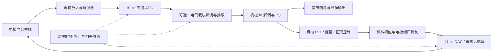

# AD9215 / AD9707、全角电极拓扑与 180 nm 电路指标调研

日期：2026-10-21。用户补充实物型号：ADC AD9215BCPZ（速度后缀未提供），DAC AD9707BCPZRL（已确认 AD9707 为 14 位；完整包装后缀待核）。本报告区分“附件规格”“公开文献/专利”“计算”“待测/建议”，不把建议参数当作既有实测或赛峰产品规格。

## 1. 先行结论

1. AD9215 是 10 位流水线 ADC，AD9707 是 14 位分段电流舵 DAC。现有模型 18 位 ADC、16 位 DAC 和 40 kS/s 有效采样合同不是这套器件的物理接口模型。
2. AD9215 附件给出的最低转换速率为 5 MSPS，最高为相应等级的 65/80/105 MSPS。BCPZ 本身不能确定速度等级。40 kS/s 可以是高速解调/抽取后的速率，不能直接用作本器件保证性能范围内的 ADC 时钟。
3. 实际需要多快不能从全角原理单独确定：还取决于电容读出是否有高频载波、是否双频/时分读出，以及最大角速率、动态频率和误差指标。ADC 芯片上限不是系统实际带宽。
4. “八物理电极→四对电气连接＋一个公共/偏置节点”存在合理拓扑，但五个引脚/节点、五个几何电极和八组电极是不同概念。公开文献只能支持具体实例，尚不能确认用户所述赛峰产品的精确引脚与器件清单。
5. 不采用激光修调并不等于不能做 R-2R；需要讨论分段、匹配、数字/电校准及目标线性度。电流舵也需要控制失配、码型毛刺、输出阻抗和低频噪声。ΣΔ＋少位 R-2R 并不会自动消除 DAC 元件非线性。
6. 当前数字滤波和控制延迟比 ADC/DAC 本体延迟更值得优先审计。独立预算算得现有 CIC＋FIR＋三拍命令约 6.4625 ms；它不是完整相位裕度结论，但已经否定“换高速转换器即可获得高速闭环”的简单推断。

## 2. 附件确认的器件事实

以下页码采用用户附件 PDF 页序。附件原字节复制到 evidence，SHA-256 见 user_sources.json；未修改源文件。

| 项目 | AD9215，Rev. B | AD9707，附件 Rev. D |
|---|---|---|
| 架构 | 差分 SHA＋流水线开关电容 ADC；级间冗余/数字纠错（p.1、14） | 分段 PMOS 电流源阵列与差分开关（p.4、30） |
| 位数 | 10 bit | 14 bit；同系列 04/05/06 分别为 8/10/12 bit |
| 物理速率 | 最低 5 MSPS；最高 65/80/105 MSPS，随速度等级（p.5） | 最大 175 MSPS（p.6）；实际运行时钟未知 |
| 输入/输出 | 1 或 2 Vpp 差分跨度，常用共模约 AVDD/2；非直接接高压电极（p.3、14） | 互补电流输出；满量程可设 1–5 mA，常用 2 mA；输出顺从电压需按负载/供电核对（p.5、35–36） |
| 动态表现 | 2.4 MHz 输入典型 SNR 58.5–59 dB、ENOB 约 9.3–9.6，随等级和条件（p.4） | 首页给 AD9707 在 5 MHz 输出下 84 dBc SFDR；不是所有频点、码幅、负载的保证 |
| 时序 | 5 个 ADC 时钟流水延迟；另有约 4.8 ns 典型输出传播延迟，孔径抖动典型 0.5 ps（p.5） | 典型传播延迟 4 ns；建立时间 11 ns 是达到 0.1%，不是达到 14-bit 半 LSB；deskew 可增加一拍（p.6、36） |
| 校准与参考 | 参考电压和温漂、输入驱动建立需建模 | 自校准用于改善静态非线性；约 4500 个校准时钟，时钟需低于 10 MHz；检查完成位，不只固定等待（p.38–39） |

AD9707 内部五个 MSB 为 31 个等电流单元，中间四位为 15 个较小等电流单元，LSB 用二进制加权电流源；p.30 明确解释使用电流源而非 R-2R 有利于动态性能。它已经是“分段＋校准”路线的实际参照，不是未经校准的理想 14 位 DAC。

ADI 当前官网提供该 DAC 家族 Rev. G；本轮数值按用户附件 Rev. D 逐项定位，最终设计冻结应再核新版修订差异。[S01–S03]

## 3. 必须区分的六种频率/速率

| 符号 | 含义 | 当前掌握程度 |
|---|---|---|
| f0 | 谐振子的机械载频 | 模型假设 5 kHz，真实表头待测 |
| fc1、fc2 | 电容检测的电气载波 | 是否存在、频率及合成方式均未确认 |
| Fs_ADC、Fs_DAC | 器件采样/更新时钟 | 器件额定范围已知，板上运行值未知 |
| Fs_IQ、Fs_ctrl、Fs_nav | 各级抽取、控制和导航输出速率 | 原模型主要为 40 kS/s→1 kHz，不能等同 Fs_ADC |
| Ωmax | 能测的最大输入角速度，°/s | 尚无实测；用 100/1000/10000 °/s 作预算扫描 |
| BΩ、Bloop | 真实运动带宽和各闭环带宽，Hz | 需要分开制定；不能因为运动需 100 Hz 就把所有环设 100 Hz |

### 3.1 从全角原理可以推到什么

对理想二阶工作模态，驻波几何角满足 |θ̇|≈κ|Ω|；检测包络主要含 cos(2θ)、sin(2θ)，R/S 不变量含 cos(4θ)、sin(4θ)。κ 取当前模型的 0.277，作为假设而非表头标定值。

若 Ω 用 °/s，则匀速时：

\[
f_{IQ}=\frac{\kappa |\Omega|}{180},\qquad f_{RS}=\frac{\kappa |\Omega|}{90}.
\]

| 输入角速率 | I/Q 的驻波方向调制频率 | R/S 的方向调制频率 |
|---:|---:|---:|
| 100 °/s | 0.1539 Hz | 0.3078 Hz |
| 1000 °/s | 1.5389 Hz | 3.0778 Hz |
| 10000 °/s | 15.3889 Hz | 30.7778 Hz |

因此高角速率不直接要求 100 MSPS；电气载波和抗混叠/噪声预算才可能使高速 ADC 成为必要。时变运动会产生更多侧带，不能用匀速表替代动态带宽验证。

若暂定运动带宽 BΩ=100 Hz、Ωmax=10000 °/s，可用 BΩ＋上述方向调制频率作为初步侧带预算量级（I/Q 约 115 Hz、R/S 约 131 Hz），但这不是任意运动严格带限证明；应依据实际轨迹、调制指数及容许截断能量检查频谱。角加速度/冲击和探针另留余量。

单拍四倍角展开的理想条件为 4κ|Ω|/Fs_nav<180°，故 1 kHz、κ=.277 时理想混叠上限约 1.62×10^5 °/s；现有 0.8π 门限使其更低。这个数学上限完全不能当真实量程，还受信噪比、带宽、执行器、寄生和数值失效限制。

高 Q 不意味着全角运动带宽只能是 f0/Q：对 f0=5 kHz、Q=2×10^6，机械共振全宽约 .0025 Hz，幅度衰减时间常数 Q/(πf0)≈127 s；这是能量存储和径向响应特性，不等于自由进动角的运动带宽。

### 3.2 两套前端路线，暂不能只选一套

**A：ADC 前已得到约 f0 的振动信号。** fmax 由 f0 与侧带决定。Nyquist 下限约两倍最高模拟频率；出于滤波和相位余量，自研 ADC 可以先扫描 0.1–1 MSPS，并比较 SAR/循环与 pipeline 的面积和能耗。若仍使用 AD9215，必须遵守其至少 5 MSPS，再数字降速，不能将芯片降到 40 kS/s 假装等效。

**B：ADC 直接采电气载波调制信号。** 读出链可能含 fc±f0±侧带，并需第一次载波解调和第二次机械解调。若仅作示例，fc1=.5 MHz、fc2=1 MHz，则最高主要频率约 1.005 MHz；Fs=5–20 MSPS 是有意义的首轮扫描，10 MSPS 可作为研究工作点。载波达到数 MHz 或通道复用后要求更快建立，则必须重新预算。示例频率不是已查明的实际电路值。

公开专利 CN116576841B 给出双频载波、公共极板读出、高速 ADC、载波解调后得到机械振动信号，再用 PLL 解调慢变量的链路，且把高速载波 DAC 和低速控制 DAC 分开。这证明需要保留两级解调分支，不能据此断定用户板卡与其完全相同。[S08]



图中的时钟 PLL 与机械 PLL 是不同模块；高压偏置及可选电气载波注入还需按实际拓扑加入，不可用同一电压节点一概替代。

## 4. 电极数和五端方案

### 4.1 正确的计数层级

- 物理电极扇区数量：例如 8 块。
- 对径连接后的独立电气端口：例如 4 对。
- 公共谐振壳/极化节点：可能另有 1 个。
- 外部针脚：还可能包含屏蔽/地/测试端，针脚数不等于电极数。
- 独立 ADC/DAC 数：取决于是否复用、驱动和读出如何分工，不等于物理电极数。

因而“8 块→4 对＋公共端＝5 个主要连接节点”是一个可能解释；应称八个扇区/四对，而不是自动称“八组”。若真的有八组对称电极，则可能是十六个物理扇区，需要另行画图。

CN112506040A 明确描述八电极对径成四对，标为 0°、45° 驱动与 90°、135°检测，并给出驱动/检测时分工作与松弛时间。这是哈工程专利实例，不是赛峰 BOM 或所有 HRG 的通用接线。[S07]

### 4.2 “共模”的准确含义

理想 n=2 位移 u(α)=qx cos(2α)+qy sin(2α)，故 u(α+π)=u(α)。对径电极在该模态下同相，电气并联可使该模态信号相加；α+π/2 的同模态分量反相，不能把这两种配对混淆。

这不意味着它们在所有意义上都是可忽略的共模：并联增大总电容和寄生，噪声相关性、装配不对称、其他模态、馈通、引线阻抗和切换电荷均需保留。理想模态耦合等效不等于检测电路线性度和噪声等效。

建议用两模态×端口的几何矩阵和显式端口映射建模，并分别提供 8 独立电极、4 对并联、公共极板载波读出、TDM 四种连接。当前独立预算脚本已计算理想 n=2 两种矩阵并测试其关系，尚未完成电容寄生网络或高压时域仿真。

### 4.3 高压的作用不能混为一谈

静电广义力可写为 F_i=.5(∂C_i/∂q)[Vb−v_i(t)]²。它包含偏置、与小信号成正比项、平方项及刚度变化。Vb 的具体连接、f0 直接驱动或 2f0 参数激励会改变所需 DAC 波形和链路。

普通 180 nm 核心/3.3 V 器件不能直接推定具有高压耐压。偏置电源、高压缓冲/隔离和信号注入应单列；是否采用 HV/BCD 选件由 PDK 和实际电压决定。没有间隙、面积、质量、振幅和拉入分析前，不填一个任意高压值作为设计指标。

### 4.4 关于赛峰的证据边界

公开赛峰/Sagem 资料和专利支持平面电极、进动控制及误差补偿等技术脉络；本轮没有取得能同时证明“该产品用 AD9215＋AD9707、五端接线和实际时钟”的官方 BOM/原理图。将这些先作为用户提供的工程线索，而非本次已独立证实的厂商事实。专利也不能证明某个量产产品一定采用其中每项实施例。[S09、S10]

## 5. 模块指标建议表（首轮预算，不是验收定值）

统一示例条件：f0=5 kHz、κ=.277、Ωmax=10000 °/s、BΩ=100 Hz；仅用于覆盖设计场景。若真实任务低于此范围，可显著缩减功耗和速度，若载波更高则相反。

| 模块 | 需要约束的指标 | 当前建议/推导方式 | 必须待测或补证 |
|---|---|---|---|
| 谐振器 | f0/Q、频差、振幅、Bryan、温漂 | 沿用模型假设开展敏感性扫描，避免当实测 | 实际表头参数及其温变 |
| 电容/电荷放大器 | C0、寄生、dC/dq、输入噪声、线性、载波馈通、输入范围 | 直接读出需覆盖 f0 侧带；载波读出需覆盖最高 fc±f0 及侧带；按总电容/噪声增益设计 | 无 C0、灵敏度和 AFE 增益，不能负责任地定 nV/√Hz 或 GBW 单值 |
| 抗混叠与 ADC 驱动 | 通带幅相、阻带、建立、输入共模、负载 kickback | 由输入频段、Fs 与允许折叠噪声积分反推；不能只加一个截止频率参数 | 实际驱动器与外界阻带干扰 |
| 现用 ADC | 10 bit、≥5 MSPS、5 拍延迟、SNR/INL/温漂 | 以 10 MSPS 示例点建模；真实载频下测 SNDR/噪声谱，不能直接照搬 2.4 MHz 测试值 | 速度后缀、时钟、满量程、通道数 |
| 自研 ADC | 位数、采样、SNDR、SFDR、INL/DNL、功耗和延迟 | 若 MHz 载波存在，先比较 10–12 bit、5–20 MSPS；约 56–60 dB SNDR、70–80 dBc SFDR 可作参照扫描，不是实测承诺 | PDK、误差预算及 10 bit 是否已够用 |
| 时钟 PLL/分配 | 相噪、积分抖动、通道偏斜、占空比、杂散 | 由最高模拟载频和分配噪声预算反推；所有 ADC/DAC/数字参考尽量同源相干 | 时钟树和相关抖动，不把独立 RSS 假设泛化 |
| 载波 DDS/DDC | 频率间隔、SFDR、相位对齐、镜像与抽取混叠 | 先支持有/无电气载波两种链路；每级保留采样时刻和总延迟 | fc1/fc2、是否时分/双频 |
| 机械 PLL | 捕获范围、环路自然频率/阻尼、跟踪噪声、相位偏置 | 首轮扫描约 1–30 Hz 的环路量级，捕获与稳态可分；必须结合 Q、增益与实际延迟重新闭环整定 | 机械频漂、失锁恢复和各环耦合 |
| 能量/正交环 | 带宽、相位裕度、起振、限幅、噪声注入 | 可先分别扫描 .5–5 Hz、1–20 Hz 的低带宽量级，非期刊或厂商要求；不能直接令全部环＝100 Hz | 电压→控制力增益、Q 与执行延迟 |
| I/Q 与导航链 | 通带平坦度、群延迟、输出率、角度展开、微分噪声 | 100 Hz 运动目标可先比较 2–10 kS/s 的测角/控制相关速率；导航通带指标和控制环带宽分开 | 实际允许幅相误差和上位机输出需求 |
| 现用高速 DAC | 14 bit、时钟、顺从电压、SFDR、低频噪声、deskew、毛刺 | 10–20 MSPS 可作 fc≤1 MHz 的示例工作点；实际最大 175 MSPS 不表示必须用满 | 负载、输出幅度、I/V 与后级驱动 |
| 自研高速 DAC | 分段电流舵、单元匹配、输出阻抗、开关偏斜、校准、1/f | 先做 12–14 bit、5–20 MSPS 场景对比；INL≈1 LSB、应用频带 SFDR≈80 dBc 等是待论证目标 | 面积/功耗、温度和校准可实现性 |
| 慢包络/偏置 DAC | 带宽、低频噪声、单调、漂移、滤波延迟 | 可独立比较少位 ΣΔ＋校准 R-2R/电流单元；不要直接承接 MHz 波形任务 | 实际输出是否为包络而非载波 |
| DAC 输出/高压驱动 | I/V、重构滤波、幅相、SR、负载、稳定性、偏置噪声 | SR≥2π fmax Vpk 仅为正弦最低要求；另验负载下建立和失真；低压 DAC 与高压偏置分开 | 载波幅度、Cload、HV 规格 |
| 基准/供电 | 带内噪声、漂移、PSRR、数字串扰 | 分别向幅值、相位、测角和静电力传播；不能只看 ppm/°C | 最终 ARW/BI 与温度指标 |

环路建议范围只是仿真扫描起点。独立脚本中的二阶 PLL 使用自然频率参数，不能把它直接当成 −3 dB 带宽，也不能代替含机械 plant 和多环耦合的实际 DPLL。

## 6. 必须体现在模型中的带宽、延迟与噪声

### 6.1 ADC 与数字采样

- ADC 模块按真实 10 位编码与输入跨度量化；内部可以扩到 18/24/32 位运算，但扩位不增加模拟分辨率。
- 采样孔径、5 拍 pipeline、接口传输分别记账，避免把数据可用时刻错当采样时刻。Fs=10 MSPS 时 5 拍为 .5 μs；这在 1 MHz 信号上是 180°，在 5 kHz 上为 .9°，相干解调参考必须相应对齐。
- ADC 白噪声、1/f、INL/DNL、参考漂移、通道幅相和采样抖动分开。理想量化器不足以代表附加噪声。
- 10 MSPS→100 Hz 的理想白噪声处理增益为 10log10(Fs/(2B))≈46.99 dB；这不会自动改善非线性、相干杂散、低频噪声或得到一颗“18 位 ADC”。

### 6.2 两类 PLL 必须分开

时钟 PLL 用相位噪声传递和积分抖动描述；机械 DPLL 用谐振相位观测、执行路径和控制器描述。ADC 选型不能用机械 PLL 的 Hz 带宽替代采样时钟的相噪预算。

抖动限制的一阶正弦关系：SNRj=−20log10(2π fin σt)。fin 是 ADC 实际看到的模拟频率，不是抽取后运动带宽，也不是自动等于 Fs。

若给抖动单独分配 80 dB 的预算，则 fin=5 kHz 可容约 3.18 ns，而 fin=1 MHz 约 15.9 ps；它们是预算例子，不是 AD9215 全链路已经达到 80 dB。若要求两通道在 1 MHz 的残余相位差低于 .01°，对应约 27.8 ps 延时差；可以靠固定延迟校准放宽硬件绝对匹配，但须检查温漂和非固定误差。

一套规范的时钟模型还需保存相噪积分上下限、参考/VCO 噪声路径、PLL 杂散、随机与相关抖动；独立脚本只包含标准二阶路径和标量抖动预算，未实现完整 PLL 相噪仿真。

### 6.3 DAC 与静电驱动

- 真实 14 位码型、分段失配、静态查表、毛刺、输出阻抗、参考、零阶保持和重构滤波必须分别描述。
- ZOH 的幅相为 sinc(πf/Fs)·exp(−jπf/Fs)；提高时钟可减小保持失真，但不能消除单元失配和 1/f。
- AD9707 的 11 ns/0.1% 不能充当 14 位半 LSB 建立保证。SPI 是配置/校准接口，波形数据走并行口，不能用 SPI 时钟当采样更新率。
- 模型中的 E/Q/虚拟进动控制量不是天然对应 3 颗物理 DAC；应先经 θ 与机械相位调制，映射成实际端口电压/电流。载波 DAC、机械波形 DAC、包络 DAC、高压偏置可能是不同链路。
- 将滤波后的电压带入 (Vb−vi)² 再计算控制力，保留非线性和噪声混频；尤其要检查 ΣΔ 带外噪声的平方、互调、混叠和前端馈通。

### 6.4 已完成的独立预算模型与当前限制

`bandwidth_budget.py`＋`provisional_spec.json` 已显式计算：

- 实际 ADC/DAC 位数、AD9215 最低时钟约束、pipeline 延迟。
- DAC ZOH、假设 AFE/重构极点和 RF 频率响应；假设极点只是例子，不是完成抗混叠设计。
- CIC、FIR、控制命令延迟、导航一阶低通响应。
- 两模态电极矩阵、恒角速率包络、抖动和偏斜预算、规范二阶 PLL 噪声路径。

**未完成**：接入既有完整 MATLAB/RTL、真实电容/高压时域模型、非均匀采样/实际 alias 时域验证、实际闭环稳定裕度和误差实测。因此不能将本预算称为已完成真实混合信号系统仿真。

当前基线只算可明确的部分：

\[
\tau_{CIC}=3(40-1)/(2\cdot40000)=1.4625\,ms,
\quad\tau_{FIR}=2/1000=2\,ms,
\quad\tau_{cmd}=3/1000=3\,ms.
\]

合计 6.4625 ms，100 Hz 下约 232.65°；若只给这部分延迟分配 30° 相位损失，交越频率约需低于 12.9 Hz。此处没有计入 ZOH/额外模拟滤波/控制器/机械 plant，不可把“30° 延迟分配”写成“30° 相位裕度”。

45 Hz 导航低通会明显衰减 100 Hz 运动；连续一阶近似约 −7.7 dB，脚本另给当前离散一阶响应。更改控制率到 5 kHz、抽取比到 8 且其余结构相同时，已知部分延迟约 1.2625 ms；这只是候选预算，需要重整定和完整回归，并非已验收硬件配置。

## 7. 180 nm 架构选择

### 7.1 ADC：pipeline 可行，但先定信号链

MHz 载波、10–12 位、数至数十 MSPS 的任务适合把 pipeline 纳入首选；AD9215 的结构就是实例。首级 SHA/MDAC 建立、有限增益、开关非线性、参考驱动、电容匹配、比较器冗余和时序不可省略。若真实需求只是约 5 kHz 振动信号的中低速采集，应公平比较 SAR/循环，不能仅因为已有器件是 pipeline 就认定自研也必须如此。

作为建立预算示例：10 位 full-scale step，要单极点残差低于半 LSB，有 exp(−t/τ)<2^−11。若只分配 30 ns 线性建立，闭环带宽约需 >40.5 MHz；β=.5 时理想单极点 GBW 约 >81 MHz。实际还要分配压摆、其他极点、增益和失配误差，且首级残差精度需按具体 pipeline 级位数推导。不能把这个例数直接当所有运放的统一规格。

公开 0.18 μm pipeline 设计论文支持工艺可行性，但本轮读到的 2019 AEU 和 2017 IET 工作主要提供设计/仿真证据，不能把它们写成经过硅测量的功耗标杆。[S12、S13]

### 7.2 DAC：优先比较分段电流舵，R-2R 保留校准分支

| 方案 | 适合本任务的部分 | 关键困难与验证 |
|---|---|---|
| 分段电流舵 | MHz 载波和低延迟机械波形，接近 AD9707 结构 | 单元失配/梯度、输出阻抗、码型毛刺、参考/1/f、时序、合规电压；前景/后台校准和 DEM 均需测副作用 |
| 全精度 R-2R | 可用于较低速高精度电压路径或有电校准的方案 | 比值匹配、开关导通、寄生、主进位毛刺；不依赖激光可以研究数字/电修调，但其复杂度和噪声须预算 |
| ΣΔ＋少位 R-2R/电流单元 | 慢包络/偏置及较低带宽重构，数字占比高 | 多位单元失配误差不自动被调制器噪声整形，需校准/元素匹配方法；带外噪声、空闲音、滤波延迟、静电平方混频 |

若输出仅为 5 kHz 附近波形，2 MHz 调制时钟相对约 5.1 kHz 通带可有约 195 的 OSR；若要直接合成 1 MHz 波形，10 MHz 低通 ΣΔ 的 OSR 仅约 5，不能拿音频 DAC 的分辨率类比。也可采用包络与载波分开的混合链路，但这将改变通道数和模拟混频架构。

“不能激光修调，所以 R-2R 不可实现”过于绝对。TI 的 R-2R 修调讨论指出电阻失配是 INL 主因；2020 AEU 有 0.18 μm R-2R 电流舵电校准仿真，说明存在替代研究路径，但不能据此保证良率或认定可以无校准达到 14 bit。[S14、S15]

电流舵在 180 nm 的可行性有更直接实物例子：2006 A-SSCC 官方会议摘要公开了 0.18 μm、14 bit、200 MHz 开关序列校准原型及测试；这证明可行性，不代表本项目能照搬其面积/能耗或已完成相同校准。[S16]

## 8. 平台检索与论坛结论

### WoS 实际站内检索

本轮在已登录核心合集 Topic 执行：

`(gyroscop* OR gyro) AND ("whole angle" OR "whole-angle" OR "rate integrating" OR "rate-integrating") AND (circuit* OR electronic* OR interface OR electrode* OR bandwidth OR sampling)`

得到 **93 条**，开放获取筛选计数 **16**；页面显示 Article 61、Proceeding Paper 32。只核对可见结果，不声称已导出/阅读全文 93 条。前三条包括：

- A Universal Electronics Approach for Rate Integrating Gyroscopes，2017，WOS:000403208300034；IEEE 对应 7935687。
- Foucault pendulum on a chip，2012，WOS:000302454900010。
- Control Scheme and Error Suppression Method for Micro Rate Integrating Gyroscopes，2016，WOS:000393179500417。

会话 URL：https://www.webofscience.com/wos/woscc/summary/34ac85ee-3eed-4938-87d6-6891bce25a5b-01cf79c446/relevance/1 。会话链接可能过期，应保留检索式复跑。

### 万方、IEEE 与中文期刊

万方公开检索取得数字测控电路期刊目录和长寿命 HRG 论文/成果记录，未登录读取全部学位论文。IEEE 定位到 2017 通用电子方案等条目，部分全文页抓取失败；不能据此填其未公开电路参数。中文 2019 全角信号处理和 2023 控制研究另以期刊官网和原资料库对照。平台记录、文献、学位论文与专利分别标记，不混作同一实验层级。

### 公开论坛

- ADI EngineerZone 的 AD9707 低频噪声帖有厂商员工答复，指出该器件低于约 100 kHz 时可能受电流舵晶体管 flicker 主导。这对 5 kHz 驱动有直接提示，不能只看高频 SFDR。[S17]
- ADI EngineerZone 的 AD9707 幅度/振铃帖提示先核对电流设定、负载和测试点，说明 DAC 额定速度不能替代输出接口设计。[S18]
- TI E2E 的 R-2R 修调文章用于失配机制和校准思路，不作为本项目性能数据。[S14]
- EDAboard 找到电流舵开关延迟、毛刺及 ΣΔ＋电流舵讨论，仅作为问题线索，未把匿名建议升级为定量指标；EETOP 检索被 robots 限制，电子发烧友组合检索未取得直接可核验命中。未声称覆盖所有论坛或取得受限附件。

## 9. 下一步：先识别真实链路，再冻结指标

1. 核 ADC 速度后缀、两颗器件实际时钟/通道数、DAC 是否 deskew/自校准以及输出范围。
2. 示波器/频谱记录谐振信号、电气载波、ADC 输入和 DAC 输出；核电气载波频率、镜像和 TDM 周期。根据实际看到的频率选择本报告路线 A/B。
3. 给出五个主要连接节点的接线表：物理扇区、对径连接、读出/驱动/偏置/屏蔽、可同时工作或复用；确认高压施加位置。
4. 测 f0/Q、AFE 增益/相位/噪声、输入/寄生电容、驱动增益与负载。转台分别测静态最大速率和正弦运动幅频/相频，不能把一种测量代替另一种。
5. 在独立实验分支接入 10-bit/14-bit 真实量化及延迟、两级解调和端口力映射；保留当前通过的模型/RTL作为行为基线。
6. 再冻结自研 ADC/DAC 的 Fs、SNDR/SFDR、线性、噪声、时序和功耗；然后开展 180 nm 电路设计与数字精度—资源研究。

当前最重要的研究顺序修订是：先建立真实混合信号/多速率合同，再优化数字架构。否则会把 18-bit 理想低速前端优化到很好，却与实际 10-bit 高速采样和 14-bit 波形输出脱节。

## 10. 来源与复现

详细 URL、来源类型和阅读边界见 `sources.json`。附件页图见 `evidence/attachment_pages.png`。本地运行：

```powershell
python bandwidth_budget.py
python -m unittest -v test_bandwidth_budget.py
```

独立预算和测试仅用 Python 标准库；模型/规格、测试、结果和来源纳入 Git。8 项测试覆盖 ADC 最低时钟、ZOH 已知点、CIC 零点、RC 极点、电极对径关系/模态秩、角速率单位、PLL 互补路径和抖动频率定义。未改既有验收源码或门限，未推送远端。
